# 01-历年真题解析_第1-410页

全国计算机技术与软件专业技术资格（水平）考试

2020 年最新版 V15.0

系统集成项目管理工程师

（历年真题&解析 09–19 年）

目录

前言（本书说明）

充分利用学习的 2/8 法则，在用 20%的时间掌握好历年考试的重点之后，剩余的时间去加强巩固，掌握一些重点之外可能出题的内容，利用睡觉前、周末等 休息时间，加强对知识点的强化记忆；力求在考试的时候看到题目就做到条件反射，迅速选出正确答案；

## 第一章、系统集成项目管理工程师考试命题规律和学习方法

系统集成项目管理工程师考试，作为软考下面的一个中级科目，自 2009 年举办至今，每年 2 次， 已历经 22 次考试。考试范围及考查重点已日渐清晰。

（一）系统集成项目管理工程师考试分为两场科目，每科总分均为 75 分， 2 科均到达 45 分以 上为合格， 只要有一门没有达到 45 分， 下次必须重考！上午为 75 道选择题，每题 1 分，为单选 题，考试时间为 150 分钟；下午科目 I 为 4 道案例分析试题，总分 75 分， 考试时间为 150 分钟；

（二）严肃的执业资格考试，尤其是标准化考试，为确保命题客观、答案确定唯一，每一道 题必定应以指定教材上的具体论述为依据。。

（三）此考试一个最大的特点就是杂而不深，虽然内容考的非常多，涉及的面非常广（有计 算机知识、相关技术标准、法律法规、项目管理、英语知识等），考察的深度并不深，

（1）历年真题，2009 年以来的22套真题

## 第二章、考试的解题技巧

信息系统项目管理领域具有软、硬件渗透及学科交叉等特点，决定了考试大纲涉及的内容较 多、知识面较广，对其中任何一个知识模块的考点，都可能系统地写成一本书。计算机专业技术 资格考试中中级资格考试是一个难度比较大的考试，其命题风格及知识点的考核形式比较灵活， 不仅注重考核内容的广一度，而且还注重其考查的深度。因此，考生在备考复习过程中，切不可 死记硬背知识点，要依据考试大纲，采用提纲式地做笔记来准备考试，在掌握历年的高频考点和 一般考点后，考试中还可能会涉及一些超纲的题目或者自己没有复习到的一些知识，在此考生需 要掌握一些常见的答题技巧就尤为重要了；下面列举了部分的解题技巧， 希望大家认真领会；

案例分析： 九招必胜：

（1）条理答题是必须

（2）多答不扣是要点

（3）专业术语得分点

（4）学会看题给分法（及 5 分的题你最少需要答 5 条。才有可能全得分）

（5）遇到答错莫着急，接着往下继续写，千万不要去涂抹

（6）遇到难题不要怕，总有适合自己的（遇到不会的不要紧张，接着往下做）

（7）字迹清楚是关键

（8）不怕写多就怕少

（9）学会先看问题在看题

一.关于概念定义，选择选项中答案最长

原因：既然是概念定义用来描述定义的句子，尽可能长些，把问题描述清楚、范围限制清楚，说话严谨

试题举例：

1、建筑物综合布线系统中的水平子系统是指（1）

（1）A.各个楼层接线间配线架到工作区信息插座之间所安装的线缆

B. 由终端到信息插座之间的连线系统

C.各楼层设备之间的互连系统

D.连接各个建筑物通信。

二.说话太绝对如句子里含有“只能”，“仅仅”不要选择

原因：不要把话说死，说满，这不光是做人的基本原则，也是答题的原则。

2、嗅探器是一种网络故障分析与排查的工具，当其处于杂收模式时，网络接口（2）

A.能够接收流经网络接口的所有数据恢

B.只能接收本网段的广播数据恢

C.只能接收该接口所属组播组的组播信息

D.只能接收发往该接口的数据恢

三.涉及到某项技术的发展，请选择最大的一个选项，或者选择最小一个选项， 核心都得突出技术发展之快。

原因：这类考题，选择容量大，数字最大的，或者体积最小，都是为了体现科技发展的日新 月异， 一日千里，发展太快了，给人类生活带来极大的便利，超出了人类的想象。

题目有着她的社会意义和科技意义。

试题举例

3 、Blu-ray 光盘使用蓝色激光技术实现数据存取，其单层数据容量达到了（3）

（3）A.4.7GB              B.15GB                  C.17GB                  D.25GB

四.从选项中找跟题干最相近、最有关联的

原因：我们知道，通过人的指纹可以识别一个人；通过一个人的写字笔迹可以分析一个人的 性格特征；通过一个人的脚印可以分析他的高矮胖瘦，年龄、职业等信息；通过人的 DNA 也可以 识别是谁家的亲生孩子。也就是见微知著。 一言以蔽之，就是一个微小信息，可以识别出要选大 答案。

试题举例：

4、（4）标准的目标是制定一个开放的多媒体应用框架标准。

（4）A.H.264              B.MPEG-21            C.XML                    D.X3D

MPEG-21 中 MPEG 正好给多媒体相关。MPEG-4，在数字电视、互联网 等领域有广泛的应用。

五.排除法

原因：根据题目的题干信息进行简单逻辑推理，排除掉不是答案的选项。

六.考题出发思路考题，也就是技术点出发来看待考题，选择跟技术相关的

原因：系统分析师，考点应该是技术，并且是高深一点的技术，不是卖白菜， 别胡扯一些销

售、市场、物流等与技术无关的杂七杂八的话题。也就是排除掉胡扯的选项，如物流、销售、市 场的选择，选择跟技术相关的选项。技术越复杂，越深奧，越要优先考虑选择该项。

试题举例 1：

6、以下关于电子商务的叙述， 正确的是（37）。

A.利用电子商务系统向消费者在线销售产品， 已经超越了传统的零售方式

B.产品的存储、打包、运送和跟踪等， 对组织的成功非常重要，几乎没有制造商或零售商 将这些行为外包

C.SSL 通信协议用于保护电子商务交易中的敏感数据

D.购物车功能是由 Web 服务器软件来实现的

试题分析：

选项 A 讲的消费者行为，也就是销售、市场等话题，跟技术一点也不沾边。

选项 B  讲的是产品的存储、打包、运送和跟踪，也就是产品包装、物流的话题， 跟技术一点 也不沾边。

选项 D    Web 服务器软件， 也讲到是一个软件的问题，随便一个 WWW 网站， 都是 Web 服务 器软件来实现，把电子商务也看得太 Easy 了，太白菜了。没点技术含金量。

只有 C 是是 SSL 通信协议是考技术的， 跟系统分析师这种高级资格考试挂钩。 参考答案：（6） C

试题举例 2：

7、以下关于电子政务的叙述， 正确的是（7）。

（7）A.政务流程的优化，是成功实施电子政务的关键因素

B. 电子政务系统就是政府各部门的办公自动化系统

C. “金关”工程实现了政府的公共服务职能

D.政府各部门的政务电子化， 是政府成功实施政务的关键因素

试题分析： B  办公自动化系统   C  讲政府、讲公共服务职能    D  讲政府电子化

跟技术、项目管理等系统分析师资格考试的考点不相干，都是胡扯。

A  流程是项目管理的一个核心概念。软件工程三要素：工具、方法以及过程。其实流程是过程的 一个更高级的说法， 或者是一个更高版本说法。

参考答案：（7） A

七.知识产权中，提到企业的， 权益优先考虑企业，而不是选择个人

原因：众所周知，中国是先国家、后集体，最后个人。包括我们的地址也是：先是省，再 是市，然后县，接着镇，街道，小区， 门牌号。先是最大的，最后才是个人。

讲知识产权的权益的时候，优先考虑的是企 业，公司，而不是个人。这就是中国文化

试题举例：

8、小张在某企业运作部工作，负责统计经营数据并制作成图表供企业高层参考决策。由于日常工 作中统计数据量大，为便于及时、准确地完成报表， 小张利用下班后的业余时间开发了一个统计 软件，则 （8） 。

（8）A.小张在开发软件的过程中，没有利用企业的物质技术条件，该软件的著作权属于小张

B.该软件的著作权属于企业，因其是小张为完成本职工作而产生的结果 C.按照软件著作权归属的一般原则，该软件的著作权归属于小张

D.该软件没有用于商业目的， 没有著作权的问题

试题分析

题目中，谈到企业， 以及个人小张。根据原则七，先企业，后个人的原则。

哪就选择答案 B 吧！该软件的著作权属于企业，因其是小张为完成本职工作而产生的结果。 参考答案：（8） B

八.关于慨念的叙述，不要选择特肯定， 如“就是”，不要选择带“不”字选项

原因：初中，高中学语文的时候，老师经常反复讲到，不要选择对概念、定义，带不字的描

述的语句，如男人是不是女人的哪一类人。

至于不选择特肯定的，就不多说了。相信生活中，世界里总是有特例。

试题举例：

9、以下关于计算机软件商业秘密的叙述，正确的是（9）。

（9）A.没有完成也没有发表的软件， 其知识内容不构成商业秘密

B.计算机软件的商业秘密， 就是技术秘密， 不含经营秘密

C.构成技术秘密的知识内容，不包括程序设计的技巧和算法

D.开源软件也存在商业秘密问题

试题分析： A 带“不”字     B 带“不”字，还有“就是”字眼     C 带“不”字 所以，排除 A.B.C 选项。

## 第三章、考试大纲和分析

对于上午考试要求大家掌握如下知识点：

（1）掌握计算机软件与信息系统集成知识；

（2）掌握信息系统集成项目管理知识、方法和工具；

（3）熟悉信息化知识；

（4）熟悉信息安全知识与安全管理体系；

（5）熟悉系统集成有关的法律法规、标准规范；

（6）熟悉系统集成项目管理工程师职业道德要求；

（7）了解信息系统工程监理知识；

（8）了解信息系统服务管理、 ISO9000、软件过程改进等相关体系；

（9）熟练阅读和正确理解相关领域的英文资料。

2012 年 11 月开始， 案例第一次只有 4 个题目。这使得众多考生拿到试卷后大呼惊讶， 另外， 中级的案例一直较偏， 每次考试都有 2 个左右案例题不属于 10 大管理的范畴， 比如涉及到合同管 理、配置管理等，还有很多需要死记硬背的东西。还有一个因素导致了本科目的通过率低：考生 比较年轻，心态不好，不爱学习，事情比较多，说个真心话，这个考试有什么难的？知识点很清 楚，当然， 知识点比较多，需要花精力。

对于系统集成项目管理工程师考试而言，无非就是项目管理知识+计算机知识， 真心话， 这个 考试几乎没有什么难懂的地方，我能给大家的主要是考试重点考点，考试资料，是一种思想，是 一种方法、 一种氛围了。大家在学习的时候不要就题而论题，把这道题会做了，仅仅会做这题而 已，下次这个考点变了个模样就不认识了， 所以我建议大家在做题的时候不要纠结与答案是什么？ 而是要通过题目去熟悉“考点”和“题型”，会做到举一反三， 掌握方法记忆， 当然朱建军老师在 授课的时候也遵循 “授之以鱼，不如授之以渔”

杂而不深。主要有： 计算机软件知识、计算机网 络知识、 IT 新技术、信息系统安全知识、机房工程知识、综合布线知识、法律法规标准规范、10大管理知识、其他知识领域、应用知识等。

对于案例分析案例对中级来说应该算是个难点，从最近几年的命题趋势来了，案例分析越来 越难，大家一定要有会忽悠的技术，结合平时生活经验去答题，也需要学好基础知识，对于每个 管理的过程都必须学会。在拿到一个案例后（非计算），你要知道， 这是考什么？？确定了这个题 目所考察的管理，就要想想，这个管理有哪几个过程；然后，题目中一般会问你该案例中有什么 问题，你应该怎么解决， 那么你就按照这几个过程， 一个一个去对案例中的现象， .另外，可能要 和别的管理有一些联系，这都可以写上，大家记住， 多写，只要不错，不扣分，但是一定要有采 分点，也别写了很多，人家最后只给你一点辛苦分， 这样也不好。很多人怕案例，但是只要你努 力，问题不大。 下午案例必考计算题，无非就是成本和进度 ：大块的，这部分是送分的，考生千 万不可在此地方丢分，丢分挂的几率就很大了

## 第四章、历年考点分值分布和命题趋势预测

不可本末倒置，缘木求鱼

“重者恒重， 轻者恒轻 ”，大家需 要充分利用学习的 2/8 法则，在用 20%的时间掌握历年的考试重点后，花更多的时间去掌握重点 和看一些非重点但是有可能出题的地方！把历年考试的重点掌握了，加上您对部分可能考的重点 的学习，那么你通过考试绝对没有问题；

下面列举了 2009 年-2019 年 22 次系统集成项目管理工程师考点分布以及 2020 年考试预测， 其实大家也可以根据历年的出题规律进行相关猜测！ 只要历年出题多达 2 次以及以上者，均需要 认真学习，有些知识点，年年考，次次考，那么我们是必须要掌握的，比如数据库和数据仓库、软件开发的方法、项目成本的类型、质量控制的工具和技术、软件文档管理指南、质量特性、软 件测试、计算机网络等； 一些非重点大家也尽量涉足！

## 第五章、信息化基础知识

### 重要考点 1、信息相关概念

1、香农（信息论的奠基人） 对信息的定义： 是有别与物质与能量的第三种东西，是对事物运动状态或存在方式的不确定性的描述。（15 下 1）

2、信息是按特定方式组织在一起的客体属性的集合，它具有超出这些客体属性本身之外的价值。（16 上 1）

3、信息的概念存在两个基本的层次， 即本体论层次和认识论层次。前者是纯客观的层次， 只 与客体本身的因素有关，与主体的因素无关；后者则是从主体立场来考察的信息层次，既与客体 因素有关， 也与主体因素有关。

‘ 、信息技术主要为解决信息的采集、加工、存储、传输、处理、计算、转换、表现等问题而 不断繁荣发展。 传输技术（通常指通信、网络等）是信息技术的核心

### 5、信息的传输模型：

①信源：产生信息的实体，信息产生后，由这个实体向外传播。

②信宿：信息的归宿或接受者

③信道：传送信息的通道，如 TCP/IP 网络。（18 上 1）

④编码器： 如量化器、压缩编码器、调制器等

⑤译码器：包括解调器、译码器、数模转换器等。（19 上 1）

⑥噪声（干扰）包括信道中的噪声及分散在通信系统中的其他噪声的集中表示。真实世界中 是无处不在的，而为了抵抗噪音带来的失真，使用了编码、译码手段。（16 下 1）（18 上 1）

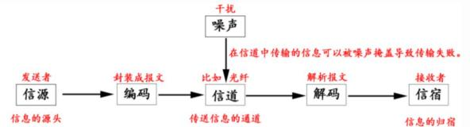

6、信息反映的是事物或者事件确定的状态，具有客观性、普遍性特点。（17 下 1）  ’、信息的质量属性

（1）精确性，对事物状态描述的精准程度。

（2）完整性，对事物状态描述的全面程度，完整信息应包括所有重要事实。

（3）可靠性，指信息的来源、采集方法、传输过程是可以信任的，符合预期。

（4）及时性，指获得信息的时刻与事件发生时刻的间隔长短。昨天的天气信息不论怎样精确、 完整，对指导明天的穿衣并无帮助，从这个角度出发，这个信息的价值为零。

（5）经济性，指信息获取、传输带来的成本在可以接受的范围之内。

（6）可验证性，指信息的主要质量属性可以被证实或者证伪的程度。（17 上 1）

（7）安全性， 指在信息的生命周期中，信息可以被非授权访问的可能性， 可能性越低， 安全性越高。

8、信息系统特点：①目的性；②可嵌套性；③稳定性；④开放性；⑤脆弱性；⑥健壮性。

（1）目的性： 定义一个系统、组成一个系统或者抽象出一个系统， 都有明确的目标或者目的。 （2）可嵌套性：系统可以包括若干子系统，系统之间也能够糯合成一个更大的系统。

（3）稳定性：受规则的约束， 系统的内部结构和秩序应是可以预见的；

（4）开放性：系统的开放性是指系统的可访问性。这个特性决定了系统可以被外部环境识别， 外部环境或者其他系统可以按照预定的方法，使用系统的功能或者影响系统的行为。（19 下 1）

（5）脆弱性：这个特性与系统的稳定性相对应， 即系统可能存在着丧失结构、功能、秩序的 特性，这个特性往往是隐藏不易被外界感知的。

（6）健壮性：当系统面临干扰、输入错误、入侵等因素时， 系统可能会出现非预期的状态而 丧失原有功能、出现错误甚至表现出破坏功能。

9、信息系统是一种以处理信息为目的的专门的系统类型。信息系统可以是手工的， 也可以是 计算机化的，本书中讨论的信息系统是计算机化的信息系统。信息系统的组成部件包括硬件、软 件、数据库、网络、存储设备、感知设别、外设、人员以及把数据处理成信息的规程等。

硬件由执行输入、处理和输出行为的计算机设备组成。输入设备包括键盘、自动扫描设备、 语音识别设备等。

软件由管理计算机运行的程序构成。包括设备驱动程序、系统软件、数据库管理系统、中间 件、应用软件等。

数据库是经过机构化、规范化组织后的事实和信息的集合。数据库是信息系统中最有价值和

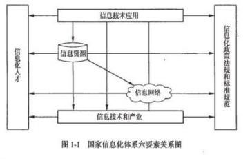

最重要的部分之一。（18 下 1）

10、软件的生命周期通常包括：可行性分析与项目开发计划、需求分析、概要设计、详细设 计、编码、测试、维护等阶段，信息系统生命周期可简化为： ①立项（系统规划）；②开发（系统 分析、系统设计、系统实施、系统验收）③运维；④消亡。开发阶段包括 系统分析、系统设计、系统实施，系统验收

11、信息化从“小”到“大”分层以下5个层次：（1）产品信息化（2）企业信息化（3）产业信息化（4）国民经济信息化（5）社会生活信息化---智慧城市、互联网金融（16 下 4）

12、信息化的核心是要通过全体社会成员的共同努力，使国家的综合实力、社会的文明素质 和人民的生活质量全面提升。（15 上 1）

13、信息化的主体是全体社会成员，包括政府、企业、事业、团体和个人；它的时域是一个 长期的过程；它的空域是政治、经济、文化、军事和社会的一切领域；它的手段是基于现代信息 技术的先进社会生产工具；它的途径是创建信息时代的社会生产力，推动社会生产关系及社会上 层建筑的改革它的 目标是使国家的综合实力、社会的文明素质和人民的生活质量全面提升。（16下 2）（17 下 2）（18 上 1）

14、面向服务的架构（SOA）是一个组件模型，它将应用程序的不同功能单元  （称为服务） 进行拆分，并通过这些服务之间定义良好的接口联系起来。不是应用系统。（19 上 2）

### 重要考点 2、国家信息化体系要素

目前我国的信息化建设处于深入发展阶段。（17 上 3）

信息资源与自然资源、物质资源相比，具有以下 7 个特点：

①能够重复使用，其价值在使用中得到体现；

②信息资源的利用具有很强的目标导向，不同的信息在不同的用户中体现不同的价值； （19 上 3）

③具有广泛性。人们对其检索和利用， 不受时间、空间、语言、地域和行业的制约；

④是社会公共财富， 也是商品，可以被交易或者交换；

⑤具有流动性，通过信息网可以快速传输；

⑥多态性，信息资源可以以数字、文字、图像、声音、视频等多种形态存在；

⑦融合性，整合不同的信息资源并分析、挖掘，可以得到新的知识，取得比分散信息资源更高的价值。

### 重要考点 3、信息化知识

1、信息技术发展趋势和新技术应用主要包括： ①高速度大容量②集成化和平台化③智能化④ 虚拟计算⑤通信技术⑥遥感和传感技术⑦移动智能终端⑧以人为本⑨信息安全⑩两化融合

（1）信息系统集成化和平台化的特点， 使得信息消费更注重良好的用户体验， 而不必关心信 息技术。

（2）以“        ”为标签的各种软硬件应用将为各行各业的各类产品带来“换代式”的飞 跃甚至是“革命”，成为拉动行业产值的主要方向

（3）       是一种资源管理技术， 是将计算机的各种实体资源， 如服务器、网缕、内存及存 储等予以抽象、传换后呈现出来，打破实体结构间的不可切割的障碍便用户可以比原本的组态更 好的方式来应用这些资源。（19 下 2）

（4）               是物联网应用的重要基础， 而物联网应用目前和未来将遍及国民经济和 日常生活的方方面面，成为计算机软件服务行业的应用重点，也是工业和信息化深度融合的关键 技术之一。

是一种无线通信技术，可以通过无线电讯号识别特定目标并读写相 关数据，而无需识别系统与特定目标之间建立机械或者光学接触。

（6）工业化与信息化“两化融合 ”的含义是： 一是指信息化与工业化发展战略的融合； 二是 指信息资源与材料、能源等工业资源的融合；三是指虚拟经济与工业实体经济融合；四是指信息 技术与工业技术、 IT 设备与工业装备的融合。

2、我们不能等工业化完成后才开始信息化或停下工业化只搞信息化， 而是应该抓住网络革命 的机遇，通过信息化促进工业化，通过工业化为信息化打基础，走信息化和工业化并举、融合、

互动、互相促进、共同发展之路。（13 下 4）（18 下 6）

我国企业信息化发展的战略要点： 1） 以信息化带动工业化 2）信息化与企业业务全过程的融 合、渗透 3）信息产业发展与企业信息化良性互动 4）充分发挥政府的引导作用 5） 高度重视信息 安全 6）企业信息化与企业的改组改造和形成现代企业制度有机结合 7）“因地制宜”推进企业信 息化

3、企业信息化的结构包括产品（服务层）、作业层、管理层、决策层（14 上 2）（19 下 3）

4、推进企业信息化发展过程中应遵循以下原则： ①效益原则。②“一把手”原则③中长期与

短期建设相结合原则④规范化和标准化原则⑤以人为本的原则。（14 下 3）

5、“十二五”期间， 电子政务的目标：（14 下 7）（15 上 6） ①电子政务统筹协调发展不断深 化。②应用发展取得重大进展③政府公共服务和管理应用成效明显④电子政务信息共享和业务协 同取得重大突破⑤电子政务技术服务能力明显加强⑥电子政务信息安全保障能力持续提升。

6、《信息化发展规划》中，提出了我国未来信息化发展的指导思想和基本原则。原则①统筹 发展，有序推进②需求牵引，市场导向③完善机制， 创新驱动③加强管理，保障安全。（18 下 3）

7、我国在“十三五”规划纲要中，将培育人工智能、移动智能终端、第五代移动通信（5G）、 先进传感器等作为新一代信息技术产业创新重点发展，拓展新兴产业发展空间。（18 下 2）

8 、推进制造过程智能化。在重点领域试点建设智能工厂/数字化车间，加快人机智能交互、  工业机器人、智能物流管理、增材制造等技术和装备在生产过程中的应用，促进制造工艺的仿真 优化、数字化控制、状态信息实时监测和自适应控制。加快产品全生命周期管理、客户关系管理、 供应链管理系统的推广应用（19 上 6）（19 下 2）

一般考点 4、电子政务

命题重要指数： ...

（需要了解电子政务的定义，掌握电子政府的模式）

1、定义（了解）：电子政务是指政府机构在其管理和服务职能中运用现代信息技术， 实现政府 组织结构和工作流程的重组优化，超越时间、空间和部门分隔的制约，建成一个精简、高效、廉 洁、公平的政府运作模式。电子政务模型可简单概括为两方面： 政府部门内部利用先进的网络信 息技术实现办公自动化、管理信息化、决策科学化；政府部门与社会各界利用网络信息平台充分 进行信息共享与服务、加强群众监督、提高办事效率及促进政务公开，等等。（17 上 4）

（12 下 4）（14 上 4）（14 下 8）（16 上 7）（18 上 4）---理解，需要根据题目进行判断

| 应用模式 | 举例 |
|---|---|
| G2G | 政府间电子公文流转、电子司法档案、电子财政管理及电子统计等 |
| G2B | 网上税务申报、电子证照办理，以及信息咨询服务等 |
| G2C | 教育培训服务、公众就业服务、电子医疗服务、社会保险服务、交通管理服务（例 如网上机动车违章查询）、公众电子税务和电子证件服务等 |
| G2E | 电子政策法规、电子公文流转、电子办公、电子培训、电子财政管理和公务员业绩 评价等 |

2 、ERP 经历了基本 MRP、闭环 MRP、MRPⅡ和 ERP这 4 个阶段

物料需求计划（MRP）：无生产能力控制；

闭环 MRP 增加了生产力与采购。闭环 MRP 能力计划通常是通过报表的形式（直方图是常用 工具）向计划人员报告，但是尚不能进行能力负荷的自动平衡，这个工作由计划人员人工完 成。 CRM 系统能与 ERP 系统在财务、制造、库存等环节进行连接，两者间会形成一定的闭

环反绩结构;（14 上 5）

制造资源计划： MRPII：增加物流与资金流

企业资源计划（ERP）：主要功能：①财会管理②生产控制管理③物流管理④人力资源管理（13 上 4）（特点）：（l）管理范围向整个供应链延伸 ；（10 上 5）

ERP  是开放的系统---任何一个企业都不是孤立存在的，企业的运营必然与供应商、客户和

息，较为突出的是供应链管理和电子商务等方面的信息，纳入 ERP 系统的处理范围。

### 重要考点 6、客户关系管理（CRM）

命题重要指数： ...

（需要掌握 CRM 的核心，3 个要素，功能、应用设计）

1 、CRM 系统要素（重点理解掌握）；（09 下 5）（10 上 5）（10 下 25）（15 下 6）  ①不仅是以客户为中心的信息系统，而是一种市场管理策略。

②注重客户满意度的同时，提升企业获得利润的能力。

③要求企业对业务功能重新设计， 将业务重心转移到客户，对不同客户采取不同的策略。 2、客户数据可以分为描述性 促销性 交易性数据3大类：（12 上 6）（13 上 5）

 描述性性据：是客户的基本信息，如果是个人客户， 一定要涵盖客户的姓名、年龄、ID  和联系 方式等； 如果是企业客户， 一定要涵盖企业的名称、规模、联系人和法人代表等。

 促销性数据：是体现企业曾经为客户提供的产品和服务的历史数据，主要包括用户产品使用 情况调查的数据、促销活动记录数据、客服人员的建议数据和广告数据等。

 交易性数据：是反映客户对企业做出的回绩的数据，包括历史购买记录数据、投诉数据、请 求提供咨询及其他服务的相关数据、客户建议数据等。（18 上 7）

4 、CRM 系统的体系结构： 数据源一ETL一营销数据存储一决策产生一信息渠道。

5 、CRM 系统至少需要包括以下几个比较基本的功能模块：（1）自动化的销售（2）自动化的

市场营销（3）自动化的客户服务（19 上 7）

一般考点 7、供应链管理（SCM）

命题重要指数： .次次

（需要掌握供应链的特征、分类、设计原则，敏捷供应链的特点）

1、供应链系统设计的原则： ①自顶向下和自底向上相结合； ②简洁性原则；③取长补短； ④

动态性原则；⑤合作性原则； ⑥创新性原则；⑦战略性原则；（09 下 2）

2、敏捷供应链：对于市场变化和需求变化怎样快速响应， 生产出满足需求的产品或服务。区 别于一般供应链的特点如下：

①支持跨企业的生产方式重组。

②支持供应链跨企业信息集成调整和重构。

③链中企业可方便地组织调整生产模式。

3、目前企业信息化系统所使用的数据库管理系统的结构， 大多数为关系结构。（09 上 65）

4 、供应链管理是以客户为中心的。整个供应链管理追求的目标， 首先是满足客户的需求。衡 量供应链管理绩效的最重要的指标就是客户满意度。降低供应链的成本、提高供应链的响应速度 等，都要以满足客户需求为前提。（13 上 6）

### 重要考点 8、电子商务

命题重要指数： ...

（需要掌握电子商务的特点、分类，需要能够给出一个例子会判断是哪种类型）

1、电子商务概念可分为原始电子商务与现代电子商务。

1）原始电子商务概念

使用电子信息技术工具进行商务活动。凡使用了诸如电报、电话、广播、电视、传真以及计 算机、计算机网络等手段、工具和技术进行商务活动，都可以称之为电子商务。

2）现代电子商务概念（17 下 6）（19 上 5）

电子商务通常是指在网络环境下， 买卖双方不需见面，实现网上（线上） 交易、在线支付（或 者货到付款）、智能配送以及相关综合服务的一切活动，是完全创新的或者在一定程度上模拟传统 商务流程的一种以信息化手段应用为典型特征的商业运营模式。

可以认为 EDI（电子数据交换） 是连接原始电子商务和现代电子商务的纽带。（19 下 5）

### 2、电子商务应该具有以下基本特征：

（1） 普遍性。电子商务作为一种新型的交易方式，将生产企业、流通企业、消费者以及金融 企业和监管者集成到了数字化的网络经济中。

（2） 便利性。参与电子商务的各方不受地域、环境、交易时间的限制， 能以非常简洁的方式 完成传统上较为繁杂的商务活动。

（3） 整体性。电子商务能够规范事务处理的工作流程，将人工操作和电子信息处理集成为一 个不可分割的整体， 保证交易过程的规范和严谨。

（4） 安全性。与传统的商务活动不同， 电子商务必须采取诸如加密、身份认证、防入侵、数 字签名、防病毒等技术手段确保交易活动的安全性。（18 上 5）

（5）协调性。商务活动本身是一种硅商、协调的过程，客户与企业之间、企业与企业之间、 客户与金融服务部门之间、企业与金融服务部门之间、企业与配送部门之间等需要有序地协作， 共同配合来完成交易。

3、电子商务的基础设施包括四个， 即网络基础设施、多媒体内容和网络出版的基础设施、报 文和信息传播的基础设施、商业服务的基础设施。此外， 技术标准，政策、法律等是电子商 务系统的重要保障和应用环境。---具体内容需要看教材

| 网络 | 信息传输平台、运行 TCP/IP 网络协议、网络接入 |
|---|---|
| 多媒体内容和网络出版 | 负责管理涉及的各种信息，包括文字、语音、图像、视频（16 下 6） |
| 报文和信息传播 | 电子邮件系统、在线交流系统、基于 HTTP 或 HTTPS 的信息传输系统、 流媒体播放系统 |
| 商业服务 | 商品目录和价格目录、电子支付网关、安全认证 |
| 技术标准 | 定义了用户接口、传输协议、信息发布标准、安全协议等技术细节 |
| 政策和法律 | 税收制度、信用管理及收费、隐私问题等由政府制定的规章制度（17 上 5） |

4、电子商务按照交易对象，可以分为企业与企业之间的电子商务（B2B）、商业企业与消费 者之间的电子商务（B2C）、消费者与消费者之间的电子商务、（C2C）以及 020  即 online To  offline,含义是线上购买线下的商品和服务， 实体店提货或者享受服务。；（10 上 6）（10 下 26）

（13 下 5）（19 上 5） ---理解，需要根据题目进行判断

| B2B | 阿里巴巴 |
|---|---|
| B2C | 京东、当当、苏宁 |
| C2C | 淘宝、易趣 |
| 020 | Online To offline（在线离线/线上到线下），是指将线下的商务机会与互联网结合， |

|  | 让互联网成为线下交易的前台。020 的概念非常广泛， 既可涉及到线上， 又可涉及到线下， 可以通称为 020。如淘宝网、京东商场等商业电子商务，APP 手机约车服务， 携程网、途 牛等旅游服务网上团购。（15 上 5）（16 下 7）（18 下 5） |
|---|---|
| B2A | 商业机构对行政机构（Business-to-administrations）指的是企业与政府机构之间进行 的电子商务活动。例如，政府将采购的细节在国际互联网络上公布，通过网上竞价方式 进行招标， 企业也要通过电子的方式进行投标。 |

5、电子商务发展的支撑保障体系： （10 下 27）（了解），命题几率小

1）法律法规体系 2）标准规范体系 3）安全认证体系 4）信用体系 5）在线支付体系 6）现代 物流体系 7）技术装备体系 8）服务体系 9）运行监控体系；

6、 商流、物流、资金流和信息流是流通过程中的四大相关部分， 由这“四流”构成了一个完 整的流通过程，在电子商务中“信息流 ”是必不可少的；（09 上 63）（15 上 2）

7、支付形式： 支付网关，第三方支付，直接支付（直接给钱）；支付宝是第三方支付（12 下 3）

8、电子商务里面涉及到常见的安全协议：SSL（安全套接层协议，传输层之上/传输层与应用

层之间）安全电子交易协议 SET，会话层和应用层（11 上 9）（16 上 23）

一般考点 8、商业智能 BI

命题重要指数： ..次

（需要掌握 BI 的定义、主要功能、层次等）

商业智能包括：数据仓库、联机事务处理、数据挖掘、数据备份恢复

商业智能不是新技术，它只是数据仓库、OLAP 和数据挖掘等技术的综合运用。（15 下 7）

2、商业智能涉及数据量大，运作复杂，要实现数据仓库、 ETL、数据统计、数据分析，计算 量大。（15 上 8）

3、商业智能系统的主要功能：数据仓库、数据 ETL、数据统计输出（报表）、分析功能（17 上 6）

（17 下 8）

④分析功能：可以通过业务规则形成分析内容，并且展示样式丰富，具有一定的交互要求，  例如预警或者趋势分析等。要支持多维度的。LAP,实现维度变化、旋转、数据切片和数据钻取等， 以帮助做出正确的判断和决策。

4、商业智能的实现有三个层次：数据报表、多维数据分析和数据挖掘。数据分析和数据挖掘

技术并不是取代数据报表，报表系统依然有不可取代的优势。（09 下 5）（18 上 8）

5、如果说在线事务处理（OLTP）侧重于对数据库进行增加、修改和删除等日常事务操作， 在线分析处理则侧重于针对宏观问题全面分析数据， 获得有价值的信息。

6、实现商业智能的 6 步骤： ①需求分析； ②数据仓库建模③数据抽取； ④建立商业智能分析

报表；⑤用户培训和数据模拟测试；⑥系统改进和完善。（19 下 6）

7、OLAP 有多种实现方法，根据存储数据的方式不同可以分为 ROLAP （Relational OLAP）、 MOLAP（Multidimensional OLAP）和 HOLAP  （Hybrid OLAP）。

ROLAP 表示基于关系数据库的 OLAP 实现；

MOLAP 表示基于多维数据组织的 OLAP 实现；（19 上 8）

HOLAP 表示基于混合数据组织的 OLAP 实现；

本章历年考题和答案解析汇总：

### 1、国家信息化体系要素

#### 【试题 1】---2009 上真题 2

（1）是国家信息化体系的六大要素。

A.数据库， 国家信息网络， 信息技术应用， 信息技术教育和培训， 信息化人才，信息化政策、 法规和标准

B.信息资源，国家信息网络，信息技术应用，信息技术和产业，信息化人才，信息化政策、法规和标准

C.地理信息系统，国家信息网络，工业与信息化，软件技术与服务，信息化人才， 信息化政 策、法规和标准

D.信息资源， 国家信息网络， 工业与信息化， 信息产业与服务业， 信息化人才，信息化政策、 法规和标准

#### 【解析】国家信息化体系包括6 个要素:信息技术应用、信息资源、信息网络、信息技术和产业、信息化人才,信息化法规政策和标准规范

#### 【试题 2】---2009 下真题 1

2、国家信息化体系包括 6 个要素，这 6 个要素的关系如下图所示，其中①的位置应该是（2）。

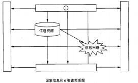

国家信息化 6 要素关系图

（2）A.信息化人才          B.信息技术应用

C.信息技术和产业      D.信息化政策法规和标准规范

#### 【解析】国家信息化体系包括信息技术应用、信息资源、信息网络、信息技术和产业、信息化人才、信息化法规政策 - 27 -

和标准规范 6 个要素，这 6 个要素按照上图所示的关系构成了一个有机的整体。

#### 【点评】常考，简单题，必须得分

#### 【试题 3】---2011 下真题 1

3、以下对国家信息化体系要素的描述中，不正确的是（3）。

A.信息技术应用是信息化体系要素中的龙头

B.信息技术和产业是我国进行信息化建设的基础

C.信息资源的开发利用是国家信息化的核心任务

D.信息化政策法规和标准规范属于国家法规范畴，不属于信息化建设范畴 【答案】D

#### 【解析】P8-10此题考察的是信息化体系 6 要素，必须掌握，高频考点

选项 A.B.C 的描述是正确的， 而选项 D 的描述是不正确的。正确的陈述如下： 信息化政策法规和标准规范用 于规范和协调信息化体系各要素之间关系， 是国家信息化快速、持续、有序、健康发展的根本保障。

#### 【点评】常考，命题的热点，简单题， 必须得分

#### 【试题 4】 ---2015 下真题 2

4、国家信息化体系包括信息技术应用，信息资源等六要素，其中（ ）是国家信息化成功之本， 对其他各要素的发展速度和质量有着决定性的影响， 是信息化建设的关键。

（4）A.信息资源  B.信息化法规和标准规范   C.信息化人才     D.信息化技术和产业

#### 【答案】C

#### 【解析】

信息化人才[成功之本]，对其他各要素的发展速度和质量有着决定性的影响，是信息化建设的关键。

信息技术应用[龙头]；信息资源是国家信息化建设取得实效的关键，也是我国信息化的薄弱 环节；信息网络是信息资源开发利用和信息技术应用的基础；信息技术和产业是我国进行信 息化建设的基础；信息化人才是国家信息化成功之本，是信息化建设的关键；信息化政策法 规和标准规范是国家信息化快速、持续、有序、健康发展的根本保障；

#### 【试题 5】---2017 上真题 5

5、在国家信息化体系六要素中，（）是进行信息化建设的基础。

A.信息技术和产业

B.信息化政策法规和标准规范

C.信息资源的开发和利用

D.信息人才

#### 【解析】P11此题考察的是国家信息化体系要素，必须掌握，高频考点

国家信息化体系:信息技术应用、信息资源、信息网络、信息技术和产业、信息化人才、信息 化法规政策和标准规范 6 要素。其中：

信息技术和产业是我国进行信息化建设的基础。

信息化政策法规和标准规范用于规范和协调信息化体系各要素之间关系， 是国家信息化快速、 持续、有序、健康发展的根本保障。

信息资源的开发利用是国家信息化的核心任务， 是国家信息化建设取得实效的关键。

信息化人才是国家信息化成功之本，对其他各要素的发展速度和质量有着决定性的影响，是 信息化建设的关键。

#### 【点评】常考，比较简单，必须得分

#### 【试题 6】---2017 下真题 3

6、国家信息化体系要素中，（）是国家信息化的主阵地，集中体现了国家信息化建设的需求和效益。 A.信息技术应用    B.信息网络    C.信息资源    D.信息化人才

#### 【解析】信息化6要素:信息化要素的地位：①信息技术应用（龙头主阵地）②信息资源(核心任务)③信息网络(应用基础)④信息技术和产业(建设基础)⑤信息化人才(成功之本)⑥信息化法规(保障)

#### 【试题 7】---2018 上真题 3

7、开展区域链技术的商业试探性应用， 属于国家信息化体系中的（）要素。

A.信息技术应用    B.信息网络    C.信息资源    D.信息技术和产业

#### 【解析】信息技术应用是指把信息技术广泛应用于经济和社会各个领域。

### 2、电子政务

#### 【试题 1】---2012 下真题 4

1、政府机构利用Intranet建立有效的行政办公和员工管理体系， 以提高政府工作效率服务和公务 员管理水平，这种电子政务的模式是（1）。

A.G2G    B.G2C    C.G2E    D.G2B

#### 【解析】G2E是政府机构通过网络技术实现内部电子化管理的重要形式， 可以提高公务员管理水平， 它也是G2G、G2B 和G2C电子政务模式的基础。

#### 【试题 2】---2014 上真题 4

2、电子政务根据其服务的对象不同，基本上可以分为四种模式。某市政府在互联网上提供的“机 动车违章查询”服务，属于（2）模式

（2）A.G2B      B.G2C        C.G2E            D.G2G

#### 【解析】G2C 是政府对客户模式，机动车违章查询是属于政府对客户；

#### 【试题 3】---2014 下真题 7

3、“十二五”期间，电子政务促进行政体制改革和服务型政府建设的作用更加显著，其发展目标 不包括（）。

A.电子政务统筹协调发展不断深化            B.应用发展取得重大进展

C.初步形成电子政务网络与信息安全保障体系   D.政府公共服务和管理应用成效明显

#### 【解析】“十二五”期间， 电子政务全面支撑政务部门履行职责， 满足公共服务、社会管理、市场监管和 宏观调控各项政务目标的需要，促进行政体制改革和服务型政府建设的作用更加显著。

—— 电子政务统筹协调发展不断深化。

——应用发展取得重大进展。

——政府公共服务和管理应用成效明显。

—— 电子政务信息共享和业务协同取得重大突破。

—— 电子政务技术服务能力明显加强。

—— 电子政务信息安全保障能力持续提升。

C.初步形成电子政务网络与信息安全保障体系是 “十五”期间的目标，而不是“十二五”期间的电子政务目标。

#### 【试题 4】 ---2014 下真题 8

4、从电子政务的实施对象和应用范畴角度，、可将电子政务分为四种类型。其中，电子工商审批 及证照办理属于（）。

（4）A.政府对政府的电子政务（G2G）    B.政府对企业的电子政务（G2B）

C.政府对公众的电子政务（G2C）     D.政府对公务员的电子政务（G2E）

#### 【解析】电子工商审批及证照办理属于政府对企业的电子政务（G2B）

#### 【试题 5】---2015 上真题 6

5、“十二五”期间，电子政务全面支撑政务部门履行职责，满足公共服务、社会管理、市场监管 和宏观调控各项政务目标的需要，促进行政体制改革和服务型政策，建设的作用更加显著。其发 展目标不包括（）。

A.逐步完善与电子政务相关的法规和标准     B. 电子政务信息安全保障能力持续提升

C. 电子政务技术服务能力明显加强          D. 电子政务信息共享和业务协同取得重大突破

#### 【答案】A

#### 【解析】 此题考察的是电子政务，必须掌握，常考

《国家电子政务“十二五”规划》（发布时间： 2012 年 04 月 13 日）

httP://WWW.miit.gov.cn/n11293472/n11295327/n11297217/14562026.html

“十二五”期间，电子政务全面支撑政务部门履行职责，满足公共服务、社会管理、市场监管和 宏观调控各项政务目标的需要，促进行政体制改革和服务型政府建设的作用更加显著。

—— 电子政务统筹协调发展不断深化。 ——应用发展取得重大进展。 ——政府公共服务和管理应 用成效明显—— 电子政务信息共享和业务协同取得重大突破。 —— 电子政务技术服务能力明显加 强—— 电子政务信息安全保障能力持续提升。选项 A 是“十五”的目标。

#### 【点评】多次考了，简单，必须得分

#### 【试题 6】---2015 上真题 7

6、《国家信息化领导小组关于我国电子政务建设指导意见》中明确指出政务内网主要是（）以上 政务部门的办公网， 与其下属政务部门的办公网物理隔离。

A.省级     B.副省级      C.市级      D.副市级

#### 【解析】电子政务网络由政务内网和政务外网构成，两网之间物理隔离，政务外网与互联网之间逻辑隔离。政务内网主要是副省级以上政务部门的办公网，与副省级以下政务部门的办公网物理隔离。政务外网是政府的业务专网，主要运行政务部门面向社会的专业性服务业务和为需在内网上运行的业务。

#### 【试题 7】---2016 上真题 7

7、某法院将罚没的物品通过某拍卖网站对社会公开拍卖， 成交后买方通过网络支付将款项直接支 付当地财政系统，该活动属于（7）的范畴。

A. 电子政务   B.行政管理   C. 电子商务    D. 电子交易

g2c 是电子政务， 此题的拍卖双方的最终对象是政府和个人， 不管中间部分是这么走的， 所以应该 是电子政务！

#### 【试题 8】---2016 下真题 5

8、以下关于我国现阶段电子政务建设的叙述中，不正确的是（）。

A.我国我国电子政务建设一直坚持统一规划，加强领导，需求主导， 突出重点的原则 B.我国电子政务建设一直坚持整合资源，拉动产业，统一标准，保障安全的原则

C.我国电子政务建设把建设独立互不干扰的电子政务网络、引进和完善重点业务系统作为主 要任务之一

D.我国电子政务建设把基本建立电子政务网络与信息安全保障体系和加强公务员信息化培训 和考核作为主要任务之一

#### 【答案】C

#### 【解析】P34此题考察的是电子政务， 必须掌握，高频考点

电子政务建设的主要任务具体分为八个方面：（1） 建设和整合统一的电子政务网络（2）建设和完 善重点业务系统（3） 规划和开发重要政务信息资源（4） 积极推进公共服务（5） 基本建立电子政 务网络与信息安全保障体系（6） 完善电子政务标准化体系（7）加强公务员信息化培训和考核（8） 加快推进电子政务法制建设

#### 【点评】送分题，常考，为第二版教材新增知识点， 必须得分

#### 【试题 9】 ---2017 上真题 4

9、电子政务是我国国民经济和社会信息化的重要组成部分。（） 一般不属于电子政务的内容。 A.公务员考勤打卡系统

B.政府大院为保证办公环境的门禁系统

C.某商务网站的可为政府提供采购服务的系统

D.政府办公大楼门前的电子公告显示屏

#### 【答案】B

#### 【解析】P29此题考察的是电子政务， 必须掌握，高频考点

电子政务是指政府机构在其管理和服务职能中运用现代信息技术，实现政府组织结构和工作流程 的重组优化，超越时间、空间和部门分隔的制约，建成一个精简、高效、廉洁、公平的政府运作 模式。电子政务模型可简单概括为两方面：政府部门内部利用先进的网络信息技术实现办公自动 化、管理信息化、决策科学化（A、C）；政府部门与社会各界利用网络信息平台充分进行信息共享 与服务、加强群众监督、提高办事效率及促进政务公开（D），等等。B 选项政府大院为保证办公环 境的门禁系统不属于电子政务。

#### 【点评】常考，比较简单，必须得分

#### 【试题 10】---2017 下真题 5

10、电子政务的内容非常广泛，我们常见的中国政府采购网属于（）。

A.G2G        B.G2C        C.G2E        D.G2B

#### 【解析】电子政务其内容包括：政府间的电子政务（G2G）、政府对企业的电子政务（G2B）、政府对公民的电子政务（G2C）、政府对公务员的电子政务（G2E），其中 G2B 最常见

#### 【试题 11】---2018 上真题 4

11、我国陆续建成了“两网、 一站、四库、十二金”工程为代表的国家级信息系统，其中的“一 站”属于（）电子政务模式。

A.G2G        B.G2C        C.G2E        D.B2C

#### 【解析】

电子政务包括：G2G:政府间的电子政务。G2B：政府对企业的电子政务，G2C：政府对公众的电子政务。G2E：政府对公务员。一站属于政府门户网站。这个题目感觉不好选啊。似乎 ABC 都对吧。B 是电子政务比较常用，用的比较多的，建议 B 好一点吧

#### 【试题 12】---2019 上真题 4

12、电子政务类型中，属于政府对公众的是（）。

A.G2B        B.G2E        C.G2G        D.G2C

#### 【解析】政府对公众是 G2C，政府对企业是 G2B，政府对员工（公务员）是 G2E，政府对政府是G2G。

3、企业资源规划（ERP）

#### 【试题 1】---2012 下真题 4

1、在 ERP 系统中，不属于物流管理模块功能的是（1）  。

（1）A.库存控制      B.销售管理    C.物料需求计划管理    D.采购管理

#### 【解析】物流管理包括销售管理、库存控制、采购管理和人力资源管理。

#### 【试题 2】---2010 上真题 5

2、与制造资源计划 MRPⅡ相比，企业资源计划 ERP  最大的特点是在制定计划时将（2）考虑在 一起，延伸管理范围。

（2）A.经销商   B.整个供应链  C.终端用户   D.竞争对手

#### 【答案】B

#### 【解析】P46此题考察的是 ERP，必须掌握，高频考点

ERP 管理范围向整个供应链延伸。在资源管理范围方面， MRPⅡ主要侧重对本企业内部人、财、 物等资源的管理， ERP 系统在 MRPⅡ的基础上扩展了管理范围， 它把客户需求和企业内部的制造活 动以及供应商的制造资源整合在一起，形成一个完整的供应链并对供应链上所有环节如订单、采 购、库存、计划、生产制造、质量控制、运输、分销、服务与维护、财务管理、人事管理、实验  室管理、项目管理、配方管理等进行有效管理。

#### 【点评】常考，命题的热点，书上原话，简单题，必须得分

#### 【试题 3】---2010 下真题 24

3、企业资源规划是由 MRP  逐步演变并结合计算机技术的快速发展而来的， 大致经历了 MRP、闭 环 MRP、MRPⅡ和 ERP 这四个阶段，以下关于企业资源规划论述不正确的是（3）。

（3）A.MRP 指的是物料需求计划， 根据生产计划、物料清单、库存信息制定出相关的物资需求

B.MRPⅡ指的是制造资源计划， 侧重于对本企业内部人、财、物等资源的管理  C. 闭环 MRP  充分考虑现有生产能力约束，要求根据物料需求计划扩充生产能力

D.ERP  系统在 MRPⅡ的基础上扩展了管理范围，把客户需求与企业内部的制造活动以及供

应商的制造资源整合在一起， 形成一个完整的供应链管理

#### 【答案】C

#### 【解析】P43此题考察的是 ERP，必须掌握，高频考点

基本 MRP （物料需求计划）聚焦于相关物资需求问题，根据主生产计划、物料清单、库存信息， 制定出相关 物资的需求时间表， 从而即时采购所需物资，降低库存。

闭环 MRP 能力计划通常是通过报表的形式向计划人员报告，但是尚不能进行能力负荷的自动平衡，这个工作由 计划人员人工完成。

ERP 系统在 MRP II 的基础上扩展了管理范围，它把客户需求和企业内部的制造活动以及供应商的制造资源整 合在一起， 形成一个完整的供应链并对供应链上的所有环节进行有效管理。

综上所述，应选择 C。

#### 【点评】常考，命题的热点，简单题， 必须得分

#### 【试题 4】 ---2013 上真题 4

4.某软件公司希望采购一套自用的管理信息系统，覆盖公司生产经营管理的各个方面，并可以根据

自身情况灵活地组合不同的功能模块进行集成和使用，该公司应采购  4   系统 A.CDS        B.ERP        C.CRM        D.IDS

#### 【答案】B

#### 【解析】P43此题考察的是 ERP 的功能，必须掌握， 高频考点

CDS：内容分发服务 CRM：客户关系管理；IDS：入侵检测系统 ERP：企业资源计划

ERP 系统的功能：1）财会管理 2） 生产控制管理 3）物流管理 4）人力资源管理，显然 ERP 包含很多， 是其他几 个选项无法替代的；

#### 【点评】信息化基本知识点，比较简单，必须得分

#### 【试题 5】---2013 下真题 4

5、ERP 系统作为整个企业的信息系统， 具有物流管理功能， 用于对企业的销售、库存及采购进行 管理控制。关于物流管理的叙述中（5）是不恰当的。

（5）A.为所有的物料建立库存信息， 作为采购部门采购、生产部门编制生产计划的依据

B.收到订购物料，经过质量检验入库；生产的产品也需要经过检验入库

C.建立供应商档案，用最新的成本信息来调整库存的成本

D.收发料的日常业务处理工作

#### 【答案】D

#### 【解析】P50此题考察的是 ERP 相关概念，必须掌握，高频考点

企业资源规划（ERP）的物流管理模块的主要功能包括销售管理、库存控制、采购管理等。选项 A.B.D 属于库 存控制的功能。选项 C 是采购管理模块的功能。

#### 【点评】此题出的不大好，按照题目意思 ABCD 均是物流管理的组成部分，坑爹，丢分不可惜

#### 【试题 1】---2009 下真题 4

1 、CRM  系统是基于方法学、软件和互联网的， 以有组织的方式帮助企业管理客户关系的信息系 统。（1）一准确地说明了 CRM 的定位。

（1）A.CRM 在注重提高客户的满意度的同时， 一定要把帮助企业提高获取利润的能力作为重要指标 B.CRM 有一个统一的以客户为中心的数据库，以方便对客户信息进行全方位的统一管理

C.CRM 能够提供销售、客户股务和营销三个业务的自动化工具，具有整合各种客户联系渠道 的能力

D.CRM 系统应该具有良好的可扩展性和可复用性， 并把客户数据可以分为描述性、促销性和 交易性数据三大类

#### 【答案】A

#### 【解析】P54 此题考察的是 CRM 的定义，必须掌握， 高频考点

CRM 所涵盖的要素主要有： 第一，CRM 以信息技术为手段，但是 CRM 绝不仅仅是某种信息技术的应用， 它更是 一种以客户为中心的商业策略，CRM 注重的是与客户的交流， 企业的经营是以客户为中心， 而不是传统的以产品或 以市场为中心。第二， CRM 在注重提高客户满意度的同时，一定要把帮助企业提高获取利润的能力作为重要指标。 第三，CRM 的实施要求企业对其业务功能进行重新设计， 并对工作流程进行重组， 将业务的中心转移到客户， 同时 要针对不同的客户群体有重点地采取不同的策略。

#### 【点评】常考，命题的热点，3 个必须记住，简单题，必须得分

#### 【试题 2】---2010 下真题 25

2、客户关系管理系统（CRM）的基本功能应包括（2）。

（2）A.自动化的销售、客户服务和市场营销    B. 电子商务和自动化的客户信息管理

C. 电子商务、自动化的销售和市场营销    D. 自动化的市场营销和售后服务

#### 【答案】A

#### 【解析】P55此题考察的是 CRM，必须掌握，高频考点

客户关系管理系统（CRM）包括的基本功能模块有自动化的销售、客户服务和市场营销。

#### 【点评】常考，命题的热点，简单题， 必须得分

#### 【试题 3】---2012 上真题 6

3、在 CRM 中，体现企业曾经为客户提供的产品和服务的历史数据，如用户产品使用情况调查的 数据、客服人员的建议数据和广告数据等，属于（3）。

（3）A.描述性数据  B.交易性数据  C.促销性数据  D.关系性数据

#### 【答案】C

#### 【解析】P56此题考察的是 CRM 客户数据的分类，必须掌握，考的不多

客户数据可以分为描述性、促销性和交易性数据三大类：

（1）关于描述性数据：这类数据是客户的基本信息，如果是个人客户， 一定要涵盖客户的姓名、 年龄、 ID 和联系方式等； 如果是企业客户， 一定要涵盖企业的名称、规模、联系人和法人代表等。 	（2）关于促销性数据：这类数据是体现企业曾经为客户提供的产品和服务的历史数据， 主要包括 用户产品使用情况调查的数据、促销活动记录数据、客服人员的建议数据和广告数据等。

（3）关于交易性数据：这类数据是反映客户对企业做出的回绩的数据， 包括历史购买记录数据、 投诉数据、请求提供咨询及其他服务的相关数据、客户建议数据等

#### 【点评】比较重要，多次考了，简单， 必须得分

#### 【试题 4】 ---2013 上真题 5

4.在利用电子信息技术进行客户关系管理活动中， 数据采信和存储是其中非常重要的环节。 4 不是

其中重点关注的数据。

A.描述性数据    B.促销性数据    C.交易性数据    D.关系性数据

#### 【答案】D

#### 【解析】P56此题考察的是 CRM 的应用设计， 必须掌握，高频考点

CRM 中三种数据：描述性、促销性、交易性

闪 关系性数据，很阴险的干扰项，命题者希望你能联想起关系数据库来；

#### 【点评】多次考了，比较简单，必须得分

#### 【试题 5】---2014 上真题 5

5、在客户关系管理（CRM）系统将市场营销的科学管理理念通过信息技术的手段集成在软件上， 能够帮助企业构建良好的客户关系。以下关于 CRM 系统的叙述中，错误的是（5）。

（5）A.销售自动化是 CRM 系统中最基本的模块

B.营销自动化作为销售自动化的扩充，包括营销计划的编制和执行、计划结果分析

C.CRM 系统能够与 ERP 系统在财务、制造、库存等环节进行连接，但两者关系相对松散， 一般不会形成闭环结构

D.客户服务与支持是 CRM 系统的重要功能。目前，客户服务与支持的主要手段是通过呼叫 中心和互联网来实现

#### 【答案】C

#### 【解析】 此题考察的是 CRM，必须掌握，高频考点

CRM 系统能与 ERP 系统在财务、制造、库存等环节进行连接，两者间会形成一定的闭环反绩结构;

#### 【点评】CRM 的概念，以前也考过类似的知识点，属于送分的

#### 【试题 6】---2015 下真题 6

6、任何企业都是依赖于客户生存的。某电子商务公司为提升客户满意度与忠诚度， 决定引入（） 系统

（6）A.ERP           B.CRM         C.SCM               D.MRPII

#### 【答案】B

#### 【解析】 此题考察的是 CRM，必须掌握，高频考点

与客户有关的肯定是客户关系管理系统（CRM）了。

ERP 企业资源计划 CRM 客户关系管理系统    SCM 供应链管理 MRP II 制造资源计划

#### 【点评】送分题，多次考了，简单

#### 【试题 7】---2018 上真题 7

7、客户关系管理（CRM）系统是以客户为中心设计的一套集成化信息管理系统， 系统中记录 的客户购买记录属于（）客户数据。

A.交易性    B.描述性    C.促销性    D.维护性

#### 【答案】A

#### 【解析】P56此题考察的是客户数据， 必须掌握，高频考点

购买记录指双方交易的情况

#### 【点评】以前考过，常考，比较简单， 必须得分

#### 【试题 8】---2019 上真题 7

8、（）不属于客户关系管理（CRM）系统的基本功能。

A. 自动化销售    B. 自动化项目管理    C. 自动化市场营销    D. 自动化客户服务

#### 【答案】B

#### 【解析】P55 此题考察的是 CRM 的功能，必须掌握， 高频考点

CRM 能够提供销售、客户服务和营销三个业务的自动化工具， 并且在这三者之间实现通信接口，使 得其中一项业务模块的事件可以触发另外一个业务模块中的响应。

#### 【试题 1】---2009 上真题 65

1、目前企业信息化系统所使用的数据库管理系统的结构，大多数为（1）。

（1）A.层次结构         B.关系结构         C.网状结构         D.链表结构

#### 【答案】B

#### 【解析】 此题考察的是数据库系统结构，必须掌握， 考的不多

目前企业信息化系统所使用的数据库管理系统的结构，大多数为关系结构。

#### 【点评】考的不多，比较简单，记住下吧，建议得分

#### 【试题 2】---2009 下真题 2

2、（2）不属于供应链系统设计的原则。

（2）A.分析市场需求和竞争环境 B.自顶向下和自底向上相结合  C.简洁 D.取长补短 【答案】A

#### 【解析】P64此题考察的是供应链设计的原则，必须掌握，现在考的少了

供应链管理的设计节中指出： 供应链系统设计的原则包括 自顶向下和自底向上相结合、简洁性原则、取长补 短原则、动态性原则、合作性原则、创新性原则、战略性原则。

#### 【点评】考的比较少，知道一些就好， 不是重点，必须得分

#### 【试题 3】---2013 上真题 6

3.供应链管理是一种将正确数量的商品在正确的时间配送到正确地点的集成的管理思想和方法，评 价供应链管理的最重要的指标是： 3

A..供应链的成本     B.客户满意度    C.供应链的响应速度    D.供应链的吞吐量

#### 【答案】B

#### 【解析】P62此题考察的是供应链管理，必须掌握， 高频考点

供应链管理是以客户为中心的。 整个供应链管理追求的目标，首先是满足客户的需求。 衡量供应链管理绩效 的最重要的指标就是客户满意度。降低供应链的成本、提高供应链的响应速度等， 都要以满足客户需求为前提。

#### 【点评】书上原话，当然客户满意度是很重要的，简单，必须得分

#### 【试题 4】 ---2015 上真题 2

4、供应链管理是把正确数量的商品在正确的时间配送到正确的地点的一套管理方法。它控制和管 理的各种“流”不包括（）。

A.物流   B.资金流   C.信息流       D.控制流

#### 【答案】D

#### 【解析】 此题考察的是供应链管理，必须掌握， 之前考过

供应链管理，3）供应链管理的概念---供应链管理是一种集成的管理思想和方法，是在满足服务 水平要求的同时，为了使系统成本达到最低而采用的将供应商、制造商、仓库和商店有效地结合 成一体来生产商品，有效地控制和管理各种信息流、资金流和物流，并把正确数量的商品在正确 的时间配送到正确的地点的一套管理方法。

#### 【点评】之前考过，简单，必须得分

### 6、电子商务

#### 【试题 1】---2009 上真题 63

,、电子商务系统所涉及的四种“流” 中，（1）是最基本的、必不可少的。

（1）A.资金流    B.信息流     C.商流      D.物流

#### 【答案】B

#### 【解析】 此题考察的是电子商务知识，必须掌握，高频考点

商流、物流、资金流和信息流是流通过程中的四大相关部分，由这“四流”构成了一个完整的流通过程。无 论是买卖交易，还是物流和资金流，这三个过程都离不开信息的传递和交换，没有及时的信息流，就没有顺畅的 商流、物流和资金流。

#### 【点评】了解下，不是很重要，比较简单，必须得分

#### 【试题 2】---2009 下真题 24

2、电子商务安全要求的 4 个方面是  （2）  。

——

（2）A.传输的高效性、数据的完整性、交易各方的身份认证和交易的不可抵赖性 B.存储的安全性、传输的高效性、数据的完整性和交易各方的身份认证

C.传输的安全性、数据的完整性、交易各方的身份认证和交易的不可抵赖性

D.存储的安全性、传输的高效性、数据的完整性和交易的不可抵赖性

#### 【答案】C

#### 【试题 3】---2010 上真题 6

3、小张在某电子商务网站建立一家经营手工艺品的个人网络商铺， 向网民提供自己手工制作的工 艺品。这种电子商务模式为（3）。

（3）A.B2B         B.B2C          C.C2C       D.G2C

#### 【答案】C

#### 【解析】P44  此题考察的是电子商务，必须掌握， 高频考点

目前常用的电子商务模式有 B2B.B2C 和 C2C 三种。

B2B 指的是进行电子商务交易的供需双方都是商家（或企业、公司），她们使用了 Internet 的技术或各种商务 网络平台， 完成商务交易的过程。

B2C 是指商业机构对消费者的电子商务。

C2C 是个人与个人之间的电子商务，是用户对用户的电子商务模式。C2C 商务平台就是通过为买卖双方提供一 个在线交易平台，使卖方可以主动提供商品网上拍卖，而买方可以自行选择商品进行竞价。

#### 【点评】必考，命题的热点，简单题， 必须得分

#### 【试题 4】 ---2010 下真题 26

4、某体育设备厂商已经建立覆盖全国的分销体系。为进一步拓展产品销售渠道， 压缩销售各环节 的成本，拟建立电子商务网站接受体育爱好者的直接订单，这种电子商务属于（4）模式。

（4）A.B2B             B.B2C                 C.C2C                 D.B2G

#### 【答案】B

#### 【解析】P44  此题考察的是电子商务的分类，必须掌握，高频考点

电子商务按照交易对象， 可以分为企业与企业之间的电子商务（B2B）、商业企业与消费者之间的电子商务 	（B2C）、消费者与消费者之间的电子商务（C2C）， 以及政府部门与企业之间的电子商务（G2B） 4 种。

题干中的交易模式属于商业企业与消费者之间的电子商务，因此应选 B。

#### 【点评】常考，命题的热点，简单题， 必须得分

#### 【试题 5】---2010 下真题 27

5、2005  年，我国发布《国务院办公厅关于加快电子商务发展的若干意见》（国办发〔2005〕2 号）， 提出我国促进电子商务发展的系列举措。其中，提出的加快建立我国电子商务支撑体系的五方面 内容指的是（5）。

（5）A.电子商务网站、信用、共享交换、支付、现代物流

B.信用、认证、支付、现代物流、标准

C. 电子商务网站、信用、认证、现代物流、标准

D.信用、支付、共享交换、现代物流、标准

#### 【答案】B

#### 【解析】P47 此题考察的是电子商务支撑体系，尽量掌握，考的少

建立和完善电子商务发展的支撑保障体系包括 9 个方面的内容，分别是法律法规体系、标准规范体系、安全 认证体系、信用体系、在线支付体系、现代物流体系、技术装备体系、服务体系、运行监控体系。

#### 【点评】常考，命题的热点，简单题， 必须得分

#### 【试题 6】---2012 下真题 3

6、 C2C电子商务模式中，常用的在线支付方式为（6）。

A. 电子钱包    B.第二方支付    C.第三方支付    D.支付网关

#### 【答案】C

#### 【解析】 此题考察的是电子商务中的支付方式， 必须掌握，首次考这个点

C2C模式下， 主要进行的是小额快速的交易， 支付宝本质上是跟网银一样的，支付宝解决了网银交易比较复 杂的问题， 都是适合于小额， 快速交易的， 它属于第三方支付方式。

常见的电子货币包括电子支票、电子现金、电子钱包、智能卡； 信用卡不是电子货币。

支付形式：支付网关， 第三方支付， 直接支付（直接给钱）    支付宝----第三方支付

交易协议：SSL（安全套接层协议，传输层） 安全电子交易协议 SET，会话层和应用层

电子物流：第一方（买家自己取） 第二方（卖家送）  第三方（快递送）   第四方（中介外包）

#### 【点评】电子商务的知识点，考的不是很多，简单， 必须得分

#### 【试题 7】---2013 下真题 5

7、网上订票系统为每一位订票者提供了方便快捷的购票业务， 这种电子商务的类型属于（7）。

（7）A.B2C          B.B2B            C.C2C          D.C2B

#### 【答案】A

#### 【解析】P44此题考察的是电子商务模式的分类，必须掌握，必考

电子商务按照交易对象可以分为 4 种模式，即企业对企业（B2B）、企业对消费者（B2C）、消费者对消费者（C2C）、 政府对企业（G2B）。依题意，运作网上订票系统的是企业（Business），订票者是消费者（Customer）。因此这是 一种 B2C 的电子商务交易模式。

#### 【点评】送分题，命题几率极大，多次考了，比较简单

#### 【试题 8】---2014 上真题 6

8、以下关于电子商务及其相关技术的叙述，正确的是（8）。

（8）A.利用电子商务系统向消费者在线销售产品， 己经超越了传统的零售方式

B.产品的存储、打包、运送和跟踪等， 对组织的成功非常重要，几乎没有制造商或零售商将 这些行为外包

C.SSL 通信协议用于保护电子商务交易中的敏感数据

D.购物车功能是由 WWW 服务器软件来实现的

#### 【答案】C

#### 【解析】 此题考察的是电子商务，必须掌握，几乎必考

2010 年上半年《系统分析师》上午试题试题（37）分析

电子商务的过程与传统商务的过程是一致的，包括识别商品、选择、协商、购买、递送、售后服 务等过程， 这些过程有些可以电子化， 有些不能（如递送、售后服务等）， 因此利用电子商务系统 向消费者在线销售产品，并没有超越传统的零售方式。

虽然产品的存储、打包、运送和跟踪等，对组织的成功非常重要，但是考虑到成本、效益和专业 区分，这些过程通常会外包给专门的仓储公司、货运公司。

电子商务支付系统是电子商务基础设施的关键组成部分，但是用于电子商务系统应用于 Internet 网上， 为防止用户信用卡、账号等信息被探测和监听，常常采用安全套接字层（SSL）技术来保证 敏感、关键数据的安全。SSL 包括握手阶段， 该阶段用来认证服务期， 决定使用的加密算法并在发 送和接收方之间交换密钥。

电子购物车的功能是跟踪客户选择的购买物品中，目前购物车的实现主要是通过Cookie 方式实现， 可能会在服务器的数据库中存放购物车内容信息，购物车功能不是由 web 服务器软件实现的。

#### 【点评】原来系分的原题，有一定的难度，但是稍加分析不难得出答案

#### 【试题 9】 ---2014 上真题 3

9、在电子商务中，除了网银、电子信用卡等支付方式以外， 第三方支付可以相对降低网络支付的 风险。下面不属于第三方支付的优点的是()

（9）A.比较安全   B.支付成本较低   C.使用方便    D.预防虚假交易

#### 【答案】D

#### 【解析】 此题考察的是第三方支付，必须掌握， 比较新

第三方平台结算支付模式有如下优点：

（1） 比较安全，信用卡信息或帐户信息仅需要告知支付中介， 而无需告诉每一个收款人，大大减 少了信用卡信息和账户信息失密的风险；

（2）支付成本较低， 支付中介集中了大量的电子小额交易，形成规模效应，因而支付成本较低； （3）使用方便。对支付者而言，他所面对的是友好的界面，不必考虑背后复杂的技术操作过程； （4）支付担保业务可以在很大程度上保障付款人的利益。

第三方平台结算支付模式存在以下缺点：

（1）这是一种虚拟支付层的支付模式， 需要其它的“实际支付方式”完成实际支付层的操作；

（2） 付款人的银行卡信息将暴露给第三方支付平台， 如果这个第三方支付平台的信用度或者保密 手段欠佳， 将带给付款人相关风险；

（3） 第三方结算支付中介的法律地位缺乏规定，一旦该终结破产，消费者所购买的“电子货币 ” 可能成了破产债权， 无法得到保障；

（4） 由于有大量资金寄存在支付平台账户内，而第三方平台非金融机构，所以有资金寄存的风险。

#### 【点评】送分题，以前讲过第三方支付的特点，稍微理解下就可以得出结果

#### 【试题 10】---2014 下真题 4

10、（）不属于电子商务基础设施。

（10）A.智能交通监控平台          B.TCP/IP 互联网协议

C.WEB 服务器                D. 中国银联网络支付平台

#### 【答案】A

#### 【解析】 此题考察的是电子商务，必须掌握，高频考点

这题很简单，智能交通监控平台这与电子商务没多大关联。

#### 【点评】此点比较偏，但是不难，错误很明显，简单

#### 【试题 11】---2014 下真题 5

11、目前，在电子商务交易过程中支付方式很多，按照支付的流程不同，主要存在四种电子商务 支付模式： 支付网关模式、网上银行模式、第三方支付模式和手机支付模式。（） 不属于第三方支 付模式。

（11）A.拉卡拉    B.支付宝    C.余额宝   D.财付通

#### 【答案】C

#### 【解析】 此题考察的是电子商务，必须掌握，高频考点

拉卡拉、余额宝、财付通都是第三方支付模式，可能大家对拉卡拉不是很熟悉；余额宝类似于基 金的模式， 相当于金融理财产品，不是第三方支付模式，其实现在余额宝也有支付功能；

拉卡拉的功能大致范围：个人金融方面使用拉卡拉可以进行信用卡还款、银行卡余额查询以及转 账汇款等业务。生活缴费方面使用拉卡拉可以缴纳水电气费用、固定电话以及宽带缴费等等。使 用拉卡拉充值购卡可以为手机、公交卡、支付宝与财付通等账户充值，也可购买游戏点。

#### 【点评】此题比较新颖，需要大家对互联网的网购有一定的了解，不难

#### 【试题 12】---2014 下真题 6

12、电子商务物流又称网上物流，是基于互联网技术，创造性推动物流行业发展的新商业模式。 通过互联网，物流公司能够被更大范围内的货主客户主动找到，能够在全国乃至世界范围内拓展 业务。（）不是当前电子商务的常用物流模式。

（12）A.联合物流模式    B.第三方物流模式    C.第二方物流模式  D.物流一体化模式

#### 【答案】C

#### 【解析】 此题考察的是电子商务，必须掌握，高频考点

电子商务物流模式有：自营物流、物流联盟、第三方物流、第四方物流、物流一体化。

#### 【点评】考的少，容易做错，稍微记忆下吧

#### 【试题 13】---2015 上真题 3

13、在构建电子商务基础环境时。我们常常使用 VPN 来实现数据的安全传输。以下关于 VPN 的 叙述中（） 是不正确的。

A.VPN 通过压缩技术使传输速率大大超过线路的最大吞吐量

B.常用的 VPN 包括 IPSecVPN 和 SSLVPN

C.VPN 的全称是虚拟专用网络

D.VPN 支持加密技术，使窃取 VPN 传输信息的难度加大

#### 【答案】A

#### 【解析】 此题考察的是电子商务技术，必须掌握，这个点考的不多

VPN（VirtualPrivateNetWork，虚拟专用网络），其功能是： 在公用网络上建立专用网络， 进行加 密通讯。在企业网络中有广泛应用。VPN 网关通过对数据包的加密和数据包目标地址的转换实现远 程访问。VPN 有多种分类方式， 主要是按协议进行分类。VPN 可通过服务器、硬件、软件等多种方 式实现。 VPN 具有成本低，并且易于使用的特点。

#### 【点评】有的难度，大家了解下，首次，尽量得分

#### 【试题 14】---2015 上真题 4

14、在电子商务的发展过程中，安全电子交易协议（SET：SecureElectronicTransaction）标准作为 北美民间组织推行的电子支付安全协议，其针对的主要交易类型是基于（）的网络交易。

A.专用电子货币      B.不记名账号     C.虚拟货币       D.信用卡

#### 【答案】D

#### 【解析】 此题考察的是电子商务协议，必须掌握，常考

安全电子交易协议 SET 是一种应用于因特网（Internet）环境下，以信用卡为基础的安全电子交 付协议，它给出了一套电子交易的过程规范。通过 SET 协议可以实现电子商务交易中的加密、认 证、密钥管理机制等，保证了在因特网上使用信用卡进行在线购物的安全。

#### 【点评】这个协议考过，不过这个题有点难，熟悉下

#### 【试题 15】---2015 上真题 5

15、我国 O2O 的常见应用不包括（）。

A. 电子政务政府集采   B.餐饮服务网上团购  C.APP 手机的约车服务  D.旅游服务网上团购

#### 【答案】A

#### 【解析】 此题考察的是电子商务，必须掌握，常考

排除法。020 即 0nlineTo0ffline（在线离线/线上到线下），是指将线下的商务机会与互联网结合， 让互联网成为线下交易的前台，这个概念最早来源于美国。020 的概念非常广泛，既可涉及到线上， 又可涉及到线下， 可以通称为 020。如淘宝网、京东商场等商业电子商务， APP 手机约车服务，携 程网、途牛等旅游服务网上团购，而政府采购则不属于该范畴，因为政府采购不具备线上交易这 个关键特征，仅仅是发布招投标通告等通知性内容。

#### 【点评】常考点，简单，必须得分

#### 【试题 16】---2015 下真题 4

16、（ ）不利于推动电子商务基础设施建设。

（16）A.制定并实施（“宽带中国”战略及实施方案）

B.充分利用现有物流资源， 完善全国物流体系建设

C.取消电子商务税收优惠政策

D.大力发展智慧货运， 提升物流运输效率

#### 【答案】c

#### 【解析】 此题考察的是电子商务的基础设施，考的不多，了解下

这可以说是常识题，  取消了电子上午税收优惠政策肯定对推动电子商务基础设施建设是不利的。

#### 【点评】送分题，多次考了，简单

#### 【试题 17】---2015 下真题 5

17、安全电子交易协议（SET: Secure Electronic Transaction）标准是一种应用于因特网环境下，以 信用卡为基础的链电子交付协议，它给出了一套店子交易过程规范，其支付系统主要由持卡人 （Card Holder）商家（Merchant）、发卡行（Issuing Bank）、收单行（Acquiring Bank）、支付网关 （PaymenTGateway）和（ ）等六个部分组成

（17）A.安全中心   B.认证中心    C.支付中心   D.信用中心

#### 【答案】B

#### 【解析】 此题考察的是电子交易协议 SET，考的不多，了解下

SET 支付系统主要由持卡人（cardHolder）、商家（Merchant）、发卡行（ISSuing Bank）、收单行 （Acquiring Bank）、支付网关（PaymenTGateway）、认证中心（certificate Authority）等六个 部分组成。对应地， 基于 SET 协议的网上购物系统至少包括电子钱包软件、商家软件、支付网关 软件和签发证书软件。

#### 【点评】首次考的考点，了解下

#### 【试题 18】---2016 上真题 4

18、物流对电子商务的发展影响重大。通常认为选择物流供应商的主要因素包括（18）。 A.价格、运输时间、灭失与损坏        B.价格、运输时间、运输质量

C.运输包装、运输质量、灭失与损坏    D.运输质量、运输时间、运输工具

#### 【答案】B

#### 【解析】 此题考察的是物流供应商，了解，首次考

理解题，快递物流肯定考虑成本，时间和速度，其中运输质量包含灭失与损坏，所以选择运输质 量，大家可以想想目前的快递行业，圆通，顺丰啊这类的！不难选出答案！

#### 【点评】送分题，考的少，理解下就好把题目做出来

#### 【试题 19】---2016 上真题 23

19 、SSL（SecureSocketsLayer 安全套接层）主要利用数据加密技术，以确保数据在网络传 输过程中不会被截取及窃听。该协议运行在网络的（19）。

A.数据链路层   B.传输层与应用层之间  C.传输层   D.应用层与会话层之间

#### 【答案】B

#### 【解析】 此题考察的是网络协议，必须掌握，高频考点

ssl 介于应用层和 tcp 层之间。应用层数据不再直接传递给传输层， 而是传递给 ssl 层， ssl 层对 从应用层收到的数据进行加密，并增加自己的 ssl 头。

#### 【点评】送分题，常考，以前考过

#### 【试题 20】---2016 下真题 6

20、在电子商务系统架构中，基础设施包括四个。其中（）主要负责管理电子商务活动涉及的各 种信息，包括文字、语音、图像、视频等。

A. 网络基础设施                       B.报文和信息传播的基础设施

C.多媒体内容和网络出版的基础设施     D.商业服努的基础设施

#### 【答案】C

#### 【解析】P70此题考察的是电子商务基础设施，必须掌握，高频考点

这题选择起来应该是很容易的，包括文字、语音、图像、视频等信息的肯定是多媒体内容了。

电子商务的基础设施包括四个，即网络基础设施、多媒体内容和网络出版的基础设施、报文和信 息传播的基础设施、商业服务的基础设施。此外，技术标准，政策、法律等是电子商务系统的重 要保障和应用环境。 ---具体包含哪些看教材

#### 【点评】送分题，常考，为第二版教材新增知识点， 尽量得分

#### 【试题 21】---2016 下真题 7

21、某网站提供电影票购买业务，消费者可以在网页上选择影院、影片、观影时间、座位，并可 通过手机应用支付费用。该电子商务模式是()

A.B2C          B.B2B          C.O2O              D.O2C

#### 【答案】A

#### 【解析】P71此题考察的是电子商务的模式，必须掌握，高频考点

020 即 0nline To 0ff line（在线离线/线上到线下），是指将线下的商务机会与互联网结合， 让互 联网成为线下交易的前台。020 是把将线下的商务机会与互联网结合， 这就为传统的企业开辟了新 的市场渠道，现在传统企业的生意越来越不容易做， 成本逐渐增高，而通过 020 的方法，可以降 低营销的成本，开辟新的市场渠道。

#### 【点评】送分题，常考，必须得分

#### 【试题 22】---2017 上真题 5

22、电子商务不仅包括信息技术，还应包括交易规则、法律法规和各种技术规范等内容，其中电 子商务的信用管理、收费及隐私保护等问题属于（） 方面的内容。

A.信息技术    B.交易规则    C.法律法规    D.技术规范

#### 【答案】C

#### 【解析】P71此题考察的是电子商务， 必须掌握，高频考点

电子商务的基础设施包括四个，即网络基础设施、多媒体内容和网络出版的基础设施、报文和信 息传播的基础设施、商业服务的基础设施。此外，技术标准，政策、法律等是电子商务系统的重 要保障和应用环境。其中 6）政策和法律

政策包括围绕电子商务的税收制度、信用管理及收费、隐私问题等由政府制定的规章或制度。

电子商务相关法律包括消费者权益保护、隐私保护、电子商务交易真实性认定、知识产权保 护等方面的立法或法规。

#### 【点评】常考，比较简单，必须得分

#### 【试题 23】---2017 下真题 6

23、（）通过互联网进行商品销售、提供服务， 是以信息网络技术为手段的商务活动。 A. 电子政务    B. 电子商务    C. 电视购物    D. 电话购物

#### 【答案】B

#### 【解析】P69此题考察的是电子商务， 必须掌握，高频考点

很明显题目说的是电子商务

#### 【点评】常考，比较简单，必须得分

#### 【试题 24】---2018 上真题 5

24、在 A 公司面向传统家电制造业的网上商城技术解决方案中，重点阐述了身份认证、数字签名、 防入侵方面的内容， 体现了电子商务平台规范（）的基本特征。

A.可靠性    B.普遍性    C.便利性    D.安全性

#### 【答案】D

#### 【解析】P69此题考察的是电子商务， 必须掌握，高频考点

电子商务应该具有以下基本特征：

（1） 普遍性。电子商务作为一种新型的交易方式，将生产企业、流通企业、消费者以及金融企业 和监管者集成到了数字化的网络经济中。

（2） 便利性。参与电子商务的各方不受地域、环境、交易时间的限制， 能以非常简洁的方式完成 传统上较为繁杂的商务活动。

（3） 整体性。电子商务能够规范事务处理的工作流程，将人工操作和电子信息处理集成为一个不 可分割的整体，保证交易过程的规范和严谨。

（4） 安全性。与传统的商务活动不同， 电子商务必须采取诸如加密、身份认证、防入侵、数字签 名、防病毒等技术手段确保交易活动的安全性。

（5） 协调性。商务活动本身是一种碳商、协调的过程，客户与企业之间、企业与企业之间、客户 与金融服务部门之间、企业与金融服务部门之间、企业与配送部门之间等需要有序地协作，共同 配合来完成交易。

#### 【点评】理解题，送分的，比较简单， 必须得分

#### 【试题 25】---2018 下真题 5

25、加快发展电子商务，是企业降低成本、提高效率、拓展市场和创新经营模式的有效手段，电子

商务与线下实体店有机结合向消费者提供商品和服务，称为（）模式

A.B2B    B.B2C    C.O2O    D.C2C

#### 【答案】C

#### 【解析】P71-72 此题考察的是电子商务，必须掌握， 高频考点

按照交易对象，电子商务模式包括：企业与企业之间的电子商务（B2B）、商业企业与消费者之间 的电子商务（B2C）、消费者与消费者之间的电子商务（C2C）。

①B2B 是企业和企业之间通过互联网进行产品、服务及信息的交换。阿里巴巴是 B2B 电子商务企业。 ②B2C 就是企业和消费者个人之间的电子商务， 京东、当当、苏宁等是典型的 B2C 电子商务企业。 ③C2C 就是消费者和消费者之间通过电子商务交易平台进行交易的一种商务模式，淘宝、易趣等是 典型的 C2C 电子商务交易平台。

④020 即。nline To 。ff line,含义是线上购买线下的商品和服务，实体店提货或者享受服务。020 平台在网上把线下实体店的团购、优惠的信息推送给互联网用户，从而将这些用户转换为实体店 的线下客户。

#### 【试题 26】---2019 上真题 5

26、关于电子商务的描述，正确的是（）。

A. 团购网站电话购物网上书店属于现代电子商务概念

B.某网站通过推广最新影讯信息及团购折扣活动促进影票销售，这种方式属于 020 模式.

C.某农产品在线交易网站，为某地区农产品公司和本地销售商提供线上交易和信息咨询等服 务，这种方式属于 C2C 模式.

D.消费者之间通过个人二手物品在线交易平台进行交易，这种商务模式属于 B2C 模式. 【答案】B

#### 【解析】P69-72 此题考察的是电子商务，必须掌握， 高频考点

选项 A，中级教程第二版 P69，电话购物是原始电子商务概念， 不是现代电子商务概念。 选项 B 属于。2。，中级教程第二版 P72，书上的原文归纳，B 正确。

选项 C，在线交易网站上的农产品公司是 B 端的，不会是 C2C。C 错误。

选项 D，个人与个人是 C2C。D 错误。

#### 【试题 27】---2019 下真题 5

27、（）是连接原始电子商务和现代化电子商务的纽带。

A.EDI        B.web        C.HTTP       D.E-mail

#### 【答案】A

#### 【解析】P171 此题考察的是电子商务，必须掌握， 高频考点；

EDI 是连接原始电子商务和现代化电子商务的纽带， 可以作为常识了解下。

### 7、商业智能 BI

#### 【试题 1】---2009 下真题 5

1、（1）是通过对商业信息的搜集、管理和分析， 使企业的各级决策者获得知识或洞察力， 促使他 们做出有利决策的一种技术。

（1）A.客户关系管理（CRM）      B.办公自动化（OA）

C.企业资源计划（ ERP）      D.商业智能（BI）

#### 【答案】D

#### 【解析】P77此题考察的是信息化基础相关技术的概念，必须掌握，高频考点

商业智能能够辅助组织的业务经营决策，既可以是操作层的，也可以是战术层和战略层的决策。	 概括地说，商业智能的实现涉及软件、硬件、咨询服务及应用，是对商业信息的搜集、管理和分析过 程，目的是使企业的各级决策者获得知识或洞察力，促使他们做出对企业更有利的决策。

#### 【点评】考的不是很多，掌握一些基本名词的作用即可，必须得分

#### 【试题 2】---2014 上真题 7

2、商业智能是指利用数据挖掘、知识发现等技术分析和挖掘结构化的、面向特定领域的存储与数据仓 库的信息。它可以帮助用户认清发展趋势、获取决策支持并得出结论，（7）不属于商业智能范畴。

（2）A.大型企业通过对产品销售数据进行挖掘，分析客户购买偏好

B.某大型企业查询数据仓库中某种产品的总体销售数量

C.某大型购物网站通过分析用户的购买历史记录.为客户进行商品推荐

D.某银行通过分析大量股票交易的历史数据， 做出投资决策

#### 【答案】B

#### 【解析】 此题考察的是电子智能，必须掌握，理解题，高频考点

商业智能是指利用数据挖掘、知识发现等技术分析和挖掘结构化的、面向特定领域的、存储在数 据仓库内的信息，它可以帮助企业认清发展趋势，识别数据模式，获取智能决策的支持，得出结 论。 查询销售是数据库智能， 并不是商业智能的功能。

#### 【点评】商业智能，常考的了，必须得分的

#### 【试题 3】---2015 上真题 8

3、以下关于商业智能 BI 的叙述中，（） 是不正确的。

A.商业智能 BI 系统运作简单，计算量小，需要数据库技术的支持

B.商业智能通常被理解为将组织中现有的数据转化为知识的技术，有助于组织提出明智的业 务经营决策

C.商业智能的实现涉及到软件、硬件、咨询服务及应用，是对商业信息的搜集、管理和分析过程 D.数据分析处理是商业智能 BI 的重要组成部分

#### 【答案】A

#### 【解析】 此题考察的是商业智能，必须掌握，常考

送分题!排除法即可。

商业智能的关键是从来自组织的许多不同的运作系统的数据中提取出有用的数据并进行清理，以 保证数据的正确性，然后经过抽取（extraction）、转换（transformation）和装载（load），即 ETL 过程， 合并到一个组织级的数据仓库里， 从而得到组织数据的一个全局视图， 在此基础上利用 合适的查询和分析工具、数据挖掘工具、OLAP 工具等对其进行分析和处理（这时信息变为辅助决 策的知识），最后将知识呈现给管理者， 为管理者的决策过程提供支持。从上面描述知，商业智能 涉及数据量大，运作复杂，要实现数据仓库、 ETL、数据统计、数据分析，计算量大。

#### 【点评】多次考了，简单，必须得分

#### 【试题 4】 ---2015 下真题 7

4、某大型企业已建有 CRM、ERP 和 。A 等信息系统，为将现有系统的数据转化为知识，帮助管 理层进行决策，可通过（ ）解决方案来实现。

（4）A.数据仓库  B.数据挖掘    C.商业智能   D.数据振表

#### 【答案】C

#### 【解析】 此题考察的是商业智能，必须掌握，高频考点

商业智能是对商业信息的搜集、管理和分析过程，目的是使企业的各级决策者获得知识或洞察力 （insight），促使他们做出对企业更有利的决策。商业智能一般由数据仓库、联机分析处理、数 据挖掘、数据备份和恢复等部分组成。商业智能的实现涉及到软件、硬件、咨询服务及应用，其 基本体系结构包括数据仓库、联机分析处理和数据挖掘三个部分。

#### 【点评】送分题，多次考了，简单

#### 【试题 5】---2017 上真题 6

5、商业智能描述了一系列的概念和方法， 通过应用基于事实的支持系统来辅助制定商业决策。商 业智能的主要功能不包括（）。

A.数据使用培训（数据使用方法论的创建、宜贯和实施落地）

B.数据 ETL（数据的抽取、转换和加载）

C.数据统计输出（统计报表的设计及展示）

D.数据仓库功能（数据存储和访问）

#### 【答案】A

#### 【解析】P78此题考察的是商业智能， 必须掌握，高频考点

商业智能系统的主要功能：（1） 数据仓库（2） 数据 ETL（3） 数据统计输出（报表）（4） 分析功能：

#### 【点评】常考，比较简单，必须得分

#### 【试题 6】---2017 下真题 8

6、以下（） 不属于商业智能系统应具有的主要功能。

A.数据仓库    B.分析功能    C.数据 ETL   D.企业战略决策

#### 【答案】D

#### 【解析】P78此题考察的是商业智能， 必须掌握，高频考点

商业智能系统的主要功能：数据仓库、数据 ETL、数据统计输出（报表）、分析功能 	【点评】常考，比较简单，必须得分

#### 【试题 7】---2018 上真题 8

7、商业智能（BI）能够利用信息技术将数据转化为业务人员能够读懂的有用信息，辅助决策， 它的实现方式包括三个层次， 即（）。

A.数据统计、数据分析和数据挖掘    B.数据仓库、数据 ETL 和数据统计

C.数据分析、数据挖掘和人工智能    D.数据报表、多维数据分析和数据挖掘

#### 【答案】D

#### 【解析】P80此题考察的是商业智能， 必须掌握，高频考点

商业智能的实现有三个层次： 数据报表.多维数据分析和数据挖掘

#### 【点评】以前考过，常考，比较简单， 必须得分

#### 【试题 8】---2018 下真题 7

8、商业智能系统的主要功能包括数据仓库、数据 ETL、数据统计输出、分析（）不属于数据 ETL 的服务内容。

A.数据迁移    B.数据同步    C.数据挖掘    D.数据交换

#### 【答案】C

#### 【解析】P78 此题考察的是商业智能， 必须掌握，高频考点

商业智能系统应具有的主要功能：

①数据仓库：高效的数据存储和访问方式。提供结构化和非结构化的数据存储，容量大，运行稳 定，维护成本低，支持元数据管理，支持多种结构

②数据 ETL:数据 ETL 支持多平台、多数据存储格式（多数据源、多格式数据文件、多维数据库等） 的数据组织，要求能自动地根据描述或者规则进行数据查找和理解。不包括 C 数据挖掘。

③数据统计输出（报表）：报表能快速地完成数据统计的设计和展示， 其中包括了统计数据表样式 和统计图展示，可以很好地输出给其他应用程序或者以 Html 形式表现和保存。

④分析功能：可以通过业务规则形成分析内容，并且展示样式丰富，具有一定的交互要求，例如 预警或者趋势分析等。要支持多维度的。LAP,实现维度变化、旋转、数据切片和数据钻取等， 以帮 助做出正确的判断和决策。

，这几次都考

#### 【试题 9】 ---2019 上真题 8

9、关于商业智能及其技术的描述，正确的是（）。

A.商业智能是数据仓库和 OLTP 技术的综合运用

B.ETL 仅支持单一平台的多数据格式处理

C.OLTP 支持复杂的分析操作，侧重决策支持

D.MOLAP 是产生多维数据报表的主要技术

#### 【答案】D

#### 【解析】P77-83 此题考察的是商业智能，必须掌握， 高频考点

商业智能是数据仓库、OALP 和数据挖掘等技术的综合应用。A 错误。

数据 ETL 支持多平台、多数据存储格式（多数据源、多格式数据文件、多维数据库等）的数据组 织。B 错误。

选项 C 是 OLAP 的内容，不是 OLTP （在线事务处理）。C 错误。

P83:MOLAP 表示基于多维数据组织的 OLAP 实现。在 MOLAP 中对“立方块”的“旋转”、“切块”和 “切片”是产生多维数据报表的主要技术。D 正确。

#### 【试题 10】---2019 下真题 6

10、实施商业智能的步骤依次是：需求分析、（）、建立商业智能分析报表、用户培训和数据拟测 试、系统改进和完善。

A.数据仓库建模、数据抽取

B.数据仓库建模、规划系统应用架构

C.规划系统应用架构、数据仓库建模

D.数据抽取、数据仓库建模

#### 【答案】A

#### 【解析】P83 此题考察的是商业智能， 必须掌握，高频考点；

实现商业智能的 6 步骤： ①需求分析；②数据仓库建模③数据抽取；④建立商业智能分析报表；  ⑤用户培训和数据模拟测试；⑥系统改进和完善

### 8、信息和信息化相关考题

#### 【试题 1】---2013 下真题 4

1、我国企业信息化必须走两化融合的道路，以下说法不恰当的是（1）。

（1） A.工业化为信息化打基础      B.完成工业化后开始信息化

C.信息化促进工业化          D.信息化和工业化

#### 【答案】B

#### 【解析】 此题考察的是信息化相关概念，必须掌握， 考的少，但是不难，送分题

我们不能等工业化完成后才开始信息化或停下工业化只搞信息化，而是应该抓住网络革命的机遇， 通过信息化 促进工业化，通过工业化为信息化打基础， 走信息化和工业化并举、融合、互动、互相促进、共同发展之路。

#### 【点评】送分题，考的书上的原话，以后应该不会再考了，了解即可

#### 【试题 2】---2014 上真题 2

2、企业信息化是国民经济信息化的基础，企业信息化的结构不包括()

（2）A.产品（服务层）  B.作业层   C.管理层    D.检测层

#### 【答案】D

#### 【解析】 此题考察的是企业信息化的机构，必须掌握，考的不多，书上原话

企业信息化的结构包括产品（服务层）、作业层、管理层、决策层

#### 【点评】送分题，以前高级考过，不难

#### 【试题 3】---2014 下真题 3

3、企业在信息化过程中，要形成高水平、稳定的信息化人才队伍，建立和完善信息化人才激励机 制。这一做法符合信息化发展过程中的（）。

（3）A.效益原则                       B.“一把手”原则

C. 中长期与短期建设相结合的原则   D. 以人为本的原则

#### 【答案】D

#### 【解析】 此题考察的是信息话的发展原则，了解下， 首次考

推进企业信息化发展过程中应遵循以下原则：

①效益原则。企业信息化应该以提高企业的经济效益和竞争力为目标。

②“一把手”原则。企业信息化实施过程中必须坚持企业最高负责人负责制，就是坚持企业信息 化建设过程中的“一把手”亲自抓的原则，成立有企业高层领导参加的信息化建设机构，负责总 体设计及日常事物址理。

③中长期与短期建设相结合原则。企业要近期、中远期目标相结合，针对企业信息化的关键环节 和制约企业发展的关键因素， 合理运用资金，逐步进行建设和完善。

④规范化和标准化原则。

⑤以人为本的原则。以人为本在企业信息化建设过程中显得尤为重要，企业信息化成功与否，最 终决定于人的素质， 取决于企业是否建立了一支稳定的高水平的信息化人才队伍

#### 【点评】首次考，冷门考点，不过通过理解不难得出答案

#### 【试题 4】 ---2015 上真题 3

4、信息化是人类社会发展的一个高级进程，它的目标是（）。

A.建设基于现代信息技术的先进社会生产工具

B.创建信息时代的社会生产力

C.推动社会生产关系及社会上层建筑的改革

D.使国家综合实力、社会文明素质和人民生活质量全面达到现代化水平

#### 【答案】D

#### 【解析】 此题考察的是信息化常识，必须掌握， 考的不多

送分题，排除法即可，信息化是人类社会发展的一个高级进程，它的核心是要通过全体社会成员 的共同努力，在经济和社会各个领域充分应用基于现代信息技术的先进社会生产工具，创建信息 时代社会生产力，推动生产关系和上层建筑的改革， 使国家的综合实力、社会的文明素质补人民 的生活质量全面达到现代化水平。

#### 【点评】理解题，书上原话，简单，必须得分

#### 【试题 5】---2015 下真题 1

5、根据控制论创始人维纳及信息论的电机者香农对信息的定义，信息是( )

（5）A.一种物质               B.一种能量

C.事先预测可知的报道     D.事物的运动状态和状态变化的自我表述

#### 【答案】D

#### 【解析】 此题考察的是信息的含义，首次考，了解下即可

维纳对信息的定义： 信息就是信息 ，既不是物质也不是能量。

香农（信息论的奠基人）对信息的定义：是有别与物质与能量的第三种东西，是对事物运动 状态或存在方式的不确定性的描述。

#### 【点评】首次考，冷门考点，了解即可

#### 【试题 6】---2016 上真题 1

6、人通过获得、识别不同信息来区别不同事物’得以认识和改造世界。以下关于信息的叙述中’ 不正确的是：（6）。

A.信息的载体是数据

B.信息是事物的运动状态和状态变化方式的自我表述

C.信息是按照特定方式组织在一起的数据的集合

D.信息通过载体进行传播

#### 【答案】C

#### 【解析】 此题考察的是信息的概念，了解，很少考

数据是信息的载体，是描述客观事物的数、字符、以及所有能输入到计算机中，被计算机程序 识别和处理的符号的集合。

香农（信息论的奠基人）对信息的定义：是有别与物质与能量的第三种东西，是对事物运动 状态或存在方式的不确定性的描述。

信息是按特定方式组织在一起的客体属性的集合，它具有超出这些客体属性本身之外的价值。

#### 【点评】理解题，很少考，需要理解答题，容易做错

#### 【试题 7】---2016 上真题 6

7、企业信息化建设内容一般不包括（7）。

A.企业技术知识信息化        B.通用基础操作系统的研发

C.企业管理知识信息化       D.企业信息应用系统的采购

#### 【答案】B

#### 【解析】 此题考察的是信息化建设的内容，了解，首次考

这答案太浅显了，企业信息化还要操作系统研发？？ ？

#### 【点评】偏题，考的少，了解下

#### 【试题 8】---2016 下真题 1

8、信息的传输模型中包括信源、编码器、信道、解码器、信宿、躁声等要素。噪声主要对（8） 形成干扰或影响。

A.信源    B.编码器    C.信道     D.解码器

#### 【答案】C

#### 【解析】P4此题考察的是噪声的含义，了解，考的少

噪声（干扰）源定义：包括信道中的噪声及分散在通信系统中的其他噪声的集中表示。真实世界 中是无处不在的，而为了抵抗噪音带来的失真， 使用了编码、译码手段。

#### 【点评】很少考，了解，为第二版教材新增知识点， 尽量得分

#### 【试题 9】 ---2016 下真题 2

9、以下关于信息化的叙述中， 不正确的是（9）。

A.信息化的主体是程序员、工程师、项目经理、质量管控人员

B.信息化是一个长期的过程

C.信息化的手段是基于现代信息技术的先进社会生产工具

D.信息化的目标是使国家的综合实力、社会的文明素质和人民的生活质量全面达到现代化水平 【答案】A

#### 【解析】P8此题考察的是信息化的含义， 必须掌握， 高频考点

信息化的主体是全体社会成员，包括政府、企业、事业、团体和个人；它的时域是一个长期的过 程；它的空域是政治、经济、文化、军事和社会的一切领域；它的手段是基于现代信息技术的先 进社会生产工具；它的途径是创建信息时代的社会生产力，推动社会生产关系及社会上层建筑的 改革；它的目标是使国家的综合实力、社会的文明素质和人民的生活质量全面提升。

#### 【点评】很少考，了解，为第二版教材新增知识点， 尽量得分

#### 【试题 10】---2016 下真题 3

10、我国现阶段信息化的主要任务不包括（10）。

A.新型工业化发展模式基本成熟

B.加强信息资源的开发利用及提高信息产业竞争力

C.提高国民信息技术应用能力，造就信息化人才队伍

D.建设先进网络文化及国家信息安全保障体系

#### 【答案】A

#### 【解析】P22此题考察的是信息化发展的任务，了解，考的少

我国信息化发展的主要任务和发展重点： 促进工业领域信息化深度应用、加快推进服务业信息化、 积极提高中小企业信息化应用水平、协力推进农业农村信息化、全面深化电子政务应用、稳步提 高社会事业信息化水平、统筹城镇化与信息化互动发展、加强信息资源开发利用、构建下一代国 家综合信息基础设施、促进重要领域基础设施智能化改造升级、着力提高国民信息能力、加强网 络与信息安全保障体系建设。

#### 【点评】很少考，了解，为第二版教材新增知识点， 尽量得分

#### 【试题 11】---2016 下真题 4

11、信息化可分为产品信息化、企业信息化、产业信息化、国民经济信息化、社会生活信息化等 不同层次。目前正在兴起的智慧城市、互联网金融等是（11）的体现和重要发展方向。

A.产品信息化    B.产业信息化    C. 国民经济信息化   D.社会生活信息化

#### 【答案】D

#### 【解析】P7此题考察的是信息化分层，必须掌握，高频考点

（5） 社会生活信息化。指包括商务、教育、政务、公共服务、交通、日常生活等在内的整个社会 体系采用先进的信息技术，融合各种信息网络，大力开发有关人们日常生活的信息服务，丰富人 们的物质、精神生活，拓展人们的活动时空，提升人们生活、工作的质量。目前正在兴起的智慧 城市、互联网金融等是社会生活信息化的体现和重要发展方向。

12、以下关于信息的质量属性的叙述中，不正确的是:（）。

A.完整性，对事物状态描述的全面程度

B.可验证性，信息的来源、采集方法、传输过程是符合预期的

C.安全性， 在信息的生命周期中，信息可以被非授权访问的可能性

D.经济性，信息获取、传输带来的成本在可以接受的范围之内

#### 【解析】信息满足一定的质量属性，包括：

（1）精确性，对事物状态描述的精准程度。

（2）完整性，对事物状态描述的全面程度，完整信息应包括所有重要事实。

（3）可靠性，指信息的来源、采集方法、传输过程是可以信任的，符合预期。

（4） 及时性， 指获得信息的时刻与事件发生时刻的间隔长短。昨天的天气信息不论怎样精确、完 整，对指导明天的穿衣并无帮助，从这个角度出发， 这个信息的价值为零。

（5）经济性，指信息获取、传输带来的成本在可以接受的范围之内。

（6）可验证性，指信息的主要质量属性可以被证实或者证伪的程度。

（7）安全性， 指在信息的生命周期中，信息可以被非授权访问的可能性，可能性越低，安全性越高。

13、2013 年 9 月工业与信息化部合同国务院有关部门编制了《信息化发展规划》，作为指导今后一 个时期加快推动我国信息化发展的行动纲领。在《信息化发展规划》中，提出了我国未来信息化 发展的指导思想和基本原则。以下关于信息化发展的叙述中，不正确的是（）。

A.信息化发展的基本原则是：统筹发展，有序推进；需求牵引，市场导向；完善机制，创新 驱动；加强管理，保障安全

B.信息化发展的主要任务包括促进工业领域信息化深度应用，包括推进信息技术在工业领域 全面普及， 推动综合集成应用和业务协调创新等

C.信息化发展的主要任务包括协力推进农业农村信息化

D. 目前，我国的信息化建设处于展开阶段

#### 【解析】目前我国的信息化建设处于深入发展阶段。

我国正处在加快转变经济发展方式和全面建设小康社会的关键时期。推动信息化深入发展，对拉 动有效投资和消费需求，加快推动经济结构调整和发展方式转变，不断改善民生具有重要意义。

信息化发展的基本原则是：统筹发展、有序推进、需求牵引、市场导向、完善机制、创新驱 动、加强管理、保障安全

我国信息化发展的主要任务和发展重点：促进工业领域信息化深度应用、加快推进服务业信

息化、积极提高中小企业信息化应用水平、协力推进农业农村信息化、全面深化电子政务应 用、稳步提高社会事业信息化水平、统筹城镇化与信息化互动发展、加强信息资源开发利用、 构建下一代国家综合信息基础设施、促进重要领域基础设施智能化改造升级、着力提高国民 信息能力、加强网络与信息安全保障体系建设。

14、以下关于信息的表述，不正确的是：（）。

A.信息是对客观世界中各种事物的运动状态和变化的反映

B.信息是事物的运动状态和状态变化方式的自我表述

C.信息是事物普遍的联系方式，具有不确定性、不可量化等特点

D.信息是主体对于事物的运动状态以及状态变化方式的具体描述

15、信息化建设是我国现代化建设的重要组成部分， 信息化的手段是（）。

A.创建信息时代的社会生产力， 推动社会生产关系及社会上层建筑改革

B.使国家的综合实力、社会文明素质和人民的生活质量全面提升

C.基于现代信息技术的先进社会生产工具

D.全体社会成员，包括政府、企业、事业、团体和个人的共同努力

#### 【解析】

信息化的主体是全体社会成员，包括政府、企业、事业、团体和个人；它的时域是一个长期的过 程；它的空域是政治、经济、文化、军事和社会的一切领域；它的手段是基于现代信息技术的先 进社会生产工具；它的途径是创建信息时代的社会生产力，推动社会生产关系及社会上层建筑的 改革；它的目标是使国家的综合实力、社会的文明素质和人民的生活质量全面提升。

16、基于 TCP/IP 协议的网络属于信息传输模型中的（）。

A.信源    B.信道    C.信宿    D.编解码

#### 【解析】信息的传输模型：

①信源：产生信息的实体，信息产生后，由这个实体向外传播。

②信宿：信息的归宿或接受者

③信道：传送信息的通道，如 TCP/IP 网络。

④编码器：信号转换器

⑤译码器：包括解调器、译码器、数模转换器等。

⑥噪声：可以理解为干扰

17、关于“信息化”的描述， 不正确的是：（）。

A.信息化的手段是基于现代信息技术的先进社会生产工具

B.信息化是综合利用各种信息技术改造.支撑人类各项活动的过程

C.互联网金融是社会生活信息化的一种体现和重要发展方向

D.信息化的主体是信息技术领域的从业者，包括开发和测试人员

18、信息系统是一种以处理信息为目的的专门系统类型，组成部件包括软件、硬件、数据库、网络、 存储设备、规程等。其中（1） 是经过机构化范化组织后的事实和信息的集合。

A.软件    B.规程    C.网络    D.数据库

#### 【解析】

信息系统是一种以处理信息为目的的专门的系统类型。信息系统可以是手工的，也可以是计算机 化的，本书中讨论的信息系统是计算机化的信息系统。信息系统的组成部件包括硬件、软件、数 据库、网络、存储设备、感知设别、外设、人员以及把数据处理成信息的规程等。

硬件由执行输入、处理和输出行为的计算机设备组成。输入设备包括键盘、自动扫描设备、 语音识别设备等。

软件由管理计算机运行的程序构成。包括设备驱动程序、系统软件、数据库管理系统、中间 件、应用软件等。

数据库是经过机构化、规范化组织后的事实和信息的集合。数据库是信息系统中最有价值和 最重要的部分之一。

19、工业和信息化部会同国务院有关部门编制的《信息化发展规划》提出了我国未采信息化发展 的指导思想和基本原则。其中，不包括（）原则。

A.统筹发展，有序推进    B.需求牵引，政府主导

C.完善机制，创新驱动     D.加强管理，保障安全

#### 【解析】在《信息化发展规划》中，提出了我国未来信息化发展的指导思想和基本原则。基本原则①统筹发展，有序推进②需求牵引，市场导向③完善机制，创新驱动③加强管理，保障安全。

20、关于我国工业化和信息化的深度融合，不正确的（）。

A.工业化是信息的基础，两者并举互动，共同发展

B.工业化为信息化的发展带来旺盛的市场需求

C.信息化是当务之急，可以减缓工业化，集中实现信息化

D.要抓住网络革命的机遇，通过信息化促进工业化

#### 【解析】两化融合

我们不能等工业化完成后才开始信息化或停下工业化只搞信息化，而是应该抓住网络革命的机遇， 通过信息化促进工业化，通过工业化为信息化打基础，走信息化和工业化并举、融合、互动、互 相促进、共同发展之路。我国企业信息化发展的战略要点：1）以信息化带动工业化 2）信息化与企业业务全过程的融合、 渗透 3）信息产业发展与企业信息化良性互动 4）充分发挥政府的引导作用 5）高度重视信息安全 6）企业信息化与企业的改组改造和形成现代企业制度有机结合 7）“因地制宜”推进企业信息化

21 、在信息传输模型中，（）属于译码器。

A.压缩编码器    B.量化器    C.解调器    D.TCP/IP 网络

#### 【解析】译码器把信道上送来的信号（原始信息与噪声的叠加）转换成信宿能接受的信号，可包括解调器、 译码器、数模转换器等。译码器是编码器的逆变换设备。

22、（）不属于企业信息化应用系统。

A.供应链管理（SCM）      B.企业资源规划（ERP）

C.客户关系管理（CRM）    D.面向服务的架构（SOA）

#### 【解析】属于 IT 常识题， 面向服务的架构（SOA）是一个组件模型， 它将应用程序的不同功能单元 （称为 服务）进行拆分，并通过这些服务之间定义良好的接口联系起来。不是应用系统。

23、关于信息资源描述，不正确的是（）。

A.信息资源的利用具有同质性， 相同信息在不同用户中体现相同的价值.

B.信息资源具有广泛性，人们对其检索和利用，不受时间， 空间、语言、地域和行业的制的. C.信息资源具有流动性，通过信息网可以快速传输.

D.信息资源具有融合性特点，整合不同的信息资源，并分析和挖掘，可以得到比分散信息资 源更高的价值.

#### 【解析】信息资源的利用具有很强的目标导向， 不同的信息在不同的用户中体现不同的价值。

24、信息系统的（）决定了系统可以被外部环境识别，外部环境或者其他系统可以按照预定的方 法便用系统的功能或者影响系统的行为。

A.可嵌套性    B.稳定性    C.开放性    D.健壮性

#### 【解析】系统的开放性是指系统的可访问性。这个特性决定了系统可以被外部环境识别，外部环境或者其他系统可以按照预定的方法， 使用系统的功能或者影响系统的行为。

25、在实际的生产环境，（） 能便底层物理硬件透明化，实现高性能物理硬件和老旧物理硬件的重 组使用。

A.通用技术    B.智能化技术    C.遥感和传感技术    D.虚拟化技术

#### 【解析】虚拟化是一种资源管理技术，是将计算机的各种实体资源，如服务器、网线、内存及存储等予以 抽象、传换后呈现出来，打破实体结构间的不可切割的障碍便用户可以比原本的组态更好的方式 来应用这些资源。

### 26、企业信息化结构不包括()

A.数据层    B.作业层    C.管理层    D.决策层

27、在重点领域试点建设智能工厂、数字化车间、加快人工智能交互、工业机器人、智能物能管 理等技术在生产过程中的应用。属于制造工程()

A.信息化    B.智能化    C.标准化    D.工业化

#### 【解析】在重点领域试点建设智能工厂、数字化车间，加快人工智能交互、工业机器人、智能物能管理等 技术在生产过程中的应用属于制造过程智能化的内容。

## 第六章、信息系统服务管理

一般 3 分左右， 属于 必考的知识点，一般系统集成资质考 0-1 分，监理知识考 1 分左右， 而且 2015 年出了个新版资质， 必考， 希望大家认真看下新版资质， 以前 03 版资质已经不考了， 部分以前的真题可以不看了， 熟 悉下题型即可，此部分可能考查的非常的不起眼，此部分内容非常简单，在此丢分非常可惜，学 员需要掌握系统集成的 4 级，有效期、认证和审批分离的原则，谁认证？谁审批？新版系统集成 资质对项目经理人数要求等方面的考点，监理的四控三管一协调，3 个文件，

本章金色考点汇总：

### 重要考点 1、系统集成资质（0-1 分）

1、中国特色的信息系统集成及服务管理体系，主要内容如下：（10 下 6）（11 下 6）（14 下 2）

（1）信息系统集成、运维服务和信息系统监理资质管理；

（2）信息系统集成、运维服务和信息系统监理相关人员管理；

（3）国家计划（投资）部门对规范的、具备信息系统项目管理能力的企业和人员的建议性要求；

（4）信息系统用户对规范的、具备信息系统项目管理能力的企业和人员市场性:需求。 重要考点 2、信息系统监理知识（1 分）

（需要掌握监理的内容、等级划分、监理 3 个文件、总监和总监代表的职责）

1、监理活动的主要内容被概括为“ 四控、三管、 一协调 ” （掌握）

（09 上 4）（10 下 5）（12 下 6）（13 上 9）（13 下 9）（14 上 8）（14 下 9）

四控： 质量控制；进度控制；投资控制；变更控制

三管： 合同管理；信息管理；安全管理

一协调：在信息系统工程实施过程中协调有关单位及人员间的工作关系

2、工程管理三方： 建设方、承建方、监理方。（09 下 7）

3、监理大纲（亦称监理方案）、监理规划和监理实施细则都是社会监理单位分别在投标阶段 和实施监理的准备阶段编制的监理文件。 （掌握）（14 上 9~10）

监理大纲： 监理大纲是社会监理单位为了获得监理任务，在投标阶段编制的项目监理方 案性文件， 亦称监理方案。

监理规划： 监理规划是在监理委托合同签订后，在项目总监理工程师主持下，按合同要 求，结合项目的具体情况制定的指导监理工作开展的纲领性文件。

监理实施细则： 监理实施细则是在监理规划指导下，项目监理组织的各专业监理的责任 落实后， 由专业监理工程师针对项目具体情况制定的具有实施性和可操作性的业务文件。

监理合同是解决争议的依据；

4、总监理工程师不得将以下工作委托总监理工程师代表： ①主持编写项目监理规划；②签发

工程开工/复工报审表、监理通知、工程款支付证书和工程竣工监理报告；（3）调解建设单位与承  包单位的合同争议、处理索赔和审批工程延期；④根据工程项目的进展情况进行监理人员的调配、 调换不称职的监理人员等；（总监管大事， 管人、钱、工期， 这些事情均不可交由总监代表 去做）

调整总监要建设单位同意，调整专业监理师只需通知建设单位就可以。

### 重要考点 3、 IT IL 与 IT 服务管理 （1 分）

（需要了解 ITSM 的核心思想、目标）

1、ITSS 组成要素包括人员、流程、技术和资源，简称 PPTR；（15 下 8）（17 上 10）（18 上 10）

（19 下 9）（掌握）

（1）人员： 指提供 IT 服务所需的人员及其知识、经验和技能要求；

（2）流程： 指提供 IT  服务时， 合理利用必要的资源，将输入转化为输出的一组相互关联和 结构化的活动；

（3）技术： 指交付满足质量要求的 IT 服务应使用的技术或应具备的技术能力； （4）资源： 指提供 IT 服务所依存和产生的有形及无形资产。

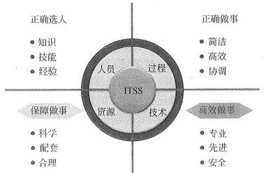

（1）规划设计：从客户业务战略出发，以需求为中心，参照 ITSS 对 IT 服务进行全面系统的 战略规划和设计，为 IT 服务的部署实施做好准备， 以确保提供满足客户需求的 IT 服务；

（2）部署实施：依据 ITSS 建立管理体系、部署专用工具及服务解决方案； （19 上 10）

（3）服务运营：根据服务部署情况，依据 ITSS,采用过程方法， 全面管理基础设施、服务流 程、人员和业务连续性，实现业务运营与 IT 服务运营融合；

（4）持续改进：根据服务运营的实际情况，定期评审 IT 服务满足业务运营的情况，以及 IT 服务本身存在的缺陷，提出改进策略和方案，并对 IT 服务进行重新规划设计和部署实施， 以提高 IT 服务质量；

（5）监督管理： 本阶段主要依据 ITSS 对 IT 服务服务质量进行评价， 并对服务供方的服务过 程、交付结果实施监督和绩效评估。

3 、ITSS  体系的提出主要从业务分类、服务管控、服务安全、服务业务、外包、对象、和行 业等几个方面考虑， 分为基础标准、服务管控标准、服务外包标准、业务标准、安全标准、  行业应用标准 6 大类。 （掌握）

（2） 问题是指： 多个具有相同症状反复出现的事件、或者出现一个严重的未知根源的故障。 问题管理的目标是消除引起事件的深层次根源，以防事件再次发生，将事件对业务的影响降 到最低程度。

5、信息系统审计的目的是评估并提供反绩、保证和建议。其关注之处可分为 3 类，分别是

可用性、保密性、完整性； （16 下 12）

6、信息系统审计的主要组成部分包括以下 6 个方面：（1）信息系统的管理、规划与组织（2） 信息系统技术基础设施与操作实务（3） 资产的保护（4） 灾难恢复与业务持续计划（5） 应用系统  开发、获得、实施与维护（6） 业务流程评价与风险管理（17 下 11）

7、信息系统审计原则： ISACA 公告、 ISACA 公告职业准则、 ISACA 职业道德规范（18 上 11）

8 、COBIT（信息及相关技术控制目标） 基于五条基本原则治理和管理企业 IT:

（1）满足利益相关者需求；

（2）端到端覆盖企业；

（3）采用单一集成框架；

（4）启用一种综合的方法；

（5）区分治理和管理。

9、基于风险的审计方法审计内涵有：企业风险、确定风险、风险评估、风险管理、风险沟通。

10、基于风险方法来进行审计的步骤如下：（19 上 11）

①编制组织使用的信息系统清单并对其进行分类。

②决定哪些系统影响关键功能和资产。

③评估哪些风险影响这些系统及对商业运作的冲击。

④在上述评估的基础上对系统分级，决定审计优先值、资源、进度和频率。审计者可以 制定年度审计计划， 开列出一年之中耍进行的审计项目。

11、信息系统审计流程 P132 图（18 下 11）

本章历年考题和答案解析汇总：

1、系统集成资质---现在基本上不考了，可不看!

### 2、监理

#### 【试题 1】---2009 上真题 4

1、信息系统工程监理活动的主要内容被概括为“四控、三管、一协调”，其中“三管”是指（1）。

（1）A.整体管理、范围管理和安全管理     B.范围管理、进度管理和合同管理

C.进度管理、合同管理和信息管理     D.合同管理、信息管理和安全管理

#### 【答案】D

#### 【解析】P67 此题考察的是监理的主要内容，必须掌握，高频考点

监理活动的主要内容被概括为“四控、三管、 一协调”，详细解释如下:

四控：质量控制；进度控制；投资控制； 变更控制。

三管：合同管理：信息管理：安全管理。

一协调：在信息系统工程实施过程中协调有关单位及人员间的工作关系。

#### 【点评】多次考了，监理的四控三管以一协调，必须记住，送分

#### 【试题 2】---2009 上真题 55

2、监理机构应要求承建单位在事故发生后立即采取措施， 尽可能控制其影响范围，并及时签发停 工令，报（2）。

（2）A.监理单位技术负责人  B.项目总监理工程师 C.承建单位负责人  D.业主单位 【答案】D

#### 【试题 3】---2009 上真题 56

3、对于（3）应实行旁站监理。

（3）A.工程薄弱环节     B.首道工序   C. 隐蔽工程  D.上、下道工序交接环节

#### 【答案】C

#### 【试题 4】 ---2009 下真题 7

4、以质量为中心的信息系统工程控制管理工作是由 3 方分工合作实施的，这 3 方不包括（4）。

（4）A.主建方    B.承建方    C.评测单位    D.监理单位

#### 【答案】C

#### 【解析】P69此题考察的是监理知识， 必须掌握，高频考点

以质量为中心的信息系统工程的控制管理工作由建设单位（主建方）、集成单位（承建单位） 和监理单位分工合作实施。

#### 【点评】考的不是很多，但是必须知道，必须得分

#### 【试题 5】---2010 下真题 5

5、信息系统工程监理要遵循“四控， 三管， 一协调”进行项目监理， 下列（5）活动属于“三管 ” 范畴。

（5）A.监理单位对系统性能进行测试验证

B.监理单位定期检查、记录工程的实际进度情况

C.监理单位应妥善保存开工令、停工令

D.监理单位主持的有建设单位与承建单位参加的监理例会、专题会议

#### 【答案】C

#### 【解析】P67  此题考察的是监理知识，必须掌握， 高频考点

监理活动的内容被概括为“四控、三管、 一协调”。

（1）四控：信息系统工程质量控制;信息系统工程进度控制;信息系统工程投资控制;信息系统工程变更控制。 	（2）三管：信息系统工程合同管理;信息系统工程信息管理;信息系统工程安全管理。

（3）一协调：在信息系统工程实施过程中协调有关单位及人员间的工作关系。

根据上述定义，选项 A 属于信息系统工程质量质量控制;选项 B 属于信息系统工程进度控制;选项 C 属于信息 系统工程信息管理;选项 D 属于在信息系统工程实施过程中协调有关单位及人员间的工作关系。

#### 【点评】常考，命题的热点，简单题， 必须得分

#### 【试题 6】---2010 下真题 6

6、信息系统工程监理活动被概括为“四控、三管、 一协调”， 其中三管是指（6）。

（6） A.合同管理、信息管理、安全管理    B.成本管理、进度管理、质量管理 C.整体管理、范围管理、沟通管理    D.采购管理、变更管理、风险管理

#### 【答案】A

#### 【解析】P67此题考察的是监理知识， 必须掌握，高频考点

答案解析参见上题， 一样的！！！

#### 【点评】监理的内容，多次考了，简单，必须得分

#### 【试题 7】---2012 下真题 6

7、信息系统工程监理活动被概括为“四控、三管、 一协调”， 其中三管是指（7）。

（7） A.合同管理、信息管理、安全管理    B.成本管理、进度管理、质量管理 C.整体管理、范围管理、沟通管理    D.采购管理、变更管理、风险管理

#### 【答案】A

#### 【解析】P67此题考察的是监理知识， 必须掌握，高频考点

答案解析参见上题， 一样的！！！

#### 【点评】监理的内容，多次考了，简单，必须得分

#### 【试题 8】---2013 上真题 9

8、信息系统工程监理单位在信息系统工程实施过程中的职责不包括 8  。

（8）A.审查和处理工程变理      B.审查分包单位的资质

C.审批工程延期            D.修订项目技术方案

#### 【答案】D

#### 【解析】P67此题考察的是监理知识， 必须掌握，高频考点

监理内容：四控三管一协调，用排除法，A 属于变更控制，B 属于合同管理， C 属于进度控制，D 修订项目技 术方案是承建方的工作，故选 D ；

#### 【点评】监理的内容，多次考了，简单，必须得分

#### 【试题 9】 ---2013 下真题 9

9、监理活动的主要内容可以概括为“四控、三管、 一协调”，其中四控包含（9）。 1.质量控制   2.风险控制   3.投资控 4.进度控制   5.范围控制   6.变更控制

（9）A.1234        B.1245          C.1345            D.1346

#### 【答案】D

#### 【解析】P67此题考察的是监理知识， 必须掌握，高频考点

答案解析参见上题， 一样的！！！

#### 【点评】多次考了，很重要，必须得分

#### 【试题 10】---2014 上真题 8

10、信息系统工程监理活动的主要内容被概括为“四控、三管、 一协调”，以下选项中不属于“四 控”的是（10）

（10）A.信息系统工程质量控制    B. 队信息系统工程进度控制

C.信息系统工程安全控制    D.信息系统工程变更控制

#### 【答案】C

#### 【解析】 此题考察的是监理知识，必须掌握，几乎必考

四控是质量控制、进度控制、投资控制、变更控制。

#### 【点评】监理的内容，考烂了，简单啊

#### 【试题 11】---2014 上真题 9~10

11、监理实施细则是指导监理单位各项监理活动的技术、经济、组织和管理的综合性文件，信息 系统工程监理实施细则是在（9）的基础上, 由项目总监理工程师主持， 专业监理工程师参加，根据 监理委托合同规定范围和建设单位的具体要求， 以（10）为对象而编制。

（9）A.监理规划           B.监理大纲  C.建设舍同             D.监理合同

（10）A.被监理的承建单位  B.监理机构  C.被监理的信息系统项目 D.建设

#### 【答案】A.C

#### 【解析】 此题考察的是监理知识，必须掌握，高频考点

监理规划应在签订监理合同及收到设计文件后开始编制，完成后，应该经过总监理工程师的审核 批准，并应该在召开第一次实施会议之前报送到信息工程承建单位。监理规划是以被监理的信息 工程项目为对象而编制的，用以指导监理单位监理实施全过程各项监理活动的技术、经济、组织 和管理的综合性文件；

#### 【点评】监理知识，首次考，但是原来高级常考，讲课也讲过，必须得分的

#### 【试题 12】---2014 下真题 9

12、信息系统工程监理活动的主要内容被概括为“四控、三管、一协调”，其中“三管”是指（12）。

（12）A.整体管理、范围管理和安全管理     B.范围管理、进度管理和合同管理

C.进度管理、合同管理和信息管理     D.合同管理、信息管理和安全管理

#### 【答案】D

#### 【解析】P67此题考察的是监理的知识点，必须掌握，高频考点

“四控”：进度控制、质量控制、成本控制、变更控制

“三管”：合同管理、安全管理、文档管理

“一协调”：沟通与协调业主、承建方、设备和材料供应商之间的关系。

#### 【点评】送分题，多次考了，简单

### 3、服务管理知识

#### 【试题 1】---2015 下真题 8

1、信息技术服务业态有：技术咨询服务、设计开发服务、信息系服务、数据处理和运维服务等， 其管理核心可用 4 个要素来描述。按照 ITSS 定义， 信息技术服务的 4 个核心要素是( )  ;

（2）A.人员、过程、工具、技术    B.人员、资源、技术、过程

C.供应商、工具、过程、技术  D.供应商、服务人员、流程、工具

#### 【答案】B

#### 【解析】 此题考察的是服务管理 ITSS 基本内容，首次考，稍微了解下

ITSS 定义了 IT 服务由人员、过程、技术和资源组成，并对这些 IT 服务的组成要素进行标准化; 组成要素包括人员 people、流程 process、技术 technology 和资源 resource,简称 PPTR

#### 【点评】考的不多，稍微记忆下即可的

#### 【试题 2】---2015 下真题 9

2、所有以满足企业和机构业务发展而产生的信息化需求为目的，基于（ ）的专业信息技术咨询 服务、系统集成服务、技术支持服务等工作，都属于信息系统服务的范畴。

（2）A.互联网与信息技术       B.互联网与信息理念

C.信息技术与信息化理念   D.工业化和信息化

#### 【答案】C

#### 【解析】 此题考察的是信息系统服务，考的不多

信息系统服务是一个范围相当广泛的概念，所有以满足企业和机构的业务发展所带来的信息化需 求为目的，基于信息技术和信息化理念而提供的专业信息技术咨询服务、系统集成服务、技术支 持服务等工作，都属于信息系统服务的范畴。

#### 【点评】考的不多，稍微记忆下即可的

#### 【试题 3】---2016 上真题 8

3、根据 GB/T29264-2012《信息技术服务分类与代码》规定，信息技术服务包括：信息技术咨询 ③;信息系统集成实施服务；运行维护；数据处理和存储；运营服务；数字内容服务；数字内容 服务；呼叫服务等其它信息技术服务。

A.设计与开发   B.信息系统工程监理  C.测试评估   D.信息系统设计

#### 【答案】A

#### 【解析】 此题考察的是信息技术服务，了解，首次考

信息技术服务定义：指供方为需方提供如何开发、应用信息技术的服务，以及供方利用信息技术

提供支持需方业务流程的服务。【基础标准工作组】

注 1：简称 IT 服务。

注 2： 信息技术服务的常见形式有： 信息技术咨询、 IT 运维、软件开发和部署、测试、数据处理、 系统集成、培训、租赁等。

#### 【点评】偏题，考的少，了解下

#### 【试题 4】 ---2016 上真题 9

4、某银行与某信息系统运维公司签订了机房的运维服务合同， 其中规定一年中服务器的宿机时间 不能超过 5 小时。该条款属于（4）中的内容。

A.付款条件   B.服务级别协议   C.合同备忘录   D.服务管理规范

#### 【答案】B

#### 【解析】 此题考察的是服务级别协议，必须掌握，高频考点

服务级别协议是指提供服务的企业与客户之间就服务的品质、水准、性能等方面所达成的双 方共同认可的协议或契约。

典型的服务级别协议包括下列内容：参与各方对所提供服务及协议有效期限的规定；服务提 供期间的时间规定，包括测试、维护和升级； 对用户数量、地点以及/或提供的相应硬件的服 务的规定；对故障报告流程的说明，包括故障升级到更高水平支持的条件。应包括对故障报 告期望的应答时间的规定；对变更请求流程的说明。可能包括完成例行的变更请求的期望时 间；对服务级别目标的规定；与服务相关的收费规定；用户责任的规定（用户培训、确保正 确的桌面配置、没有不必要的软件、没有妨碍变更管理流程等）； 对解决与服务相关的不同 意见的流程说明。

#### 【点评】送分题，之前考过类似的，理解下就好把题目做出来

#### 【试题 5】---2016 上真题 10

5、以下技术服务工作中，（5）不属于 IT 系统运行维护。

A.某大型国企中， 对于用户终端的软件及硬件管理和日常维护

B.对提供互联网服务的机房内各类服务器、网络设备、网络安全、网络性能等进行监控和故障恢复

C.对某省税务局的税务稽查系统的使用情况进行监测、对其数据库定期检查、优化、备份 D.某工业企业由于业务流程变化，对其使用的生产管理系统进行升级改造

#### 【答案】D

#### 【解析】 此题考察的是 IT 运维，必须掌握，高频考点

所谓 IT 运维管理，是指单位 IT 部门采用相关的方法、手段、技术、制度、流程和文档等，对 IT 如硬运行环境（软件环境、网络环境等）、 IT 业务系统和 IT 运维人员进行的综合管理。D 选项不 在运行状态，不是在维护，而是在升级改造，所以不是在进行系统运行维护;

#### 【点评】理解题，考的少，理解下就好把题目做出来

#### 【试题 6】---2016 上真题 12

6、事件管理是信息系统运维中的一项重要内容，其主要职能是（6）。

A.类似于系统日志，用于发现系统问题   B.发现并处理系统中存在的各种问题

C.管理信息系统中的事件反映           D.迅速恢复系统的正常功能

#### 【答案】D

#### 【解析】 此题考察的是事件管理，必须掌握，高频考点

事件管理流程是 IT 服务管理中的一个核心流程，提升事件管理时效性、回归事件管理本身属性， 可以提高 IT 服务的质量。事件管理流程大概如下：当一个事件输入的时候，首先要对事件进行检 查、定位。检查事件的时候要与它不断交互，明确它的影响范围和紧急程度，还要进行初步的归 类评估。B 和 C 都是需要做的，D 为最终的目的！

#### 【点评】送分题，考的少，理解下就好把题目做出来

#### 【试题 7】---2016 下真题 10

7、运维的主要工作是保证系统的可用性和稳定性。以下关于运行维护的叙述中， 不正确的是（）。 A.IS020000 及 GB/T24405 是运行维护工作可以参考的管理标准

B.ITSS 是国内自主知识产权的运行维护管理系统标准

C.运行维护业务不能被视为系统集成业务的以部分

D.基础设连的运维包括道路、水利设施、建筑物的维护，但其收入不能作为系统集成收入 【答案】C

#### 【解析】 此题考察的是 IT 运维，必须掌握，高频考点

运行维护业务是系统集成业务的一部分。

#### 【点评】送分题，常考，为第二版教材新增知识点， 必须得分

#### 【试题 8】---2016 下真题 11

8 、ITSS 规定了 IT 服务生命周期由 5 个阶段组成。 “定期评审 IT 服务满足业务运营的情况，以及 IT 服务本身存在的缺陷”是在（8）阶段的工作内容。

A.部署实施    B.服务运营    C.持续改进     D.监督管理

#### 【答案】C

#### 【解析】P122~123此题考察的是 IT 服务，必须掌握，高频考点

IT 服务生命周期由规划设计（Planning&Design）、部署实施（Implementing）、服务运营（0peration）、 持续改进（Improvement）和监督管理（Supervision）5 个阶段组成，简称 PI0IS。其中：

规划设计： 从客户业务战略出发，以需求为中心，参照 ITSS 对 IT 服务进行全面系统的战略

规划和设计，为 IT 服务的部署实施做好准备， 以确保提供满足客户需求的 IT 服务；

部署实施： 在规划设计基础上，依据 I.TSS 建立管理体系、部署专用工具及服务解决方案；

服务运营： 根据服务部署情况，依据 ITSS,采用过程方法， 全面管理基础设施、服务流程、人 员和业务连续性，实现业务运营与 IT 服务运营融合；

持续改进： 根据服务运营的实际情况， 定期评审 IT 服务满足业务运营的情况，以及 IT 服务 本身存在的缺陷， 提出改进策略和方案， 并对 IT 服务进行重新规划设计和部署实施，以提高 IT 服务质量；

监督管理： 本阶段主要依据 ITSS 对 IT 服务服务质量进行评价， 并对服务供方的服务过程、 交付结果实施监督和绩效评估。

#### 【点评】送分题，常考，为第二版教材新增知识点， 必须得分

#### 【试题 9】 ---2016 下真题 12

9、信息系统审计的目的是评估并提供反绩、保证和建议。其关注之处可分为 3 类，分别是（）。 A.保密性、及时性、完整性    B.可用性、及时性、准确性

C.保密性、准确性、完整性    D.可用性、保密性、完整性

#### 【解析】P127此题考察的是信息系统审计关注点，必须掌握，高频考点

信息系统审计的目的是评估并提供反绩、保证和建议。分为 3 类，分别是可用性、 保密性、完整性

#### 【点评】送分题，常考，必须得分

#### 【试题 10】---2017 上真题 10

10、信息技术服务标准（ITSS）所定义的 IT 服务四个核心要素是:人员、流程、资源和（）。 A.技术    B.工具    C.合作伙伴    D.持续改进

#### 【解析】P122此题考察的是 ITSS，必须掌握，高频考点

ITSS 定义了 IT 服务的核心耍素由人员、过程、技术和资源组成，并对这些 IT 服务的组成要素进 行标准化

#### 【试题 11】---2017 下真题 10

11、信息技术服务标准（ITSS）规定了 IT 服务的组成要素和生命周期， IT 服务生命周期由规划设 计、部署实施、服务运营、持续改进、（）五个阶段组成。

A.二次规划设计    B.客户满意度调查    C.项目验收    D.监督管理

#### 【解析】P122此题考察的是 IT 服务生命周期，必须掌握，高频考点

IT 服务生命周期由规划设计（Planning&Design）、部署实施（Implementing）、服务运营 （0peration）、持续改进（Improvement）和监督管理（Supervision）5 个阶段组成， 简称 PI0IS。

#### 【点评】常考，比较简单，必须得分

#### 【试题 12】---2017 下真题 11

12、（）不属于信息系统审计的主要内容。

A.信息化战略                B.资产的保护

C.灾难恢复与业务持续计划    D.信息系统的管理、规划与组织

#### 【答案】A

#### 【解析】P130此题考察的是信息系统审计的内容，了解

信息系统审计的主要组成部分包括以下 6 个方面：（1）信息系统的管理、规划与组织（2） 信息系 统技术基础设施与操作实务（3）资产的保护（4）灾难恢复与业务持续计划（5）应用系统开发、 获得、实施与维护（6）业务流程评价与风险管理

#### 【试题 13】---2018 上真题 10

13、信息技术服务标准（ITSS）定义了 IT 服务的核心要素由人员、过程、技术和资源组成。() 要素关注“正确做事”。

A.人员    B.过程    C.技术    D.资源

#### 【答案】B

#### 【解析】P123此题考察的是 PPTR 必须掌握，高频考点

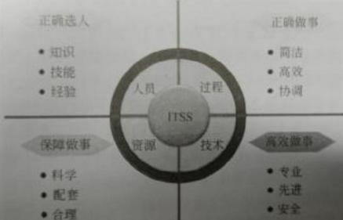

#### 【点评】以前考过，常考，比较简单， 必须得分

14 、一般公认信息系统审计原则不包括（）。

A.ISACA 公告    B.ISACA 公告职业准则    C.ISACA 职业道德规范    D.COBIT 框架

#### 【解析】一般公认信息系统审计原则包括：ISACA 公告、ISACA 公告职业准则、ISACA 职业道德规范

15、信息技术服务标准（ITSS）是套成体系和综合配套的标准库， 用于指导实施标准化和可信赖的 IT 服， ITSS 定义的服务生命周期不包括（）。

A.战略部署    B.规划设计    C.部署实施    D.服务运营

#### 【解析】IT 服务生命周期由规划设计（Planning&Design）、部署实施（Implementing）、服务运营（0peration）、持续改进（Improvement）和监督管理（Supervision）5 个阶段， 简称 PI0IS。

16、针对信息系统审计流程，在了解内部控制结构、评价控制风险、传输内部控制后，下一步应当 进行（）。

A.有限的实质性测试  B.外部控制测试   C.内部控制测试    D.扩大的实质性测试

#### 【解析】在了解内部控制结构、评价控制风险、传输内部控制后，判断为是，下一步是内部控制测试。

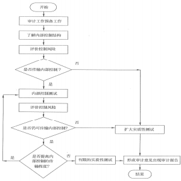

17、信息技术服务标准（ITSS）的 IT 服务生命周期模型中（） 是在规划设计基础上依据 ITSS 建 立管理体系、提供服务解决方案。

A.服务战略    B.部署实施    C.服务运营    D.监督管理

#### 【解析】部署实施：在规划设计基础上， 依据 ITSS 建立管理体系、部署专用工具及服务解决方案。

18、基于风险方法进行信息系统审计的步骤是（）。

①决定哪些系统影响关键功能和资产

②评估哪些风险影响这些系统及商业运作的冲击

③编制组织使用的信息系统清单并对其分类

④在评估的基础上对系统分级，决定审计优先值/资源/进度和频率

A.①②③④    B.①③②④    C.③①④    D.③①②④

#### 【解析】基于风险方法来进行审计的步骤如下：

（1）编制组织使用的信息系统清单并对其进行分类。

（2）决定哪些系统影响关键功能和资产。

（3）评估哪些风险影响这些系统及对商业运作的冲击。

（4） 在上述评估的基础上对系统分级， 决定审计优先值、资源、进度和频率。审计者可以制定年 度审计计划，开列出一年之中要进行的审计项目。

19、信息技术服务标准（ITSS）。

A.工具、技术、流程、服务    B.人员、过程、技术、资源

C.计划、执行、检查、纠正    D.质量、成本、进度、风险

#### 【解析】IT 服务的核心要素指的是人员、过程、技术、资源。

## 第七章、信息系统集成专业技术知识

考点分析与预测： 系统集成技术专业技术知识涉及的面非常的广， 一般每次考试考查 15 分 左右，此部分对有基础的朋友大家掌握历年的考点后，并不是很难，对于没有计算机基础的朋友 需要认真学习，此部分可能会涉及到超纲的知识点； 对待这些内容，大家需要掌握一定的答题技 巧，从历年考试的试题来看，历年考试的重点集中在系统集成的定义、特点， 常见的开发方法，	 软件需求，软件测试、软件维护，面向对象相关定义， UML 定义及其各种图，类之间的关系，软 件架构模式（比如 C/s，B/s 等），中间件定义及其分类， web service（定义、协议以及适用范 围、不适用范围等），J2EE 与.NET 基本知识，常用的构件，网络的分类， OsI 模型，网络的最基 本协议，网络的一些名词和网络服务，网络存储技术，网络接入技术，无线网络技术，网络的基 本命令等，希望大家予以重视。 大家在掌握历年的高频考点后， 尽量涉足其他内容；

本章内容，对于很多非计算机专业的人来说，难度应该很大，大家尽量得全分。特别是面向 对象、 UML、J2EE 与.NET 等知识点应该是绝大部分人的难点， 对于网络知识， 可能考的知识也太 多，也算是一个难点，大家尽量得分。非 IT 朋友别过于担心，在项目管理方面多得分吧！

### 重要考点 1、系统集成的特点

（需要掌握系统集成的特点，必考）

（09 上 1）（09 下 14）（10 上 1）（10 下 1）（11 上 1）（11 上 53）（12 上 1）（12 上 2）

1、信息系统建设的内容主要包括设备采购、系统集成、软件开发和运维服务等。信息系统集 成是指将计算机软件、硬件、网络通信、信息安全等技术和产品集成  为能够满足用户特定需求的 信息系统。（14 下 28）

### 重要考点 2、信息系统的生命周期

（需要掌握信息系统生命周期每个阶段的特征的特点）

信息系统生命周期 4 阶段： 立项（规划），开发，运维，消亡（花开云散）（09 下 8）（17 上 12）

（19 下 10）

1、立项阶段： 即概念阶段  或需求阶段，这一阶段根据用户业务发展和经营管理的需要， 提出 建设信息系统的初步构想；然后对企业信息系统的需求进行深入调研和分析，形成 《需求规格说 明书》 并确定立项。（16 下 13）（18 上 12）

2、开发阶段（关键）  ：开发阶段： 以立项阶段所做的需求分析为基础， 进行总体规划。之后， 通过系统分析（建模）、系统设计、系统实施、系统验收等工作实现并交付系统。（13 上 7）（14

上 25）（15 下 27）

3、运维阶段： 信息系统通过验收， 正式移交用户。分为更正性、适应性、完善性、预防性维 护等四个主要类型（17 下 12）

### 重要考点 3、信息系统的开发方法

 常用的开发方法有结构化、原型、和面向对象（09 下 9）（12 上 7）

结构化开发方法利用图形表达用户需求，使用的手段主要有数据流图、数据字典、结构化语 言、判定表以及判定树等（16 上 14）（17 上 14）

2 、原型法：其认为在无法全面准确地提出用户需求的情况下， 并不要求对系统做全面、详细 的分析，而是基于对用户需求的初步理解， 先快速开发一个原型系统，然后通过反复修改来 实现用户的最终系统需求。原型法的特点在于其对用户的需求是动态响应、逐步纳入的；系 统分析、设计与实现都是随着对原型的不断修改而同时完成的，  相互之间并无明显界限，  也 没有明确分工。--第二版教材修改（18 下 12）

特点： 实际可行、具有最终系统的基本特征、构造方便、快速、造价低。（13 上 11）删除

适于用户需求开始时定义不清、管理决策方法结构化狂度不高的系统开发，开发方法更宜被

用户接受；但如果用户配合不好，盲目修改，就会拖延开发过程。 分类： 抛弃型原型、进化 型原型；用于需求不明、管理方法结构化程度不高的系统；

3 、面向对象方法：用对象表示客观事物， 对象是一个严格模块化的实体， 在系统开发中可被 共享和重复引用，以达到复用的目的。其关键是能否建立一个全面、合理、统一的模型，既 能反映需求对应的问题域，也能被计算机系统对应的求解域所接受。

—     面向对象方法主要涉及分析、设计和实现三个阶段。其特点是在整个开发过程中使用的是同 一套工具。 整个开发过程实际上都是对面向对象三种模型的建立、补充和验证。因此， 其分 析、设计和实现三个阶段的界限并非十分明确。

### 重要考点 4、信息系统设计

（了解软件设计的原则、逆向工程等相关名词的概念）

1、软件设计的原则为高内聚、低糯合。

-  内聚性是一个模块内部各个元素之间彼此结合的紧密程度的度量；

-  糯合性是模块间互相连接的紧密程度的度量，它反映了模块的独立性

2、信息系统设计是开发阶段的重要内容， 其主要任务是①从信息系统的总体目标出发， 根据 系统逻辑功能的要求，并结合经济、技术条件、运行环境和进度等要求，②确定系统的总体 架构和系统各组成部分的技术方案，合理选择计算机、通信及存储的软、硬件设备，③制订 系统的实施计划。（17 下 13）

3、系统方案设计包括总体设计和各部分的详细设计（物理设计） 两个方面。

（1）            ：包括系统的总体架构方案设计、软件系统的总体架构设计、数据存储的 总体设计、计算机和网络系统的方案设计等。（17 下 13）（19 上 13）

（2）             ：包括代码设计、数据库设计、人/机界面设计、处理过程设计等软件设计

4、系统架构是将系统整体分解为更小的子系统和组件，从而形成不同的逻辑层或服务。之后，

进一步确定各层的接口，层与层相互之间的关系。对整个系统的分解，

| 分解， 也需要对同一逻辑层分块， 进行“横向”分解 |
|---|

5、软件设计：根据软件需求， 产生一个软件内部结构的描述， 并将其作为软件构造的基础。 通过软件设计，描述出软件架构及相关组件之间的接口；然后，进一步详细地描述组件，以 便能构造这些组件。通过软件设计得到要实现的各种不同模型，并确定最终方案。其可以划 分为                               和            两个阶段。

### 重要考点 5、设备、 DBMS 及技术选型

1、在系统设计中进行设备、DBMS  及技术选型时， 不只要考虑系统的功能要求，还要考虑 到系统实现的内外环境和主客观条件。

2、在选型时，需要权衡各种可供选用的计算机硬件技术、软件技术、数据管理技术、数据通 信技术和计算机网络技术及相关产品。同时，必须考虑用户的使用要求、系统运行环境、现 行的信息管理和信息技术的标准、规范及有关法律制度等。

### 重要考点 6、软件需求  （10 上 10）（11 下 10）（12 上 10）（12 下 7）

（需要掌握信息系统开发方法包含哪些？各自的定义和特点适用情况）

1、软件需求是针对待解决问题的特性的描述。所定义的需求必须可以被验证（可验证性）。

在资源有限时，可以通过优先级对需求进行权衡。通过需求分析，可以①检测和解决需求之间的

冲突；②发现系统的边界；③并详细描述出系统需求（14 上 13）（15 下 14）（17 下 14）

2、软件需求包括 3 方面：

—   功能需求： 是指系统必须完成的那些事；

—   非功能需求： 是指产品必须具备的属性或品质， 比如可靠性，容错等；

—   设计约束： 也称为限制条件、补充规约，例如必须采用国有自主知识版权的数据库系统， 必须运行在 UNIX 操作系统之下等；

—  业务需求表示组织或客户高层次的目标。业务需求通常来自项目投资人、购买产品的客户、

实际用户的管理者、市场营销部门或产品策划部门。（16 上 15）

—  用户需求描述的是用户的目标，或用户要求系统必须能完成的任务。

—  功能需求规定开发人员必须在产品中实现的软件功能， 用户利用这些功能来完成任务，满足 业务需求。

4、 常用需求分析方法包括:结构化分析方法（SA）、面向对象的分析方法（00A）。（18 下 31）

### 重要考点 7、软件测试

（需要掌握软件测试的注意点，分类以及各自的特点、软件测试的工具等）

1、软件测试测试是为了评价和改进产品质量、识别产品的缺陷和问题而进行的活动。软件测 试是针对一个程序的行为，在有限测试用例集合上，                              软件测 试应尽可能在实际运行使用环境下进行。测试不再只是一种仅在编码阶段完成后才开始的活 动。现在的软件测试被认为是一种应该包括在整个开发和维护过程中的活动，它本身是实际 产品构造的一个重要部分。（14 下 10）（16 下 14）（17 上 15）

测试人员认为程序出现错误， 要对错误结果进行一个确认过程。 一般由 A 测试出来的错误，  一定要由 B 来确认。严重的错误可以            进行讨论和分析，对测试结果要进行严格 地确认，是否真的存在这个问题以及严重程度等

2、软件测试有如下几大原则：（10 上 9）（10 下 10）（12 下 8）

（1）软件开发人员即程序员应当避免测试自己的程序（单元测试除外） （2）应尽早地和不断地进行软件测试

（3） 对测试用例要有正确的态度：第一，测试用例应当由测试输入数据和预期输出结果这两 部分组成； 第二， 在设计测试用例时， 不仅要考虑合理的输入条件， 更要注意不合理的输入条件。

（4） 要充分注意软件测试中的群集现象，也可以认为是“80-20 原则”。不要以为发现几个错 误并且解决这些问题之后，就不需要测试了。 反而这里是错误群集的地方，对这段程序要重点测 试，以提高测试投资的效益。

（5）严格执行测试计划， 排除测试的随意性， 以避免发生疏漏或者重复无效的工作。 （6）应当对每一个测试结果进行全面检查。

（7） 妥善保存测试用例、测试计划、测试报告和最终分析报告，以备回归测试及维护之用。

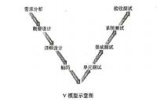

3、软件测试可分为以下类型（11 上 8）

从是否关心软件内部结构和具体实现的角度划分白盒测试、黑盒测试、灰盒测试。

从是否执行程序的角度划分静态测试和动态测试

从软件开发的过程按阶段划分有单元测试、集成测试、确认测试、系统测试、验收测试

黑盒测试：已知产品的功能设计规格，可以进行测试证明每个实现了的功能是否符合要求。

白盒测试：已知产品的内部工作过程，可以通过测试证明每种内部操作是否符合设计规格要 求，所有内部成分是否以经过检查。

|  | 测试种类 | 定义、分类 |
|---|---|---|
| 1 | 黑盒测试 | 不考虑模块内部结构，只在其接口进行测试。 1）等价类划分：将所有可能的输入数据划分为几类，从每一类中选取具有 代表性的数据作为测试用例。 2）边界值法：选取刚好等于、刚刚大于或者刚刚小于输入范围边界的值作 为测试数据。 3）错误推测法： 根据程序中所有可能的错误和容易发生错误的特殊情况设 计测试用例。 4）因果图法： 利用输入条件的多种组合产生相应多个动作的方式设计测试用例。 |
| 2 | 白盒测试 | 对程序所有的逻辑分支进行测试， 逻辑覆盖属于典型的白盒测试 |
| 3 | a 测试 | 一个用户在开发环境下进行的测试，或者公司内部用户在模拟实际操作环境 下进行的测试。 |
| 4 | β测试 | 软件的多个用户在实际使用环境下进行的测试。 |

4、软件测试按阶段和目的可分为： 单元测试、集成测试、系统测试、验收测试等。（16 上 19）

| 1 | 单元测试 | 是对每个模块进行测试。主要目的是针对编码过程中可能存在的各种错误，例如 用户输入验证过程中的边界值的错误。 |
|---|---|---|
| 2 | 集成测试 | 在单元测试的基础上， 将所有模块按照设计要求组装成系统，必须精心计划，应 提交集成测试计划、集成测试规格说明书和集成测试分析报告。 主要目的是针对 详细设计中可能存在的问题， 尤其是检查各单元与其他程序部分之间的接口上可 能存在的错误。（16 上 19） |
| 3 | 系统测试 | 将软件放在整个计算机环境下， 在实际运行环境中进行一系列的测试，发现软件 与系统定义不符合或矛盾的地方。 |
| 4 | 验收测试 | 验证软件的功能、性能以及其他特性是否与用户的要求一致。 |

5、软件测试相关的 V 模型：（15 上 27）（15 下 28）

V 模型的左边下降的是开发过程各阶段，与此相对应 的是右边上升的部分，价值在于： 非常明确地标明了 测试过程中存在的不同级别，并且清楚地描述了这些 测试阶段和开发各阶段的对应关系。换而言之， 应该

| 从信息系统项目 | 需求分析阶段 | 就开始谋划、编写验收 |
|---|---|---|

测试计划。

6、回归测试是指在发生修改之后重新测试先前的测试以保证修改的正确性。回归测试的目的 在于验证以前出现过但已经修复好的缺陷不再重新出现。 一般指对某已知修正的缺陷再次围 绕它原来出现时的步骤重新测试。（13 下 61）

7、模糊测试是指将一个随机的、非预期的数据源作为程序的输入，然后系统地找出这些输入 所引起的程序失效。抢在别人之前来揭示软件易受攻击的弱点。（11 上 6）

### 重要考点 8、软件维护

（需要掌握软件维护的种类，各自特点，软件维护的原则等）  （10 下 11）（11 上 11）

1、软件维护包括如下类型（就是鱼丸）：交付软件产品后进行的修改是它们的共同特征；

（1）更正性维护： 软件产品交付后进行的修改，以更正发现的问题。 （修改 BUG）其主要内

容包括:（1）设计错误（2）程序错误（3）数据错误（4）文档错误。（19 上 12）

（2）适应性维护： 软件产品交付后进行的修改， 以保持软件产品能在变化后或变化中的环境 中可以继续使用。 （系统移植）（15 下 15）（16 上 11）（17 下 16）

主要内容包括:

（1）影响系统的规则或规律的变化 ;

（2）硬件配置的变化，如机型、终端、外部设备的改变等 ;

（3）数据格式或文件结构的改变 ;

（4）软件支持环境的改变，如操作系统、编译器或实用程序的变化等。

（3）完善性维护： 软件产品交付后进行的修改， 以改进性能和可维护性。（增加功能，工作量最大）  主要内容包括:

（1）为扩充和增强功能而做的修改，如扩充解题范围和算法优化等 ;

（2）为改善性能而作的修改， 如提高运行速度、节省存储空间等 ;

（3）为便于维护而做的修改， 如为了改进易读性而增加一些注释等。

（4）预防性维护： 软件产品交付后进行的修改， 以在软件产品中的潜在错误成为实际错误前， 检测和更正它们。 （针对未来）

2、系统需求将软件维护定义为需要提供软件支持的全部活动。这些活动包括在交付前完成的 活动，以及交付后完成的活动。 交付前要完成的活动包括交付后的运行计划和维护计划  等。 交付后的活动包括软件修改、培训、帮助资料等

### 重要考点 9、软件质量保证和质量评价

（需要掌握下列相关名词术语的定义和区别等）

1、软件质量： 内部质量、外部质量和使用质量；        定义了软件质量特性，及确认这些

特性的方法和原则；（19 下 11）

：、验证与确认： 确定某一活动的产品是否符合活动的需求， 最终的软件产品是否达到其意图 并满足用户需求。

-  验证过程试图确保活动的输出产品已经被正确构造，即活动的输出产品满足活动的规范

说明；（18 上 14）

-  确认过程则试图确保构造了正确的产品，即产品满足其特定的目的。

3、评审与审计过程包括： 管理评审、技术评审、检查、走查、审计等。（09 上 6） --掌握 	（1）管理评审： 是监控进展， 决定计划和进度的状态，或评价用于达到目标所用管理方法的有效性。 	（2）技术评审：评价软件产品，以确定其对使用意图的适合性

（3）软件审计： 提供软件产品和过程对于可应用的规则、标准、指南、计划和流程的遵从性 的独立评价，审计是事后进行的；  。审计是  正式组织的活动

4、软件配置管理活动包括软件配置管理计划、软件配置标识、软件配置控制、软件配置状态 记录、软件配置审计、软件发布管理与交付等活动

 5、软件过程管理涉及技术过程和管理过程， 通常包括以下几个方面： （1）项目启动与范围定 义（2）项目规划（3）项目实施（4）项目监控与评审（5）项目收尾与关闭

6、软件配置管理计划的制定需要了解组织结构环境和组织单元之间的联系， 明确软件配置控 制任务。软件配置标识活动识别要控制的配置项，并为这些配置项及其版本建立基线。软件 配置控制关注的是管理软件生命周期中的变更。            记录标识、收维护并报告配置 管理的配置状态信息。软件配置审计是独立评价软件产品和过程是否遵从己有的规则、标准、 指南、计划和流程而进行的活动。 软件发布管理和交付通常需要创建特定的交付版本，完成 此任务的关键是软件库。（18 下 14）

7、软件开发工具：

软件需求工具包括需求建模工具和需求追踪工具。

软件设计工具包括软件设计创建和检查工具。

软件构造工具包括程序编辑器、编译器、代码生成器、解释器、调试器等。

软件测试工具包括测试生成器、测试执行框架、测试评价工具、测试管理工具、性能分析工具。

软件维护工具包括理解工具（如可视化工具）和再造工具（如重构工具）。

软件配置管理工具包括追踪工具、版本管理工具和发布工具。（19 上 14）

软件工程管理工具包括项目计划与追踪工具、风险管理工具和度量工具。

软件工程过程工具包括建模工具、管理工具、软件开发环境。

软件质量工具包括检查工具和分析工具。

一般考点 10、软件复用

（需要掌握软件复用的定义，有哪些复用类型等）

1、软件复用是指利用已有软件的各种有关知识构造新的软件， 以缩减软件开发和维护的费用。 软件复用是提高软件生产力和质量的一种重要技术。 （把以前重复的东西拿来用，二次开发） 按抽象程度高低， 可以分为代码级复用、设计的复用、分析的复用和测试信息的复用、知识、 开发经验、设计决策、架构、需求、设计、代码和文档等一切有关方面。软件重用可以减少 软件开发活动中大量的重复性工作，可以提高生产率，降低开发成本，缩短开发周期，也可

以改善软件质量（09 下 10）

### 重要考点 11、面向对象

（需要掌握面向对象相关名词的概念以及它们之间的关系等）

1、面向对象的基本概念： 对象、类、抽象、封装、继承、多态、接口、消息、组件、模式、复用

| 1 | 对象 | 对象是由数据及其操作所构成的封装体， 对象包含三个基本要素， 分别是对象标识、 对象状态和对象行为;  是系统中用来描述客观事物的一个模块，是构成系统的基本单 位。用计算机语言来描述，对象是由一组属性和对这组属性进行的操作构成的。 张三是教师这个类实例化后的一个对象，教师是封装的类， 授课是成员方法， 姓名、 性别、年龄、职位是成员属性。（19 下 12） |
|---|---|---|
| 2 | 类 | 现实世界中实体的形式化描述，类将该实体的属性（数据） 和操作（函数） 封装在一起 |

类和对象的关系可以总结为： （10 下 18）（18 上 15）--第二版教材删除，掌握

1）每一个对象都是某一个类的实例；

2）每一个类在某一时刻都有零或更多的实例；

3）类是静态的，对象是动态的

4）类是生成对象的模板。

类和对象的关系可理解为， 对象是类的实例，类是对象的模板。如果将对象比作房子，那么 类就是房子的设计图纸。

| 3 | 抽象 | 通过特定的实例抽取共同特征后形成概念的过程， 对象是现实世界中某个实体的抽 象，类是一组对象的抽象。 |
|---|---|---|
| 4 | 封装 | 将相关的概念组成一个单元，然后通过一个名称来引用它。面向对象封装是将数据 和基于数据的操作封装成一个整体对象，对数据的访问或修改只能通过对象对外提 供的接口进行。（09 下 18）（18 下 15） |
| 5 | 继承 | 继承表示类 之间的层次关系，继承又可分为单继承和多继承（09 下 17）（12 下 17） 	（16 下 15）继承自父类的属性特征，不需要在子类中进行重复说明（17 下 15） |
| 6 | 多态 | 使得在多个类中可以定义同一个操作或属性名，并在每个类中可以  有不同的实现。 多态使得某个属性或操作在不同的时期可以表示不同类的对象特性。（19 上 15） 多态，是面向对象的程序设计语言最核心的特征。多态，意味着一个对象有着多重 特征，可以在特定的情况下， 表现不同的状态， 从而对应着不同的属性和方法。 |
| 7 | 接口 | 接口就是对操作规范的说明， 其只说明操作应该做什么 |
| 8 | 消息 | 体现对象间的交互，通过它向目标对象发送操作请求（11 下 8） |
| 9 | 组件 | 表示软件系统可替换的、物理的组成部分， 封装了模块功能的实现。组件应当是内 聚的，并具有相对稳定的公开接口。 |
| 10 | 模式 | 描述了一个不断重复发生的问题，以及该问题的解决方案。其包括特定环境、问题 和解决方案三个组成部分。应用设计模式可以更加简单和方便地去复用成功的软件 设计和架构，从而帮助设计者更快更好地完成系统设计。 |
| 11 | 复用 | 软件复用是指将已有的软件及其有效成分用于构造新的软件或系统； |

2、面向对象系统分析的模型由用例模型、类-对象模型、对象-关系模型和对象-行为模型  组成。

3、面向对象系统设计基于系统分析得出的问题域模型， 用面向对象方法设计出软件基出架构（概 要设计）和完整的类结构（详细设计）  ，以实现业务功能。面向对象系统设计主要包括用例设计、 类设计和子系统设计等。

### 重要考点 12、UML

（需要掌握 UML 语言的特点、视图以及它们之间的关系等）

1 、UML 适用于各种软件开发方法、软件生命周期的各个阶段、各种应用领域以及各种开发工具；

2 、UML 是一种可视化的建模语言，而不是编程语言。不是过程，也不是方法，但允许任何 一种过程和方法使用它；UML 标准包括相关概念的语义， 表示法和说明， 提供了静态、动态、 系统环境及组织结构的模型。它比较适合用于选代式的开发过程，是为支持大部分现存的面 向对象开发过程而设计的，强调在软件开发中对架构、框架、模式和组件的重用，并与最佳  软件工程实践经验进行了集成。（09 下 15）（11 上 18）（11 下 17）

; 、RUP 模型是一种过程方法，它属于选代模型的一种。使用面向对象技术进行软件开发的最 佳实践。 其涵盖的最佳实践经验包括： 选代式开发、需求管理、使用以组件为中心的软件架 构、可视化建模、验证软件质量及控制变更等。（13 下 10）

4 、UML 视图的归纳总结图表：（09 上 11）（09 下 16）（10 下 8）（11 上 17）（12 下 13）

UML2.0 支持 13 种图，它们可以分成两大类：结构图和行为图。结构图包括类图、组合结构

图、构件图、部署图、对象图和包图；行为图包括活动图、交互图、用例图和状态机图，其中交 互图是顺序图、通信图、交互概览图和时序图的统称；

| 结 构 类 | 类图 | 描述系统的对象结构， 它们显示构成系统的对象类以及这些对象类之间的关系。 |
|---|---|---|
| 结 构 类 | 对象图 | 类似类图， 但并不描述对象类，它们对实际的对象实例建模—显示实例属性的当前值。 |
| 结 构 类 | 构件图 | 用来描述系统的物理结构，它可以用来显示程序代码如何分解模块。展示一组构件之间的组织和依赖。 |
| 结 构 类 | 部署图 | 描述系统中硬件和软件的物理架构，它描述构成系统架构的软件构件，处理器和设备。 |
| 行 为 类 | 用例图 | 以图形化的方式描述系统与外部系统及用户的交互， 描述用户需求。换句话说，它们以图形 化的方式描述了谁将使用系统，以及用户期望以什么方式与系统交互。帮助开发团队以一种可 视化的方式了解系统的功能需求， 包括基于基本流程的“角色”关系等。 |
| 行 为 类 |  | 以图形化的方式描述系统与外部系统及用户的交互， 描述用户需求。换句话说，它们以图形 化的方式描述了谁将使用系统，以及用户期望以什么方式与系统交互。帮助开发团队以一种可 视化的方式了解系统的功能需求， 包括基于基本流程的“角色”关系等。 |
| 行 为 类 | 顺序图 序列图 | 序列图用来描述对象之间动态的交互关系，着重体现对象间消息传递的时间顺 序。可为一个协作建模。 |
| 行 为 类 | 协作图 | 或称通信图。强调收发消息的对象的结构组织， 类似序列图， 但重点不是消息的时间顺序， 它 以一种网状格式表现对象之间的交互。 |
| 行 为 类 | 状态图 | 对一个特定对象的动态行为建模， 说明一个对象的生命周期---对象可以经历各种状态， 以及引 起对象从一个状态向另一个状态转换的事件。 |
| 行 为 类 | 活动图 | 活动图是一种特殊的状态图， 它展示了在系统内从一个活动到另一个活动的流程。 |
| 行 为 类 |  | 活动图是一种特殊的状态图， 它展示了在系统内从一个活动到另一个活动的流程。 |

5、UML 五个系统视图：（简记：裸狗不用进）

（1）逻辑视图：以问题域的语汇组成的类和对象集合。

（2） 进程视图：可执行线程和进程作为活动类的建模，它是逻辑视图的一次执行实例

（3） 构  建视图：对组成基于系统的物理代码的文件和组件进行建模。

（4）部  署视图：把组件物理地部署到一组物理的、可计算节点上。

（5） 用例视图：最基本的需求分析模型。

### 6、类之间的关系：

（1） 依赖关系---如果元素 A 的变化会引起元素 B 的变化，则 B 依赖于 A。 （2） 泛化关系---就是继承的反义词。

（3） 关联关系------聚合关系、组合关系表示两个类的实例之间存在的某种语义上的联系。

例如一个老师在某学校工作， 一个学校有多间教室。那么，教室和学校，学校和老师之间存 在着关联关系。

（4） 实现关系---用来规定接口和实现接口的类或组件之间的关系，接口是操作的集合，这 些操作用于规定类或组件的服务。

### 重要考点 13、软件架构  （需要掌握软件架构体系的分类和各自的特点适用情况等）

1、典型体系结构： （10 上 17）

|  | 模式 | 特点、适用情况 |
|---|---|---|
| 1 | 管道/过滤器模 式 | 体现了各功能模块高内聚、低糯合的“黑盒 ”特性， 支持软件功能模块的重用， 便于系统维 护；同时，每个过滤器自己完成数据解析和合成工作（如加密和解密），易导致系统性能下 降，并增加了过滤器具体实现的复杂性。其典型应用包括批处理系统。 |
| 2 | 面向对象模式 | 将模块数据的表示方法及其相应操作封装在更高抽象层次的数据类型或对象 中。其典型应用是基于组件的软件开发（CBD）（16 下 16） |
| 3 | 事件驱动模式 |  |
| 4 | 分层模式 | 采用层次化的组织方式， 每一层都为上一层提供服务， 并使用下一层提供的功能。 该模式允 许将一个复杂问题逐步分层实现。 其中的每一层最多只影响相邻两层，只要给相邻层提供相 同的接口， 就允许每层用不同的方法实现， 可以充分支持软件复用。其典型应用是分层通信 协议，如 ISO/OSI 的七层网络模型。 |
| 5 | C/S 模式 | 【二层 C/S三（N）层 C/SB/S】 |

2、软件架构是软件开发过程中的一项重要工作,  编写需求规格说明书不属于软件架构设计的 主要工作内容。

①目前主流的数据库系统是关系数据库；②HTML/HTTP（S）协议是实现 Internet 应用的重要技术。

### 重要考点 14、软件中间件

1、中间件（Middleware）是位于硬件、操作系统等平台和应用之间的通用服务。它位于客户 端/服务器的操作系统之上，借由中间件，解决了分布系统的异构问题。中间件服务具有标 准的程序接口和协议。不同的应用、硬件及操作系统平台，可以提供符合接口和协议规范的

多种实现， 其主要目的是实现应用与平台的无关性。借助中间件，屏蔽操作系统和网络协议的 差异， 为应用程序提供多种通讯机制， 满足不同领域的应用需要。（10 上 8）（10 上 18）（12 上 8）

（18 下 16）

2 、中间件是一类软件、而不是一种软件；

3、几种主要的中间件（19 下 15）python 是一种跨平台的面向对象的开发语言， 不是中间件。

（1）数据库访问中间件， 通过一个抽象层访问数据库，从而允许使用相同或相似的代码访问 不同的数据库资源。典型的技术如 Windows 平台的 ODBC 和 Java 平台的 JDBC 等。

（2）远程过程调用（RPC），是一种广泛使用的分布式应用程序处理方法。 一个应用程序使 用 RPC 来“远程”执行一个位于不同地址空间内的过程，从效果上看和执行本地调用相同。

（3）面向消息中间件（MOM），典型的产品如 IBM 的 MQseries 。（19 上 16）

（4）分布式对象中间件， 是建立对象之间客户/服务器关系的中间件，结合了对象技术与分 布式计算技术。该技术提供了一个通信框架，可以在异构分布计算环境中透明地传递对象请求。 典型的产品如 OMG 的 CORBA.sun 的 RIVU/EJB、Microsoft 的 DCOM 等。

### 重要考点 15、数据库和数据仓库

（09 下 28）（10 上 30）（11 下 30）（12 上 9）（12 上 30）（12 下 31）（13 上 28）（16 上 16）必考

1、数据仓库（ DW）是一个面向主题的、集成的、相对稳定的、反映历史变化的数据集合， 用于支持管理决策。 数据仓库是对多个异构数据源（包括历史数据）的有效集成，集成后按 主题重组， 且存放在数据仓库中的数据一般不再修改。

2 、前端工具主要包括各种报表工具、查询工具、数据分析工具、数据挖掘工具以及各种基于 数据仓库或数据集市的应用开发工具。其中数据分析工具主要针对 OLAP 服务器， 报表工具、 数据挖掘工具主要针对数据仓库。下图（15 下 16）（17 下 17）--第二版教材删除，了解

3、随着云时代的来临，大数据（BigData）吸引了越来越多的关注。业界将其特点归纳为 5 个“v ”——volume（数据量大）、variety（数据类型繁多）、velocity（处理速度快）、value （价值密度低）、veracity（真实性高）。大数据的意义不在于掌握庞大的数据信息， 而在于对 这些数据进行专业化处理，实现数据的 “增值 ”

4、大数据分析相比于传统的数据仓库应用，具有数据量大、查询分析复杂等特点。在技术上， 大数据必须依托云计算的分布式处理、分布式数据库和云存储、虚拟化技术等。（13 下 6）

5、MongoDB 是一个介于关系型和非关系型数据库直接的产品。（19 下 14）

（1） 常见的关系型数 据库： oracle、DB2、MicrosofTSQL Server、MicrosofTAccess、MYSQL。 （2）常见的非关系型数据库： NoSql、cloudant、MongoDb、redis、HBase。

两则的主要区别是关系型数据库采用二维表格存储数据，非关系型使用键值对存储数据。

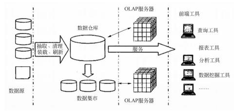

### 重要考点 16、web service 技术

（需要掌握 web service 技术的定义、模型、典型技术、适用和不适用情况等）

（09 上 69）（09 下 29）（12 下 32）

一描述、发现及集成（UDDI）、用于数据交换的 XML；（13 上 26）

1、JavaEE 应用将开发工作分成两类： 业务逻辑开发和表示逻辑开发，其余的系统资濾则由应用 服务器负责处理，不必为中间层的资源和运行管理进行编码。这样就可以将更多的开发精力集中 在应用程序的业务逻辑和表示逻辑上，从而缩短企业应用开发周期、有效地保护企业的投资。

2、J2EE 应用服务器运行环境包括组件（component）、容器（container）及服务（Services） 三部分。 组件是表示应用逻辑的代码；容器是组件的运行环境；服务则是应用服务器提供的  各种功能接口，可以同系统资源进行交互。（10 上 29）

3 、通用语言运行环境处于.NET  开发框架的最低层，是该框架的基础，它为多种语言提供了 统一的运行环境、统一的编程模型，大大简化了应用程序的发布和升级、多种语言之间的交 互、内存和资源的自动管理等等。

一般考点 18、软件引擎技术

（需要掌握软件引擎技术的定义、3 个阶段等）

1、软件引擎通常是系统的核心组件，目的是封装某些过程方法， 使得在开发的时候不需要过 多地关注其具体实现，从而可以将关注点聚焦在与业务的结合上。

2、工作流程引擎是工作流管理系统的运行和控制中心。通过工作流程引擎， 可以解释流程建 模工具中定义的业务流程逻辑， 进行过程、活动实例的创建， 把任务分派给执行者，并根据 任务执行的返回结果决定下一步的任务，控制并协调各种复杂工作流程的执行，实现对完整 的业务流程生命周期的运行控制。工作流程引擎的主要功能是流程调度和冲突检测。--修改

### 重要考点 19、组件

（需要掌握组件的定义、常用的构件标准等）

1 、组件技术就是利用某种编程手段， 将一些人们所关心的， 但又不便于让最终用户去直接操 作的细节进行了封装，同时对各种业务逻辑规则进行了实现， 用于处理用户的内部操作细节。 这个封装体就常常地被称作构件。

### 2、常用的组件标准

（1）COM/DCOM/COM+（11 上 30）（11 下 28）

（2）CORBA （11 下 29）

（3）EJB

### 重要考点 1、OSI 模型

（需要掌握 OSI 模型的 7 层以及各自功能、典型的协议、设备等）

1 、OSI 模型总结（书上没有的内容，补充掌握，这个表格很重要，必须掌握记住）：

（09 上 16）（12 下 22~23）（14 上 21）（15 上 12、22）（16 下 18）（18 上 18/20）

①物理层：该层包括物理连网媒介，如电缆连线连接器。该层的协议

。具体标准有 RS232、V.35、RJ-45 、FDDI。

②数据链路层：它控制网络层与物理层之间的通信。它的主要功能是将从网络层接收到的数 据分割成特定的可被物理层传输的  。常见的协议有 IEEE802.3/.2 、HDLC 、PPP、ATM。

| 网络地址（例如， IP 地址） 翻译成对应的物理地址（例如，网卡 |
|---|

, 并决定如何将数据从发送方路由到接收方。在 TCP/IP 协议中，网络层协议有 IP、ICMP、 IGMP、IPX 、ARP 等。

④传输层：主要负责确保数据可靠、顺序、无错地                   。如提供建立、维护 和拆除传送连接的功能； 选择网络层提供最合适的服务； 在系统之间提供可靠的透明的数据传送，

提供端到端的错误恢复和流量控制。在 TCP/IP 协议中；具体协议 TCP 、UDP、SPX。

⑤会话层：负责在网络中的两节点之间                                          ，如

二种数据流方向的控制， 即一路交互、两路交替和两路同时会话模式。协议有 RPC 、SQL、NFS。

⑥表示层：如同应用程序和网络之间的翻译官，数据将按照网络能理解的方案进行格式化；

| 数据的解密加密、数据转换、格式化和文本压缩 |
|---|

⑦应用层：负责对软件提供接口以使程序能使用网络服务，如

| 和网络管理 | 和网络管理 | 等。在 TCP/EP 协议中，协议有 HTTP、Telnet、FTP、SMTP。 | 等。在 TCP/EP 协议中，协议有 HTTP、Telnet、FTP、SMTP。 | 等。在 TCP/EP 协议中，协议有 HTTP、Telnet、FTP、SMTP。 | 等。在 TCP/EP 协议中，协议有 HTTP、Telnet、FTP、SMTP。 |
|---|---|---|---|---|---|
|  | 功能描述 | 功能描述 | 功能描述 | 对应协议 | 通信设备 |
| 应用层 （应1） | 对软件提供接口以使程序能使用网络服 务，如事务处理程序、文件传送协议和 网络管理等 | 对软件提供接口以使程序能使用网络服 务，如事务处理程序、文件传送协议和 网络管理等 | 对软件提供接口以使程序能使用网络服 务，如事务处理程序、文件传送协议和 网络管理等 | FTP、HTTP、Telnet、 DHCP、SMTP、 SNMP、DNS 、POP3 | 网关、高层交换机 |
| 表示层 （适1） | 应用程序和网络之间的翻译官，在表示 层，数据将按照网络能理解的方案进行 格式化；数据的解密加密、数据转换、 格式化和文本压缩（17 下 18） | 应用程序和网络之间的翻译官，在表示 层，数据将按照网络能理解的方案进行 格式化；数据的解密加密、数据转换、 格式化和文本压缩（17 下 18） | 应用程序和网络之间的翻译官，在表示 层，数据将按照网络能理解的方案进行 格式化；数据的解密加密、数据转换、 格式化和文本压缩（17 下 18） | JPEG、MPEG、 ASCII、GIF、DES 等。 | 网关、高层交换机 |
| 会话层 （话1） | 在网络中的两节点之间建立和维持通 信，以及提供交互会话的管理功能 | 在网络中的两节点之间建立和维持通 信，以及提供交互会话的管理功能 | 在网络中的两节点之间建立和维持通 信，以及提供交互会话的管理功能 | RPC 、SQL 、NFS | 网关、高层交换机 |
| 传输层 （传1） | 负责确保数据可靠、顺序、无错地从 A 点到传输到 B 点。如提供建立、维护和 拆除传送连接的功能；选择网络层提供 最合适的服务；在系统之间提供可靠的 透明的数据传送，提供端到端的错误恢 复和流量控制。（17 上 18） | 负责确保数据可靠、顺序、无错地从 A 点到传输到 B 点。如提供建立、维护和 拆除传送连接的功能；选择网络层提供 最合适的服务；在系统之间提供可靠的 透明的数据传送，提供端到端的错误恢 复和流量控制。（17 上 18） | 负责确保数据可靠、顺序、无错地从 A 点到传输到 B 点。如提供建立、维护和 拆除传送连接的功能；选择网络层提供 最合适的服务；在系统之间提供可靠的 透明的数据传送，提供端到端的错误恢 复和流量控制。（17 上 18） | TCP 、UDP、SPX | 网关、高层交换机 |
| 网络层 （网1） | 将网络地址（例如， IP 地址）翻译成对 应的物理地址（例如， 网卡地址），并决 定如何将数据从发送方路由到接收方 | 将网络地址（例如， IP 地址）翻译成对 应的物理地址（例如， 网卡地址），并决 定如何将数据从发送方路由到接收方 | 将网络地址（例如， IP 地址）翻译成对 应的物理地址（例如， 网卡地址），并决 定如何将数据从发送方路由到接收方 | IP、ICMP、IGMP、 IPX 、ARP 、RARP | 路由器、第三层交换 机（15 上 12） |
| 数据链 路层  （联1） | 控制网络层与物理层之间的 通信。将从网络层接收到的 数据分割成特定的可被物理 层传输的恢（15 上 22） | 控制网络层与物理层之间的 通信。将从网络层接收到的 数据分割成特定的可被物理 层传输的恢（15 上 22） | IEEE802.2/.3 、HDLC 、PPP、 X.25、恢中继、 ATM （16 上 20） | IEEE802.2/.3 、HDLC 、PPP、 X.25、恢中继、 ATM （16 上 20） | 网桥、第二层交换机 |
| 物理层 （物1） | 包括物理连网媒介，如电缆连线连接器。 该层的协议产生并检测电压以便发送和 接收携带数据的信号 | 包括物理连网媒介，如电缆连线连接器。 该层的协议产生并检测电压以便发送和 接收携带数据的信号 | 包括物理连网媒介，如电缆连线连接器。 该层的协议产生并检测电压以便发送和 接收携带数据的信号 | RS232、V.35、RJ-45、 FDDI 等。 | 中继器、集线器、 网卡、网线、 调制解调器、电缆 |

快速以太网和传统以太网在物理层上的标准不同，比如网线；（16 上 18）

TCP/IP 是 Internet 的核心，利用TCP/IP 协议可以方便地实现多个网络的无缝连接。（19 下 16）

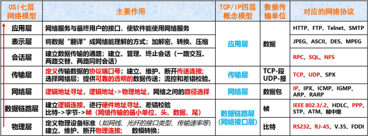

### 2、需要掌握常见的网络协议：

SMTP 协议：简单邮件传输协议，用来控制信件的发送、中转； （13 下 19）

SNMP 协议：简单网络管理协议

DNS 协议：域名解析服务， 提供域名到 IP 地址之间的转换；（13 上 19）（13 下 21）（14 下 23）

DNS 的全称是 DomainNameServer，一种程序，它保存了一张域名（domainname）和与之相对 应的 IP 地址（IPaddress）的表，以解析消息的域名。

TCP 协议：传输控制协议， 为可靠的、带连接的协议；

UDP 协议： 用户数据报协议，为不可靠的无连接协议；比如 QQ、微信就是 UDP（14 下 20）

TCP 协议传输数据包的速度一般比 UDP 协议传输速度慢； （13 上 21）

ICQ、AOL InstantMessenger、yahooPager、微软的 MSNMessenger  以及国内的 QQ 是最流行的 P2P 应用。（14 上 20）

ICMP 协议：  Internet 控制报文协议，在 IP 协议发送差错报文时使用；（15 下 19）（18 下 18）

ARP 协议：地址解析协议，将 IP 地址转为相应的物理地址；

RARP 协议：反向地址转换协议，功能与 ARP 相反；

PPP 协议：点对点协议， 主要用于“拨号上网”式的广域连接模式；

FDDI 协议：光纤分布式数据接口， 一种光纤环网标准。

WWW 服务提供了測览网络新闻、下载软件、网上购物、聊天、在线学习等服务， FTP 是文件传 输服务， BBS 是电子公告板的缩写， Telnet 是远程登录服务。

3、需要掌握常见的网络设备：（14 上 19）

| 调制解调器 | 工作于物理层，它的主要作用是信号变换，即把模拟信号变换成数字信号， 或把 数字信号变换成模拟信号。 |
|---|---|
| 以太网交换机 | 工作于数据链路层， 根据以太顿中的地址转发数据顿。 |
| 集线器 | 也是工作于数据链路层，它收集多个端口来的数据顿并广播出去。 |
| 路由器 | 工作于网络层，它根据 IP 地址转发数据报，处理的是网络层的协议数据单元.以 连接不同的子网 。 在选择路由器时主要考虑的因素：CPU、内存、吞吐量、接口种类、用户可用槽 数、端口密度等（15 下 12） |
| 中继器 | 工作在物理层，用于把网络中的设备物理连接起来。 |

| 网桥 | 工作在数据链路层，网桥能连接不同传输介质的网络，采用不同高层协议的网络 不能通过网桥互相通信。 |
|---|---|
| 网关 | 是互联两个协议差别很大的网络时使用的设备。网关可以对两个不同的网络进行 协议的转换，主要用于连接网络层之上执行不同协议的网络。 |

4 、IEEE802 规范包括：802.1（802 协议概论）、802.2（逻辑链路控制层 LLC  协议）、802.3  	（以太网的 CSMA/CD 载波监听多路访问/冲突检测协议） 802.4（令牌总线 TokenBus 协议）、 802.5（令牌环（TokenRing）协议）、802.6（城域网 MAN 协议）、802.7（FDDI 宽带技术协 议）、802.8（光纤技术协议）、802.9（局域网上的语音/数据集成规范）、802.10（局域网安全 互操作标准）、802.11（无线局域网 WLAN 标准协议）。

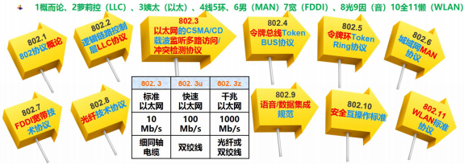

5、以太网规范 IEEE802.3 是重要的局域网协议，内容包括：

| IEEE802.3 | 标准以太网 | 10Mb/s | 传输介质为细同轴电缆 |
|---|---|---|---|
| IEEE802.3U | 快速以太网 | 100Mb/s | 双绞线 |
| IEEE802.3Z | 千兆以太网 | 1000Mb/s | 光纤或双绞线 |

6 、广域网协议包括： PPP 点对点协议、 ISDN 综合业务数字网、 XDSL（DSL 数字用户线路的统 称： HDSL、SDSL、MVL、ADSL）DDN 数字专线、 X.25、FR 恢中继、 ATM 异步传输模式。

7、 IP 地址

常用的 IP 地址有 A、B、C 三类，每类均规定了网络标识和主机标识在 32 位中所占的位数。 A 类地址一般分配给具有大量主机的网络使用，B 类地址通常分配给规模中等的网络使用，C  类地址通常分配给小型局域网使用。为了确保唯一性， IP  地址由世界各大地区的权威机构 Inter NIC（网络信息中心） 管理和分配。

若两台主机的 IP 地址分别与它们的子网掩码相“与”后的结果相同， 则说明这两台主机在同一子网中。

IPv6 也被称作下一代互联网协议， 它是由 IETF 小组设计的用来替代现行的 IPv4（现行的 IP）

协议的一种新的 IP 协议。 IPv6 。语法建议把 IPv6 地址的 128 位

IPv6 具有以下显著优点：

 提供更大的地址空间，能够实现 plUgandplay 和灵活的重新编址；

 更简单的头信息，能够使路由器提供更有效率的路由转发；

与 mobileip 和 ipsec 保持兼容的移动性和安全性；

提供丰富的从 IPv4 到 IPv6 的转换和互操作的方法， ipsec 在 IPv6 中是强制性的。Internet 上 的域名由域名系统 DNS 统一管理。 DNS 是一个分布式数据库系统，由  域名空间、域名服务

器和地址转换请求程序三部分组成。有了 DNS，凡域名空间中有定义的域名都可以有效地转 换为对应的 IP 地址，同样， IP 地址也可通过 DNS 转换成域名。WWW 上的每一个网页都有 一个独立的地址，这些地址称为统一资源定位器（URL）；

一般考点 2、网络的分类（需要掌握网络的分类等）

网络的分类：

| 局域网 LAN | 将小区域内的计算机和通信设备互联形成资源共享的网络。 |
|---|---|
| 广域网 WAN | 将大区域范围内的计算机和通信设备互联形成资源共享的网络。 |
| 城域网 MAN | 覆盖范围处于局域网和广域网之间。应用模式有①SDH  多业务平台 ②弹性分组 环多业务平台 （3）电信级以太网多业务平台 |
| 因特网 |  |
| 按拓扑结构可划分为总线型结构、环形结构、星型结构、树形结构和网状结构。（11 上 21） | 按拓扑结构可划分为总线型结构、环形结构、星型结构、树形结构和网状结构。（11 上 21） |

（15 上 19）（19 下 18）

| 1 | 总线型 | 所需电缆少、布线容易、单点可靠性高；故障诊断困难、对站点要求较高 |
|---|---|---|
| 2 | 星型 | 整体可靠性高、故障诊断容易、对站点要求不高；所需电缆较多、整个网络可靠性依 赖中央节点 |
| 3 | 环形 | 所需电缆较少、适用于光纤； 整体可靠性差、故障诊断困难、对站点要求高。 |
| 其中总线型是属于逻辑连接，星型是属于物理连接； 星型也是最常用的；（11 下 20） | 其中总线型是属于逻辑连接，星型是属于物理连接； 星型也是最常用的；（11 下 20） | 其中总线型是属于逻辑连接，星型是属于物理连接； 星型也是最常用的；（11 下 20） |

| 令牌环网和 FDDI 网 | 令牌技术相对以太网技术过于复杂 |
|---|---|
| ATM 步传输模式 | 光纤作为传输介质。 ATM  网络的最大吸引力之一是具有特别的灵活性， 用户只要通过 ATM 交换机建立交换虚电路，就可以提供突发性、宽频带 传输的支持，适应包括多媒体在内的各种数据传输 |
| ISDN 综合业务数据网 | 通过时分多路复用技术，可以  在一条电话线上同时传输多路信号。ISDN  可以提供从 144kbps 到 30Mbps 的传输带宽，但是由于其仍然属于电话技 术的线路交换， 租用价格较高，并没有成为计算机网络的主要通讯网络。 |

（需要掌握常用的网络交换技术等）

在计算机网络中， 按照交换层次的不同，可以分为物理层交换 （如电话网）、链路层交换（二 层交换， 对 MAC 地址进行变更）、网络层交换 （三层交换， 对 IP 地址进行变更）、传输层交换 （四层交换，对端口进行变更，比较少见）和应用层交换（似乎可以理解为 web 网关等）。

网络中的数据交换可以分为电路交换、分组交换（数据包交换）、ATM 交换、全光交换和标记 交换。其中电路交换有预留，且分配一定空间，提供专用的网络资源，提供有保证的服务，  应用于电网； 而分组交换无预留， 且不分配空间， 存在网络资源争用， 提供有无保证的服务。 分组交换可用于数据报网络和虚电路网络（最常用，性价比最高）。（14 上 18）

我们常用的 Internet 就是数据报网络，单位是 Bit，而 ATM 则用的是虚电路网络，单位是码 元。A 是错误的。 Byte:字节;bit:位。 8bit=1Byte（18 下 20）

### 重要考点 4、网络存储技术（12 下 4）

（需要掌握常见存储方式的特点等）

网络存储技术 DAS、SAN 和 NAS：（19 上 19）

| DAS 直连式存储 | 通过标准接口（SCSI）连接存储器与服务器； |
|---|---|
| NAS 网络连接存储 | 通过网络连接， 即插即用； |
| SAN 存储区域网络 | 通过高速光纤连接，极度可扩展型 |

DAS：Direct-Attached storage   NAS：Network storage TechnoIogies SAN：storage Area Network

SAN 是通过专用交换机将磁盘阵列与服务器连接起来的高速专用子网。它没有采用文件共享存 取方式， 而是采用块（blOck）级别存储， 其成本较高、技术较复杂，适用于据量大、数据访问速 度要求较高的场合。（18 下 19）

### 重要考点 5、无线网络技术、网络接入技术

（需要掌握常见的无线网络技术等）

| 2G | 2G | 3G | 3G | 3G | 4G | 4G | 5G | 6G |
|---|---|---|---|---|---|---|---|---|
| 移动/联 通 GSM | 电信 CDMA2000 | 移动 TD-SCDMA | 电信 CDMA2000 | 联通 WCDMA | TD-LTE | FDD-LTE |  |  |
| 236kb | 153 kb | 2.8Mb | 3.1 Mb | 14.4 Mb | 100 Mb | 150 Mb | 1GbpS | 1TB/S |

4、掌握 Wimax 采用 802.16 协议，覆盖范围为 50KM ；Wifi 采用 802.11 协议，覆盖范围为 10 到 300m；AP 覆盖范围为 100 到 300m。

5 、WEP 认证是 WLAN 常用的上网认证方式

### 重要考点 6、网络接入技术

（需要掌握网络接入方式有哪些？各自特点等）

网络接入方式：光纤接入、同轴接入、铜线接入、无线接入—第二版教材修改

| 光纤接入 | 传输速率最高的传输介质，在主干网中已大量的采用了光纤（16 下 20）（17 下 19） |
|---|---|
| 同轴接入 | 也是传输带宽比较大的一种传输介质， 目前的 CATV 网就是一种混合光纤铜轴网络， 主干部分采用光纤， 用同轴电缆经分支器接入各家各户。 混合光纤/铜轴（HFC）接 入技术的一大优点是可以利用现有的 CATV 网， 从而降低网络接入成本 |

| 铜线接入 | 是指以现有的电话线  为传输介质，利用各种先进的调制技术和编码技术、数字信号 处理技术来提高铜线的传输速率和传输距离。 |
|---|---|
| 无线接入 | 无线用户环路是指利用无线技术为固定用户或移动用户提供电信业务，可分为固定 无线接入和移动无线接入， 采用的无线技术有微波、卫星等。优点有： 初期投入小， 能迅速提供业务，不需要铺设线路，因而可以省去铺线的大量费用和时间；比较灵 活，可以随时按照需要进行变更、扩容，抗灾难性比较强。 |

### 重要考点 7、综合布线工程、网络设计

（需要掌握综合布线有哪些子系统、 一些标准、注意事项等）

1、综合布线 6 个子系统： 建筑群、设备间（机房）、垂直干线（楼层间）、管理、水平（楼层

内）、工作区（14 下 22）

### 2、网络设计工作

| 网絡拓扑结构 设计 |  |  |  |
|---|---|---|---|
| 主干网络 （核心层）设计 |  |  |  |
| 汇聚层和接入层 设计 |  |  |  |
| 广域网连接与远 程访问设计 |  |  |  |
| 广域网连接与远 程访问设计 | 采用 ISDN 或 ADSL 等技术连接外网。 2.如果用户有 www、E-mail 等具有 Internet 功能的服务器， 用户可采用 DDN 	（或 E1）专线连接、 ATM 交换及永久虚电路连接外网。 | 采用 ISDN 或 ADSL 等技术连接外网。 2.如果用户有 www、E-mail 等具有 Internet 功能的服务器， 用户可采用 DDN 	（或 E1）专线连接、 ATM 交换及永久虚电路连接外网。 | 采用 ISDN 或 ADSL 等技术连接外网。 2.如果用户有 www、E-mail 等具有 Internet 功能的服务器， 用户可采用 DDN 	（或 E1）专线连接、 ATM 交换及永久虚电路连接外网。 |
| 无线网络设计 | 无线网络首先适用于很难布线的地方（比如受保护的建筑物、机场等） 或者经 常需要变动布线结构的地方（如展览馆等）。学校也是一个很重要的应用领域， 一个无线网络系统可以使教师、学生在校园内的任何地方接入网络。另外， 因 为无线网络支持十儿公里的区域， 因此对于城市范围的网络接入也能适用，可 以设想一个采用无线网络的 ISP 可以为一个城市的任何角落提供高达 10Mbps 的互联网接入（17 下 21） | 无线网络首先适用于很难布线的地方（比如受保护的建筑物、机场等） 或者经 常需要变动布线结构的地方（如展览馆等）。学校也是一个很重要的应用领域， 一个无线网络系统可以使教师、学生在校园内的任何地方接入网络。另外， 因 为无线网络支持十儿公里的区域， 因此对于城市范围的网络接入也能适用，可 以设想一个采用无线网络的 ISP 可以为一个城市的任何角落提供高达 10Mbps 的互联网接入（17 下 21） | 无线网络首先适用于很难布线的地方（比如受保护的建筑物、机场等） 或者经 常需要变动布线结构的地方（如展览馆等）。学校也是一个很重要的应用领域， 一个无线网络系统可以使教师、学生在校园内的任何地方接入网络。另外， 因 为无线网络支持十儿公里的区域， 因此对于城市范围的网络接入也能适用，可 以设想一个采用无线网络的 ISP 可以为一个城市的任何角落提供高达 10Mbps 的互联网接入（17 下 21） |
|  | 无线网络首先适用于很难布线的地方（比如受保护的建筑物、机场等） 或者经 常需要变动布线结构的地方（如展览馆等）。学校也是一个很重要的应用领域， 一个无线网络系统可以使教师、学生在校园内的任何地方接入网络。另外， 因 为无线网络支持十儿公里的区域， 因此对于城市范围的网络接入也能适用，可 以设想一个采用无线网络的 ISP 可以为一个城市的任何角落提供高达 10Mbps 的互联网接入（17 下 21） | 无线网络首先适用于很难布线的地方（比如受保护的建筑物、机场等） 或者经 常需要变动布线结构的地方（如展览馆等）。学校也是一个很重要的应用领域， 一个无线网络系统可以使教师、学生在校园内的任何地方接入网络。另外， 因 为无线网络支持十儿公里的区域， 因此对于城市范围的网络接入也能适用，可 以设想一个采用无线网络的 ISP 可以为一个城市的任何角落提供高达 10Mbps 的互联网接入（17 下 21） | 无线网络首先适用于很难布线的地方（比如受保护的建筑物、机场等） 或者经 常需要变动布线结构的地方（如展览馆等）。学校也是一个很重要的应用领域， 一个无线网络系统可以使教师、学生在校园内的任何地方接入网络。另外， 因 为无线网络支持十儿公里的区域， 因此对于城市范围的网络接入也能适用，可 以设想一个采用无线网络的 ISP 可以为一个城市的任何角落提供高达 10Mbps 的互联网接入（17 下 21） |
| 网络通信设备 选型 | 包括核心交换机选型、汇聚层/接入层交换机选型、远程接入与访问设备选型。 | 包括核心交换机选型、汇聚层/接入层交换机选型、远程接入与访问设备选型。 | 包括核心交换机选型、汇聚层/接入层交换机选型、远程接入与访问设备选型。 |

3、层次化网络设计在互联网组件的通信中引入了三个关键层的概念，三个层次分别是： 核心层（core Layer）、汇聚层（DistributionLayer）和接入层（AccessLayer）。

（1）核心层为网络提供了骨干组件或高速交换组件。在纯粹的分层设计中，核心层只完成数 据交换的特殊任务。

（2）汇聚层是核心层和终端用户接入层的分界面。汇聚层完成了网络访问策略控制、数据包 处理、过滤、寻址、及其他数据处理的任务。

（3）接入层向本地网段提供用户接入。

4、机房建设是系统集成工程中的重要内容之一楼宇自控（16 下 22）

5、智能建筑弱电总控机房，工作包括布线、监控、消防、计算机机房、楼宇自控等；

6、三通一平是指项目开工的前提条件，具体指：水通、电通、路通和场地平整。（17 上 20） 重要考点 8、网络安全

 1、信息安全的基本要素有：

 机密性：确保信息不暴露给未授权的实体或进程。

 完整性：只有得到允许的人才能修改数据，并且能够判别出数据是否已被篡改。（18 上 21）（19

下 19）

 可用性：得到授权的实体在需要时可访问数据，即攻击者不能占用所有的资源而阻碍授 权者的工作。

 可控性：可以控制授权范围内的信息流向及行为方式。

 可审查性：对出现的网络安全问题提供调查的依据和手段。

2、典型的网络攻击步骤：信息收集、试探寻找突破口、实施攻击、消除记录、保留访问权限。 攻击者一般在攻破安全防护后，进入主机窃取或破坏核心数据。除了对数据的攻击外，还有  一种叫“拒绝服务 ”攻击，即通过控制网络上的其他机器，对目标主机所在网络服务不断进  行干扰，改变其正常的作业流程，执行无关程序使系统响应减慢甚至瘫痪，影响正常用户的  使用， 甚至使合法用户被排斥而不能进入计算机网络系统或不能得到相应的服务。（19 上 21）

3 、信息系统安全分为 5 个等级，分别是： 自主保护级、系统审计保护级、安全标记保护级、 结构化保护级、访问验证保护级。

4、主要的网络和信息安全产品加以说明：

| 防火墙 | 网络安全的大门， 用来鉴别什么样的数据包可以进出企业内部网。在应对黑客入侵方 面，可以阻止基于 IP 包头的攻击和非信任地址的访问。但传统防火墙无法阻止和检测基于 数据内容的黑客攻击和病毒入侵，同时也无法控制内部网络之间的违规行为。（16 下 21） （18 下 21） |
|---|---|
| 扫描器 | 入侵检测的一种，主要用来发现网络服务、网络设备和主机的漏洞，通过定期的检测 与比较， 发现入侵或违规行为留下的痕迹。当然，扫描器无法发现正在进行的入侵行 为，而且它还有可能成为攻击者的工具。（19 下 20） |
| 防毒软件 | 防毒软件是最为人熟悉的安全工具， 可以检测、清除各种文件型病毒、宏病毒和邮件 病毒等。在应对黑客入侵方面，它可以查杀特洛伊木马和蠕虫等病毒程序，但对于基 于网络的攻击行为（如扫描、针对漏洞的攻击） 却无能为力。 为系统打补丁，能有效预防蠕虫， 但不能有效预防病毒（17 上 22） |
| 安全审计 系统 | 通过独立的、对网络行为和主机操作提供全面与忠实的记录，方便用户分析与审查事 故原因，很像飞机上的黑匣子。由于数据量和分析量比较大，目前市场上鲜见特别成 熟的产品， 即使存在冠以审计名义的产品，也更多的是从事入侵检测的工作。 |

1、虚拟局域网（ VLAN）的优点如下： （09 上 10）

（1）有效地共享网络资源  （2）简化网络管理（3）控制广播风暴， 提高网络性能。 （4）简化网络结构、保护网络投资、提高网络安全性。

而链路聚合是解决交换机之间的宽带瓶颈问题的一种技术。

2、  100Base-T4、100Base-TX 和 100Base-FX 均为常用的快速以太网标准。（09 上 12）

100Base-TX 使用的是两对抗阻为 100 的 5 类非屏蔽双绞线 UTP 或 STP，最大传输距离是 100m。

其中一对用于发送数据，另一对用于接收数据。

3、 IEEE802 系列标准：（10 上 19）

IEEE802 系列标准 IEEE 802LAN/MAN 标准委员会制定的局域网、城域网技术标准， 其中：

 IEEE 802.3 网络协议标准描述物理层和数据链路层的 MAC 子层的实现方法，在多种物理 媒体上以多种速率采用 CSMA/CD 访问方式，对于快速以太网该标准说明的实现方法有所 扩展，该标准通常指以太网。

 IEEE 802.11 是无线局域网通用的标准，它是由 IEEE 所定义的无线网络通信的标准，该 标准定义了物理层和媒体访问控制（MAC）协议的规范。

 IEEE 802.15 应用于无线个人区域网（WPAN ）。

 IEEE 802.16 是一种无线宽带标准。

4 、光纤接口是用来连接光纤线缆的物理接口。通常有 SC.ST、FC 等几种类型，它们由日本 NTT 公司开发。FC 是 Ferrule Connector 的缩写， 其外部加强方式是采用金属套， 紧固方式为螺丝 扣。 ST 接口通常用于 10Base-F ，SC 接口通常用于 100Base-FX 。（12 上 22）

5 、IP 地址，子网掩码（12 下 19）

### 6、常用传输介质的传输距离：

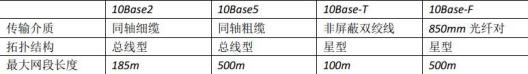

7、网络安全设计是保证网络安全运行的基础。网络安全设计有其基本的设计原则，其中包括: 强调对信息均衡、全面的进行保护的木桶原则、良好的信息安全系统必备的等级划分制度，网络 信息安全的整体性原则、安全性评价与平衡原则等。 在进行网络安全系统设计时应充分考虑现有 网络结构， 在不影响现有系统正常运行的情况下，逐步完善网络安全系统。

8、局域网交换机的特性主要有以下几点:（1） 低交换传输延迟；（2）高传输带宽；（3）允许 loMbps/l00Mbps 共存；（4）局域网交换机可以支持虚拟局域网服务。

### 9、有线传输介质对比表：

| 线缆名称 | 传输距离 | 传输速度 | 成本 | 安装 | 抗干扰性 |
|---|---|---|---|---|---|
| 屏蔽双绞线 | 100m | 10Mb/s-1000Mb/s | 较低 | 容易 | 强 |
| 非屏蔽双绞线 | 100m | 10Mb/s-1000Mb/s | 最低 | 最容易 | 最低 |
| 多模光纤 | 2km | 51Mb/s-1000Mb/s | 次贵 | 最难 | 最强 |
| 单模光纤 | 2-10km | 1-10Gb/s | 最贵 | 最难 | 最强 |

11、网络协议三要素如下： 语法、语义、时序；

12 、通常， 面向连接通信适用于数据量大、可靠性高、出错率低、实时性要求稍低的场合。  传送大量的多媒体数据适合选用面向连接的通信方式。传输控制协议（TCP）是一个面向连接的、

可靠的、全双工的、基于字节流的传输层协议。（13 下 18）

13、1TB=210GB； 1GB=210MB； 1MB=210KB； 1KB=210B；1B=1BYTE （字节）（13 下 23）

14、以太网（Ethernet）指的是由 xerox 公司创建并由 xerox、Intel 和 DEC 公司联合开发的基带局域网规 范， 是当今现有局域网采用的最通用的通信协议标准。以太网具有如下的一般特征：（14 下 18）

（1）共享媒体：所有网络设备使用同一通信媒体。

（2）广播域：需要传输的恢被发送到所有节点，但只有寻址到的节点才会接收到恢。

（3） CSMA/CD：以太网中利用载波监听多路访问/冲突检测方法以防止两个或更多节点同时发送。

（4） MAC 地址：媒体访问控制层的所有 Ethernet 网络接口卡（NIC）都采用 48 位网络地址。 这种地址全球唯一。

快速以太网（1000BASE-T）使用交换机来组网目的是提高网络使用效率提高网络速度，减少 冲突，根本无法结局 IP 地址消耗的问题；该组网方式类似于星型结构。（15 上 18）

15、web2.0 技术主要包括： 博客（BLOG）、RSS、百科全书（wiki）、网摘、社会网络（SNS）、

P2P、即时信息（IM）等。（14 下 21）

16、IDS 是计算机的监视系统， 它通过实时监视系统，一旦发现异常情况就发出警告。IDS 入 侵检测系统以信息来源的不同和检测方法的差异分为几类：根据信息来源可分为基于主机 IDS 和基于网络的 IDS，根据检测方法又可分为  异常入侵检测和滥用入侵检测。不同于防火墙， IDS 入侵检测系统是一个监听设备，没有跨接在任何链路上，无须网络流量流经它便可以工 作。因此，对 IDS 的部署，唯一的要求是： IDS 应当挂接在所有所关注流量都必须流经的链

路上。（14 下 25）

17、入侵检测是防火墙的合理补充，帮助系统对付网络攻击，扩展了系统管理员的安全管理 能力（包括安全审计、监视、进攻识别和响应），提高了信息安全基础结构的完整性。它从计 算机网络系统中的若干关键点收集信息，并分析这些信息，看看网络中是否有违反安全策略 的行为和遭到袭击的迹象。入侵检测被认为是防火墙之后的第二道安全闸门，在不影响网络 性能的情况下能对网络进行监测，从而提供对内部攻击、外部攻击和误操作的实时保护。

入侵检测是从信息安全审计派生出来的，随着网络和业务应用信息系统的推广普及而逐渐成 为一个信息安全的独立分支。信息安全审计更偏向业务应用系统的范畴，而入侵检测更偏向 “入侵”的、业务应用系统之外的范畴。信息安全审计与入侵检测将合二而一，并形成一个 完整的信息安全防范体系。 一个安全审计系统，主要有以下的作用： 对潜在的攻击者起到震 镊或警告作用；对于系统破坏行为提供有效的追纠证据；

18、代理服务型防火墙，代表某个专用网络同互联网进行通讯的防火墙。当你将测览器配置 成使用代理功能时，防火墙就将你的测览器的请求转给互联网；当互联网返回响应时，代理 服务器再把它转给你的测览器。代理服务器也用于页面的缓存，代理服务器在从互联网上下 载特定页面前先从缓存器取出这些页面。 使用代理服务型防火墙，内部网络与外部网络之间

不存在直接连接。（14 下 26）

19、千兆位以太网是一种新型高速局域网，它可以提供 1Gbps 的通信带宽，采用和传统 10M、 100M 以太网同样的 CSMA/CD 协议、恢格式和恢长， 因此可以实现在原有低速以太网基础上平

滑、连续性的网络升级。速率达到或超过 100Mb/s 的以太网称为高速以太网。千兆以太网采 用的标准为 IEEE802.3Z；（15 下 18）

20、堡垒主机是一种被强化的可以防御进攻的计算机，作为进入内部网络的一个检查点，以 达到把整个网络的安全问题集中在某个主机上解决， 从而省时省力，不用考虑其它主机的安 全的目的。 它没有任何防火墙或者包过虑路由器设备保护。一个堡垒主机使用两块网卡，每 个网卡连接不同。（16 上 22）

21、虚拟专用网(VPN)被定义为通过一个公用网络（通常是因特网） 建立一个临时的、安全的 连接，是一条穿过混乱的公用网络的安全、稳定的隧道。虚拟专用网是对企业内部网的扩展。 VPN 指的是依靠 ISP 和 NSP，在公用网络中建立专用的数据通信网络的技术。（16 上 26）

### 22、网络常识：

（1） P2P 直接将人们联系起来，让人们通过互联网直接交互。 P2P 使得网络上的沟通变得容 易、更直接共享和交互，真正地消除中间商。 P2P 就是人可以直接连接到其他用户的计算机、交 换文件， 而不是像过去那样连接到服务器去測览与下载。P2P 另一个重要特点是改变互联网现在 的以大网站为中心的状态、重返"非中心化"， 并把权力交还给用户。P2P 看起来似乎很新，但是正 如 B2C.B2B 是将现实世界中很平常的东西移植到互联网上一样， P2P 并不是什么新东西。在现实 生活中我们每天都按照 P2P 模式面对面地或者通过电话交流和沟通。

（2） NAT（网络地址转换） 是将 IP 数据包头中的 IP 地址转换为另一个 IP 地址的过程。 在实 际应用中，NAT 主要用于实现私有网络访问公共网络的功能。这种通过使用少量的公有 IP 地址代表较 多的私有 IP 地址的方式，将有助于减缓可用的 IP 地址空间的枯竭；

（3） 通过 NAT 实现私有地址到公有地址的映射。

（4） MAC 地址在网卡中是固定的， 每张网卡的 MAC 地址都不一样。网卡在制作过程中，厂家 会在它的 EPROM 里面烧录上一组数字， 这组数字， 每张网卡都各不相同， 这就是网卡的 MAC（物理） 地址。 网卡物理地址就如同我们身份证上的身份证号码，具有全球唯一性。

本章历年考题和答案解析汇总：

### 1、系统集成的特点

#### 【试题 1】---2009 上真题 1

,、所谓信息系统集成是指（1）。

（1）A.计算机网络系统的安装调试

B.计算机应用系统的部署和实施

C.计算机信息系统的设计、研发、实施和服务

D.计算机应用系统工程和网络系统工程的总体策划、设计、开发、实施、服务及保障 【答案】D

#### 【解析】“计算机信息系统集成是指从事计算机应用系统工程和网络系统工程的总体策划、设计、开发、实施、服务及保障”。

#### 【试题 2】---2009 下真题 14

2、有关信息系统集成的说法错误的是（2） 。

（2）A.信息系统集成项目要以满足客户和用户的需求为根本出发点

B.信息系统集成包括设备系统集成和管理系统集成

C.信息系统集成包括技术、管理和商务等各项工作，是一项综合性的系统工程

D.系统集成是指将计算机软件、硬件、网络通信等技术和产品集成为能够满足用户特定需求 的信息系统

#### 【解析】P81  此题考察的是信息系统集成的特点， 必须掌握，必考

系统集成是指将计算机软件、硬件、网络通信等技术和产品集成为能够满足用户特定需求的 信息系统。主要包括设备系统集成和应用系统集成。

计算机信息系统集成的显著特点如下：

（1）信息系统集成要以满足用户需求为根本出发点；

（2） 信息系统集成不只是设备选择和供应，更重要的是具有高技术含量的工程过程， 要面向 用户需求提供解决方案， 核心是软件；

（3）系统集成的最终交付物是一个完整的系统而不是一个分立的产品：

（4） 系统集成包括技术、管理和商务等各项工作，是一项综合性的系统过程， 技术是系统的 核心，管理和商务活动是系统集成项目成功实施的保障。

#### 【点评】必考，命题的热点，简单题， 必须得分

#### 【试题 3】---2010 上真题 1

3、以下对信息系统集成的描述正确的是（3）。

（3）A.信息系统集成的根本出发点是实现各个分立子系统的整合

B.信息系统集成的最终交付物是若干分立的产品

C.信息系统集成的核心是软件

D.先进技术是信息系统集成项目成功实施的保障

#### 【解析】“信息系统集成的核心是软件”

#### 【试题 4】 ---2010 下真题 1

4、以下（4）不属于系统集成项目。

（4）A.不包含网络设备供货的局域网综合布线项目

C.某软件测试实验室为客户提供的测试服务项目

B.某信息管理应用系统升级项目

D.某省通信骨干网的优化设计项目

#### 【答案】C

#### 【解析】P81此题考察的是信息系统集成的定义，必须掌握，必考

所谓系统集成项目，是指将计算机软件、硬件、网络通信等技术和产品集成为能够满足用户 特定需求信息系统，包括总体策划、设计、开发、实施、服务及保障。系统集成主要包括设备系 统集成和应用系统集成。

因此选项 A 和 B 属于系统集成项目。如果选项 D 中的通信骨干网的优化设计项目范围不仅包括 设计也包括实施的话，选项 D 也是系统集成项目。选项 C 中的“某软件测试实验室为客户提供的 测试服务项目”提供的是服务，是一种服务型项目。该项目完成的是白盒测试、或黑盒测试、或 确认测试， ……。

#### 【点评】必考，命题的热点，简单题， 必须得分

#### 【试题 5】---2011 上真题 1

5、以下对信息系统集成的描述不正确的是（5）。

（5）A.信息系统集成包括总体策划、设计、开发、实施、服务及保障

B.信息系统集成主要包括设备系统集成和应用系统集成

C.信息系统集成是具有高技术含量的工程过程，要面向用户需求提供全面解决方案

D.信息系统集成工作的核心是满足用户要求，管理和商务活动是系统集成项目实施成功的保证 【答案】D

#### 【解析】P81此题考察的是信息系统集成的特点，必须掌握，必考

解析参考第一题，内容一样的， 不重复列出，此知识点必考

#### 【点评】必考，命题的热点，简单题， 必须得分

#### 【试题 6】---2012 上真题 1

6、信息系统系统集成项目是从客户和用户的需求出技， 将硬件、系统软件、工具软件、网络、数 据库及相应韵应用软件集成为实用的信息系统的过程，其生命周期包括总体策划、设计、开发、 实施、服务保障等。它是一项综合性的系统工程，（6）是系统集成项目成功实施的保障。

①管理②商务③技术④软件⑤独立的应用软件

（6）A.①④    B.①②    C.③④⑤    D.④⑤

#### 【答案】B

#### 【解析】 此题考察的是信息系统集成的特点，必须掌握，必考

解析参考第一题，内容一样的，不重复列出，此知识点必考

#### 【点评】必考，命题的热点，简单题， 必须得分

#### 【试题 7】---2012 上真题 3

7、关于信息系统集成项目的特点，下述说法中，（7）是不正确的。

（7）A.信息系统集成项目是高技术与高技术的集成，要采用业界最先进的产品和技术 B.信息系统集成项目对企业管理技术水平和项目经理的领导艺术水平要求比较高 C.信息系统集成项目的需求常常不够明确，而加强需求变更管理以控制风险.

D.信息系统集成项目经常面临人员流动率较高的情况

#### 【答案】A

#### 【解析】 此题考察的是信息系统集成的特点，必须掌握，必考

信息系统集成项目有以下几个显著特点。

（1）信息系统集成项目要以满足客户和用户的需求为根本出发点。

（2）客户和用户的需求常常不够明确、复杂多变，由此应加强需求变更管理以控制风险。

（3） 系统集成不是选择最好的产品的简单行为， 而是要选择最适合用户的需求和投资规模的 产品和技术。

（4） 高技术与高技术的集成。系统集成不是简单的设备供货， 系统集成是高技术的集成，它 体现更多的是设计、调试与开发，是高技术行为。

（5） 系统工程。系统集成包含技术， 管理和商务等方面， 是一项综合性的系统工程。相关的 各方应“一把手”挂帅、多方密切协作。

（6）项目团队年轻，流动率高。

（7）强调沟通的重要性。

#### 【点评】必考，命题的热点，简单题， 必须得分

#### 【试题 8】---2013 上真题 8

8 、 8   是在组织内外的各种异构系统、应用、数据源之间实现信息交流， 共享或协作的途径， 方 法，标准和技术。

（8）A.企业应用集成      B.信息系统集成    C.信息系统运维     D.业务流程重组

#### 【答案】A

#### 【解析】 此题考察的是系统集成的分类，必须掌握， 高频考点

企业应用集成（EAI） 是完成在组织内、外的各种异构系统，应用和数据源之间共享和交换信息 和协作的途径，方法学，标准和技术。 企业应用集成所连接的应用包括各种电子商务系统，企业资源 规划系统，客户关系管理系统，供应链管理系统， 办公自动化系统，数据库系统，数据仓库等。

#### 【点评】企业应用系统集成的定义，简单，必须得分

#### 【试题 9】 ---2014 下真题 28

9、（9）不属于信息系统集成项目。

（9）A.OA 系统开发项目             B.ERP 系统施工项目

C.财务管理软件销售项目       D.校园一卡通工程设计项目

#### 【答案】C

#### 【解析】P81此题考察的是系统集成项目的定义，必须掌握，高频考点

所谓信息系统集成项目，就是从客户和用户的需求出发，将硬件、系统软件、工具软件、网络、 数据库及相应的应用软件集成为实用的信息系统的过程。在这个过程中，应根据需求，开发相应 的软件和硬件，并把他们集成为一个系统。

注意选项 C 中的“销售”2 字，属于产品销售， 不具备信息系统集成项目的特点。

#### 【点评】送分，简单，必须得分的

#### 【试题 10】---2015 上真题 9

10、系统集成是指计算机软件、硬件。网络通信等技术和产品集成为能够满足用户特定需求信息 系统的一系列过程，包括总体策划，设计，开发。实施、服务和保障。以下关于信息系统集成特 点的描述中（）是不正确的。

A.信息系统集成要以集成商利益最大化为根本出发点

B.信息系统集成不只是设备选择和供应，它是具有高技术含量的工程过程、要面向客户需求 提供全面解决方案， 其核心是软件

C.系统集成的最终交付物是一个完整的系统而不是一个个分立的产品

D.系统集成包括技术、管理和商务等各项工作，是一项综合性的系统工程，技术是系统集成 工作的核心，管理和商务活动是系统集成项目成功实施的保障

#### 【答案】A

#### 【解析】 此题考察的是系统集成的特点，必须掌握， 必考

送分题！排除法即可。

计算机信息系统集成是指从事计算机应用系统工程和网络系统工程的总体策划、设计、开发、实 施、服务及保障；计算机信息系统集成的资质是指从事计算机信息系统集成的综合能力，包括技 术水平、管理水平、服务水平、质量保证能力、技术装备、系统建设质量、人员构成与素质、经 营业绩、资产状况等要素；

计算机信息系统集成要以满足用户需求为根本出发点。

#### 【点评】几乎必考的，简单，必须得分

#### 【试题 11】---2015 下真题 10

11、将路由器、交换机、网关、集线器、终端接入设备、有关系统软件等实施集成服务称为( )

（11）A.网络集成实施服务      B.主机集成实施服务

C.只能建筑系统集成服务  D.应用系统集成服务

#### 【答案】A

#### 【解析】 此题考察的是系统集成的分类，必须掌握， 高频考点

计算机网络系统集成：指通过结构化的综合布线系统和计算机网络技术，将各个分离的设备（如

个人电脑等）、功能和信息等集成到相互关联、统一协调的系统之中， 使资源达到充分共享， 实现 集中、高教、便利的管理。

#### 【点评】送分题，多次考了，简单

#### 【试题 12】---2016 下真题 9

12、以下关于信息系统集成特点的叙述中，不正确的是（）。

A.信息系统集成要以集成商利益最大化为根本出发点

B.信息系统集成不只是设备选择和供应，它是具有高技术含量的工程过程，要面向用户需求 提供全面解决方案

C.系统集成的最终交付物是一个完整的系统而不是一个个分立的产品

D.系统集成包括技术、管理和商务等工作，是一项综合性的系统工程

#### 【答案】A

#### 【解析】P133此题考察的是系统集成的特点，必须掌握，高频考点

信息系统集成有以下几个显著特点（理解掌握）：

①信息系统集成要以满足用户需求为根本出发点。

②信息系统集成不只是设备选择和供应，更重要的， 它是具有高技术含量的工程  过程，要面 向用户需求提供全面解决方案，其核心是软件。

③系统集成的最终交付物是一个完整的系统而不是一个分立的产品。

④系统集成包括技术、管理和商务等各项工作，是一项综合性的系统工程。技术是系统集成 工作的核心，管理和商务活动是系统集成项目成功实施的保障。

#### 【点评】送分题，常考，第二版教材删除了，但是也需要掌握，必须得分

### 2、信息系统的生命周期

#### 【试题 1】---2009 下真题 8

1、典型的信息系统项目开发的过程为：需求分析、概要设计、详细设计、程序设计、调试与测试、 系统安装与部署。（1）阶段拟定了系统的目标、范围和要求。

（1）A.概要设计    B.需求分析    C.详细设计    D.程序设计

#### 【答案】B

#### 【解析】P163  此题考察的是软件工程知识，必须掌握，高频考点

需求分析阶段要确定对系统的综合要求、功能要求和性能要求等。而概要设计、详细设计均 是对系统的具体设计方案的分析。程序设计即为编码过程。

#### 【点评】常考，命题的热点，简单题， 必须得分

#### 【试题 2】---2013 上真题 7

2、从信息系统开发的角度来看，信息系统的生命周期包括   2 。

（2）A.立项、开发、运维、消亡

B.启动、计划、执行、控制和收尾

C.总体规划、系统分析、系统设计、系统实验、系统验收

D.招标、投标、执行合同、合同收尾

#### 【答案】C

#### 【解析】 此题考察的是信息系统的生命周期，必须掌握，高频考点

这是一道文字游戏题， 审题很重要， 注意 “从信息系统开发的角度”中的开发二字，信息系 统的生命周期可分为四个阶段：（1）立项（规划）阶段（2）开发阶段  （3）运维阶段（4）消亡 	（更新）阶段；其中开发阶段又可分为：（1）总体规划阶段（2）系统分析阶段（3）系统设计阶 段（4）系统实施阶段（5）系统验收阶段

#### 【点评】有点坑爹，感觉像是在玩文字游戏，经过分析不难得出，必须得分

#### 【试题 3】---2014 上真题 25

3、信息系统生命周期分为立项、开发、运维及消亡四个阶段。（）不属于开发阶段的工作成果。

（3）A.需求规格说明书   B.系统逻辑模型    C.系统架构设计    D.系统业务流程分析

#### 【答案】A

#### 【解析】 此题考察的是生命周期阶段，必须掌握，高频考点

立项阶段又称为需求阶段， 该阶段提出建设信息系统的初步构想，形成《需求规范说明书》，经评 审、批准后立项。

#### 【点评】属于常考题，必须得分的

#### 【试题 4】 ---2014 下真题 11

4、信息系统通过试运行，系统的各种问题都已经暴露在用户面前，这时通常可以考虑进入（4）阶段。

（4）A.系统验收   B.系统维护   C.系统运营     D.系统试运行

#### 【答案】A

#### 【解析】P83此题考察的是信息系统生命周期的特点，必须掌握，高频考点

信息系统通过试运行， 系统的各种问题都已经暴露在用户面前， 开发方要对暴露的问题进行整改， 然后就可以申请“A.系统验收”了。

通常信息系统集成项目的验收工作步骤包括：（1）系统测试（2）系统的试运行（3）系统的文档 验收（4）项目的最终验收报告 用排除法，也可以知道参考答案：A

#### 【点评】送分题，多次考了，简单

#### 【试题 5】---2015 下真题 27

5、对于信息系统项目来说，确定信息系统必须完成的总目标， 确定工程的可行性，导出实现工程 目标应该采取的策略及系统必须完成的功能，估计完成该项目工程的资源和成本，并且制定工程 大致进度表的过程属于项目的（ ）阶段，

（5）A.系统分析  B.系统设计  C.需求分析  D.可行性研究

#### 【答案】A

#### 【解析】 此题考察的是项目的阶段特点，必须掌握， 高频考点

系统的分析，也叫系统的调查与分析，是信息系统生命周期的第一个阶段，也是最重要的一个环 节。系统分析时期的任务包括确定信息系统必须完成的总目标，确定工程的可行性，导出实现工 程目标应该采取的策略及系统必须完成的功能，估计完成该项工程需要的资源和成本，并且制定

工程进度表。系统分析时期通常进一步划分成三个阶段， 即问题的定义、可行性研究和需求分析。 问题定义阶段的主要任务是确定所开发的信息系统要完成的目标是什么，如果不知道信息系统的  目标就试图开发信息系统，显然是盲目的，只会白白浪费时间和金钱。可行性研究阶段的主要任  务是分析达到信息系统的目标是否存在可行的办法。可行性研究的结果是信息系统的负责人做出  是否继续进行这个信息系统的开发决定的重要依据。

#### 【点评】送分题，多次考了，简单

#### 【试题 6】---2016 下真题 13

6、信息系统的生命周期可以分为立项、开发、运维及消亡四个阶段。《需求规格说明书》在() 阶段形成。

A.立项    B.开发    C.运维     D.消亡

#### 【答案】A

#### 【解析】P133此题考察的是信息系统生命周期，必须掌握，高频考点

信息系统的生命周期可以分为立项、开发、运维及消亡四个阶段。

（1） 立项阶段：即概念阶段或需求阶段，这一阶段根据用户业务发展和经营管理的需要，提出建 设信息系统的初步构想；然后对企业信息系统的需求进行深入调研和分析，形成《需求规格说明 书》并确定立项。

（2） 开发阶段： 以立项阶段所做的需求分析为基础， 进行总体规划。之后， 通过系统分析、系统 设计、系统实施、系统验收等工作实现并交付系统。

（3） 运维阶段：信息系统通过验收， 正式移交给用户以后， 进入运维阶段。要保障系统正常运行， 系统维护是一项必要的工作。系统的运行维护可分为更正性维护、适应性维护、完善性维护、预 防性维护等类型。

（4） 消亡阶段： 信息系统不可避免地会遇到系统更新改造、功能扩展， 甚至废弃重建等情况。对 此，在信息系统建设的初期就应该注意系统消亡条件和时机，以及由此而花费的成本。

#### 【点评】送分题，常考，必须得分

#### 【试题 7】---2017 上真题 12

7、信息系统的生命周期可以分为立项、开发、运维及消亡四个阶段。以下对各阶段的叙述中,不正 确的是:（）。

A.立项阶段:依需业务发展和经营管理的需要,提出建设信息系统的初步构想,对企业信息系统 的需求进行深入调研和分析,形成《需求规格说明书》

B.开发阶段：通过系统分析,系统设计、系统实施、系统验收等工作实现并交付系统

C.运维阶段:信息系统通过验收，正式移交给用户后的阶段。系统的运行维护就是更正性维护

D.消亡阶段:信息系统不可避免地会遇到系统的更新改造甚至废弃重建等

#### 【答案】C

#### 【解析】P133此题考察的是信息系统的生命周期，必须掌握，高频考点

解析同上题

#### 【点评】常考，比较简单，必须得分

#### 【试题 8】---2017 下真题 12

8、某公司准备将运行在本地局域网上的 CRM 系统迁移到集团云平台上并做适当的功能扩产，从 信息系统生命周期的角度看， 该 CRM 系统处于（） 阶段。

A.立项    B.开发    C.运维    D.消亡

#### 【答案】C

#### 【解析】P133此题考察的是信息系统生命周期，必须掌握，高频考点

解析同上题

#### 【点评】常考，比较简单，必须得分

#### 【试题 9】 ---2018 上真题 12

9、在信息系统的生命周期中，“对企业信息系统的需求进行深入调研和分析，形成《需求规格说 明书》”是在（）阶段进行的。

A.立项    B.可行性分析    C.运维阶段    D.消亡

#### 【答案】A

#### 【解析】P133此题考察的是生命周期模型，必须掌握，高频考点

最基本的生命周期的题目，老师说这是非常重要的题目，必须知道每个阶段做什么事情。

#### 【点评】以前考过，常考，比较简单， 必须得分

#### 【试题 10】---2019 下真题 10

10、信息系统生命周期可以分为（）四个阶段。

A.需求、设计、开发、测试    B.启动、执行、监控、收尾

C.立项、开发、运维、消亡    D.启动、设计、立项、运维

#### 【答案】C

#### 【解析】P133 此题考察的是生命周期，必须掌握，高频考点；

信息系统生命周期可以分立项、开发、运维、消亡四个阶段。

### 3、信息系统的开发方法

#### 【试题 1】---2009 下真题 9

1、常用的信息系统开发方法中，不包括（1）。

（1）A.结构化方法  B.关系方法    C.原型法    D.面向对象方法

#### 【答案】B

#### 【解析】 此题考察的是信息系统开发方法，必须掌握，高频考点

目前常用的开发方法有结构化方法、原型法和面向对象法。

#### 【点评】常考，命题的热点，简单题， 必须得分

#### 【试题 2】---2012 上真题 7

2、用户需求在项目开始时定义不清,开发过程密切依赖用户的良好配合,动态响应用户的需求, 通过反复修改来实现用户的最终系统需求,这是（） 的主要特点。

A.蒙特卡洛法  B.原型法    C.面向对象方法  D.头脑风暴法

#### 【答案】B

#### 【解析】P84 此题考察的是常用的开发方法，必须掌握，高频考点

原型法的基本思想与结构化方法不同，原型法认为在很难一下子全面准确地提出用户需求的 情况下，首先不要求一定要对系统做全面、详细的调查、分析，而是本着开发人员对用户需求的 初步理解， 先快速开发一个原型系统， 然后通过反复修改来实现用户的最终系统需求。

#### 【点评】原型法，比较重要，多次考了，简单，必须得分

#### 【试题 3】---2013 上真题 10

3、信息系统开发是一项艰巨的工作,为实现信息系统开发在效率,质量,成本方面的要求,选择 合理的开发方法起着非常重要的作用,   的主要特点是： 严格区分工作阶段,每个阶段都有明确 的任务和取的任务和取的成果,强调系统的整体性和系统开发过程顺序,开发过程工程化,文档 资料标准化。

A.结构化方法    B.敏捷方法    C.瀑布模型     D.面向对象方法

#### 【答案】A

#### 【解析】P83此题考察的是信息系统的开发方法，必须掌握，高频考点

常用的开发方法有结构化、原型、和面向对象；

结构化方法具有如下特点。（1）遵循用户至上原则。（2）严格区分工作阶段，每个阶段有明 确的任务和取得的成果③强调系统开发过程的整体性和全局性。（4）系统开发过程工程化，文档 资料标准化。

这题很容易选错，选成瀑布模型，注意区分生命周期模型和开发方法

#### 【点评】开发方法的特点，多次考了， 简单，必须得分

#### 【试题 4】 ---2013 上真题 11

4、原型化开发方法强调开发系统的原型,关于原型的特点,下面说法不正确的是   。

A.原型的开发应该是实际可行的

B.原型应具有最终系统的基本特征

C.原型应构造方便,快速,造价低

D.原型的功能和性能不能低于最终的目标系统

#### 【答案】D

#### 【解析】P84此题考察的是信息系统的开发方法，必须掌握，高频考点

原型应当具备的特点如下：（1）实际可行（2）具有最终系统的基本特征（3）构造方便、快 速，造价低；原型法特点：第 2 条。要功能和性能跟最终系统一样，那还叫原型？

#### 【点评】开发方法的特点，多次考了， 简单，必须得分

#### 【试题 5】---2014 上真题 11

5、某信息系统的生命周期棋型采用的是瀑布模型,并且用户要求要有详尽的文档说明，那么该系统 应该使用的开发方法是()

A.结构化方法   B.原型法   C.面向对象方法    D.战略数据规划方法

#### 【答案】A

#### 【解析】 此题考察的是生命周期模型与开发方法，必须掌握，高频考点

瀑布模型适合适用的开发方法是结构化方法。讲过 n 次啦！

#### 【点评】几乎必考的，简单，以前经常讲的

#### 【试题 6】---2015 下真题 11

6、（ ）不属于瀑布式开发模型的特点

A.严格区分工作阶段，每个阶段有明确的任务和取得的成果

B.强调系统开发过程的整体性和局性

C.基于客户需求的演进，快速送代开发

D.系统开发过程工程化，文档资料标准化

#### 【答案】C

#### 【解析】 此题考察的是瀑布模型，必须掌握，高频考点

瀑布式也就是结构化开发方法，解析同第 4 题

#### 【点评】送分题，多次考了，简单

#### 【试题 7】---2016 上真题 8

7、常用的需求分析方法有：面向数据流的结构化分析方法（SA）、面向对象的分析方法（OOA）。 ( )不是结构化分析方法的图形工具。

A.决策树   B.数据流图   C.数据字典     D.用例图

#### 【答案】D

#### 【解析】 此题考察的是结构化，必须掌握，高频考点

结构化分析方法（结构化方法）是强调开发方法的结构合理性以及所开发软件的结构合理性的软件开 发方法。结构化分析方法给出一组帮助系统分析人员产生功能规约 的原理与技术。它一般利用图 形表达用户需求，使用的手段主要有数据流图、数据字典、结构化语言、判定表以及判定树等。

#### 【点评】送分题，常考

#### 【试题 8】---2017 上真题 14

8、常用的需求分析方法有:面向数据流的结构化分析方法（SA）,面向对象的分析方法（00A）。() 不是结构化分析方法的图形工具。

A.决策树    B.数据流图    C.数据字典    D.快速原型

#### 【答案】D

#### 【解析】 此题考察的是结构化分析方法，必须掌握， 高频考点

结构化分析方法给出一组帮助系统分析人员产生功能规约的原理与技术。它一般利用图形表 达用户需求，使用的手段主要有数据流图、数据字典、结构化语言、判定表以及判定树等。

#### 【点评】常考，比较简单，必须得分

#### 【试题 9】 ---2018 下真题 12

9、某企业信息化系统建设初期，无法全面准确获取需求，此时可以基于对已有需求的步理解，快速 开发一个初步系统模型，然后通过反复修改实现用户的最终需求。这种开发方法称为（10）

A.结构法    B.原型法    C.瀑布模型法    D.面向对象法

#### 【答案】B

#### 【解析】P133-134 此题考察的是信息系统开发方法， 必须掌握，高频考点

常用的开发方法包括结构化方法、原型法、面向对象方法等。

①结构化方法：是应用最为广泛的一种开发方法。应用结构化系统开发方法，把整个系统的开发 过程分为若干阶段，然后依次进行，前一阶段是后一阶段的工作依据，按顺序完成。每个阶段和 主要步骤都有明确详尽的文档编制要求，并对其进行有效控制。

②原型法：其认为在无法全面准确地提出用户需求的情况下，并不要求对系统做全面、详细的分 析，而是基于对用户需求的初步理解，先快速开发一个原型系统，然后通过反复修改来实现用户 的最终系统需求。

③面向对象方法（00）：用对象表示客观事物， 对象是一个严格模块化的实体， 在系统开发中可被 共享和重复引用，以达到复用的目的。其关键是能否建立一个全面、合理、统一的模型，既能反 映需求对应的问题域，也能被计算机系统对应的求解域所接受。

### 4、软件需求

#### 【试题 1】---2009 下真题 11

1 、在软件生命周期中，能准确地确定软件系统必须做什么和必须具备哪些功能的阶段是（）。 A.概要设计  B.详细设计    C.可行性分析  D.需求分析

#### 【答案】D

#### 【解析】 此题考察的是软件工程，必须掌握，高频考点

软件生命周期可分为可行性分析、需求分析、概要设计、详细设计、编码和单元测试、综合 测试、软件维护等阶段。其中在需求分析阶段要确定为解决该问题，目标系统要具备哪些功能； 可行性分析阶段要确定问题有无可行的解决方案，是否值得解决；概要设计阶段制定出实现该系 统的详细计划；详细设计阶段就是把问题的求解具体化，设计出程序的详细规格说明。

#### 【点评】常考，命题的热点，简单题， 必须得分

#### 【试题 2】---2010 下真题 7

2、在软件需求规格说明书中，有一个需求项的描述为：“探针应以最快的速度响应气压值的变化”。 该需求项存在的主要问题是不具有（）。

A.可验证性   B.可信性    C.兼容性    D.一致性

#### 【答案】A

#### 【解析】 此题考察的是软件需求的特性，必须掌握， 高频考点

软件需求是一个为解决特定问题而必须由被开发或被修改的软件展示的特性。所有软件需求 的一个基本特性就是可验证性。软件需求和软件质保人员都必须保证，在现有资源约束下，需求

可以被验证。

在需求项“探针应以最快的速度响应气压值的变化”中，没有定量地阐述探针响应气压值变 化的速度， 在现有资源约束下不具有可验证性。因此应选 A。

#### 【点评】常考，命题的热点，简单题， 必须得分

#### 【试题 3】---2011 下真题 10

3、以下关于软件需求分析描述中，不正确的是（）。

A.软件需求除了所表达的行为特征外，还具有优先级等特性

B.架构设计的工作就是把满足需求的职责分配到组件上

C.软件需求分析的关键是开发反映真实世界问题的模型

D.可实现性是软件需求的基本特征

#### 【答案】D

#### 【解析】 此题考察的是软件需求，必须掌握，高频考点

其中“除了其表达的行为特性外，需求还有其他特性，如优先级，以便在资源有限时进行权 衡”的叙述表明选项 A 的描述是正确的。

其中“架构设计是需求过程与软件或系统设计重叠进行的，将二者截然分开是不可能的。其 工作是需求分配，即将满足需求的职责分配到组件上”的叙述表明选项 B 的描述是正确的。

其中“开发真实世界问题的模型是软件需求分析的关键，模型的目的是帮助理解问题，而不 是启动方案的设计”的叙述表明选项 C 的描述是正确的。

其中“所有软件需求的一个基本特性就是可验证性。验证某些软件需求可能很困难或者成本 很高。软件需求和软件质保人员都必须保证，在现在的资源约束下，需求可以被验证”的叙述表 明选项 D 的描述是不正确的。因此正确答案应选 D。

#### 【点评】常考，命题的热点，简单题， 必须得分

#### 【试题 4】 ---2012 上真题 10

4、软件需求可理解为： 为解决特定问题则由被开发或被修改的软件所展示出的特性。所有软件需 求的基本特性是      。

A.可验证性     B.与用户交互性      C.解决冲突       D.面向对象

#### 【答案】A

#### 【解析】P85  此题考察的是软件需求的特性，必须掌握，高频考点

所有软件需求的一个基本特性就是可验证性。 验证某些软件需求可能很困难或者成本很高。 软件需求和软件质保人员都必须保证， 在现有的资源约束下，需求可以被验证。

#### 【点评】软件需求，比较重要，多次考了，简单，必须得分

#### 【试题 5】---2012 下真题 30

5 、一般情况下，（） 属于软件项目非功能性需求。

A.操作界面差异性   B.系统配置内容   C.系统稳定性    D.系统联机帮助

#### 【答案】C

#### 【解析】 此题考察的是软件需求的分类，必须掌握， 高频考点

软件项目的非功能性需求是指软件产品为满足用户业务需求而必须具有且除功能需求以外的 特性。包括系统性能、稳定性、可用性、可靠性、扩展性、可维护性、易用性和对技术和对业务 的适应性等。

#### 【点评】软件需求，多次考了，简单， 必须得分

#### 【试题 6】---2013 下真题 8

6、软件需求规格说明书在软件开发中具有重要作用，但其不应作为（）。

A.软件设计的依据                B.生命周期估算的依据

C.软件验收的依据                D.数据库设计的依据

#### 【答案】B

#### 【解析】 此题考察的是项目事项的流程，必须掌握， 高频考点

生命周期估算？估算什么啊？ 估算个毛啊！ 需求是龙头，  系统开发、  验收都必需根据需求， 生命周期和需求没有必然联系。 软件需求规格说明书是系统分析阶段的输出，也是后一阶段—— 软件设计或数据库设计 阶段的依据。验收测试通常由业务专家或用户进行， 以确认产品能真正符 合用户业务上的需要其验收的依据是需求规格说明书。

#### 【点评】基本题，虽然书上没有，但是通过题目分析可以得出，尽量得分

#### 【试题 7】---2014 上真题 13

7、需求分析是对各种需求信息进行分析并抽象描述。（）不属于需求分析的范畴。 A.检测和解决需求之间的冲突

B.发现软件的边界，以及软件及其环境如何交互

C.详细描述系统需求，以导出软件需求

D.将分配的需求在组件上实现

#### 【答案】D

#### 【解析】 此题考察的是需求分析，必须掌握，高频考点，此题稍微理解下，书上也有原话 D 选项属于编码实现。ABC 均属于需求分析的范畴；

#### 【点评】这个题是理解题，需要稍微理解下，不难

#### 【试题 8】---2015 下真题 14

8、项目经理在需求调研的过程中，应尽可能的多了解客户的需求进行分析，并对需求进行分析， 其做需求分析的目的一般不包括( )

A.检测和解决需求之间的冲突

B.定义潜在的风险

C.发现软件的边界，以及软件与其环境如何交互

D.翻描述需求分析， 以导出软件需求

#### 【答案】B

#### 【解析】 此题考察的是需求分析的目的，必须掌握， 高频考点

需求分析涉及分析需求的过程，其目的如下（1）检测和解决需求之间的冲突（2）发现软件的边 界，以及软件与其环境如何交互（3）详细描述系统需求，以导出软件需求。

#### 【点评】送分题，多次考了，简单

#### 【试题 9】 ---2016 上真题 15

9、确认软件需求是软件项目成功的重要保证，其中反映本组织对系统、产品高层次目标的要求属 于（）。

A.业务需求   B.用户需求    C.功能需求    D.系统需求

#### 【答案】A

#### 【解析】 此题考察的是需求的分层，必须掌握， 高频考点

需求描述了组织为什么要开发一个系统，即组织希望达到的目标。

用户需求（userrequirement）描述的是用户的目标， 或用户要求系统必须能完成的任务。也 就是说用户需求描述了用户能使用系统来做些什么。

功能需求（functionalrequirement）规定开发人员必须在产品中实现的软件功能，用户利用 这些功能来完成任务，满足业务需求。功能需求描述是开发人员需要实现什么。

系统需求（systemrequirement）用于描述包含多个子系统的产品（即系统）的顶级需求。系 统可以只包含软件系统，也可以既包含软件又包含硬件子系统。人也可以是系统的一部分， 因此某些系统功能可能要由人来承担。

#### 【点评】理解，以前高级考过 2 次，中级首次考

#### 【试题 10】---2017 下真题 14

10、需求分析是软件生存周期中的重要工作，以下描述不正确的是（）。

A.软件需求是针对待解决问题的特征的描述

B.绝大部分软件需求可以被验证，验证手段包括评审和测试

C.需求分析可以检测和解决需求之间的冲突

D.在资源有限时，可以通过优先级对需求进行权衡

#### 【答案】B

#### 【解析】P135此题考察的是软件需求，必须掌握，高频考点

软件需求是针对待解决问题的特性的描述。所定义的需求必须可以被验证。在资源有限时，可以 通过优先级对需求进行权衡。必须可验证，不是大部分，应该是所有，所以 B 错误

通过需求分析，可以检测和解决需求之间的冲突、发现系统的边界、并详细描述出系统需求。

#### 【点评】常考，比较简单，必须得分

#### 【试题 11】---2018 下真题 31

11、常用的需求分析方法有（）。

A.结构化分析法与面问对象分析法

B.面向对象分析法与数握流

C.观察法与问卷调查法

D.结构化分析法与杆对照法

#### 【答案】A

#### 【解析】此题考察的是需求分析的方法，必须掌握， 高频考点

常用的需求分析方法包括：结构化分析方法（SA）、面向对象的分析方法（00A）。

#### 【试题 12】---2019 下真题 11

12、（）定义了软件质量特性， 以及确认这些特性的方法和原则。

A.软件验收    B.软件需求    C.软件规划    D.软件设计

#### 【答案】B

#### 【解析】P136 此题考察的是软件需求，必须掌握，高频考点；

软件质量指的是软件特性的总和， 是软件满足用户需求的能力， 即遵从用户需求，达到用户满意。 软件质量包括“内部质量 ”“外部质量”和“使用质量”三部分。软件需求定义了软件质量特性， 及确认这些特性的方法和原则

### 5、软件设计

#### 【试题 1】---2010 上真题 11

1 、 在软件生存周期中，将某种形式表示的软件转换成更高抽象形式表示的软件的活动属于（1）

（1）A.逆向工程         B.代码重构  C.程序结构重构       D.数据结构重构

#### 【答案】A

#### 【解析】 此题考察的是软件工程术语，必须掌握，高频考点

通常产品设计过程是一个从设计到产品的过程，即设计人员首先在大脑中构思产品的外形、 性能和大致的技术参数等，然后在详细设计阶段完成各类数据模型，最终将这个模型转入到研发 流程中，完成产品的整个设计研发周期。这就是“正向设计”过程。

而逆向工程， 又名反向工程（RE），则是一个从产品到设计的过程， 就是根据已经存在的产品， 反向推出产品设计数据（包括各类设计图或数据模型）的过程。早期的船舶工业中常用的船体放 样设计就是逆向工程的很好实例。

#### 【点评】考的不是很多，知道下即可， 简单题，必须得分

#### 【试题 2】---2011 上真题 7

2、软件设计包括软件架构设计和软件详细设计。架构设计属于高层设计，主要描述软件的结构和 组织，标识各种不同的组件。由此可知，在信息系统开发中，（2）属于软件架构设计师要完成的 主要任务之一。

（2）A.软件复用      B.模式设计 C.需求获取   D.需求分配

#### 【答案】D

#### 【解析】 此题考察的是软件架构，有点难，必须掌握，高频考点

架构设计是需求过程与软件或系统设计重叠进行的， 将二者截然分开是不可能的。其工作是需 求分配，即将满足需求的职责分配到组件上。

架构师不仅要保持与开发者的沟通，也需要与项目经理、需求分析员，甚至与最终用户保持 沟通。所以，对于架构师来讲，不仅有技术方面的要求，还有人际交流方面的要求。因此，需求

分配是架构设计师要完成的主要任务之一，正确答案应选 D 。

#### 【点评】常考，命题的热点，简单题， 必须得分

#### 【试题 3】---2017 下真题 13

3、信息系统设计是开发阶段的重要内容，主要任务包括()

①明确组织对信息系统的实际需求，制定系统架构

②对系统进行经济、技术条件、运行环境和用户使用等方面的可行性研究

③选择计算机、操作系统、数据库、网络及技术等方案

④确定软件系统的模块结构

A.②③④    B.①②③    C.①②④    D.①③④

#### 【答案】D

#### 【解析】P134此题考察的是信息系统设计，必须掌握，高频考点

信息系统设计是开发阶段的重要内容，其主要任务是从信息系统的总体目标出发，根据系统逻辑 功能的要求，并结合经济、技术条件、运行环境和进度等要求，确定系统的总体架构和系统各组 成部分的技术方案，合理选择计算机、通信及存储的软、硬件设备，制订系统的实施计划。②属 于分析阶段的任务

#### 【点评】常考，比较简单，必须得分

#### 【试题 4】 ---2018 上真题 13

4、关于信息系统设计的描述， 正确的是（）。

A.人机界面设计是系统概要设计的任务之一

B.确定系统架构时， 要对整个系统进行“纵向”分解而不是“横向”分解 C.系统架构设计对设备选型起决定作用

D.设备选型与法律制度无关

#### 【答案】C

#### 【解析】P134-135此题考察的是软件设计，必须掌握，高频考点

A 选项，人机界面设计是详细设计的内容

B 选项，“纵向”分解、“横向”分解都需要进行的

D.设备选型与法律制度有关

#### 【点评】以前考过，常考，比较简单， 必须得分

#### 【试题 5】---2018 下真题 13

5、系统方案设计包括总体设计和详细设计，系统总体设计内容包括（）。

A.计算机和网络系统的方案设计

B.人机界面设计

C.处理过程设计

D.数据库设计

#### 【答案】A

#### 【解析】P134 此题考察的是软件设计，必须掌握，高频考点

系统方案设计包括总体设计和各部分的详细设计（物理设计）两个方面。

①系统总体设计：包括系统的总体架构方案设计、软件系统的总体架构设计、数据存储的总体设 计、计算机和网络系统的方案设计等。

②系统详细设计：包括代码设计、数据库设计、人/机界面设计、处理过程设计等。

#### 【试题 6】---2019 上真题 13

6、系统方案设计包括总体设计与各部分的详细设计，（）属于总体设计。

A.数据库设计    B.代码设计    C. 网络系统的方案设计    D.处理过程设计

#### 【答案】C

#### 【解析】P134 此题考察的是软件总体设计，必须掌握，高频考点

系统总体设计包括：系统的总体架构方案设计、软件系统的总体架构设计、数据存储的总体设计、 计算机和网络系统的方案设计等。

#### 【试题 7】---2019 上真题 14

7、追踪工具、版本管理工具和发布工具属于（）。

A.软件需求工具    B.软件测试工具    C.软件配置工具    D.软件构造工具

#### 【答案】C

#### 【解析】P137 此题考察的是软件配置工具，必须掌握，高频考点

软件配置管理工具包括追踪工具、版本管理工具和发布工具。

#### 【江山老师点评】考的比较偏，了解

### 6、软件测试

#### 【试题 1】---2010 上真题 9

1 、 以下关于软件测试的描述，（1）是正确的。

（1）A.系统测试应尽可能在实际运行使用环境下进行

B.软件测试是在编码阶段完成之后进行的一项活动

C.专业测试人员通常采用白盒测试法检查程序的功能是否符合用户需求

D.软件测试工作的好坏，取决于测试发现错误的数量

#### 【答案】A

#### 【解析】 此题考察的是软件测试，必须掌握，高频考点

软件测试是为了发现错误而执行程序的过程，是根据程序开发阶段的规格说明及程序内部结 构而精心设计的一批测试用例（输入数据及其预期结果的集合），并利用这些测试用例去运行程序， 以发现程序错误的过程。 故软件测试应尽可能在实际运行使用环境下进行。

软件测试不再只是一种仅在编码阶段完成后才开始的活动，而是应该包括在整个开发和维护 过程中的活动，它本身也是实际产品构造的一个组成部分。

基于计算机的测试可以分为白盒测试和黑盒测试。黑盒测试指根据软件产品的功能设计规格，

在计算机上进行测试，以证实每个已经实现的功能是否符合要求。自盒测试指根据软件产品的内 部工作过程，在计算机上进行测试，以证实每种内部操作是否符合设计要求，所有内部成分是否 已经过检查。故专业测试人员通常采用黑盒测试法检查程序的功能是否符合用户需求。

对软件测试进行设计的目的是想以最少的时间和人力系统地找出软件中潜在的各种错误和缺 陷。如果成功地实施了测试，就能够发现软件中的错误。测试的附带收获是它能够证明软件的功 能和性能与需求说明相符。 软件测试工作的好坏，并不取决于测试发现错误的数量。因此，系统 测试应尽可能在实际运行使用环境下进行。 应选择 A。

#### 【点评】常考，命题的热点，简单题， 必须得分

#### 【试题 2】---2010 下真题 10

2、某程序由相互关联的模块组成， 测试人员按照测试需求对该程序进行了测试。出于修复缺陷的 目的，程序中的某个旧模块被变更为一个新模块。关于后续测试，（2）是不正确的。

（2）A.测试人员必须设计新的测试用例集，用来测试新模块

B.测试人员必须设计新的测试用例集，用来测试模块的变更对程序其它部分的影响

C.测试人员必须运行模块变更前原有测试用例集中仍能运行的所有测试用例，用来测试程 序中没有受到变更影响的部分

D.测试人员必须从模块变更前的原有测试用例集中排除所有不再适用的测试用例，增加新 设计的测试用例，构成模块变更后程序的测试用例集

#### 【答案】D

#### 【解析】 此题考察的是软件测试中的回归测试， 必须掌握，高频考点

回归测试是指修改了旧代码后，重新进行测试以确认修改没有引入新的错误或导致其他代码 产生错误。在给定的预算和进度下，尽可能有效率地进行回归测试，需要对测试用例库进行维护 并依据一定的策略选择相应的回归测试包。对测试用例库的维护通常包括删除过时的测试用例、 改进不受控制的测试用例、删除冗余的测试用例、增添新的测试用例等。在软件生命周期中，即 使一个得到良好维护的测试用例库也可能变得相当大，这使每次回归测试都重新运行完整的测试 包变得不切实际，时间和成本约束可能阻碍运行这样一个测试，有时测试组不得不选择一个缩减 的回归测试包来完成回归测试。

上述回归测试的基本概念说明，修改了旧代码之后所进行的回归测试不一定要重新运行原有 测试用例集中仍能运行的所有测试用例， 可以在其中选择一个缩减的回归测试包来完成回归测试， 因此选项 D 的说法是不正确的，应选择 D。

#### 【点评】常考，命题的热点，简单题， 必须得分

#### 【试题 3】---2011 上真题 6

3、模糊测试（Fuzz testing）是一种通过向目标系统提供非预期的输入并监视异常结果来发现软件

漏洞的方法，是用于系统安全漏洞发掘的重要技术。模糊测试的测试用例通常是（3）。 （3）A.预定数量的字符串  B.预定长度的字符串  C.模糊集的隶属度   D.随机数据	 【答案】D

#### 【解析】 此题考察的是软件测试，必须掌握，高频考点

模糊测试是指将一个随机的、非预期的数据源作为程序的输入，然后系统地找出这些输入所

引起的程序失效。通过模糊测试，你将会抢在别人之前来揭示软件易受攻击的弱点。模糊测试现 在已经发展成为一种最有效的软件安全性测试方法。

#### 【点评】常考，命题的热点，简单题， 必须得分

#### 【试题 4】 ---2011 上真题 8

4、下列测试方法中，（4）均属于白盒测试的方法。

（4）A.语句覆盖法和边界值分析法     B.条件覆盖法和基本路径测试法

C.边界值分析法和代码检查法     D.等价类划分和错误推测法

#### 【答案】B

#### 【解析】P87 书上不全 此题考察的是软件测试，必须掌握，高频考点

白盒测试，又称逻辑驱动测试，结构测试）， 白盒测试法的覆盖标准有逻辑覆盖、循环覆盖和 基本路径测试。其中逻辑覆盖包括语句覆盖、判定覆盖、条件覆盖、判定/条件覆盖、条件组合覆 盖和路径覆盖。

#### 【点评】常考，命题的热点，简单题， 必须得分

#### 【试题 5】---2011 上真题 12

5、在信息系统集成项目中，经常使用 （5） 对集成的系统进行性能测试。

（5）A.Bugzilla      B.TestManager        C.TrueCoverage      D.LoadRunner

#### 【答案】D

#### 【解析】 此题考察的是常用的开发测试工具，必须掌握，高频考点

很明显，只有选项 D 是对集成的系统进行性能测试的工具软件，其他的：

Bugzilla：缺陷管理工具        Truecoverage：覆盖率检查工具

TestManager：测试管理工具     Loadrunner：性能测试工具

#### 【点评】常考，命题的热点，简单题， 必须得分

#### 【试题 6】---2012 下真题 8

6、系统集成项目通过验收测试的主要标准为（6）。

（6）A.所有测试项均未残留各等级的错误

B.需求文档定义的功能全部实现， 非功能指标达到目标要求

C.立项文档、需求文档、设计文档与系统的实现和编码达到一致

D.系统通过单元测试和集成测试

#### 【答案】B

#### 【解析】 此题考察的是验收测试，理解题，必须掌握，高频考点

单元测试、功能测试、集成测试、系统测试、验收测试依次对应于开发过 程的软件编码、详 细设计、概要设计、需求分析等各个子阶段。其中， 验收测试主要针对客户需求通常由业务专家 或用户进行，以确认产品能否真正符合用户业务上的需要。而功能性需求和功能性需求是客户需 求的两个重要内容。 因此，系统集成项目通过验收测试的主要标准为需求文档定义的功能全部实 现，非功能指标达到设计要求。

#### 【点评】验收的标准，需要稍微理解下，尽量得分

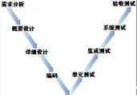

#### 【试题 7】---2014 下真题 10

7、以下关于软件测试的叙述中，（7）是不正确的。

（7）A.软件测试是为了改进产品质量、识别产品的缺陷和问题而进行的活动

B.测试不仅是检查预防措施是否有效的主要手段，而且是识别由于某种原因预防措施无效 而产生错误的主要手段

C.软件测试按照测试阶段划分，可分为单元测试、集成测试、系统测试

D.测试是在编码测试阶段完成后才开始的活动

#### 【答案】D

#### 【解析】 此题考察的是软件测试，必须掌握，高频考点

软件测试是一个系列过程活动，包括软件测试需求分析，测试计划设计，测试用例设计，执 行测试。因此， 软件测试贯穿于软件项目的整个生命过程。

#### 【点评】送分题，多次考了，简单

#### 【试题 8】---2015 上真题 27

8、在一个信息系统项目的 V 型生命周期模型中，系统测试是针对（）阶段做出的。 A.需求分析     B.概要设计    C.详细设计      D.编码

#### 【答案】B

#### 【解析】 此题考察的是 v 模型，必须掌握，常考

#### 【点评】多次考了，简单，必须得分

#### 【试题 9】 ---2015 下真题 28

9、基于 V 模型来设定软件开发项目计划，项目组应该在概要设计阶段制定软件的（）计划。 （9）A.单元测试  B.系统测试  C.集成测试  D.验收测试

#### 【答案】B

#### 【解析】 此题考察的是 v 模型，必须掌握，高频考点

系统测试主要针对概要设计，检查系统作为一个整体是否有效地得到运行，例如在产品设置中是 否能达到预期的高性能。

#### 【点评】送分题，多次考了，简单

#### 【试题 10】---2016 上真题 19

10、软件测试可以在概念上分为三个大的测试阶段： 单元测试、集成测试和系统测试。以下叙述 中，不正确的是（10）。

A.单元测试又称为模块测试， 是针对软件测试的最小单位——程序模块进行正确性检验的测试工作

B.集成测试也叫做组装测试， 通常在编码完成的基础上， 将所有的程序模块进行有序的、递增 的测试

C.集成测试是检验程序单元和部件的接口关系，逐步集成为符合概要设计的程序部件或整个系统   D.系统测试是真实或模拟系统运行环境下， 检查完整的程序系统能否和相关硬件、外设、网络、

系统软件和支持平台等正确配置与连接，并满足用户需求

#### 【答案】B

#### 【解析】 此题考察的是软件测试，必须掌握，高频考点

在（单元测试）的基础上，将所有模块按照设计要求（如根据结构图）组装成为子系统或系统， 进行集成测试。

#### 【点评】送分题，常考，理解下就好把题目做出来

#### 【试题 11】---2016 下真题 14

11 、以下关于软件需求分析、设计、测试与维护的叙述中，不正确的是（）。

A.软件需求分析可以检测和解决需求之间的冲突，发现系统的边界， 并详细描述系统需求 B.软件设计可以划分为软件架构设计和软件详细设计两个阶段

C.软件测试是在编码阶段完成后才开始介入的

D.软件维护指的是软件产品交付前和交付后需要提供的支持活动

#### 【答案】C

#### 【解析】P135此题考察的是软件测试维护、软件需求，必须掌握，高频考点

测试不再只是一种仅在编码阶段完成后才开始的活动。现在的软件测试被认为是一种应该包括在 整个开发和维护过程中的活动，它本身是实际产品构造的一个重要部分。

#### 【点评】送分题，常考，必须得分

#### 【试题 12】---2017 上真题 15

12、以下关于软件需求分析和软件设计的叙述中,不正确的是:（）。

A.需求分析可以检测和解决需求之间的冲突,并发现系统的边界

B.软件设计是根据软件需求,产生一个软件内部结构的描述,并将其作为软件构造的基础 C.需求分析是为了评价和改进产品质量、识别产品的缺陷和问题而进行的活动

D.软件设计是为了描述出软件架构及相关组件之间的接口

#### 【答案】C

#### 【解析】P135此题考察的是软件分析和软件设计，必须掌握，高频考点

选项 C 说的是“软件测试”。其余均为教程原文。

#### 【点评】常考，比较简单，必须得分

#### 【试题 13】---2017 上真题 64

13、某软件项目进行到测试阶段时,发现概要设计说明书中存在一处错误, 因此要进行修改。以下配 置项中,不会受到影响的是（）。

A.需求规格说明书    B.详细设计说明书    C.程序代码    D.测试大纲和测试用例

#### 【答案】A

#### 【解析】 此题考察的是软件测试，必须掌握，高频考点

考核的是信息系统项目是生命周期， 搞清不同阶段的先后顺序： 1 需求，2 概要设计， 3 详细设计， 4 编码，5 测试，6 验收。

#### 【点评】常考，比较简单，必须得分

### 7、软件维护

#### 【试题 1】---2010 下真题 11

1、在几种不同类型的软件维护中，通常情况下（1）所占的工作量最大。

（1）A.更正性维护    B.适应性维护    C.完善性维护    D.预防性维护

#### 【答案】C

#### 【解析】 此题考察的是软件维护，必须掌握，高频考点

软件的维护活动可以分为改正性维护、适应性维护、完善性维护和预防性维护四类，其中，	 完善性维护是软件维护的主要类型。根据对软件开发机构调查的结果，各类维护活动所占比重最 大的是完善性维护。因此，应选 C。

#### 【点评】常考，命题的热点，简单题， 必须得分

#### 【试题 2】---2011 上真题 10

2、为了改进应用软件的可靠性和可维护性， 并适应未来软硬件环境的变化，应主动增加新的功能 以使应用系统适应各类变化而不被淘汰。为了适应未来网络带宽的需要， 在满足现有带宽需求下， 修改网络软件从而使之支持更大的带宽，这种软件维护工作属于（2）。

（2）A.更正性维护    B.适应性维护   C.完善性维护  D.预防性维护

#### 【答案】D

#### 【解析】 此题考察的是软件维护，必须掌握，高频考点

软件维护包括如下类型：

①更正性维护：软件产品交付后进行的修改，以更正发现的问题

②适应性维护：软件产品交付后进行的修改，以保持软件产品能在变化后或变化中的环境中 可以继续使用

③完善性维护： 软件产品交付后进行的修改，以改进性能和可维护性

④预防性维护：软件产品交付后进行的修改，以在软件产品中的潜在错误成为实际错误前，  检测和更正它们

#### 【点评】常考，命题的热点，简单题， 必须得分

#### 【试题 3】---2015 下真题 15

3、某软件开发企业在软件交付给用户使用后，定期指派工程师小张去用户单位进行维护， 以保持 本企业软件产品能在变化后或变化中的环境中可以继续使用。小张以上的维护过程属于（3）

（3）A.适应性维护  B.更正性维护  C.预防性维护   D.完善性维护

#### 【答案】A

#### 【解析】 此题考察的是软件维护，必须掌握，高频考点

适应性维护是由于软件运行的外部环境（例如软件， 硬件）和数据环境等的发生了变化而修改软 件，使之适应这些变化的活动。

#### 【点评】送分题，多次考了，简单

#### 【试题 4】 ---2016 上真题 11

4、某软件系统进行升级，将某字段的长度由原先的 32 位增加到 64 位，这属于软件系统的（4）。 A.适应性维护   B.纠错性维护   C.完善性维护   D.预防性维护

#### 【答案】A

#### 【解析】 此题考察的是软件维护，必须掌握，高频考点

适应性维护。指使用软件适应信息技术变化和管理需求变化而进行的修改。 如代码改变、数 据结构变化、数据格式以及输入/输出方式的变化、数据存储介质的变化等， 都将直接影响系 统的正常工作。因此有必要对系统进行调整，使之适应应用对象的变化， 满足用户的要求。 如增加数据输出的图形方式， 增加联机在线帮助功能，调整用户界面等属于完善性维护

#### 【点评】送分题，常考，理解下就好把题目做出来， 部分人会误选成 C

#### 【试题 5】---2017 下真题 16

5、某央企的 ERP 系统已经稳定运行了 3 年，为了使用新业务发展的需要，运营团队近期接到数 据库系统升级服务的任务，它属于信息系统（） 类型的工作。

A.更正性维护    B.适应性维护    C.完善性维护    D.预防性维护

#### 【答案】B

#### 【解析】P136此题考察的是软件维护，必须掌握，高频考点

软件维护有如下类型：①更正性维护—更正交付后发现的错误；②适应性维护—使软件产品能够 在变化后或变化中的环境中继续使用；③完善性维护—改进交付后产品的性能和可维护性；④预 防性维护—在软件产品中的潜在错误成为实际错误前，检测并更正它们。

#### 【点评】常考，比较简单，必须得分

#### 【试题 6】---2019 上真题 12

6、某业务系统在送行中因应用程序错误导致业务受影响， 事后由维护工程师对该应用程序缺陷进 行修复，该维护活动属于（）。

A.更正性维护    B.适应性维护    C.完善性维护    D.预防性维护

#### 【答案】A

#### 【解析】P136 此题考察的是软件维护，必须掌握，高频考点

属于常识题。修改程序错误是更正性维护。

### 8、软件复用

#### 【试题 1】---2009 下真题 10

1、应用已有软件的各种资产构造新的软件，以缩减软件开发和维护的费用，称为（1）。

（1）A.软件继承  B.软件利用    C.软件复用    D.软件复制

#### 【答案】C

#### 【解析】P87此题考察的是软件复用， 必须掌握，高频考点

软件复用是指利用已有软件的各种有关知识构造新的软件， 以缩减软件开发和维护的费用。

#### 【点评】考的不是很多，书上的定义， 比较简单，必须得分

### 9、软件质量保证和质量评价、配置管理

#### 【试题 1】---2009 上真题 6

,、（1）的目的是评价项目产品， 以确定其对使用意图的适合性， 表明产品是否满足规范说明并遵 从标准。

（1）A.IT 审计   B.技术评审     C.管理评审     D.走查

#### 【答案】B

#### 【解析】 此题考察的是管理评审、技术评审、检查、走查审计等，必须掌握，高频考点

软件质量保证及质量评价”一节中的“评审与审计”中指出技术评审的目的是评价软件产品， 以确定其对使用意图的适合性，目标是识别规范说明和标准的差异，并向管理提供证据，以表明 产品是否满足规范说明并遵从标准，而且可以控制变更。

#### 【点评】这个点常考了，必须记住的， 需要区分，必须得分

#### 【试题 2】---2010 上真题 10

2、软件的质量是指（2）。

（2）A.软件的功能性、可靠性、易用性、效率、可维护性、可移植性

B.软件的功能和性能

C.用户需求的满意度

D.软件特性的总和，以及满足规定和潜在用户需求的能力

#### 【答案】D

#### 【解析】 此题考察的是软件质量的定义，必须掌握， 高频考点

软件“产品评价”国际标准 IS014598 和国家标准 GB/T16260-1-2006《软件工程产品质量一质 量模型》给出的“软件质量”的定义是：软件特性的总和，软件满足规定或潜在用户需求的能力。 其中定义的软件质量包括“内部质量”、“外部质量”和“使用质量”三部分。也就是说，“软件满 足规定或潜在用户需求的能力”要从软件在内部、外部和使用中的表现来衡量。软件质量特性是 软件质量的构成因素，是软件产品内在的或固有的属性，包括软件的功能性、可靠性、易用性、 效率、可维护性和可移植性等，每一个软件质量特性又由若干个软件质量子特性组成。

由此可见， 软件质量不是某个或几个软件质量特性或子特性，如功能和性能，也不是用户需 求的满意程度，而是软件特性的总和， 是软件满足规定或潜在用户的能力。应选择 D。

#### 【点评】考的不是很多，知道下即可， 简单题，必须得分

#### 【试题 3】---2011 下真题 11

3、以下关于软件质量保证和质量评价的描述中，不正确的是（3）。

（3）A.软件质量保证过程通过计划制定、实施和完成一组活动提供保证， 这些活动保证项目生命 周期中的软件产品和过程符合其规定的需求

B.验证和确认过程确定某一开发和维护活动的产品是否符合活动需求， 最终的产品是否满足 用户需求

C.检查的目的是评价软件产品， 以确定其对使用意图的适合性， 目的是识别规范说明与标准 的差异，并向管理提供证据

D.软件审计的目的是提供软件产品和过程对于应用的规则、标准、指南、计划和流程的遵从 性的独立评价

#### 【答案】C

#### 【解析】 此题考察的是软件质量保证和评价，必须掌握，高频考点

“软件质量保证过程通过计划制订、实施和完成一组活动提供保证，这些活动保证项目生命 周期中的软件产品和过程符合其规定的需求”的叙述表明选项 A 的描述是正确的。

其中“验证和确认过程确定某一开发和维护活动的产品是否符合活动的需求，最终的产品是 否达到其意图并满足用户需求”的叙述表明选项 B 的描述是正确的。

其中“软件审计的目的是提供软件产品和过程对于可应用的规则、标准、指南、计划和流程 的遵从性的独立评价”的叙述表明选项 D 的描述是正确的。

而其中“技术评审的目的是评价软件产品，以确定其对使用意图的适合性，目标是识别规范 说明与标准的差异，并向管理提供证据，以表明产品是否满足规范说明并遵从标准，而且可以控 制变更。检查的目的是检测和识别软件产品异常”的叙述则表明选项 C 的描述是不正确的。因此 正确答案应选 C。

#### 【点评】常考，命题的热点，简单题， 必须得分

#### 【试题 4】 ---2018 上真题 14

4、软件质量管理过程由许多活动组成，“确保活动的输出产品满足活动的规范说明”是（）活动 的目标。

A.软件确认    B.软件验证    C.技术评审    D.软件审计

#### 【答案】B

#### 【解析】P136此题考察的是软件质量术语，必须掌握，高频考点

软件质量管理过程包括质量保证过程、验证过程、确认过程、评审过程、审计过程等。

② 验证过程试图确保活动的输出产品已经被正确构造，即活动的输出产品满足活动的规范说明； 确认过程则试图确保构造了正确的产品，即产品满足其特定的目的。

③评审与审计：包括管理评审、技术评审、检查、走查、审计等。

管理评审的目的是监控进展，决定计划和进度的状态，或评价用于达到目标所用管理方法的有效 性。技术评审的目的是评价软件产品， 以确定其对使用意图的适合性。

软件审计的目的是提供软件产品和过程对于可应用的规则、标准、指南、计划和流程的遵从性的 独立评价。

#### 【点评】以前考过，常考，比较简单， 必须得分

### 10、面向对象

#### 【试题 1】---2009 下真题 17~18

1、面向对象中的（17）机制是对现实世界中遗传现象的模拟。通过该机制， 基类的属性和方法被 遗传给派生类；（18）是指把数据以及操作数据的相关方法组合在同一单元中， 这样可以把类作为

软件复用中的基本单元，提高内聚度， 降低糯合度。

（17） A.复用    B.消息    C.继承    D.变异

（18） A.多态    B.封装    C.抽象    D.接口

#### 【答案】（17） C  （18） B

#### 【解析】 此题考察的是面向对象的基本知识，必须掌握，高频考点

继承表示类之间的层次关系，这种关系使得某类对象可以继承另外一类对象的特征和能力， 继承又可分为单继承和多继承。

封装是将相关的概念组成一个单元，然后通过一个名称来引用它。面向对象封装是将数据和 基于数据的操作封装成一个整体对象， 对数据的访问或修改只能通过对象对外提供的接口进行。

多态性是一种方法，这种方法使得在多个类中可以定义同一个操作或属性名，并在每个类中 可以有不同的实现。

#### 【点评】常考，命题的热点，简单题， 必须得分

#### 【试题 2】---2010 下真题 17

2、“容器是一个构件，构件不一定是容器； 一个容器可以包含一个或多个构件， 一个构件只能包 含在一个容器中”。根据上述描述，如果用 UML  类图对容器和构件之间的关系进行面向对象分析 和建模，则容器类和构件类之间存在（2）关系。

① 继承   ②扩展  ③聚集  ④ 包含

（2）A.①②            B.②④          C.①④          D.①③

#### 【答案】D

#### 【解析】P92~96 书上没有明确说明  此题考察的是面向对象概念，必须掌握，高频考点

在统一建模语言 UML 的类图中，类和类之间可能存在继承、泛化、聚集、组成和关联等关系。 在统一建模语言的用例图中，用例和用例之间可能存在扩展、包含等关系。由于扩展和包含关系 不是类图中类和类之间的关系类型，因此题干中所述的容器类和构件类之间不可能存在扩展和包 含关系。“容器是一个构件”暗示容器类和构件类之间存在“① 继承（也叫类属）”关系，“一个 容器可以包含一个或多个构件”暗示容器类和构件类之间存在“③聚集”关系。正确答案应选 D

#### 【点评】常考，命题的热点，简单题， 必须得分

#### 【试题 3】---2010 下真题 18

3、面向对象分析与设计技术中，（3）是类的一个实例。

（3）A.对象         B.接口           C.构件           D.设计模式

#### 【答案】A

#### 【解析】 此题考察的是面向对象概念，必须掌握，高频考点

对象是由数据及其操作所构成的封装体，是系统中用来描述客观事物的一个封装，是构成系

统的基本单位。类是现实世界中实体的形式化描述， 类将该实体的数据和函数封装在一起。接口 是对操作规范的说明。模式是一条由三部分组成的规则，它表示了一个特定环境、 一个问题和一 个解决方案之间的关系。 类和对象的关系可以总结为:

（1）每一个对象都是某一个类的实例；（2）每一个类在某一时刻都有零个或更多的实例。  	（3）类是静态的，对象是动态的;   （4） 类是生成对象的模板。

由此可知，对象是类的一个实例， 因此应选 A。

#### 【点评】常考，命题的热点，简单题， 必须得分

#### 【试题 4】 ---2012 上真题 17

4、关于图 1 的叙述 （4）是不正确的。

（4）A.Rectangle 类和 circle 类都有名为 area 的属性，这两个属性一定是相同的属性

B.Rectangle 类和 circle 类都有名为 getArea 的属性， 这两个属性一定是相同的属性

c.Rectangle 中名为 length 的属性和 circle 类中名为 radius 的属性，这两个属性一定是不同 的属性

D.shape 类有一个属性， circle 类有两个属性， Rectangle 类有三个属性

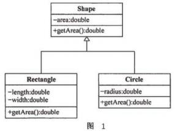

#### 【答案】B

#### 【解析】P95此题考察的是多态的概念，必须掌握， 高频考点

在面向对象方法中，多态性是一种方法，使得在多个类中可以定义同一个操作或属性名，并在每个类 中可以有不同的实现。它使得一个属性或变量在不同的时期可以表示不同类的对象。类 Rectangle 和 类 circle 都继承于类 shape,对于类 shape 而言，会有 getArea（）的操作。但显而易见，类 Rectangle 和类 circle 的 getArea（）方法的实现是完全不一样的这就体现了 多态的特征。

#### 【点评】多态，比较重要，多次考了， 简单，必须得分

#### 【试题 6】---2012 下真题 18

6、在面向对象的基本概念中，接口可以被理解为是类的一个特例。如果用可视化面向对象建模语 言（UML）来表示，则（6）图表示了类和接口之间的这种关系。

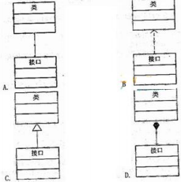

#### 【答案】C【解析】 此题考察的是面向对象和 UML 的知识，必须掌握，高频考点

UML中类图实例：

接口：空心圆+直线（唐老鸭类实现了‘讲人话,）； 依赖：虚线+箭头（动物和空气的关系）；

关联：实线+箭头（企鹅需要知道气候才迁移）；

聚合： 空心四边形+实线+箭头（雁群和大雁的关系）； 合成/组合：实心四边形+实线+箭头（鸟和翅膀的关系）；   泛化/继承：空心三角形+实线（动物和鸟的继承关系）；

实现：空心三角形+虚线（实现大雁飞翔的接口）；

#### 【点评】UML 图，考的不多，尽量掌握，尽量得分

#### 【试题 7】---2016 下真题 15

7、以下关于对象、类和继承的叙述中， 不正确的是（）。

A.对象是系统中用来描述客观事物的一个模块， 是构成系统的基本单位

B.类是现实世界中实体的形式化描述

C.对象是类的实例， 类是对象的模板

D.继承表示对象之间的层次关系

#### 【答案】D

#### 【解析】P138此题考察的是面向对象，必须掌握，高频考点

继承：表示类之间的层次关系（父类与子类），这种关系使得某类对象可以继外一类对象的特征， 继承又可分为单继承和多继承。

#### 【点评】送分题，常考，必须得分

#### 【试题 8】---2017 上真题 16

8、在面向对象的概念中,类是现实世界中实体的形式化描述,类将该实体的（）和操作封装在一起。 A.属性    B.需求    C.对象    D.抽象

#### 【答案】A

#### 【解析】P138此题考察的是面向对象，必须掌握，高频考点

类是现实世界中实体的形式化描述，类将该实体的属性（数据） 和操作（函数）封装在一起。

#### 【点评】常考，比较简单，必须得分

#### 【试题 9】 ---2017 下真题 15

9、封装、继承和多态是面向对象编程的三大特征，在 Java 开发过程中有着广泛应用。以下关于它 们的描述不正确的是（）。

A.封装是将数据和基于数据的操作封装成一个整体对象，通过接口实现对数据的访问和修改 B.继承关系中共有的类属性特征均需在父类和子类中进行说明

C.多态使得一个类实例的相同方法在不同情形有不同表现形式

D.多态机制使具有不同内部结构的对象可以共享相同的外部接口

#### 【答案】B

#### 【解析】P139此题考察的是面向对象，必须掌握，高频考点

继承：表示类之间的层次关系（父类与子类），这种关系使得某类对象可以继外一类对象的特征， 继承又可分为单继承和多继承。Dog 和 cat 类都是从 Mammal 继承而来，具有父类的 eyecolor 属性 特征，因此在子类中就可以不用重复指定 eyecolor 这个属性。

继承自父类的属性特征，不需要在子类中进行重复说明，所以 B 错误

#### 【点评】常考，比较简单，必须得分

#### 【试题 10】---2018 上真题 15

10、关于对象、类、继承、多态的描述，不正确的是：（）。

A.对象包含对象表示、对象状态和对象行为三个基本要素

B.类是对象的实例， 对象是类的模板

C.继承是表示类之间的层次关系

D.多态使得同一个操作在不同类中有不同的实现方式

#### 【答案】B

#### 【解析】P138此题考察的是面向对象名词概念，必须掌握，高频考点

对象是类的实例，类是对象的抽象定义

#### 【点评】以前考过，常考，比较简单， 必须得分

#### 【试题 11】---2018 下真题 15

11、进行面向对象系统分析和设计时，将相关的概念组成一个单元模块，并通过一个名称来引用它, 这种行为叫做()

A.继承    B.封装    C.抽象    D.复用

#### 【答案】B

#### 【解析】P138-140 此题考察的是面向对象名词概念， 必须掌握，高频考点

抽象：通过特定的实例抽取共同特征以后形成概念的过程。抽象是一种单一化的描述，强调 给出与应用相关的特性，

封装：将相关的概念组成一个单元模块，并通过一个名称来引用它。面向对象封装是将数据和基 于数据的操作封装成一个整体对象， 对数据的访问或修改只能通过对象对外提供的接口进行。

继承： 表示类之间的层次关系（父类与子类），这种关系使得某类对象可以继承另外一类对象 的特征，继承又可分为单继承和多继承。

复用：指将己有的软件及其有效成分用于构造新的软件或系统。组件技术软件复用实现的关键。

#### 【试题 12】---2019 上真题 15

12、关于面向对象概念的描述，正确的是（）。

A.对象包含两个基本要素，分別是对象状态和对象行为

B.如果把对象比作房屋设计图纸，那么类就是实际的房子

C.继承表示对象间的层次关系

D.多态在多个类中可以定义同一个操作或属性名，并在每个类中可以有不同的实现

#### 【答案】D

#### 【解析】P138-139 此题考察的是面向对象，必须掌握，高频考点

对象包含三个基本要素，分别是对象标识、对象状态和对象行为，A 错误。

类和对象的关系可理解为，对象是类的实例，类是对象的模板。如果将对象比作房子，那么类就 是房子的设计图纸。B 说反了。

继承：表示类之间的层次关系（父类与子类），C 错误。

多态：使得在多个类中可以定义同一个操作或属性名，并在每个类中可以有不同的实现。D 正确。

#### 【试题 13】---2019 下真题 12

13、对象由一组属性和对这组属性进行的操作构成。例如，老师张三的个人信息包括:性别年龄、 职位等，日常工作包括授课等。则（） 就是封装后的一个典型对象。

A.张三    B.老师    C.授课    D.姓名

#### 【答案】A

#### 【解析】P138 此题考察的是面向对象，必须掌握，高频考点；

张三是教师这个类实例化后的一个对象，教师是封装的类， 授课是成员方法，姓名、性别、年龄、 职位是成员属性。

#### 【试题 1】---2009 上真题 11

, 、UML2.0 支持 13 种图，它们可以分成两大类： 结构图和行为图。（1）说法不正确。

（1）A.部署图是行为图   B.顺序图是行为图    C.用例图是行为图    D.构件图是结构图

#### 【答案】A

#### 【解析】 此题考察的是 UML 视图，必须掌握，必考

UML2.0 支持 13 种图， 它们可以分成两大类： 结构图和行为图。 结构图包括类图、组合结构图、 构件图、部署图、对象图和包图：行为图包括活动图、交互图、用例图和状态机图，其中交互图  是顺序图、通信图、交互概览图和时序图的统称。

#### 【点评】UML 知识点，常考，必须得分

#### 【试题 2】---2009 下真题 15

2、关于 UML，错误的说法是（2）。

（2）A.UML 是一种可视化的程序设计语言

B.UML 不是过程，也不是方法，但允许任何一种过程和方法使用

C.UML 简单且可扩展

D.UML 是面向对象分析与设计的一种标准表示

#### 【答案】A

#### 【解析】 此题考察的是 UML 的特点，必须掌握，必考

UML 具有如下语言特征：

（1）UML 不是一种可视化的程序设计语言， 而是一种可视化的建模语言。

（2） UML 是一种建模语言规范说明，是面向对象分析与设计的一种标准表示。 	（3）UML 不是过程，也不是方法， 但允许任何一种过程和方法使用它。

#### 【点评】常考，命题的热点，简单题， 必须得分

#### 【试题 3】---2009 下真题 16

3、在 UML 中，动态行为描述了系统随时间变化的行为，下面不属于动态行为视图的是（3）。

（3）A.状态机视图    B.实现视图    C.交互视图    D.活动视图

#### 【答案】B

#### 【解析】P98  此题考察的是 UML 视图，必须掌握， 必考

UML 视图的最上层分成结构、动态行为和模型管理 3 个视图域。其中动态行为视图包括状态机 视图、活动视图和交互视图。

#### 【点评】常考，命题的热点，简单题， 必须得分

#### 【试题 4】 ---2010 下真题 8

4 、UML 中的用例和用例图的主要用途是描述系统的（4）。

（4）A.功能需求  B.详细设计    C.体系结构    D. 内部接口

#### 【答案】A

#### 【解析】 此题考察的是 UML 视图，必须掌握，高频考点

UML（统一建模语言）是用来对软件密集系统进行可视化建模的一种语言。 UML 的重要内容可 以由 5 类图（共 9 种图形）来定义，其中的第一类是用例图，从用户角度描述系统功能，并指出 各功能的操作者。因此，用例图描述的是系统的功能，即功能需求，所以应选 A

#### 【点评】常考，命题的热点，简单题， 必须得分

#### 【试题 5】---2011 上真题 17

5、在用例设计中， 可以使用 UML  中的（5）来描述用户和系统之间的交互， 说明系统功能行为。

（5）A.序列图        B.构件图        C.类图  D.部署图

#### 【答案】A

#### 【解析】P98此题考察的是 UML 视图，必须掌握，必考

UML 序列图主要用于按照交互发生的一系列顺序，显示对象之间的这些交互。序列图的主要用 途之一，是把用例表达的需求，转化为进一步、更加正式层次的精细表达。

UML 构件图主要用于描述各种软件构件之间的依赖关系，例如， 可执行文件和源文件之间的依 赖关系。UML 类图由许多（静态）说明性的模型元素（例如类、包和它们之间的关系，这些元素和 它们的内容互相连接）组成。类图可以组织在（并且属于）包中，仅显示特定包中的相关内容。 类图是最常用的 UML 图， 显示出类、接口以及它们之间的静态结构和关系；它用于描述系统的结构 化设计。

UML 部署图（配置图）是用来显示系统中软件和硬件的物理架构。

由 UML 的上述图的含义可知，在备选项中，只有序列图可用于描述系统的需求， 系统的功能

行为是需求的一部分，因此正确答案应选 A。

#### 【点评】常考，命题的热点，简单题， 必须得分

#### 【试题 6】---2011 上真题 18

6、根据下面的 UML 类图，以下叙述中 （6） 是不正确的。

（6）A.容器是一个组件                B.GUI  组件就是一个容器

C.GUI  组件是一个对象           D.容器和 GUI  组件都是组件

#### 【答案】B

#### 【解析】P114   此题考察的是 UML 视图，必须掌握， 高频考点

GUI 是， 即图形用户接口。根据教程 P114，J2EE 应用服务器运行环境包括构件、容器及服务 三部分。构件是表示应用逻辑的代码；容器是构件的运行环境；服务则是应用服务器提供的各种 功能接口， 可以同系统资源进行交互。

继承标识类之间的层次关系，这种关系使得某类对象可以继承另一类对象的特征和能力。假 设类 B 继承类 A，即类 B 中的对象具有类 A 的一切特征。

题干中所给的 UML 图是一个类图，其中共有 4 个类：对象、组件、容器和 GUI 组件。其中组件 类继承了对象类，容器类和 GUI 组件类继承了组件类，而容器类和 GUI 组件类之间不存在继承关 系。因此 GUI 组件类并没有继承容器类的所有特征和能力，即 GUI 组件不一定是一个容器，正确 答案应选 B。

#### 【点评】常考，命题的热点，简单题， 必须得分

#### 【试题 7】---2011 下真题 17

7、以下关于面向对象方法的描述中，不正确的是（7）。

（7）A.选择面向对象程序设计语言时需要考虑开发人员对其的熟悉程度

B.使用设计模式有助于在软件开发过程中应用对象技术

C.在软件生命周期的分析、设计、实现和测试过程中均可以应用面向对象技术

D.UML 是一种可视化建模语言，它需要与 RUP 开发过程同时使用

#### 【答案】D

#### 【解析】P96~97  此题考察的是 UML，必须掌握，必考

UML 仅仅是一种可视化建模语言，用来描述待开发的系统、用来建模，可以和任何过程模型搭配。

#### 【点评】常考，命题的热点，简单题， 必须得分

#### 【试题 8】---2012 下真题 13

8、用于显示运行的处理节点以及居于其上的构件、进程和对象的配置的图是（8）。

（8）A.用例图    B.部署图    C.类图        D.构件图

#### 【答案】B

#### 【解析】P98  此题考察的是UML视图，必须掌握，必考

部署图：显示运行时处理节点以及在其上存活的构件、过程和对象的配置的一种图。构件是 代码单元在运行时的具体表现形式。

#### 【点评】UML，多次考了，简单，必须得分

#### 【试题 9】 ---2014 上真题 9

9、在对一个系统进行需求分析后，通常会建立实体关系模型（E-R）图，在 E-R 图中，表示实体 的图形是（9）

（9）A.椭圆    B. 圆形    C.矩形    D.菱形

#### 【答案】C

#### 【解析】 此题考察的是 UML 相关，必须掌握，考的不多

| 【点评】UML 的一些知识，这个点考的不是很多，稍微 | 实体关系模型是指提供了表示实体型、属 性和联系的方法。用来描述现实世界的概 念模型。 ER 图中，椭圆表示属性，矩形 表示实体， 菱形表示联系。 看看就好 |
|---|---|

### 12、软件架构

#### 【试题 1】---2009 上真题 5

,、与客户机/服务器（Client/server ，C/s）架构相比，测览器/服务器（Browser/server ，B/s）架构 的最大优点是（1）。

（1）A.具有强大的数据操作和事务处理能力    B.部署和维护方便、易于扩展

C.适用于分布式系统，支持多层应用架构  D.将应用一分为二，允许网络分布操作 【答案】B

#### 【解析】 此题考察的是软件架构相关知识，必须掌握，高频考点

C/S 模式（即客户机/服务器模式）分为客户机和服务器两层，客户机不是毫无运算能力的输入、 输出设备，而是具有一定的数据处理和数据存储能力， 可以有效地降低网络通信量和服务器运算量。

B/S 模式（測览器/服务器模式）是 C/S 结构的一种改进。在这种结构下，软件应用的业务逻 辑完全在应用服务器端实现， 用户表现完全在 web 服务器端实现，客户端只需要測览器即可进行 业务处理， 是一种全新的软件系统构造技术。

因此， 基于 B/S 架构的信息系统比基于 C/S 架构的系统更容易部署和升级维护。应洗择 C。

#### 【点评】C/S 和 B/S 的区别，多次考了，比较简单， 必须得分

#### 【试题 2】---2010 上真题 7

2、与基于 C/s  架构的信息系统相比， 基于 B/s  架构的信息系统（2）。

（2）A.具备更强的事务处理能力，易于实现复杂的业务流程

B.人机界面友好，具备更加快速的用户响应速度

C.更加容易部署和升级维护

D.具备更高的安全性

#### 【答案】C

#### 【解析】 此题考察的是软件架构，必须掌握，高频考点

因此， 基于 B/S 架构的信息系统比基于 C/S 架构的系统更容易部署和升级维护。应洗择 C。

#### 【  点评】考的不是很多，现在基本不怎么考了，简单题，必须得分

#### 【试题 3】---2010 上真题 17

3、为了解决 C/S  模式中客户机负荷过重的问题，软件架构发展形成了（3）模式。

（3）A.三层 C/S            B.分层      C.B/S         D.知识库

#### 【答案】C

#### 【解析】 此题考察的是软件架构，必须掌握，高频考点

C/S 模式即客户机/服务器模式。该模式是基于资源不对等，为实现共享而提出的。 C/S 模式 需要在使用者计算机上安装相应的操作软件，使得客户机负载过重。为了解决 C/S 模式中客户端 的问题，发展形成了測览器/服务器（B/S ）模式；为解决 C/S 模式中服务器端的问题，发展形成 了三层（多层） C/S 模式及多层应用架构。知识库模式采用两种不同的控制策略：传统数据库型的 知识库模式和黑板报系统的知识库模式。应选择 C。

#### 【点评】常考，命题的热点，简单题， 必须得分

#### 【试题 4】 ---2012 上真题 21

4、网络协议和设备驱动软件经常采用分层架构模式，其主要原因是   （ 4）    。

（4）A.可以让软件获得更高的性能          B.支持软件复用

C.让功能划分容易，便于设计实现     D.为达到内聚、高糯合的设计目标

#### 【答案】B

#### 【解析】 此题考察的是分层架构模式，必须掌握，高频考点

分层架构模式优点如下：（1）有助把复杂的问题按功能分解，使整体设计更为清晰。（2）支 持系统设计的逐级抽象③具有较好的可扩展性。（4） 支持复用。

分层模式的缺点如下：（1）并不是每个系统都可以很容易地划分出层次来；同时，各层功能 的划分也没有一个统一的、正确的抽象方法。（2）层次的个数过多，系统性能可能会下降

#### 【点评】分层架构的特点，有一定难度，尽量记住， 再次考的几率不大，尽量得分

#### 【试题 5】---2014 下真题 12

5、在信息系统工程总体规划过程中，软件架构包括多种形式。在（5）中，数据和数据处理放在 服务器端， 而应用处理和表现层放在客户端。

（5）A.文件服务器架构 B.客户/服务器两层架构  C.客户/服务器 N 层架构 D.基于 web 的架构 【答案】B

#### 【解析】 此题考察的是软件价格，必须掌握，中频考点

客户机/服务器（ Client/Server，C/s）模式是基于资源不对等，为实现共享而提出的。

C/S 模式将应用一分为二， 服务器（后台） 负责数据管理， 客户机（前台）完成与用户的交互任务。 C/S 模式具有强大的数据操作和事务处理能力， 模型思想简单， 易于人们理解和接受。

#### 【点评】考的不多，暂且了解下吧

#### 【试题 6】---2016 下真题 16

6、基于组件的软件开发架构模式一般在（）软件并发架构模式中使用。

A.管道—过滤器    B.面向对象   C.事件驱动    D.客户/服务器

#### 【答案】B

#### 【解析】P141此题考察的是软件架构，必须掌握，高频考点

基于组件的软件开发架构模式一般在面向对象软件并发架构模式中使用。

#### 【点评】送分题，常考，必须得分

#### 【试题 7】---2018 上真题 16

7、在典型的软件架构模式中，（）模式是基于资源不对等，为实现共享而提出的。 A.管道/过滤器    B.事件驱动    C.分层    D.客户/服务器

#### 【答案】D

#### 【解析】P141此题考察的是软件架构模型，必须掌握，高频考点

客户/服务器模式（C/S）：基于资源不对等， 为实现共享而提出的模式。C/S 模式将应用一分为二， 服务器（后台）负责数据操作和事务处理，客户（前台）完成与用户的交互任务。

#### 【点评】以前考过，常考，比较简单， 必须得分

#### 【试题 8】---2019 下真题 13

8、关于软件架构分层模式描述，不正确的是（）。

A.允许将一个复杂问题分层实现

B.每一层最多只影响相邻两层

C.具有各功能模块高内聚，低糯合的“黑盒”特性

D.允许每层用不同的实验方法， 可以充分支持软件复用

#### 【答案】C

#### 【解析】P141-142 此题考察的是软件架构，必须掌握，高频考点；

管道/过滤器模式体现了各功能模块高内聚、低糯合的“黑盒，支持软件功能模块的重用，便于系 统维护，同时，每个过滤器自己完成数据析和合成工作（如加密和解密），易导致系统性能下降， 并增加了过滤器具体实现的复杂性。选项 C 是管道/过滤器模式。

### 13、软件中间件

#### 【试题 1】---2010 上真题 8

1 、 中间件是位于硬件、操作系统等平台和应用之间的通用服务。（1）位于客户和服务器之间， 负责负载均衡、失效恢复等任务，以提高系统的整体性能。

（1）A.数据库访问中间件     B.面向消息中间件    C.分布式对象中间件    D.事务中间件

#### 【答案】D

#### 【解析】 此题考察的是中间件，必须掌握，高频考点

数据库访问中间件通过一个抽象层访问数据库，从而允许使用相同或相似的代码访问不同的

数据库资源。远程过程调用（RPC）中间件用来“远程”执行一个位于不同地址空间内的过程， 从 效果上看和执行本地调用相同。面向消息的中间件（MOM）利用高效可靠的消息传递机制负责进行 平台无关的数据交流，并可基于数据通信进行分布系统的集成。分布式对象中间件是随着对象技 术和分布计算技术的发展，两者结合形成的技术，可用于在异构分布计算环境中透明地传递对象 请求。 事务中间件也称事务处理监控器（TPM）位于客户端和服务器之间，完成事务管理与协调、	 负载平衡、失效恢复等任务， 以提高系统的整体性能。应选择 D。

#### 【点评】常考，命题的热点，书上原话，简单题，必须得分

#### 【试题 2】---2011 下真题 8

2、某供电企业在信息化过程中先后构建了多个部门级的信息系统应用。由于历史原因， 这些应用 大多采用不同的语言开发，并且运行在多种平台之上，现在该企业希望将这些系统集成起来，实 现在各个系统之间快速传递可定制格式的数据包。如果有新数据到达，接收系统能够自动获得通 知，当传输发生异常时能够支持数据重传。以下最能满足这种要求的集成方式是（2）。

（2）A.消息机制      B.文件共享  C.数据仓库  D.工作流

#### 【答案】A

#### 【解析】P109~110 此题考察的是消息机制，必须掌握，高频考点

消息机制是通过使用面向消息中间件（MOM）利用高效可靠的消息传递机制进行平台无关的数 据交流，并可以基于数据通信进行分布系统的集成。通过提供消息传递和消息排队模型，可以在 分布式环境下扩展进程间的通信，并支持多种通讯协议、语言、应用程序、硬件和软件平台。通 过使用 MOM，通信双方的程序（称其为消息客户程序）可以在不同的时间运行， 程序不在网络上直 接通话，而是间接地将消息放入 MOM 服务器的消息机制中。因为程序间没有直接的联系，所以它 们不必同时运行。消息客户程序之间通过将消息放入消息队列或从消息队列中取出消息来进行通 讯。客户程序不直接与其他程序通信，避免了网络通信的复杂性。消息队列和网络通信的维护工 作由 MOM 来完成。对本题干反映的应用场景来说， 可以考虑使用面向消息中间件（MOM）把这样的 异构系统集成起来， 因此使用“A.消息机制”最为恰当。

#### 【点评】常考，命题的热点，简单题， 必须得分

#### 【试题 3】---2012 上真题 8

3、关于中间件特点的描述，（3）是不正确的。

（3）A.中间件可运行于多种硬件和操作系统平台上

B.跨越网络、硬件、操作系统平台的应用或服务可通过中间件透明交互

C. 中间件运行于客户机/服务器的操作系统内核中，提高内核运行效率

D. 中间件应支持标准的协议和接口

#### 【答案】C

#### 【解析】 此题考察的是中间件的定义，必须掌握，高频考点

中间件是一种独立的系统软件或服务程序，它位于客户机/服务器（C/S） 的操作系统之上，  管理计算机资源和网络通信。据此，选项 C 的说法有误。

通常， 中间件特点包括（但不限于）：①满足大量应用的需要； ②运行于多种硬件和操作系统 平台上③支持分布计算；④提供跨越网络、硬件、操作系统平台的应用或服务；⑤支持标准的协 议

⑥支持标准的接口。

#### 【点评】中间件，比较重要，多次考了，简单，必须得分

#### 【试题 4】 ---2012 下真题 5

4、在下列技术中，（4）提供了可靠消息传输、服务接入、协议转换、数据格式转换、基于内容 的路由器等功能，能够满足大型异构企业环境的集成要求。

（4） A.ESB          B.RUP          C.EJB              D.PERT

#### 【答案】A

#### 【解析】 此题考察的是常见的集成技术，比较偏，排除法解决，必须掌握，高频考点

企业服务总线（ESB）是指由中间件基础设施产品技术实现的， 通过事件驱动和基于XML消息 引擎， 为更复杂的面向服务的架构提供的软件架构的构造物。它提供了可靠消息传输、服务接入、 协议转换、数据格式转换、基于内容的路由等功能， 屏蔽了服务的物理位置、协议和数据格式，	  能够满足大型异构企业环境的集成需求。

PERT即计划评审技术， 简单地说， PERT是利用网络分析制定计划以及对计划予以评价的技术。 它能协调整个计划的各道工序，合理安排人力、物力、时间、资金，加速计划的完成。在现代计  划的编制和分析手段上， PERT被广泛的使用，是现代项目管理的重要手段和方法。

#### 【点评】ESB，虽然考的不多，但是可以通过排除法解题，必须得分

#### 【试题 5】---2018 下真题 16

5、软件三层架构中，（）是位于硬件、操作系统等平台和应用之间的通用服务，用于解决分布系统 的异构问题， 实现应用与平台的无关性。

A.服务器    B.中间件    C.数据库    D.过滤器

#### 【答案】B

#### 【解析】P143 此题考察的是中间件技术，必须掌握， 高频考点

中间件（Middleware）是位于硬件、操作系统等平台和应用之间的通用服务。借由中间件，解决 了分布系统的异构问题。

#### 【试题 6】---2019 上真题 16

6、中间件有多种类型，IBM 的 MQSeries 属于（）中间件。

A.面向消息    B.分布式对象    C.数据库访问    D.事务

#### 【答案】A

#### 【解析】P144 此题考察的是中间件，必须掌握，高频考点

面向消息中间件：利用高效可靠的消息传递机制进行平台无关的数据传递，并可基于数据通信进 行分布系统的集成。通过提供消息传递和消息队列模型，可在分布环境下扩展进程间的通信，并 支持多种通讯协议、语言、应用程序、硬件和软件平台。典型产品如 IBM 的 MQSeries。

#### 【试题 7】---2019 下真题 15

7、中间件是一件独立的系统软件或服务程序，（）不属于中间件。

A.TomaT   B.webSphere    C.。DBS    D.Python

#### 【答案】D

#### 【解析】P144 此题考察的是中间件，必须掌握，高频考点；

Python 是一种跨平台的面向对象的开发语言，不是中间件。

#### 【江山老师点评】教材表述不全，排除法求解

### 14、数据库和数据仓库

#### 【试题 1】---2009 下真题 28

1、下面关于数据仓库的叙述， 错误的是（1）  。

（1）A.在数据仓库的结构中，数据源是数据仓库系统的基础

B.数据的存储与管理是整个数据仓库系统的核心

C.数据仓库前端分析工具中包括报表工具

D.数据仓库中间层 。LAP 服务器只能采用关系型。LAP

#### 【答案】D

#### 【解析】 此题考察的是数据仓库，必须掌握，高频考点

在数据仓库的结构中，数据源是数据仓库系统的基础，通常包括企业内部信息和外部信息。 数裙的存储与管理是整个数据仓库系统的核心。 OLAP 服务器对分析需要的数据进行有效集成，按 多维模型组织，以便进行多角度、多层次的分析，并发现趋势。具体实现可以分为 ROLAP、MOLAP 和 HOLAP。数据仓库的前端工具主要包括各种报表工具、查询工具、数据分析工具、数据挖掘工具 以及各种基于数据仓库的应用开发工具。

#### 【点评】常考，命题的热点，简单题， 必须得分

#### 【试题 2】---2010 上真题 30

2、以下关于数据仓库与数据库的叙述中，（2）是正确的。

（2）A.数据仓库的数据高度结构化、复杂、适合操作计算；而数据库的数据结构比较简单， 适合分析 B.数据仓库的数据是历史的、归档的、处理过的数据；数据库的数据反映当前的数据

C.数据仓库中的数据使用频率较高；数据库中的数据使用频率较低

D.数据仓库中的数据是动态变化的，可以直接更新；数据库中的数据是静态的，不能直接更新 【答案】B

#### 【解析】 此题考察的是数据仓库技术，尽量掌握，必考

数据库技术以数据库为中心，进行事务处理、批处理、决策分析等各种数据处理工作，主要 有操作型处理和分析型处理两类。操作型数据库系统主要强调的是优化企业的日常事务处理工作， 难以实现对数据分析处理要求，无法满足数据处理多样化的要求。从而进化出分析型的数据仓库 技术。

数据仓库是一个面向主题的、集成的、相对稳定的、反映历史变化的数据集合，用于支持管 理决策。

与操作型数据库相比，数据仓库的主要特点有面向主题、集成、相对稳定和反映历史变化。 操作型数据库中的数据通常是实时更新的，数据根据需要及时发生变化，而数据仓库只有少量的 修改和删除操作。

#### 【  点评】必考，命题的热点，简单题，必须得分

#### 【试题 3】---2011 下真题 30

。、以下关于数据仓库描述中，正确的是（3）。

A.数据仓库中的数据主要提供企业决策分析之用。需要实施快速更新

B.数据仓库中的数据包含了企业从过去某一时刻到当前各个阶段的信息

C.数据仓库中的数据通常按业务应用进行组织

D.数据仓库中的数据往往来自异构数据库，发生数据不一致在所难免

#### 【答案】B

#### 【解析】P111此题考察的是数据仓库，必须掌握，必考

数据仓库是在管理人员决策中的面向主题的、集成的、非易失的并且随阶段而变化的数据集合。

#### 【点评】常考，命题的热点，简单题， 必须得分

#### 【试题 4】 ---2012 上真题 9

4、数据库管理系统是操纵和管理数据库的大型软件，用于建立、使用和维护数据库。以下关于数 据库管理系统的描述， （4）是不正确的。

（4）A.数据库管理系统可使多个应用程序和用户用不同的方法在需要的时候去建立、修改和询问 数据库

B.数据库管理系统提供数据定义语言与数据操作语言

C.数据库管理系统提供对数据的追加、删除等操作

D.数据库管理系统不具有与操作系统的联机处理、分时系统及远程作业输入的相关接口 【答案】D

#### 【解析】P111 书中不详   此题考察的是数据库管理系统，必须掌握，考的不多

数据库管理系统（DBMS）对数据库进行统一的管理和控制，以保证数据 库的安全性和完整  性。它可使多个应用程序和用户用不同的方法在同时（或不同时刻）去建立、修改和询问数据库。 DBMS 提供数据定义语言（DDL）与数据操作语言（DML），供用户定义数据库的模式结构与权限约束， 实现对数据的追加、删除等操作。 DBMS 具有与操作系统的联机处理、分时系统及远程作业输入的 相关接口， 负责处理数据的传送。对网络环境下的数据库系统， 还应该 包括 DBMS 与网络中其他 软件系统的通信功能，以及数据库之间的互操作功能。

#### 【点评】数据库，书上不详，难题，需要稍微理解下，尽量得分

#### 【试题 5】---2012 上真题 30

5 、一般情况下，（5）属于软件项目非功能性需求。

（5） A.操作界面差异性   B.系统配置内容   C.系统稳定性    D.系统联机帮助

#### 【答案】C

#### 【解析】 此题考察的是软件需求的分类，必须掌握， 高频考点

软件项目的非功能性需求是指软件产品为满足用户业务需求而必须具有且除功能需求以外的 特性。包括系统性能、稳定性、可用性、可靠性、扩展性、可维护性、易用性和对技术和对业务 的适应性等。

#### 【点评】软件需求，多次考了，简单， 必须得分

#### 【试题 6】---2012 下真题 31

6、数据仓库是一个面向主题的、集成的、相对稳定的、反映历史变化的数据集合， 用于支持管理 决策。关于数据仓库，下面说法正确的是（6）。

（6）A.数据仓库指主要规律是事务处理。即对联机数据的增、删、改、查

B.数据仓库集成了异构数据源，且存放在数据仓库中的数据一般不再改变 C.我们把数据库通常称为数据集合， 它是数据仓库的主题

D.OLAP 服务器检索位于数据仓库的前端，用于管理人员有决策分析

#### 【答案】B

#### 【解析】P111   此题考察的是数据仓库，必须掌握， 必考

数据仓库是对多个异构数据源（包括历史数据）的有效集成，集成后按主题重组，且存放在 数据仓库中的数据一般不再修改。据此，选项 B 的说法正确。

传统数据库技术的主要用途是事务处理、批处理等， 即对联机数据的增、删、改、查等工作。 据此，选项 A 的说法有误。

数据仓库的主题是指用户使用数据仓库进行决策时所关心的某些方面， 一个主题通常与多个 操作型系统相关。据此，选项 C 的说法有误。

数据仓库系统的结构通常包含数据源、数据的存储与管理、 OLAP （联机分析处理）服务器和 前端分析工具 4 个层次。其中，OLAP 服务器对分析需要的数据进行有效集成，按多维模型组织以 便进行多角度、多层次的分析，并发现趋势。前端分析工具主要包括各种报表工具、查询工具、 数据分析工具、数据挖掘工具，以及各种基于数据仓库或数据集市（即部门级数据仓库）的应用 开发工具。据此，选项 D 的说法有误。

#### 【试题 7】---2013 上真题 28

7、某关系数据库中有如下的员工表和部门表， 适合作为员工表的主键和外键的字段分别为   7 。

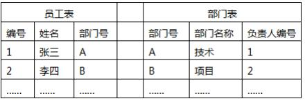

（7）A.员工编号和部门编号       B.部门编号和员工编号

C.部门编号和姓名           D.姓名和部门编号

#### 【答案】A

#### 【解析】 此题考察的是数据库，书上没有，必须掌握，高频考点

根据上述数据库表，员工表的主键为“编号”，外键为“部门号”；部门表的主键为“部门号”， 外键为“负责人编号”。

#### 【点评】数据库的知识，理解题，比较简单，尽量得分

#### 【试题 8】---2013 上真题 29

8.数据库管理系统 DBMS 和操作系统。S 之间的关系为  8  。

（8）A.相互调用      B.DBMS 调用 OS        C.OS 调用 DBMS            D.并发运行

#### 【解析】DBMS 是 database managemenTsystem 数据库管理系统； S 是 operating system 操作系统。 一般 DBMS 是安装在。S，DBMS 的数据管理可以用。S 的的文件管理，也可以想。S 申请空间然后自 己管理数据。

#### 【试题 9】 ---2014 下真题 13

9、数据库管理系统（DatabaseManagementSystem）是一种操纵和管理数据库的大型软件。用示建 立、使用和维护数据库，简称 DBMS。其中供用户实现数据的追加、删除、更新、查询的功能属 于（）

A.数据定义   B.数据操作   C.数据的组织、存储和管理   D.数据库的维护

#### 【解析】 数据操作：DBMS 提供数据操作语言 DML（Data Manipulation Language），供用户实现对数据的追 加、删除、更新、查询等操作。

#### 【试题 10】---2015 下真题 13

10 、DBMS 用于建立，使用和维护数据库，（ ）不是其选型的首要原则。

（10）A.稳定可靠   B.可扩性  C.经济性   D.安全性

#### 【解析】 在选择相关设备时， 一般经济性都不是首要的原则， 重点是要稳定可靠、安全、扩充性好等。数据库选型：稳定可靠（High-Availability）、可扩展性（High-Scalability）、安全性（Security）、 丰富的开发工具、服务质量；

#### 【试题 11】---2015 下真题 16

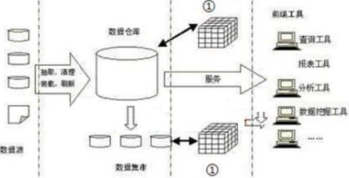

11、数据仓库是一个面向主题的、集成的、相对稳定的、反映历史变化得得数据集合，用于支持 管理决策， 其系统结构如下图所示：图中①应为( )

（11）A.中心数据服务器  B.OLTP 服务器  C.OLAP 服务器   D.决策应用服务器

#### 【解析】 教材上原图。《系统集成项目管理工程师教程》P112

#### 【试题 12】---2016 上真题 13

12、所谓设备选型，是从多种可以满足相同需要的不同型号、规格的设备中，经过技术经济的分 析评价，选择最佳方案以作出购买决策。在某设备选型的测试中，发现某防火墙功能满足条件、 性能适中，但是其图形控制终端只能安装在老版本的操作系统上，因不满足（13）原则，决定不 购买此防火墙。

A.安装便利   B.技术先进   C.扩展性强    D.质量可靠

#### 【解析】 在系统设计中进行设备、DBMS 及技术选型时，不只要考虑系统的功能要求，还要考虑到系统实现 的内外环境和主客观条件。很明显不能满足技术先进要求；

#### 【试题 13】---2016 下真题 17

13、以下关于数据仓库的叙述申，不正确的是（）。

A.数据仓库是相对稳定的

B.数据仓库是反映历史变化的数据集合

C.数据仓库的数据源可能是异构的

D.数据仓库是动态的、实时的数据集合

#### 【解析】数据仓库（Datawarehouse）是一个面向主题的（subjectoriented）、集成的、相对稳定的、反映 历史变化的数据集合，用于支持管理决策。数据仓库是对多个异构数据源（包括历史数据）的有 效集成，集成后按主题重组， 且存放在数据仓库中的数据一般不再修改。

#### 【试题 14】---2017 上真题 17

14、以下关于数据仓库的叙述中,正确的是（）。

A.数据仓库主要用于支持管理决策

B.数据仓库的数据源相对比较单一

C.存放在数据仓库中的数据一般是实时更新的

D.数据仓库为企业的特定应用服务,强调处理的响应时间、数据的安全性和完整性等

#### 【解析】数据仓库（ Data warehouse）是一个面向主题纳（subjecToriented）、集成的、相对稳定的、反 映历史变化的数据集合，用于支持管理决策。数据仓库是对多个异构数据源（包括历史数据）的 有效集成， 集成后按主题重组，且存放在数据仓库中的数据一般不再修改。

#### 【试题 15】---2017 下真题 17

15、（）是一种软件技术，在数据仓库中有广泛的应用，通过访问大量的数据实现数据处理分析要 求，实现方式是从数据仓库中抽取详细数据的一个子集并经过必要的聚集存储到该服务器中供前 端分析工具读取。

A.联机分析处理（OLAP）   B.联机事务处理（OLTP）

C.数据采集工具（ETL）     D.商业智能分析（BI）

#### 【解析】

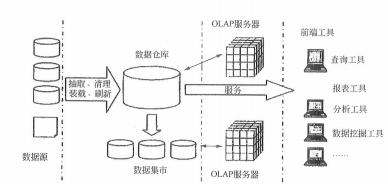

#### 【试题 16】---2018 上真题 17

16、关于数据库和数据仓库技术的描述，不正确的是（）。

A.与数据仓库相比，数据库的数据源相对单一

B.与数据仓库相比， 数据库主要存放历史数据，相对稳定

C.数据仓库的目的是为了管理决策

D.数据仓库的结构包含数据源、数据集市、OLAP 服务器、前端工具等

#### 【解析】数据仓库（Datawarehouse）是一个面向主题的（subjectoriented）、集成的、相对稳定的、反映 历史变化的数据集合，用于支持管理决策。数据仓库相对稳定

#### 【试题 17】---2018 下真题 17

17、关于数据库和数据仓库技术的描述，不正确的是（17）。

A.数据库是面向主题的，数据仓库是面向事务的

B.数据仓库一般用于存放历史数据

C.数据库主要采用。LTP,数据仓库主要采用。LAP

D.数据仓库的数据源相对数据库来说比较复杂

#### 【解析】数据仓库（Datawarehouse）是一个面向主题的、集成的、相对稳定的、反映历史变化的数据集合， 用于支持管理决策。数据仓库是对多个异构数据源（包括历史数据）的有效集成，集成后按主题 重组，且存放在数据仓库中的数据一般不再修改。

#### 【试题 18】---2019 上真题 17

18、关于数据库和数据仓库技术的描述，不正确的是（）。

A.数据仓库是一个面向主题的、集成的、相对稳定的、反映历史变化的数据集合，用于支持 管理决策.

B.企业数据仓库的建设是以现有企业业务系统和大量业务数据的积累为基础的，数据库一般 不支持异构数据的集成.

C.大数据分析相比传统的数据仓库应用，其数据量更大，查询分析复杂，且在技木上须依托 于分布式、云存储、虚拟化等技木

D.数据仓库的结构通常包含数据源、数据集市、数据分析服务器和前端工具 4 个层次

#### 【解析】数据仓库是对多个异构数据源（包括历史数据）的有效集成，集成后按主题重组，且存放在数据 仓库中的数据一般不再修改。

#### 【试题 19】---2019 下真题 14

19、常见的数据库管理系统中，（）是非关系型数据库

A.Oracle        B.MYsQL       C.sQL sever        D.Mongo DB

#### 【解析】信息技术常识题， MongoDB 是一个介于关系型和非关系型数据库直接的产品。

常见的关系型数据库：Oracle、DB2、MicrosofTsQL server、MicrosofTAccess、MYsQL。 常见的非关系型数据库： Nosql、Cloudant、MongoDb、redis、HBase。

两则的主要区别是关系型数据库采用二维表格存储数据，非关系型使用键值对存储数据。

### 15、web service 技术

#### 【试题 1】---2009 上真题 69

Webservice的各种核心技术包括 XML 、Namespace 、XMLschemA.sOAP 、WsDL 、UDDI、 Ws-Inspection 、Ws-securitY 、Ws-Routing 等，下列关于 Webservice 技术的叙述错误的是（1）。 A.XMLschema 是用于对 XML 中的数据进行定义和约束

B.在一般情况下， Webservice 的本质就是用 HTTP 发送一组 WEB 上的 HTML 数据包

C.SOAP（简单对象访问协议），提供了标准的 RPC 方法来调用 Webservice，是传输数据的方式  D.SOAP 是一种轻量的、简单的、基于 XML 的协议， 它被设计成在 WEB 上交换结构化的和

固化的信息

#### 【解析】web service 是一个组件或应用程序，它向外界暴露出一个能够通过 web 进行调用的 API。 web services 是建立可互操作的分布式应用程序的新平台。

web services 平台是一套标准，它定义了应用程序如何在 web 上实现互操作性。

开发人员可以用任何自己喜欢的语言， 在任何自己喜欢的平台上写 web service，只要可以通 过 web service 标准对这些服务进行查询和访问。

web service 的各种核心技术包括 XMI。、 Namespace、XMI。schemA.sOAP、wsDL、UDDI、 ws-Inspection、ws-securitY 和 ws-Routing 等， 其中 xlvn。定义 web service 平台中的数据格 式。 sOAP（简单对象访问协议）提供了标准的 RPC 方法来调用 web service，是传输数据的方式。

#### 【试题 2】---2009 下真题 29

2、以下（2） 是 SOA 概念的一种实现。

（2）A.DCOM        B.J2EE        C.Web service        D.WWW

#### 【解析】webservice 服务的典型技术包括用于传递信息的简单对象访问协议SOAP，用于描述服务的

web 服务描述语言 wsDL，用于 web 服务注册的统一描述， 发现及集成 UDDI，用于数据交换的 XML。

#### 【试题 3】---2010 上真题 28

3 、 web Service  技术适用于（3）应用。

①跨越防火墙②应用系统集成③单机应用程序④B2B 应用⑤软件重用⑥局域网上的同构应用程序

（3）A.③④⑤⑥     B.②④⑤⑥      C.①③④⑥      D.①②④⑤

#### 【解析】web 服务的主要目标是跨平台的互操作性，适合使用 web services 的情况有跨越防火墙、应 用程序集成、B2B 集成和软件重用。在某些情况下，web 服务也可能会降低应用程序的性能。不适合使用 web 服务的情况有单机应 用程序以及局域网上的同构应用程序。

#### 【试题 4】 ---2010 下真题 28

4 、web  服务（web  Service）定义了一种松散的、粗粒度的分布式计算模式。 web 服务的提供者 利用①描述 web  服务， web  服务的使用者通过②来发现服务， 两者之间的通信采用（3）协议。 以上①②③处依次应是（4）。

（4）A.①SOAP   ② UDDI    ③wSDL          B.①UML      ② UDDI       ③SMTP

C.①WSDL  ② UDDI     ③SOAP         D.①UML     ② UDDI     ③wSDL

#### 【解析】Web 服务（web service ）定义了一种松散的、粗粒度的分布计算模式，适用标准的 HTTP （s） 协议传送 XML 表示及封装的内容。 web 服务的典型技术包括：用户传递信息的简单对象访问协议  	（sOAP）、用于描述服务的 web 服务描述语言（wsDL ）、用于 web 服务的注册的统一描述、发现及  集成（UDDI ）、用于数据交换的 XML。

#### 【试题 5】---2011 上真题 28

5 、web 服务（web  service）的主要目标是跨平台的操作性，它有许多适用场合。但某些情况下， web 服务也会降低应用程序的性能。下列情况中，（5）不适合采用 web 服务作为主要的系统集成技术。

（5）A.B2B 集成            B.集成不同语言编写的在不同平台上运行的应用程序

C.跨越防火墙          D.构建单机应用程序

#### 【解析】Web 服务的主要目标是跨平台的互操作性，适合使用 web services 的情况如下：

（1）跨越防 火墙；（2） 应用程序集成；（3） B2B 集成；（4） 软件重用。

在某些情况下， web 服务也可能会降低应用程序的性能。 不适合使用 web 服务的情 况如下：（1）单机应用程序；（2）局域网内的同构应用程序。

因此， 单机应用程序是不适合采用 web 服务作为主要的系统集成技术，应选 D。

#### 【点评】web service 技术，常考，简单，必须得分

#### 【试题 6】---2011 下真题 9

6、如果某些信息系统集成项目的客户、集成商、厂商等一系列合作伙伴全都已经把业务部署在各 自的 Internet 网站上，而现在某客户希望可以把自己的 IT 业务系统通过 Internet 与这些合作伙伴实 现 B2B 集成，那么该系统最适合采用的技术是（6）。

A.DCOM                B.WEB Service               C.CORBA               D.JAVA RMI

#### 【解析】把分布在 Internet 网上的不同应用集成起来，首先考虑的技术是“B.wEB service”。

#### 【试题 7】---2012 下真题 32

7 、WEB Services 技术正确（7）。

（7）A.将不同语言编写的程序进行集成

B.支持软件代码重用，但不支持数据重用

C.集成各种应用中的功能， 为用户提供统一开源，不属于软件重用

D.支持 HTTP 协议，不支持 XML 协议

#### 【解析】Web 服务（web service）定义了—种松散的、粗粒度的分布计算模式，使用标准的 HTTP/HTTPs 协议传送 XML 表示封装的内容。它能够集成不同语音编程的、在不同平台上运行的应用程序；它 允许在重用代码的同时，重用代码后面的数据等。用 web service 集成各种应用中的功能，为用 户提供一个统一的界面，是另一种软件重用方式。

#### 【试题 8】---2013 上真题 26

8.在 WEB.SERVICE 中用于描述 WEB 服务的语言是  8 。

A.WSDL       B.UML        C.XML          D.ETL

#### 【解析】web 服务的典型技术包括：用于传递信息的简单对象访问协议（SOAP）、用于描述服务的 web 服务 描述语言（wsDL）、用于 web 服务的注册的统一描述、发现及集成（UDDI）、用于数据交换的 XML；

wsDL， wEB sERVICE 描述语言； ETL，数据提取、转换和加载；UML 统一建模语言；XML  用于数据交换；

16、J2EE 和.NET 技术

#### 【试题 1】---2009 下真题 30

1、在.NET 架构中，（）给开发人员提供了一个统一的、面向对象的、层次化的、可扩展的编程接口。

A.通用语言规范    B.基础类库   C.通用语言运行环境    D.ADO.NET

#### 【解析】基础类库给开发人员提供了一个统一的、面向对象的、层次化的、可扩展的编程接口，使开发人员能够高效、快速地构建基于下一代因特网的网络应用。

#### 【试题 2】---2010 上真题 29

2、以下关于 J2EE  应用服务器运行环境的叙述中，（2）是正确的。

A.容器是构件的运行环境           B.构件是应用服务器提供的各种功能接口

C.构件可以与系统资源进行交互     D.服务是表示应用逻辑的代码

#### 【解析】J2EE 应用服务器运行环境包括构件（component）、容器（container）及服务（services）三 部分。 构件是表示应用逻辑的代码；容器是构件的运行环境；服务则是应用服务器提供的各种功能接口，可以同系统资源进行交互。

#### 【试题 3】---2011 上真题 29

3、J2EE 的四层体系架构（客户层/表示层/业务逻辑层/数据层）中，可用来实现业务逻辑层的技术是（3）。

（3）A.InterneTExplore       B.Database          C.Enterprise JavaBean          D.servlet

#### 【答案】c

#### 【解析】P114  此题考察的是 J2EE，必须掌握，高频考点

J2EE 是由 sun 公司主导、各厂商共同制定并得到广泛认可的工业标准。J2EE 规范包含了一系 列构件及服务技术规范。其中 servlet 是运行在服务器上的一个小程序， 用于提供以构件为基础、 独立于平台的 web 应用。 EJB 用来实现应用中关键的业务逻辑， 创建基于构件的企业级应用程序。

Database 指数据库，主要用来实现数据访问和操纵， InterneTExplore 是基于 web 的 网络测览器，是 web 应用的一种用于实现表示层的客户端程序。

因此，正确答案应选 C。

#### 【点评】J2EE，常考，简单，必须得分

#### 【试题 4】 ---2012 上真题 28

4、在.net 架构中，为开发人员提供统一的、面向对象的、层次化的、可扩展的编程接口，使开发 人员能够高效、快速地构建基于下一代互联网网络应用的是（4）。

A.统一语言运行环境    B.基础类库   C.数据库访问技术    D.网络开发技术

#### 【解析】基础类库（Hase class Library）给开发人员提供了一个统一的、面向对象的、层次化的、  可扩展的编程接口， 使开发人员能够高效、快速地构建基于下一代互联网的网络应用。

#### 【试题 5】---2012 上真题 29

5 、J2EE 规范包含一系列技术规范， 其中（5）实现应用中关键的业务逻辑， 创建基于构件的企业 级应用程序，如进行事务管理、安全运行远程客户连接、生命周期管理和数据库连接缓冲等中间 层服务的应用程序。

（5）A.ServleT     B.JCAC          C.JSP          D.EJB

#### 【解析】P114  此题考察的是 J2EE，必须掌握，高频考点

EJB:实现应用中关键的业务逻辑， 创建基于构件的企业级应用程序。EJB 在应用服务器的 EJB 容器内运行，由容器提供所有基本的中间层服务，如事务管理、安全、远程客户连接、生命周期 管理和数据库连接缓冲等。

#### 【试题 6】---2013 上真题 13

6、项目开发组需要重用以往的 A.ctivex 控件，利用一个集成的编程开发工具，研发 WINDOWS 应用程 序，且该工作应同时支持 VB,C++和 JSCRIPT 等编程语言，该开发组应宜选择 6 作为编程工发工具。

A.VISUA.L STUDIO.NET        B.JDK 工具包    C.ECLIPSE          D.IBM WEBSPHERE

### 17、工作流技术

### 18、构件

#### 【试题 1】---2011 上真题 30

1、某项目组需要在 windows 操作系统平台上用 C++语言编写应用构件， 该项目组宜选用（1）作 为构件标准。

（1）A.COM+                B.EJB             C.OMG  D.ODBC

#### 【答案】A

#### 【解析】P148此题考察的是构件，必须掌握，高频考点

COM 是个开放的组件标准， 它有很强的扩充和扩展能力。COM+不再局限于 COM 的组件技术， 它 更加注重于分布式网络应用的设计和实现，已经成为 windoWs 系统平台策略和软件发展的策略的 一部分。

EJB 是 J2EE 中定义的构件模型，可用于多种操作系统平台， 使用 Java 语言编写。

OMG 是对象管理组的简称，该组织定义了统一建模语言 UML、模型驱动的体系结构 MDA 等重要规范。 ODBC 是开放数据库互连的简称，它是微软公司开放服务结构（wOSA）中有关数据库的一个组

成部分，它建立了一组规范， 并提供了一组对数据库访问的标准 API （应用程序编程接口）。

综上所述，用 C++语言在 windoWs 操作系统上编写应用构件，应该采用 COM+标准。

#### 【点评】COM，常考，简单，尽量得分

#### 【试题 2】---2011 下真题 28

2、以下关于 COM+的描述中，不正确的是（2）。

（2）A.COM+是 COM  的新版本，它使 COM  升级为一个完整的组件架构

B.COM+的底层架构以 COM  为基础，几乎包含了 COM  所有内容

C.COM+更加注重分布式网络应用的设计和实现

D.COM+与操作系统紧密结合，通过系统服务为应用程序提供全面服务

#### 【答案】A

#### 【解析】P148此题考察的是构件标准，必须掌握，高频考点

COM 是个开放的组建标准， DCOM 在 COM 的基础上添加了许多功能和特性， 使 COM 成为一个完 整的组件架构。COM+将 COM, DCOM 和 MTS 形成一个全新的、功能强大的组件架构。COM+并不是 COM 的新版本， 可以把它理解为 COM 的新发展，或者为 COM 更高层次上的应用。COM+的底层结构仍然 以 COM 为基础，它几乎包容了 COM 的所有内容，把 COM 组件软件提升到应用层而不再是底层的软 件结构。 COM+不再局限于 COM 组件技术， 它更加侧重于分布式网络应用的设计和实现，已经成为 Microsoft 系统平台策略和软件发展策略的一部分。COM+紧紧地与操作系统结合起来，通过系统服 务为应用程序提供全面服务。

根据上述内容分析可知， 选择 B, C 和 D 的描述符合上述说法，而选项 A 所描述的 "COM+是 COM 的新版本”这一说法是不正确的， 因此正确答案应选 A。

#### 【点评】常考，命题的热点，简单题， 必须得分

#### 【试题 3】---2011 下真题 29

3、CORBA  是由 OMG  组织为解决分布式处理环境中软硬件系统互连而提出的一种解决方案， 已 经逐渐成为分布式计算技术的标准。CORBA 标准主要分为三个层次， 其中规定业务对象有效协作 所需的协议规则的层次是（3）。

（3）A.对象请求代理    B.公共对象服务    C.公共语言规范     D.公共设施

#### 【答案】D

#### 【解析】P148此题考察的是构件标准，必须掌握，高频考点

C。RBA（公共对象请求代理架构） 是由。MG 组织制订的一种标准的面向对象的应用程序体系规 范。 C。RBA 标准主要分为三个层次：对象请求代理、公共对象服务和公共设施。 最底层是对象请求 代理。RB，规定了分布对象的定义（接口） 和语言映射， 实现对象间的通讯和互操作， 是分布对象 系统中的“软总线”;在。RB 之上定义了很多公共服务， 可以提供诸如并发服务、名字服务、事务 （交易） 服务、安全服务等各种各样的服务；最上层的公共设施则定义了组件框架，提供可直接为 业务对象使用的服务，规定业务对象有效协作所需的协定规则。

#### 【点评】常考，命题的热点，简单题， 必须得分

### 19、计算机网络

#### 【试题 2】---2009 上真题 12

z、以太网 100BASE-TX 标准规定的传输介质是（2）。

（2）A.3 类 UTP                B.5 类 UTP          C.单模光纤       D.多模光纤

#### 【解析】 100Base-T4、100Base-TX 和 100Base-FX 均妇常用的快速以太网标准。

100Base-TX 使用的是两对抗阻为 100 的 5 类非屏蔽双绞线 UTP 或 STP，最大传输距离是 100m。 其中一对用于发送数据，另一对用于接收数据。

#### 【试题 3】---2009 上真题 13~15

3、根据布线标准 ANSI/TIA/EIA-568A，综合布线系统分为如下图所示的 6 个子系统,其中的①为 （13）子系统、②为（14）子系统、（3）为（15）子系统。

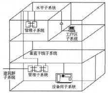

（13）A.水平子系统 （14）A.水平子系统

B.建筑群子系统 B.建筑群子系统

C.工作区子系统

C.工作区子系统

D.设备间子系统

D.设备间子系统

（15）A.水平子系统     B.建筑群子系统    C.工作区子系统     D.设备间子系统

#### 【答案】（13）C  （14）D  （15）B

#### 【解析】目前在综台布线领域被广泛遵循的标准是 EIA/TIA 568A。在 EIA/TIA-568A 中把综合布线系统 分为 6 个子系统：建筑群予系统、设备间子系统、垂直干线子系统、管理子系统、水平子系统和 工作区子系统，如图所示。

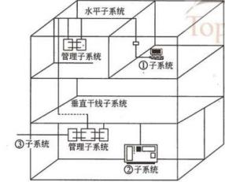

#### 【试题 4】 ---2009 上真题 16

4、通过局域网接入因特网，图中箭头所指的两个设备是（4）。

（4）A.二层交换机     B.路由器     C. 网桥      D.集线器

#### 【解析】

交换机用于将一些计算机连接起来组成一个局域网，工作在链路层。

路由器工作在网络层，是用于网络之间互联的设备，它主要用于在不同网络之间存储转发数 据分组。 与网桥不同之处就在于路由器主要用于广域网。路由器提供了各种各样、各种速率的链 路或于网接口，是一个主动的、智能的网络节点，它参与了网络管理，提供对资源的动态控制， 支持工程和维护括动， 主要功能有连接 WAN、数据处理（数据包过滤、转发、优先选择、复用、加 密和压缔等）、管理设施（配置管理、容错管理和性能管理）。路由器用于包含数以百计、数以千 计的大型网络环境， 由于它处于 IS0/0SI 模型的网络层，可将网络划分为多个子网，并在这些子 网中引导信息流向。

网桥工作在数据链路层，能连接不同传输介质的网络。采用不同高层协议的网络不能通过网 桥互相通信。

集线器的作用可以简单地理解为将一些计算机连接起来组成一个局域网。集线器采用的是共享带宽的工作方式，而交换机是独享带宽。

#### 【试题 5】---2009 上真题 17

5、在铺设活动地板的设备间内， 应对活动地板进行专门检查， 地板板块铺设严密坚固， 符合安装 要求，每平米水平误差应不大于（5）。

（5）A.1mm        B.2mm            C.3mm              D.4mm

#### 【解析】 根据中华人民共和国通信行业标准《通信设备工程验收规范》中第一部分“程控电话交换设 备安装工程验收规范”，以及第四部分“接入网设备工程验收规范”，对有关内容的要求如下：在铺设活动地板的机房内，应对活动地板进行专门检查，地板板块铺设严密坚固，符合安装 要求，每平方米水平误差应不大于 2mm，地板支柱接地良好。

#### 【试题 6】---2009 下真题 19

6、在进行网络规划时， 要遵循统一的通信协议标准。网络架构和通信协议应该选择广泛使用的国 际标准和事实上的工业标准， 这属于网络规划的（6）。

（6）A.实用性原则    B.开放性原则    C.先进性原则    D.可扩展性原则

#### 【解析】网络规划原则包括实用性原则、开放性原则以及先进性原则。开放性原则是指网络必须制定 全国统一的网络构架，并遵循统一的通信协议标准。网络构架和通信协议应该选择广泛使用的国 际工业标准，使得网络成为一个完全开放式的网络计算环境。开放性原则包括开发标准、开发技 术、开发结构、开发系统组件和开发用户接口。

#### 【试题 7】---2009 下真题 20

7 、DNS 服务器的功能是将域名转换为一（7）  。

（7）A.IP 地址    B.传输地址    C.子网地址    D.MAC 地址

#### 【解析】 全球计算机是靠 IP 地址进行唯一标识的，由于IP 地址比较难于记忆，人们更习惯用域名来记忆。而域名服务就是实现将域名转换为 lP 地址的功能。

#### 【试题 8】---2009 下真题 21

8、目前，综合布线领域广泛遵循的标准是（8）

（8）A.GB/T50311-2000        B.TIA/EIA 568 D

。

C.TIA/EIA 568A        D.TIA/EIA 570

#### 【解析】目前在综合布线领域被广泛遵循的标准是 TIA/EIA 568A。

#### 【试题 9】 ---2009 下真题 22

9、以下关于接入 Intemet 的叙述，（9）是不正确的。

（9）A.以终端的方式入网，需要一个动态的 IP 地址

B.通过 PPP 拨号方式接入， 可以有一个动态的 lP 地址

C.通过 LAN 接入， 可以有固定的地址，也可以用动态分配的地址

D.通过代理服务器接口，多个主机可以共享 1 个 IP 地址

#### 【解析】 在接入 Internet 有终端方式和局域网方式，二者都可以使用固定的IP地址，也可以使用动态的地址。以终端的方式入网，不需要 IP 地址，此时只能访问登录访问的远程主机。

#### 【试题 10】---2009 下真题 23

10、（10）一是将存储设备与服务器直接连接的存储模式。

A.DAS        B.NAS        C.SAN        D.SCSI

#### 【解析】现有的三大存储模式包括 DAS、NAS 和 SAN。

DAS 是存储器与服务器的直接连接；

NAS 是将存储设备通过标准的网络拓扑结构（如以太网） 连接到一系列计算机上；

SAN 是采用高速的光纤通道作为传输介质的网络存储技术。

#### 【试题 11】---2010 上真题 19

11、（11）制定了无线局域网访问控制方法与物理层规范。

（11）A.IEEE 802.3             B.IEEE 802.11          C.IEEE 802.15            D.IEEE 802.16

#### 【解析】

IEEE802 系列标准 IEEE 802LAN/MAN 标准委员会制定的局域网、城域网技术标准，其中：

IEEE 802.3 网络协议标准描述物理层和数据链路层的 MAC 子层的实现方法，在多种物理媒体 上以多种速率采用 CSMA/CD 访问方式，对于快速以太网该标准说明的实现方法有所扩展，该标准 通常指以太网。

IEEE 802.11 是无线局域网通用的标准，它是由IEEE 所定义的无线网络通信的标准，该标准定义了物理层和媒体访问控制（MAC）协议的规范。

IEEE 802.15 是由IEEE制定的一种蓝牙无线通信规范标准，应用于无线个人区域网（WPAN ）。

IEEE 802.16 是一种无线宽带标准。

#### 【试题 12】---2010 上真题 20

12、可以实现在 Internet 上任意两台计算机之间传输文件的协议是（12）。

A.FTP           B.HTTP            C.SMTP               D.SNMP

#### 【解析】

FTP是Internet 上用来传送文件的协议（文件传输协议）。它是为了我们能够在 InterneT 上互相传送文件而制定的的文件传送标准，规定了 InterneT 上文件如何传送。可以使用文件传输 协议 （FTP）把文件从一部电脑通过 Internet 传输至另一部电脑。HTTP 是超文本传输协议的英文简称， SMTP 简单邮件传输协议， SNMP 简单网络管理协议。

#### 【试题 13】---2010 上真题 21

13、我国颁布的《大楼通信综合布线系统 YD/T926》标准的适用范围是跨度距离不超过（）米， 办公总面积不超过1,000,000 平方米的布线区域。

（13）A.500            B.1000              C.2000               D.3000

#### 【解析】通信行业标准《大楼通信综合布线系统》YD/T926）的适用范围是跨越距离不超过3000 米、建筑总面积不超过 100 万平方米的布线区域，区域内的人员为 50 人至 5 万人。

#### 【试题 14】---2010 上真题 22

14、根据《电子信息系统机房设计规范》，（14）的叙述是错误的。

（14）A.某机房内面积为 125  平方米，共设置了三个安全出口

B.机房内所有设备的金属外壳、各类金属管道、金属线槽、建筑物金属结构等必须进行等 电位联结并接地

C.机房内的照明线路宜穿钢管暗敷或在吊顶内穿钢管明敷

D.为了保证通风， A  级电子信息系统机房应设置外窗

#### 【解析】 《电子信息系统机房设计规范》中包含下列相关条款:

6.3.4  面积大于 100m“的主机房，安全出口应不少于两个，且应分散布置。面积不大于 100 m2 的主机房，可设置一个安全出口，并可通过其他相临房间的门进行疏散。门应向疏散方向开启， 且应自动关闭，并应保证在任何情况下都能从机房内开启。走廊、楼梯间应畅通，并应有明显的 疏散指示标志。

6.4.6 A 级 B 级电子信息系统机房的主机房不宜设置外窗。当主机房设有外窗时， 应采用双层 固定窗，并应有良好的气密性，不间断电源系统的电池室设有外窗时，应避免阳光直射。

8.2.9 电子信息系统机房内的照明线路宜穿钢管暗敷或在吊顶内穿钢管明敷。

8.3.4 电子信息系统机房内所有设备可导电金属外壳、各类金属管道、金属线槽、建筑物金属 结构等必须进行等电位连接并接地。

#### 【试题 15】---2010 上真题 23

15 、 SAN  存储技术的特点包括（15）。

①高度的可扩展性 ②复杂但体系化的存储管理方式③优化的资源和服务共享 ④高度的可用性

A.①③④  B.①②④   C.①②③  D.②③④

#### 【解析】

SAN 是采用高速的光纤通道为传输介质的网络存储技术。 它将存储系统网络化，实现了高速共 享存储以及块级数据访问的目的。作为独立于服务器网络系统之外，它几乎拥有无限存储扩展能 力。业界提倡的 OPEN SAN 克服了早先光纤通道仲裁环所带来的互操作和可靠性问题，提供了开放 式、灵活多变的多样配置方案。

总体来说， SAN 拥有极度的可扩展性、简化的存储管理、优化的资源和服务共享以及高度可用性。

#### 【试题 16】---2010 下真题 19

16、在没有路由的本地局域网中，以 windows  操作系统为工作平台的主机可以同时安装（ ？）协议，其中前者是至今应用最广的网络协议，后者有较快速的性能，适用于只有单个网络或桥接起来的网络。

A.TCP/IP  和 SAP                    B.TCP/IP  和 IPX/SPX

C.IPX/SPX 和 NETBEUI         D.TCP/IP 和 NETBEUI

#### 【解析】局域网中常见的三个协议是微软的 NETBEUI，Novell的 IPX/SPX 和跨平台TCP/IP。NETBEUI 是为IBM 开发的非路由协议，用于携带 NETBIOS 通信。NETBEUI 缺乏路由和网络层寻址功能，既是其最大的优点，也是其最大的缺点。因为它不需要附加的网络地址和网络层头尾，所以很快并很有效，且适用于只有单个网络或整个环境都桥接起来的小工作组环境。

IPX 是 Novell 用于 Netware 客户端/服务器的协议群组。IPX 具有完全的路由能力，可用于大型企业网。TCP/IP 允许与 Internet 完全的连接。 Internet 的普遍使用是 TCP/IP 至今广泛使用的原因。 该网络协议在全球应用最广。

#### 【试题 17】---2010 下真题 20

17、Internet 上的域名解析服务（DNS）完成域名与 IP 地址之间的翻译。执行域名服务的服务器被   称为 DNS  服务器。小张在 Internet 的某主机上用 nslookup 命令查询“中国计算机技术职业资格网 ” 的网站域名，所用的查询命令和得到的结果如下：

>nslookup www.rkb.gov.cn

Server: xd-cache-1.bjtelecom.net

Address:219.141.136.10

Non-authoritative answer:

Name: www.rkb.gov.cn

Address:59.151.5.241

根据上述查询结果，以下叙述中不正确的是（17）。

（17）A.域名为“www.rkb.gov.cn ”的主机 IP 地址为 59.151.5.241

B.域名为“xd-cache-1.bjtelecom.net ”的服务器为上述查询提供域名服务

C.域名为“xd-cache-1.bjtelecom.net ”的 DNS  服务器的 IP  地址为 219.141.136.10

D.首选 DNS  服务器地址为 219.141.136.10 ，候选 DNS  服务器地址为 59.151.5.241

#### 【解析】 域名服务（DNS ）是因特网的一项核心服务，它作为可以将域名和 IP 地址相互映射的一个分 布式数据库，能够使人更方便地访问互联网，而不用去记住能够被机器直接读取的 IP 数串。nslOOkUp 命令可以指定查询的类型， 可以查到 DNS 记录的生存时间，还可以指定使用哪个 DNS 服务器进行解释。在已安装 TCP/IP 协议的电脑上均可以使用这个命令。该命令主要用来诊断域名 系统（DNS ）基础结构的信息。如果以某一域名为唯一查询参数，ns lOOkUp 命令不能查出解释该 域名的首选 DNS 和候选 DNS 服务器地址。

#### 【试题 18】---2010 下真题 21

18、关于单栋建筑中的综合布线，下列叙述中（18）是不正确的：

A.单栋建筑中的综合布线系统工程范围是指在整栋建筑内敷设的通信线路

B.单栋建筑中的综合布线包括建筑物内敷设的管路、槽道系统、通信线缆、接续设备以及其 它辅助设施

C.终端设备及其连接软线和插头等在使用前随时可以连接安装，一般不需要设计和施工

D.综合布线系统的工程设计和安装施工是可以分别进行的

#### 【解析】

综合布线系统的范围应根据建筑工程项目范围来定，主要有单栋建筑和建筑群体两种范围。 单栋建筑中的综合布线系统工程范围一般指整栋建筑内部敷设的通信线路，还应包括引出建筑物 的通信线路。如建筑物内敷设的管路、槽道系统、通信缆线、接续设备以及其他辅助设施（如电 缆竖井和专用的房间等）。此外，各种终端设备（如电话机、传真机等） 及其连接软线和插头等， 在使用前随时可以连接安装， 一般不需设计和施工。综合布线系统的工程设计和安装施工是单独 进行的，所以，这两部分工作应该与建筑工程中的有关环节密切联系和相互配合。根据单栋建筑中的综合布线系统工程范围的描述可知，选项 A 的叙述是不正确的

#### 【试题 19】---2010 下真题 22

19、某单位依据《电子信息系统机房设计规范 GB 50174-2008》设计该单位的机房， 在该单位采取 的下述方案中，（19）是不符合该规范的。

（19）A.整个机房由主机房、辅助区、支持区和行政管理区等四个功能区组成 B.主机房内计划放置 15  台设备， 设计使用面积 65 平米

C.除主机房外，还设置了辅助区，辅助区面积是主机房面积的 10%

D.主机房设置了设备搬运通道、设备之间的出口通道、设备的测试和维修通道

#### 【解析】 根据《电子信息系统机房设计规范 GB 50174-2008》的 4.2.3，辅助区的面积宜为主机房面积的 0.2~1 倍

#### 【试题 20】---2010 下真题 23

20、某工作站的使用者在工作时突然发现该工作站不能连接网络，为了诊断网络故障，最恰当的 做法是首先（20）。

（20）A.查看该工作站网络接口硬件工作指示是否正常，例如查看网卡指示灯是否正常 B.测试该工作站网络软件配置是否正常， 例如测试工作站到自身的网络连通性

C.测试本工作站到相邻网络设备的连通性，例如测试工作站到网关的连通性

D.查看操作系统和网络配置软件的工作状态

#### 【答案】A

#### 【解析】 此题考察的是网络故障的诊断，必须掌握， 高频考点

网络故障的诊断是一个复杂问题。通常，在故障不明的情况下，应先诊断硬件故障，后诊断 软件故障；先诊断物理距离近的故障， 再诊断物理距离远的故障。在突发网络故障时， 比较合理的 做法是首先查看本机网络硬件是否工作正常，因此应选 A。

#### 【点评】常考，命题的热点，简单题， 必须得分

#### 【试题 21】---2011 上真题 19

21 、TCP/IP 协议族中的（21）协议支持离线邮件处理，电子邮件客户端可利用该协议下载所有未 阅读的电子邮件。

（21）A.FTP                   B.POP3                   C.TelneT                 D.SNMP

#### 【解析】 FTP 是 Internet 文件传输协议。PoP3 即邮局协议的第 3 个版本， 是规定个人计算机如何连接到互联网上的邮件服务器进行收发邮件的协议。 Telnet 协议是 TCP/IP 协议族中的一员，是 Internet 远程登录服务的标准协议和主要方式。 SNMP（简单网络管理协议）的前身是简单网关监 控协议（SGMP ），用来对通信线路进行管理。

#### 【试题 22】---2011 上真题 20

22、系统集成工程师小王为了查询其工作站的状态， 在其工作站的命令行上运行“ping 127.0.0.1 ” 命令，得到如下结果：

正在 ping 127.0.0.1 具有 32 字节的数据：

来自 127.0.0.1 的回复：字节=32 时间< 1ms    TTL=64

来自 127.0.0.1 的回复：字节=32 时间< 1ms    TTL=64

来自 127.0.0.1 的回复：字节=32 时间< 1ms    TTL=64

关于以上查询结果， 下列说法中，正确的是 （22） 。

（22）A.小王的工作站正确安装了 TCP/IP  协议

B.小王的工作站访问了网关并收到响应

C.小王的工作站访问了 DNS  并收到响应

D.小王的工作站未正确安装网络硬件或驱动程序

#### 【解析】 Ping 是 windows 系列自带的一个可执行命令。利用它可以检查网络是否能够连通， 用好它可以很好地帮助我们分析判定网络故障。应用格式:ping IP 地址。

IP 地址 127.0.0.1 是回送地址， 指本地机， 一般用来测试使用。如果网卡及 TCP/IP 协议安装配置没有问题， ping 127.0.0.1 可返回类似题干所述的结果。

#### 【试题 23】---2011 上真题 21

23、某综合办公大楼的楼高 20 层，其综合布线系统一般采用的拓扑结构是（23）。

A.环型     B.分级星型          C.总线型            D.星环型

#### 【解析】根据我国和国际的综合布线标准，多层建筑物的综合布线系统中的拓扑结构主要采用分级星型。

24、依据《电子信息系统机房设计规范》（GB50174-2008），对于涉及国家秘密或企业对商业信息 有保密要求的电子信息系统机房， 应设置电磁屏蔽室。以下描述中，不符合该规范要求的是（24）。 （24）

A.所有进入电磁屏蔽室的电源线缆应通过电源滤波器进行

B.进出电磁屏蔽室的网络线宜采用光缆或屏蔽线缆线，光缆应带有金属加强芯

C.非金属材料穿过屏蔽层时应采用波导管， 波导管的截面尺寸和长度应满足电磁屏蔽的性能要求

D.截止波导通风窗内的波导管宜采用等边六角形，通风窗的截面积应根据室内换气次数进行计算

#### 【解析】 《电子信息系统机房设计规范》（GB 50174-2008 ）中的相关规定如下:

9.3.3 进入电磁屏蔽室的电源线应通过电源滤波器进行处理。电源滤波器的规格、供电方式和数量应根据电磁屏蔽室内设备的用电情况确定。

9.3.5 进出电磁屏蔽室的网络线宜采用光缆或屏蔽缆线，光缆不应带有金属加强芯。

9.3.6 非金属材料穿过屏蔽层时应采用波导管， 波导管的截面尺寸和长度应满足电磁屏蔽的性能要求。

9.3.7 截止波导通风窗内的波导管宜采用等边六角形，通风窗的截面积应根据室内换气次数进行计算。

#### 【试题 25】---2011 上真题 23

25、某公司有一台 Linux 文件服务器，多台 windows 客户端和 Linux 客户端。要求任意一个客户端都可以共享服务器上的文件，并且能够直接存取服务器上的文件。客户端和服务器间应该使用 （25）协议。

A.NFS          B.Samba                 C.FTP              D.Iscsi

#### 【解析】NFS 是一种网络操作系统，并且是 UNIX 操作系统的协议。

Samba 是在 Linux 和 UNIX 系统上实现 SMB 协议的一个免费软件，由服务器及客户端程序构成。

文件传输协议（FTP）是一个用于在两台装有不同操作系统的机器中传输计算机文件的软件标 准。它属于网络协议组的应用层。

iSCSI技术是一种由 IBM公司研究开发的，供硬件设备使用的可以在 IP 协议的上层运行的SCSI 指令集，这种指令集合可以实现在 IP 网络上运行 SCSI 协议，使其能够在诸如高速千兆以太网上 进行路由选择。

在 Linux 和 UNIX 系统上， 任意一个客户端都可以共享服务器上的文件，并且能够直接存取服 务器上的文件，应选择使用 Samba。

#### 【试题 26】---2011 上真题 24

26、根据《电子信息系统机房设计规范 GB50174-2008》，电子信息系统机房应对人流和出入口进 行安全考虑，以下叙述错误的是（26）。

（26）A.建筑的入口至主机房应设通道，通道净宽不应小于 1.5m

B. 电子信息系统机房宜设门厅、休息室、值班室和更衣间

C. 电子信息系统机房应有设备搬入口

D. 电子信息系统机房必须设置单独出入口

#### 【解析】 根据《电子信息系统机房设计规范 GB50174-2008》有如下规定：

6.2.1 主机房宜设置单独出入口，当与其它功能用房共用出入口时，应避免人流、物流的交叉。

6.2.3  电子信息系统机房内通道的宽度及门的尺寸应满足设备和材料运输要求，建筑的入口至 主机房应设通道，通道净宽不应小于 1.5m。

6.2.4 电子信息系统机房宜设门厅、休息室、值班室和更衣间，更衣间使用面积应按最大班 人数的每人 1~3 口计算。

注意上述说法是“宜”，而不是“必须”。

#### 【试题 27】---2011 下真题 19

27、某五星级酒店公开招标建设一套“无线网络”系统，以满足商务客人在酒店范围内随时随地 高速访问 Internet 的需要。该项目最适合采用的无线网络技术是（27）。

A.WiFi          B.Bluetooth            C.BlueRay                      D.GPRS

#### 【试题 28】---2011 下真题 20

28 、一个使用普通集线器的 10Base-T 网络的拓扑结构可描述为（28）。

（28）A.物理连接是总线型拓扑，逻辑连接是星型拓扑

B.物理连接和逻辑连接都是总线型拓扑

C.物理连接是星型拓扑， 逻辑连接是总线型拓扑

D.物理连接和逻辑连接都是星型拓扑

#### 【解析】拓扑结构，必须掌握，考的有点偏

10Base-T 是 1990 年由 IEEE 认可的，编号为IEEE 802.3 i ，T 表示采用双绞线。 使用普通集线器的 10Base-T 网络被安装成星型的总线拓扑结构， 总线本身被紧缩到集线器中， 从集线器连接 点到工作站的线路分支呈星型布局。因此，其物理连接方式虽然是星型拓扑，但逻辑连接上是一 种总线型拓扑。外部看是星形，里面是一根总线把这些计算机连起来。

#### 【试题 29】---2011 下真题 21

29、依照通信综合布线规范， 以下水平子系统布线距离的描述中正确的是（29）。

A.水平电缆最大长度为 80 米， 配线架跳接至交换机、信息插座跳接至计算机总长度不超过 20 米，通信通道总长度不超过 100 米

B.水平电缆最大长度为 90 米， 配线架跳接至交换机、信息插座跳接至计算机总长度不超过10 米，通信通道总长度不超过 100 米

C.水平电缆最大长度为 80 米， 配线架跳接至交换机、信息插座跳接至计算机总长度不超过 10 米，通信通道总长度不超过 90 米

D.水平电缆最大长度为 90 米，配线架跳接至交换机、信息插座跳接至计算机总长度不超过 20 米，通信通道总长度不超过 110 米

#### 【解析】 由插座到配线箱的线路长度不可超出 90 米，信道长度不可超出 100 米。

30、依据《电子信息系统机房设计规范》（GB50174-2008），机房内通道的宽度及门的尺寸应满足 设备和材料的运输要求，建筑入口至主机房的通道净宽不应小于（30）。

（30）A.1.2 米   B.1.5 米   C.1.8 米    D.2.0 米

#### 【解析】根据《电子信息系统机房设计规范》（GB50174-2008）的“4.3 设备布置”中的规定，用于搬运设备的通道净宽不应小于 1.5m。

31、为了实现高速共享存储以及块级数据访问，采用高速的光线通道作为传输介质，实现存储系 统网络化的网络存储模式是（31）。

（31）A.DAS          B.NAS          C.SAN              D.SNA

#### 【解析】直接连接存储（DAS ）是存储器与服务器的直接连接，一般通过标准接口，如小型计算机系统接口 SCSI 等。

网络连接存储（NAS ）是将存储设备通过标准的网络拓扑结构（如以太网） 连接到一系列计算机上。

存储区域网络（SAN）是采用高速的光纤通道作为传输介质的网络存储技术。它将存储系统网络化，实现了高速共享存储以及块级数据访问的目的。网络体系结构（SNA）是 IBM 公司开发的网络体系结构， 在IBM 公司的主机环境中得到广泛的应用。

#### 【试题 32】---2012 上真题 19

32、MPLS 是目前使用较为广泛的广域网技术， 该技术利用数据标签引导数据包在开放的通信网络中运 行，通过在无连接的网络中引入连接模式， 减少了网络的复杂性。（32）不属于它的技术特点。

（32）A.充分采用原有的 IP 路由

B.是一种与链路层无关的技术

C.MPLS 的标签合并机制不支持不同数据流的合并传输

D.具有良好的网络拓展性

#### 【答案】C

#### 【解析】 此题考察的是网络交换技术，有点偏， 必须掌握，考的不多

多协议标记交换（MPLS）的标签合并机制支持不同的数据流的合并传输提高了网络传输效率。

#### 【点评】难题，书上不详，需要积累或者最这个知识点理解下，必须得分

#### 【试题 33】---2012 上真题 20

33、某系统集成工程师在其工作站的网络测览器地址栏中输入“http: //wvrw.rkb.gov, cn ”，发现不 能访问中国计算机技术职业资格网 ， 而在其工作站的网络测览器地址栏中输入

“http://59.108.35.160 ”，发现可正常访问中国计算机技术职业资格网，

这说明该工作站所处的网络中，可能存在  （33）   服务故障。

（33）A.FTP          B.TelneT          C.DNS          D.HTTP

#### 【答案】C

#### 【解析】 此题考察的是常见的网络协议，必须掌握， 高频考点

细则书中不详，  DNS：域名系统（DNS）的主要功能是将主机域名解析为对应的 IP 地址。在 同一台工相站上， 使用 IP 地址方式可以正常访问某网站， 而使用域名方式无法访问该网站， 则说 明该工作站与所访问网站之间网络链路的连通性是正常的，可能该工作站所处网络的域名解析服 务（DNS）存奄故障。

#### 【点评】操作命令，多次考了，简单， 必须得分

#### 【试题 34】---2012 上真题 21

34、网络协议和设备驱动软件经常采用分层架构模式，其主要原因是（34）。

（34）A.可以让软件获得更高的性能          B.支持软件复用

C.让功能划分容易，便于设计实现     D.为达到内聚、高糯合的设计目标

#### 【答案】B

#### 【解析】P105  此题考察的是分层架构模式，必须掌握，高频考点

分层架构模式优点如下：（1）有助把复杂的问题按功能分解，使整体设计更为清晰。（2）支持系 统设计的逐级抽象③具有较好的可扩展性。（4） 支持复用。

分层模式的缺点如下。（1）并不是每个系统都可以很容易地划分出层次来；同时，各层功能的划 分也没有一个统一的、正确的抽象方法。（2）层次的个数过多， 系统性能可能会下降

#### 【点评】有一定的难度，考的少，了解下就好，建议得分

#### 【试题 35】---2012 上真题 22

35、（35）不是光纤接口类型。

（35）A.SC            B.ST        C.LC          D.LH

#### 【答案】D

#### 【解析】 此题考察的是光纤的接口，尽量掌握， 考的不多

光纤接口是用来连接光纤线缆的物理接口。通常有 SC.ST、FC 等几种类型，它们由日本 NTT 公司开发。FC 是 Ferrule Connector 的缩写，其外部加强方式是采用金属套， 紧固方式为螺丝扣。 ST 接口通常用于 10Base-F，SC 接口通常用于 100Base-FX。

#### 【点评】光纤的类型，比较偏，记住吧，建议得分

#### 【试题 36】---2012 上真题 23

36 、zigBee 是 （36）  网络的标准之一。

（36）A.WLAN              B. WMAN          C.WPAN        D.WWAN

#### 【答案】C

#### 【解析】P129 书中不详，经验题  此题考察的是无线网络技术，必须掌握，考的不多

无线个人区域网（WPAN）是当前发展最迅速的领域之一，相应的新技术层出不穷， zigBee 是一 种构建 WPAN 的新技术，无线个人局域网（WPAN）是一种采用无线连接的个人局域网。它被用在诸 如电话、计算机、附属设备以及小范围（个人局域网的工作范围一般是在 10 米以内）内的数字助 理设备之间的通讯。支持无线个人局域网的技术包括：蓝牙、zigBee、超频波段（UWB）、IrDA.HomeRF 等，其中蓝牙技术在无线个人局域网中使用的最广泛。

#### 【点评】无线个人网，比较偏啊，建议得分

#### 【试题 37】---2012 上真题 24

37、下列关于电子信息机房的设计中，（37）不符合《电子信息系统机房设计规范 GB50174-2008》 的要求。

（37）A.机房采用二级、三级耐火等级的建筑材料， 重要部位采用一级耐火等级的材料

B.机房所有设备的金属外壳、各类金属管道、金属线糟、建筑物金属结构等结构等全部进 行电位连接并接地

C.在机房吊顶上和活动地板下都设置火灾探测器

D.主机房内绝缘体的静电电位不大于 1KV

#### 【答案】A

#### 【解析】P442此题考察的是机房工程标准，必须掌握，高频考点

机房建设应使用二级材料， 重要地方使用一级建筑材料， 所以答案 A 说的是二、三级材料，机房和 重要的记录介质存放间，其建筑材料的耐火等级，应符合 GBJ 45-1982 中规定的二级耐火等级

#### 【点评】机房工程标准，必考的，简单，必须得分

#### 【试题 38】---2012 上真题 25

38、根据《EIA/TIA568A/B 商用建筑物电信布线标准-1995》，综合布线系统分为三个等级，其中 增强型综台布线等级要求每个工作区至少有（38）个以上信息插座。

（38）A.1          B.2      C.3        D.4

#### 【答案】B

#### 【解析】 此题考察的是综合布线标准，考的比较细， 必须掌握，高频考点

根据《EIA/TIA568A/B 商用建筑物电信布线标准-1995》，增强型综合布线等级要求每个工作区 至少有两个或以上信息插座，每个工作区的配线电缆为两条四对双绞线电缆，每个工作区的干线 电缆至少有三对双绞线。

#### 【点评】综合布线的知识，比较细，考过一次，记住即可，建议得分

#### 【试题 39】---2012 下真题 19

39、主机 A 的 IP 地址是 192.168.4.23 ，子网掩码为 255.255.255.0（39）是与主机 A 处于同一子网 的主机 IP 地址。

（39）A.192.168.4.1                B.192.168.255.0          C.255.255.255.255        D.192.168.4.255

#### 【答案】A

#### 【解析】 此题考察的是IP地址，必须掌握，第一次考

采用排除法，后8位为全。可全1的为广播地址， 不能作为主机IP地址。所以除了

B.192.168.255.0    C.255.255.255.255   D.192.168.4.255 只有A

IP地址192.168.4.23是一个C类地址，若将它与其约定的子网掩码 255.255.255.0进行“逻辑 与运算，其运算结果就是该IP地址所在的子网地址， 即192.168.4.0/24。该子网可实际分配的IP 地址范围为192.168.4.1~192.168.4.254。其中地址192.168.4.255是该子网的直接广播地址（对 目的网络广播）；地址255.255.255.255是该子网的受限广播地址（本网内播）。

#### 【点评】 IP 地址，考的不多，尽量掌握吧， 尽量得分

#### 【试题 40】---2012 下真题 20

40、项目经理要求杨工在项目经理的工作站上装一个 Internet 应用程序，该程序允许项目经理登录， 并且可以远程安全地控制服务器，杨工应安装的应用程序为（40）。

（40）A.Email                  B.FTP            C.web Browser        D.SSH

#### 【解析】网络协议

Telnet 是一个能够使用户在本地计算机上完成对远程主机进行相关操作 的应用层协议。而由 IETF 网络工作小组制定的 SSH （SecUre Shell）是建立在应用层和传输层基础上的安全协议。SSH 是目前较可靠，专为远程登录会话和其他网络服务提供安全性的协议。 利用 SSH 协议可以有效防 止远程管理过程中的信息泄露问题。 SSH 有很多功能，它既可以代替 Telnet 又可以为 FTP、POP、 甚至为 PPP 提供一个安全的“通道”。

#### 【试题 41】---2012 下真题 21

41、IEEE 制订了以太网的相关技术标准，其中 1000Base-X（光纤吉比特以太网）遵循的标准为（41）。

（41）A.802.3            B.802.3u            C.802.3z              D.802.3ab

#### 【答案】C

#### 【解析】 此题考察的是常见的网络协议，此题比较偏，必须掌握，第一次考

1998 年 2 月， 千兆（或吉比特）以太网标准 IEEE802.3Z 获得正式批准。其主要有 4.种物理 层标准：1000Base-T、1000Base-Cx、1000 Base-Sx 与 1000 Base-Lx 依次对应的传输介质分别为 超 5 类（或 4 对 5 类） 非屏蔽双绞线（UTP）、屏蔽双绞线（STP）、单模光纤（SMF） 或多模光纤。

IEEE 802.3 标准是传统以太网的 CSMA/CD 总线访问控制方法与物理层规范；

IEEE 802.3U 是 百兆（或快速）以太网的相关标准；

IEEE 802.3ae 是万兆以太网的相关标准。

IEEE 802.3ab 是为针对实体媒介部分制定的 1000 Base-T 规格。该标准允许 4 对 5 类双绞线可在 100m 内以 1Gbps 等级的速度传输数据。

#### 【试题 42】---2012 下真题 22~23

42 、PPP  协议是用于拨号上网和路由器之间通信的点到点通信协议，是属于（22）协议，它不具 有（23）的功能。

22）A.物理层           B.传输层      C.数据链路层      D. 网络层

23）A.错误检测         B.支持多种协议

C.允许身份验证     D. 自动将域名转换为 IP 地址

#### 【答案】（22）C（23）D

#### 【解析】 点到点协议（PPP）是目前仍在使用的数据链路层协议之一。它具有处理错误检测、支持多种协议、允许在连接时刻协商 IP 地址、允许身份认证等功能。

“自动将域名转换为 IP 地址”是 DNS 应具有的解析功能。

#### 【试题 43】---2012 下真题 24

43、蒋某采用下图所示的方式将其工作电脑接入 Internet，蒋某采用的 Internet 接入的方式为（43）。

（43）A.DSL               B.Cable Modem            C.3G              D.FTTM

#### 【解析】数字用户线（XDSL）是各类 DSL 的总称，其中使用最广的有非对称数字用户线（ADSL）和超高比特率数字用户线（VDSL）等。ADSL 是基于现有电话线宽带接入Internet,它采用频分复用（FDM） 技术在传输数字信号的同时不干扰传统模拟电话业务。图所示的 DSL 接入 Internet 的宽带上网方 式。用户家中的信号分离器（PS）经过接线盒连接至公共电话网（PSTN）。用户家中的 ADSL MODEM 实现电话线上传输的模拟信号和计算机所使用的数字信号之间的相互转换。

光纤同轴电缆混合网（HFC）是一个基于有线电视网络（CATV）的双向传输系统， 光纤节点将光纤干线和宽带同轴分配线相互连接。其用户端的标志性设备 Cable MODEM 利用频分多路复用 （FDM）技术将信道分为上行信道和下行信道。

FTTX 光纤接入技术包括光纤到住户（FTTH）、光纤到大楼（FTTB）、光纤到路边（FTTC）等。 第三代移动通信技术（3G）是指支持高速数据传输的蜂窝移动通信技术。

#### 【试题 44】---2013 上真题 12

44 、 44 由电缆连接器和相关设备组成，把各种不同的公共系统和设备连接起来其中包括电信部 门的光缆， 同轴电缆，程控交换机等。

（44）A.建筑群子系统    B.设备间子系统    C.垂直干线子系统     D.工作区子系统

#### 【解析】设备间子系统由设备室的电缆、连接器和相关支持硬件组成，把各种公用系统设备互连起来。 设备间的主要设备有数字程控交换机、计算机网络设备、服务器、楼宇自控设备主机等等。它们可以放在一起，也可分别设置。设备间是整个网络的数据交换中心;

应该是管理子系统。但是管理子系统通常放置在设备间内

#### 【试题 45】---2013 上真题 18

45、我国自主研发的 3G 技术标准 TD—SCDMA.采用的是 45   技术。

（45）A.时分双工    B.频分双工    C.成时频带    D.波分双工

#### 【解析】

CDMA，码分多址

移动 3G，TD-SCDMA，时分同步码分多址

联通 3G，W-CDMA，宽频码分多址

电信 3G，CDMA2000，多载波码分多址

FDMA，Frequency Division Multiple Access，频分多址，1G，模拟手机，大哥大  TDMA，Time Division Multiple Access，时分多址， 2G，数字手机， GSM

WDMA，Wavelength Division Multiple Access，波分多址

#### 【试题 46】---2013 上真题 19

46 、 E —MAIL 客户端程序要找到邮件服务器，FTP 客户端程序要找到 FTP 服务器，WEB 测览器要 找到 WEB 服务器，通常要用到   46。

A.FTP 服务器     B.DNS 服务器    C.E-MA.IL 服务器    D.TELNET 服务器

#### 【解析】 E-MAIL 客户端程序、FTP 客户端程序、WEB 测览器要找到相应的服务器都需要用到域名解析， DNS 服务器的功能正是进行域名解析。

#### 【试题 47】---2013 上真题 21

47、传输控制 TCP 协议和用户数据报 UDP 协议是互联网传输层的主要协议。下面关于 TCP 和 UDP 的说法中，  47 是不正确的。

A.TCP 是面向连接的协议， UDP 协议是无连接的协议

B.TCP 能够保证数据包到达目的地不错序， UDP 不保证数据的传输正确 C.TCP 协议传输数据包的速度一般比 UDP 协议传输速度快

D.TCP 保证数包传输的正确性， UDP 在传输过程中可能存在丢包现象

#### 【解析】

TCP 协议：传输控制协议，为可靠的、带连接的协议；

UDP 协议：用户数据报协议， 为不可靠的无连接协议；

TCP 要保证传输质量，有丢包检测和重传机制，性能比 UDP差

#### 【试题 48】---2013 下真题 18

48、关于无连接的通信，下面描述中正确的是（48）。

（48）A.无连接的通信较适合传送大量的多媒体数据

B. 由于通信双方的通信线路都是预设的，所以在通信过程中无需任何有关接的操作 C. 由于每一个分组独立地建立和释放逻辑连接，无连接的通信具有较高可性

D.无连接的通信协议 UDP 不能运行在电路交换或租用专线网络上

#### 【解析】 通常，面向连接通信适用于数据量大、可靠性高、出错率低、实时性要求稍低的场合。传送 大量的多媒体数据适合选用面向连接的通信方式。传输控制协议（TCP）是一个面向连接的、可靠 的、全双工的、基于字节流的传输层协议。

#### 【试题 49】---2013 下真题 19

49、以下（49）是因特网上负责接收邮件到客户端的协议。

（49）A.SMTP           B.POP              C.IMP                  D.MIME

#### 【解析】 SMTP 是发送的，POP3 是接收的。

目前， 因特网上负责接收邮件到客户端的协议是第 3 版邮局协议（POP3） 或第 4 版 Internet 消息访问协议（IMAP4）。

电子邮件系统的工作原理可简述为：客户端软件（用户代理） 使用简单邮件传送协议（SMTP） 将电子信件传递到发送方的邮件服务器； 发送方邮件服务器使用 SMTP 将电子信件发送到接收方的 邮件服务器；接收方客户端软件可以随时使用 POP3 或 IMAP4 从邮件服务器读取电子信件。

多用途因特网邮件扩展（MIME）是一个因特网标准，扩展了电子邮件标准，使其能够支持非 ASCII 字符、二进制格式附件、图像、声音等多种格式的邮件消息。

#### 【试题 50】---2013 下真题 20

50、以太网交换机的交换方式有三种， 这三种交换方式不包括（50） 。

A.存储转发式交换   B.IP 交换   C.直通式交换    D.碎片过滤式交换

#### 【解析】 目前交换机在传送源和目的端口的数据包时通常采用直通式交换、存储转发式和碎片隔离方式3种数据包交换方式。存储转发式是交换机的主流交换方式。

#### 【试题 51】---2013 下真题 21

51、Internet 中的每个主机都有一个 IP 地址和域名， 通过 DNS 服务器来完成 IP 域名的对应。关于 DNS 服务器的功能，（51）不正确的是。

（51）A.具有保存了“主机”对应“IP”地址的数据库

B.可接受 DNS 客户机提出的查询请求

C.若不在本 DNS 服务器中，则向 DNS 客户机返回结果

D. 向 DNS 客户机提供查询结果

#### 【解析】在本 DNS 服务器机中找不到的话，则向自己的快取缓冲区查找，如果还找不到，则向最近的 名称服务器请求帮忙，因此 C 项说法不正确。

#### 【试题 52】---2013 下真题 22

52、使用 RAID 作为网络存储设备有许多好处，以下关于 RAID 的叙述中不正确的是（52）。 （52）A.RAID 使用多块廉价磁盘阵列构成，提高了性能价格比

B.RAID 采用交叉存取技术， 提高了访问速度

C.RAID1 使用磁盘镜像技术， 提高了可能性

D.RAID3 利用海明码校验完成容错功能，减少了冗余磁盘数量

#### 【解析】

RAID1 使用磁盘镜像技术，提高了可靠性，但其磁盘利用率仅为 50%。

RAID2 利用海明码校验完成容错功能。

RAID3 利用奇偶校验完成容错功能，减少了冗余磁盘数量，磁盘利用率为（n-1） /n。

#### 【试题 53】---2013 下真题 23

53、某数据存储设备的容量为 10TB，其含义指容量为（53）字节。

（53）A.10 根 220           B. 10 根 230          C. 10 根 240              D. 10 根 250

#### 【答案】C

#### 【解析】 此题考察的是网络存储的基本知识，必须掌握，高频考点

1TB=210GB； 1GB=210MB； 1MB=210KB； 1KB=210B （2 的 10 次方）； 1B=1BYTE  （字节）

#### 【点评】常识题啊，还是有不少人丢分了，唉

#### 【试题 54】---2014 上真题 18~19

54、广域网覆盖的地理范围从几十公里到几千公里， 它的通信子网主要使用（1）技术。随着微型 计算机的广泛应用，大量的微型计算机是通过局域网连入广域网的，而局域网与广域网的互联一 般是通过（2）设备实现的。

（1）A.报文交换       B.分组交换   C.文件交换    D. 电路交换

（2）A.Ethernet 交换机  B.路由器     C. 网桥       D. 电话交换机

#### 【答案】B.B

#### 【解析】 此题考察的是网络知识，必须掌握，高频考点

广域网WAN 的通信子网主要使用分组交换技术将分布在不同地区的局域网或计算机系统互连起来， 达到资源共享的目的。

#### 【点评】网络知识，必考的，比较常见，必须得分的

#### 【试题 55】---2014 上真题 20

55、信息时代，除了传统的电子邮件、远程登录、新闻与公告等应用外， 新型的 Internet 应用有基 于 WEB 的网络应用和基于 P2P 的网络应用。（55）是属于基于 P2P 的网络应用.

（55）A.google      B.blog        C. 网络共享课程     D.QQ

#### 【答案】D

#### 【解析】 此题考察的是网络知识，必须掌握，高频考点

事 实上，网 络上现 有的许多服务可以 归 入 P2P 的 行列。即 时讯息 系统譬如 ICQ 、 AOL InstantMessenger、YahooPager、微软的 MSNMessenger 以及国内的 QQ 是最流行的 P2P 应用。

#### 【点评】常识性的题，不知道的可能得出答案不易！

#### 【试题 56】---2014 上真题 21

56、在 TCP/IP 协议簇中，（56）协议属于应用层协议。

（56）A.IP     B.TCP     C.FTP         D.UDP

#### 【答案】C

#### 【解析】 此题考察的是网络协议，必须掌握，高频考点

应用层协议有： TFTP，HTTP，SNMP，FTP，SMTP，DNS，Telnet，NFS 等等

#### 【点评】网络协议几乎每次必考的，简单，必须得分的

#### 【试题 57】---2014 上真题 22

57、（57）是第四代移动电话通信标准所采用的制式

（57）A.LTE        B.WCDMA      C.GSM          D.TD-SCDMA

#### 【答案】A

#### 【解析】 此题考察的是 4G 知识，必须掌握，高频考点

2010 年 12 月 6 日国际电信联盟把 LTEAdvanced 正式称为 4G。LTE 是应用于手机及数据卡终端的高

速无线通讯标准。

#### 【点评】常识啊， 4G，讲课的时候也讲过， 简单

#### 【试题 58】---2014 上真题 30

58、磁盘冗余陈列 RAID 利用冗余实现高可靠性，其中 RAID1 的磁盘利用率为（58）

（58）A.25%      B.50%      C.75%        D.100%

#### 【答案】B

#### 【解析】 此题考察的是 RAID 知识，必须掌握，高频考点

RAID1 就是磁盘镜像，其原理为在主硬盘上存放数据的同时也在镜像磁盘上写一样的数据，因此磁 盘的利用率就是 50%。

#### 【点评】以前高级考过，中级首次考， 上课的时候讲过了，应该蛮简单

#### 【试题 59】---2014 下真题 18

59、（59）是以太网技术的典型特征。

（59）A.采用双绞线作为传输介质      B.使用以太网集线器

C.载波监听多路访问冲突检测    D.星型拓扑结构

#### 【答案】C

#### 【解析】 此题考察的是以太网的特点，必须掌握，考的少

以太网（Ethernet）指的是由 xerox 公司创建并由 xerox、Intel 和 DEC 公司联合开发的基带局域 网规范，是当今现有局域网采用的最通用的通信协议标准。以太网具有如下的一般特征：

（1）共享媒体：所有网络设备使用同一通信媒体。

（2）广播域：需要传输的峽被发送到所有节点，但只有寻址到的节点才会接收到峽。

（3） CSMA/CD：以太网中利用载波监听多路访问/冲突检测方法（Carrier Sense Multiple Access/Collision Detection）以防止两个或更多节点同时发送。

（4） MAC 地址：媒体访问控制层的所有 EtherneT 网络接口卡（NIC）都采用 48 位网络地址。这 种地址全球唯一。

#### 【点评】考的少，稍微了解下即可

#### 【试题 58】---2014 下真题 19

60 、IPV6 协议规定，一个 IP 地址的长度是（60）位。

（60）A.32            B.64        C.128              D.256

#### 【答案】C

#### 【解析】 此题考察的是 IPv6，必须掌握，高频考点

IPV4 的地址长度是 4 个字节 32 位， IPV6 的地址长度是 32 个字节 128 位

#### 【点评】送分，简单，必须得分的

#### 【试题 61】---2014 下真题 20

61、微信是一种常用的单时通信工具， 主要采用了（61）。

（61）A.UDP 通信协议   B.非对等通信模式   D.对称中心结构  D.有中央节点的集中控制 【答案】A

#### 【解析】 此题考察的是网络协议，必须掌握，高频考点

微信的通信原理如下图所示：

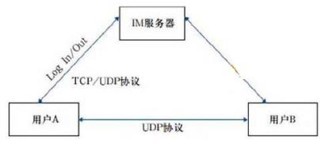

安装完微信并注册后，使用微信时，应先登录：

不管 UDP 还是 TCP，最终登陆成功之后， 微信都会有一个 TCP 连接来保持在线状态。这个 TCP 连接的远程端口一般是 80，采用 UDP 方式登陆的时候，端口是 8000 。因此，假如你所在的网络 开放了 80 端口，但没有屏蔽腾讯的服务器 IP，恭喜你，你是可以登陆成功微信的。

聊天消息通信

采用 UDP 协议， 通过服务器中转方式。因此，现在的 IP 侦探在你仅仅跟对方发送聊天消息的 时候是无法获取到 IP 的。 UDP 协议是不可靠协议， 它只管发送， 不管对方是否收到的，但它的传 输很高效。但是，作为聊天软件，怎么可以采用这样的不可靠方式来传输消息呢？于是，腾讯公 司采用了上层协议来保证可靠传输：如果客户端使用 UDP 协议发出消息后， 服务器收到该包， 需 要使用 UDP 协议发回一个应答包。如此来保证消息可以无遗漏传输。之所以会发生在客户端明明 看到 “消息发送失败”但对方又收到了这个消息的情况， 就是因为客户端发出的消息服务器已经 收到并转发成功，但客户端由于网络原因没有收到服务器的应答包引起的。

#### 【点评】送分，简单，必须得分的

#### 【试题 62】---2014 下真题 21

62 、web2.0 指的是一个利用 web 的平台， 由用户主导生成内容的互联网产品模式。（62）不属于 web2.0 技术。

（62）A.微博   B.相册   C.百科全书（wiki）    D.论坛

#### 【答案】D

#### 【解析】 此题考察的是网络技术，必须掌握，考的少

论坛是一个讨论的园地， 其板块、架构由论坛的创建者决定， 由参与者发言讨论，发言的内容 由版主管理。如版主可以删除灌水帖以及不法言论贴，也可把讨厌的人剔除论坛。

微博、相册和百科 wiki 可由用户主导生产内容。

web2.0 技术主要包括：博客（BLOG）、RSS、百科全书（wiki）、网摘、社会网络（SNS）、P2P、 即时信息（IM）等。

#### 【点评】首次考，容易做错，稍微记忆下吧

#### 【试题 63】---2014 下真题 22

63、根据 EIA/TIA568A 标准，综合布线系统分为 6 个子系统，这 6 个子系统是（63）。

（63）A.建筑群子系统、建筑间子系统、设备间子系统、垂直干线子系统、水平子系统、管理子系统 B.建筑间子系统、设备间子系统、垂直干线子系统、水平子系统、管理子系统、工作区子系统

C.建筑群子系统、建筑间子系统、垂直干线子系统、水平子系统、管理子系统、工作区子系统 D.建筑群子系统、设备间子系统、垂直干线子系统、水平子系统、管理子系统、工作区子系统

#### 【答案】D

#### 【解析】P131此题考察的是综合布线标准，必须掌握，高频考点

根据 EIA/TIA568A 标准， 综合布线系统分为 6 个子系统， 这 6 个子系统是建筑群子系统、设 备间子系统、垂直干线子系统、水平子系统、管理子系统、工作区子系统；

#### 【点评】送分，考过 N 次了

#### 【试题 64】---2014 下真题 23

64、在网络服务器中，（64）组织成域层次结构的计算机和网络服务命名系统，负责 IP 地址和域 名之间的转换。

（23）A.DHCP 服务器   B.身份验证服务器   C. 邮件服务器   D.DNS 服务器

#### 【答案】D

#### 【解析】 此题考察的是网络协议，必须掌握，高频考点

DNS 域名服务器是指保存有该网络中所有主机的域名和对应 IP 地址，并具有将域名转换为 IP 地址 功能的服务器。

DHCP 服务器：动态主机配置协议是一个局域网的网络协议。指的是由服务器控制一段 IP 地址范围， 客户机登录服务器时就可以自动获得服务器分配的 IP 地址和子网掩码。

#### 【点评】送分，多次考了，简单，必须得分的

#### 【试题 65】---2014 下真题 24

65 、IIS 不支持（65）服务。

（24）A.WWW        B.FTP      C.E-mail        D.Gopher

#### 【答案】C

#### 【解析】 此题考察的是网络术语，必须掌握，高频考点

InterneT Information Services（I IS，互联网信息服务）， 是由微软公司提供的基于运行 MicrosofTwindows 的互联网基本服务。

I IS 是一种 wEB（网页）服务组件， 其中包括 web 服务器、 FTP 服务器、 NNTP 服务器和 SMTP 服务器，分别用于网页測览、文件传输、新闻服务和邮件发送等方面，它使得在网络（包括互联 网和局域网）上发布信息成了一件很容易的事。

Gopher 是 Internet 上一个非常有名的信息查找系统，它将 Internet 上的文件组织成某种索 引，很方便地将用户从 Internet 的一处带到另一处。在 www 出现之前， Gopher 是 Internet 上最 主要的信息检索工具，Gopher 站点也是最主要的站点。但在 www 出现后，Gopher 失去了昔日的辉 煌。现在它基本过时，人们很少再使用它。

E-mail 叫电子邮件， 要使 I IS 支持 E-MAIL 需要自己安装邮件软件。

#### 【点评】首次考，大家了解下即可

#### 【试题 66】---2014 下真题 25

66、以下关于入侵检测设备的叙述中，（66）是不正确的。

（66）A.不产生网络流量                    B.使用在尽可能靠近攻击源的地方.

C.使用在尽可能接近受保护资源的地方   D.必须跨接在链路上

#### 【答案】B

#### 【解析】 此题考察的是入侵检测，必须掌握，高频考点

很明显是 B， 网络上的攻击源是不确定的，所以不可能是使用在尽可能靠近攻击源的地方。

#### 【点评】之前高级常考，大家需要掌握的

#### 【试题 67】---2014 下真题 26

67、代理服务器防火墙主要使用代理技术来阻断内部网络和外部网络之间的通信，达到隐蔽内部 网络的目的。以下关于代理服务器防火墙的叙述中，（67）是不正确的。

（67）A.仅“可以信赖的”代理服务才允许通过

B. 由于已经设立代理，因此任何外部服务都可以访问

C.允许内部主机使用代理服务器访问 Internet

D.不允许外部主机连接到内部安全网络

#### 【答案】B

#### 【解析】 此题考察的是防火墙，必须掌握，高频考点

这题选择起来还是很容易的，因为 B 选项说法太过绝对。

代理服务型防火墙，代表某个专用网络同互联网进行通讯的防火墙。当你将测览器配置成使 用代理功能时，防火墙就将你的测览器的请求转给互联网；当互联网返回响应时，代理服务器再 把它转给你的测览器。代理服务器也用于页面的缓存，代理服务器在从互联网上下载特定页面前 先从缓存器取出这些页面。

使用代理服务型防火墙，内部网络与外部网络之间不存在直接连接。

#### 【点评】考的少，大家了解下这个知识点，此题排除法解题

#### 【试题 68】---2015 上真题 11

68、以下关于网络设备选型原则的叙述中，（） 是不正确的。

A.尽可能选取同一厂家的产品，以提高设备的互联互通性

B.核心主干设备因其产品技术成熟，选择时不用考虑产品可扩展性指标

C.选择质保时间长，品牌信誉好的产品

D.选择性价比高、质量过硬的产品， 使资金投入产出达到最大值

#### 【答案】B

#### 【解析】 此题考察的是设备选择原则，必须掌握，常考

任何网络设备在进行选型时， 都必须考虑产品的兼容性和可扩展性。因此，B 错误。

#### 【点评】多次考了，简单，必须得分

#### 【试题 69】---2015 上真题 12

69、路由器是在（） 实现网络互连的设备

A. 网络层   B.数据链路层  C.物理层     D.传输层

#### 【答案】A

#### 【解析】 此题考察的是网络设备，必须掌握，必考

路由器是工作在网络层来实现网络互连的设备。

#### 【点评】多次考了，简单，必须得分

#### 【试题 70】---2015 上真题 18~19

70、目前的快速以太网（1000BASE-T）使用交换机来组网， 这样做的目的不是为了（1）。此时以 太网的拓扑结构类似（2）。

（1）A.减少冲突    B.提高网络速度     C.提高网络使用效率     D.减少 IP 地址消耗

（2）A.星型        B.总线型           C.环型                D.网状型

#### 【答案】（18）D.（19）A

#### 【解析】 此题考察的是拓扑结构，必须掌握，必考

快速以太网（1000BASE-T）使用交换机来组网目的是提高网络使用效率提高网络速度， 减少冲突， 根本无法结局 IP 地址消耗的问题；该组网方式类似于星型结构。

#### 【点评】多次考了，简单，必须得分

#### 【试题 71】---2015 上真题 21

71、微信创造了移动互联网用户增长增速记录， 433 天之内完成用户数从零到一亿的增长， 千万数 量级的用户同时在线使用各种功能，其技术架构具有尽量利用后端处理而减少依赖客户端升级的 特点，该设计方法的好处不包括（）。

A.极大地提高了系统响应速度     B.减少了升级给客户带来的麻烦

C.实现新旧版本兼容              D.降低后台系统开销

#### 【答案】D

#### 【解析】 此题考察的是新技术的理解，必须掌握，常考

微信平台属于胖服务器，瘦客户端的模式，该模式降低了客户端系统开销，而后台系统将承受巨 大的并发访问吞吐量、存储、内存、 CPU 等利用率超高等的开销。D 明显说反了。

#### 【点评】理解得分，分析得出，简单， 必须得分

#### 【试题 72】---2015 上真题 22

72、在 。SI 模型中， 数据链路层处理的数据单位是（）。

A.比特     B.恢    C.分组      D.报文

#### 【答案】B

#### 【解析】 此题考察的是。SI 模型，必须掌握，必考

数据链路层是 。SI 参考模型中的第二层， 介乎于物理层和网络层之间。数据链路层在物理层提供 的服务的基础上向网络层提供服务，其最基本的服务是将源自网络层来的数据可靠地传输到相邻 节点的目标机网络层。为达到这一目的，数据链路必须具备一系列相应的功能，主要有：如何将 数据组合成数据块，在数据链路层中称这种数据块为峽（frame），峽是数据链路层的传送单位； 如何控制峽在物理信道上的传输，包括如何处理传输差错，如何调节发送速率以使与接收方相匹 配；以及在两个网络实体之间提供数据链路通路的建立、维持和释放的管理。

#### 【点评】多次考了，简单，必须得分

#### 【试题 73】---2015 下真题 12

73、选择路由器设备时，（ ）可不用重点考虑

（73）A.处理器主频    B. 内存容量     C.硬盘存储容量  D.吞吐量

#### 【答案】C

#### 【解析】 此题考察的是路由器设备选择，必须掌握， 高频考点

在选择路由器时主要考虑的因素： CPU、内存、吞吐量、接口种类、用户可用槽数、端口密度等

#### 【点评】稍微理解下不难得出答案，简单，首次考， 稍微记忆下

#### 【试题 74】---2015 下真题 18

74、以下关于高速以太网的叙述中，（ ）是正确的。

（74）A.高速以太网是指效率达到或超过 1000MB/S 的以太网

B.千兆以太网与 10/100M 以太网具有相同的恢格式

C.对于物理层与双绞线的千兆以太网，采用的编码为 8B/10B

D.千兆以太网采用的标准为 TEEE802.3U

#### 【答案】B

#### 【解析】 此题考察的是以太网知识，必须掌握， 高频考点

千兆位以太网是一种新型高速局域网， 它可以提供 1Gbps 的通信带宽， 采用和传统 10M、100M 以太网同样的 CSMA/CD 协议、顿格式和顿长，因此可以实现在原有低速以太网基础上平滑、 连续性的网络升级。

速率达到或超过 100Mb/s 的以太网称为高速以太网。

千兆以太网采用的标准为 IEEE802.3Z

#### 【点评】考的不是很多，稍微记忆下， 了解

#### 【试题 75】---2015 下真题 19

75 、TCP/IP 协议是因特网的基础协议， 一般将其分成四层：数据链路层， 网络层。传输层和应用 层，（ ）属于网络层协议。

（75）A.TCP    B.SNMP    C.ICMP      D.ARP

#### 【答案】C

#### 【解析】 此题考察的是网络协议，必须掌握，高频考点

关于各层协议我们一直强调是重点。

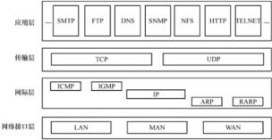

#### 【点评】送分题，多次考了，简单

#### 【试题 76】---2015 下真题 21

76、移动互联网技术体系主要涵盖六大技术产业领域：关键应用服务平台、网络平台技术、移动 智能终端软件平台技术、移动智能终端硬件平台技术、移动智能终端原材料元器件技术和（ ）。 （76）A.移动云计算技术   B.综合业务技术   C.安全控制技术   D.综合系统技术

#### 【答案】C

#### 【解析】 此题考察的是移动互联网技术体系，首次考，了解下

（1） 移动互联网关键应用服务平台技术 （2）面向移动互联网的网络平台技术 （3）移动智能终 端软件平台技术  （4）移动智能终端硬件平台技术  （5）移动智能终端原材料元器件技术  （6） 移动互联网安全控制技术

#### 【点评】首次考，稍微记忆下，做个了解，理解答题

#### 【试题 77】---2016 上真题 18

77、快速以太网和传统以太网在（77）上的标准不同。

A.逻辑链路控制子层   B. 网络层   C.介质访问控制子层   D.物理层

#### 【解析】 SI 模型，网线工作在物理层

#### 【试题 78】---2016 上真题 20

78、数据链路层最基本的服务是将源自网络层的数据可靠地传输到相邻节点。数据链路层的主要 协议不包括（78）。

A.点对点协议   B.HDLC      C.802.3        D.异步传输模式

#### 【答案】C

#### 【解析】 此题考察的是网络协议，必须掌握，高频考点

明明四个选项都是数据链路层的协议， c 是因为没有加 ieee 吗？ 我很疑惑？

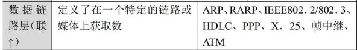

#### 【试题 79】---2016 上真题 22

79、堡垒主机是一台完全暴露给外网的主机，在维护内网安全方面发挥着非常大的作用。以下关 于堡垒主机的叙述中，不正确的是（79）。

A.堡垒主机具有输入输出审计功能     B.需要设置防火墙以保护堡垒主机

C.堡垒主机能配置网关服务           D.堡垒主机一般配置两块网卡

#### 【解析】 堡垒主机是一种被强化的可以防御进攻的计算机，作为进入内部网络的一个检查点，以达到把整个网络的安全问题集中在某个主机上解决，从而省时省力，不用考虑其它主机的安全的目的。它没有任何防火墙或者包过虑路由器设备保护。 一个堡垒主机使用两块网卡，每个网卡连接不同。

#### 【试题 80】---2016 上真题 26

80、以下关于虚拟专用网（VPN）的叙述中，不正确的是：（80）。

A.VPN 是指建立在私有网上的、由某一组织或某一群用户专用的通信网络

B.VPN 的虚拟性表现在任意一对 VPN 用户之间没有专用的物理连接，而是通过 ISP 提供 的公用网络来实现通信

C.VPN 的专用性表现在 VPN 之外的用户无法访问 VPN 内部资源

D.隧道技术是实现 VPN 的关键技术之一

#### 【解析】 虚拟专用网(VPN)被定义为通过一个公用网络（通常是因特网）建立一个临时的、安全的连接，是 一条穿过混乱的公用网络的安全、稳定的隧道。虚拟专用网是对企业内部网的扩展。

VPN 指的是依靠 ISP 和 NSP，在公用网络中建立专用的数据通信网络的技术。

#### 【试题 81】---2016 下真题 18

81 、OSI（Open SystemInter connection）参考模型将网络体系结构划分为七层， 其中（） 的主要功 能是将网络地址翻译成对应的物理地址，并决定路由。

A.数据链路层    B. 网络层    C.传输层      D.会话层

#### 【解析】网络层：其主要功能是将网络地址（例如， IP 地址） 翻译成对应的物理地址（例如，网卡地址）， 并决定如何将数据从发送方路由到接收方。

#### 【试题 82】---2016 下真题 19

82、无线网络技术已经成为当前的一种主流技术，并且呈现出快速演进的趋势。（） 属于 4G 无线 网络技术标准。

A.WPAN        B.FDD-LTE        C.TD-CDMA          D.WMAN

#### 【解析】目前基于 LTE 的 4G 标准有两个，分别为LTE FDD 和 LTE TDD（国内习惯于将 LTE TDD 称为 TD-LTE）

#### 【试题 83】---2016 下真题 20

83、以下关于当前主干网络的叙述中， 不正确的是（）。

A.主干网技术的选择需要考虑网络规模、传输信息的种类和费用等多种因素 B.主干网的可用性、可靠性要求很高

C.主干网一般采用同轴电缆作为传输介质

D.典型的主干网技术包括有 100Mbps-FX 以太网、1000Mbps 以太网等

#### 【解析】光纤是目前传输速率最高的传输介质， 在主干网中已大量的采用了光纤。

#### 【试题 84】---2016 下真题 21

84、随着互联网的发展，网络安全越来越受到人们的重视，其中能够鉴别什么样的数据包可以进 出组织内部网络的安全技术称为（）。

A.入侵检测  B. 防病毒软件  C.安全审计系统   D.防火墙

#### 【解析】防火墙通常被比喻为网络安全的大门，用来鉴别什么样的数据包可以进出企业内部网。在应对黑 客入侵方面， 可以阻止基于 IP 包头的攻击和非信任地址的访问。但传统防火墙无法阻止和检测基 于数据内容的黑客攻击和病毒入侵，同时也无法控制内部网络之间的违规行为。

#### 【试题 85】---2016 下真题 22

85、机房建设是系统集成工程中的重要内容之一（）。

A.楼宇自控   B.消防  C. 网络设备安装调试   D.空调系统安装调试

#### 【解析】 机房建设是系统集成工程中的重要内容之一楼宇自控

#### 【试题 86】---2017 上真题 18

86、在 0SI 七层协议中, （）主要负责确保数据可靠、顺序、无错地从 A 点传输到 B 点。 A.数据链路层    B. 网络层    C.传输层    D.会话层

#### 【解析】OSI 模型，传输层主要负责确保数据可靠、顺序、无错地从 A 点传输到 B 点。

#### 【试题 87】---2017 上真题 19

87、以下关于网络规划、设计与实施工作的叙述中， 不正确的是：（）。

A.在设计网络拓扑结构时,应考虑的主要因素有： 地理环境、传输介质与距离以及可靠性 B.在设计主干网时， 连接建筑群的主干网一般考虑以光缆作为传输介质

C.在没计广域网连接方式时,如果网络用户有 www 、E-mai1 等具有 Internet 功能的服务器,建 议采用 ISDN 或 ADSL 等技术连接外网

D.在很难布线的地方或者经常需要变动布线结构的地方,应首先考虑使用无线网络接入

#### 【解析】在设计广域网连接方式时，如果网络用户有 www、E-mail 等具有 Internet 功能的服务器， 用户可采用 DDN（或 EI）专线连接、 ATM 交换或永久虚电路连接外网。

#### 【试题 88】---2017 上真题 20

88、（） 一般不属于机房建设的内容。

A.消防监控安装调试    B.三通一平    C. 网络设备安装调试    D.空调系统安装调试

#### 【解析】三通一平是指基本建设项目开工的前提条件，具体指：水通、电通、路通和场地平整

#### 【试题 89】---2017 上真题 22

89、以下关于计算机病毒与蠕虫的特点比较的叙述中，正确的是:（）。

A.在传染机制中，蠕虫是通过宿主程序运行的

B.为系统打补丁，能有效预防蠕虫， 但不能有效预防病毒

C.在触发机制中，蠕虫的触发者是计算机的使用者

D.蠕虫和病毒都是寄生模式存在

#### 【解析】

病毒， 木马， 蠕虫统称为电脑病毒。病毒（包含蠕虫）的共同特征是自我复制、传播、破 坏电脑文件，对电脑造成数据上不可逆转的损坏。而木马独有特征是伪装成正常应用骗取 用户信任而入侵，潜伏在电脑中盗取用户资料与信息

病毒： 是编制者在计算机程序中插入的破坏计算机功能或者数据的代码，能影响计算机使 用，能自我复制的一组计算机指令或者程序代码。

木马： 也称木马病毒， 是指通过特定的程序来控制另一台计算机。与一般的病毒不同， 它 不会自我繁殖，也并不“刻意”地去感染其他文件， 它通过将自身伪装吸引用户下载执行， 向施种木马者提供打开被种主机的门户，使施种者可以任意毁坏、窃取被种者的文件， 甚 至远程操控被种主机。

蠕虫病毒：一种能够利用系统漏洞通过网络进行自我传播的恶意程序。它不需要附着在其

他程序上， 而是独立存在的。当形成规模、传播速度过快时会极大地消耗网络资源导致大 面积网络拥塞甚至瘫痪。

#### 【试题 90】---2017 下真题 18

90、在 。OSI 七层协议中，（） 充当了翻译官的角色，确保一个数据对象能在网络中的计算机间以双 方协商的格式进行准确的数据转换和加解密。

A.应用层    B.网络层   C.表示层    D.会话层

#### 【解析】OSI 模型 7 层，必须掌握，高频考点

OSI 采用了分层的结构化技术，从下到上共分七层：

（1）物理层：该层包括物理连网媒介， 如电缆连线连接器。

（2）数据链路层：它控制网络层与物理层之间的通信。它的主要功能是将从网络层接收到的数据 分割成特定的可被物理层传输的顿。

（3）网络层：其主要功能是将网络地址（如，IP 地址）翻译成对应的物理地址（例如，网卡地 址），并决定如何将数据从发送方路由到接收方。

（4）传输层：主要负责确保数据可靠、顺序、无错地从 A 点到传输到 B 点。

（5）会话层：负责在网络中的两节点之间建立和维持通信，以及提供交互会话的管理功能

（6） 表示层： 如同应用程序和网络之间的翻译官，在表示层， 数据将按照网络能理解的方案进行 格式化；这种格式化也因所使用网络的类型不同而不同。

（7） 应用层： 负责对软件提供接口以使程序能使用网络服务， 如事务处理程序、文件传送协议和 网络管理等。

#### 【试题 91】---2017 下真题 19

91、在下列传输介质中，（）的传输速率最高。

A.双绞线    B.同轴电缆    C.光纤    D.无线介质

#### 【解析】光纤是目前传输速率最高的传输介质，在主干网中已大量的采用了光纤。

#### 【试题 92】---2017 下真题 20

92、某公司承接了某政府机关的办公网络改造项目， 在进行网络总体设计时考虑使用汇聚交换机， 从技术层面考虑，最直接的原因是：（）。

A.办公楼内的信息点较多，使用 3 台交换机采用级联方式扩充端口

B.两栋办公楼距离较远，使用了百兆光纤电缆

C.网络用户数量超过 10000 人

D.本项目采用了星型网络拓扑结构

#### 【解析】汇聚层的存在与否，取决于网络规模的大小。当建筑楼内信息点较多（比如大于 22 个点）超出一 台交换机的端口密度，而不得不增加交换机扩充端口时，就需要有汇聚交换机。交换机间如果采 用级连方式，则将一组固定端口交换机上联到一台背板带宽和性能较好的汇聚交换机上，再由汇 聚交换机上联到主干网的核心交换机。如果采用多台交换机堆叠方式扩充端口密度，其中一台交 换机上联， 则网络中就只有接入层。

#### 【试题 93】---2017 下真题 21

93、关于 WLAN 描述不正确的是：（）。

A.802.11n 是 IEEE 制定的一个无线局域网标准协议

B.无线网络与有限网络的用途类似， 最大的不同在于传输媒介的不同

C.无线网络技术中不包括为近距离无线连接进行优化的红外线技术

D.现在主流应用的是第四代无线通信技术

#### 【解析】无线网络的出现就是为了解决有线网络无法克服的困难。无线网络首先适用于很难布线的地方（比 如受保护的建筑物、机场等）或者经常需要变动布线结构的地方（如展览馆等）。学校也是一个很 重要的应用领域，一个无线网络系统可以使教师、学生在校园内的任何地方接入网络。另外，因 为无线网络支持十儿公里的区域，因此对于城市范围的网络接入也能适用，可以设想一个采用无 线网络的 ISP 可以为一个城市的任何角落提供高达 10Mbps 的互联网接入。C 应该是包括的；

#### 【试题 94】---2017 下真题 22

94、《中华人民共和国网络安全法》与 2017 年 6 月 1 日起开始施行，（）负责统筹协调网络安全工 作和相关监督管理工作。

A.国务院电信主管部门   B.工业和信息化部主管部门    C.公安部门    D.国家网信部门

#### 【解析】 《网络安全法》第八条提出国家网信部门负责统筹协调网络安全工作和相关监督管理工作。电信主管部门、公安部门和其他有关机关依照本法和有关法律、行政法规的规定，在各自职责范围内负责网络安全保护和监督管理工作。

#### 【试题 95】---2018 上真题 18

95、在 。OSI 七层协议中， HTTP 是（） 协议。

A.网络层    B.传输层    C.会话层    D.应用层

#### 【解析】OSI模型

OSI 采用了分层的结构化技术，从下到上共分七层：

|  | 功能描述 | 对应协议 |
|---|---|---|
| 应用层 （应个） | 对软件提供接口以使程序能使用网络服务，如事务处理 程序、文件传送协议和网络管理等 | FTP、HTTP、Telnet、DHCP、 SMTP、SNMP、DNS、POP3 |

#### 【试题 96】---2018 上真题 19

96、在网络存储结构中，（）通过 TCP/IP 协议访问数据。

A.直连式储存    B. 网络储存设备    C.光纤通道交换机    D.SCSI 储存

#### 【解析】既然是通过 TCP/IP 协议访问数据，则肯定是需要网络了

#### 【试题 97】---2018 上真题 20

97、对 MAC 地址进行变更属于（）。

A.链路层交换    B.物理层交换    C.网络层交换    D.传输层交换

#### 【解析】OSI 模型7层，考察网络技术标准与协议 OSI 七层协议。

#### 【试题 98】---2018 上真题 21

98、只有得到允许的人才能修改数据，并且能够判别出数据是否已被篡改，这体现了信息安全的（）。 A.机密性    B.可用性    C.完整性    D.可控性

#### 【解析】P520此题考察的是信息安全的属性，必须掌握，高频考点

保密性：信息不被泄漏给未授权的个人、实体和过程或不被其使用的特性。

完整性：保护资产的正确和完整的特性，就是确保接收到的数据就是发送的数据。数据不应该 被改变，这需要某种方法去进行验证。例如可以用 MD5 实现。

可用性：需要时，授权实体可以访问和使用的特性.磁盘和系统的容错及备份、可接受的登录 及进程性能、可靠的功能性的安全进程和机制可以来实现。路由选择控制和审计跟踪等技术 主要用于提高信息系统的可用性。

不可抵赖性：是指建立有效的责任机制，防止用户否认其行为，这一点在电子商务中是极其重要的。可以通过数字签名实现。

#### 【试题 99】---2018 下真题 18

99、windows 操作系统下的 ping 命令，使用的是（） 协议

A.UDP    B.ARP    C.ICMP    D.FTP

#### 【解析】ping 命令用来测试数据包能否通过IP 协议到达特定主机。其使用ICMP 协议， 它利用 ICMP 协议中 的 “EchoRequest”，报文进行工作的。

#### 【试题 100】---2018 下真题 19

100、在网络存储结构中，（）成本较高、技术较复杂，适用于数据量大、数据访问速度要求高的场 合。

A.直连式存储（DAS） B.网络存储设备（NAS） C.存储网络（SAN） D.移动存储设备（MSD）

#### 【解析】SAN 是通过专用交换机将磁盘阵列与服务器连接起来的高速专用子网。它没有采用文件共享存取方式，而是采用块（block）级别存储，其成本较高、技术较复杂，适用于据量大、数据访问速度要 求较高的场合。

#### 【试题 101】---2018 下真题 20

101、关于网络交换技术的描述，不正确的是（）。

A.Internet 传输的最小数据单位是 Byte

B.ATM 交换的最小数据单位是码元

C.Internet 使用数据报网络

D.ATM 使用虚电路网络管

#### 【解析】我们常用的 Internet 就是数据报网络，单位是 Bit，而 ATM 则用的是虚电路网络，单位是码元。Byte:字节;bit:位 8bit=1Byte

#### 【试题 102】---2018 下真题 21

102、在网络产品中，（）通常被比喻为网络安全的大门，用来鉴别什么样的数据包可以进出企业内部网。 A.漏洞扫描工具    B.防火墙    C.防病毒软件    D.安全审计系统

#### 【解析】防火墙通常被比喻为网络安全的大门， 用来鉴别什么样的数据包可以进出企业内部网。

#### 【试题 103】---2019 上真题 18

103、关于无线通信网络的描述，不正确的是（）。

A.2G 应用于 GSM、CDMA 等数字手机

B.3G 主流制式包括 CDMA200、WCDM   A.TD-LTE 和 FDD-LTE

C.4G 是 3G 与 WAN 于体理论下载速率达到 100Mbps

D.正在研发的 5G，理论上可达 1Gbps 以上的速度传送数据

#### 【解析】TD-LTE 和 FDD-LTE 是 4G 的两种主要制式

4G 包括 TD-LTE 和 FDD-LTE 两种制式， 是集 3G 与 WLAN 于一体， 并能够快速传输数据、高质量、音频、视频和图像等，理论下载速率达到 100Mbps。

#### 【试题 104】---2019 上真题 19

104、存储磁盘阵列按其连接方式的不同，可分为三类，即 DAS、NAS 和（）。 A.LAN    B.WAN    C.SAN    D.RAID

#### 【解析】主流的网络存储技术主要有三种， 分别是直接附加存储（DAS）、网络附加存储（NAS）和存储区域 网络（SAN）。

#### 【试题 105】---2019 上真题 20

105、IP 地址是在。OSI 模型的（）定义。

A.物理层    B.数据链路层    C.网络层    D.传输层

#### 【解析】IP 地址，即用IP 协议语言表示的逻辑地址。IP（InterneTProtocol）协议是在网络层的核心协议。

#### 【试题 106】---2019 上真题 21

106、DDos 拒绝服务攻击是以通过大量合法的请求占用大量网络资源，造成网络瘫痪。该网络攻 击破环了信息安全的（）属性。

A.可控性    B.可用性    C.完整性    D.保密性

#### 【解析】分布式拒绝服务（DDoS： Distributed Denial of Service）攻击指借助于客户/服务器技术，将 多个计算机联合起来作为攻击平台， 对一个或多个目标发动 DDoS 攻击， 从而成倍地提高拒绝服务攻击的威力。主要目的是让目标服务器不可用。

#### 【试题 107】---2019 下真题 16

107 、Internet 通过（）协议可以实现多个网络的无缝连接。

A.ISDN        B.IPv6      C.TCP/IP        D.DNS

#### 【解析】TCP/IP 是 Internet 的核心， 利用 TCP/IP 协议可以方便地实现多个网络的无缝连接。

#### 【试题 108】---2019 下真题 17

### 108、查内存使用结果如下:

|  | total | used | free | shared | buffers | cached |
|---|---|---|---|---|---|---|
| mem | 2026 | 1958 | 67 | 0 | 76 | 1556 |

下列结果分析错误的是（）。

A.该内存资源占用状态正常

B.该内存资源占用率状态异常

C.1958 表示系统使用的内存

D.67 表示系统剩余内存

#### 【答案】A

#### 【解析】很少考；

剩余内存已经基本没了，不是正常状态，这个题目没必要会。

题干给出的数据是在 Linux 下用 free 命令显示的系统内存的使用情况：

mem 内存的使用信息；

total 系统总的可用物理内存大小（total 为 used 与 free 之和）；

used 已被使用的物理内存大小 ;free 还有多少物理内存可用；

shared 被共享使用的物理内存大小；

buffers 是指用来给块设备做缓冲的物理内存大小；

cached 被缓存使用的物理内存大小；

系统总的可用物理内存 total=used+free，计算的 1958+67=2025，并不等于 2026，即内存资源占 用率状态异常，推荐错误的选项为 A。

#### 【试题 108】---2019 下真题 18

108、网结按照（）可划分为总线型结构、环型结构、星型结构、树型结构和网状结构。 A.覆盖的地理范围    B.链接传输控制技术    C.拓扑结构    D.应用传输层

#### 【解析】按拓扑结构可划分为总线型结构、环形结构、星型结构、树形结构和网状结构

#### 【试题 109】---2019 下真题 19

109、信息安全中的（）是指只有得到允许的人才能修改数据， 并且能够判别出数据是否已被篡改。 A.机密性    B.完整性    C.可用性    D.可控性

#### 【解析】

机密性：确保信息不暴露给未授权的实体或进程；

完整性：只有得到允许的人才能修改数据，并且能够判别出数据是否己被篡改；

可用性：得到授权的实体在需要时可访问数据，即攻击者不能占用所有的资源而阻碍授权者的工作。 可控性：可以控制授权范围内的信息流向及行为方式。

可审查性：对出现的网络安全问题，提供调查的依据和手段。

#### 【试题 110】---2019 下真题 20

110、网络和信息安全产品中，（） 无法发现正在进行的入侵行为，而且成为攻击者的工具。 A. 防火墙    B.扫描器    C.防毒软件    D.安全审计软件

#### 【解析】扫描器可以说是入侵检测的一种，主要用来发现网络服务、网络设备和主机的漏洞，通过定检测 与比较，发现入侵或违规行为留下的痕迹。当然，扫描器无法发现正在进行的入侵行为，而且它还有可能成为攻击者的工具。

## 第八章、新一代网络技术

考点分析与预测：在系统集成项目管理工程师考试中，可能会涉及考察一些最新的计算机 技术，可能会出 5 分的选择题， 可能考查的知识点为：物联网的定义、核心技术以及三层架构，  云计算的定义和三种服务模式， 互联网+、大数据、智能制造 2025、智慧城市、人工智能、4G/5G 技术等，希望大家予以重视。此部分大家尽量涉及， 平时多注意积累，下面列举了部分新技术， 希望大家掌握；

本章金色考点汇总：

| 新一代网络技术（6 分） | 新一代网络技术（6 分） | 新一代网络技术（6 分） | 新一代网络技术（6 分） | 新一代网络技术（6 分） | 新一代网络技术（6 分） | 新一代网络技术（6 分） | 新一代网络技术（6 分） | 新一代网络技术（6 分） | 新一代网络技术（6 分） | 新一代网络技术（6 分） | 新一代网络技术（6 分） | 新一代网络技术（6 分） | 新一代网络技术（6 分） | 新一代网络技术（6 分） | 新一代网络技术（6 分） | 新一代网络技术（6 分） | 新一代网络技术（6 分） | 新一代网络技术（6 分） | 新一代网络技术（6 分） | 新一代网络技术（6 分） | 新一代网络技术（6 分） | 新一代网络技术（6 分） |
|---|---|---|---|---|---|---|---|---|---|---|---|---|---|---|---|---|---|---|---|---|---|---|
| 分值        年份 考点情况 | 09 上 | 09 下 | 10 上 | 10 下 | 11 上 | 11 下 | 12 上 | 12 下 | 13 上 | 13 下 | 14 上 | 14 下 | 15 上 | 15 下 | 16 上 | 16 下 | 17 上 | 17 下 | 18 上 | 18 下 | 19 上 | 19 下 |
| 1、物联网 |  |  |  |  | 1 | 1 |  |  |  |  |  |  |  |  |  | 2 | 3 | 1 | 1 | 1 | 1 | 1 |
| 2、云计算 |  |  |  |  |  | 2 |  |  | 1 |  |  |  | 1 | 2 | 1 |  | 1 | 1 | 2 | 1 | 2 | 1 |
| 3、互联网+ |  |  |  |  |  |  |  |  |  |  |  |  |  | 1 | 2 |  |  |  | 1 |  | 1 |  |
| 4、大数据 |  |  |  |  |  |  |  |  |  |  |  |  |  |  |  | 1 | 1 | 1 | 1 | 1 | 1 | 2 |
| 5、移动互联网 |  |  |  |  |  |  |  |  |  |  |  |  |  |  |  | 1 | 1 | 1 |  | 1 | 1 |  |
| 6、智能制造 2025 |  |  |  |  |  |  |  |  |  |  |  |  |  |  | 1 |  |  | 2 | 1 |  | 1 |  |
| 7、人工智能 |  |  |  |  |  |  |  |  |  |  |  |  |  |  |  |  |  | 1 | 1 | 1 | 1 |  |
| 8、 Web 2.0 |  |  |  |  |  |  |  |  |  |  |  |  |  |  |  |  |  |  | 1 |  |  |  |
| 总的分值 |  |  |  |  | 1 | 3 |  |  | 1 |  |  |  | 1 | 3 | 4 | 4 | 6 | 7 | 8 | 5 | 8 | 4 |
| 学习建议：新一代网络技术可能会考 6 分，重点掌握大数据、物联网、云计算、互联网+、移动互联网、智能制造 2025、 IPV6、、 4G、4G 等前言网络技术，当然这部 分大家平时注意积累，尽量得分； | 学习建议：新一代网络技术可能会考 6 分，重点掌握大数据、物联网、云计算、互联网+、移动互联网、智能制造 2025、 IPV6、、 4G、4G 等前言网络技术，当然这部 分大家平时注意积累，尽量得分； | 学习建议：新一代网络技术可能会考 6 分，重点掌握大数据、物联网、云计算、互联网+、移动互联网、智能制造 2025、 IPV6、、 4G、4G 等前言网络技术，当然这部 分大家平时注意积累，尽量得分； | 学习建议：新一代网络技术可能会考 6 分，重点掌握大数据、物联网、云计算、互联网+、移动互联网、智能制造 2025、 IPV6、、 4G、4G 等前言网络技术，当然这部 分大家平时注意积累，尽量得分； | 学习建议：新一代网络技术可能会考 6 分，重点掌握大数据、物联网、云计算、互联网+、移动互联网、智能制造 2025、 IPV6、、 4G、4G 等前言网络技术，当然这部 分大家平时注意积累，尽量得分； | 学习建议：新一代网络技术可能会考 6 分，重点掌握大数据、物联网、云计算、互联网+、移动互联网、智能制造 2025、 IPV6、、 4G、4G 等前言网络技术，当然这部 分大家平时注意积累，尽量得分； | 学习建议：新一代网络技术可能会考 6 分，重点掌握大数据、物联网、云计算、互联网+、移动互联网、智能制造 2025、 IPV6、、 4G、4G 等前言网络技术，当然这部 分大家平时注意积累，尽量得分； | 学习建议：新一代网络技术可能会考 6 分，重点掌握大数据、物联网、云计算、互联网+、移动互联网、智能制造 2025、 IPV6、、 4G、4G 等前言网络技术，当然这部 分大家平时注意积累，尽量得分； | 学习建议：新一代网络技术可能会考 6 分，重点掌握大数据、物联网、云计算、互联网+、移动互联网、智能制造 2025、 IPV6、、 4G、4G 等前言网络技术，当然这部 分大家平时注意积累，尽量得分； | 学习建议：新一代网络技术可能会考 6 分，重点掌握大数据、物联网、云计算、互联网+、移动互联网、智能制造 2025、 IPV6、、 4G、4G 等前言网络技术，当然这部 分大家平时注意积累，尽量得分； | 学习建议：新一代网络技术可能会考 6 分，重点掌握大数据、物联网、云计算、互联网+、移动互联网、智能制造 2025、 IPV6、、 4G、4G 等前言网络技术，当然这部 分大家平时注意积累，尽量得分； | 学习建议：新一代网络技术可能会考 6 分，重点掌握大数据、物联网、云计算、互联网+、移动互联网、智能制造 2025、 IPV6、、 4G、4G 等前言网络技术，当然这部 分大家平时注意积累，尽量得分； | 学习建议：新一代网络技术可能会考 6 分，重点掌握大数据、物联网、云计算、互联网+、移动互联网、智能制造 2025、 IPV6、、 4G、4G 等前言网络技术，当然这部 分大家平时注意积累，尽量得分； | 学习建议：新一代网络技术可能会考 6 分，重点掌握大数据、物联网、云计算、互联网+、移动互联网、智能制造 2025、 IPV6、、 4G、4G 等前言网络技术，当然这部 分大家平时注意积累，尽量得分； | 学习建议：新一代网络技术可能会考 6 分，重点掌握大数据、物联网、云计算、互联网+、移动互联网、智能制造 2025、 IPV6、、 4G、4G 等前言网络技术，当然这部 分大家平时注意积累，尽量得分； | 学习建议：新一代网络技术可能会考 6 分，重点掌握大数据、物联网、云计算、互联网+、移动互联网、智能制造 2025、 IPV6、、 4G、4G 等前言网络技术，当然这部 分大家平时注意积累，尽量得分； | 学习建议：新一代网络技术可能会考 6 分，重点掌握大数据、物联网、云计算、互联网+、移动互联网、智能制造 2025、 IPV6、、 4G、4G 等前言网络技术，当然这部 分大家平时注意积累，尽量得分； | 学习建议：新一代网络技术可能会考 6 分，重点掌握大数据、物联网、云计算、互联网+、移动互联网、智能制造 2025、 IPV6、、 4G、4G 等前言网络技术，当然这部 分大家平时注意积累，尽量得分； | 学习建议：新一代网络技术可能会考 6 分，重点掌握大数据、物联网、云计算、互联网+、移动互联网、智能制造 2025、 IPV6、、 4G、4G 等前言网络技术，当然这部 分大家平时注意积累，尽量得分； | 学习建议：新一代网络技术可能会考 6 分，重点掌握大数据、物联网、云计算、互联网+、移动互联网、智能制造 2025、 IPV6、、 4G、4G 等前言网络技术，当然这部 分大家平时注意积累，尽量得分； | 学习建议：新一代网络技术可能会考 6 分，重点掌握大数据、物联网、云计算、互联网+、移动互联网、智能制造 2025、 IPV6、、 4G、4G 等前言网络技术，当然这部 分大家平时注意积累，尽量得分； | 学习建议：新一代网络技术可能会考 6 分，重点掌握大数据、物联网、云计算、互联网+、移动互联网、智能制造 2025、 IPV6、、 4G、4G 等前言网络技术，当然这部 分大家平时注意积累，尽量得分； | 学习建议：新一代网络技术可能会考 6 分，重点掌握大数据、物联网、云计算、互联网+、移动互联网、智能制造 2025、 IPV6、、 4G、4G 等前言网络技术，当然这部 分大家平时注意积累，尽量得分； |

### 重要考点 1：物联网

（1）物联网定义：即“物物相联之网”，指通过射频识别（RFID）、红外感应器、全球定位 系统、激光扫描器等信息传感设备，按约定的协议， 把物与物、人与物进行智能化连接，进行信 息交换和通讯，以实现智能化识别、定位、跟踪、监控和管理的一种新兴网络。从计算机的协同 处理来划分，可分为独立计算、互联网和物联网时代；（11 上 5）

物联网不是一种物理上独立存在的完整网络，而是架构在现有互联网或下一代公网或专网 基础上的联网应用和通信能力，是具有整合感知识别、传输互联和计算处理等能力的智能型应用。

（17 下 25）

射频识别（RFID）是物联网中常用的无线通信技术， 它通过无线电信号识别特定目标并读写 相关数据。

电子标签 RFID  ，也叫射频标签、射频识别。它是一种非接触式的自动识别技术， 通过射频 信号识别目标对象并获取相关数据。识别工作无须人工干预， 作为条形码的无线版本， RFID 技术 具有条形码所不具备的防水、防磁、耐高温、使用寿命长、读取距离大、标签上数据可以加密、  存储数据容量更大、存储信息更改自如、更容易地附着在不同的产品上等优点。RFID 射频识别是 一种非接触式的自动识别技术，它通过射频信号自动识别目标对象并获取相关数据，识别工作无

作快捷方便。
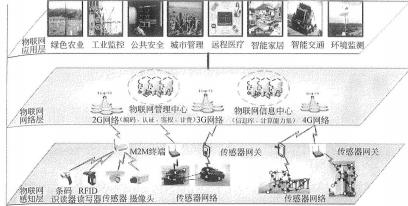

短距离射频产品不怕油溃、灰尘污染等恶劣的环境，可在这样的环境中替代条码，	 例如用在工厂的流水线上跟踪物体。长距射频产品多用于交通上，识别距离可达几十米，如自动 收费或识别车辆身份等。

从技术架构上来看， 物联网可分为三层： 感知层、网络层和应用层。  （11 下 3）（17 上 7、8）

（18 下 24）

（1） 感知层：负责信息采集和物物之间的信息传输， 信息采集的技术包括传感器、条码和二 维码、 RFID 射频技术、音视频等多媒体信息， 信息传输包括远近距离数据传输技术、自组织组网 技术、协同信息处理技术、信息采集中间件技术等传感器网络。感知层是实现物联网全面感知的 核心能力，是物联网中包括关键技术、标准化方面、产此化方面亚待突破的部分，关键在于具备 更精确、更全面的感知能力， 并解决低功耗、小型化和低成本的问题。（16 下 24）（17 上 25）（19

上 24）（19 下 22）

（2） 网络层： 是利用无线和有线网络对采集的数据进行编码、认证和传输， 广泛覆盖的移动 通信网络是实现物联网的基础设施，是物联网三层中标准化程度最高、产业化能力最强、最成熟 的部分， 关键在于为物联网应用特征进行优化和改进，形成协同感知的网络。（18 上 24）

（3） 应用层：提供丰富的基于物联网的应用，是物联网发展的根本目标， 将物联网技术与行 业信息化需求相结合，实现广泛智能化应用的解决方案集，关键在于行业融合、信息资源的开发 利用、低成本高质量的解决方案、信息安全的保障以及有效的商业模式的开发。

各个层次所用的公共技术包括编码技术、标识技术、解析技术、安全技术和中间件技术。

物联网关键技术： 感知层作为物联网架构的基础层面，主要技术包括： 产品和传感器（条码、 RFID、传感器等）自动化识别技术、无线传输技术（WLAN、Bluetooth 、zigBee、UWB）、 自组织组网技术、中间件技术

物联网应用（1）智能微尘（2）智能电网（3）智慧物流（4）智能家居（5）智能交通（6）智慧农业（7）

环境保护（8）医疗健康（9）城市管理（10）金融服务保险业（11）公共安全（16 下 25）

### 重要考点 2：云计算

（1）云计算的定义： 通过互联网来提供大型计算能力和动态易扩展的虚拟化资源。云是网络、 互联网的一种比喻说法。是一种大集中的服务模。（11 下 1）（15 下 17）

云计算通过网络提供可动态伸缩的廉价计算能力，特点： （1）超大规模（2）虚拟化（3）高

可靠性（4）通用性（5）高可扩展性（6）按需服务（7）极其廉价（8）潜在的危险性（19 上 23）

云计算的主要特点包括： 一是宽带网络连接，用户需要通过宽带网络接入“云”中并获得有 关的服务，“云”内节点之间也通过内部的高速网络相连； 二是快速、按需、弹性的服务，用户可 以按照实际需求迅速获取或释放资源， 并可以根据需求对资源进行动态扩展。（18 下 23）

云计算关键技术：

| 基础设施关键技术 | 包括服务器、网络和数据中心相关技术 |
|---|---|
| 操作系统关键技术 | 包括资源池管理技术和向用户提供大规模存储、计算能力的分布式任务和数 据管理技术；资源池管理技术主要实现对物理资源、虚拟资源的统一管理， 并根据用户需求实现虚拟资源的自动化生成、分配和迁移。 |

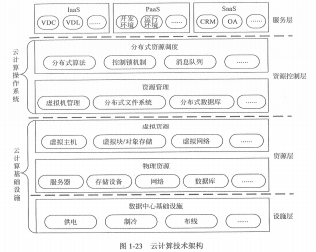

（2）云计算可以认为包括以下几个层次的服务：基础设施即服务（IaaS），平台即服务（PaaS）和软件即服务（SaaS）。（11 下 2）（15 下 20）

云计算结构包括资源池、云操作系统和云平台接口

（1）资源池：指集群管理的各种基础硬件资源，如 cPU、存储和网络带宽等。 （2）云操作系统：通过虚拟化技术对资源池中的各种资源进行统一调度管理。 （3）云平台接口：用户调用云计算资源的接口。

云计算又可分为公有云、私有云和混合云。

| 公有云 | 第三方提供商用户能够使用的云， 一般可通过 Internet 使用，可能是免费或成本低廉的 |
|---|---|
| 私有云 | 为一个客户单独使用而构建的，因而提供对数据、安全性和服务质量的最有效控制。该 公司拥有基础设施， 并可以控制在此基础设施上部署应用程序的方式 |
| 混合云 | 将公有、私有两种模式结合起来，根据需要提供统一服务的模式（17 下 24） |

 云计算是一种将池化的集群计算能力通过互联网向外部用户提供按需服务的互联网新业务。  它通过互联网来提供动态易扩展且通常为虚拟化的资源。

 重要考点 3：互联网+

“互联网+工业”即传统制造业企业采用移动互联网、云计算、大数据、物联网等信息通信技 术,改造原有产品及研发生产方式，与“工业互联网”、“工业 4.0”的内涵一致。

“互联网+ ”就是“互联网+各个传统行业”，但这并不是简单的两者相加， 而是利用信息通信 技术以及互联网平台，让互联网与传统行业进行深度融合，创造新的发展生态。此类协同制  造公共服务平台多采用分布式系统， 电子商务、互联网金融（ITFIN）、在线旅游、在线影视、 在线房产等行业是“互联网+ ”的杰作。 互联网+行动可以助推传统产业的转型升级（16 上 2）

比如互联网金融， 由于与互联网的相结合， 诞生出了很多普通用户触手可及的理财投资产品， 比如余额宝、理财通以及 p2p 投融资产品等；比如互联网医疗，传统的医疗机构由于互联网 平台的接入，使得人们实现在线求医问药成为可能， 这些都是最典型的互联网+的案例。

《国务院关于积极推进“互联网+ ”行动的指导意见》中提出推动互联网与制造业融合， 提升 制造业数字化、网络化、智能化水平，加强产业链协作， 发展基于互联网的协同制造新模式。 在重点领域推进智能制造、大规模个性化定制、网络化协同制造和服务型制造，打造一批网 络化协同制造公共服务平台， 加快形成制造业网络化产业生态体系。（15 下 3）（16 上 3）

信息物理系统（cps,cyber-Physicalsystems）是一个综合计算、网络和物理环境的多维复杂系 统， 通过 3c（computing、communication 、control）技术的有机融合与深度协作， 实现大型 工程系统韵实时感知、动态控制和信息服务：该系统主要应用于智能制造领域，是智能制造 的核心；（16 上 5）

国务院正式印发《关于深化“互联网+先进制造业”发展工业互联网的指导意见》指出:工业 互联网通过系统构建网络、平台、（安全） 三大功能体系， 打造人、机、物全面互联的新型网 络基础设施，形成智能化发展的新兴业态和应用模式，是推进制造强国和网络强国建设的重 要基础，是全面建成小康社会和建设社会主义现代化强国的有力支撑。（18 上 26）

P98 顺应世界“互联网+”发展趋势，充分发挥我国互联网的规模优势和应用优势，推动互联 网由消费领域向生产领域拓展，加速提升产业发展水平，增强各行业创新能力，构筑经济社 会发展新优势和新动能。（19 上 26）

—      互联网+有六大特征： 一是跨界融合、二是创新驱动、三是重塑结构、四是尊重人性、五是开 放生态、六是连接一切。

 重要考点 4：大数据

大数据（BigData）特点：5 个“V ”——volume（数据量大）、variety（数据类型繁多）、velocity  （处理速度快）、value（价值密度低）、veracity（真实性高） 。（19 下 7）

大数据的意义不在 于掌握庞大的数据信息，而在于对这些数据进行专业化处理， 实现数据的“增值 ”大数据分 析相比于传统的数据仓库应用，具有数据量大、查询分析复杂等特点。在技术上， 大数据必 须依托云计算的分布式处理、分布式数据库和云存储、虚拟化技术等。适用于大数据的技术， 包括大规模并行处理（MPP）数据库、数据挖掘电网、分布式文件系统、分布式数据库、云 计算平台、互联网和可扩展的存储系统。

最小的基本单位是 bit，按顺序给出所有单位： bit、Byte、KB、MB、GB、TB、PB、EB、ZB、 YB 、BB 、NB 、DB。它们按照进率 1024（2 的十次方）来计算：

大数据从数据源经过分析挖掘到最终获得价值一般需经过 5 个主要环节，包括数据准备、数 据存储与管理、计算处理、数据分析和知识展现。

大数据只是在数据规模上达成共识：“超大规模”表示的是 GB 级别的数据，“海量”表示的 是 TB 级的数据，而“大数据”则是 PB 级别及其以上的数据。

企业逐渐了解到大数据并不仅仅指处理网络数据，行业对大数据处理的需求也会增加，包括 数据流检测和分析。

大数据所涉及的技术很多， 主要包括数据采集、数据存储、数据管理、数据分析与挖掘四个环节。

| 数据采集 | 数据抽取工具 ETL（16 下 23） |
|---|---|
| 数据存储 | 结构化数据、非结构化数据和半结构化数据的存储与访问 |
| 数据管理 | 分布式并行处理技术，比较常用的有 MapReduce（17 下 23） |
| 数据分析与挖掘 | 根据业务需求对大数据进行关联、聚类、分类等钻取和分析，并利用图形、 表格加以展示—核心 |

大数据的关键技术：

| 大数据存储管理技术 | 谷歌文件系统（GFS）和 Hadoop 的分布式文件系统HDFS 奠定了大数据 存储技术的基础。（18 上 22） |
|---|---|
| 大数据并行分析技术 | 谷歌的 MapReduce 是主要的大数据分布式并行计算技术之一，而开源的 分布式并行计算技术 ApacheHadoopMapReduce,已经成为应用最广泛的大 数据计算软件平台 |
| 大数据分析技术 | 主要是通过建立人工智能系统，使用大量样本数据进行训练， 让机器模仿 人工，获得从数据中提取知识的能力 |
| 大数据的关键技术：（17 上 23） | 大数据的关键技术：（17 上 23） |

| HDFS | 分布式文件系统，提供高吞吐量的数据访问， 非常适合大规模数据集上的应用 |
|---|---|
| HBase | 分布式的、面向列的开源数据库，不同于一般的关系数据库， 是非结构化数据存 储的数据库，适合于非结构化数据存储的数据库， 基于列的而不是基于行的模式。 （18 下 22）（19 下 23） |
| MapReduce | 一种编程模型，用于大规模数据集（大于 1TB）的并行运算， 主要思想：概念“Map （映射）”和“Reduce（归约） ” |
| chukwa | 开源的用于监控大型分布式系统的数据收集系统， 包含了一个强大而灵活的工具 集，可用于展示、监控和分析已收集的数据 |

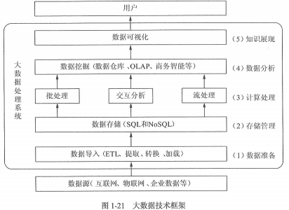

补充了解：

Flume（日志收集系统）是 cloudera 公司提供的一个高可用的， 高可靠的，分布式的海量日 志采集、聚合和传输的系统。

MapReduce 是一种编程模型，用于大规模数据集（大于 1TB）的并行运算。概念“Map（映射）” 和“Reduce （归约）”，Reduce 英文也可翻译成化简、减少的意思。

Apache kafka 是一个分布式发布-订阅消息系统和一个强大的队列， 可以处理大量的数据， 并 能够将消息从一个端点传递到另一个端点。 kafka 架构分为三层， 经纪人、生产者以及消费 者，生产者向 kafka 经纪人发送数据， consumers 从经纪人处读取数据。（19 上 22）

spark 因为其处理数据的方式不一样，会比 MapReduce 快上很多，它会在内存中以接近“实时 ” 的时间完成所有的数据分析， spark 的批处理速度比 MapReduce 快近 10 倍， 内存中的数据分   析速度则快近 100 倍。

### 重要考点 5：移动互联网

移动互联网  一般是指用户用手机等无线终端， 通过3G （WCDMA 、CDMA2000  或者 TD-SCDMA）或者 WLAN 等速率较高的移动网络接入互联网， 可以在移动状态下（如在地铁、 公交车上等）使用互联网的网络资源。

移动互联网=移动通信网络+互联网内容和应用，它不仅是互联网的延伸，而且是互联网的发 展方向。

移动终端在处理能力、显示效果、开放性等方面无法和 PC 相提并论， 但在个性化、永远在线、 位置性等方面强于 PC。由于移动终端具有小巧轻便、随身携带两个特点， 决定了移动互联网 应用应具有下列新特征而不是传统互联网应用的简单复制和移植。（1）接入移动性（2）时间 碎片性（3）生活相关性（4）终端多样性

移动互联网的关键技术包括面向服务的架构技术 SOA、页面展示技术 web2.0 和 HTML5 以 及主流开发平台 Android、iOS 和 windowsphone。（17 下 26（18 下 25）（19 上 25）

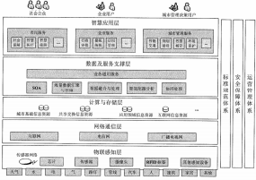

| SOA | 面向服务的架构， SOA 是一种粗粒度、松糯合服务架构，服务之间通过简单、精确定 义接口进行通讯， 不涉及底层编程接口和通讯模型。SOA 可以看作是 B/S 模型、XML 	（标准通用标记语言的子集） /webService 技术之后的自然延伸。 webService 是目前实现 SOA 的主要技术 |
|---|---|
| web2.0 | 是页面展示技术。严格来说不是一种技术， 而是提倡众人参与的互联网思维模式（18 上 25） |
| HTML5 16 下 26 |  |
| Android | 特点入门容易，因为 Android  的中间层多以 Java  实现，指令相对减少、开发相对简单， 而且开发社群活跃， 开发资源丰富 |
| IOS | 一个非开源的操作系统， 开发人员必须加入苹果开发者计划，需要付款以获得苹果的 批准，开发语言是 Objective-C 、 C、和 C++，开发难度大于 Android |
| windowsphone | 微软一款手机操作系统，开发技术： C 、C++ 、C#等。 |

### 重要考点 6：智慧城市

智慧城市建设主要包括以下几个部分：

首先，通过传感器或信息采集设备全方位地获取城市 系统数据；其次，通过网络将城市数据关联、融合、处理、分析为信息； 第三，通过充分共 享、智能挖掘将信息变成知识；最后，结合信息技术，把知识应用到各行各业形成智慧。

智慧城市建设成败的关键不再是数字城市建设中建设大量 IT系统，而是如何有效推进城市范 围内数据资源的融合， 通过数据和 IT 系统的融合来实现跨部门的协同共享、行业的行动协调、 城市的精细化运行管理等。（16 下 8）

智慧城市建设模型包括五层（功能层）和对 建设有约束关系的三个支撑体系

1.功能层： ①物联感知层②通信网络层③计 算与存储层④数据及服务支撑层⑤智慧应 用层（18 下 29）（19 下 8）

2.支撑体系： ①安全保障体系 ②建设和运 营管理体系③标准规范体系（17 上 9）（17 下9）

鼓励电子政务系统向云计算模式迁移。

—      智慧城市的应用： ①公用事业智能化②城市智能交通③城市应急联动

 一般考点 7：智能制造 2025 与工业 4.0、人工智能

李克强指出，首先，《  中国制造 2025》和“互联网+ ”是不可分割的，这是因为我们要推动中国制造升级，必须向智能化的方向发展。

 “工业 4.0”三大主题： “智能工厂”、“智能生产”、“智能物流 ”

加快推动新一代信息技术与制造技术融合发展，把智能制造作为两化深度融合的主攻方向； 着力发展智能装备和智能产品，推进生产过程智能化，培育新型生产方式，全面提升企业研 发、生产、管理和服务的智能化水平。（17 下 7）

《新一代人工智能发展规划》提出“三步走”战略目标。

到 2020 年人工智能总体技术和应用与世界先进水平同步，人工智能产业成为新的重 要经济增长点；

到 2025 年人工智能基础理论实现重大突破， 部分技术与应用达到世界领先水平；

到 2030 年人工智能理论、技术与应用总体达到世界领先水平，成为世界主要人工智 能创新中心。（18 上 27）

实施“中国制造 2025”，促进两化深度融合， 加快从制造大国转向制造强国， 需要电子信息产  业有力支撑，大力发展新一代信息技术，加快发展智能制造和工业互联网；制订“互联网+” 行动计划，推动移动互联网、云计算、大数据、物联网等应用，需要产业密切跟踪信息技术  变革趋势，探索新技术、新模式、新业态，构建以互联网为基础的产业新生态体系。实施国  家信息安全战略，需要尽快突破芯片、整机、操作系统等核心技术，大力加强网络信息安全  技术能力体系建设， 在信息对抗中争取主动权。

P42 推进制造过程智能化。在重点领域试点建设智能工厂/数字化车间，加快人机智能交互、 工业机器人、智能物流管理、增材制造等技术和装备在生产过程中的应用，促进制造工艺的 仿真优化、数字化控制、状态信息实时监测和自适应控制。加快产品全生命周期管理、客户 关系管理、供应链管理系统的推广应用，促进集团管控、设计与制造、产供销一体、业务和 财务衔接等关键环节集成，实现智能管控。加快民用爆炸物品、危险化学品、食品、 印染、 稀土、农药等重点行业智能检测监管体系建设， 提高智能化水平。（19 上 6）

人工智能实际应用:机器视觉， 指纹识别， 人脸识别， 视网膜识别， 虹膜识别， 掌纹识别， 专  家系统，自动规划， 智能搜索，定理证明，博弃，自动程序设计，智能控制，机器人学，语  言和图像理解，遗传编程，无人驾驶等， 不含 3D 打印（新技术，不是人工智能）（18 下 8）

（19 上 27）

### 重要考点 8：区块链（掌握）

1、通过利用点对点网络和分布式时间戳服务器，区块链数据库能够进行自主管理。为比特币 而发明的区块链使它成为第一个解决重复消费问题的数字货币。 比特币的设计已经成为其他应用 程序的灵感来源（17 下 5）

2、区块链是分布式数据存储、点对点传输、共识机制、加密算法等计算机技术的新型应用模 式。所谓共识机制是区块链系统中实现不同节点之间建立信任、获取权益的数学算法。（18 上 5）

3、区块链系统由数据层、网络层、共识层、激励层、合约层和应用层组成。

-  数据层封装了底层数据区块以及相关的数据加密和时间戳等基础数据和基本算法；

-  网络层则包括分布式组网机制、数据传播机制和数据验证机制等；

-  共识层主要封装网络节点的各类共识算法；

-  激励层将经济因素集成到区块链技术体系中来，主要包括经济激励的发行机制和分配机制等；

-  合约层主要封装各类脚本、算法和智能合约，是区块链可编程特性的基础；

-  应用层则封装了区块链的各种应用场景和案例。

该模型中，基于时间戳的链式区块结构、分布式节点的共识机制、基于共识算力的经济激 励和灵活可编程的智能合约是区块链技术最具代表性的创新点

所谓区块链技术， 简称 BT（Blockchain technology），也被称之为分布式账本技术， 是一种 互联网数据库技术， 其特点是去中心化、公开透明， 让每个人均可参与数据库记录。

最早是比特币的基础技术，目前世界各地均在研究， 可广泛应用于金融等各领域 区块链的基本原理理解起来并不难。基本概念包括：

(1)交易（Transaction）：一次操作， 导致账本状态的一次改变，如添加一条记录；

(2)区块（Block）：记录一段时间内发生的交易和状态结果， 是对当前账本状态的一次共识； (3)链（chain）： 由一个个区块按照发生顺序串联而成，是整个状态变化的日志记录。

(4)如果把区块链作为一个状态机， 则每次交易就是试图改变一次状态， 而每次共识生成的 区块，就是参与者对于区块中所有交易内容导致状态改变的结果进行确认。

用通俗的话阐述： 如果我们把数据库假设成一本账本，读写数据库就可以看做一种记账的 行为， 区块链技术的原理就是在一段时间内找出记账最快最好的人， 由这个人来记账， 然 后将账本的这一页信息发给整个系统里的其他所有人。这也就相当于改变数据库所有的记 录，发给全网的其他每个节点，所以区块链技术也称为分布式账本

区块链是分布式数据存储、点对点传输、共识机制、加密算法等计算机技术的新型应用模式。

区块链（Blockchain）是比特币的一个重要概念，它本质上是一个去中心化的数据库，同 时作为比特币的底层技术。

区块链的一些领域可以是： 智能合约、证券交易、电子商务、物联网、社交通讯、文件存 储、存在性证明、身份验证、股权众筹

特征：去中心化、开放性、自治性、信息不可篡改、匿名性

 重要考点 9： IPv6

IPv6 是 IETF（互联网工程任务组）设计的用于替代现行版本 IP 协议（IPv4）的下一代 IP 协 议。目前 IP 协议的版本号是 4（简称为 IPv4），它的下一个版本就是 IPv6 。 IPV4 的地址长度是 4 个字节 32 位， IPV6 的地址长度是 32 个字节 128 位；（14 下 19）

### 重要考点 10：3G 和 4G/5G 技术、操作系统、 一带一路

第三代移动通信技术（3rd-generation，3G），目前 3G 存在四种标准： CDMA2000，WCDMA， TD-SCDMA ，WiMAX；其中 TD-SCDMA  是中国大唐的。

4G 是第四代移动通信及其技术的简称，   4G 系统能够以 100Mbps 的速度下载， 比拨号上网快 2000 倍，上传的速度也能达到 20Mbps，并能够满足几乎所有用户对于无线服务的要求。

2019 年 6 月，工信部向中国电信、中国移动、中国联通以及中国广电发放 5G 商用牌照（不 含铁塔），这标志着中国正式进入了 5G 商用阶段。

5G 组网方案： 2 大方案(NSA 非独立组网和 SA 独立组网)

2G、3G 和 4G、5G、6G 的主要技术标准及下载速度， 见下表： （掌握）

| 2G | 2G | 3G | 3G | 3G | 4G | 4G | 5G | 6G |
|---|---|---|---|---|---|---|---|---|
| 移动/联 通 GSM | 电信 CDMA2000 | 移动 TD-SCDMA | 电信 CDMA2000 | 联通 WCDMA | TD-LTE | FDD-LTE |  |  |
| 236kb | 153 kb | 2.8Mb | 3.1 Mb | 14.4 Mb | 100 Mb | 150 Mb | 1GbpS | 1TB/S |

在华为 2019 年开发者大会上， 华为发布全新分布式操作系统： 鸿蒙。

华为四大芯片系列： 獻鱗、巴龙、异腾、鲤鹏。

（1）獻鱗系列是华为在手机上搭载的 CPU 处理器芯片；

（2）巴龙 系列是在众多 5G 手机上搭载的调制解调器，并且全球率先支持 NSA 和 SA 组网方 式，超过了高通 x50 基带；

（3） 异腾 系列是华为推出的人工智能芯片，也是华为将在 AI 技术上的布局；

（4）鲤鹏系列是 ARM 处理器， 是由华为研发设计的处理器芯片，在 2019 年推出的鲤鹏 920 基于 7nm 工艺打造，支持 64 个内核，也是华为在计算机电脑领域的布局。

2013 年 9 月和 10 月， 国家主席习近平在访问哈萨克斯坦和印度尼西亚时， 分别提出共建   两大倡议， 引起全球高度关注和沿线国家的积极响应。

本章历年考题和答案解析汇总：

#### 【试题 1】---中级 2011 上真题 5

1、以互联网为基础， 将数字化、智能化的物体接入其中， 实现自组织互联， 是互联网的延伸与扩 展； 通过嵌入到物体上的各种数字化标识、感应设备，如 RFID 标签、传感器、响应器等， 使物体 具有可识别、可感知、交互和响应的能力，并通过与 InterneT 的集成实现物物相联， 构成一个协 同的网络信息系统。以上描述的是（1）。

（1）A.智慧地球      B.三网融合      C.SaaS             D.物联网

#### 【解析】 智慧地球也称为智能地球，就是把感应器嵌入和装备到电网、铁路、桥梁、隧道、公路、建 筑、供水系统、大坝、油气管道等各种物体中， 并且被普遍连接， 形成所谓“物联网”，然后将“物 联网”与现有的互联网整合起来，实现人类社会与物理系统的整合。

三网融合是指电信网、计算机网和有线电视网三大网络通过技术改造，能够提供包括语音、 数据、图像等综合多媒体的通信业务。

SaaS 指软件即服务，它是基于互联网提供软件服务的软件应用模式。

物联网是指通过各种信息传感设备，如传感器、射频识别（RFID）技术、全球定位系统、红 外感应器、激光扫描器、气体感应器等各种装置与技术，实时采集任何需要监控、连接、互动的 物体或过程，采集其声、光、热、电、力学、化学、生物、位置等各种需要的信息，与互联网结 合形成的一个巨大网络。其目的是实现物与物、物与人，所有的物品与网络的连接，方便识别、	 管理和控制。

2、物流信息技术是指用于物流各个环节中的信息技术， 它是物流现代化的重要标志， 也是物流技 术中发展最快的领域，主要包括条码技术、 RFID 技术、 EDI 技术、 GPS 技术和（2）。

A.EOS 技术     B.POS 技术      C.BIS 技术       D.GIS 技术

#### 【解析】 根据物流的功能以及特点，物流信息技术包括计算机技术、网络技术、信息分类编码技术、	 条码技术、射频识别技术（RFID）、电子数据交换技术（EDI ）、全球定位系统（GPS ）、地理信息系统（G IS）等

#### 【试题 3】---高级 2011 上真题 5

3、2011 年 3 月全国两会召开期间发布的《中华人民共和国国民经济和社会发展第十二个五年规划 纲要》有如下内容：“推动物联网关键技术研发和重点领域的应用示范”。从技术架构上看，物联 网可分为三层：感知层、网络层和应用层。其中网络层可包括（3）。

（3）A.各种传感器以及传感器网关， 包括二氧化碳浓度传感器、温度传感器、湿度传感器、二维 码标签、 RFID 标签和读写器、摄像头、 GPS 等

B.互联网，有线、无线通信网，各种私有网络，网络管理系统和云计算平台等 C.用户（包过人、组织和其他系统）的接口

D. 网络应用程序

#### 【解析】

从技术架构上来看，物联网可分为三层：感知层、网络层和应用层。感知层由各种传感器以及 传感器网关构成，包括二氧化碳浓度传感器、温度传感器、湿度传感器、二维码标签、 RFID 标签 和读写器、摄像头、GPS 等感知终端。感知层的作用相当于人的眼耳鼻喉和皮肤等神经末梢，它是 物联网获识别物体， 采集信息的来源， 其主要功能是识别物体， 采集信息。

网络层由各种私有网络、互联网、有线和无线通信网、网络管理系统和云计算平台等组成，  相当于人的神经中枢和大脑， 负责传递和处理感知层获取的信息。

应用层是物联网和用户（包括人、组织和其他系统）的接口，它与行业需求结合，实现物联 网的智能应用。

#### 【试题 4】 ---高级 2011 下真题 1

4、下列关于电子标签（RFID）与条形码（barcode）标签的叙述，正确的是（4）。 （4）A.电子标签建置成本低

B.条形码标签容量小，但难以被复制

C. 电子标签容量大，可同时读取多个标签并且难以被复制

D. 电子标签通讯距离短，但对环境变化有较高的忍受能力

#### 【解析】电子标签 RFID ，也叫射频标签、射频识别。它是一种非接触式的自动识别技术， 通过射频信 号识别目标对象并获取相关数据。识别工作无须人工干预，作为条形码的无线版本，RFID 技术具 有条形码所不具备的防水、防磁、耐高温、使用寿命长、读取距离大、标签上数据可以加密、存 储数据容量更大、存储信息更改自如、更容易地附着在不同的产品上等优点。

RFID 射频识别是一种非接触式的自动识别技术，它通过射频信号自动识别目标对象并获取相 关数据，识别工作无须人工干预，可工作于各种恶劣环境。 RFID 技术可识别高速运动物体并可同 时识别多个标签，操作快捷方便。

短距离射频产品不怕油溃、灰尘污染等恶劣的环境， 可在这样的环境中替代条码，例如用在 工厂的流水线上跟踪物体。长距射频产品多用于交通上，识别距离可达几十米，如自动收费或识 别车辆身份等。

#### 【试题 5】---中级 2011 下真题 1

5、通过建立网络服务器集群，将大量通过网络连接的软件和硬件资源进行统一管理和调度，构成 一个计算资源池，从而使用户能够根据所需从中获得诸如在线软件服务、硬件租借、数据存储、 计算分析等各种不同类型服务，并按资源使用量进行付费。以上描述的是（5）。

（5）A.网络计算    B.云计算      C.效用计算      D.物联网

#### 【解析】 云计算有两种：狭义云计算和广义云计算。狭义云计算是指 IT 基础设施的交付和使用模式，	 指通过网络以按需、易扩展的方式获得所需的资源； 广义云计算是指服务的交付和使用模式，指 通过网络以按需、易扩展的方式获得所需的服务。

效用计算的目标是结合分散在计算机网络上的各地的服务器、存储系统以及应用程序，按客 户要求来提供计算机资源，在使用前根据某个应用、而不是仅仅按照速率进行收费。效用计算按 需分配的效用计算模型采用了多种灵活有效的技术，能够对不同的需求提供相应的配置与执行方 案。效用计算也叫实用计算、公用计算。

物联网是指通过射频识别（RFID）、红外感应器、全球定位系统、激光扫描器等信息传感设备， 按约定的协议， 把任何物体与互联网相连接，进行信息交换和通信， 以实现对物体的智能化识别、 定位、跟踪、监控和管理的一种网络。

#### 【试题 6】---中级 2011 下真题 2

6、目前，云计算的服务模式不包括（6）

（6）A.Iaas            B.paas            C.Taas            D.saas

#### 【解析】 云计算可以认为包括以下3个层次的服务:

Iaas:基础设施即服务。消费者通过 Internet 可以从完善的计算机基础设施获得服务。

paas:平台即服务。paas 实际上是指将软件研发的平台作为一种服务，以 saas 的模式提交给 用户。paas 也是 saas 模式的一种应用。但是，paas 的出现可以加快 saas 的发展，尤其是加快 saas 应用的开发速度;

saas:软件即服务。它是一种通过 Internet 提供软件的模式，用户无需购买软件，而是向提 供商租用基于 web 的软件，来管理企业经营活动。相对于传统的软件， saas 解决方案有明显的优 势，包括较低的前期成本，便于维护， 快速展开使用等。

而选项 Taas 指的是“The InterneTof things”，即物联网。

#### 【试题 7】---高级 2011 上真题 6

7、在下列应用场景中，属于 saas（软件即服务）模式的是（7）。

（7）A.供应商通过 Internet 提供软件， 消费者从供应商处租用基于 web 的软件来管理企业经营活动 B.供应商开拓新的 IT 基础设施业务,消费者通过 Internet 从计算机基础设施获得服务

C.消费者从供应商处购买软件的 License

D.消费者从互联网下载和使用免费软件

#### 【解析】 云计算有 saas, paas 和 Iaas 3大服务模式。这是目前被业界最广泛认同的划分。paas 和 Iaas 源于 saas 理念。

saas:提供给客户的服务是运营商运行在云计算基础设施上的应用程序， 用户可以在各种设备 上通过瘦客户端界面访问， 如測览器。消费者不需要管理或控制任何云计算基础设施， 包括网络、 服务器、操作系统、存储等。

paas:提供给消费者的服务是把客户采用提供的开发语言和工具开发的或收购的应用程序部署到 供应商的云计算基础设施上去。 客户不需要管理或控制底层的云基础设施，包括网络、服务器、操作 系统、存储等， 但客户能控制部署的应用程序，也可能控制运行应用程序的托管环境配置。

Iaas:提供给消费者的服务是对所有设施的利用，包括处理器、存储、网络和其他基本的计算 资源，用户能够部署和运行任意软件，包括操作系统和应用程序。 消费者不管理或控制任何云计 算基础设施，但能控制操作系统的选择、储存空间、部署的应用，也有可能获得有限制的网络组 件（例如， 防火墙， 负载均衡器等）的控制。

供应商通过 Internet 提供软件， 消费者从供应商处租用基于 web 的软件， 来管理企业经营活 动。供应商提供的是运行在云计算基础设施上的应用程序，因此属于 saas.

#### 【试题 8】---高级 2010 下真题 5

8 、2002 年，《国家信息化领导小组关于我国电子政务建设指导意见》（中办发（2002）17 号）提 出我国电子政务建设的 12 项重点业务系统， 后来被称为“十二金工程”。以下（8）不属于“十二 金工程”的范畴。

A.金关、金税     B.金宏、金财    C.金水、金土    D.金审、金农

#### 【试题 9】 ---高级 2013 上真题 4

9、根据国家电子政务“十二五”规划， 在建设完善电子政务公共平台方面， 将以效果为导向，推行 “（9）”优先模式， 制定电子政务公共平台建设和应用行动计划，明确相关部门的职责和分工，共同推动电子政务公共平台运行和服务。

（9）A.智慧城市    B.物联网服务   C.云计算服务    D.面向服务的架构（SOA）

#### 【答案】C

#### 【解析】 此题考察的是新技术，必须掌握，高频考点

十二五规划原文： 4.鼓励向云计算模式迁移。以效果为导向，推行“云计算服务优先”模式， 制定电子政务公共平台建设和应用行动计划，明确相关部门的职责和分工，共同推动电子政务公 共平台运行和服务。

#### 【点评】比较新，但是以前考过类似的知识点，不难，必须得分

#### 【试题 10】---高级 2013 下真题 7

10、云计算通过提供动态易扩展且通常为（10）的资源实现基于网络的相关服务

（10）A.分布式   B.虚拟化    C.共享式   D.公用的基础设施

#### 【答案】B

#### 【解析】 此题考察的是云计算知识点，必须掌握，高频考点

云计算是一种将池化的集群计算能力通过互联网向外部用户提供按需服务的互联网新业务。 它通过互联网来提供动态易扩展且通常为虚拟化的资源。

#### 【点评】云计算属新技术范畴，常考， 此题考的比较细，建议得分

#### 【试题 11】---中级 2015 上真题 20

11、云服务是基于互联网的相关服务的增加。使用和交付模式。我们经常使用的 Gmail，网上相册 等属于（）。

A.私有云服务   B.软件即服务（saas）   C.平台即服务（paas）   D.基础设施即服务（Iaas）

#### 【答案】B

#### 【解析】 此题考察的是云计算，必须掌握，常考

Iaas 是将可以用的计算资源分配各用户，比如多大的计算能力（CpU 的频率），多少的内存空 间， 硬盘容量，是否需要数据的备份，来按照用户的需要租用给用户， 按照使用时间来收费。 至于用户想要安装很忙操作系统什么软件，做什么事情，是用户自己来完成的。比如亚马逊  的 EC2 就是做的 Iaas，还有各种云盘， 云存储神马的！

paas 是在有了硬件的基础之上提供一整套的支持软件，形成一种平台性质的系统， 可以方便 用户实现对于特殊开发平台的使用需要求。

saas 就是将某种软件的使用直接提供用户，用户使用的是某个软件的具体功能，不必关心是 在什么硬件上和使用的什么系统。就像我们现在使用的电子邮箱，Google 文档什么的！

 【点评】多次考了，简单，必须得分 【试题 12】---高级 2015 上真题 2

12、自从第一台电子计算机问世以来，信息系统经历了由低级到高级，由单机到网络，由数据处 理到智能处理，由集中式计算到云计算的发展历程。以下关于云计算的叙述中，（） 是不正确的。

A.云计算凭借数量庞大的云服务器为用户提供远超单台服务器的处理能力

B.云计算支持用户在任意位置获取应用服务， 用户不必考虑应用的具体位置 C.云计算的扩展性低，一旦需要扩展，需要重新构件全部数据模型

D.云计算可以构造不同的应用， 同一个“云”可以同时支撑不同的应用运行 【答案】C

#### 【解析】 此题考察的是云计算，必须掌握，常考

送分题。排除法即可。这题选择起来比较简单，排除法即可，云计算那么流行，如果需要扩展就 要重新构建全部数据模型，肯定是不受欢迎的。

也可以从云计算的概念来选择：云计算（cloud computing）是基于互联网的服务的增加、使用和 交付模式， 通常涉及通过互联网来提供动态易扩展且经常是虚拟化的资源。

云计算包括几个层次的服务， 基础设施即服务（Iaas），平台即服务（paas）和软件即服务（saas）。 云计算凭借数量庞大的云服务器为用户提供远远超单台服务器的处理能力，支持用户在任意位置

获取应用服务，用户不必考虑应用的具体位置，可以构造不同的应用，同一个“云”可以同时支 撑不同的应用运行， 并具有强大的扩展性。

#### 【点评】理解下就可以得分，简单，必须得分

#### 【试题 13】---高级 2015 上真题 3

13、以下关于移动互联网发展趋势的叙述中，（）是不正确的。

A.移动互联网与 PC 互联网协调发展，共同服务经济社会

B.移动互联网与传统行业融合，衍生新的应用模式

C.随着移动设备的普及，移动互联网将逐步替代 PC 互联网

D.移动互联网对用户的服务将更泛在，更智能， 更便捷

#### 【答案】C

#### 【解析】 此题考察的是移动互联网，必须掌握， 常考

移动互联网，就是将移动通信和互联网二者结合起来，成为一体，是通过互联网的技术、平 台、商业模式和应用与移动通信技术结合并实践的活动的总称。

PC 互联网， 即传统的互联网，将计算机网络互相联接在一起的方法可称作“网络互联”，在这 基础上发展出覆盖全世界的全球性互联网络称互联网。

但是，移动互联网与 PC 互联网协调发展，共同服务经济社会， 而不是替代 PC 互联网。

#### 【点评】常识题，送分的，简单，必须得分

#### 【试题 14】---中级 2015 下真题 3

14、《国务院关于积极推进“互联网+ ”行动的知道意见》中提出的推动互联网与制造业融合，加 强产业链协作， 即基于互联网的协同制造新模式， 提升制造业数字化、网络化和（ ）水平， 是发 展“互联网+ ”的重点活动之一

（14）A.3D 化     B.重型化    C.定制化     D.智能化

#### 【答案】D

#### 【解析】 此题考察的是互联网+，必须掌握，高频考点

《国务院关于积极推进“互联网+”行动的指导意见》指出，推动互联网与制造业融合，提升制 造业数字化、网络化、智能化水平，加强产业链协作，发展基于互联网的协同制造新模式。其中 重点包括智能制造、大规模个性化定制、网络化协同制造和服务型制造四大类型。

#### 【点评】送分题，稍微蒙一下不难得出答案

#### 【试题 15】---中级 2015 下真题 17

15、以下关于云计算机叙述中，（ ）是不正确的。

（15）A.云计算通过互联网来提供动态易扩展且经常是虚拟化资源的计算模式 B.云计算可以脱离网络提供服务

C.云计算比本地计算具备更好的扩展性

D.云计算使得计算能力成为一种在互联网上流通的资源

#### 【答案】B

#### 【解析】 此题考察的是云计算，必须掌握，高频考点

这题很简单，B 与 AD 相反，肯定不对。

云计算（cloud computing）是基于互联网的相关服务的增加、使用和交付模式，通常涉及通过互 联网来提供动态易扩展且经常是虚拟化的资源。

#### 【点评】送分题，多次考了，简单

#### 【试题 16】---中级 2015 下真题 20

16、云计算的服务类型有三种，其中不包括( )

（16）A.Iaas，即基础设施做为服务   B.paas，即平台作为服务

C.saas ， 即软件作为服务      D.Taas，即泛在服务

#### 【答案】D

#### 【解析】 此题考察的是云计算的服务类型，必须掌握，高频考点

云计算可以认为包括： Iaas：基础设施即服务、paas：平台即服务、 saas：软件即服务。

#### 【点评】送分题，多次考了，简单

#### 【试题 17】---中级 2015 下真题 21

17、移动互联网技术体系主要涵盖六大技术产业领域：关键应用服务平台、网络平台技术、移动 智能终端软件平台技术、移动智能终端硬件平台技术、移动智能终端原材料元器件技术和( )

（17）A.移动云计算技术   B.综合业务技术   C.安全控制技术   D.综合系统技术

#### 【答案】C

#### 【解析】 此题考察的是移动互联网技术体系，首次考，了解下

（1） 移动互联网关键应用服务平台技术 （2）面向移动互联网的网络平台技术 （3）移动智能终 端软件平台技术  （4）移动智能终端硬件平台技术  （5）移动智能终端原材料元器件技术  （6） 移动互联网安全控制技术

#### 【点评】首次考，稍微记忆下，做个了解，理解答题

#### 【试题 18】---高级 2015 下真题 1

18、大数据对产品，企业和产业有着深刻的影响，把信息技术看作是辅助或服务性的工具已经变 成为过时的观念，管理者应该认识到信息技术的广泛影响，以及怎样利用信息技术来创造有力而 持久的竞争优势（ ）将是未来经济社会发展的一个重要特征。

（18）A.数据驱动     B.信息产业    C.大数据      D.成本驱动

#### 【答案】C

#### 【解析】 此题考察的是大数据知识点，新技术的范畴，必须掌握，高频考点

大数据是数据及相关技术工具的统称， Gartner 认为大数据是需要新处理模式才能具 有更强 的决策力、洞察发现力和流程优化能力的海量、高增长率和多样化的信息资产.维基 百科认  为， 大数据是指无法在可承受的时间范围内用常规软件工具进行捕捉、管理、处理的 数据集 合。从产业角度，常常把这些数据与采集它们的工具、平台、分析系统一起被称为“大 数据”。 大数据具有 volume、varlEtY、value 和 velocITY 的 4v 特征。

所以我们建议选 C，当然这题有人认为应该选 A、数据驱动， 也是有一定道理的，只能说有争 议的题吧。

数据驱动这样一种商业模式是在大数据的基础上产生的，它需要利用大数据的技术手段，对 企业海量的数据进行分析处理， 挖掘出这些海量数据的蕴含的价值， 从而指导企业进行生产、 销售、经营、管理。

#### 【点评】多次考了，不难，必须得分

#### 【试题 19】---高级 2015 下真题 3

19、“互联网+ ”协同制造中鼓励有实力的互联网企业构建网络化协同制造公共服务平台。以下叙 述中（ ）是不正确的

（19）A.此类协同制造公共服务平台多采用大集中系统

B.此类协同制造公共服务平台需要大数据技术的支持

C.此类协同制造公共服务平台通常需要宽带网络的支持

D.此类协同制造公共服务平台需要加强信息安全管理

#### 【答案】A

#### 【解析】 此题考察的是新技术的考点，必须掌握，高频考点

这题很简单，排除法，既然是网络化的不可能是大集中的系统， 应该是分布式的。

#### 【点评】理解题，不难，必须得分

#### 【试题 20】---高级 2015 下真题 21

20、射频识别（RFID）是物联网中常用的无线通信技术， 它通过（ ）识别特定目标并读写相关数 据。

（20）A.磁条  B.红外线  C.无线电信号  D.光束扫描

#### 【答案】C

#### 【解析】 此题考察的是射频识别，必须掌握，高频考点

电于标签 RFID，也叫射频标签、射频识别。它是一种非接触式的自动识别技术，通过射频电 信号识别目标对象井获取相关数据。识别工作无须人工干预，作为条形码的无线版本， RFID 技术具有条形码所不具备的防水、防磁、耐高温、使用寿命长、读取距离大、标签上数据可 以加密、存储数据容量更大、存储信息更改自如、更容易地附着在不同的产品上等优点。

RFID 射频识别是一种非接触式的自动识别技术，它通过射频信号自动识别目标对象并获取相 关数据， 识别工作无须人工干预，可工作于各种恶劣环境。 RFID 技术可识别高速运动物体井 可同时识别多个标签，操作快捷方便。

短距离射频产品不怕油溃、灰尘污染等惑劣的环墙， 可在这样的环境中替代条码，例如用在 工厂的流水线上跟踪物体。长距射频产品多用于交通上，识别距离可达几十来，如自动收费 或识别车辆身份等。

#### 【点评】常考，必须记住，不难，必须得分

#### 【试题 21】---中级 2016 上真题 2

21、以下关于“互联网+ ”的理解中， 正确的是：（2）。

A. “互联网+"行动可以助推传统产业的转型升级

B. “互联网+ ”是指互联网与物联网的融合

c. “互联网+ ”是电子商务在移动互联网上的创新发展

D.Ipv6 的应用推广， 催生互联网转型升级到“互联网+ ”

#### 【答案】A

#### 【解析】 此题考察的是互联网+，必须掌握，高频考点

“互联网+”就是“互联网+各个传统行业”，但这并不是简单的两者相加，而是利用信息通信技术 以及互联网平台，让互联网与传统行业进行深度融合，创造新的发展生态。它代表一种新的社会 形态，即充分发挥互联网在社会资源配置中的优化和集成作用，将互联网的创新成果深度融合于 经济、社会各域之中，提升全社会的创新力和生产力，形成更广泛的以互联网为基础设施和实现 工具的经济发展新形态。

目前 IPv6 还没广泛应用！处于过渡阶段！

#### 【点评】送分题，多次考了，理解下就好把题目做出来，排除法解题

22、《国务院关于积极推进“互联网+ ”行动的指导意见》中提出的推动互联网与制造业融合， 加强产业链协作，发展基于互联网的协同制造新模式，提升制造业数字化、网络化和（3）

水平，是“互联网+" 的重点行动之一。

A.3D 化   B.智能化   c.定制化   D.精细化

#### 【解析】 推动互联网与制造业融合，提升制造业数字化、网络化、智能化水平，加强产业链协作，发展基 于互联网的协同制造新模式。在重点领域推进智能制造、大规模个性化定制、网络化协同制造和 服务型制造，打造一批网络化协同制造公共服务平台，加快形成制造业网络化产业生态体系。

23、信息物理系统（cps,cyber-physicalsystems）是一个综合计算、网络和物理环境的多维复杂系 统， 通过 3c（computing、communication 、control）技术的有机融合与深度协作， 实现大型工程 系统韵实时感知、动态控制和信息服务：该系统主要应用于（5）领域。

A.新一代网络控制   B.智能制造   c.智慧城市    D. 电子商务

#### 【解析】 基于信息物理系统 （Cyber-physiCs system，Cps）的智能工厂将成为未来制造的主要形式，重  复和一般技能劳动将不断被智能装备和生产方式所替代。随着产业价值链重心由生产端向研发设 计、营销服务等的转移，产业形态将从生产型制造向服务型制造转变。网络众包、异地协同设计、 大规模个性化订制、精准供应链管理等正在构建企业新的竞争优 势；全生命周期管理、总集成总 承包、互联网金融、电子商务等加速重构产业价值链新体系。工信部的解读

24、构建电子商务平台是当前一种重要的商业模式，任何希望从事电子商务的公司或个人可以通 过注册商铺的形式在该平台上从事电子商务活动。从技术角度来看， 该平台属于（24）服务模式。

A.Iaas      B.Daas      C.saas        D.paas

#### 【解析】

从对外提供的服务能力来看，云计算的架构可以分为 3 个层次：基础设施即服务（Iaas）、平台即 服务（paas）和软件即服务（ saas）

（1）基础设施即服务（Iaas）指消费者通过 InterneT 可以从云计算中心获得完善的计算机基础 设施服务， 例如虚拟主机、存储服务等， 典型厂家有 Amazon、阿里云等。如果把云计算比作一台 计算机， Iaas 就相当于计算机的主机等硬件。

（2）平台即服务（ paas）指为云计算上各种应用软件提供服务的平台应用，其作用类似于个人 计算机的操作系统， 也包括一些增强应用开发的“开发包”。

（3） 软件即服务（saas）是一种通过 InterneT 提供软件的模式， 用户无需购买软件， 而是向提 供商租用基于 web 的软件， 来管理企业经营活动。类似于个人计算机中各种各样的应用软件。提 供 saas 服务的厂家越来越多。

25、作为两化融合的升级版，（）将互联网与工业、商业、金融业等行业全面融合。

（25）A.互联网+        B.工业信息化   C.大数据    D.物联网

#### 【解析】

通俗来说，“互联网+”就是“互联网+各个传统行业”，但这并不是简单的两 者相加，而是利用信 息通信技术以及互联网平台，让互联网与传统行业进行深度融合， 创造新的发展生态；我国的“互 联网+”战略是“两化融合”战略的升级版，即由工业化和信息化的二元融合， 拓展到工业、商业、 金融业等行业与以互联网为重要特征的信息技术的全面融合。而世界其他主要国家，大多只强调 了互联网与工业、制造业的融合，并未将互联网上升到与各行业全面融合发展的高度。这题很简 单，李总理一直强调的。

26、移动计算的特点不包括（）。

（26）A.移动性   B.网络通信的非对称性  C.频繁断接性   D.高可靠性

#### 【解析】 移动计算是随着移动通信、互联网、数据库、分布式计算等技术的发展而兴起的新技术。移动计 算技术将使计算机或其它信息智能终端设备在无线环境下实现数据传输及资源共享。它的作用是 将有用、准确、及时的信息提供给任何时间、任何地点的任何客户。这将极大地改变人们的生活 方式和工作方式。（1）移动性（2）网络条件多样性：（3）频繁断接性（4）网络通信的非对称性（5）移动计算机的电源能力有限：（6）可靠性低。

27、以下关于智慧城市的理解中，恰当的是（）。

A.智慧城市建设的关键是大量、有效地建设城市 IT 系统

B.社会治安防控体系不是智慧城市顶层设计主要考虑的内容

C. 电子政务系统是智慧城市的组成部分， 由于其特殊性，不鼓励电子政务系统向云计算模式迁移 D.通过传感器或信息采集设备全方位地获取城市系统数据是智慧城市的基础

#### 【解析】

智慧城市建设主要包括以下几个部分：首先，通过传感器或信息采集设备全方位地获取城市 系统数据；其次，通过网络将城市数据关联、融合、处理、分析为信息；第三，通过充分共 享、智能挖掘将信息变成知识；最后， 结合信息技术，把知识应用到各行各业形成智慧。

智慧城市建设成败的关键不再是数字城市建设中建设大量 IT 系统， 而是如何有效推进城市范 围内数据资源的融合， 通过数据和 IT 系统的融合来实现跨部门的协同共享、行业的行动协调、 城市的精细化运行管理等。

鼓励电子政务系统向云计算模式迁移。

28、在大数据的关键技术中， 数据抽取工具 ETL 是（）过程主要使用的技术。

A.数据采集    B.数据存储   C.数据清洗       D.数据分析

#### 【解析】

29、物联网是随着智能化技术的发展而发展起来的新的技术应用形式，从架构上来讲一般分为感 知层、网络层和应用层， 其中 RFID 技术一般应用于（24）。从物联网应用的角度来看，（25）不属 于物联网的应用领域。

（24）A.感知层         B. 网络层        C.应用层        D.展示层

（25）A.手机钱包       B.安全监控      C.智能家居      D.决策分析

#### 【解析】

物联网从架构上面可以分为感知层、网络层和应用层：

（1）感知层： 负责信息采集和物物之间的信息传输，信息采集的技术包括传感器、条码和二维码、 RFID 射频技术、音视频等多媒体信息，信息传输包括远近距离数据传输技术、自组织组网技术、  协同信息处理技术、信息采集中间件技术等传感器网络。

（2） 网络层： 是利用无线和有线网络对采集的数据进行编码、认证和传输， 广泛覆盖的移动通信 网络是实现物联网的基础设施，是物联网三层中标准化程度最高、产业化能力最强、最成熟的部 分，关键在于为物联网应用特征进行优化和改进，形成协同感知的网络。

（3）应用层：提供丰富的基于物联网的应用， 是物联网发展的根本目标

物联网应用（1）智能微尘（2）智能电网（3）智慧物流（4）智能家居（5）智能交通（6）  智慧农业（7） 环境保护（8） 医疗健康（9） 城市管理（10）金融服务保险业（11）公共安全

30、移动互联网的迅速普及除了归功于网络带宽的增加之外，还与丰富的应用有密不可分的关系。() 技术使得 web 应用不仅丰富，而且能够实现高度的互动，极大地改善了移动互联网用户的体验。

A.HTML5      B.Android      C.SOA      D.HTTPS

#### 【解析】

| SOA | 面向服务的架构， SOA 是一种粗粒度、松糯合服务架构，服务之间通过简单、精确定义 接口进行通讯，不涉及底层编程接口和通讯模型。 |
|---|---|
| web2.0 | web2.0 严格来说不是一种技术，而是提倡众人参与的互联网思维模式， 是相对于 web1.0 的新的时代。指的是一个利用 web 的平台，由用户主导而生成的内容互联网产品模式， 为了区别传统由网站雇员主导生成的内容而定义为第二代互联网，即 web2.0 |
| HTML5 | HTML5 相对于 HTML4 是一个划时代的改变，新增了很多特性 |

31、物联网技术作为智慧城市建设的重要技术， 其架构一般可分为（），其中（） 负责信息采集和 物物之间的信息传输。

（7）A.感知层、网络层和应用层    B.平台层、传输层和应用层

C.平台层、汇聚层和应用层    D.汇聚层、平台层和应用层

（8）A.感知层    B.网络层    C.应用层    D.汇聚层

#### 【解析】物联网从架构上面可以分为感知层、网络层和应用层

（1）感知层： 负责信息采集和物物之间的信息传输，信息采集的技术包括传感器、条码和二维码、 RFID 射频技术、音视频等多媒体信息，信息传输包括远近距离数据传输技术、自组织组网技术、  协同信息处理技术、信息采集中间件技术等传感器网络。感知层是实现物联网全面感知的核心能 力， 是物联网中包括关键技术、标准化方面、产此化方面亚待突破的部分，关键在于具备更精确、

更全面的感知能力， 并解决低功耗、小型化和低成本的问题。

（2） 网络层： 是利用无线和有线网络对采集的数据进行编码、认证和传输， 广泛覆盖的移动通信 网络是实现物联网的基础设施，是物联网三层中标准化程度最高、产业化能力最强、最成熟的部 分，关键在于为物联网应用特征进行优化和改进，形成协同感知的网络。

（3）应用层：提供丰富的基于物联网的应用， 是物联网发展的根本目标，将物联网技术

32、智慧城市建设参考模型包括有依赖关系的 5 层结构和对建设有约束关系的 3 个支撑体系，5 层结构包括物联感知层、通信网络层、计算与存储层、数据及服务支撑层、智慧应用层;3  个支撑 体系除了建设和运营管理体系、安全保障体系之外还包括（）。

A.人员资源调配体系    B.数据管理体系    C.标准规范体系    D.技术研发体系

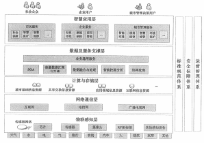

33、在移动互联网的关键技术中, （）是页面展示技术。

A.SOA       B.webService        C.HTML5        D.Android

#### 【解析】移动互联网关键技术：

①架构技术 SOA：面向服务的架构，不涉及底层编程接口和通讯模型，web Service 是目前实现 SOA 的主要技术。

②页面展示技术 web2.0：严格来说不是一种技术，而是互联网思维模式。

③HTML5：在原有 HTML 基础上扩展了 API，使 web 应用成为 RIA，具有高度互动性、丰富用户体验 以及强大的客户端。最大优势可以在网页上直接调试和修改。

④Android：特点入门容易，因为 Android 的中间层多以 Java 实现，指令相对减少、开发相对简

单，而且开发社群活跃，开发资源丰富。

⑥IOs：一个非开源的操作系统⑦windows phone：微软一款手机操作系统

34、大数据存储技术首先需要解决的是数据海量化和快速增长需求，其次是处理格式多样化的数 据。谷歌文件系统（GFs）和 Hadoop 的（）奠定了大数据存储技术的基础。

A.分布式文件系统       B.分布式数据库系统

C.关系型数据库系统    D.非结构化数据分析系统

#### 【解析】p172此题考察的是大数据存储技术选项 A 即为 HDFS。

35、在云计算服务类型中，（） 向用户提供虚拟的操作系统、数据库管理系统、 web 应用等服务。

A.Iaas        B.Daas        C.paas        D.saas

#### 【解析】按照云计算服务提供的资源层次，可以分为  laas、paas 和 saas 等三种服务类型。

（1） laas（基础设施即服务），向用户提供计算机能力、存储空间等基础设施方面的服务。这种 服务模式需要较大的基础设施投入和长期运营管理经验， 但 laas 服务单纯出租资源， 盈利能力有 限。

（2） paas（平台即服务），向用户提供虚拟的操作系统、数据库管理系统、web 应用等平台化的服 务。 paas 服务的重点不在于直接的经济效益，而更注重构建和形成紧密的产业生态。

（3） saas（软件即服务），向用户提供应用软件（如 CRM、办公软件等）、组件、工作流等虚拟化 软件的服务， saas一般采用 web 技术和 sOA 架构， 通过 Internet 向用户提供多租户、可定制的应 用能力，大大缩短了软件产业的渠道链条，减少了软件升级、定制和运行维护的复杂程度，并使 软件提供商从软件产品的生产者转变为应用服务的运营者。

36、在物联网的关键技术中， 射频识别（RFID）是一种（）。

A.信息采集技术    B.无线传输技术    C. 自组织组网技术    D. 中间件技术

#### 【解析】

感知层：负责信息采集和物物之间的信息传输，信息采集的技术包括传感器、条码和二维码、 RFID 射频技术、音视频等多媒体信息。

其次，抛开课本，按基本的常识， RFID 又是无线传输技术

37、智能制造是制造技术发展的必然趋势，从理论上来讲，（）是智能制造的核心

A.制造机器人    B.CPS        C.互联网    D.3D 打印

智能制造（IntelligenTManufacturing， IM）是一种由智能机器和人类专家共同组成的人机  一体化智能系统， 它在制造过程中能进行智能活动， 诸如分析、推理、判断、构思和决策等。

CPS:信息物理系统（CpS,Cyber-physicalSystems）是一个综合计算、网络和物理环境的多维复杂 系统，通过 3C（Computer、Communication、Control）技术的有机融合与深度协作， 实现大型工 程系统的实时感知、动态控制和信息服务。 CpS 实现计算、通信与物理系统的一体化设计，可使系 统更加可靠、高效、实时协同，具有重要而广泛的应用前景。其是智能制造的核心。

工业 4.0 时代的连接-CpS 信息物理系统就是“互联网+制造”系统。德国的学术界是这样理解工业 4.0 的：基于信息物理系统（Cyber-physicalSystem，CpS）的智能化。

38、在无线通信领域， 现在主流应用的是第四代（4G）通信技术， 其理论下载速率可达到（）Mbps （兆比特每秒）。

A.2.6      B.4        C.20        D.100

#### 【解析】2G、3G 和 4G 的主要技术标准及下载速度，见下表：

| 2G | 2G | 3G | 3G | 3G | 4G | 4G | 5G |
|---|---|---|---|---|---|---|---|
| 移动/联通 GSM | 电信 CDMA2000 | 移动 TD-SCDMA | 电信 CDMA2000 | 联通 WCDMA | TD-LTE | FDD-LTE |  |
| 236kb | 153 kb | 2.8Mb | 3.1 Mb | 14.4 Mb | 100 Mb | 150 Mb | 1Gbps |

39、2017 年 7 月 8  日，《国务院关于印发新一代人工智能发展规划的通知》中涉及了人工智能的几 个基础理论， 其中，（） 研究统计学习基础理论、不确定性推理与决策、分布式学习与交互、隐私 保护学习等学习理论和高效模型。

A.大数据智能理论    B.跨媒体感知计算理论   C.高级机器学习理论    D.群体智能理论

#### 【解析】高级机器学习理论研究统计学习基础理论、不确定性推理与决策、分布式学习与交互、隐私保护 学习等学习理论和高效模型。

#### 【试题 40】---中级 2017 下真题 7

40、《中国制造 2025》提出“推进信息化与工业化深度融合”的重点任务，加快推动新一代信息技 术与制造技术融合发展，把（）作为两化深度融合的主攻方向。

A.人工智能    B.智能制造    C.大数据    D.云计算

#### 【解析】推进信息化与工业化深度融合

加快推动新一代信息技术与制造技术融合发展，把智能制造作为两化深度融合的主攻方向；着力 发展智能装备和智能产品， 推进生产过程智能化， 培育新型生产方式， 全面提升企业研发、生产、 管理和服务的智能化水平。

41 、智能挖掘分析是智慧城市建设参考模型（） 中的关键技术。

A.智慧应用层    B.计算与存储层    C.数据及服务支撑层    D.网络通信层

42、在将数据源经过分析挖掘到最终获得价值的大数据处理过程中， MapReduce  是在（）阶段应 用分布式并行处理关键技术的常用工具。

A.数据采集    B.数据管理    C.数据存储    D.数据分析与挖掘

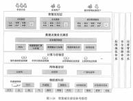

#### 【解析】大数据管理主要使用了分布式并行处理技术，比较常用的有 MapReduce,编程人员借助 MapReduce 可以在不会分布式并行编程的情况下， 将自己的程序运行在分布式系统上。

#### 【试题 43】---中级 2017 下真题 24

43、某公司已有建企业云，近期遇到了网站服务器因带宽限制而突然崩溃的情况。为了避免以上 问题，该公司从某云服务供应商处购买了云服务，经过重新部署可以解决其网站使用量突然猛增 的情况。这种部署方式通常称为（）模式。

A.私有云    B.公有云    C.混合云    D.社区云

#### 【答案】C

#### 【解析】P163此题考察的是云计算，必须掌握，高频考点

从应用范围来看，云计算又可分为公有云、私有云和混合云。公有云通常指第三方提供商用户能 够使使用的云， 公有云一般可通过 Internet 使用， 可能是免费或成本低廉的。私有云是为一个客 户单独使用而构建的，因而提供对数据、安全性和服务质量的最有效控制。该公司拥有基础设施， 并可以控制在此基础设施上部署应用程序的方式。混合云就是将公有、私有两种模式结合起来，  根据需要提供统一服务的模式。

#### 【点评】常考，比较简单，必须得分

#### 【试题 44】---中级 2017 下真题 25

### 44、以下对物联网的描述不正确的是：()

A.物联网即“物物相联之网 ”

B.物联网是一种物理上独立存在的完整网络

C.物联网的“网”应和通讯介质、通信拓扑结构无关

D.物联网从架构上可以分为感知层、网络层和应用层

#### 【答案】B

#### 【解析】P163此题考察的是物联网，必须掌握，高频考点

物联网不是一种物理上独立存在的完整网络，而是架构在现有互联网或下一代公网或专网基础上 的联网应用和通信能力，是具有整合感知识别、传输互联和计算处理等能力的智能型应用。

#### 【点评】常考，比较简单，必须得分

#### 【试题 45】---中级 2017 下真题 26

45、移动互联网是一种通过智能移动终端，采用移动无线通信方式获取业务和服务的新兴业务， 其主流操作系统开发平台不包括：()

A.Android       B.unix        C.ISO       D.windowsphone

#### 【答案】B

#### 【解析】P169此题考察的是操作系统平台，必须掌握，高频考点

移动互联网的关键技术包括架构技术 SOA 页面展示技术 web2.0 和 HTML5 以及主流开发平台 AndroiD.iOS 和 windoWsPhone。

#### 【点评】常考，比较简单，必须得分

#### 【试题 46】---中级 2017 下真题 27

46 、2015 年 5 月 19  日，国务院印发《中国制造 2025》，明确指出将以信息化与工业化深度融合为 主线，重点发展十大领域，其中“新一代信息通信技术产业”主要聚焦在（）类别的产品上。

①集成电路及专用装备

②信息通信设备

③先进轨道交通设备

④操作系统及工业软件

A.①②③    B.②③④    C.①②④    D.①③④

#### 【答案】C

#### 【解析】 此题考察的是新一代通信技术，必须掌握， 高频考点

新一代信息技术分为六个方面，分别是下一代通信网络、物联网、三网融合、新型平板显示、高 性能集成电路和以云计算为代表的高端软件。

新一代信息技术，不只是指信息领域的一些分支技术如集成电路、计算机、无线通信等的纵向升 级，更主要的是指信息技术的整体平台和产业的代际变迁。

③先进轨道交通设备目前大家看看高铁，已经很牛逼了，很明显不是

#### 【点评】常考，比较简单，必须得分

#### 【试题 47】---高级 2017 下真题 5

47、区块链是一种按照时间顺序将数按区块以顺序相连的方式组合成的一种链式数据结构，并以 密码学方式保证的不可复改和不可伪造的分布式账本。主要解决交易的信任和安全问题，最初是 作为（47）的底层技术出现。

A.电子商务    B.证券交易    C.比特币    D.物联网

#### 【答案】C

#### 【解析】第三版教程没有  此题考察的是比特币，必须掌握，高频考点

还记得江山老师上课和大家讲我买比特币的事情麻， 还有勒索病毒！听过的应该很简单，即 使没听过， 此题排除法也能把答案做出来！

2008 年由中本聪第一次提出了区块链的概念， 在随后的几年中， 成为了电子货币比特币的核 心组成部分：作为所有交易的公共账簿。通过利用点对点网络和分布式时间戳服务器，区块链数  据库能够进行自主管理。为比特币而发明的区块链使它成为第一个解决重复消费问题的数字货币。 比特币的设计已经成为其他应用程序的灵感来源

#### 【点评】常考，比较简单，必须得分

#### 【试题 48】---高级 2017 下真题 6

48、人工智能（Artificial Intelligence，筒称 AI），是研究、开发用于模拟、延伸和扩展人的 智能的理论、方法、技术及应用系统的一门新的技术科学。近年在技术上取得了长足的进步，其 主要研究方向不包含（48）

A.人机对奕    B.人脸识别    C.自动驾驶    D.3D 打印

#### 【答案】D

#### 【解析】 此题考察的是人工智能，必须掌握，高频考点

人工智能主要影音是计算机视觉，自然语言处理，数据挖掘。比如大家想想阿尔法狗（选项 A）、 IPHONE X（选项 B）、百度无人车（选项 C），这些都是人工智能的应用， 非常火的， 3D 打印是快速 成型技术的一种，它是一种以数字模型文件为基础， 运用粉末状金属或塑料等可粘合材料，通过 逐层打印的方式来构造物体的技术，是属于打印技术的创新，不属于人工智能，排除法做

#### 【点评】常考，比较简单，必须得分

#### 【试题 49】---高级 2017 下真题 20

49、2015 年国务院发布的《关于积极推进“互联网+”行为的指导意见》提出：到（49）年， 网络 化、智能化、服务化、协同化的“互联网+”产亚生态体系基本芜善，“互联网+”称为经济社会创 新发展的重要驱动力量。

A.2018    B.2020    C.2025    D.2030

#### 【答案】C

#### 【解析】 此题考察的是智能制造 2025，必须掌握，高频考点

实施“中国制造 2025”，促进两化深度融合， 加快从制造大国转向制造强国， 需要电子信息产业有 力支撑， 大力发展新一代信息技术，加快发展智能制造和工业互联网； 制订“互联网+”行动计划， 推动移动互联网、云计算、大数据、物联网等应用， 需要产业密切跟踪信息技术变革趋势，探索 新技术、新模式、新业态，构建以互联网为基础的产业新生态体系。实施国家信息安全战略，需 要尽快突破芯片、整机、操作系统等核心技术，大力加强网络信息安全技术能力体系建设，在信 息对抗中争取主动权。

#### 【点评】常考，比较简单，必须得分， 想想经常说的智能制造 2025，送分的啊

#### 【试题 50】---高级 2017 下真题 21

50、以下关于移动互联网的描述，不正确的是（50）。

A.移动互联网使得用户可以在移动状态下接入和使用互联网服务

B.移动互联网是桌面互联网的复制和移植

C.传感技术能极大地推动移动互联网的成长

D.在移动互联网领域，仍存在測览器竞争及“孤岛”问题

#### 【答案】B

#### 【解析】第三版教程 P67 此题考察的是移动互联网， 必须掌握，高频考点

移动互联网的核心是互联网，因此一般认为移动互联网是桌面互联网的补充和延伸，应用和 内容仍是移动互联网的根本。不是桌面互联网的复制和移植，所以 B 错误；

移动互联在市场领域和应用开发领域形成了一些特点：①重视对传感技术的应用②有效地实 现人与人的连接③测览器竞争及孤岛问题突出。

#### 【点评】常考，比较简单，必须得分

#### 【试题 51】---高级 2018 上真题 1

51、我国在“十三五”规划纲要中指出要加快信息网络新技术开发应用，以拓展新兴产业发展空

间，纲要中提出将培育的新一代信息技术产业创新重点中不包梧()

A.人工智能    B.移动智能终端    C.第四代移动通信    D.先进传感器

#### 【答案】C

#### 【解析】第三版教材 P56此题考察的是新一代信息技术，必须掌握，高频考点

此题很简单，目前 4G 技术已经很普遍了，不应该属于新技术了，国家马上都在大力发展 5G 了， 所以很容易选出： C

我国在“十三五”规划纲要中，将培育人工智能、移动智能终端、第五代移动通信（5G），现金传 感器等作为新一代信息技术产业创新重点发展。在江山老师冲刺里面里面有列出， 大家需要了解 【江山老师点评】常识题，简单，送分的

#### 【试题 52】---高级 2018 上真题 2

52、智能具有感知、记忆、自适应等特点，能擦存储感知到的外部信息及由思维产生的知说，同 时能够利用己有的知识对信息进行分析、计算、比较、判断、联想和决策属于智能的（）能力。

A.感知    B.记忆和思维    C.学习和自适应    D.行为决策

#### 【答案】B

#### 【试题 53】---高级 2018 上真题 4

53、区块链 2.0 技术架构自上而下分力数据层、网络层、共识层、激励层、智能合约层，数据传播 机制、数据验证机制属于其中的()

A.数据层    B. 网络层    C.共识层    D.激励层

#### 【答案】B

#### 【解析】 此题考察的是区块链技术，必须掌握， 高频考点

区块链系统由数据层、网络层、共识层、激励层、合约层和应用层组成。

数据层封装了底层数据区块以及相关的数据加密和时间戳等基础数据和基本算法；

网络层则包括分布式组网机制、数据传播机制和数据验证机制等；

共识层主要封装网络节点的各类共识算法；

激励层将经济因素集成到区块链技术体系中来， 主要包括经济激励的发行机制和分配机制等；

合约层主要封装各类脚本、算法和智能合约，是区块链可编程特性的基础；

应用层则封装了区块链的各种应用场景和案例。

该模型中，基于时间戳的链式区块结构、分布式节点的共识机制、基于共识算力的经济激励和灵 活可编程的智能合约是区块链技术最具代表性的创新点

#### 【江山老师点评】区块链去年考了，今年继续考，平时讲课和考前资料都预测到了，这个点比较 偏，抓关键词传播验证应该是网络层

#### 【试题 54】---高级 2018 上真题 5

54、区块链是（）、点对点传输、共识机制、加密算法等计算机技术的新型应用模式。 A.数据仓库    B. 中心化数据库    C.非链式数据结构    D.分布式数据存储

#### 【答案】D

#### 【解析】 此题考察的是区块链技术，必须掌握， 高频考点

区块链是分布式数据存储、点对点传输、共识机制、加密算法等计算机技术的新型应用模式。所 谓共识机制是区块链系统中实现不同节点之间建立信任、获取权益的数学算法。

江山老师曾经上课和大家讲过区块链， 还和大家讲过 BlocK 7 区块链喷漆和防止虚假交易、银行 应用等例子，B 应该是去中心， 应该是选择 D，如果之前听课或者考前资料认真看的，这个题很简 单

#### 【江山老师点评】区块链去年考了，今年继续考，平时讲课和考前资料都预测到了，想想我平时 讲课的举例应该很简单

#### 【试题 55】---高级 2018 上真题 6

55、某云计算服务商向电信运营商提供计算能力、存储空间及相应的运营管理服务，按照云计算 服务提供的资源层次，该服务类型属于()

A.laas        B.aas        C.paas        D.saas

#### 【答案】A

#### 【解析】 此题考察的是云计算，必须掌握，高频考点

按照云计算服务提供的资源层次，可以分为 Iaas、paas 和 saas 三种服务类型。

—  Iaas（基础设施即服务），向用户提供计算机能力、存储空间等基础设施方面的服务。这种服 务模式需要较大的基础设施投入和长期运营管理经验，但 Iaas 服务单纯出租资源， 盈利能力 有限。

—  paas（平台即服务）， 向用户提供虚拟的操作系统、数据库管理系统、 web 应用等平台化的服 务。 paas 服务的重点不在于直接的经济效益，而更注重构建和形成紧密的产业生态。

—  saas（软件即服务），向用户提供应用软件（如 CRM、办公软件等）、组件、工作流等虚拟化软 件的服务， saas一般采用 web 技术和 sOA 架构， 通过 Internet 向用户提供多租户、可定制的 应用能力， 大大缩短了软件产业的渠道链条，减少了软件升级、定制和运行维护的复杂程度， 并使软件提供商从软件产品的生产者转变为应用服务的运营者。

#### 【江山老师点评】云计算常考点，送分的

#### 【试题 56】---中级 2018 上真题 9

56 、A 公司是一家云服务提供商，向用户提供老租户可定制的办公软件和客户关系管理软件， A 公司所提供的此项云服务属于（） 服务类型。

A.Iaas        B.paas        C.saas        D.Daas

#### 【答案】C

#### 【解析】p92此题考察的是云计算，必须掌握，高频考点

云计算的三个服务模式是 Iaas、paas、saas。

1） Iaas（Infrastructure-as-a-service）：基础设施即服务。消费者通过 Internet 可以从完善 的计算机基础设施获得服务。

2）paas（platform-as-a-service）：平台即服务。paas 实际上是指将软件研发的平台作为一种服 务， 以 saas 的模式提交给用户。因此， paas 也是 saas 模式的一种应用。但是， paas 的出现可以 加快 saas 的发展，尤其是加快 saas 应用的开发速度。

3） saas（softWare-as-a-service）：软件即服务。它是一种通过 Internet 提供软件的模式， 用

户无需购买软件， 而是向提供商租用基于 web 的软件，来管理企业经营活动。相对于传统的软件， saas 解决方案有明显的优势， 包括较低的前期成本， 便于维护， 快速发展使用等。

#### 【点评】以前考过，常考，比较简单， 必须得分

#### 【试题 57】---中级 2018 上真题 22

57、在大数据关键技术中’Hadoop 的分布式文件系统 HDFS 属于大数据（）。

A.存储技术    B.分析技术    C.并行分析技术    D.挖掘技术

#### 【答案】A

#### 【解析】P172此题考察的是大数据关键技术，必须掌握，高频考点

Hadoop 实现了一个分布式文件系统（HadoopDistributedFilesystem），简称 HDFs。HDFs 有高容错  性的特点，并且设计用来部署在低廉的（low-cost）硬件上；而且它提供高吞吐量（highthroughput） 来访问应用程序的数据，适合那些有着超大数据集（largedataset）的应用程序

#### 【点评】以前考过，常考，比较简单， 必须得分

#### 【试题 58】---中级 2018 上真题 23

58、在云计算服务中’“向用户提供虚拟的操作系统”属于（）。

A.Iaas        B.paas        C.Saas        D.Daas

#### 【答案】B

#### 【解析】P162此题考察的是云计算，必须掌握，高频考点

解析同试题 55

#### 【点评】以前考过，常考，比较简单， 必须得分

#### 【试题 59】---中级 2018 上真题 24

59、在物联网的架构中’3G、4G 属于（） 技术。

A. 网络层    B.感知层    C.物理层    D.应用层

#### 【答案】A

#### 【解析】P165此题考察的是物联网层次，必须掌握， 高频考点

这就是最基本的送分题啊。

#### 【点评】书上有个图，没看过理解答题，肯定是网络层了

#### 【试题 56】---中级 2018 上真题 25

25、相对于 web1.0 来说’web2.0 具有多种优势’（）不属于 web2.0 的优势。

A.页面简洁、风格流畅    B.个性化、突出自我品牌

C.用户参与度高          D.更加追求功能性利益

#### 【答案】D

#### 【解析】P170此题考察的是 web2.0，必须掌握，高频考点

更加追求功能性利益是 web1.0 的， web2.0 体验追求情感性利益

#### 【点评】书上的原话，如果没看过理解答题，尽量得分

#### 【试题 60】---中级 2018 上真题 26

60、2017 年 11 月 27 日， 国务院正式印发《关于深化“互联网+先进制造业”发展工业互联网的指 导意见》以下简称“《意见》”）。该《意见》指出:工业互联网通过系统构建网络、平台、（） 三大功 能体系， 打造人、机、物全面互联的新型网络基础设施， 形成智能化发展的新兴业态和应用模式， 是推进制造强国和网络强国建设的重要基础，是全面建成小康社会和建设社会主义现代化强国的 有力支撑。

A.开放    B.融合    C.安全    D.流程

#### 【答案】C

#### 【解析】 此题考察的是互联网+，必须掌握，高频考点

这就是通知原文，没什么好解释的，读下就好。

#### 【点评】书上没，理解答题，尽量得分

#### 【试题 61】---中级 2018 上真题 27

61、2017 年 7 月 8 日，国务院印发《新一代人工智能发展规划》该规划提出了“三步走”的战 略目标。第一步， 到（），人工智能总体技术和应用与世界先进水平同步， 人工智能产业成为 新的重要经济增长点， 人工智能技术应用成为改善民生的新途径，有力支撑进入创新型国家 行列和实现全面建成小康社会的奋斗目标。

A.2018 年   B.2020 年   C.2025 年  D.2030 年

#### 【答案】B

#### 【解析】 此题考察的是人工智能，必须掌握，高频考点

这就是通知原文，没什么好解释的，读下就好。

#### 【点评】书上没，理解答题，尽量得分，此题容易选成 C

#### 【试题 62】---中级 2018 上真题 6

62、（）属于互联网在制造领域的应用范畴。

A.建设智能化工厂和数字化车间

B.加强智能制造工控系统信息安全保障体系

C.开展工业领域的远程诊断管理、全产业链追溯等

D.组织研发具有深度感知的机器人

#### 【答案】C

#### 【解析】 此题考察的是智能制造，必须掌握，高频考点

远程是需要联网的。就是使用互联网操作。本题目的关键点在于互联网。

#### 【点评】理解题，比较简单，必须得分

#### 【试题 63】---中级 2018 下真题 2

63、根据我国“十三五”规划纲要，（） 不属于新一代信息技术产业创新发展的重点。 A.人工智能    B.移动智能终端    C.先进传感器    D.4G

#### 【答案】D

#### 【解析】P13 此题考察的是新一代信息技术，必须掌握，高频考点

我国在“十三五”规划纲要中，将培育人工智能、移动智能终端、第五代移动通信（5G）、先进传 感器等作为新一代信息技术产业创新重点发展， 拓展新兴产业发展空间。

，为 2018 年 11 月高项原题

#### 【试题 64】---中级 2018 下真题 4

64、建设完善电子政务公设以（）为基础的电子政务公共平台顶层设计、制定相关标准规范等内 容。

A.云计算    B.人工智能    C.物联网    D.区块链

#### 【答案】A

#### 【解析】P34 此题考察的是电子政务， 必须掌握，高频考点

建设完善电子政务公共平台①完成以云计算为基础的电子政务公共平台顶层设计。

，以前高级考过的原题

#### 【试题 65】---中级 2018 下真题 8

65、到 2020 年，新一代信息技术与节能环保、生物、高端装备制造产业等将成为国民经济的支柱 产业，新一代信息技术中的（） 可以广泛应用于机器视视网膜识别自动规划、专家系统。

A.人工智能    B. 自动控制    C.地理信息    D.移动计算

#### 【答案】A

#### 【解析】此题考察的是人工智能，必须掌握，高频考点

人工智能实际应用：机器视觉， 指纹识别， 人脸识别， 视网膜识别， 虹膜识别， 掌纹识别， 专家系 统，自动规划，智能搜索，定理证明，博弃，自动程序设计，智能控制，机器人学，语言和图像 理解，遗传编程，无人驾驶等。

#### 【江山老师点评】多次考了，教材没有原话，属于新技术，每年必考的

#### 【试题 66】---中级 2018 下真题 9

66、智慧城市建设参考模型主要包括物联感知层、网络通信层、计算与存储层、数据及服务支撑 层、智慧应用层、（） 不属于物联感知层。

A.RFID 标签    B.SOA    C.摄像头    D.传感器片

#### 【答案】B

#### 【解析】P100-102 图 1-24。此题考察的是物联网， 必须掌握，高频考点

B 答案 SOA 属于数据及服务支撑层，不属于物联感知层。

#### 【试题 67】---中级 2018 下真题 22

### 67、大数据关键技术中, Hbase 主要被应用于()

（22）A.数据采集    B.数据分析    C.数据存储    D.数娘挖掘

#### 【答案】C

#### 【解析】P173 此题考察的是大数据关键技术，必须掌握，高频考点

Hbase 是一个分布式，面向列的开源数据库，它是非结构化数据存储的数据库。

#### 【试题 68】---中级 2018 下真题 23

68、“云”是一个庞大的资源池，可以像自来水、电、煤气那样，根据用户的购买量进行计费，这体 现了“云”的（）特点：

A.高可扩展性   B.通用性   C.按需服务    D.高可靠性

#### 【答案】C

#### 【解析】P160。此题考察的是云计算，必须掌握，高频考点

按需服务:“云”是一个庞大的资源池， 用户按需购买；云可以像自来水、电、煤气那样计费。

#### 【试题 69】---中级 2018 下真题 24

69、物联网架构三层结构中不包括（）。

A.感知层    B.网络层    C.数据层    D.应用层

#### 【答案】C

#### 【解析】P164。此题考察的是物联网，必须掌握，高频考点

物联网从架构上面可以分为感知层、网络层和应用层。

#### 【试题 70】---中级 2018 下真题 25

70、（）不属于移动互联网所使用的主流开发平台。

A.web2.0    B.Android    C.IOS    D.windows phone

#### 【答案】A

#### 【解析】P169。此题考察的是移动互联网，必须掌握，高频考点

移动互联网的关键技术包括架构技术 SOA、页面展示技术 web2.0 和 HTML5 以及主流开发平台 Android,iOS 和 windoWsPhone.web2.0 是页面展示技术，不是开发平台。

#### 【试题 71】---高级 2018 下真题 5

### 71、物联网应用中的两项关键技术是()

A.传感器技术与遥感技术        B.传感器技术与嵌入式技术

C.虚拟计算技术与智能化技术    D.虚拟计算技术与嵌入式技术

#### 【答案】B

#### 【解析】P57 此题考察的是物联网，必须掌握，高频考点

在物联网应用中有两项关键技术，分别是传感器技术和嵌入式技术。

#### 【试题 72】---高级 2018 下真题 6

72、某电商平台根据用户消卷记录分析用户消卷偏好，预测未来消费倾向，这是（）技术的典型 应用。

A.物联网    B. 区块网    C.云计算    D.大数据

#### 【答案】D

#### 【解析】P62 此题考察的是大数据，必须掌握，高频考点

大数据（bigdata），指无法在一定时间范围内用常规软件工具进行捕捉、管理和处理的数据集合， 是需要新处理模式才能具有更强的决策力、洞察发现力和流程优化能力的海量、高增长率和多样 化的信息资产。所以目前大数据的应用已一步步广泛深入我们生活的方方面面， 涵盖电商、社交、 金融、医疗、交通、教育、体育等各行各业。

#### 【试题 73】---高级 2018 下真题 20

73、（） 依托互联网信息技术实现互联网与传统产业的联合， 以优化主产要素、更新业务体系、重 构商业模式等途径来完成经济转型和升级.

A.云计算    B.物联网    C.虎拟化技术    D.互联网+

#### 【答案】D

#### 【解析】此题考察的是新一代信息技术互联网+， 必须掌握，高频考点

“互联网+”就是“互联网+各个传统行业”，但这并不是简单的两者相加，而是利用信息通信技术 以及互联网平台，让互联网与传统行业进行深度融合，创造新的发展生态。此类协同制造公共服 务平台多采用分布式系统

#### 【试题 74】---高级 2019 上真题 1

74 、RFID 射频技术多应用于物联网的（ ）。

A. 网络层    B.感知层    C.应用层    D.传输层

#### 【答案】B

#### 【解析】P57 此题考察的是物联网，必须掌握，高频考点

从技术架构上来看， 物联网可分为三层：感知层、网络层和应用层。

（1） 感知层：由各种传感器构成， 包括温湿度传感器、二维码标签、RFID 标签和读写器、摄像头、 GPS 等感知终端。感知层是物联网识别物体、采集信息的来源

（2） 网络层： 由各种网络， 包括互联网、广电网、网络管理系统和云计算平台等组成， 是整个物 联网的中枢，负责传递和处理感知层获取的信息

（3）应用层：是物联网和用户的接口， 它与行业需求结合，实现物联网的智能应用。 【江山老师点评】很简单，多次考了， 送分的

#### 【试题 75】---高级 2019 上真题 2

75、智慧城市建设参考模型的（ ）利用 SOA（面向服务的体系架构）、云计算、大数据等技术， 承载智慧应用层中的相关应用，提供应用所需的各种服务和共享资源。

A.通信网络层    B.计算与存储层    C.物联感知层    D.数据及服务支撑层

#### 【答案】D

#### 【解析】P58 此题考察的是智慧城市， 必须掌握，高频考点

智慧城市功能层：

①物联感知层：提供对城市环境的智能感知能力，通过各种信息采集设备、各类传感器、监控摄 像机、GPs 终端等实现对城市范围内的基础设施、大气环境、交通、公共安全等方面信息采集、识 别和监测。

②通信网络层： 广泛互联，以互联网、电信网、广播电视网以及传输介质为光纤的城市专用网作为骨 干传输网络，以覆盖全城的无线网络（如 wiFi）、移动 4G 为主要接入网，组成网络通信基础设施。

③计算与存储层：包括软件资源、计算资源和存储资源，为智慧城市提供数据存储和计算，保障 上层对于数据汇聚的相关需求。

④数据及服务支撑层：利用 sOA（面向服务的体系架构）、云计算、大数据等技术， 通过数据和服 务的融合， 支撑承载智慧应用层中的相关应用， 提供应用所需的各种服务和共享资源。

⑤智慧应用层： 各种基于行业或领域的智慧应用及应用整合， 如智慧交通、智慧家政、智慧园区、 智慧社区、智慧政务、智慧旅游、智慧环保等，为社会公众、企业、城市管理者等提供整体的信 息化应用和服务。

#### 【江山老师点评】很简单，多次考了， 送分的

#### 【试题 76】---高级 2019 上真题 5

76、（） 向用户提供办公软件、工作流等服务，使软件提供商从软件产品的生产者转变成服务的运 营者。

A.IAAs        B.PAAs        C.saas        D.Daas

#### 【答案】C

#### 【解析】P60 此题考察的是云计算，必须掌握，高频考点

云计算服务可以分为 Iaas、Paas 和 saas 三种服务类型。

①Iaas（基础设施即服务），向用户提供计算机能力、存储空间等基础设施方面的服务。这种服务模式 需要较大的基础设施投入和长期运营管理经验，但 Iaas 服务单纯出租资源，盈利能力有限。（硬件）

②Paas（平台即服务），向用户提供虚拟的操作系统、数据库管理系统、web 应用等平台化的服务。Paas 服务的重点不在于直接的经济效益， 而更注重构建和形成紧密的产业生态。（个人计算机的操作系统） ③saas（软件即服务），向用户提供应用软件（如 CRM、办公软件等）、组件、工作流等虚拟化软件 的服务， saas一般采用 web 技术和 sOA 架构， 通过 Internet 向用户提供多租户、可定制的应用能 力，大大缩短了软件产业的渠道链条，减少了软件升级、定制和运行维护的复杂程度，并使软件 提供商从软件产品的生产者转变为应用服务的运营者。（租用）

#### 【江山老师点评】很简单，多次考了， 送分的

#### 【试题 77】---高级 2019 上真题 6

77、区块进的特征不包括（）。

A. 中心化    B.开放性    C.信息不可篡改    D.匿名性

#### 【答案】A

#### 【解析】此题考察的是区块链，必须掌握，高频考点

区块链的特征： 去中心化、开放性、自治性、信息不可篡改、匿名性

#### 【江山老师点评】很简单，多次考了， 送分的

#### 【试题 77】---高级 2019 上真题 6

77、区块进的特征不包括（）。

A. 中心化    B.开放性    C.信息不可篡改    D.匿名性

#### 【答案】A

#### 【解析】此题考察的是区块链，必须掌握，高频考点

区块链的特征： 去中心化、开放性、自治性、信息不可篡改、匿名性

#### 【江山老师点评】很简单，多次考了， 送分的

#### 【试题 78】---高级 2019 上真题 20

78、（）不属于“互联网+ ”的应用。

A.滴滴打车    B.AIphaGo        C.百度外卖    D.共享单车

#### 【答案】B

#### 【解析】P 此题考察的是互联网+，必须掌握， 高频考点

“互联网+工业”即传统制造业企业采用移动互联网、云计算、大数据、物联网等信息通信技术, 改造原有产品及研发生产方式，AlphaGo 是人工智能的应用。滴滴打车和共享单车是互联网+出行， 百度外卖是物联网+餐饮。“互联网+”指互联网加各个传统行业。

#### 【江山老师点评】很简单，多次考了， 送分的

#### 【试题 79】---高级 2019 上真题 21

79、基于买方的购买历史及行为分析， 进行针对性的广告推送， 属于（） 的典型应用。 A.大数据    B.云计算    C.物联网    D.智慧城市

#### 【答案】A

#### 【解析】P62 此题考察的是大数据，必须掌握，高频考点

大数据（bigdata），指无法在一定时间范围内用常规软件工具进行捕捉、管理和处理的数据集合， 是需要新处理模式才能具有更强的决策力、洞察发现力和流程优化能力的海量、高增长率和多样 化的信息资产。基于买方的购买历史及行为分析，进行针对性的广告推送是大数据的应用。

#### 【江山老师点评】很简单，多次考了， 送分的

#### 【试题 80】---中级 2019 上真题 6

80、《中国制造 2025》在战略任务和重点中提出“推进信息化与工业化深度融合”，其中（） 的工 作内容包括在重点领城试点建说智能工厂数字化车间，加快人机智能交互、工业机器人，智能物 流管理等技术和装备在生产过程中的应用，促进制造工艺的仿真优化、数字化控制、状态信息实 时监测和自适应控制。

A.推进制造过程智能化

B.建立完善智能制造和两化融合管理标准体系

C.加强互联网基础设施建设

D.深化互联网在制造领域的应用

#### 【答案】A

#### 【解析】P42 此题考察的是智能制造， 必须掌握，高频考点

推进制造过程智能化。在重点领域试点建设智能工厂/数字化车间，加快人机智能交互、工业机器 人、智能物流管理、增材制造等技术和装备在生产过程中的应用，促进制造工艺的仿真优化、数 字化控制、状态信息实时监测和自适应控制。加快产品全生命周期管理、客户关系管理、供应链 管理系统的推广应用，促进集团管控、设计与制造、产供销一体、业务和财务衔接等关键环节集 成， 实现智能管控。加快民用爆炸物品、危险化学品、食品、 印染、稀土、农药等重点行业智能 检测监管体系建设， 提高智能化水平。

#### 【江山老师点评】考的比较偏，但是智能化是多次强调的，必须得分

#### 【试题 81】---中级 2019 上真题 9

81、（）向用户提供虚拟的操作系统、数据库管理系等服务，满是户个性化的应用部署需求。 A.saas        B.paas        C.laas        D.Daas

#### 【答案】B

#### 【解析】P92 此题考察的是云计算，必须掌握，高频考点

虚拟的操作系统、数据库管理系统等服务即为 Paas（平台即服务）。

#### 【试题 83】---中级 2019 上真题 23

83、云计算通过网络提供可动态伸缩的廉价计算能力（）不属于云计算的特点。 A.虚拟化    B.高可扩展性    C.按需服务    D.优化本地存储

#### 【答案】D

#### 【解析】P160 此题考察的是云计算，必须掌握，高频考点

云计算是指基于互联网的超级计算模式，通过互联网来提供大型计算能力和动态易扩展的虚拟化 资源。优化本地存储不是云计算的特点。

#### 【试题 84】---中级 2019 上真题 24

84 、RFID 射频技术多应用于物联网的（）。

A.感知层    B. 网络层    C.应用层    D.传输层

#### 【答案】A

#### 【解析】P164 此题考察的是物联网，必须掌握，高频考点

射频识别， RFID （Radio Frequency Identification）技术，又称无线射频识别， 是一种通信技 术， 可通过无线电讯号识别特定目标并读写相关数据，而无需识别系统与特定目标之间 建立机械 或光学接触。RFID 具有远距离读取、高存储容量、成本高、可同时被读取、难复制、可工作于各 种恶劣环境等特点。相比之下，条形码具有容量小、成本低、容易被复制、构造简单、灵活实用 等特点。应用于感知层。

#### 【试题 85】---中级 2019 上真题 25

85、关于移动互联网关键技术的描述正确的是（）。

A.web2.0 保留了 web1.0 用户体验的低参与度、被动接受的特征

B.HTM4 支持地理位置定位，更适合移动应用开发

C.Android 是种基于 Linux 的自由及开放源代码的操作系统主要应用于移动设备 D.ios 是一个开源操作系统，支持的应用开发语言包括    C.C#等

#### 【答案】C

#### 【解析】P170-171 此题考察的是移动互联网，必须掌握，高频考点

web2.0 是高参与度、互动接受，A 错误。

HTML5 支持地理位置定位，更适合移动用开发， 不是 HTML4，B 错误。

C 正确。

ios 是一个封闭的操作系统，D 错误。

#### 【试题 86】---中级 2019 上真题 26

86 、2015  年国务院发布了《关于积极推进“互联网+ ”行动的指导意见》其总体思路是顺应世界 “互联网+ ”发展趋势，充分发挥我国互联网的规模优势和应用优势，推动互联网由（）拓展加速 提升产业发展水平， 增强各行业创新能力构筑经济社会发展新优势和新动能。

A.实体经济向虚拟经济    B.第二产业向第三产业

C.线上领域向线下领域    D.消费领域向生产领域

#### 【答案】D

#### 【解析】P98 此题考察的是互联网+，必须掌握，高频考点

顺应世界“互联网+”发展趋势，充分发挥我国互联网的规模优势和应用优势， 推动互联网由消费 领域向生产领域拓展，加速提升产业发展水平，增强各行业创新能力，构筑经济社会发展新优势 和新动能。

#### 【江山老师点评】考的比较偏，了解即可

#### 【试题 87】---中级 2019 上真题 27

87、（）属于人工智能应用领域。

①自动驾驶②智能搜索引擎③人脸识别④3D 打印

A.①②④    B.①③④    C.②③④    D.①②③

#### 【答案】D

#### 【解析】此题考察的是人工智能，必须掌握，高频考点

3D 打印不是人工智能的应用， 只是一种新的制造方式。

#### 【试题 88】---高级 2019 下真题 4

88 、2013 年， 习近平主席在（） 发表《电扬人民友谊共创美好未来》的重要演讲， 首次提出“一 带一路”构想。

A.土耳其    B.哈萨克斯坦    C. 印度尼西亚    D.德国

#### 【答案】B

#### 【解析】此题考察的是一带一路，了解，很少考;

2013 年 9 月 7 日，国家主席习近平在哈萨克斯坦纳扎尔巴恥夫大学发表题为《私扬人民友谊 共创 美好未来》的重要演讲。推进“丝绸之路经济带”和“21 世纪海上丝绸之路”建设， 是中国国家 主席习近平统筹国内国际两个大局。

#### 【江山老师点评】书本没有的内容，我们之前资料有涉及到过，了解即可

#### 【试题 89】---高级 2019 下真题 5

89、智能音箱是（） 的典型应用。

A.人工智能    B.数据库    C.两化融合    D.区块链

#### 【答案】A

#### 【解析】此题考察的是人工智能，必须掌握，高频考点;

人工智能（Artificial Intelligence），英文缩写为 A I。它是研究、开发用于模拟、延伸和扩展 人的智能的理论、方法、技术及应用系统的一门新的技术科学。

人工智能是计算机科学的一个分支，它企图了解智能的实质，并生产出一种新的能以人类智能相 似的方式做出反应的智能机器，该领域的研究包括机器人、语言识别、图像识别、自然语言处理 和专家系统等。

#### 【江山老师点评】很简单，多次考了， 送分的

#### 【试题 90】---高级 2019 下真题 6

90、2019 年 8 月，华为正式发布自有操作系统—（），可用于支付、人脸识别、指纹等高安全级别 场景。

A.鲤鹏    B.獻鱗    C.异腾    D.鸿蒙

#### 【答案】D

#### 【解析】此题考察的是操作系统，了解，很少考;

广东东竞举行的华为 2019 年开发者大会上，华为正式发布全新分布式操作系统： 鸿蒙！

华为发布鋸鹏芯片，是芯片不是操作系统，容易做错，不过这个题只要是中国人都应该选对，除 非你不上网，不关注国家大事的，哈哈！

#### 【江山老师点评】书本没有的内容，但是只要是爱国的中国人都知道，都能做对

#### 【试题 91】---高级 2019 下真题 14

91、（）不属于“互联网+ ”的特征

A.创新驱动    B.资源驱动    C.跨界融合    D.重塑结构

#### 【答案】B

#### 【解析】此题考察的是互联网+，必须掌握，高频考点;

互联网+有六大特征： 一是跨界融合、二是创新驱动、三是重塑结构、四是尊重人性、五是开放生 态、六是连接一切。

#### 【江山老师点评】常识性的题，书本没有，讲课有补充过

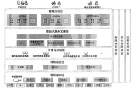

#### 【试题 92】---中级 2019 下真题 4

92、在重点领域试点建设智能工厂、数字化车间、加快人工智能交互、工业机器人、智能物能管 理等技术在生产过程中的应用。属于制造工程()

A.信息化    B.智能化    C.标准化    D.工业化

#### 【答案】B

#### 【解析】P42 此题考察的是智能化，必须掌握，高频考点；

在重点领域试点建设智能工厂、数字化车间，加快人工智能交互、工业机器人、智能物能管理等 技术在生产过程中的应用属于制造过程智能化的内容。

#### 【江山老师点评】有智能这个关键词， 对应下，简单题，必须得分

#### 【试题 93】---中级 2019 下真题 7

93、大数据具有的特点包括大量（volume）、高速（velocity）、（）。

①可验证性（verifiable）②真实性（velocity）③多样（vahcty）④价值（value） A.①③④    B.②③④    C.①②④    D.①②③

#### 【答案】B

#### 【解析】P84 此题考察的是大数据，必须掌握，高频考点；

最基本的送分题了， 大数据的 5V 分别是大量、高速、多样、价值、真实性。

#### 【试题 94】---中级 2019 下真题 8

94、智慧城市建设参考模型包括物联感知层、通信网络层、计算与存储层、数据及服务支撑层、 智慧应用层。智慧医疗属于（）。

A.物联感知层    B.通信网络    C.数据及服务支撑层    D.智慧应用层

#### 【答案】D

#### 【解析】P100 此题考察的是智慧城市，必须掌握，高频考点；

送分的，当然是应用了。其余 4 层的功能是什么，也需要知道。

#### 【试题 95】---中级 2019 下真题 21

95、用户无需购买软件，而是租用基于 web 的软件来管理企业经营活动， 这种模式属于（）。

A.基础设施即服务IAAS       B.平台即服务paas        C.软件即服务Saas        D.数据即服务Daas

#### 【答案】C

#### 【解析】P162 此题考察的是云计算，必须掌握，高频考点；

考了无数次了，基于 Web 的软件是典型的 saas（软件即服务）。 Iaas、Paas、saas 要会区分。

#### 【试题 96】---中级 2019 下真题 22

96、作为物联网架构的基础层面，感知层的技术主要包括:产品和传感器自动识别技术，（）和中间件。 A.无线传输技术、自组织组网技术    B.无线传输技、编码技术

C.编码技术、自组织组网技术       D.解析技术，自组织组网技术

#### 【答案】A

#### 【解析】P165 此题考察的是物联网，必须掌握，高频考点；

感知层作为物联网架构的基础层面，主要是达到信息采集共将采集到的数据上传的目的，感知层 的技术主要包括；产品和传感器（条码、 RFID、传感器等）自动识别技术，无线传输技术（WLAN、 Bluetooth，zigBee、UWB）自组织组网技术和中间件技术。

#### 【试题 97】---中级 2019 下真题 23

97、在大数据相关技术中，（） 是个分布的、面向列的开源数据库， 是一个适合于非结构化数据存 储的数据库。

A.HBase        B.Map Reduce        C.Chukwa        D.HDFS

#### 【答案】A

#### 【解析】P173 此题考察的是大数据，必须掌握，高频考点；

HBase 是一个分布式的、面向列的开源数据库，HBase 不同于一般的关系数据库， 它是一个适合于 非结构化数据存储的数据库。另一个不同的是 HBase 基于列的而不是基于行的模式。

## 第九章、信息系统项目管理

一、项目管理一般知识

考点分析与预测： 根据历年考题分析和相关辅导经验， 项目管理一般知识章节一般考察 3 分 左右， 下午案例分析在此部分一般不考，此部分命题几率不大，可能考查的知识点为：  项目特点、 项目组织结构及其优缺点、信息系统生命周期模型、阶段（过程交互）、评审， 希望大家予以重视。

根据下表历年考点分布情况，希望大家掌握如下高频考点：

本章金色考点汇总：

1、项目（了解） 是为达到特定的目的、使用一定的资源、在确定的期间内、为特定发起人而 提供独特的产品、服务或成果而进行的一次性努力。项目目标包括成果性目标 （满足客户要  求的产品、系统、服务或者成功）和约束性目标（时间、成本、质量）。（09 上 20）（17 上 27） 项目的约束性目标也叫管理性目标，项目的成果性目标有时也简称为项目目标。项目成果性

目标指通过项目开发出的满足客户要求的产品、系统、服务或成果，例如：（19 下 24）

（1）建设一个视频监控系统是一个项目，建成后的视频监控系统就是该项目的产品。

（2）建设一个办公大楼也是一个项目或者说工程， 建成后的办公大楼就是该项目的产品。

（3）开发一个网上书店也是一个项目， 完成后的网上书店就是该项目的产品。

（4） 一个 ERP 系统的实施也是一个项目，完成后的 ERP 系统就是该项目的产品。

（5） 组织一次旅游也是一个项目，订票、订旅馆、解说以及其他让旅游者身心愉悦的工作均 为这个项目提供的服务。

2、项目的目标特性： 1）项目的目标有不同的优先级 2）项目目标有层次性（17 下 28）

3、项目特点（掌握）：临时性（有明确的起始和结束时间）、独特性（独有的）、渐进明细（逐

步完成的）（14 下 29）（16 下 27）（17 上 26）（18 上 28）（18 下 26）（19 上 28）

（1）临时性：每一个项目都有一个明确的开始时间和结束时间，指项目是一次性的。

（2）独特性：项目要提供某一独特产品，提供独特的服务或成果，没有完全一样的项目

（3）渐进明细指项目的成果性目标是逐步完成的。因为项目的产品、成果或服务事先不可见， 在项目前期只能粗略地进行项目定义，随着项目的进行才能逐渐明朗、完善和精确。这意味着在 项目逐渐明细的过程中一定会有修改， 产生相应的变更。

4、信息系统集成项目有以下几个显著特点（需要掌握）：（14 下 27）（15 下 29）

（1）信息系统集成项目要以满足                为根本出发点。

（2）客户和用户的需求常常不够明确、复杂多变， 由此应加强需求变更管理以控制风险。

（3）系统集成不是选择最好的产品的简单行为， 而是要选择最适合用户的需求和投资规模的 产品和技术。

（4）高技术与高技术的集成。系统集成不是简单的设备供货， 系统集成是高技术的集成，它 体现更多的是设计、调试与开发，是高技术行为。

（5）系统工程。系统集成包含技术，管理和商务等方面，是一项综合性的系统工程。

（6）项目团队年轻， 流动率高。

（7）强调沟通的重要性。

### 5、项目管理与运作管理、战略管理的区别与联系 ：

|  | 项目 | 运营 |
|---|---|---|
| 相同点 | 都需要由人完成、受制于资源、需要计划执行与控制 | 都需要由人完成、受制于资源、需要计划执行与控制 |
| 不同点 | 临时性与独特性、目标是达到项目目标 | 连续性和重复性、目标是维持已有业务 |

6、软技能： 有效沟通、施加影响、领导、激励、谈判与冲突处理、解决问题

7、对项目经理的一般要求 （1）足够的知识（2）丰富的项目管理经验（3）良好的协调和沟

通能力（4）良好的职业道德（5） —定的领导和管理能力（19 下 25）

怎样当好一个优秀的项目经理（1）真正理解项目经理的角色（2）领导并管理项目团队

（3）依据项目进展的阶段， 组织制订详细程度适宜的项目计划， 监控计划的执行， 根据实际 情况、客户要求或其他变更要求对计划的变更进行管理。

（4）真正理解“一把手工程”（5）注重客户和用户参与

项目经理应具备广博的知识、丰富的经验、良好的沟通技巧、协调能力、职业道德及学习通 用管理、领导能力等， 但是项目经理不可能具有所有的知识和技能，比如， IT 的项目经理没必要 对建筑行业很精通， 只要了解即可。（15 上 29）

在沟通和管理中，项目经理处于项目中的核心位置， 必须具有管理和领导能力，因此， 项目 经理必须具有丰富的项目管理相关知识和宽广的技术知识，而不需要掌握所有技术细节，这也不 可能；同时，项目组成员不需要精通项目管理知识，只要在项目经理领导下工作， 做好相关专业 技术活动。

### 8、项目干系人：

①项目干系人指那些积极参与项目， 或是其利益会受到项目执行的影响或项目结果影响的个 人和组织， 他们也可能对项目及结果施加影响。

②项目干系人包括：客户和用户； 项目经理；执行组织；项目团队成员；项目发起人；职能 经理；影响者；项目管理办公室（PMO）。

③项目经理必须管理项目干系人的期望，因为项目干系人经常会有相互不同甚至是冲突的目 标。通常，解决项目干系人之间不同意见应该以使客户满意为主， 但不要忽略其他项目干系人的 要求和期望，应找到对分歧的恰当解决方案，是项目经理的主要挑战。

9、事业环境因素---在项目启动时， 必须考虑涉及并影响项目成功的环境、组织的因素和系统 ①实施单位的企业文化和组织机构；②国家标准或行业标准；③现有的设施和固定资产等；

④实施单位现有的人力资源、人员的专业和技能，人力资源政策如招聘和解聘的指导方针、员工

绩效评估和培训记录等；⑤当时的市场状况；⑥项目干系人对风险的承受力；⑦行业数据库；⑧ 项目管理信息系统（可能是工具，也可能是软件，总之能帮助人们管理项目）。（09 上 62）【注意

和组织过程资产的区分，也叫企业环境因素，是项目经理不可控的，不可裁剪的。 一般来源于组

组织过程资产包含： 【我们需要经常更新组织过程资产， 是项目经理可控的， 可以裁剪的， 一

般来源于内部】

（1）过程和程序： ①组织的标准过程；②标准指导方针、模板、工作指南；③用于满足项目特 定需要的标准过程的修正指南；④组织的沟通要求，汇报制度；⑤项目收尾指南或要求；⑥财务控制 程序；⑦问题和缺陷管理程序；⑧变更控制程序； ⑨风险控制程序；⑩批准与发布工作授权程序；

（2）组织的全部知识：①项目档案； ②过程测量数据库； ③经验学习系统；④问题和缺陷管

理数据库  ；⑤配置管理知识库；⑥财务数据库。（09 上 62）--具体内容看教材，很多领域涉及    10、 组织的沟通 能力对项目的执行方式有很大的影响。（16 下 28）

11、项目的组织结构（09 上 18）（09 下 31）（11 上 52）（17 上 28）（17 下 29）（18 上 29）（18 下 27）（19 上 29）

|  | 简单介绍 | 优点 | 缺点 |
|---|---|---|---|
| 职 能 型 | 项目经理来无权无资源， 所有项目人员 还在属部门里面供职， 仅仅花费小部分 的时间来处理项目的事情。还有相应的 职能经理， 这样的双重管理， 对于项目 来说是最可怕的了。当然好处也是有 的， 就公司来说。为这个项目消耗的资 源不是很多。 个人来说，还在自己的萝 	卜坑里面。 | 1、可以充分发挥职能部门的 资源集中优势 2、部门的专家可以同时为部 门内不同项目使用 3、便于相互交流， 相互支援, 可以随时增派人员 4、可以将项目和本部门的职 能工作融为一体 | 1、项目和部门利益发生冲突， 职能 部门更重视本部门的目标,会忽视项 目目标 2、资源平衡会出现问题 3、权利分割不利于各个职能部门的 交流和团结协作 4、行政隶属关系使得项目经理没有 充分的权利 |
| 项 目 型 | 将所有的能兵强将集结在一起，财务 部、业务部、IT 管理部等的精英们脱离 原有的岗位， 形成一个正式的部门， 并 由项目经理领导。这样的优势是项目经 理的权利很强、资源充足。对公司而言， 单独团队对公司整体资源的浪费； 对被 抽调的个人而言，脱离了原有的岗位。	 待项目结束之后，精英们将无家可归。 | 1、项目经理对项目可以负全责 2、项目目标单一，可以以项 目为中心, 有利于项目顺利 进行 3、避免多重领很导 4、组织结构简单， 交流简单, 快速 | 1、资源不能共享 2、各个独立的项目处于相对封闭状 态,不利于公司政策的贯彻 3、对项目组织的成员缺少一种事业 上的连续性和安全感 4、项目组织之间处于分割状态,缺少 信息交流 |
| 矩 阵 型 | 兼具项目型和矩阵型的特点； 分为弱矩阵，平衡矩阵， 强矩阵： 项目经理>职能经理=强矩阵 项目经理=职能经理=平衡矩阵 项目经理<职能经理=弱矩阵 | 1、专职的项目经理负责整个 项目 ,  以项目为中心, 2、公司的多个项目可以共享 各个职能部门的资源 3、即利于项目目标的实现, 又利于公司目标方针的贯彻 4、项目成员的顾虑减少了 | 1、容易引起职能经理和项目经理权 力的冲突 2、资源共享也能引起项目之间的冲 突 3、项目成员有多头领导 |
| 项目型项目经理权利最大，其次是矩阵型，职能型项目经理权利最小；项目型一般用于规模大、技术复杂的项目； 职能型适用于规模较小，侧重于技术的项目； 矩阵型适用于规模巨大， 分工明确，跨职能部分的项目； | 项目型项目经理权利最大，其次是矩阵型，职能型项目经理权利最小；项目型一般用于规模大、技术复杂的项目； 职能型适用于规模较小，侧重于技术的项目； 矩阵型适用于规模巨大， 分工明确，跨职能部分的项目； | 项目型项目经理权利最大，其次是矩阵型，职能型项目经理权利最小；项目型一般用于规模大、技术复杂的项目； 职能型适用于规模较小，侧重于技术的项目； 矩阵型适用于规模巨大， 分工明确，跨职能部分的项目； | 项目型项目经理权利最大，其次是矩阵型，职能型项目经理权利最小；项目型一般用于规模大、技术复杂的项目； 职能型适用于规模较小，侧重于技术的项目； 矩阵型适用于规模巨大， 分工明确，跨职能部分的项目； |

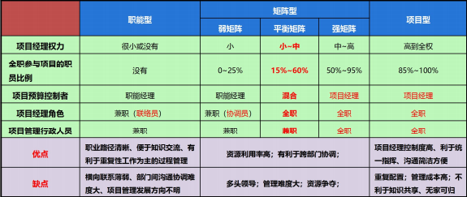

12、项目管理办公室（PMO）

以下列出 PMO 的一些关键特征，但不限于此：（19 下 25）

（4）为所有项目进行集中的配置管理。

（5）对所有项目的集中的共同风险和独特风险存储库加以管理。

（6）项目工具（如企业级项目管理软件）的实施和管理中心。

（7）项目之间的沟通管理协调中心。

（8）对项目经理进行指导的平台。

（9）通常在企业级对所有 PMO 管理的项目的时间基线和预算进行集中盟控。

（10）在项且经理和任何内部或外部的质量人员或标准化组织之间协调整体项目的质量标准。 PMO 有支持型、控制型和指令型等3种。

项目管理和 PMO 的区别如下：

1）项目经理和 PMO 追求不同的目标，同样，受不同的需求所驱使。所有工作都必须在组织 战略要求下进行调整。

2）项目经理负责在项目约束条件下完成特定的项目成果性目标，而 PMO 是具有特殊授权的 组织机构， 其工作目标包含组织级的观点。

3）项目经理关注于特定的项目目标，而 PMO 管理重要的大型项目范围的变化，以更好地达 到经营目标。

4）项目经理控制赋予项目的资源以最好地实现项目目标，而 PMO 对所有项目之间的共享组 织资源进行优化使用。

5）项目经理管理中间产品的范围、进度、费用和质量，而 PMO 管理整体的风险、整体的机 会和所有的项目依赖关系。

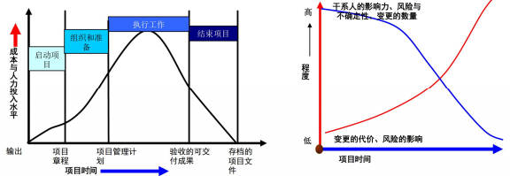

13、项目生命周期的特征（了解）（11 上 54）（14 上 64）

1）项目阶段一般按顺序首尾相接；

2）人力投入和费用， 开始时低，随之增高，在项目结尾时迅速降低；

3）项目成功可能性随项目执行逐渐上升，风险和不确定性逐渐下降；

4）项目干系人对项目的影响力对项目执行逐渐下降；

14、项目阶段的特征（掌握）

1）每个项目阶段都以一个或数个可交付成果的完成为标志；

2）可交付成果是某种有形的、可验证的工作成果；

3）一些可交付成果对应着项目管理过程，另一些可能是最终产品的一部分；

4）项目阶段的结束通常以对完成的工作和可交付成果的技术和设计评审为标志，目的是 确定是否验收、是否仍然需要增加工作，或者是否考虑结束这一阶段；

5）阶段末可进行一次审查，目的是取得对结束当前阶段并启动下一阶段的核准。阶段末 审查也称为阶段放行口、阶段关卡或验收站

无大多数项目生命周期定义的阶段顺序通常从技术上可以分为需求分析，系统设计，系统构 建，系统运行四个阶段，按管理活动出现的先后，把项目的生命周期划分为启动、计划、执 行和收尾四个典型阶段，在条件许可或涉及的风险可接受时，下一阶段可以在前一阶段结束 前开始。俗话说， 三分技术 7 分管理， 任何项目的阶段中都包含管理工作和技术工作，只是 根据项目性质、规模、大小、管理和技术所占比重进行权衡分配。

 论按技术工作还是接管理工作出现的先后来划分项目的阶段，项目的每个阶段部至少包含管

理工作和技术工作。（15 上 28）

 15、项目生命周期与产品生命周期的关系（需要掌握）

|  | 项目 | 产品 |
|---|---|---|
| 不同点 | 概念/启动、开发/计划、实施/执行、结束/收尾 | 介绍、增长、成熟、衰退 |
| 相同点 | 一般产品生生命周期包含项目生命周期 | 一般产品生生命周期包含项目生命周期 |

产品的生命周期更长，产品的生命周期包含项目的生命周期；

16、典型的信息系统项目的生命期模型（重点掌握）（09 下 6）（09 下 11）

| 模型 | 描述 | 描述 | 优点 | 缺点 | 缺点 | 适用场合 |
|---|---|---|---|---|---|---|
| 瀑布模型 | 每个软件过程顺序衔接、一次性通 过,最常用。 | 每个软件过程顺序衔接、一次性通 过,最常用。 | 由文档和风险驱动, 利于提高大型项目开 发的质量和效率。 | 建设周期长、风 险大、难以满足 用户需求。 | 建设周期长、风 险大、难以满足 用户需求。 | 需求明确且很少变更的 项目,如二次开发或升级 型项目。（18 上 30） |
| 螺旋模型 | 演化软件过程模型，将  原型 实现的选代特征与线性顺序 	（瀑布） 模型  中控制的和系 统化的方面结合起来 （16 上 28） | 演化软件过程模型，将  原型 实现的选代特征与线性顺序 	（瀑布） 模型  中控制的和系 统化的方面结合起来 （16 上 28） | 由 文档和 风险驱 动,利于提高大型 项目开发的质量和 效率。 | 建设周期长、风 险大、难以满足 用户需求。 | 建设周期长、风 险大、难以满足 用户需求。 | 需求经常变化的大型复 杂系统。 分为 4 个阶段： 制定计 划、风险分析、实施工程 和客户评估。（16 上 29） |
| 增量模型 | 采用随时间进展而交错的线性序 列、 每个序列产生一个可发布的 增量、每个增量产生一个可操作 的产品、第一个增量是核心产品。 | 采用随时间进展而交错的线性序 列、 每个序列产生一个可发布的 增量、每个增量产生一个可操作 的产品、第一个增量是核心产品。 | 开始时不用投入大量 人力资源、可以先推 出核心产品以稳定用 户、可以有计划的管 理技术风险。 |  |  | 需求经常发生改变的软 件开发过程。 |
| 快速原型 模型 | 快速构建可运行的软件模型,以便 理解和澄清问题,进一步细化需 求,在新获取需求基础上进行系统 开发。 | 快速构建可运行的软件模型,以便 理解和澄清问题,进一步细化需 求,在新获取需求基础上进行系统 开发。 |  | 快速建立的模 型加上连续的 修改可能造成 产品质量低下。 | 快速建立的模 型加上连续的 修改可能造成 产品质量低下。 |  |
| 选代模型 | 一次选代过程包括了所有软件开发流程、每一次选代均产生一个可发布的 产品、该产品为最终产品的一个子集。 RUP的每个阶段里面都要执行核心过程工作流的“商业建模”、 “需求”、“分析和设计”、“实现”、“测试”、“部署”。根据需求， 在一个阶段内部， 可以完成一次到多次的选代。（17 上 29、30） | 一次选代过程包括了所有软件开发流程、每一次选代均产生一个可发布的 产品、该产品为最终产品的一个子集。 RUP的每个阶段里面都要执行核心过程工作流的“商业建模”、 “需求”、“分析和设计”、“实现”、“测试”、“部署”。根据需求， 在一个阶段内部， 可以完成一次到多次的选代。（17 上 29、30） | 一次选代过程包括了所有软件开发流程、每一次选代均产生一个可发布的 产品、该产品为最终产品的一个子集。 RUP的每个阶段里面都要执行核心过程工作流的“商业建模”、 “需求”、“分析和设计”、“实现”、“测试”、“部署”。根据需求， 在一个阶段内部， 可以完成一次到多次的选代。（17 上 29、30） | 一次选代过程包括了所有软件开发流程、每一次选代均产生一个可发布的 产品、该产品为最终产品的一个子集。 RUP的每个阶段里面都要执行核心过程工作流的“商业建模”、 “需求”、“分析和设计”、“实现”、“测试”、“部署”。根据需求， 在一个阶段内部， 可以完成一次到多次的选代。（17 上 29、30） | 一次选代过程包括了所有软件开发流程、每一次选代均产生一个可发布的 产品、该产品为最终产品的一个子集。 RUP的每个阶段里面都要执行核心过程工作流的“商业建模”、 “需求”、“分析和设计”、“实现”、“测试”、“部署”。根据需求， 在一个阶段内部， 可以完成一次到多次的选代。（17 上 29、30） | （19 上 30） |
| V 模型 |  |  |  |  |  |  |
| V 模型 | 试。（17 上 30、31）（18 下 28） | 试。（17 上 30、31）（18 下 28） | 试。（17 上 30、31）（18 下 28） | 试。（17 上 30、31）（18 下 28） | 试。（17 上 30、31）（18 下 28） | 试。（17 上 30、31）（18 下 28） |
| 敏捷方法（极 限编程： XP） | 敏捷方法（极 限编程： XP） |  |  |  |  |  |
| 统一过程 |  |  |  |  |  |  |

1、瀑布模型是一个经典的软件生命周期模型,一般将软件开发分为： 可行性分析（计划）、 需求分析、软件设计（概要设计、详细设计）、编码（含单元测试）、测试、运行维护等几个阶段

2、瀑布模型中每项开发活动具有以下特点。 （掌握）
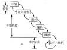

①从上一项开发活动接受该项活动的工作对象作为输入。

②利用这一输入,实施该项活动应完成的工作内容。

③给出该项活动的工作成果,作为输出传给下一项开发活动。

④对该项活动的实施工作成果进行评审。

3、螺旋模型是一个演化软件过程模型,将原型实现的选代特征与线性顺序（瀑布）模型中控 制的和系统化的方面结合起来。使得软件的增量版本的快速开发成为可能。在螺旋模型中,软件

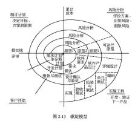
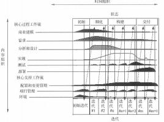

开发是一系列的增量发布。在早期的选代中，发布的增量可能是一个纸上的模型或原型；在以后 的选代中，被开发系统的更加完善的版本逐步产生； 四阶段：制订计划、风险分析、实施工程和 客户评估。螺旋模型强调了风险分析，特别适用于庞大而复杂的、高风险的系统。 （掌握）

4、选代式开发模型水平方向为时间维，分四个阶段： 初始、细化、构造、移交，核心工作流 从技术角度描述选代模型的静态组成部分，包括：业务建模、需求获取、分析与设计、实现、测 试、部署。图中的阴影部分描述了不同的工作流， 在不同的时间段内工作量的不同，几乎所有的 工作流在所有的时间段内均有工作量，只是大小不同而已。各阶段的主要任务如下。 （掌握）

①初始阶段：系统地阐述项目的范围，选择可行的系统构架，计划和准备业务案例。

②细化阶段：细化构想，细化过程和基础设施，细化构架并选择构件。

③构造阶段：资源管理、控制和过程最优化，完成构件的开发并依评价标准进行测试，依构 想的验收标准评估产品的发布。

④移交阶段： 同步并使并发的构造增量集成到一致的实施基线中， 与实施有关的工程活动（商 业包装和生产、人员培训等），根据完整的构想和需求集的验收标准评估实施基线。

5、V 模型从整体上看起来， 就是一个 V 字型的结构， 由左右两边组成。左边的下画线分别代  表了需求分析、概要设计、详细设计、编码。右边的上画线代表了单元测试、集成测试、系统测  试与验收测试。看起来V模型就是一个对称的结构，它的重要意义在于，非常明确的表明了测试  过程中存在的不同的级别，并且非常清晰的描述了这些测试阶段和开发阶段的对应关系。（掌握）

（18 下 28）

①单元测试的主要目的是针对编码过程中可能存在的各种错误，例如用户输入验证过程中的 边界值的错误。

②集成测试主要目的是针对详细设计中可能存在的问题，尤其是检查各单元与其他程序部分 之间的接口上可能存在的错误。

③系统测试主要针对概要设计，检查系统作为一个整体是否有效地得到运行，例如在产品设 置中是否能达到预期的高性能。

④验收测试通常由业务专家或用户进行，以确认产品能真正符合用户业务上的需要。

6、原型化模型的第一步是建造一个快速原型，实现客户或未来的用户与系统的交互，经过和 用户针对原型的讨论和交流，弄清需求以便真正把握用户需要的软件产品是什么样子的。充分了 解后，再在原型基础上开发出用户满意的产品。适于用户需求开始时定义不清、管理决策方法结 构化程度不高的系统开发，开发方法更易被用户接受；但如果用户配合不好，盲目修改，就会拖

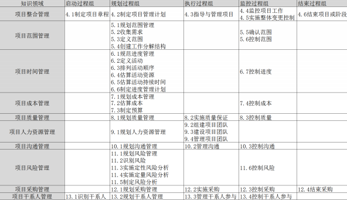

延开发过程。

17、掌握项目管理 PDCA（戴明循环）的思想，很有帮助!

对于任何项目都必需的 5 个项目过程组。这 5 个项目过程组具有明确的依存关系并在各个项 目中按一定的次序执行。5个过程组是所有项目应必需的。项目过程组很少会是离散的或者只出 现一次，它们是相互交选的活动。（18 下 30）

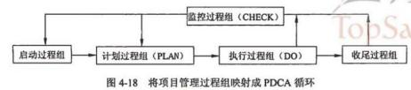

18、项目管理 5 大过程组：（18 下 29）（19 上 31）（19 下 27）

（1）启动过程组：定义并批准项目或阶段。

（2）计划编制过程组： 定义和细化目标， 规划最佳的技术方案和管理计划， 以实现项目或阶 段所承担的目标和范围。

（3）执行过程组： 整合人员和其他资源， 在项目的生命期或某个阶段执行项目管理计划， 并 得到输出与成果。

（4）监督与控制过程组（监控过程组）：要求定期测量和监控进展、识别实际绩效与项目管 理计划的偏差、必要时采取纠正措施， 或管理变更以确保项目或阶段目标达成。

（5）收尾过程组： 正式接受产品、服务或工作成果，有序地结束项目或阶段。

从整体上看， 项目管理过程比基本的 PDCA 循环要复杂的多，但是这个循环可以被应用于项 目过程内部及各过程组之间的相互关联。（17 下 31）

本章历年考题和答案解析汇总：

#### 【试题 1】---2009 上真题 18

1、在（1）中,项目经理的权力最小。

（1）A.强矩阵型组织    B.平衡矩阵组织    C.弱矩阵型组织    D.项目型组织

#### 【解析】实施项目的组织结构对能否获得项目所需资源和以何种条件获取资源起着制约作用。组织结 构可以比喻成一条连续的频谱，其一端为职能型，另一端为项目型，中间是形形色色的矩阵型。 与项目有关的组织结构类型的主要特征见图:

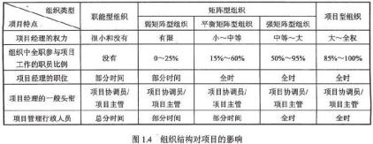

由图知，在矩阵型组织和项目型组织中，弱矩阵型组织中的项目经理的权力最小。

#### 【试题 2】---2009 上真题 19

### 2、矩阵型组织的缺点不包括()

A.管理成本增加       B.员工缺乏事业上的连续性和保障

C.多头领导           D.资源分配与项目优先的问题产生冲突

#### 【解析】矩阵型组织存在着管理成本增加、多头领导、难以监测和控制、资源分配与项目优先的问题 产生冲突以及权利难以保持平衡等缺点。员工缺乏事业上的连续性和保障是项目型组织的缺点。

#### 【试题 3】---2009 上真题 20

3、定义清晰的项目目标将最有利于（3）。

（3）A.提供一个开放的工作环境          B.及时解决问题

C.提供项目数据以利决策            D.提供定义项目成功与否的标准

#### 【解析】 项目的目标包括衡量项目成功的可量化标准。项目可能具有多种业务、成本、进度、技术和质量上的目标。项目目标包括成本、进度和质量方面的具体目标。

义项目成功与否的标准，也有助于降低项目风险。

#### 【试题 4】 ---2009 上真题 22

‘、（4）反映了信息系统集成项目的技术过程和管理过程的正确顺序。

A.制定业务发展计划、实施项目、项目需求分析

B.制定业务发展计划、项目需求分析、制定项目管理计划

C.制定业务发展计划、制定项目管理计划、项目需求分析

D.制定项目管理计划、项目需求分析、制定业务发展计划

#### 【解析】 一个组织在制订出战略规划并根据该战略发展自己的业务时，首先根据制定战略规划制订具 体业务发展计划、构思支持业务发展的产品，通过需求分析明确定义未来信息系统（即信息系统 项目的产品）的目标， 确定为了满足用户的需求待建系统必须做什么， 明确待建的系统要做什么、 应具备什么功能和性能，然后才能制定详细的项目管理计划。

#### 【试题 5】---2009 下真题 6

5、某- MIS 泵统项目的实施过程如下：需求分析、概要设计、详细设计、编码、单元测试、集成 测试、系统测试、验收测试。那么该项目最有可能采用的是（5） 。

（5）A.瀑布模型    B.选代模型    C.V 模型    D.螺旋模型

#### 【解析】V 模型的左边下降的是开发过程各阶段，包括需求分析、概要设计、详细设计和编码。v 模型的右边上升的是测试过程的各个阶段，包括单元测试、集成测试、系统测试和验收测试。

#### 【试题 6】---2009 下真题 8

6、典型的信息系统项目开发的过程为：需求分析、概要设计、详细设计、程序设计、调试与测试、 系统安装与部署。（6）阶段拟定了系统的目标、范围和要求。

（6）A.概要设计    B.需求分析    C.详细设计    D.程序设计

#### 【解析】 需求分析阶段要确定对系统的综合要求、功能要求和性能要求等。而概要设计、详细设计均是对系统的具体设计方案的分析。 程序设计即为编码过程。

#### 【试题 7】---2009 下真题 31

7、在（7）中,项目经理权限最大。

（7）A.职能型组织    B.弱矩阵型组织    C.强矩阵型组织    D.项目型组织

#### 【解析】项目经理的权力在职能型组织中权力很小或没有：在矩阵型组织中权力有限或者权力中等； 而在项目型组织中权力很大或者全权负责。

#### 【试题 8】---2010 下真题 1

8、以下（8）不属于系统集成项目。

A.不包含网络设备供货的局域网综合布线项目

C.某软件测试实验室为客户提供的测试服务项目

B.某信息管理应用系统升级项目

D.某省通信骨干网的优化设计项目

#### 【解析】 所谓系统集成项目，是指将计算机软件、硬件、网络通信等技术和产品集成为能够满足用户 特定需求信息系统，包括总体策划、设计、开发、实施、服务及保障。系统集成主要包括设备系 统集成和应用系统集成。

因此选项 A 和 B 属于系统集成项目。如果选项 D 中的通信骨干网的优化设计项目范围不仅包括 设计也包括实施的话，选项 D 也是系统集成项目。选项 C 中的“某软件测试实验室为客户提供的 测试服务项目”提供的是服务，是一种服务型项目。该项目完成的是白盒测试、或黑盒测试、或 确认测试， ……。

#### 【试题 9】 ---2011 上真题 52

9、下列关于项目型组织优缺点的描述中,不正确的是（9）。

A.项目型组织结构单一,责权分明,利于统一指挥

B.项目型组织管理成本较低,项目环境利于沟通和知识共享

C.项目型组织沟通简洁、方便,目标明确单一,决策快

D.项目型组织的员工缺乏事业上的连续性和保障

#### 【解析】项目型组织的优点体现在如下方面：（1）结构单一，责权分明，利于统一指挥；（2）目标明 确单一；（3）沟通简洁、方便；（4）决策快。同时， 项目型组织也存在着如下缺点：管理成本过高， 如项目的工作量不足则资源配置效率低；项目环境比较封闭，不利于沟通、技术知识等共享；员工 缺乏事业上的连续性和保障等。综合以上项目型组织的特点可知，在项目型组织中各专业的员工是分散在各项目中的，是不方便知识共享的

#### 【试题 10】---2011 上真题 53

10、以下关于信息系统集成项目的特点描述不正确的是（10）。

A.信息系统集成项目要以满足用户和客户的需求为根本出发点

B.信息系统集成项目更加强调了沟通的重要性， 技术的集成需要以最前沿技术的合理应用为基础

C.信息系统集成项目是高技术与高技术的集成， 但同时也蕴藏着没有完全掌握新技术带来的风险

D.信息系统集成项目团队年轻、流动率高，因此对于企业的管理技术水平和项目经理的领 导艺术水平要求较高

#### 【答案】B

#### 【解析】 信息系统集成项目有以下几个显著特点:

（1）信息系统集成项目要以满足客户和用户的需求为根本出发点;

（2）客户和用户的需求常常不够明确、复杂多变，由此应加强需求变更管理以控制风险;

（3） 系统集成不是选择最好的产品的简单行为，而是要选择最适合用户的需求和投资规模的 产品和技术;

（4）高技术与高技术的集成。系统集成不是简单的设备供货，系统集成是高技术的集成， 它 体现更多的是设计、调试与开发，是高技术行为。

（5）系统工程。系统集成包含技术、管理和商务方面，是一项综合性的系统工程。

（6）项目团队年轻，流动率高。因此对企业的管理水平和项目经理的领导艺术水平要求较高。 （7）强调沟通的重要性。

综上所述，技术的集成需要以标准为基础，而不是以最前沿技术的合理应用为基础

#### 【试题 11】---2012 上真题 3

11、关于信息系统集成项目的特点，下述说法中， （11）是不正确的。

（11）A.信息系统集成项目是高技术与高技术的集成，要采用业界最先进的产品和技术 B.信息系统集成项目对企业管理技术水平和项目经理的领导艺术水平要求比较高 C.信息系统集成项目的需求常常不够明确，而加强需求变更管理以控制风险.

D.信息系统集成项目经常面临人员流动率较高的情况

#### 【试题 12】---2014 下真题 27

12、信息系统集成项目区别于其它项目的特点是（12）。

（12）A.每个项目都有始有终   B.每个项目都是不同的

C.渐进明细             D.需求复杂多变，需求变更控制复杂

#### 【解析】D 是信息系统项目的特点

#### 【试题 13】---2014 下真题 29

13、项目的临时性是指（13）。

A.每一个项目都有一个明确的开始时间和结束时间，项目是一次性的

B.项目可能有不同的客户、不同的用户。不同的需求、不同的产品、不同的时间、不同的 成本和质量

C.系统集成商不仅向客户提供产品，更重要的是根据其要求提供不同的解决方案

D.项目的成果性目标是逐步完成的

#### 【解析】临时性是指每一个项目都有一个明确的开始时间和结束时间，临时性也指项目是一次性的。当项目目标已经实现，或由于项目成果性目标明显无法实现，或者项目需求已经不复存在而终止项目 时，就意味着项目的结束，临时性并不一定意味着项目历时短，项目历时依项目的需要而定，可 长可短。不管什么情况，项目的历时总是有限的，项目要执行多个过程以完成独特产品、提供独 特的服务或成果。

#### 【试题 14】---2015 上真题 28

14、项目生命周期定义了从项目开始直至结束的项目阶段。以下关于项目阶段的叙述中，（）是不 正确的。

A.大多数项目生命周期定义的阶段顺序通常从技术上可以分为需求分析、系统设计、系统构 建、系统运行四个阶段。

B.按管理活动出现的先后，把项目的生命周期划分为启动、计划、执行和收尾四个典型阶段

C.在条件许可或涉及的风险可接受时，下一个阶段可以在前一个阶段结束前开始。

D.根据实际需要， 项目的阶段中可能只包含管理工作或包含技术工作。

#### 【解析】大多数项目生命周期定义的阶段顺序通常从技术上可以分为需求分析，系统设计，系统构 建，系统运行四个阶段，按管理活动出现的先后，把项目的生命周期划分为启动、计划、执 行和收尾四个典型阶段，在条件许可或涉及的风险可接受时，下一阶段可以在前一阶段结束 前开始。俗话说，三分技术 7 分管理，任何项目的阶段中都包含管理工作和技术工作，只是根据项目性质、规模、大小、管理和技术所占比重进行权衡分配。

论按技术工作还是接管理工作出现的先后来划分项目的阶段，项目的每个阶段部至少包含管理工作和技术工作。

#### 【试题 15】---2015 上真题 29

15、项目管理知识体系包括了管理项目所需的管理知识。以下关于项目管理知识体系的叙述中，() 是不正确的。

A.项目管理的 10 大知识域是通用的， 是跨行业的。

B. 除了要掌握项目管理基本知识域的内容，项目团队还应该了解行业的基本流程和业务需求

C.项目经理除了要掌握项目管理基本知识体系外， 还应该学习通用管理域的技能以及人际关 系管理技能。

D.项目经理应该具有项目所需要的所有知识和技能。

#### 【解析】项目经理应具备广博的知识、丰富的经验、良好的沟通技巧、协调能力、职业道德及学习通用管 理、领导能力等，但是项目经理不可能具有所有的知识和技能，比如，IT 的项目经理没必要对建 筑行业很精通，只要了解即可。

#### 【试题 16】---2016 上真题 27

16 、—结构化分析与设计是信息系统开发时常用的方法。按其生命周期特征，它应属于（16）。 A.V 模型   B.原型化模型   C.螺旋模型   D.瀑布模型

#### 【解析】 结构化对应的是瀑布模型，都是按步走的模型

#### 【试题 17】---2016 上真题 28~29

17、软件开发“螺旋模型”是经常使用的一种模型， 它是（28）的结合，强调软件开发过程中的 风险分析，特别适合于大型复杂的系统。螺旋模型沿着螺线进行若干次选代，每次选代中的活动 依次为（29）。

（1）A.瀑布模型和快速原型模型     B.瀑布模型和增量模型

C.选代模型和快速原型模型     D.敏捷模型和原型模型

（2）A.需求分析、风险分析、实施工程和客户评估

B.需求收集、制定计划、风险分析和实施工程

C.制定计划、风险分析、实施工程和软件运维

D.制定计划、风险分析、实施工程和客户评估

#### 【解析】螺旋模型是一个演化软件过程模型，将原型实现的选代特征与线性顺序（瀑布）模型中控制的和 系统化的方面结合起来。螺旋模型分为 4 个阶段： 制定计划、风险分析、实施工程和客户评估。 螺旋模型强调了风险分析，特别适用于庞大而复杂的、高风险的系统。

#### 【试题 18】---2016 下真题 27

18、与组织日常的、例行的运营工作不同， 项目具有一些非常明显的特点。 “没有完全一样的项目” 体现了项目的（）。

A.临时性    B.独特性    C.差异性    D.系统性

#### 【解析】独特性：项目要提供某一独特产品，提供独特的服务或成果，因此“没有完全一样的项目”，项目 可能有各种不同的客户、不同的用户、不同的需求、不同的产品、不同的时间、不同的成本和质 量等等。

#### 【试题 19】---2016 下真题 28

19、组织文化和组织风格会对项目的执行产生深刻的影响， 但具体来说在一个组织中，（） 对项目 执行方式有很大的影响。

A.组织沟通    B.组织文化   C.组织管理     D.组织结构

#### 【答案】A

#### 【解析】P194此题考察的是组织结构，必须掌握，高频考点

组织的沟通能力对项目的执行方式有很大的影响。因而，即使相距遥远，项目经理仍然可以与组 织结构内所有干系人进行有效沟通，以促进决策。

#### 【点评】送分题，考的比较偏，但是不难，尽量得分

#### 【试题 20】---2016 下真题 29

20 、V  模型是多种典型的信息系统项目的生命周期模型，它标明了测试阶段与开发过程各阶段的

对应关系，其中（） 的主要目的是针对详细设计中可能存在的问题， 尤其是检查各单元之间接口 上可能存在的问题。

A.单元测试    B.集成测试   C.系统测试    D.验收测试

#### 【答案】B

#### 【解析】P210此题考察的是 v 模型，必须掌握，高频考点

v 模型的价值在于它非常明确地标明了测试过程中存在的不同级别，并且清楚地描述了这些测试阶 段和开发各阶段的对应关系。

（1） 单元测试的主要目的是针对编码过程中可能存在的各种错误， 例如用户输入验证过程中的边 界值的错误。

（2） 集成测试主要目的是针对详细设计中可能存在的问题， 尤其是检查各单元与其他程序部分之 间的接口上可能存在的错误。

（3） 系统测试主要针对概要设计， 检查系统作为一个整体是否有效地得到运行， 例如在产品设置 中是否能达到预期的高性能。

（4）验收测试通常由业务专家或用户进行，以确认产品能真正符合用户业务上的需要。

#### 【点评】送分题，常考，必须得分

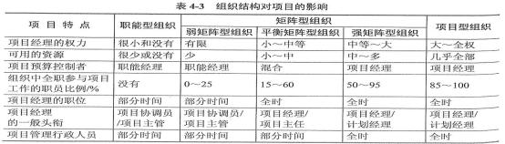

#### 【试题 21】---2017 上真题 26

21、与例行工作相比，项目具有明显的特点。其中（）是指每一个项目都有一个明确的开始时间 与结束时间。

A.临时性    B.按时性    C.独特性    D.渐进明细

#### 【答案】A

#### 【解析】P178此题考察的是项目的特点，必须掌握， 高频考点

项目具有非常明显的特点： 临时性、独特性和渐进明细。

临时性是指每一个项目都有一个明确的开始时间和结束时间，临时性也指项目是一次性的。

独特性： 项目要提供某一独特产品， 提供独特的服务或成果，因此“没有完全一样的项目 ”

渐进明细指项目的成果性目标是逐步完成的。因为项目的产品、成果或服务事先不可见，在 项目前期只能粗略地进行项目定义，随着项目的进行才能逐渐明朗、完善和精确。

#### 【点评】常考，比较简单，必须得分

#### 【试题 22】---2017 上真题 27

22、项目目标包括成果性目标和（）目标，后者也叫管理性目标。

A.建设性    B.约束性    C.指导性    D.原则性

#### 【答案】B

#### 【解析】P176此题考察的是项目的目标，必须掌握， 高频考点

项目目标包括成果性目标和约束性目标。

#### 【点评】常考，比较简单，必须得分

#### 【试题 23】---2017 上真题 28

23、在以下类型的组织结构中，项目经理权力相对较大的是（） 组织.

A.职能型    B.弱矩阵型    C.强矩阵型    D.项目型

#### 【答案】D

#### 【解析】P194此题考察的是组织结构，必须掌握，高频考点

#### 【点评】常考，比较简单，必须得分

#### 【试题 24】---2017 上真题 29

24、软件统一过程（RUP）是选代模型的一种。以下关于 RUP 的叙述中，不正确的是（）。

A.RUP 生命周期在时间上分为 4 个顺序阶段， 分别是： 初始阶段、细化阶段、构建阶段和交

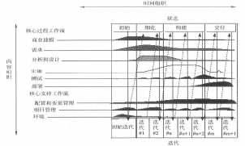
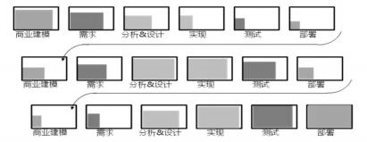

付阶段

B.RUP 的每个阶段里面都要执行核心过程工作流“商业建模”、“需求”、“分析和设计”、“实 现”、“测试”、“部署”。每个阶段的内部仅完成一次选代即可。

C.软件产品交付给用户使用一段时间后如有新的需求则应该开始另外一个 RUP 开发周期

D.RUP 可以用户大型复杂软件项目开发

#### 【答案】B

#### 【解析】P207此题考察的是信息系统项目的生命周期模型，必须掌握，高频考点

RUP 的每个阶段里面都要执行核心过程工作流的“商业建模”、“需求”、“分析和设计”、“实现”、 “测试”、“部署”。根据需求， 在一个阶段内部，可以完成一次到多次的选代。

#### 【点评】常考，比较简单，必须得分

#### 【试题 25】---2017 上真题 30

25、小正是某软件开发项目的项目经理，在组内讨论项目所采用的开发方法时，项目组成员最后 采取了下图的模式。他们采取的是（）。

A.瀑布模型    B.原型化模型    C.选代模型    D.螺旋模型

#### 【答案】C

#### 【解析】P207此题考察的是信息系统项目的生命周期模型，必须掌握，高频考点

#### 【点评】常考，比较简单，必须得分

#### 【试题 26】---2017 上真题 31-32

26、在 V 模型中，（）是对详细设计进行验证，（）与需求分析相对应。

（31）A.集成测试    B.系统测试    C.验收测试和确认测试    D.验证测试

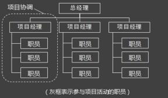

（32）A.代码测试    B.集成测试    C.验收测试    D.单元测试

#### 【答案】AC

#### 【解析】P209此题考察的是信息系统项目的生命周期模型，必须掌握，高频考点 典型的信息系统项目的生命周期模型：

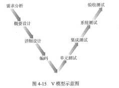

#### 【点评】常考，比较简单，必须得分

#### 【试题 27】---2017 下真题 28

### 27、以下关于项目与项目管理的描述不正确的是：()

A.项目临时性是指每一个项目都有一个明确的开始时间和结束时间

B.渐进明细是指项目的成果性目标是逐步完成的

C.项目的目标不存在优先级， 项目目标具有层次性

D.项目整体管理属于项目管理核心知识域

#### 【答案】C

#### 【解析】P177此题考察的是项目的目标特征，必须掌握，高频考点

项目目标具有如下特性：1）项目的目标有不同的优先级 2）项目目标具有层次性-

#### 【点评】常考，比较简单，必须得分

#### 【试题 28】---2017 下真题 29

28、下图中的项目组织结构属于（）。

A.项目型组织    B.职能型组织    C.弱矩阵型组织    D.强矩阵型组织

#### 【答案】A

#### 【解析】P196此题考察的是组织结构，必须掌握，高频考点

很明显是项目型组织结构

#### 【点评】常考，比较简单，必须得分

#### 【试题 29】---2017 下真题 30

29、某公司承接一个互联网企业的开发项目，由于互联网业务变化较快，无法在项目初期准确确 定出项目需求，你作为项目经理应首先考虑的开发模型是（）。

A.瀑布模型    B.V 模型    C.螺旋模型    D.原型化模型

#### 【答案】D

#### 【解析】P210此题考察的是生命周期模型，必须掌握，高频考点

原型化模型的第一步是建造一个快速原型，实现客户或未来的用户与系统的交互，经过和用户针 对原型的讨论和交流，弄清需求以便真正把握用户需要的软件产品是什么样子的。充分了解后， 再在原型基础上开发出用户满意的产品。原型化模型的应用意义很广，瀑布和 v 模型将原型化模 型的思想用于需求分析环节， 来解决因为需求不明确而导致产品出现严重后果的缺陷。

#### 【点评】常考，比较简单，必须得分

#### 【试题 30】---2017 下真题 31

30、以下关于项目管理过程组的描述不正确的是（）。

A.所有项目都必须经历 5 个过程组

B.每个单独的过程都明确了如何使用输入来产生项目过程组的输出

C.制定项目管理计划所需要的过程都属于计划过程组

D.控制变更， 推荐纠正措施属于执行过程组

#### 【答案】D

#### 【解析】P220此题考察的是 5 大过程组，必须掌握， 高频考点

控制变更属于监控过程组

#### 【点评】常考，比较简单，必须得分

#### 【试题 31】---2018 上真题 28

31、应用软件开发项目执行过程中允许对需求进行适当修改，并对这种变更进行严格控制，充分 体现了项目的（）特点。

A.临时性    B.独特性    C.渐进明细    D.无形性

#### 【答案】C

#### 【解析】P178此题考察的是项目的特点，必须掌握， 高频考点

项目的特点：临时性：是指每一个项目都有一个明确的开始时间和结束时间，临时性也是指  项目是一次性的。独特性：项目要提供某一独特产品，提供独特的服务或成果。渐进明细性： 是指项目的成果性目标是逐步完成的。）

#### 【点评】以前考过，常考，比较简单， 必须得分

#### 【试题 32】---2018 上真题 29

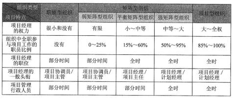

32、小王被安排担任 A 项目的兼职配置管理员，她发现所有项目组成员都跟她一样是兼职的，项

目经理没有任何决策权， 所有事情都需要请示总经理做决策。这是一个典型的（）项目组织结构。 A.职能型    B.项目型    C.弱矩阵型    D.强矩阵型

#### 【答案】A

#### 【解析】P194此题考察的是项目的组织结构，必须掌握，高频考点

#### 【点评】以前考过，常考，比较简单， 必须得分

#### 【试题 33】---2018 上真题 30

33、信息系统项目生命周期模型中的（）适用于需求明确或团队具备行业经验，并开发过类似产 品的项目。

A.瀑布模型     B.V 模型     C.螺旋模型     D.选代模型

#### 【答案】A

#### 【解析】P206此题考察的是生命周期模型特点，必须掌握，高频考点

-  瀑布模型适用： 需求明确或很少变更的项目开发人员的组织与管理； 开发团队比较弱或缺乏经验

-  螺旋模型适用：特别适合于大型复杂的系统

-  选代模型： 适用：1） 项目实现不能完整定义产品的所有需求 2）在项目开发早期需求可能有 所变化 3）分析设计人员对应用领域很熟悉 4）高风险项目；5） 用户可不同程度地参与整个 项目的开发过程 6）使用面向对象的语言或统一建模语言 7）使用 CASE8）具有高素质的项目 管理者和软件研发团队

-  v 模型适用： 以测试为中心的开发模型发过程同样重要的过程。

#### 【点评】以前考过，常考，比较简单， 必须得分

#### 【试题 34】---2018 下真题 26

34、每个项目都有一个明确的开始时间和结束时间，这体现了项目的（）。

A.紧迫性    B.独特性    C.渐进明细    D.临时性

#### 【解析】临时性是指每一个项目都有一个明确的开始时间和结束时间。

#### 【试题 35】---2018 下真题 27

35、在（） 中,项目经理权力最小。

A.弱矩阵型组织    B.平衡矩阵型组织    C.强矩阵型组织    D.项目型组织

#### 【解析】相对来说， 弱矩阵型组织项目经理权力最小。

#### 【试题 36】---2018 下真题 28

36、（）清楚地描述了测试各阶段和开发各阶段的对应关系。

A.瀑布模型    B.送代模型    C.V模型    D.螺旋模型

#### 【解析】v模型述了测试各阶段和开发各阶段的对应关系，编码-单元测试；详细设计-集成测试；概要设计- 系统测试；需求分析-验收测试。

#### 【试题 37】---2018 下真题 29

37、识别干系人是项目（）的活动。

A.启动过程组    B.计划过程组    C.执行过程组    D.监督和控制过程组

#### 【解析】识别干系人是启动过程组的。

#### 【试题 38】---2018 下真题 30

38、关于项目的过程组的描述,不正确的是:（）。

A.并非所有项目都会经历 5 个过程组

B.项目的过程组很少会是离散的或者只出现一次

C.项目的过程组经常会发生相互交选

D.项目的过程组具有明确的依存关系并在各个项目中按一定的次序执行

#### 【答案】A

#### 【解析】P214，此题考察的是项目过程组，必须掌握，高频考点

第一句话：本节确定并描述了对于任何项目都必需的 5 个项目过程组。这 5 个项目过程组具有明确 的依存关系并在各个项目中按一定的次序执行。所以 A 是错误的，5 个过程组是所有项目应必需的。 答案 D 是正确的，原话。答案 B 参考 P218，项目过程组很少会是离散的或者只出现一次，它们是 相互交选的活动。正确。答案 C 也是正确的。

#### 【试题 39】---2019 上真题 28

39、项目具有临时性、独特性与渐进明细的特点其中临时性指（ ）。

A.项目的工期短

B.每个项目都有明确的开始与结束时间

C.项目的成果性目标是逐步完成的

D.项目经理可以随时取消项目

#### 【解析】临时性是指每个项目都有明确的开始与结束时间。

#### 【试题 40】---2019 上真题 29

40、在（）组织结构中，项目拥有独立的项目团队， 项目经理在调用与项目相关的资源时不需要 向部门经理汇报。

A.职能型    B.平衡矩阵型    C.强矩阵型    D.项目型

#### 【解析】项目拥有独立的项目团队，项目经理在调用与项目相关的资源时，不需要向部门经理报告，说明 是项目经理全权，为项目型。

#### 【试题 41】---2019 上真题 30

41、公司计划开发一个新的信息系统，该系统需求不明确，事先不能定义需求，需要经过多期开 发完成该系统的生命周期模型宜采用（）。

A.瀑布模型    B.V 模型    C.测试驱动方法    D.选代模型

#### 【解析】该系统需求不明确，事先不能定义产品所有需求，需要经过多期开发完成为典型的选代模型。

#### 【试题 42】---2019 上真题 31

42、项目管理过程中，（）不完全属于监控过程组。

A.范围确认、监督和控制项目主作、整体变更控制

B.进度控制、控制沟通风险监督与控制

C.成本控制、质量保证、范围控制

D.管理项目团队、范围控制、控制干系人参与

#### 【解析】题有异议。答案 D 中的管理项目团队按第二版中级教材P220表4-42017年8月及之后的版

本）是属于执行过程组。 答案 C 质量保证也是执行过程组的。  因为管理项目团队曾经在老版本 的教材里是监控过程组的，所以建议选 C，质量保证一直都是执行过程组中的子过程。

#### 【试题 43】---2019 下真题 24

43、关于项目的描述，不正确的是（）。

A.建设视频监控系统是一个项目，建成后的系统是项目产品

B.建设办公大楼是一个项目， 建设后的大楼是项目产品

C.商务谈判是一个项目，如果谈判成功，合同是项目产品

D.ERP 系统的运行维护是一个项目， ERP 系统是项目产品

#### 【解析】P176 此题考察的是项目的定义，了解，很少考；

项目的约束性目标也叫管理性目标，项目的成果性目标有时也简称为项目目标。项目成果性目标 指通过项目开发出的满足客户要求的产品、系统、服务或成果， 例如：

（1）建设一个视频监控系统是一个项目，建成后的视频监控系统就是该项目的产品。

（2）建设一个办公大楼也是一个项目或者说工程， 建成后的办公大楼就是该项目的产品。 （3）开发一个网上书店也是一个项目， 完成后的网上书店就是该项目的产品。

（4） 一个 ERP 系统的实施也是一个项目，完成后的 ERP 系统就是该项目的产品。

（5） 组织一次旅游也是一个项目，订票、订旅馆、解说以及其他让旅游者身心愉悦的工作均为这 个项目提供的服务。

这题的争议在 C 和 D 之间， C 选项中的合同是一个交付物， 说是Γ项目产品」不合适，D 选项中的 Γ运行维护」可以是以项目的形式来实施，推荐 C 选项。

#### 【江山老师点评】定义题，了解

#### 【试题 44】---2019 下真题 25

44、关于项目经理的相关描述，不正确的是（）。

A.项目经理需要足够的知识和经验

B.项目经理必须掌握项目所需的新技术

C.项目经理必须具有良好的职业道德

D.项目经理需要具有领导和管理的能力

#### 【解析】对项目经理的一般要求：（1）足够的知识（2）丰富的项目管理经验（3）良好的协调和沟通能力 和良好的职业道德（4）领导和管理能力；项目经理主要是偏管理。不需要懂很多技术。

#### 【试题 45】---2019 下真题 26

45、（）是 PMO 应具备的特征。

①负责制定项目管理方法，最佳实践和标准

②对所有项目进行集中的配置管理

③项目之间的沟通管理协调中心

④在项目约束条件下完成特定的项目成果性目标

⑤对项目之间的关系组织资源进行优化使用

A.①②③④    B.②③④⑤    C.①②③⑤    D.①②③④⑤

#### 【解析】P200 此题考察的是 PMO，必须掌握，高频考点；

以下列出 PMO 的一些关键特征，但不限于此。

（1）在所有 PMO 管理的项目之间共享和协调资源。

（2）明确和制定项目管理方法、最佳实践和标准。

（3）负责制订项目方针、流程、模板和其他共享资料。

（4）为所有项目进行集中的配置管理。

（5）对所有项目的集中的共同风险和独特风险存储库加以管理。

（6）项目工具（如企业级项目管理软件）的实施和管理中心。

（7）项目之间的沟通管理协调中心。

（8）对项目经理进行指导的平台。

（9）通常对所有 PMO 管理的项目的时间基线和预算进行集中监控。

（10）在项目经理和任何内部或外部的质量人员或标准化组织之间协调整体项目的质量标准。 ④完成特定的项目成果性目标这个是项目组要做的事，不是 PMO 要做的事。

#### 【试题 46】---2019 下真题 27

46、在项目 5 个管理过程组中，计划过程组不包括（）。

A.成本估算    B.收集需求    C.风险分析    D.识别干系人

#### 【解析】5 大过程组，识别干系人是启动过程组的， 不是在计划过程组。

二、立项管理

1、项目立项管理包括以下 5 个典型环节， 分别是项目建议、项目可行性分析、项目审批、项 目招投标以及项目合同谈判与签订 5 个阶段。

2、项目建议书（又称立项申请） 是项目建设单位向上级主管部门提交项目申请时所必须的文 件，是对拟建项目提出的框架性的总体设想。项目建议书是项目发展周期的初始阶段，是国家或 上级主管部门选择项目的依据，也是可行性研究的依据。（17 下 32）

3、项目建议书应该包括的核心内容如下：第一章项目简介、第二章项目建设单位概况、第三

章项目建设的必要性、第四章业务分析、第五章总体建设方案（16 下 30）、第六章本期项目建设

方案（18 上 32）、第七章环保、消防、职业安全、八章项目实施进度第九章投资估算和资金筹措、

4、项目建设单位可以规定对于规模较小的系统集成项目省略项目建议书环节， 而将其与项目 可行性分析阶段进行合并。（19 上 32）（19 下 28）

5 、立项管理主要是解决项目组织战略符合性问题，即项目值不值得去做的问题；（16 上 31）

6、可行性研究内容一般应包括以下内容： 1）投资必要性 2）技术的可行性 3）财务可行性 4） 组织可行性 5）经济可行性 6）社会可行性 7）风险因素及对策—结合项目背景需要进行判断

| 1 | 投资必要性 | 主要根据市场调查及预测的结果， 以及有关的产业政策等因素，论证项目投资 建设的必要性。 |
|---|---|---|

要从技术、经济等方面进行深入调查研究；（18 下 34）

详细可行性研究的方法： 经济评价法、市场预测法、投资估算法和增量净效益法等（19 上 28）

可行性研究报告的内容：（1）项目概述（2）项目建设单位概况（3）需求分析和项目建设的 必要性（4）总体建设方案（5）本期项目建设方案（6）项目招标方案（7）环保、消防、职业安 全（8）项目组织机构和人员培训（9）项目实施进度（10）投资估算和资金来源（11）效益与评 价指标分析（12）项目风险与风险管理。（19 下 24）

8、机会研究、初步可行性研究、详细可行性研究、评估与决策是投资前期的四个阶段。 其中前三个可以合并，但是详细可行性研究是不可或缺的。

9、对于不同规模和类别的项目，初步可行性研究可能出现4种结果，即： ①肯定，对于比较 小的项目甚至可以直接“上马”；②肯定，转入详细可行性研究，进行更深入更详细的分析研究； ③展开专题研究， 如建立原型系统， 演示主要功能模块或者验证关键技术； ④否定， 项目应该“下 马 ”。（17 下 34）（19 下 30）

| 阶段 | 工作内容 | 误差控制 |
|---|---|---|
| 机会研究 | 寻求投资机会，鉴别投资方向 | +30% |
| 初步可行性研究 | 初步项目是否有生命力，能否盈利 | +20% |
| 详细可行性研究 | 详细技术经济论证， 在多方案比较的基础上选择出最优方案 | +10% |

10、最终提交的可行性研究报告将成为进行项目评估和决策的依据。

11 、项目审批部门委托有资质的咨询机构评估后审核批复， 或报国务院审批后下达批复。

12 、项目评估指项目可行性研究的基础上，由第三方进行评价、分析和论证，为银行的贷款 决策或行政主管部门的审批决策提供科学依据。（11 上 57）（12 上 32）（16 下 31）（18 下 32）

13、项目可行性研究报告的编制内容与项目建议书批复内容有重大变更的，应重新报批项目 建议书。项目初步设计方案和投资概算报告的编制内容与项目可行性研究报告批复内容有重大变 更或变更投资超出已批复总投资额度 10% 的， 应重新报批可行性研究报告。

项目初步设计方案和授资概算报告的编制内容与项目可行性研究报告批复内容有少量调整且

其调整内容未超出已批复总投资额度 10%的，需在提交项目初步设计方案和投资概算报告时以独 立章节对调整部分进行定量补充说明。（12 上 31）（12 下 34）（13 上 33）

14、国有资金占控股或者主导地位的依法必须进行招标的项目，应当公开招标；下列情形可 以邀请招标：①需要采用不可替代的专利或者专有技术；②采购人依法能够自行建设、生产或者 提供；③已通过招标方式选定的特许经营项目投资人依法能够自行建设、生产或者提供；④需要 向原中标人采购工程、货物或者服务，否则将影响施工或者功能配套要求；⑤国家规定的其他特 殊情形。（18 上 34）

15、资格预审文件或者招标文件的发售期不得少于          5 日    通过资格预审的申请人少于 3 个的， 应当重新招标。投标保证金不得超过招标项目估算价的 2% ，招标保证金有效期应当与投标有效期致。 招标人可以自行决定是否编制标底，且只能有一个标底，必须保密。招标人设有最高投 标限价的，应当在招标文件中明确最高投标限价或者最高投标限价的计算方法，招标人不得规定 最低投标限价。招标人不得组织单个或者部分潜在投标人踏勘项目现场。  . （18 下 35）

16、对技术复杂或者无法精确拟定技术规格的项目， 招标人可以分 2 个阶段招标：第一阶段，

提交不带报价的技术建议，招标人编制招标文件；第二阶段，向提供第一阶段技术建议的投标人 提供招标文件，投标人按照要求提交包括最终技术方案和投标报价的投标文件。

### 17、招标人有下列行为属于以不合理条件限制：

①就同一招标项目向潜在投标人或者投标人提供有差别的项目信息；

②设定的资格、技术、商务条件与招标项目的具体特点和实际需要不相适应或者与合同履行无关；

③依法必须进行招标的项目以特定行政区域或者特定行业的业绩、奖项作为加分条件或者中标条件；

④对潜在的投标人或者投标人采取不同的资格审查或者评标标准；

⑤限定或者指定特定的专利、商标、品牌、原产地或者供应商；

⑥依法必须进行招标的项目非法限定潜在投标人或者投标人的所有制形式或者组织形式；

⑦以其他不合理条件限制、排斥潜在的投标人或者投标人。

18、与招标人存在利害关系可能影响招标公正性的法人、其他组织或者个人，不得参加投标。 单位负责人为同一人或者存在控股、管理关系的不同单位，不得参加同一标段投标或者未划分标 段的同一招标项目投标。

19、下列情形属于投标人相互串通投标：①投标人之间协商投标报价等投标文件的实质性内 容；②投标人之间约定中标人；③投标人之间约定部分投标人放弃投标或者中标；④属于同一集 团、协会、商会等组织成员的投标人按照该组织要求协同投标；⑤投标人之间为谋取中标或者排 斥特定投标人而采取的其他联合行动。 .

20、下列情形视为投标人相互串通投标： ①不同投标人的投标文件由同一单位或者个人编制； ②不同投标人委托同一单位或者个人办理投标事宜； ③不同投标人的投标文件载明的项目管理成 员为同一人；④不同投标人的投标文件异常一致或者投标报价呈规律性差异；⑤不同投标人的投 标文件相互混装；⑥不同投标人的投标保证金从同一单位或者个人的账号转出。 .

21、下列情形属于招标人与投标人相互串通投标：①招标人在开标前开启投标文件并将有关 信息泄露给其他投标人；②招标人直接或者间接向投标人泄露标底、评标委员会成员等信息；③ 招标人明示或者暗示投标人压低或者抬高投标报价； ④招标人授意投标人撤换、修改投标文件； ⑤招标人明示或者暗示投标人为特定投标人中标提供方便；⑥招标人与投标人为谋求特定投标人 中标而采取的其他串通行为。

22、系统集成供应商在项目投标阶段的主要工作包括： ①项目意向识别： 4  种途径：政策导 向、市场需求、技术发展、挖掘现有客户。②项目售前交流； ③获取招标文件； ④编写投标文件； ⑤参加投标活动。.

23、投标文件内容包括：①投标书、投标报价一览表、分项一览表； ②投标资质证明文件（营 业执照副本复印件加盖公章及其他相关证件）；③公司与制造商代理协议和授权书；④公司有关技 术资料及客户反绩意见。 .

24、投标文件签署及规定：①投标文件正本和副本须打印并由投标方法人代表或委托代理人 签署；②除投标方对错处作必要修改外，投标文件中不许有加行、涂抹或改写；③电报、电话、 传真形式的投标概不接受。

25、投标文件密封和标记： ①正本和副本有差异，以正本为准；②每一密封信封上注明何时 之前不准启封；③投标文件由专人递交，并按投标注明的时间和地点送至招标方。

26、投标人的各种商务文件、技术文件等应依据招标文件要求备全，商务文件包括：资质证 明文件（营业执照、税务登记证、企业代码以及行业主管部门颁发的等级资质证书、授权书、代 理协议等）、资信证明文件（保函、已履行的合同及商户意见书、中介机构出具的财务状况书等）。 技术文件一般包括投标项目方案及说明等。

27、投标人少于 3 个的，不得开标； 评标报告应当由评标委员会全体成员签字。招标人应当 自收到评标报告之日起 3  日内公示中标候选人， 公示期不得少于 3  日。公示期有异议的，招标人 应当自收到异议之日起 3  日内作出答复。招标人应当确定排名第一的中标候选人为中标人， 第一 中标候选人放弃中标的，因不可抗力不能履行合同、不按照招标文件要求提供履约保证金、或者 被查实存在影响中标结果的违法行为等情况，不符合招标条件的，招标人可以按照评标委员会提 出的中标候选人名单排序依次确定其他中标候选人为中标人，也可以重新招标。 .（18 上 35）

28、招标人根据评标委员会提出的书面评标报告和推荐的中标候选人确定中标人，招标人也 可以授权评标委员会直接确定中标人，中标通知书对招标人和中标人具有法律效力。招标人应在 书面合同签订后 5 日内退还投标保证金及银行同期存款利息。 .

29、履约保证金不得超过中标合同金额的 10% 。.（19 下 31）

30、合同约定或者经招标人同意，可以将中标项目的部分非主体、非关键性工作分包给他人 完成。接受分包的人应当具备相应的资格条件，并不得再次分包。中标人应当就分包项目向招标 人负责，接受分包的人就分包项目承担连带责任。 .

31、合同谈判的方法一般先谈技术条款，后谈商务条款。

32、合同的条款一般应包括： 当事人的名称和地址、标的、数量、质量、价款和报酬、履行 期限、地点和方式、违约责任和解决争议的方法等。

33、对于系统集成类的技术合同，一般应包括： 项目名称；标的内容、范围和要求；履行的 计划、进度、期限、地点、地域和方式； 技术文档和资料的保密； 风险责任的承担;技术成果的归 属和收益的分成方法；验收标准和方法；价款、报酬或者使用费及其支付方式；违约金或者损失 赔偿的计算方法；解决争议的方法；名词术语的解释等。

34、如果中标人不同意按照招标文件规定的条件或条款按时进行签约，招标方有权宣布该标 作废而与第二最低评估价投标人进行签约，或请示有关管理部门之后宣布本次招标无效，而重新 组织招标。

35、系统集成供应商所应承担的合同责任发生了转移,由组织转移到了项目组。 一般来说, 系统集成供应商主要根据项目的特点和类型,决定是否在组织内部为所签署的外部项目单独立项。

36、一般来说,系统集成供应商主要根据项目的特点和类型,决定是否要在组织内部为所签 署的外部项目单独立项。例如针对包含软件开发任务的项目通常需要进行内部立项,而那些单一 的设备采购类项目则无需单独立项

36、系统集成供应商主要根据项目的特点和类型,决定是否要在组织内部为所签署的外部项 目单独立项,例如针对包含软件开发任务的项目通常需要进行内部立项,而那些单一的设备采购 类项目则无需单独立项。

供应商内部立项主要原因： ①通过项目立项方式为项目分配资源；②通过项目立项方式确定 合理的项目绩效目标；③以项目型工作方式,提升项目实施效率。.（17 下 36）（19 下 32）

37 、系统集成供应商在进行项目内部立项时包括内容：①项目资源估算；②项目资源分配； ③准备项目任务书； ④任命项目经理。 .（16 下 32、33）（18 上 36）（18 下 36）（19 上 36）---

具体内容看教材，有时候考的很细

38、项目识别是承建方项目立项的第一步（09 上 61）（11 上 55）（11 下 31）从下面方向识别：

### 39、立项的流程

#### 【答案】C

承建方的立项管理主要包括项目识别、项目论证和投标等步骤。 项目识别是承建方项目立项 的第一步， 其目的在于选择投资机会、鉴别投资方向。

在时间顺序上， 本题其他选项在"C.项目识别”之后进行。

#### 【点评】考过多次了，比较简单，必须得分

#### 【试题 2】---2011 上真题 55

2、项目识别是承建方项目立项的第一步,其目的在于选择投资机会、鉴别投资方向。以下关于项 目识别的说法不正确的是（）。

A.可从政策导向中寻找项目机会,主要依据包括国家、行业和地方的科技发展和经济社会发 展的长期规划与阶段性规划

B.市场需求是决定投资方向的主要依据， 投资者应从市场分析中选择项目机会 C.信息技术发展迅速、日新月易， 新技术也会给企业带来新的项目机会

D.对项目的市场风险、技术风险、经济及社会风险等因素进行分析， 为项目全过程的风险管 理提供依据

#### 【答案】D

#### 【解析】 此题考察的是项目立项管理，必须掌握，高频考点

项目识别是承建方项目立项的第一步， 其目的在于选择投资机会、鉴别投资方向。

可从政策导向中寻找项目机会。项目机会研究的政策导向依据主要包括国家、行业和地方的 科技发展和经济社会发展的长期规划与阶段性规划。

可从市场需求中寻找项目机会。市场需求是决定投资方向的主要依据， 投资者应从市场分析中选择项目机会。 可从技术发展中寻找项目机会。信息技术发展迅速、日新月异，新技术也会给我们带来新的项目机会。

对项目的市场风险、技术风险、经济及社会风险等因素进行分析，为项目全过程的风险管理 提供依据， 不是项目识别的主要手段。很明显， 选项 D 是项目机会已经确定之后的事情，是分析 项目风险、为管理项目风险提供依据的。因此应选 D。

#### 【点评】项目识别，常考，简单，必须得分

#### 【试题 3】---2011 上真题 56

3、项目承建方在立项管理过程中，应从多个角度对项目进行论证，以下通常不属于承建方项目论 证内容的是（）。

A.技术可行性分析   B.财务可行性分析   C.风险分析   D.需求验证

#### 【解析】承建方项目论证包括承建方技术可行性分析、承建方人力及其他资源配置能力可行性分析、项目财务可行性分析、项目风险分析、对可能的其他投标者的相关情况分析。其中不包括需求验 证。

#### 【试题 4】 ---2011 上真题 57

4、某地方政府策划开展一项大型电子政务建设项目， 项目建设方在可行性研究的基础上开展项目 评估，以下做法不正确的是（）。

A.项目建设方的相关领导和业界专家，根据国家颁布的政策、法规、方法、参数和条例等， 进行项目评估

B.从项目、国民经济、社会角度出发， 对拟建项目建设的必要性、建设条件、生产条件、产 品市场需求、工程技术、经济效益和社会效益等进行评价、分析和论证， 进而判断其是否可行

C.项目评估按照成立评估小组、制定评估计划、开展调查研究、分析与评估、编写评估报告 的程序开展

D.评估工作采用费用效益分析法，比较为项目所支出的社会费用和项目对社会所提供的效 益，评估项目建成后将对社会做出的贡献程度

#### 【答案】A

#### 【解析】P192 此题考察的是项目评估，必须掌握， 高频考点

项目评估由第三方进行，因此选项 A 是不正确的。

#### 【点评】项目评估，常考，简单，必须得分

#### 【试题 5】---2011 下真题 32

5、以下不属于项目可行性研究内容是（）。

A.项目的详细管理计划                B.项目的风险因素及其对策

C.项目的社会影响性分析              D.项目的财务盈利能力评价

#### 【答案】A

#### 【解析】 此题考察的是可研，必须掌握，高频考点

项目可行性研究内容如下： 1）投资的必要性；2）技术的可行性；3）财务的可行性；4）组织的 可行性；5） 经济的可行性；6）社会可行性；7）风险因素及对策。

根据以上内容分析可知， 选项 B 属于“风险因素及对策”内容，选项 C 属于“社会可行性” 内容，选项 D 属于“财务可行性”内容。在项目可行性研究阶段，通常无法也无需给出“项目的  详细管理计划”，因此选项 A 不属于项目可行性研究内容。

#### 【点评】常考，命题的热点，简单题， 必须得分

#### 【试题 6】---2011 下真题 33

6、作为承建方，其项目立项的第一步工作是（6）。

A.编制立项申请书     B.项目论证     C.项目识别   D.投标

#### 【解析】承建方的项目管理的步骤为： 项目机会识别、项目论证、投标。

#### 【试题 7】---2012 上真题 31

7、某政府部门拟利用中央财政资金建设电子政务项目， 关于建设方的立项管理，下列做法中不符 合有关规定的是（）。

A.建设单位在编制项目建议书时专门组织项目需求分析， 形成需求分析报告， 报送项目审批部门

B.建设方在项目建议书获得批复后，招标选定有资格的第三方工程咨询机构编制可行性研究 报告，报送项目审批部门

C.建设方在可行性研究报告获得批复后， 向有关部门申请项目前期工作经费， 前期工作经费 计入项目总投资

D.建设方在可行性研究报告获得批复后，委托有资格的第三方工程咨询机构出具评估意见， 连同批复的项目建议书，作为项目建设的主要依据

#### 【答案】D

#### 【解析】 此题考察的是发改委 55 号令，尽量掌握， 考的不多

根据《国家电子政务工程建设项目管理暂行办法》（发展改革委令第 55 号）第 13 条：“项 目审批部门对电子政务项目的项目建议书、可行性研究报告、初步设计方案和投资概算的批复文

件是项目建设的主要依据。 ……”选项 D 的说法有误。

#### 【点评】发改委 55 号令，比较偏，考的不是很多， 尽量得分

#### 【试题 8】---2012 上真题 32

8、某企业信息化建设过程中,决策层要对实施计划方案进行择优和取舍,为保证决策的科学性, 其主要决策依据是（）。

A.需求分析   B.项目建议书   C.可行性研究报告   D.项目评估报告

#### 【解析】

可行性研究报告只提供多方案比较依据，而项目评估报告通常是对多方案择优。因而，项目

取舍的依据（决策依据）是项目评估报告

#### 【试题 9】 ---2012 下真题 33

9、项目建议书主要论证项目建设的必要性,建设方案和投资估算比较粗,投资误差最多为（）。 A.士30%   B.士50%   C.士10%    D.士20%

#### 【解析】 此题考察的是立项管理，书上没有，考的细，必须掌握，考的少

项目建议书主要论证项目建设的必要性，建设方案和投资估算也比较粗， 投资误差为士30%左右。

#### 【试题 10】---2012 下真题 34

10、根据《国家电子政务工程建设项目管理暂行办法》,项目设计方案和投资预算,报告的编制内 容与项目可行性研究报告批复内容不符合,且变更投资一旦超出已批复总投资额度（）的。应重 新撰写可行性研究报告。

A.5%     B.10%     C.15%       D.20%

#### 【答案】B

#### 【解析】 此题考察的是立项管理，考的细，必须掌握，考的少

项目可行性研究报告的编制内容与项目建议书批复内容有重大变更的，应重新报批项目建议书。  项目初步设计方案和投资概算报告的编制内容与项目可行性研究报告批复内容有重大变更或变更 投资超出已批复总投资额度10%的，应重新报批可行性研究报告。项目初步设计方案和投资概算报 告的编制内容与项目可行性研究报告批复内容有少量调整且其调整内容未超出已批复总投资额度 10%的， 需在提交项目初步设计方案和投资概算报告时以独立章节对调整部分进行定量补充说明。 	【点评】书上原话，多次考了，简单， 必须得分

#### 【试题 11】---2012 下真题 36~37

11、某单位为加强项目管理、计划在 2013 年建设一个项目管理系统,但企业领导对该系统没有提 出具体要求。钱工是项目负责人,要对项目的技术、经济等进行深入研究和方案论证,应（36）。 如果钱工对比了自主开发和外购的成本、时间差异,该行为属于（37）。

36）A.进行项目识别             B.编制项目建议书

C.编制可行性研究报告      D.聘请评估机构对项目进行评估

37）A.项目的财务评价           B.项目的总量评估

C.项目的技术方案评估      D.项目的国民经济评价

#### 【答案】（36）C   （37）A

#### 【解析】 此题考察的是可研，需要理解，高频考点

项目可行性研究是在投资决策之前，对拟建项目进行比较全面的技术、经济等分析的科学论 证。它通过对项目的主要内容和配套条件（如市场需求、资源供应、环境影响、资金筹措、盈利 能力等），从技术、经济、工程等方面进行调查研究和分析比较，并对项目建成之后可能取得的财 务、经济效益及社会影响进行预测，从而提出该项目是否值得投资、如何进行建设的咨询意见。 据此，项目负责人郭工要对项目的技术、经济等进行深入研究和方案论证应编制项目的可行性研 究报告。

项目财务评价是在财务预测的基础上， 根据国家现行财税制.度和现行价格， 分析预算项目的 效益和费用，考察项目的获利能力、清偿能力及外汇效益等财务状况以判别项目财务上的可行性 的经济评价方法，是建设项目经济评价的组成部分。 依题意，郭工对比了项目自主开发和外购的 成本、时间差异，该行为属于项目的财务评价。

#### 【试题 12】---2013 上真题 22

12 、一般是项目初步可行性研究关注的问题     。

A.合作方式    B.项目进度安排    C.技术合作计划    D.投资与成本估算

#### 【解析】可行性研究的结构及研究的主要内容基本与详细可行性研究相同。所不同的是占有的资 源细节有较大差异。初步可行性研究的主要内容一般如下：①市场和生产能力②物料投入分析， 包括从建设到经营的物料的投入分析③座落地点及厂址的选择。④项目设计包括项目总体规划， 工艺设备计划、土建工程规划等⑤项目进度安排⑥项目投资与成本估算，包括投资估算、成本估 算、筹集资金的渠道及初步筹集方案。

BD 都有，二者相比，在该阶段 D 比 B 应该更受关注。初步可行性研究时不可能关注项目的细枝末节；

#### 【试题 13】---2013 上真题 33

13、某政府部门需要改造现有信息系统，目前正在开展项目立项工作，该项目经初步投资估算确 定的投资额为 950W，而项目可行性研究报告，的到批复确定为 890W。这种情况下建设单位恰当的 做法是（）。

A.重新报批项目建议书

B.重新报批项目可行性研究报告

C.重新报批项目可行性研究报告和项目建意书

D.在项初步设计和投资概算报告中进行定量补充说明

#### 【答案】D

#### 【解析】 此题考察的是可研，必须掌握，高频考点

项目可行性研究报告的编制内容与项目建议书批复内容有重大变更的，应重新报批项目建议 书。项目初步设计方案和投资概算报告的编制内容与项目可行性研究报告批复内容有重大变更或 变更投资超出已批复总投资额度 10%的，应重新报批可行性研究报告。

闪 项目初步设计方案和投资概算报告的编制内容与项目可行性研究报告批复内容有少量调整且 其调整内容未超出已批复总投资额度 10%的，需在提交项目初步设计方案和投资概算报告时以独立 章节对调整部分进行定量补充说明。

#### 【点评】可研，书上原话，多次考了， 比较简单，必须得分

#### 【试题 14】---2013 下真题 31~32

14、已知某拟建项目财务净现金流量如下表所示，则该项目的静态投资回收期是（31）年。进行 该项目财务评价时， 如果动态投资回收期 pt 小于计算期 n ，则财务净现值（32）。

| 时间 | 1 | 2 | 3 | 4 | 5 | 6 | 7 | 8 | 9 | 10 |
|---|---|---|---|---|---|---|---|---|---|---|
| 净现金流  量（万元） | -1200 | -1100 | 300 | 300 | 400 | 500 | 500 | 500 | 500 | 700 |

（31）A.8、4            B.8 、6        C.7、4        D.7 、6

#### 【答案】DB

#### 【解析】

静态投资回收期不需要考虑资金的折现情况。静态投资回收期=（累计净现金流量开始出现正 值的年份数- 1）+l上一年累计净现金流量l/当年净现金流量

“动态投资回收期 pt 小于计算期 n”，意思为给你 n 年时间，你只需要 pt 年就收回成本了， 这个项目财务净现值肯定是大于 0，肯定是值得投入的

15、在进行项目详细可行性研究时，将有项目时的成本与无项目时的成本进行比较，求得差额， 这种分析方法被称为（）。

A.经济评价法   B.市场预测法   C.投资估算法    D.增量净效益法

#### 【答案】D

#### 【解析】 此题考察的是详细可研，必须掌握，高频考点

增量净效益法是指在改扩建项目和不改扩建项目相比所增加的效益，即将改扩建、不改扩建两种 情况下同一时间点的收益相减，得到的就是增量效益。

#### 【点评】考的比较细，首次考方法的定义，之前考有哪些方法，关注下

#### 【试题 16】---2014 上真题 33~34

16、项目论证是确定项目是否实施的依据，（1）不属于项目建设方项目论证的原则。（2）不属于 项目建设方项目论证的内容。

（1）A.合规    B.实施便利  C.科学预测   D.重视数据资料

（2）A.招标文件的编制 B.项目组织设置的合理性 C.资金筹措的依据  D.项目的工艺技术 【答案】BA

#### 【解析】 此题考察的是项目论证知识，必须掌握，高频考点

项目论证的原则有：合规；政策、技术、经济相结合； 重视数据资料；要加强科学的预测工作；微观 经济效果与宏观经济效果相结合的原则；近期经济效果与远期经济效果相结合；定性分析与定量分析 相结合。招标文件的编制不属于项目建设方项目论证的内容。招标文件的编制是论证后的工作。

#### 【试题 17】---2014 下真题 30

17、某负责人在编制项目的《详细可行性研究报告》时，列出的提纲如下，按照详细可行性研究 报告内容要求，该报告中缺少的内容（）。

①项且概述②需求确定③现有资源、设施情况分析④设计（初步）技术方法⑤投资估算和资金筹 措计划⑥项目组织、人力资源、培训计划⑦合作方法

A.项目实施进度计划                          B.项目建设的必要性和依据

C.项目涉及的国内外技术发展状况、水平和趋势  D.项目的国民经济评价 【答案】A

#### 【解析】 此题考察的是可研，必须掌握，高频考点

详细可行性研究的内容。1、概述。2、需求确定。3、现有资源、设施情况分析。4、设计（初步） 技术方法。5、项目实施进度计划建设。6、投资估算和资金筹措计划。7、项目组织、人力资源、 技术培训计划。8、经济和社会效益分析（效果评价）。9、合作， 协作方式。

#### 【点评】考的不是很多，记忆下

#### 【试题 18】---2014 下真题 31

18、在项目可行性研究报告编写、提交和获得批准之前，首先要进行初步可行性研究。初步可行 性研究的目的是（）。

A.分析项目是否有前途，从而决定是否应该继续深入调查研究

B.确定项目是否实施的依据

C.编制计划、设计、采购、施工以及机构设置、资源配置的依据

D.对多个项目方案择优选择

#### 【答案】A

#### 【解析】 此题考察的是可研，必须掌握，高频考点

初步可行性研究是在立项申请书（项目建议书）获得批准后对该项目做粗略的论证估计，其目的 如下：1、分析项目是否有前途，从而决定是否应该继续深入调查研究。

2、项目中是否有关键性的技术或项目需要解决。3、必须要做哪些职能研究或辅助研究（如实验 室试验、中间试验， 重大事件处理、深入市场研究等）。

#### 【点评】送分，简单，必须得分的

#### 【试题 19】---2015 上真题 30

19、项目的可行性研究一般包括的内容有： 投资必要性、技术可行性、财务可行性、经济可行性、 组织可行性、社会可行性、风险因素及对策。以下关于项目可行性研究的叙述中（） 是不正确的。

A.投资必要性主要是根据市场调查及预测的结果，以及有关产业政策等因素，论证投资建设 的必要性。

B.技术可行性是从技术角度，合理设计技术方案， 并对有关内容进行比较、选择和评价。

C.财务可行性是指从项目及投资者的角度，设计合理的财务方案，并进行评价，做出投资决策。 D.经济可行性是分析项目对社会的影响，包括政治体制，方针政策，社会稳定性等。

#### 【答案】D

#### 【解析】 此题考察的是可研的内容，必须掌握， 常考

选项 D 为社会可行性。投资必要性主要根据市场调查及预测的结果， 以及有关的产业政策等因素， 论证项目投资建设的必要性；技术的可行性，主要从事项目实施的技术角度， 合理设计技术方案， 并进行比较、选择和评价；财务可行性，主要从项目及投资者的角度，设计合理的财务方案，从  企业理财的角度进行资本预算，评价项目的财务盈利能力， 进行投资决策， 并从融资主体（企业） 的角度评价股东投资收益、现金流量计划及债务偿还能力；经济可行性主要从资源配置的角度衡  量项目的价值，评价项目在实现区域经济发展目标、有效配置经济资源、增加供应、创造就业、  改善环境、提高人民生活等方面的效益。

社会可行性主要分析项目对社会的影响，包括政治体制、方针政策、经济结构、法律道德、宗教 民族、妇女儿童及社会稳定性等。

#### 【点评】多次考了，简单，必须得分

#### 【试题 20】---2015 上真题 31

20、项目可行性研究的目的是对拟建设的项目从技术、经济、工程等会方面进行调查研究和分析 比较， 提出是否投资和如何建设的相关意见， 形成《可行性研究报告》。为项目决策提供依据。较 完整的项目可行性研究的步骤依次是（）。

A.立项申请、初步可行性研究、详细可行性研究、项目论证、项目评估。

B.立项申请、项目论证、项目评估、初步可行性研究、详细可行性研究。

C.项目建议书的编制、项目论证、项目评估、可行性研究。

D.项目建议书的编制、项目论证、项目评估、可行性研究报告的编制、提交及审批。 【答案】A

#### 【解析】 此题考察的是可研的顺序，必须掌握， 常考

可行性研究的步骤依次是立项申请、初步可行性研究、详细可行性研究、项目论证、项目评估。

#### 【点评】多次考了，简单，必须得分

#### 【试题 21】---2015 下真题 30

21、在编写项目可行性研究报告时， 风险因素及对策主要是对项目的市场风险（ ）法律风险，经 济及社会风险等因素进行评价，制定规避风险的对策，为项目的全过程的管理提供依据。

A.计算风险，财务防线，环境风险  B.技术风险，财务风险，组织风险

C.技术风险，组织风险，环境风险  D.财务风险，组织风险，环境风险

#### 【答案】B

#### 【解析】 此题考察的是可研的内容，必须掌握， 高频考点

风险因素及对策主要是对项目的市场风险、技术风险、财务风险、组织风险、法律风险、经济及 社会风险等因素进行评价，制定规避风险的对策，为项目全过程的风险管理提供依据。

#### 【点评】送分题，多次考了，简单

#### 【试题 22】---2015 下真题 31

22、在信息系统项目可行性研究报告中，项目实施进度计划和项目招标方案一般属于（ ）研究的内容。 A.政策可行性  B.经济可行性  C.市场可行性   D.技术可行性

#### 【答案】D

#### 【解析】 此题考察的是可研的内容，必须掌握， 高频考点

排除法选择 D

#### 【点评】送分题，多次考了，简单

#### 【试题 23】---2015 下真题 32

23、承建方的立项管理一般经过（ ）等四个阶段。

A.项目识别，项目论证，投标，签订合同

B.项目论证，投标，合同谈判，签订合同

C.项目识别，技术可行性分析，合同谈判， 合同签订

D.项目论证，项目识别，合同谈判，签订合同

#### 【答案】A

#### 【解析】 此题考察的是承建方立项管理的步骤， 必须掌握，高频考点

承建方的立项管理内容包括： 项目识别，项目论证， 投标。

#### 【点评】送分题，多次考了，简单

#### 【试题 24】---2015 下真题 33

24、分析， 讨论和验证项目计划和方案， 并且给出明确的判断和意见， 是项目立项阶段的（ ）工 作中的内容。

A.项目论证  B.项目评估  C.项目建议  D.项目需求收集

#### 【答案】A

#### 【解析】 此题考察的是项目论证的内容，必须掌握， 高频考点

项目论证是指对拟实施项目技术上的先进性、适用性， 经济上的合理性、盈利性、实施上的可能 性、风险可控性进行全面科学的综合分析， 为项目决策提供客观依据的一种技术经济研究活动。

项目论证是确定项目是否实施的前提。

#### 【点评】送分题，多次考了，简单

#### 【试题 25】---2016 上真题 30

25、评估开发所需的成本和资源属于可行性研究中（）研究的主要内容。

A.社会可行性   B.经济可行性     C.技术可行性   D.实施可行性

#### 【答案】B

#### 【解析】 此题考察的是可研的内容，必须掌握， 高频考点

经济可行性主要是从资源配置的角度衡量项目的价值，评价项目在实现区域经济发展目标、有效 配置经济资源、增加供应、创造就业、改善环境、提高人民生插等方面的效益。

#### 【点评】送分题，常考，必须得分

#### 【试题 26】---2016 上真题 31

27、立项管理是项目管理中的一项重要内容。从项目管理的角度看，立项管理主要是解决项目的 ()问题。

A.技术可行性   B.组织战略符合性   C.高层偏好   D.需求收集和确认

#### 【答案】B

#### 【解析】 此题考察的是立项管理的目的，必须掌握， 高频考点

立项管理主要是解决项目的组织战略符合性问题，即项目值不值得去做的问题；

#### 【点评】送分题，常考，必须得分，此题需要稍微理解下

#### 【试题 27】---2016 上真题 32

27、项目论证通过对实施方案的工艺技术、产品、原料、未来的市场需求与供应情况以及项目的 投资与收益情况的分析，从而得出各种方案的优劣以及在实施技术上是否可行，经济土是否合算 等信息供决策参考。项目论证的作用不包括（）。

A.确定项目是否实施的依据

B.编制计划设计、采购、施工及机构设置、资源配置的依据

C.有效避免风险的发生， 保证项目的效率

D.筹措资金、向银行贷款的依据

#### 【答案】C

#### 【解析】 此题考察的是项目论证的目的，必须掌握， 高频考点

项目论证的作用主要体现在以下几个方面（1）确定项目是否实施的依据（2）筹措资金、向银行 贷款的依据（3）编制计划、设计、采购、施工以及机构设置、资源配置的依据（4）项目论证是 防范风险、提高项目效率的重要保证。

#### 【点评】尽量得分，首次考，掌握

#### 【试题 28】---2016 上真题 33

28、承建方的立项管理与建设方的立项管理相比， 更加关注（），以保证在招投标过程中获得与竞 争对手的比较优势。

A.客户关系            B.项目采购管理过程

C.项目的市场需求      D.组织资源与项目的匹配程度

#### 【答案】D

#### 【解析】 此题考察的是项目论证的内容，必须掌握， 高频考点

项目论证的内容包括项目运行环境评价、项目技术评价、项目财务评价、项目国民经济评价、项 目环境评价，项目社会影响评价、项目不确定性和风险评价、项目综合评价等。

承建方项目论证 1.承建方技术可行性分析 2.承建方人力及其他资源配置能力可行性分析 3.项目 财务可行性分析 4.项目风险分析 5.对可能的其他投标者的相关情况分析。

2 者对比，承建方更关注于人力及其他资源配置能力可行性分析，即看本组织的资源是否满项目的要求！

#### 【点评】送分题，常考，理解下就好把题目做出来

#### 【试题 29】---2016 下真题 30

29、项目建议书是项目建设单位进行项目申请时提交的文件， 其中“项目建设目标与主要建设内容” 一般出现在项目建议书的（） 部分。

A.项目建设单位概况    B.项目建设必要性    C.总体建设方案  D.业务分析

#### 【答案】C

#### 【解析】P223此题考察的是项目建议书的内容，必须掌握，高频考点

项目建议书主要内容其中五章总体建设方案：

1、建设原则和策略 2、总体目标与分期目标 3、总 体建设任务与分期建设内容 4、总体设计方案

#### 【点评】送分题，常考，为第二版教材修改的知识点，必须得分

#### 【试题 30】---2016 下真题 31

30、项目立项包括项目建议、项目可行性分析、项目审批、项目招投标、项目合同谈判 5 个阶段， ()属于项目可行性分析阶段的内容

A.编制立项申请    B.编制项目建议书    C.项目评估   D.重新报批可研报告

#### 【答案】C

#### 【解析】P228此题考察的是项目评估，必须掌握，高频考点

项目评估指在项目可行性研究的基础上，由第三方（国家、银行或有关机构）根据国家颁布的政 策、法规、方法、参数和条例等，从项目（或企业）、国民经济、社会角度出发， 对拟建项目建设 的必要性、建设条件、生产条件、产品市场需求、工程技术、经济效益和社会效益等进行评价、 分析和论证，进而判断其是否可行的一个评估过程。项目评估是项目投资前期进行决策管理的重 要环节，其目的是审查项目可行性研究的可靠性、真实性和客观性，为银行的贷款决策或行政主 管部门的审批决策提供科学依据。

#### 【点评】送分题，常考，必须得分

#### 【试题 31】---2016 下真题 32~33

31、系统集成在承接项目之后， 一般会通过内部立项的方式将合同责任进行转移，并对这种责任 进行约束和规范。这种内部立项的目的一般不包括（32）。而在进行内部立项时，需要对项目的进 度、质量， 以及所面临的风险进行分析，这些内容一般包括在（33）文件之中。

（32）A.为项目进行资源分配     B.确定项目绩效目标

C.提升项目实施效率      D.选择合适的供应商

（33）A.项目资源估算  B.项目资源分配  C.项目工作说明书  D.项目经理职责

#### 【答案】DC

#### 【解析】P237此题考察的是立项的内容，必须掌握， 高频考点

系统集成供应商在进行项目内部立项时一般包括的内容有项目资源估算、项目资源分配、准

备项目任务书和任命项目经理等。

为项目分配资源后，组织应该准备项目任务书，项目任务书根据合同中工作内容的要求、项目 进度要求、项目质量要求、项目分配资源以及项目所面临的各种风险等信息，针对项目提出明确 的任务目标以及考核要求。任务书中的任务目标和考核要求将作为评价项目绩效的主要依据。

#### 【点评】送分题，常考，为第二版教材新增知识点， 必须得分

#### 【试题 32】---2016 下真题 34

32、以下关于开标与评标的叙述中，不正确的是（）。

A.评标委员会的数量为单数，其中技术、经济等方面专家人数不得少于成员总数的 1/2

B.招标人自收到评标报告之日起 3 日内公示中标候选人，公示期不得少于 3 日 C.依法必须进行招标的项目， 招标人应当确定排名第一的中标候选人为中标人 D.评标报告应当由评标委员会全体成员签字

#### 【答案】A

#### 【解析】 此题考察的是招投标法，必须掌握，高频考点

评标委员会的数量为单数，其中技术、经济等方面专家人数不得少于成员总数的 2/3

#### 【点评】送分题，常考，必须得分

#### 【试题 33】---2017 上真题 33

33、项目经理小张正在组织项目核心团队编写可行性研究报告。对多种技术方案进行比较、选择 和评价属于（）分析。

A.投资必要性    B.技术可行性    C.经济可行性    D.组织可行性

#### 【答案】B

#### 【解析】P225此题考察的是可研的内容，必须掌握， 高频考点

—      可行性研究内容一般应包括以下内容：

| 1 | 投资必要性 | 主要根据市场调查及预测的结果， 以及有关的产业政策等因素，论证项目投资 建设的必要性。 |
|---|---|---|
| 2 | 技术的可行性 | 主要从事项目实施的技术角度，合理设计技术方案， 并进行比较、选择和评价。 |
| 3 | 财务可行性 | 主要从项目及投资者的角度，设计合理财务方案， 从企业理财的角度进行资本 预算， 评价项目的财务盈利能力， 进行投资决策， 并从融资主体（企业） 的角 度评价股东投资收益、现金流量计划及债务偿还能力。 |
| 4 | 组织可行性 | 制定合理的项目实施进度计划、设计合理的组织机构、选择经验丰富的管理人 员、建立良好的协作关系、制定合适的培训计划等， 保证项顺利执行。 |
| 5 | 经济可行性 | 主要是从资源配置的角度衡量项目的价值，评价项目在实现区域经济发展目标、有效配置 经济资源、增加供应、创造就业、改善环境、提高人民生插等方面的效益。 |
| 6 | 社会可行性 | 主要分析项目对社会的影响， 包括政治体制、方针政策、经济结构、法律道德、 宗教民族、妇女儿童及社会稳定性等。 |
| 7 | 风险因素及对 策 | 主要是对项目的市场风险、技术风险、财务风险、组织风险、法律风险、经济 及社会风险等因素进行评价，制定规避风险的对策， 为项目全过程的风险管理 提供依据。 |

#### 【点评】常考，比较简单，必须得分

#### 【试题 34】---2017 上真题 34

34、某项目的立项负责人编制了一份某软件开发项目的详细可行性研究报告, 目录如下:①概述②需 求确定③现有资源④技术方案⑤进度计划⑥项目组织⑦效益分析⑧协作方式⑨结论。该报告中欠 缺的必要内容是（）。

A.应用方案    B.质量计划    C.投资估算    D.项目评估原则

#### 【答案】C

#### 【解析】P225~227此题考察的是项目可行性研究内容， 必须掌握，高频考点， 13 年上半年高级原题

详细可行性研究的内容除了包括：概述、需求确定、现有资源/设施情况分析、初步设计方案、 项目实施进度计划建议、投资估算和资金筹措计划、项目组织/人力资源/技术培训计划、经济和  社会效益分析、合作/协作方式外，还应该包括质量计划。

#### 【点评】常考，比较简单，必须得分

#### 【试题 35】---2017 上真题 35

35、某系统集成商准备去投标一个政府网站开发项目，该系统集成商在项目招投标阶段的工作依 次是（）。

①组建评标小组②编制投标文件中③参写开标过程④研读招标公告⑤提交投标文件 A.①②③④⑤    B.⑤②④③    C.④②⑤③    D.①④⑤②③

#### 【答案】C

#### 【解析】 此题考察的是招投标流程，必须掌握，高频考点本题是送分题喷。

招标程序一般为：1、采购人编制计划，报财政厅政府采购办审核；2、采购办与招标代理机构办 理委托手续，确定招标方式；3、进行市场调查，与采购人确认采购项目后，编制招标文件。4、 发布招标公告或发出招标邀请函；5、出售招标文件，对潜在投标人资格预审；6、接受投标人标 书； 7、在公告或邀请函中规定的时间、地点公开开标； 8、由评标委员对投标文件评标； 9、依据 评标原则及程序确定中标人； 10、向中标人发送中标通知书； 11、组织中标人与采购单位签订合 同； 12、进行合同履行的监督管理，解决中标人与采购单位的纠纷。

项目投标的过程从大的方面讲就是：招标、投标、评标和授标

#### 【点评】常考，比较简单，必须得分

#### 【试题 36】---2017 下真题 32

36、以下关于项目建议书的叙述中，不正确的是（）。

A.项目建议书一般由项目承建单位编写， 提交项目建设单位审批

B.项目建议书是选择项目的依据，也是可行性研究的依据

C.项目建议书包括项目建设的必要性、业务分析、总体建设方案、实施进度、效益与风险分 析等内容

D.某些情况下，项目建议书的编写、申报和审批工作可与项目可行性分析阶段的工作合并 【答案】A

#### 【解析】P222此题考察的是项目建议书，必须掌握， 高频考点

项目建议书，又称立项申请，是项目建设单位向上级主管部门提交项目申请时所必须的文件，是 该项目建设筹建单位或项目法人，根据国民经济的发展、国家和地方中长期规划、产业政策、生 产力布局、国内外市场、所在地的内外部条件、本单位的发展战略等，提出的某一具体项目的建 议文件，是对拟建项目提出的框架性的总体设想。项目建议书是项目发展周期的初始阶段，是国 家或上级主管部门选择项目的依据，也是可行性研究的依据。

#### 【点评】常考，比较简单，必须得分

#### 【试题 37】---2017 下真题 33

37、在项目可行性研究内容中，（） 包括制定合理的项目实施进度计划、设计合理的组织结构、选 择经验丰富的管理人员、建立良好的协作关系、制定合适的培训计划等内容。

A.技术可行性    B.财务可行性    C.组织可行性   D.流程可行性

#### 【答案】C

#### 【解析】P224-225此题考察的是可研，必须掌握，高频考点

解析同试题 48

#### 【点评】常考，比较简单，必须得分

#### 【试题 38】---2017 下真题 34

38、以下关于项目可行性研究的叙述中，不正确的是（）。

A.机会可行性研究的目的是激发投资者的兴趣， 寻找投资机会

B.在项目立项阶段， 即使是小型项目，详细可行性研究也是必须的

C.详细可行性研究是一项费时、费力且需一定资金支持的工作

D.项目可行性研究报告一般委托具有相关专业资质的工程咨询机构编制

#### 【答案】B

#### 【解析】P228此题考察的是可研，必须掌握，高频考点

对于不同规模和类别的项目， 初步可行性研究可能出现 4 种结果， 即：①肯定，对于比较小的项 目甚至可以直接“上马”；②肯定， 转入详细可行性研究， 进行更深入更详细的分析研究； ③展开 专题研究， 如建立原型系统， 演示主要功能模块或者验证关键技术；④否定，项目应该“下马”。

#### 【点评】常考，比较简单，必须得分

#### 【试题 39】---2017 下真题 35

39、以下关于项目招投标的叙述中，正确的是（）。

A.资格预审文件或招标文件的发售期不得少于 15 日

B.投标保证金不得超过招标项目估算价的 5%

C.评标委员会的人员数量不得少于 5 人

D.书面合同具备法律效力，中标通知书不具有法律效力

#### 【答案】C

#### 【解析】P229/230此题考察的是招投标，必须掌握， 高频考点

P229 资格预审文件或者招标文件的发售期不得少于 5 日。

P230 招标人在招标文件中要求投标人提交投标保证金的，投标保证金不得超过招标项目估算价的

2%。投标保证金有效期应当与投标有效期一致。

P234 评标委员会由具有高级职称或同等专业水平的技术、经济等相关领域专家、招标人和招标机 构代表等 5 人以上单数组成， 其中技术、经济等方面专家人数不得少于成员总数的 2/3。

P235 中标人确定后，招标人应当向中标人发出中标通知书，并同时将中标结果通知所有未中标的 投标人。中标通知书对招标人和中标人具有法律效力。

#### 【点评】常考，比较简单，必须得分

#### 【试题 40】---2017 下真题 36

40、当与客户签署合同之后， 许多供应商会进行内部立项。内部立项的主要作用不包括（）。 A.通过内部立项方式为项目分配资源

B.通过内部立项方式确定合理的项目绩效目标

C.通过内部立项方式提升项目实施效率

D.通过内部立项方式降低成本

#### 【答案】D

#### 【解析】P237此题考察的是内部立项的作用，必须掌握，高频考点

项目内部立项主要有几方面原因：

（1）通过项目立项方式为项目分配资源

（2）通过项目立项方式确定合理的项目绩效目标， 有助于提升人员的积极性。 （3）以项目型工作方式，提升项目实施效率。

#### 【点评】常考，比较简单，必须得分

#### 【试题 41】---2018 上真题 32

41、在信息系统集成项目建议书中， “信息资源规划和数据库建设”属于（）部分。 A.业务分析               B.本期项目建设方案

C.项目建设的必要性       D.效益与风险分析

#### 【答案】B

#### 【解析】P223此题考察的是项目建议书的内容，必须掌握，高频考点

项目建议书的内容： 第六章本期项目建设方案： 1、建设目标与王要建设内容 2、信息资源规划和 数据库建设 3、应用支撑平台和应用系统建设 4、网络系统建设 5、数据处理和存储系统建设 6、 安全系统建设 7、其他（终端、备份、运维等） 系统建设 8、主要软硬件选型原则和软硬件配置清 单 9、机房及配套工程建设

#### 【点评】以前考过，常考，比较简单， 必须得分

#### 【试题 42】---2018 上真题 33

42、在项目可行性研究内容中，（） 主要是从资源配置的角度衡量项目的价值， 评价项目在实现区 域经济发展目标、有效配置经济资源、增加供应、创造就业、改善环境、提高人民生活等方面的 效益。

A.经济可行性    B.技术可行性    C.财务可行性    D.组织可行性

#### 【答案】A

#### 【解析】P225此题考察的是可行性研究的内容，必须掌握，高频考点

提到价值效益等，肯定是从经济方面进行可行性研究。

#### 【点评】以前考过，常考，比较简单， 必须得分

#### 【试题 43】---2018 上真题 34

43、在（） 时。可以不进行招标。

A.需要采用不可替代的专利或者专有技术

B.项目全部或部分使用国有投资或国家融资

C.采购大型关系公共安全的基础设施

D.使用国际组织或外国政府贷款、援助资金

#### 【答案】A

#### 【解析】P229此题考察的是招投标知识，必须掌握， 高频考点

第九条除招标投标法第六十六条规定的可以不进行招标的特殊情况外，有下列情形之一的， 可以不进行招标：

（一）需要采用不可替代的专利或者专有技术；

（二）采购人依法能够自行建设、生产或者提供；

（三）已通过招标方式选定的特许经营项目投资人依法能够自行建设、生产或者提供； （四）需要向原中标人采购工程、货物或者服务，否则将影响施工或者功能配套要求； （五）国家规定的其他特殊情形。

#### 【点评】以前考过，常考，比较简单， 必须得分

#### 【试题 44】---2018 上真题 35

44、关于项目招投标的说法， 不正确的是（）。

A. 中标人确定后，招标人应当视情况向中标人发出中标通知书，将中标结果通知所有未中标 的投标人

B.依法必须进行招标的项目。招标人应当自收到评标报告之日起 3 日内公示中标候选人

C.招标人在招标文件中要求投标人提交投标保证金的，投标保证金有效期应当与投标有效期 一致

D.投标人少于 3 个的， 不得开标；招标人应当重新招标

#### 【答案】A

#### 【解析】 此题考察的是在招投标知识，必须掌握，高频考点

中标人确定后， 招标人应当向中标人发出中标通知书， 并同时将中标结果通知所有未中标的投标人

#### 【点评】以前考过，常考，比较简单， 必须得分

#### 【试题 45】---2018 上真题 36

45、针对新中标的某政务工程项目， 系统集成商在进行项目内部立项时， 立项内容一般不包括（）。 A.项目资源分配    B.任命项目经理    C.项目可行性研究    D.准备项目任务书

#### 【答案】C

#### 【解析】P237此题考察的是供货商的立项内容，必须掌握，高频考点

内部立项一般包括的内容有项目资源估算、项目资源分配、准备项目任务书、任命项目经理。

#### 【点评】以前考过，常考，比较简单， 必须得分

#### 【试题 46】---2018 下真题 32

46、关于项目建议书的描述，不正确的是（）。

A.项目建议书是针对拟建项目提出的总体性设想

B.项目建议书是项目建设单位向上级主管部门提交的项目申请文

C.项目建议书包含总体建设方案、效益和风险分析等内容

D.项目建议书是银行批准贷款或行政主管部门审批决策的依据

#### 【答案】D

#### 【解析】P222: 此题考察的是项目建议书，必须掌握，高频考点

项目建议书，又称立项申请，是项目建设单位向上级主管部门提交项目申请时所必须的文件，是 对拟建项目提出的框架性的总体设想。项目建议书是项目发展周期的初始阶段，是国家或上级主 管部门选择项目的依据，也是可行性研究的依据。A,B 是正确。

C 正确。项目建议书包含总体建设方案、效益和风险分析等内容，参见 P223-224。

D 是错误的，项目评估才是银行批准贷款或行政主管部门审批决策的依据（P228）， 而不是项目建 议书。

#### 【试题 47】---2018 下真题 33

47、可行性研究过程中，（）的内容是:从资源配置的角度量项目的价值，评价项目在实现区域经发 展目标、有效配照经济资源、增加供求、创造环境、提高人民生活等方面的效益。

A.技术可行性研究    B.经济可行性    C.社会可行性研究    D.市场可行性研究

#### 【答案】B

#### 【解析】P225: 此题考察的是可行性研究，必须掌握，高频考点

经济可行性：主要是从资源配置的角度衡量项目的价值， 评价项目在实现区域经济发展目标、有效 配置经济资源、增加供应、创造就业、改善环境、提高人民生活等方面的效益。

#### 【试题 48】---2018 下真题 34

48、关于项目可行性研究阶段的描述，不正确的是（）。

A.详细可行性研究的内容与初步可行性研究内容大致相同

B.初步可行性研究是介于机会研究和详细可行性研究的一个中间阶段

C.初步可行性研究阶段需要从技术、经济等方面进行深入调查研究

D.机会研究的主要任务是对投资项目或投资方向提出建议

#### 【答案】C

#### 【解析】P227-228: 此题考察的是可行性研究，必须掌握，高频考点

详细可行性研究才需要从技术、经济等方面进行深入调查研究，C 是错误的。

#### 【试题 49】---2018 下真题 35

49、关于项目招投标的描述，不正确的是（）。

A.招标人采用公开招标，应当发布招标公告

B.两个或两个以上法人或者其他组织可以组成一个联合体共同投标

C.招标人在招标文件中要求投标人提交投标保证金的，投标保证金有期应长于投标效期

D.评标委员会名单在中标结果确定前需保密

#### 【答案】C

#### 【解析】P230。此题考察的是招投标，必须掌握，高频考点

招标人在招标文件中要求投标人提交投标保证金的， 投标保证金不得超过招标项目估算价的 2%。 投标保证金有效期应当与投标有效期一致。c 是错误的。

#### 【试题 50】---2018 下真题 36

50、供应商在进行项目内部项时，立项内容不包括（）。

A.项目资源估算    B.项目资源分配    C.任命项目经理    D.项目可行性研究

#### 【答案】D

#### 【解析】P237。此题考察的是供应商内部立项，必须掌握，高频考点

系统集成供应商在进行项目内部立项时一般包括的内容有项目资源估算、项目资源分配、准备项 目任务书和任命项目经理等。

#### 【试题 51】---2019 上真题 32

51 、关于项目建议书的描述， 不正确的是（）。

A.项目建议书可作为可行性研究的依据

B.系统集成类项目建议书的内容可进行扩充和裁剪

C.项目建议书是建设单位向上级主管部门提交的文件

D.系统集成项目必须提供项目建议书

#### 【答案】D

#### 【解析】P222-224 此题考察的是项目建议书，必须掌握，高频考点

P222-223：项目建议书，又称立项申请，是项目建设单位向上级主管部门提交项目申请时所必须 的文件， 是该项目建设筹建单位或项目法人，根据国民经济的发展、 国家和地方中长期规划、产 业政策、生产力布局、国内外市场、所在地的内外部条件、本单位的发展战略等，提出的某一具 体项目的建议文件，是对拟建项目提出的框架性的总体设想。项目建议书是项目发展周期的初始 阶段，是国家或上级主管部门选择项目的依据， 也是可行性研究的依据。A 和 c 正确。

系统集成类项目建议书的内容是可进行扩展和裁剪的，B 正确。

D 错误， P224，项目建设单位可以规定对于规模较小的系统集成项目省略项目建议书环节， 所以项 目建议书不是必须的。

#### 【试题 52】---2019 上真题 33

52、项目可行性研究的内容中（）主要从资源配置的角度衡量项目的价值，项目在实现经济发展 目标、有效配置经济资源、增加供给、创造就业、改善环境、提高人民生活等方面的效益。

A.投资必要性    B.技术可行性    C.经济可行性    D.组织可行性

#### 【答案】C

#### 【解析】P225 此题考察的是可研，必须掌握，高频考点

经济可行性：主要是从资源配置的角度衡量项目的价值，评价项目在实现区域经济发展目标、有 效配置经济资源、增加供应、创造就业、改善环境、提高人民生活等方面的效益。

#### 【试题 53】---2019 上真题 34

53、关于项目可行性研究的描述中，不正确的是（）。

A.初步可行性研究可以形成初步可行性报告

B.项目初步可行性研究与详细可行性研究的内容大致相同

C.小项目一般只做详细可行性研究初步可行性研究可以省略

D.初步可行性研究的方法有投资估算法、增量效益法等

#### 【答案】D

#### 【解析】P227-228 此题考察的是可研，必须掌握，高频考点

投资估算法和增量效益法是详细可研的方法， 不是初步可研的。所以 D 不正确。中级教程中没有， 此题主要为高级教程里的内容。

#### 【试题 54】---2019 上真题 35

54、依据《中华人民共和国招投标法》，不正确的是（）。

A.投标人少于 3 个的不得开标

B.招标人和中标人应当在中标通知发出之日起 30 日内订立面合同

C.招标人不可以自行选择招标代理机构

D. 中标通知书对招标人和中标人具有法律效力

#### 【答案】C

#### 【解析】P234 此题考察的是招投标法，必须掌握，高频考点

《中华人民共和国招标投标法》第十二条 招标人有权自行选择招标代理机构， 委托其办理招标事 宜。任何单位和个人不得以任何方式为招标人指定招标代理机构。

#### 【试题 55】---2019 上真题 36

55、系统集成供应商在进行项目内部立项时的工作不包括（）。

A.项目资源估算    B.任命项目经理    C.组建项目 CCB        D.准备项目任命书

#### 【答案】C

#### 【解析】P237 此题考察的是供应商立项的内容，必须掌握，高频考点

系统集成供应商在进行项目内部立项时一般包括的内容有项目资源估算、项目资源分配、准备项 目任务书和任命项目经理等。

#### 【试题 56】---2019 下真题 28

56、关于项目建议书的描述， 不正确的是（）。

A.项目建议书是项目建设单位向上级主管部门提交的项目申请文件

B.集成类项目建议书的内容包含业务分析、建设方案、实施进度等

C.项目建议书是国家或上级主管选择项目的依据

D.项目建议书是必需的，是后续可行性研究的基础

#### 【答案】D

#### 【解析】P224 此题考察的是项目建议书，必须掌握， 高频考点；

对于系统集成类型的项目立项工作，项目建设单位可以依据中央和国务院的有关文件规定以及所 处行业的建设规划，研究提出系统集成项目的立项申请。项目建设单位可以规定对于规模较小的 系统集成项目省略项目建议书环节，而将其与项目可行性分析阶段进行合并。

#### 【试题 57】---2019 下真题 29

57、（）不属于项目可行性研究报告的内容。

A.项目建设必要性    B.项目建设方案    C.项目实施进度    D.变更管理计划

#### 【答案】D

#### 【解析】此题考察的是可研报告内容，了解，很少考；

包含如下内容：（1） 项目概述（2）项目建设单位概况（3） 需求分析和项目建设的必要性（4） 总  体建设方案（5）本期项目建设方案（6）项目招标方案（7）环保、消防、职业安全（8）项目组  织机构和人员培训（9）项目实施进度（10）投资估算和资金来源（11）效益与评价指标分析（12） 项目风险与风险管理；变更管理计划是项目管理计划的内容，不属于可行性研究报告。

#### 【江山老师点评】超纲，了解

#### 【试题 58】---2019 下真题 30

58、对于不同规模和类别的项目，初步可行性研究可能出现的结果包括（）。

①肯定，对于比较小的项目甚至可以直接“上马”

②肯定，转入详细可行性研究

③展开专题研究，如建立原型系统，演示主要功能模块或者验证关键技术

④否定，项目应该“下马 ”

⑤否定，进行机会可行性研

A.①③④⑤    B.①②③④    C.①②④⑤    D.②③④⑤

#### 【答案】B

#### 【解析】P228 此题考察的是可研，必须掌握，高频考点；

对于不同规模和类别的项目， 初步可行性研究可能出现 4 种结果：

①肯定，对于比较小的项目甚至可以直接“上马”；

②肯定，转入详细可行性研究，进行更深入更详细的分析研究；

③展开专题研究，如建立原型系统，演示主要功能模块或者验证关键技术；

④否定，项目应该“下马”。

#### 【试题 59】---2019 下真题 31

59、根据 2019 年修订的《中华人民共和国招投标法实施条例》招标文件要求中标人要提交履约保 证金的，属约保证金不得超过中标合同金额的（）。

A.2%        B.5%        C.10%        D.15%

#### 【答案】C

#### 【解析】P235 此题考察的是招投标法，必须掌握，高频考点；

招标文件要求中标人提交履约保证金的，中标人应当按照招标文件的要求提交，履约保证金不得 超过中标合同金额的 10%。

#### 【试题 60】---2019 下真题 32

60、关于供应商项目内部立项的描述， 不正确的是（）。

A.任何规模和类型的项目均要求进行内部立项

B.通过项目立项方式可以确定合理的项目绩效目标

C.通过项目立项方式可以分为项目分配资源

D. 以项目型工作方式， 提升项目实施效率

#### 【答案】A

#### 【解析】P237 此题考察的是供应商立项，必须掌握， 高频考点；

系统集成供应商主要根据项目的特点和类型，决定是否要在组织内部为所签署的外部项目单独立 项，例如

针对包含软件开发任务的项目通常需要进行内部立项，而那些单一的设备采购类项目则无需单独 立项。

系统集成商进行项目内部立项主要有几方面原因：

第一，通过项目立项方式为项目分配资源。

第二，通过项目立项方式确定合理的项目绩效目标， 有助于提升人员的积极性。 第三，以项目型工作方式，提升项目实施效率。

三、项目整体管理

亏考点分析与预测： 项目整体管理一般上午考察 4 分左右；整体管理是一个全局性、综合性 的管理过程，起着总体的协调和把关的作用，此部分下午出案例分析难度系数较大， 一般考理论 部分偏多，往往会结合其他管理一起出题； 本章节在本次考试中可能考查的知识点为：项目章程 定义、作用、包含内容，初步项目范围书包含内容，项目管理计划包含内容以及编制的原则，以 及 6 个过程的一些输入、输出、工具和技术。希望大家予以重视，建议大家在掌握历年的高频考 点后尽量去学习其他方面的知识点。

本章案例中所提出的问题侧重于实践应用，用于考查考生是否理解相关理论知识和是否具备 相关的实践应用经验，试难度系数较高。本章下午案例分析主要表现为：给出某项目在项目管理 方面的案例的描述，要求指该案例场景中存在哪些问题并说明相关原因：要求给出解决这些问题 的补救措施（或建议）；给出 1 个该案例涉及且与整体管理基础知识点相关的简答题（或填空题、 选择题、判断题等）

|  |  |  |  |  |  |  |  |  |  |  |  |  |  |  |  |  |  |  |  |  |  |  |
|---|---|---|---|---|---|---|---|---|---|---|---|---|---|---|---|---|---|---|---|---|---|---|
| 分值        年份 考点情况 | 09 上 | 09 下 | 10 上 | 10 下 | 11 上 | 11 下 | 12 上 | 12 下 | 上 |  |  |  |  |  |  | 16 下 | 17 上 | 17 下 | 18 上 | 18 下 | 19 上 | 19 下 |
| 1、项目章程 |  | 1 | 1 |  |  | 1 |  |  | 1 | 1 | 1 |  | 1 |  | 2 | 1 | 2 | 1 | 1 | 1 | 1 | 1 |
| 2、项目管理计划 |  | 1 | 1 |  | 1 | 2 |  |  |  |  |  | 1 |  | 1 |  | 1 | 1 | 1 | 1 | 1 | 1 | 1 |
| 3、组织过程资产 | 1 |  |  |  |  |  |  |  |  |  |  |  |  |  |  |  |  |  |  |  |  |  |
| 4、指导/监督控制 |  |  |  |  |  |  |  |  |  |  |  |  |  |  |  |  |  |  |  |  | 1 | 1 |
| 5、变更知识 | 1 |  | 1 |  |  |  |  |  |  | 1 | 1 |  |  | 1 |  | 3 |  | 1 | 2 | 1 | 2 | 1 |
| 6、配置管理知识 |  |  |  |  |  |  |  |  |  |  |  |  |  |  |  | 1 |  |  |  |  |  |  |
| 7、引导/分析技术 |  |  |  |  |  |  |  |  |  |  |  |  |  |  |  | 1 |  |  |  |  |  | 1 |
| 8、整合者作用 |  |  |  |  |  |  |  |  |  |  |  |  |  |  |  |  |  | 1 | 1 | 1 | 1 |  |
| 9、纠正预防措施 |  |  |  |  |  |  |  |  |  |  |  |  |  |  |  |  |  | 1 | 1 |  |  |  |
| 10、项目收尾 |  |  |  |  |  |  |  |  |  |  |  |  |  |  |  |  |  |  |  | 1 |  |  |
| 11、整体管理过程 |  |  |  |  |  |  |  |  |  |  |  |  |  |  |  |  |  |  |  |  |  | 1 |
| 总的分值 | 2 | 2 | 3 |  | 2 | 5 |  | 2 | 1 | 2 | 2 | 1 | 1 | 2 | 2 | 7 | 3 | 5 | 6 | 5 | 6 | 6 |
| 学习建议：项目整体管理不是很，比较简单，如果出案例会考此部分记忆要点， 必须得分 | 学习建议：项目整体管理不是很，比较简单，如果出案例会考此部分记忆要点， 必须得分 | 学习建议：项目整体管理不是很，比较简单，如果出案例会考此部分记忆要点， 必须得分 | 学习建议：项目整体管理不是很，比较简单，如果出案例会考此部分记忆要点， 必须得分 | 学习建议：项目整体管理不是很，比较简单，如果出案例会考此部分记忆要点， 必须得分 | 学习建议：项目整体管理不是很，比较简单，如果出案例会考此部分记忆要点， 必须得分 | 学习建议：项目整体管理不是很，比较简单，如果出案例会考此部分记忆要点， 必须得分 | 学习建议：项目整体管理不是很，比较简单，如果出案例会考此部分记忆要点， 必须得分 | 学习建议：项目整体管理不是很，比较简单，如果出案例会考此部分记忆要点， 必须得分 | 学习建议：项目整体管理不是很，比较简单，如果出案例会考此部分记忆要点， 必须得分 | 学习建议：项目整体管理不是很，比较简单，如果出案例会考此部分记忆要点， 必须得分 | 学习建议：项目整体管理不是很，比较简单，如果出案例会考此部分记忆要点， 必须得分 | 学习建议：项目整体管理不是很，比较简单，如果出案例会考此部分记忆要点， 必须得分 | 学习建议：项目整体管理不是很，比较简单，如果出案例会考此部分记忆要点， 必须得分 | 学习建议：项目整体管理不是很，比较简单，如果出案例会考此部分记忆要点， 必须得分 | 学习建议：项目整体管理不是很，比较简单，如果出案例会考此部分记忆要点， 必须得分 | 学习建议：项目整体管理不是很，比较简单，如果出案例会考此部分记忆要点， 必须得分 | 学习建议：项目整体管理不是很，比较简单，如果出案例会考此部分记忆要点， 必须得分 | 学习建议：项目整体管理不是很，比较简单，如果出案例会考此部分记忆要点， 必须得分 | 学习建议：项目整体管理不是很，比较简单，如果出案例会考此部分记忆要点， 必须得分 | 学习建议：项目整体管理不是很，比较简单，如果出案例会考此部分记忆要点， 必须得分 | 学习建议：项目整体管理不是很，比较简单，如果出案例会考此部分记忆要点， 必须得分 | 学习建议：项目整体管理不是很，比较简单，如果出案例会考此部分记忆要点， 必须得分 |

整体管理的过程、输入、输出、工具和技术汇总表：

| 过程名 | 输入（依据） | 工具和技术（方法） | 输出（结果） |
|---|---|---|---|
| 1、制定项目章程 | ①项目工作说明书 ②商业论证 ③协议 ④事业环境因素 ⑤组织过程资产（19 下 34） | ①专家判断 ②引导技术 | 2、 项目章程 |
| 2、制定项目管 理计划 | ①项目章程 ②其他过程的输出结果 ③事业环境因素 ④组织过程资产 | ①专家判断 ②引导技术 （16 下 36） | ①项目管理计划 |
| 3、指导与管理 项目工作 | ①项目管理计划 ②批准的变更请求 ③事业环境因素 ④组织过程资产 | ①专家判断 ②项目管理信息系统 ③会议 | ①可交付成果（19 下 36） ②工作绩效数据 ③变更请求（19 上 40） ④项目管理计划（更新） ⑤项目文件（更新） |
| 4、监控项目工作 | ①项目管理计划 ②进度预测 ③成本预测 ④确认的变更 ⑤工作绩效信息 ⑥事业环境因素 ⑦组织过程资产 | ①专家判断 ②分析技术 ③项目管理信息系统 ④会议 | ①变更请求 ②工作绩效报告 ③项目管理计划（更新） ④项目文件（更新） |
| 5、实施整体变 更控制 | ①项目管理计划 ②工作绩效报告 ③变更请求 ④事业环境因素 ⑤组织过程资产 | ①专家判断 ②会议 ③变更控制工具 （19 上 42） | ①批准的变更请求 ②变更日志 ③项目管理计划（更新） ④项目文件（更新） |
| 6、结束项目或 阶段 | ①项目管理计划 ②验收的可交付成果 ③组织过程资产（15 下 39） | ①专家判断 ②分析技术 ③会议 | ①最终产品、服务或成果 移交 ②组织过程资产（更新） |

本章金色考点汇总：

1、项目整体管理是对项目管理过程组中的不同过程和活动进行识别、定义、整合、统一和协 调的过程 ，整体管理负责管理项目的需求、范围、进度、成本、质量、人力资源、沟通、风险和 采购 ；即 （狗（沟通） 子（质量） 整（整体） 范（范围） 进（进度），成（成本） 人（人力资源、 干系人）风（风险）采（采购）  ，主要有以下 6 个过程：（19 下 33）

（1）制定项目章程。编写一份正式文件的过程， 这份文件就是项目章程。通过发布项目章程， 正式地批准项目并授权项目经理在项目活动中使用组织资源。

（2）制定项目管理计划。定义、准备和协调所有子计划，并把它们整合为一份综合项目管理

计划的过程。项目管理计划包括经过整合的项目基准和子计划。

（3）指导与管理项目工作。 为实现项目目标而领导和执行项目管理计划中所确定的工作，并 实施已批准变更的过程。

（4）监控项目工作。 跟踪、审查和报告项目进展， 以实现项目管理计划中确定的绩效目标的 过程。

（5）实施整体变更控制。审查所有变更请求， 批准变更， 管理对可交付成果、组织过程资产、 项目文件和项目管理计划的变更，并对变更处理结果进行沟通的过程。

（6）结束项目或阶段。完成所有项目管理过程组的所有活动， 以正式结束项目或阶段的过程。

2、项目整体管理是项目管理的核心，寻找最佳平衡点。

3、项目整体管理涉及 4 个方面：①各分目标之间的集成； ②各项目干系人之间的集成； ③各 专业工作之间的集成；④各过程之间的集成。

4、作为整合者， 项目经理必须： ①通过与项目干系人主动、全面的沟通， 来了解他们对项目 的需求；②再相互竞争的众多干系人之间寻求平衡点；③通过认真、细致的协调工作，来达到各 种需求间的平衡，实现整合。（17 下 37）（18 上 37）（18 下 37）（19 上 37）

8、项目章程的作用（09 下 57）（10 上 31）（11 下 50）（12 下 35）（13 上 25）（16 上 35~36）

（17 上 36）（18 下 38）

（1）确定项目经理， 规定项目经理的权力。

（2）正式确认项目的存在，给项目一个合法的地位。

（3）规定项目的总体目标，包括范围、时间、成本和质量等。

（4）通过叙述启动项目的理由，把项目与执行组织的日常经营运作及战略计划等联系起来。 9、项目章程的制订主要关注记录商业需求、项目论证、对顾客需求的理解和满足这些需求的

新产品、服务或输出。主要内容包括：（13 下 35）（14 上 61）（14 下 35）（15 上 35）（17 上 37）

（17 下 38）（18 上 38）（18 下 39）（19 上 38）

（1）概括性的项目描述和项目产品描述。

（2）项目目的或批准项目的理由，即为什么要做这个项目。

（3）项目的总体要求，包括项目的总体范围和总体质量要求。

（4）可测量的项目目标和相关的成功标准。

（5）项目的主要风险，如项目的主要风险类别。

（6）总体里程碑进度计划。

（7）总体预算。

（8）项目的审批要求，即在项目的规划、执行、监控和收尾过程中，应该由谁来做出哪种批准。

（9）委派的项目经理及其职责和职权。

（10）发起人或其他批准项目章程的人员的姓名和职权。

10、项目工作说明书（SOW）是对项目所要提供的产品、成果或服务的描述。对内部项目而 言，项目发起者或投资人基于业务需要，或产品，或服务的需求提出工作说明书。内部的工作说 明书有时也叫任务书。对外部项目而言， 工作说明书作为投标文档的一部分从客户那里得到，如 邀标书、投标邀请书或者合同中的一部分。

工作说明书的内容： ①业务要求②产品范围描述③战略计划

11、制订项目管理计划是一个收集其他规划过程的结果，并汇成一份综合的、经批准的、现 实可行的、正式的项目计划文件的过程。 项目管理计划可能不只是要得到管理层的批准，可能还 需要得到其他主要项目干系人的批准。项目管理计划必须是自下而上制订出来的。项目团队成员 要对与自己密切相关的部分制订相应计划，并逐层向上报告和汇总，最后  由项目经理进行综合， 形成综合性的、整体的项目管理计划。（19 下 35）

12、制定项目管理计划过程定义、准备、集成和协调所有的分计划，以形成项目管理计划。 项目管理计划的内容将依据应用领域和项目复杂性的不同而不同。作为这个过程结果的项目管理 计划通过整体变更控制过程进行更新和修订。项目管理计划明确了如何执行、监督和控制，以及 如何收尾项目。（09 下 58）（11 下 52）（12 下 49）

13、在制订项目管理计划的过程中，项目经理和项目团队成员也要充分听取其他主要项目干 系人的意见，以便把干系人的需求尽可能地反映在项目管理计划中，以避免干系人对项目的执行 结果产生分歧。

14、项目管理计划最重要的用途是指导项目执行并为执行过程中的项目检查、监督和控制提 供依据，同时也指导项目的收尾工作。 项目管理计划的主要用途有：

（1）指导项目执行、监控和收尾。

（2）为项目绩效考核和项目控制提供基准。

（3）记录制订项目计划所依据的假设条件。

（4）记录制订项目计划过程中的有关方案选择。

（5）促进项目干系人之间的沟通。

（6）规定管理层审查项目的时间、内容和方式。

15、在项目执行开始之前， 要制订出尽可能完整的项目管理计划。但是项目管理计划也要在 项目生命周期的后续阶段中不断审阅、细化、完善和更新。

16、项目管理强调项目的特性和项目计划的渐进明细，因为：

（1）项目的各种情况是逐渐明朗的， 不可能一开始就明晰项目的各种特性、制订出详细的项目计划。 （2）所确定的项目特性和项目计划必须经主要项目干系人批准才能付诸实施。

### 17、项目管理计划制订的步骤：

（1）各具体知识领域制订各自的分项计划。

（2）整体管理知识领域收集各分项计划，整合成项目管理计划。

（3）用项目管理计划指导项目的执行和监控工作， 并在执行过程中监控。 （4）对提出的必要的变更请求，报实施整体变更控制过程审批。

（5）根据经批准的变更请求， 更新项目管理计划。

18、项目管理计划包括如下内容： （15 下 35）（17 上 38）（17 下 39）（18 上 39）（19 上 39）

（1）所使用的项目管理过程。

（2）每个特定项目管理过程的实施程度。

（3）完成这些过程的工具和技术的描述。

（4）项目所选用的生命周期及各阶段将采用的过程。

（5）如何用选定的过程来管理具体的项目。包括过程之间的依赖与交互关系和基本的输入和输出。 （6）如何执行工作来完成项目目标及对项目目标的描述。

（7）如何监督和控制变更，明确如何对变更进行监控。

（8）配置管理计划， 用来明确如何开展配置管理。

（9）对维护项目绩效基线的完整性的说明。

（10）与项目干系人进行沟通的要求和技术。

（11）为项目选择的生命周期模型。

（12）为解决某些遗留问题和未定的决策， 对于其内容、严重程度和紧迫程度进行的关键管理评审。

19、项目管理计划可以是概括的或详细的，可以包含一个或多个辅助计划（即其他各规划过

程所产生的所有子管理计划）。辅助计划包括： 范围管理计划、需求管理计划、进度管理计划、成 本管理计划、质量管理计划、过程改进计划、人力资源管理计划、沟通管理计划、风险管理计划、 采购管理计划、干系人管理计划等。

20 、引导技术广泛用于各项目管理过程，指导项目章程的制定。 头脑风暴、冲突处理、问题 解决和会议管理等，都是引导者可以用来帮助团队和个人完成项目活动的关键技术。（16 下 36）

21、指导与管理项目工作变更活动包括：（17 下 40）（18 上 40）

（1）纠正措施。为使项目工作绩效重新与项目管理计划一致而进行的有目的的活动。

（2）预防措施。为确保项目工作的未来绩效符合项目管理计划而进行的有目的的活动。 （3）缺陷补救。为了修正不一致的产品或产品组件而进行的有目的的活动。

22、作为事业环境因素的一部分， 项目管理信息系统提供下列工具:进度计划工具、工作授权 系统、配置管理系统、信息收集与发布系统， 或其他基于 IT 技术的工具。本系统也可用于自动收 集和报告关键绩效指标。（18 下 40）

23、监控项目工作  是跟踪、审查和报告项目进展，以实现项目管理计划中确定的绩效目标的 过程。项目的监控工作贯穿于项目工作的始终，即不仅要对项目执行进行监控，而且要对项目的 启动、规划和收尾进行监控。

### 24、分析技术包括：

①回归分析：确定两种或两种以上变数间相互依赖的定量关系的一种统计分析方法。

②分组方法：划分为若干个不同性质的组，使组内的差异尽可能小，组间的差异尽可能大。 ③因果分析，又称鱼刺图。

④根本原因分析：（RCA）一项结构化的问题处理法，用以逐步找出问题的根本原因并加以解 决，而不是仅仅关注问题的表征。常用的工具： 因果图、头脑风暴法、因果分析。

⑤预测方法：如，假设情景分析、模拟（蒙特卡洛分析）等。

⑥失效模式与影响分析（FMEA）：早期阶段，识别过程的可能失效情形， 以及一旦发生这种 失败情形时造成的影响。

⑦故障树分析（FTA）；⑧储备分析；

⑨趋势分析： 又称趋势预测法， 包括趋势平均法、指数平滑法、直线趋势法、非直线趋势法。

（19 下 37）

25、实施整体变更控制是审查所有变更请求，批准或否决变更，管理对可交付成果、组织过 程资产、项目文件和项目管理计划的变更，并对变更处理结果进行沟通的过程。

26 、实施整体变更控制过程贯穿项目始终，并且应用于项目的各个阶段。项目经理对此负  最终责 任。（17 下 41）（19 下 38）

27 、项目的任何干系人都可以提出变更请求。尽管可以口头提出，但所有变更请求都必须以 书面形式记录，并纳入变更管理以及配置管理系统中。变更请求应该由变更控制系统和配置控制

28、每项记录在案的变更请求都必须由一位责任人批准或否决，这个责任人通常是项目发起 人或项目经理。应该在项目管理计划或组织流程中指定这位责任人。必要时，应该由变更控制委 员会（CCB）来决策是否实施整体变更控制过程。CCB 是一个正式组成的团体，负责审查、评价、  批准、推迟或否决项目变更，以及记录和传达变更处理决定。变更请求得到批准后，可能需要制 订新的（或修订的）成本估算、活动排序、进度日期、资源需求和风险应对方案分析。这些变更 可能要求调整项目管理计划和其他项目文件。变更控制的实施程度，取决于项目所在应用领域、  项目复杂程度、合同要求， 以及项目所处的背景与环境。 某些特定的变更请求， 在 CCB 批准之后， 还可能需要得到客户或发起人的批准， 除非他们本来就是 CCB 的成员。（16 下 41）（17 下 42）

29、整体变更控制不只是 CCB 的事情，也是项目经理和项目团队的事情，原因：（18 上 41）

①变更控制委员会是由主要项目干系人的代表所组成的一个小组， 项目经理可以是其中的成 员之一，但通常不是组长  。该委员会负责审查变更请求，批准或否决这些变更请求。 对于可能影 响项目目标的变更，必须经过变更控制委员会的批准才能实施。（18 上 42）

②变更控制系统是指关于变更管理的一系列正式的书面程序，包括文档、跟踪系统和变更的 批准层次等。

30、整体变更控制过程包括下列变更活动：（了解）

（1）识别可能发生和已经发生的变更。

（2）影响整体变更控制的相关因素，确保只有已批准的变更才能被实施。

（3）评审并批准变更申请。

（4）通过规范化的变更申请流程来管理已批准的变更。

（5） 管理基线的完备性， 确保只有已批准的变更才能被集成到项目的产品或服务中，并对变更 的配置和计划文档进行维护。

（6）评审并审批所有书面的纠正措施和预防措施。

（7） 根据已批准的变更， 控制并更新项目的范围、成本、预算、进度和质量需求， 变更要从整 个项目的高度上进行协调。

（8）要记录变更申请的所有影响。

（9）验证缺陷修复的正确性。

（10）基于质量报告控制项目质量使其符合标准。

31、整体变更控制配置管理活动：①配置识别； ②配置状态记录；③配置核实与审计

32、        重点关注可交付成果及各个过程的技术规范之间的匹配问题， 而         则着 眼于识别、记录、批准或否决对项目文件、可交付成果或基准的变更。（16 下 40）

33、变更管理活动包括：①识别可能发生的变更；②管理每个已识别的变更；③维持所有基 线的完整性；④根据已批准的变更，更新范围、成本、预算、进度和质量要求，协调整体项目内 的变更⑤基于质量报告，控制项目质量使其符合标准；⑥维护一个及时、精确的关于项目产品及 相关文档的信息库， 直至项目结束；（15 下 38）

34 、项目收尾的内容： 管理收尾、合同收尾（13 下 36）（14 上 59）（14 下 37） 35、行政收尾（管理收尾）阶段主要工作包括：

（1）产品核实。确认全部工作都按项目产品的既定需求完成了。

（2）财务收尾。支付最后的项目款项， 完成财务结算。

（3）更新项目记录。完成最终的项目绩效报告和项目团队成员的业绩记录。

（4）总结经验教训， 进行项目完工后评价。

（5）进行组织过程资产更新。收集、整理和归档各种项目资料。

（6）结束项目干系人在项目上的关系， 解散项目团队。

36、项目行政收尾产生的结果如下： （1）对项目产品的正式接受。（2）完整的项目档案（3）

组织过程资产更新（经验教训总结）（4）资源释放（包括人力和非人力资源）

37、结束项目或阶段过程中，还有一个结束采购过程，旨在进行合同收尾。合同收尾是指结 束合同工作，进行采购审计，结束当事人之间的合同关系，并将有关资料收集归档。

38、行政收尾与合同收尾既有联系又有区别。联系在于： 都需要进行产品核实，都需要总结 经验教训，对相关资料进行整理和归档，更新组织过程资产。区别在于：（18 下 42）

①行政收尾是针对项目和项目各阶段的， 不仅整个项目要进行一次行政收尾，而且每个项目 阶段结束时都要进行相应的行政收尾；而  合同收尾是针对合同的，每一个合同需要而且只需要进 行一次合同收尾。

②从整个项目说， 合同收尾发生在行政收尾之前；如果是以合同形式进行的目， 在收尾阶段， 先要进行采购审计和合同收尾，然后进行行政收尾。

③从某一个合同的角度说， 合同收尾中又包括行政收尾工作（合同的行政收尾）。

④行政收尾要由项目发起人或高级管理层给项目经理签发项目阶段结束或项目整体结束的书 面确认，而  合同收尾则要由负责采购管理成员（可能是项目经理或其他人）向卖方签发合同结束 的书面确认。

本章历年考题和答案解析汇总：

#### 【试题 1】---2009 上真题 23

,、制定项目计划时，首先应关注的是项目（1）。

（1）A.范围说明书   B.工作分解结构   C.风险管理计划   D.质量计划

#### 【答案】A

#### 【解析】 此题考察的是制定项目管理计划注意点，必须掌握，高频考点

项目范围说明书详细描述了项目的可交付物以及产生这些可交付物所必须做的项目工作。项 目范围说明书在所有项目干系人之间建立了一个对项目范围的共同理解， 描述了项目的主要目标， 使项目团队能进行更详细的计划。

范围说明书是整个项目管理工作的基础，在制定项目计划的其他分计划之前，首先要有一个 范围说明书，首先应关注的是项目范围说明书。

#### 【点评】常考题，理解，比较简单，必须得分

#### 【试题 2】---2009 上真题 50

z、项目将要完成时，客户要求对工作范围进行较大的变更，项目经理应（2）。

（2）A.执行变更         B.将变更能造成的影响通知客户

C.拒绝变更         D.将变更作为新项目来执行

#### 【答案】B

#### 【解析】 此题考察的是变更的流程，必须掌握， 必考

要进行范围变更控制，基本步骤如下：

（1）要事前定义或引用范围变更的有关流程。它包括必要的书面文件（如变更申请单）、纠 正行动、跟踪系统和授权变更的批准等级。变更控制系统与其他系统相结合，如配置管理系统来 控制项目范围。当项目受合同约束时， 变更控制系统应当符合所有相关合同条款。

（2）当有人提出变更时， 应以书面的形式提出并按事前定义的范围变更有关流程处理。

根据上述步骤和变更处理的原则，尤其是项目将要完成时，如果客户要求对工作范围进行较 大的变更，项目经理不应首先执行变更、拒绝变更或将变更作为新项目来执行，而是依据范围变 更的有关流程先“将变更能造成的影响通知客户。

#### 【点评】变更必考，比较简单，必须得分

#### 【试题 3】---2009 下真题 57

3、（3）是正式批准一个项目的文档，或者是批准现行项目是否进入下一阶段的文档。

（3）A.项目章程    B.项目合同    C.项目启动文档    D.项目工作说明书

#### 【答案】A

#### 【解析】P207   此题考察的是项目章程，必须掌握， 高频考点

项目章程是正式批准的一个项目的文档，或者是批准现行项目是否进入下一阶段的文档。

#### 【点评】常考，命题的热点，简单题， 必须得分

#### 【试题 4】 ---2009 下真题 58

4、经项目各有关干系人同意的（4）就是项目的基准，为项目的执行、监控和变更提供了基础。

（4）A.项目合同书    B.项目管理计划   C.项目章程    D.项目范围说明书

#### 【答案】B

#### 【解析】P213  此题考察的是项目管理计划，必须掌握，高频考点

经项目各有关干系人同意的项目管理计划就是项目的基准，为项目的执行、监控和变更提供了基础。

#### 【点评】常考，命题的热点，简单题， 必须得分

#### 【试题 5】---2010 上真题 31

5、发布项目章程，标志着项目的正式启动。以下围绕项目章程的叙述中，（5）是不正确的。 （5）A.制定项目章程的工具和技术包括专家判断

B.项目章程要为项目经理提供授权，方便其使用组织资源进行项目活动

C.项目章程应当由项目发起人发布

D.项目经理应在制定项目章程后再任命

#### 【答案】D

#### 【解析】P208   此题考察的是项目章程，尽量掌握， 高频考点

项目章程是正式批准一个项目的文档，或者是批准现行项目是否进入下一个阶段的文档。项 目章程应当由项目组织以外的项目发起人发布，若项目为本组织开发也可由投资人发布。发布人 其在组织内的级别应能批准项目，并有相应的为项目提供所需要资金的权力。项目章程为项目经 理使用组织资源进行项目活动提供了授权。 尽可能在项目早期确定和任命项目经理。应该总是在 开始项目计划前就任命项目经理，在项目启动时任命会更合适。

项目经理要最好在项目前期就得到任命和参与项目，以便对项目有较深入的了解，并参与制 定项目章程，而不能“应在制定项目章程后再任命”。

项目章程是项目的一个正式文档，在批准发布前应由专家进行评审（专家判断）， 以确保其的 内容满足项目要求。应选择 D。

#### 【  点评】常考，命题的热点，简单题，必须得分

#### 【试题 6】---2010 上真题 32

6、在编制项目管理计划时，项目经理应遵循编制原则和要求， 使项目计划符合项目实际管理的需 要。以下关于项目管理计划的叙述中，（6）是不正确的。

（6）A.应由项目经理独立进行编制          B.可以是概括的

C.项目管理计划可以逐步精确         D.让干系人参与项目计划的编制

#### 【答案】A

#### 【解析】P214  此题考察的是项目管理计划，必须掌握，高频考点

编制项目管理计划所遵循的基本原则有：全局性原则、全过程原则、人员与资源的统一组织与 管理原则、技术工作与管理工作协调的原则。除此之外， 更具体的编制项目计划所遵循的原则有: 目标的统一管理、方案的统一管理、过程的统一管理、技术工作与管理工作的统一协调、计划的 统一管理、人员资源的统一管理、各干系人的参与和逐步求精原则。

其中，各干系人的参与是指各干系人尤其是后续实施人员参与项目管理计划的制定过程，这 样不仅让他们了解计划的来龙去脉，提高了他们在项目实施过程中对计划的把握和理解。更重要 的是，因为他们的参与包含了他们对项目计划的承诺，从而提高了他们执行项目计划的自觉性。

逐步求精是指，项目计划的制定过程也反映了项目的渐进明细特点，也就是近期的计划制定 得详细些， 远期的计划制定得概要一些，随着时间的推移，项目计划在不断细化。

由此可见，项目计划可以是概括的，可以逐步精确，并且干系人要参与项目计划的编制，不 应由项目经理独立进行编制。应选择 A。

#### 【  点评】常考，命题的热点，简单题，必须得分

#### 【试题 7】---2010 上真题 33

7、在项目实施过程中， 项目经理通过项目周报中的项目进度分析图表发现机房施工进度有延期风 险。项目经理立即组织相关人员进行分析，下达了关于改进措施的书面指令。该指令属于（7）。

（7）A.检查措施      B.缺陷补救措施 C.预防措施      D.纠正措施

#### 【答案】C

#### 【解析】P219   此题考察的是改进措施，必须掌握， 高频考点

检查措施是对产品或工作制定的检查方法或措施。

缺陷补救措施是对在质量审查和审核过程中发现的缺陷制定的修复和消除影响的措施。

预防措施是为消除潜在不合格或其他潜在不期望情况的原因，降低项目风险发生的可能性而 需要的措施。

纠正措施是为了消除已发现的不合格或其他不期望情况的原因所采取的措施。

项目经理通过项目周报中的项目进度分析图表发现机房施工进度有延期风险，经分析后下达 了关于改进措施的书面指令；该指令属于在不合格或不期望情况尚未发生的情况下， 为降低项目风 险发生的可能性而采取的措施，因此属于预防措施。应选择 C。

#### 【  点评】常考，命题的热点，简单题，必须得分

#### 【试题 8】---2010 上真题 34

8、在项目管理中， 采取（8）方法， 对项目进度计划实施进行全过程监督和控制是经济和合理的。

（8）A.会议评审和 MONTE CARLO  分析     B.项目月报和旁站

C.进度报告和旁站                      D.挣值管理和会议评审

#### 【答案】D

#### 【解析】 此题考察的是项目管理方法的理解，必须掌握，高频考点

MONTE CARLO 分析属于计算机随机模拟方法， 它是一种基于“随机数”的计算方法，用事件发 生的“频率”来决定事件的“概率”，可用于在项目进度管理和风险管理中进行模拟分析。 模拟指 以不同的活动假设为前提，计算多种项目所需时间， 这种方法的成本通常较高。

旁站是监理中的一个术语，主要用于监控隐蔽工程质量，对于关键的活动的进度监督也可采 用，如果全过程采用则人力成本较高。

通过进度报告、挣值分析和判断、会议评审等收集进度数据和对数据进行判断的方法对项目 进度计划实施进行全过程监督和控制是相对经济、可行和合理的。应选择 D。

#### 【  点评】常考，命题的热点，简单题，必须得分

#### 【试题 9】 ---2010 上真题 35

9、一项新的国家标准出台， 某项目经理意识到新标准中的某些规定将导致其目前负责的一个项目 必须重新设定一项技术指标， 该项目经理首先应该（9）。

（9）A.撰写一份书面的变更请求

B.召开一次变更控制委员会会议， 讨论所面临的问题

C.通知受到影响的项目干系人将采取新的项目计划

D.修改项目计划和 WBS，以保证该项目产品符合新标准

#### 【答案】A

#### 【解析】 此题考察的是变更流程，必须掌握，高频考点

变更是指对计划的改变，由于极少有项目能够完全按照原来的项目计划安排运行，因而变更 不可避免。同时对变更也要加以管理，因此变更控制就必不可少。变更控制过程如下：①受理变更 申请②变更的整体影响分析③接受或拒绝变更④执行变更⑤变更结果追踪和审核

上述答案选项中，A 选项属于变更申请，B 选项属于变更的整体影响分析，C 选项属于接受变 更后执行变更，D 选项属于执行变更和变更结果追踪。根据变更控制过程，首先要提出变更申请， 因此应选 A。

#### 【  点评】常考，命题的热点，简单题，必须得分

#### 【试题 10】---2011 上真题 31

10、项目经理在编制项目管理计划时， 应（10）。

（10）A.越简单越好   B.越详细越好   C.逐步细化 D.按照公司的模板编制，不能变更

#### 【答案】C

#### 【解析】 此题考察的是项目管理计划编制，必须掌握，高频考点

项目工作被分解到更低的、更详细的层次时，有助于对这些工作进行计划、管理和控制。然 而过度的分解反而有害。详细的分解对遥远的将来才能完成的交付物是不需要的， 也是不可能的。 一般地， 项目管理团队应该等待交付物或子项目足够清晰时才制订详细的 WBS。这种技术有时被称 作滚动波式计划。 滚动波式计划的实质是近期的工作计划得细一些，远期的工作计划得相对粗一 些。因此， 编制项目管理计划，并非越简单越好、越详细越好， 而应做到繁简有节、逐步细化。

#### 【点评】项目管理计划，常考，简单， 必须得分

#### 【试题 11】---2011 上真题 32

11、在项目整体管理过程中监督和控制项目是一个关键环节， 下列不属于监督和控制过程组的是（11）。 （11）A.客户等项目干系人正式验收并接受已完成的项目可交付物的过程

B.企业质量管理体系审计

C.在管理项目团队时，项目经理与组员就组员情况进行正式交谈

D.编制绩效报告

#### 【答案】B

#### 【解析】 此题考察的是监控过程组，必须掌握， 高频考点

监督和控制过程组是由监督项目执行情况，在必要时采取纠正措施以便控制项目的各个过程 所组成。 监督和控制过程组包括监督和控制项目工作、整体变更控制、范围核实、范围控制、进 度控制、成本控制、质量控制、管理项目团队、绩效报告、管理项目干系人、风险监督与控制、	 合同管理等活动，其中不包括企业质量管理体系审计。

选项 B 是企业级行为， 选项 B 不属于项目的监控过程。选项 C 属于“管理项目团队”这一日 常的监控过程。

#### 【点评】进度压缩，常考，简单，必须得分

#### 【试题 12】---2011 下真题 50

12、某公司正在启动一个新的系统集成项目，任命张某为项目负责人，并从多个职能部门抽调人 员组成项目团队，采用矩阵式管理模式。张某认识到在这种情况下团队成员对职能经理的配合往 往要超过对自己配合，因此决定请求公司发布一份（12）。

（12）A.人力资源管理计划    B.项目管理计划   C.项目章程  D.沟通管理计划

#### 【答案】C

#### 【解析】 此题考察的是项目章程，必须掌握，高频考点

项目章程是正式批准一个项目的文档。项目章程应当由项目组织以外的项目发起人发布，若 项目为本组织开发也可由投资人发布。发布人其在组织内的级别应能批准项目，并有相应的为项 目提供所需资金的权力。项目章程为项目经理使用组织资源进行项目活动提供了授权。 虽然项目 章程不能阻止因矩阵式管理模式先天缺陷而导致冲突情况的发生，但是它能为解决冲突提供一个 框架，因为项目章程描述了项目经理把组织资源应用到项目活动中去的权利。而本题选项 A\B\D 中给出的“人力资源管理计划”、“项目管理计划”和“沟通管理计划”，均不能有效解决矩阵式管 理模式先天缺陷所带来的问题。

#### 【点评】常考，命题的热点，简单题， 必须得分

#### 【试题 13】---2011 下真题 51

13、某项目经理正在为一个新产品开发项目制订项目管理计划，他应该遵循的基本原则中不包括（13）。

（13）A.逐步精确细化         B.技术工作与管理工作相分离

C.各干系人参与         D.对相关人员与资源统一组织及管理

#### 【答案】B

#### 【解析】P214~215   此题考察的是制定计划的原则，必须掌握，高频考点

编制项目计划所遵循的基本原则有：全局性原则、全过程原则、人员与资源的统一组织与管理 原则、技术工作与管理工作协调的原则。除此之外， 更具体的编制项目计划所遵循的原则包括： 目 标的统一管理、方案的统一管理、过程的统一管理、技术工作与管理工作的统一协调、计划的统 一管理、人员资源的统一管理、各干系人的参与:

根据上述内容分析可知， 选项 B“技术工作与管理工作相分离”的表述是不符合编制项目计划 所遵循的基本原则的，因此正确答案应选 B。

#### 【点评】常考，命题的热点，简单题， 必须得分

#### 【试题 14】---2011 下真题 52

14、某大型信息系统集成项目组建了一个变更控制委员会来负责项目变更请求的审查与处理工作，并 且确立了支配其运作的具体程序和规则。这个程序要求所有得到批准的变更都必须反映到（14）中。

（14）A.业绩衡量基准     B.变更管理计划    C.项目管理计划    D.质量保证计划

#### 【答案】C

#### 【解析】 此题考察的是项目管理相关文件，必须掌握，高频考点

项目管理是一个渐进明细的过程，在前后过程之间， 在整体和部分之间是反复选代、逐步求 精的。因此项目的范围、进度、成本和质量等方面知识域中的计划过程也有可能触发项目整体变 更控制过程。例如制定 WBS 过程，如果在此过程中发现遗漏了一些项目工作，则可能引起工期、 人力资源和质量等方面的变更，此时需要项目整体变更控制过程进行处理，包括更新项目管理计 划。

项目管理计划可以通过批准的变更而改变。项目管理计划通过整体变更控制过程进行更新和 修订。在项目实施过程中，必须对项目计划不断地进行及时更新以反映对项目所做的各种获得批 准的修改， 并且必须及时把这些变化通报给有关的项目干系人。

#### 【点评】常考，命题的热点，简单题， 必须得分

#### 【试题 15】---2011 下真题 55

15、某系统集成公司据经验决定建立一套变更控制系统，为保证该系统行之有效，该系统中必须 包括的内容是（15）。

（15）A.对每个项目的各条功能和物理特征作出的具体描述

B.项目预期的、具体的变更要求， 以及响应计划

C.定义项目文档如何变更的程序和规则

D.预测项目变更的绩效报告

#### 【答案】C

#### 【解析】 此题考察的是变更，必须掌握，必考

项目变更控制系统是变更控制的工具。变更控制系统是正式的、文档化的过程，定义了对正 式项目文档进行变更的步骤，包括书面文件、跟踪系统和用于批准变更所必须的程序，它也指出 了在什么情况下变更可以不经评审就能得到承认。所谓的文档化是指所有操作和内容均采用文档 形式明确写下来了。选项 C 所描述的就是上述内容。

变更控制系统不需要对每个项目的每条功能和物理特征做出的具体描述，其作用也不是定义 项目预期的、具体的变更要求或者制定响应计划， 更不是预测项目变更的绩效报告。故选项 A, B, D 均不属于变更控制系统必须包括的内容。

#### 【点评】常考，命题的热点，简单题， 必须得分

#### 【试题 16】---2011 下真题 56

16、某大型系统集成项目由多个不同的承包商协作完成， 项目涉及了分别代表 7 家公司的 24 个主 要干系人、项目经理陈某直接管理的团队由 7 个项目小组长， 每个项目小组长负责一支约 15 人的 工作组。陈某意识到必须特别注意进行有效的整体变更控制，这表明他最应该关心的工作是（16）。

（16）A.整合从项目的不同专业职能部门交付来的工作成果

B.设立一个专门的变更控制部门来监控所有的项目变更

C.保持基准计划的完整性。整合产品和项目的范围，并且协调那些跨知识领域的变更 D.关注可能引发变更的因素，确定已经发生的变更并管理实际发生的变更

#### 【答案】D

#### 【解析】 此题考察的是变更，必须掌握，必考

整体变更控制是由在整个项目过程中协调和管理变更两部分组成的。在整体变更控制范围内 的活动包括：范围变更控制、范围确认、日期变更控制、成本变更控制、质量控制、风险跟踪与控 制以及合同管理。

在本题案例中，项目经理所面临的主要问题是项目干系人多且关系复杂，项目实施过程中可 能导致变更的因素多，进而需要进行有效的整体变更控制，因而选项 D 所指出的内容完整体现了 是项目经理最应该关心的工作。

#### 【点评】常考，命题的热点，简单题， 必须得分

#### 【试题 17】---2012 上真题 34

17、项目管理计划应整合其他规划过程的所有子计划和基准， 一经确定即成为项目的基准。在项目管 理中通常将（17）合并为一个绩效测量基准，这些基准可应用于挣值测量从而判断项目的整体绩效。

（17）A.范围基准、成本基准、进度基准      B.质量基准、成本基准、范围基准

D.质量基准、进度基准、成本基准      C.质量基准、进度基准、范围基准

#### 【答案】A

#### 【解析】 此题考察的是挣值，必须掌握，高频考点

挣值技术表现形式各异， 是一种通用的绩效测量方法。它将项目范围、成本（或资源）、进度 整合在一起，帮助项目管理团队评估项目绩效

#### 【点评】3 大基准，多次考了，简单，必须得分

#### 【试题 18】---2012 上真题 35---编错章节了，具体解析看进度管理

18、关于项目进度管理中的活动历时估算的叙述，（18）是正确的。

（18）A.活动历时估算应给出尽量准确的结果，不麻给出变化范围，例如：2 周士2 天 B.多方案分析法是一种常用的活动历时估算方法

C.常用的活动历时估算方法包括类比估算、参数估算、三点估算法和后备

D.类比估算法也称为自下而上估算法， 常用于项目早期的活动历时估算

#### 【答案】C

#### 【试题 19】---2013 上真题 25

19、项目章程在项目管理中起着非常重要的作用，以下对项目章程的描述中  19  是错误的。 （19）A.项目章程应该由项目团队之外的人发布

B.项目章程使项目与执行组织的日常动营联系起来

C.项目章程不包括干系人的需求和期望

D.项目章程包括论证项目的业务方案

#### 【答案】C

#### 【解析】 此题考察的是项目章程，必须掌握，高频考点

项目章程是正式批准一个项目的文档，或者是批准现行项目是否进入下一阶段的文档。项目 章程应当由项目组织以外的项目发起人发布，若项目为本组织开发也可由投资人发布。发布人其 在组织内的级别应能批准项目，并有相应的为项目提供所需资金的权力。项目章程为项目经理使 用组织资源进行项目活动提供了授权。尽可能在项目早期确定和任命项目经理。应该总是在开始 项目计划前就任命项目经理， 在项目启动时任命会更合适。

项目章程应当包括以下直接列入的内容或援引自其他文件的内容：

（1）基于项目干系人的需求和期望提出的要求（2）项目必须满足的业务要求或产品需求（3） 项目的目的或项目立项的理由（4）委派的项目经理及项目经理的权限级别（5）概要的里程碑进  度计划（6）项目干系人的影响（7）职能组织及其参与（8）组织的、环境的和外部的假设（9）   组织的、环境的和外部的约束（10）论证项目的业务方案，包括投资回报率（11）概要预算  。所

以应该包括 C 选项，所以 C 选项错误

#### 【点评】项目章程，书上原话，多次考了，比较简单，必须得分

#### 【试题 20】---2013 下真题 35

20、项目章程是正式批准一个项目的文档，项目章程的内容不包括（20）。

（20）A.项目的目的或项目立项的理由       B.概要的里程碑进度计划

C.项目工作的分解方式              D.概要预算

#### 【答案】C

#### 【解析】 此题考察的是项目章程的内容，必须掌握， 高频考点

项目工作的分解方式是在创建 WBS 时必须要考虑的问题。

#### 【点评】项目章程的内容，以前经常考，简单，送分

#### 【试题 21】---2013 下真题 36

21、项目收尾是结束项目某一阶段中的所有活动的过程，包括管理收尾和合同，其中管理收尾不 包括（21）。

（21）A.收集项目纪录   B.分析项目成败   C.采购审计   D.收集应吸取的教训

#### 【答案】C

#### 【解析】 此题考察的是项目收尾，必须掌握，高频考点

采购审计是对采购过程中完整性进行审计， 总结本次采购的成功和失败的地方， 属于典型的合 同收尾过程。C 是合同收尾做的。

#### 【点评】项目收尾的内容，稍加理解不难得出，常考，必须得分

#### 【试题 22】---2013 下真题 37

22、配置管理描述了应用技术和行政管理指示的监督的程序，（22）不属于配置中实施的任务。

（22）A.控制特征的变更         B.实施审计， 以证实符合要求

C.允许自动批准变更       D.识别某事项或系统的性能和物理特征

#### 【答案】C

#### 【解析】 此题考察的是配置中实施的任务，必须掌握，高频考点

这个是之前考过的题目。配置管理主要是确保配置项的一致性、完整性和可追溯性，基线配 置项的变更必须严格走变更流程。

#### 【点评】配置管理的知识，需要稍微分析下，以前考过的知识点，必须得分

#### 【试题 23】---2014 上真题 61

23、（23）不属于项目章程的组成内容.

（23）A.工作说明书   B.指定项目经理并授权   C.项目概算   D.项目需求

#### 【答案】A

#### 【解析】 此题考察的是项目章程的内容，必须掌握， 高频考点

最基本的知识，工作说明书不属于项目章程的组成内容

#### 【试题 24】---2014 下真题 35

24、某公司要开发一款电子行车记录仪，成立了产品研发项目团队，发布了项目章程，其中不应 包括（24）。

（24）A.开发电子行车记录仪的背景、目的及可行性   B.业务要求或产品需求

C.详细的开发计划和投资预算                 D.任命的项目经理和他的权限级别

#### 【答案】C

#### 【解析】 此题考察的是项目章程的内容，必须掌握， 高频考点

项目章程的内容： 1.基于项目干系人的需求和期望提出的要求。 2.项目必须满足的业务要求或产 品需求。 3.项目的目的或项目立项的理由。 4.委派的项目经理及项目经理的权限级别。 5.概要的 里程碑进度计划。6.项目干系人的影响。7.职能组织及其参与。8.组织的、环境的和外部的假设。 9.组织的、环境的和外部的约束。 10.论证项目的业务方案，包括投资回报率。 11.概要预算。选 项“C.详细的开发计划和投资预算”是项目计划应该包含的内容。

#### 【点评】多次考了，比较简单，送分的

#### 【试题 25】---2014 下真题 36

25、项目计划的编制是一个逐步的过程。以下关于项目计划编制的叙述中，（25）是正确的。 （25）A.项目计划的编制过程是渐进明细、逐步细化的过程

B.一般进度计划应写在项目主计划中，而其他方面的计划，如范围、质量、成本等应单独 编制成子计划

C.项目计划只供项目组内部使用， 因此客户不必参与项目计划的编制

D.项目经理对项目计划有最高管理权限，可随时修改项目计划

#### 【答案】A

#### 【解析】 此题考察的是编制项目计划的原则，必须掌握，高频考点

项目计划的制定过程，也反映了项目的渐进明细特点，也就是近期的计划制定得详细些，远期的 计划制定得概要一些，随着时间的推移，项目计划在不断地细化。

#### 【点评】多次考了，比较简单，送分的

#### 【试题 26】---2015 上真题 35

26、以下关于项目章程的叙述中，（）是正确的。

A.项目章程应当由项目经理主持发布

B.项目章程中应明确客户的详细需求。不能直接引用合同或工作说明书中内容

C.项目章程中可以给出概要的里程碑进度计划，详细的进度计划可在项目计划阶段在进行制定

D.项目经理应当由公司专门发布文件进行任命，不应写入项目和章程

#### 【答案】C

#### 【解析】 此题考察的是项目章程的内容，必须掌握， 常考

项目章程是正式批准一个项目的文档，通常在项目批准和启动阶段发布。项目章程应当由项目组 织以外的项目发起人或投资人发布，其在组织内的级别应该能批准项目，并有相应的为项目提供 所需资金的权力。项目章程的编制主要关注于记录商业需求、项目缘由、对顾客需求的理解和满 足这些需求的新产品、服务或结果。项目章程起到正式批准一个项目的作用。

项目章程的编制过程主要关注于记录建设方的商业要求、项目立项的理由与背景、对客户需求的 现有理解和满足这些需求的新产品、服务或结果。项目章程应当包括以下直接列入的内容或援引 自其他文件的内容。

项目章程无需写明客户的详细需求，可以直接饮用合同或工作说明书的内容。

#### 【点评】多次考了，简单，必须得分

#### 【试题 27】---2015 下真题 34

27、项目管理计划确定了项目执行，监控和结束项目的方式和方法，其中不包括（ ）。

（27）A.项目需要执行的过程  B.项目生命周期 C.里程碑的阶段的划分 D.项目过程改进 【答案】D

#### 【解析】 此题考察的是项目管理计划的内容，必须掌握，高频考点

项目管理计划记叙了如下内容：（1）项目背景如项目名称、客户名称、项目的商业目的等。

（2） 项目经理、项目经理的主管领导、客户方联系人、客户方的主管领导， 项目领导小组（即项 目管理团队） 和项目实施小组人员（3） 项目的总体技术解决方案。（4） 对用于完成这些过程的工 具和技术的描述。（5）选择的项目的生侖周期和相关的项目阶段。（6）项目最终目标和阶段性目 标。（7）进度计划。（8）项目预算。（9）变更流程和变更控制委员会。（I0）沟通管理计划。

#### 【点评】送分题，多次考了，简单

#### 【试题 28】---2015 下真题 39

28、项目收尾管理的过程中的输入项不包括（ ）。

（28）A.项目管理计划     B.合同文件   C.组织过程资产     D.验收标准

#### 【答案】D

#### 【解析】 此题考察的是项目收尾的输入，必须掌握， 高频考点

项目收尾管理输入：项目管理计划、合同、企业环境因素、组织过程资产、工作绩效信息、可交付物

#### 【点评】送分题，多次考了，简单

#### 【试题 29】---2016 上真题 35~36

29、项目章程应在项目计划之前公布。以下关于项目章程的叙述中， 不正确的是（35）。通常项目 章程由（36）发布。

（35）A.项目章程不是正式批准的项目文档

B.项目章程包含产品需求和产品的商业需求

C.项目章程将项目与执行组织的日常运营联系起来

D.项目章程为项目经理使用组织资源进行项目活动提供授权

（36）A.项目经理   B.项目调研小组   C.项目发起人   D.项目监理

#### 【答案】AC

#### 【解析】 此题考察的是项目章程，必须掌握，高频考点

项目章程是正式批准项目的文件。该文件授权项目经理在项目活动中动用组织的资源。项目应尽 早选定和委派项目经理。项目经理任何时候都应在规划开始之前被委派，最好是在制定项目章程 之时。由项目组织之外的、为项目提供资金的项目启动者或发起人来发布项目章程。

#### 【点评】送分题，常考，必须得分

#### 【试题 30】---2016 下真题 35

30、以下关于项目章程的叙述中，不正确的是（）。

A.项目章程描述了项目发起人或其他批准项目章程的人员姓名和职权

B.项目章程规定了项目的总体目标， 包括范围、时间、成本和质量等

C.项目章程由项目发起人签字

D.项目经理有权修改项目章

#### 【答案】D

#### 【解析】P244此题考察的是项目章程，必须掌握，高频考点

项目章程不能太抽象，也不能太具体。另外，项目经理可以参与甚至起草项目章程，但项目章程  是由项目以外的实体来发布的，如发起人、项目集或项目管理办公室职员，或项目组合治理委员  会主席或授权代表。项目经理是项目章程的实施者。项目章程所规定的是一些比较大的、原则性  的问题，通常不会因项目变更而对项目章程进行修改。当项目目标发生变化，需要对项目章程进  行修改时， 只有管理层和发起人有权进行变更， 项目经理对项目章程的修改不在其权责范围之内。 项目章程遵循“谁签发，谁有权修改”的原则。

#### 【点评】送分题，常考，必须得分

#### 【试题 31】---2016 下真题 36

31、引导技术是指团队领导者诱发团队成员积极参与团队活动的方法，来帮助团队和个人完成相 关项目活动。（） 一般不作为引导技术在项目中的应用。

A.专家判断   B.头脑风暴   C.冲突处理      D.会议管理

#### 【答案】A

#### 【解析】P246此题考察的是引导技术，必须掌握，高频考点

引导技术广泛应用于各项目管理过程，可用于指导项目章程的制定。头脑风暴、冲突处理、问题 解决和会议管理等， 都是引导者可以用来帮助团队和个人完成项目活动的关键技术。

#### 【点评】送分题，常考，为第二版教材新增知识点， 必须得分

#### 【试题 32】---2016 下真题 37

32、以下关于项目管理计划的叙述中， 不正确的是（）。

A.项目管理计划最重要的用途是指导项目执行、监控和收尾

B.项目管理计划是自上而下制订出来的

C.项目管理计划集成了项目中其他规划过程的成果

D.制订项目管理计划过程会促进与项目干系入之间的沟通

#### 【答案】B

#### 【解析】P248此题考察的是项目管理计划，必须掌握，高频考点

项目管理计划必须是自下而上制订出来的。项目团队成员要对与自己密切相关的部分制订相应计 划，并逐层向上报告和汇总， 最后由项目经理进行综合，形成综合性的、整体的项目管理计划。

#### 【点评】送分题，常考，为第二版教材新增知识点， 必须得分

#### 【试题 33】---2016 下真题 38

33、在项目进行过程中，变更控制委员会要求项目必须采用市场上刚出现的一种新技术，并且要 求按时交付时项目经理应该更新的第一份文件是（）。

A.项目管理计划    B.质量管理计划    C.成本管理计划   D.项目进度表

#### 【答案】A

#### 【解析】P254此题考察的是项目管理计划，必须掌握，高频考点

可交付成果是在某一过程、阶段或项目完成时，必须产出的任何独特并可核实的产品、输出或服 务，它是可验证的。可交付成果通常是为实现项目目标而完成的有形的组件，也可包括项目管理 计划。

#### 【点评】送分题，常考，必须得分

#### 【试题 34】---2016 下真题 39

34、项目整体变更控制管理的流程是变更请求y（）。

A. 同意或否决变更y变更影响评估y执行

B.执行变更y变更影响评估y 同意或否决变更

C.变更影响评估y 同意或否决变更y执行

D. 同意或否决变更y执行y变更影响评估

#### 【答案】C

#### 【解析】P509~510此题考察的是整体变更的流程，必须掌握，高频考点

变更流程： 1）提出变更申请; 2）变更影响分析;3）CCB（变更控制委员会）审查批准;4）变更实 施 5）监控变更实施 6）结束变更

#### 【点评】送分题，常考，必须得分

#### 【试题 35】---2016 下真题 40

35、配置管理和变更管理是项目管理中非常重要的组成部分，两者相比， 配置管理重点关注（）。 A.项目可交付成果及各个过程技术之间的匹配

B.识别、记录对项目文件的更改

C.批准或否决对项目文件的改变

D.对项目可交付成果或基准变更的记录

#### 【答案】A

#### 【解析】P261此题考察的是配置管理，必须掌握，高频考点

配置控制重点关注可交付成果及各个过程的技术规范之间的匹配问题， 而变更控制则着眼于识别、 记录、批准或否决对项目文件、可交付成果或基准的变更。

#### 【点评】送分题，常考，为第二版教材新增知识点， 必须得分

#### 【试题 36】---2016 下真题 41

36、以下关于整体变更控制的叙述中， 不正确的是（）。

A.一个未知风险发生影响到项目进度时， 需要进行整体变更分析

B.未经批准的变更请求不需要在变更日志中记录

C.变更请求可以口头提出，但要以书面形式记录

D.变更请求在 CCB 批准后， 还可能需要得到客户或发起人的批准

#### 【答案】D

#### 【解析】P260此题考察的是变更，必须掌握，高频考点

每项记录在案的变更请求都必须由一位责任人批准或否决，这个责任人通常是项目发起人或项目  经理。应该在项目管理计划或组织流程中指定这位责任人。必要时，应该由变更控制委员会（CCB） 来决策是否实施整体变更控制过程。CCB 是一个正式组成的团体，负责审查、评价、批准、推迟或 否决项目变更，以及记录和传达变更处理决定。变更请求得到批准后，可能需要制订新的（或修  订的）成本估算、活动排序、进度日期、资源需求和风险应对方案分析。这些变更可能要求调整  项目管理计划和其他项目文件。变更控制的实施程度，取决于项目所在应用领域、项目复杂程度、 合同要求， 以及项目所处的背景与环境。某些特定的变更请求，在 CCB 批准之后，还可能需要得 到客户或发起人的批准，除非他们本来就是 CCB 的成员。

#### 【点评】送分题，常考，必须得分

#### 【试题 37】---2017 上真题 36

37、项目章程的作用中,不包括（）。

A.为项目人员绩效考核提供依据

B.确定项目经理,规定项目经理的权力

C.规定项目的总体目标

D.正式确认项目的存在

#### 【答案】A

#### 【解析】P245此题考察的是项目章程的作用，必须掌握，高频考点

项目章程的作用

（1）确定项目经理， 规定项目经理的权利。

（2）正式确认项目的存在，给项目一个合法的地位。

（3）规定项目的总体目标，包括项目的范围、时间、成本和质量等。

（4）通过叙述启动项目的理由，把项目与执行组织的日常经营运作及战略计划等联系起来。

#### 【点评】常考，比较简单，必须得分

#### 【试题 38】---2017 上真题 37

38、（）不属于项目章程的内容。

A.项目工作说明书

B.项目的主要风险,如项目的主要风险类别

C.里程碑进度计划

D.可测量的项目目标和相关的成功标准

#### 【答案】A

#### 【解析】P246此题考察的是制定项目章程的内容，必须掌握，高频考点

项目章程主要内容：①概括性的项目描述和项目产品描述；②项目目的或批准项目的理由③项目 的总体要求，包括项目的总体范围和总体质量要求； ④可测量的项目目标和相关的成功标准；⑤ 项目的主要风险，如项目的主要风险类别；⑥总体里程碑进度计划；⑦总体预算；⑧项目的审批 要求，即在项目的规划、执行、监控和收尾过程中， 应该由谁来做出哪种批准；⑨委派的项目经

理及其职责和职权； ⑩发起人或其他批准项目章程的人员的姓名和职权。

A 是制定项目章程的输入。

#### 【点评】常考，比较简单，必须得分

#### 【试题 39】---2017 上真题 38

39、为项目选择特定的生命周期模型-般是（）中的工作。

A.项目管理计划编制    B.项目章程        C.项目任务书    D.质量计划编制

#### 【答案】A

#### 【解析】P250此题考察的是项目管理计划的内容，必须掌握，高频考点

项目管理计划还可以包括如下内容：

（1）所使用的项目管理过程。

（2）每个特定项目管理过程的实施程度。

（3）完成这些过程的工具和技术的描述。

（4）项目所选用的生命周期及各阶段将采用的过程。

（5）如何用选定的过程来管理具体的项目。包括过程之间的依赖与交互关系和基本的输入和输出。 （6）如何执行工作来完成项目目标及对项目目标的描述。

（7）如何监督和控制变更，明确如何对变更进行监控。

（8）配置管理计划， 用来明确如何开展配置管理。

（9）对维护项目绩效基线的完整性的说明。

（10）与项目干系人进行沟通的要求和技术。

（11）为项目选择的生命周期模型。

（12）为解决某些遗留问题和未定的决策， 对于其内容、严重程度和紧迫程度进行的关键管理评审。

#### 【点评】常考，比较简单，必须得分

#### 【试题 40】---2017 下真题 37

40、整合者是项目经理承担的重要角色之一，作为整合者，其主要工作不包括：（）。

A.通过与项目干系人主动、全面的沟通， 来了解他们对项目的需求

B.在相互竞争的众多干系人之间寻找平衡点

C.通过认真、细致的协调，来达到各种需求间的整合与平衡

D.将不同厂商的产品、技术进行整合

#### 【答案】D

#### 【解析】P244此题考察的是整合者的工作，必须掌握，高频考点

作为整合者，项目经理必须：

（1）通过与项目干系人主动、全面的沟通，来了解他们对项目的需求。

（2）在相互竞争的众多干系人之间寻找平衡点。

（3）通过认真、细致的协调工作，来达到各种需求间的平衡， 实现整合。

#### 【点评】常考，比较简单，必须得分

#### 【试题 41】---2017 下真题 38

41 、项目章程的主要内容包括（）。

①项目目的或批准项目的理由

②项目的主要风险

③项目的总体预算

④项目总体里程碑进度计划

⑤项目范围说明书

⑥项目成本基准

A.①②③⑥    B.①②③④    C.①③④⑤    D.①④⑤⑥

#### 【答案】B

#### 【解析】P246此题考察的是项目章程的内容，必须掌握，高频考点

项目章程的制订主要关注记录商业需求、项目论证、对顾客需求的理解和满足这些需求的新产品、 服务或输出。主要内容包括：

（1）概括性的项目描述和项目产品描述。

（2）项目目的或批准项目的理由，即为什么要做这个项目。

（3）项目的总体要求，包括项目的总体范围和总体质量要求。

（4）可测量的项目目标和相关的成功标准。

（5）项目的主要风险，如项目的主要风险类别。

（6）总体里程碑进度计划。

（7）总体预算。

（8）项目的审批要求，即在项目的规划、执行、监控和收尾过程中，应该由谁来做出哪种批准。 （9）委派的项目经理及其职责和职权。

（10）发起人或其他批准项目章程的人员的姓名和职权。

#### 【点评】常考，比较简单，必须得分

#### 【试题 42】---2017 下真题 39

42、项目管理计划是说明项目将如何执行、监督和控制的文件。以下选项中，（） 不属于项目管理 计划的内容。

A.干系人登记册

B.为项目选择的生命周期模型

C.如何监督和控制变更

D.所使用的项目管理过程

#### 【答案】A

#### 【解析】P250此题考察的是项目管理计划的内容，必须掌握，高频考点

项目管理计划还可以包括如下内容：

（1）所使用的项目管理过程。

（2）每个特定项目管理过程的实施程度。

（3）完成这些过程的工具和技术的描述。

（4）项目所选用的生命周期及各阶段将采用的过程。

（5）如何用选定的过程来管理具体的项目。包括过程之间的依赖与交互关系和基本的输入和输出。 （6）如何执行工作来完成项目目标及对项目目标的描述。

（7）如何监督和控制变更，明确如何对变更进行监控。

（8）配置管理计划， 用来明确如何开展配置管理。

（9）对维护项目绩效基线的完整性的说明。

（10）与项目干系人进行沟通的要求和技术。

（11）为项目选择的生命周期模型。

（12）为解决某些遗留问题和未定的决策， 对于其内容、严重程度和紧迫程度进行的关键管理评审。

#### 【点评】常考，比较简单，必须得分

#### 【试题 43】---2017 下真题 40

43、（）指的是为确保项目工作的未来绩效符合项目管理计划而进行的有目的的活动。 A.纠正措施    B.预防措施    C.缺陷补救    D.功能完善

#### 【答案】B

#### 【解析】P252此题考察的是指导项目管理工作，必须掌握，高频考点

指导与管理项目工作还须对项目所有变更的影响进行审查，并实施已批准的变更， 活动包括： （1）纠正措施。为使项目工作绩效重新与项目管理计划一致而进行的有目的的活动。

（2）预防措施。为确保项目工作的未来绩效符合项目管理计划而进行的有目的的活动。 （3）缺陷补救。为了修正不一致的产品或产品组件而进行的有目的的活动。

#### 【点评】常考，比较简单，必须得分

#### 【试题 44】---2017 下真题 41

44、以下关于项目整体变更控制过程的叙述中， 不正确的是：()

A.实施整体变更控制过程的目的是为了降低项目风险

B.实施整体变更控制过程贯穿项目始终，并且应用于项目的各个阶段

C.变更控制委员会对整体变更控制过程负最终责任

D.会议是实施整体变更控制的工具与技术之一

#### 【答案】C

#### 【解析】P259此题考察的是变更，必须掌握，高频考点

实施整体变更控制过程贯穿项目始终， 并且应用于项目的各个阶段。项目经理对此负最终责任。

#### 【点评】常考，比较简单，必须得分

#### 【试题 45】---2017 下真题 42

45、以下关于项目变更管理的叙述中， 不正确的是（）。

A.项目的任何干系人都可以提出变更请求

B.所有的变更请求都必须以书面形式记录

C.所有的变更请求都必须交由变更控制委员会审批

D.客户也可以作为变更控制委员会成员

#### 【答案】C

#### 【解析】P259-260此题考察的是变更，必须掌握，高频考点

项目的任何干系人都可以提出变更请求。尽管可以口头提出，但所有变更请求都必须以书面形式 记录，并纳入变更管理以及配置管理系统中。变更请求应该由变更控制系统和配置控制系统中规 定的过程进行处理。应该评估变更对时间和成本的影响，并向这些过程提供评估结果。

每项记录在案的变更请求都必须由一位责任人批准或否决， 这个责任人通常是项目发起人或项目经理。应该在项  目管理计划或组织流程中指定这位责任人。必要时， 应该由变更控制委员会（CCB）来决策是否实施整体变更控制  过程。CCB 是一个正式组成的团体， 负责审查、评价、批准、推迟或否决项目变更， 以及记录和传达变更处理决定。 变更请求得到批准后， 可能需要制订新的（或修订的）成本估算、活动排序、进度日期、资源需求和风险应对方  案分析。这些变更可能要求调整项目管理计划和其他项目文件。变更控制的实施程度， 取决于项目所在应用领域、 项目复杂程度、合同要求，以及项目所处的背景与环境。某些特定的变更请求，在 CCB 批准之后， 还可能需要得  到客户或发起人的批准， 除非他们本来就是 CCB 的成员。

#### 【点评】常考，比较简单，必须得分

#### 【试题 46】---2018 上真题 37

46、（）没有体现项目经理作为整合者的作用。

A.与项目干系人全面沟通，来了解他们对项目的需求

B.充分发挥自身经验，制定尽可能详细的项目管理计划

C.在相互竞争的众多干系人之间寻找平衡点

D.通过沟通、协调达到各种需求的平衡

#### 【答案】B

#### 【解析】P244此题考察的是整合者的作用，必须掌握，高频考点

作为项目整合者，项目经理必须：

（1）通过与项目干系人主动、全面的沟通，来了解他们对项目的需求。

（2）再相互竞争的众多干系人之间寻求平衡点。

（3）通过认真、细致的协调工作，来达到各种需求间的平衡， 实现整合。

#### 【点评】以前考过，常考，比较简单， 必须得分

#### 【试题 47】---2018 上真题 38

47、项目章程的内容不包括（）。

A.项目的总体质量要求    B.项目的成功标准

C.项目范围管理计划     D.项目的审批要求

#### 【答案】C

#### 【解析】P246此题考察的是项目章程的内容，必须掌握，高频考点

项目章程一般包括以下内容：

（1）概括性的项目描述和项目产品描述。

（2）项目目的或批准项目的理由，即为什么要做这个项目。

（3）项目的总体要求，包括项目的总体范围和总体质量要求。

（4）可测量的项目目标和相关的成功标准。

（5）项目的主要风险，如项目的主要风险类别。

（6）总体里程碑进度计划。

（7）总体预算。

（8）项目的审批要求，即在项目的规划、执行、监控和收尾过程中，应该由谁来做出哪种批准。 （9）委派的项目经理及其职责和职权。

（10）发起人或其他批准项目章程的人员的姓名和职权。

#### 【点评】以前考过，常考，比较简单， 必须得分

#### 【试题 48】---2018 上真题 39

48、项目管理计划的内容不包括（）。

A.范围基准    B.过程改进计划    C.干系人管理计划    D.资源日历

#### 【答案】D

#### 【解析】P250此题考察的是项目管理计划的内容，必须掌握，高频考点

考查的是项目管理计划的内容，P250

#### 【点评】以前考过，常考，比较简单， 必须得分

#### 【试题 49】---2018 上真题 40

49、（）是为了修正不一致的产品或产品组件而进行的有目的的活动。

A.纠正措施    B.预防措施    C.缺陷补救    D.产品更新

#### 【答案】C

#### 【解析】P253此题考察的是预防纠正缺陷补救措施， 必须掌握，高频考点

-  纠正措施： 为使项目工作绩效重新与项目管理计划一致而进行的有目的的活动

-  预防措施： 为确保项目工作的未来绩效符合项目管理计划而进行的有目的的活动

-  缺陷补救： 为了修正不一致的产品或产品组件而进行的有目的的活动。

#### 【点评】以前考过，常考，比较简单， 必须得分

#### 【试题 50】---2018 上真题 41

50、关于项目整体变更的描述，不正确的是：（）。

A.整体变更控制过程贯穿项目始终

B.任何项目干系人都可以提出变更请求

C.所有变更都应纳入变更管理

D.所有变更请求都应由 CCB 来批准或否决

#### 【答案】D

#### 【解析】P260此题考察的是变更知识，必须掌握，高频考点

有的变更在初审的时候就要被干掉，根本到不了 CCB 的层面。

#### 【点评】以前考过，常考，比较简单， 必须得分

#### 【试题 51】---2018 上真题 42

51、关于变更控制委员会（CCB）的描述，不正确的是（）。

A.CCB 的成员可能包括客户或项目经理的上级领导

B.一般来说，项目经理会担任 CCB 的组长

C.针对某些变更，除了 CCB 批准以外，可能还需要客户批准

D.针对可能影响项目目标的变更，必须经过 CCB 批准

#### 【答案】B

#### 【解析】P260此题考察的是变更知识，必须掌握，高频考点

CCB 由除项目所涉及的多方人员组成，包括甲方和乙方的决策人员。但是不能由项目经理担任组长。

#### 【点评】以前考过，常考，比较简单， 必须得分

#### 【试题 52】---2018 下真题 37

52、在职能型组织中，关于项目经理的职责，不正确的是:（）。

A.通过与项目干系人主动、全面的沟通、来了解他们对项目的需求

B.在互相竞争的众多干系人之间寻求平衡点

C.通过认真、细致的协调，来达到各种需求间的整合与平衡

D.项目经理是项目的预算控制者

#### 【答案】D

#### 【解析】P195/244 此题考察的是项目经理职责，必须掌握，高频考点

职能型组织中部门经理才是预算控制者。D 错误。

#### 【江山老师点评】理解题，教材并没有原话，其中 ABC 是在整体管理中项目经理职责的描述

#### 【试题 53】---2018 下真题 38

53、（）不属于项目章程的作用。

A.明确项目的人员要求及考核指标

B.正式确认项目存在，给项目一个合法的地位

C.规定项目的总体目标，包括范围、时间、成本和质量等

D.确定项目经理，规定项目经的权力

#### 【答案】A

#### 【解析】P245。此题考察的是项目章程的作用，必须掌握，高频考点

项目章程的作用：

（1）确定项目经理， 规定项目经理的权力。

（2）正式确认项目的存在，给项目一个合法的地位。

（3）规定项目的总体目标，包括范围、时间、成本和质量等。

#### 【试题 54】---2018 下真题 39

54、项目管理计划不包括（）。

A.变更管理计划    B.变更日志    C.配置管理计划    D.范围基准

#### 【答案】B

#### 【解析】P250-251，此题考察的是项目管理计划的内容，必须掌握，高频考点 其中变更日志属于项目文件， 不是项目管理计划。

#### 【试题 55】---2018 下真题 40

55、（）不属于项目管理信息系统的子系统。

A.工作授权系统          B.配置管理系统

C.IT 基础设施监控系统    D.信息收集与发布系统

#### 【答案】C

#### 【解析】P253: 此题考察的是项目管理信息系统，必须掌握，高频考点

作为事业环境因素的一部分，项目管理信息系统提供下列工具：进度计划工具、工作授权系统、配 置管理系统、信息收集与发布系统， 或其他基于 IT 技术的工具。本系统也可用于自动收集和报告 关键绩效指标。不包括 c。

#### 【试题 56】---2018 下真题 41

56、在项目执行的过程中，一名干系人确定了一个新需求，该需求对项目是否成功起到关键的作用, 项目经理接下来应该（）。

A.为该需求建立变更请求，提交给变更控制委员会审批

B.评估重要性，以确定是否执行变更流程

C.寻求项目发起人对变更的批准

D.考虑该需求比较关键，安排相关人员进行修改

#### 【答案】A

#### 【解析】P261 此题考察的是需求变更，必须掌握，高频考点

确定新需求，应通过变更来处理。A 是最正确的选择，先提变更请求，按流程来处理。

#### 【试题 57】---2018 下真题 42

57、关于项目收尾的描述，不正确的是:（）。

A.项目收尾分为管理收尾和合同收尾

B.管理收尾和合同收尾都要进行产品核实，都要总结经验教训

C.每个项目阶段结束时都要进行相应的管理收尾

D.对于整个项目而言，管理收尾发生在合同收尾之前

#### 【答案】D

#### 【解析】P266: 此题考察的是项目收尾，必须掌握， 高频考点

项目收尾分为管理收尾和合同收尾， 行政收尾与合同收尾既有联系又有区别。联系在于：都需要进 行产品核实，都需要总结经验教训， 对相关资料进行整理和归档，更新组织过程资产。A,B 是正确 的。

两者区别在于:

①行政收尾是针对项目和项目各阶段的，不仅整个项目要进行一次行政收尾，而且每个项目阶段 结束时都要进行相应的行政收尾；而合同收尾是针对合同的， 每一个合同需要而且只需要进行一次 合同收尾。C 是正确的。

②从整个项目说， 合同收尾发生在行政收尾之前；如果是以合同形式进行的项目，在收尾阶段， 先 要进行采购审计和合同收尾， 然后进行行政收尾。D 是错误的。

③从某一个合同的角度说，合同收尾中又包括行政收尾工作（合同的行政收尾）。

④行政收尾要由项目发起人或高级管理层给项目经理签发项目阶段结束或项目整体结束的书面确 认，而合同收尾则要由负责采购管理成员（可能是项目经理或其他人）向卖方签发合同结束的书 面确认。

#### 【试题 58】---2019 上真题 37

58、整合者是项目经理承担的重要角色之一，作为整合者，不正确的是（）。

A.整合者从技术角度审核项目

B.通过与项目干系人主动、全面沟通了解他们对项目的需求

C.在相互竞争的干系人之间寻找平衡点

D.通过协调工作，达到项目需求间平衡， 实现整合

#### 【答案】A

#### 【解析】P244 此题考察的是整合者项目经理的职责， 必须掌握，高频考点

作为整合者，项目经理必须：

（1）通过与项目干系人主动、全面的沟通，来了解他们对项目的需求。

（2）在相互竞争的众多干系人之间寻找平衡点。

（3）通过认真、细致的协调工作，来达到各种需求间的平衡， 实现整合。

#### 【试题 59】---2019 上真题 38

59、项目章程内容不包括（）。

A.任命项目经理    B.组建项目团队    C.项目总体要求    D.项目总体预算

#### 【答案】B

#### 【解析】P246 此题考察的是项目章程的内容，必须掌握，高频考点

组建项目团队是人力资源管理的内容。

#### 【试题 60】---2019 上真题 39

60、项目管理计划的内容不包括（）。

A.范围管理计划与项目范围说明书

B.干系人管理计划与沟通管理计划

C.进度管理计划与进度基准

D.成本管理计划与成本绩效

#### 【答案】D

#### 【解析】P250 此题考察的是项目管理计划的内容，必须掌握，高频考点

成本绩效是项目执行过后的绩效信息， 不是项目管理计划的内容。

#### 【试题 61】---2019 上真题 40

61 、指导与管理项目工作过程的输出不包括（）。

A.工作绩效数据    B.批准的变更请求    C.项目管理计划更新    D.项目文件更新

#### 【答案】B

#### 【解析】P254 此题考察的是指导与管理项目工作的输出，必须掌握，高频考点 批准的变更请求是实施整体控制过程的输出。

#### 【试题 62】---2019 上真题 41

62、项目执行过程中，客户要求对项目范围进行修改，项目经理首先应该（）。 A. 向 CCB 提交正式的交更请求

B.通知客户在项目进展过程中不可以进行范围修改

C.重写项目计划添加新的需求并实施

D.听取高级管理层关于预算和资源计划的建议

#### 【答案】A

#### 【解析】P261 此题考察的是变更的流程，必须掌握， 高频考点

出现变更， 应按照变更流程提交变更请求。

#### 【试题 63】---2019 上真题 42

63、整体变更控制的工具技术不包括（）。

A.专家判断    B.实验设计    C.会议    D.配置管理工具

#### 【答案】B

#### 【解析】P263 此题考察的是变更控制的工具，必须掌握，高频考点

实验设计是规划质量管理的工具。

#### 【试题 64】---2019 下真题 33

64、项目整体管理是项目管理中一项综合性和全局性的管理工作，项目整体包括（）。 A.制定项目章程、识别干系人、制定项目管理计划、指导和管理项目工作

B.制定项目可行性研究报告、制定项目管理计划、指导和管理项目工作、监控项目工作、实 施整体变更控制

C.制定项目章程、制定项目管理计划、指导和管理项目工作、监控项目工作、实施整体变更控制。 D.制定项目可行性研究报告、识别干系人、监控项目工作、实施整体变更控制

#### 【答案】C

#### 【解析】P242 此题考察的是整体管理过程，必须掌握，高频考点；

考察整体管理的子过程。各项目管理知识领域的子过程要熟练记忆。还有比这更简单的题目了吗？

#### 【试题 65】---2019 下真题 34

65、（）不是制定项目章程的输入。

A.项目工作说明书    B.商业论证    C.合同或谅解备忘录协议    D.项目成功标准

#### 【答案】D

#### 【解析】P245 此题考察的是项目章程，必须掌握，高频考点；

制定项目章程的输入：①项目工作说明书②商业论证③协议④事业环境因素⑤组织过程资产，项 目成功标准是制定项目章程的输出，在输出的项目章程中应包含可测量的项目目标和相关的成功 标准。

#### 【试题 66】---2019 下真题 35

66、关于项目管理计划的描述，不正确的是()

A.项目管理计划必须是自上而下制定出来的

B.项目管理计划必须得到主要项目干系人的执行批准

C.其他规划过程的成果是项目管理计划制定的依据

D.项目管理计划可以指导项目的收尾工作

#### 【答案】A

#### 【解析】P248 此题考察的是项目管理计划，必须掌握，高频考点；

项目管理计划必须是自下而上制订出来的。项目团队成员要对与自己密切相关的部分制订相应计 划，并逐层向上报告和汇总，最后由项目经理进行综合，形成综合性的、整体的项目管理计划。 选项 A 是说反了，项目管理计划的制定强调的是团队集体参与， 不是自上而下。

#### 【试题 67】---2019 下真题 36

67、（）不属于指导与管理项目工作的输出。

A.批准的变更请求    B.工作绩效数据    C.可交付成果    D.项目管理计划更新

#### 【答案】A

#### 【解析】P254 此题考察的是指导与管理项目工作输出，必须掌握，高频考点；

指导与管理项目工作的输出：①可交付成果②工作绩效数据③变更请求④项目管理计划（更新） ⑤项目文件（更新），批准的变更请求是输入。

#### 【试题 68】---2019 下真题 37

68、（）优点是考虑时间序列发生趋势， 使预测结果能更好地符合实际。

A. 因果分析    B.挣值管理    C. 回归分析    D.趋势分析

#### 【答案】D

#### 【解析】P258 此题考察的是趋势分析，必须掌握，高频考点；

趋势分析法又称趋势预测法，用于检查项目绩效随时间的变化情况，以确定绩效是在改善还是在 恶化。具体包括：趋势平均法、指数平滑法、直线趋势法、非直线趋势法。主要优点是考虑时间 序列发展趋势，使预测结果能更好地符合实际。题目都说了考虑时间序列发生趋势，按语文基础 都可以选出来。

#### 【江山老师点评】了解，很少考

#### 【试题 69】---2019 下真题 38

69、关于整体变更控制的描述，不正确的是（）。

A.项目的任何干系人都可以提出变更请求

B.项目经理可以是变更控制委员会（CCB）的成员

C.整体变更控制过程贯穿项目始终， CCB 对此负最终责任

D.整体变更控制的主要作用是降低因末考虑变更对整个项目计的影响而产生的风险 【答案】C

#### 【解析】P260 此题考察的是变更控制，必须掌握，高频考点；

整体变更控制过程贯穿项目始终，项目经理对此负最终责任。CCB 只管批准或拒绝，然后就走人了。

四、项目范围管理

考点分析与预测： 项目范围管理一般上午考察 3 分， 需求是龙头，是做项目管理的基础，没 有需求就不能确定项目的范围，没有范围，项目就无从谈起，由此范围就显的由为重要，此部分 出下午案例分析的几率也是非常大的；上午历年考试的重点在范围定义的概念、产品范围和项目 范围以及各自的衡量标准、详细范围说明书的内容、 WBS 的表现形式、分解的方法、原则、工作 包的定义作用、范围确认、范围基准、范围变更、范围蔓延等知识点上，输入输出工具和技术考 察的并不是很多，这部分的考察力度还是非常大的，考点也很清晰；建议大家在掌握历年的高频 考点后尽量去学习其他方面的知识点。

本章知识点在下午案例分析的命题思路主要表现为： 给出某项目在范围管理方面的案例场景描述。 要求指出该案例场景中存在哪些问题并说明相关原因， 要求给出解决这些问题的补救措施（或建议）；  给出 1 个该案例涉及且与范围管理基础知识点相关的简答题，或者结合案例说明判断相关观点的正误。

范围管理的过程、输入、输出、工具和技术汇总表：

| 规划范围管理-收集需求--定义范围-创建 WBS-确认范围-控制范围 | 规划范围管理-收集需求--定义范围-创建 WBS-确认范围-控制范围 | 规划范围管理-收集需求--定义范围-创建 WBS-确认范围-控制范围 | 规划范围管理-收集需求--定义范围-创建 WBS-确认范围-控制范围 |
|---|---|---|---|
| 过程名 | 输入（依据） | 工具和技术（方法） | 输出（结果） |
| 1、规划范围 管理 | ①项目管理计划 ②项目章程 ③事业环境因素 ④组织过程资产 | ①专家判断 ②会议 | ①范围管理计划 ②需求管理计划 |
| 2、收集需求 | ①范围管理计划 ②需求管理计划 ③干系人管理计划 ④干系人登记册 ⑤项目章程 | ①访谈 ②焦点小组 ③引导式研讨会 ④群体创新技术 ⑤群体决策技术 ⑥问卷调查 ⑦观察 ⑧原型法 ⑨标杆对照 ⑩系统交互图 回文件分析 | ①需求文件 ②需求跟踪矩阵 |
| 3、定义范围 | ①范围管理计划 ② 项目章程 ③需求文件 ④组织过程资产 | ①专家判断 ②产品分析 ③备选方案识别 ④引导式研讨会 | ①项目范围说明书   ②项目文件（更新） （18 下 40） |
| 4、创建 WBS | ①范围管理计划 ②项目范围说明书 ③需求文件 ④事业环境因素 ⑤组织过程资产（16 上 41） | ①分解 ②专家判断 | ①范围基准 ②项目文件（更新） |
| 5、确认范围 | ①项目管理计划 ②需求文件 ③需求跟踪矩阵 ④核实的可交付成果 ⑤工作绩效数据 | ①检查 ②群体决策技术 （17 上 46）（19 上 42） | ①验收的可交付成果 ②变更请求 ③工作绩效信息 ④项目文件（更新） |
| 6、控制范围 | ①项目管理计划 ②需求文件 ③需求跟踪矩阵 ④工作绩效数据 ⑤组织过程资产 | ①偏差分析 | ①工作绩效信息 ②变更请求 ③项目管理计划（更新） ④项目文件（更新）  ⑤组织过程资产（更新） |

根据下表历年考点分布情况，希望大家掌握如下高频考点：

本章金色考点汇总：

（4）创建工作分解结构。把整个项目工作分解为较小的、易于管理的组成部分，形成一个自

上而下的分解结构。

（管理方面）。

4、编制范围管理计划是项目或项目集管理计划的组成部分，描述了如何定义、制定、监督、 控制和确认项目范围。编制范围管理计划有助于降低项目范围蔓延的风险。

5、项目团队可以参加项目会议来制定范围管理计划。与会人员可能包括项目经理、项目发起 人、选定的项目团队成员、选定的干系人、范围管理各过程的负责人，以及其他必要人员。项目 范围管理计划需要项目管理团队全员参与。（15 上 42）

6、根据具体项目的实际情况，项目范围管理计划可以是正式的或非正式的、详细的或粗略的。 一个范围管理计划可以包括在项目管理计划中，或者是项目管理计划的一个分计划。项目管理计 划是项目其他知识域中的相关分计划的集合。

7、范围管理计划的内容：（了解）

1 、对项目范围的管理， 是通过 6 个管理过程来实现的：（14 上 66）（14 下 40）

（1）编制范围管理计划过程，对如何定义、确认和控制项目范围的过程进行描述。（13 上 41）

（2）收集需求。为实现项目目标，明确并记录项目干系人的相关需求的过程。

（3）定义范围。详细描述产品范围和项目范围，编制项目范围说明书，作为以后项目决策的 基础。（09 上 31）

（5）确认范围。正式验收已完成的可交付成果。

（6）范围控制。监督项目和产品的范围状态、管理范围基准变更。

2 、产品范围和项目范围的区别和联系：（产品范围是项目范围的基础）

（1）产品范围：表示产品、服务或结果的特性和功能 （需求分析、技术方面）。

（2）项目范围：为了完成具有规定特征和功能的产品、服务或结果， 而必须完成的项目工作

3 、项目范围是否完成以项目管理计划、项目范围说明书、WBS、以及 WBS 字典作为衡量标 准，而产品范围是否完成以产品要求作为衡量标准。（16 上 40）

（1）制定详细项目范围说明书。

（2）根据详细项目范围说明书创建 WBS。

（3）维护和批准工作分解结构（WBS）。

（4）正式验收已完成的项目可交付成果。

（5）处理对详细项目范围说明书或 WBS 的变更。该工作与实施整体变更控制过程直接相联。

8、定义范围最重要的任务就是详细定义项目的范围边界，范围边界是应该做的工作和不需要 进行的工作分界线。定义范围可以增加项目时间、成本和资源估算的准确度，定义项目控制的依 据，明确相关责任人在项目中的责任， 明确项目的范围、合理性和目标， 以及主要可交付成果。

9、收集需求的工具与技术有访谈、焦点小组、引导式研讨会、群体创新技术、群体决策技术、 问卷调查、观察、原型法、标杆对照、系统交互图、文件分析等。

### 10、收集需求的工具和技术简介： 详细介绍可以查看教材

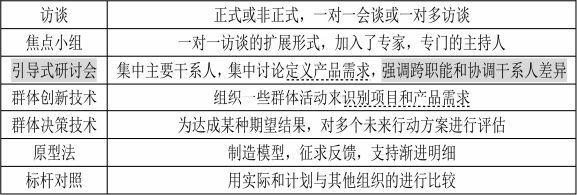

11 、群体创新技术：

（1）头脑风暴法。一种用来产生和收集对项目需求与产品需求的多种创意的技术。本身不包 含投票或排序，但常与包含该环节的其他群体创新技术一起使用。

（2）名义小组技术。用于促进头脑风暴的一种技术， 通过投票排列最有用的创意，以便进一 步开展头脑风暴或优先排序。

（3）概念/思维导图。把从头脑风暴中获得的创意整合成一张图的技术，以反映创意之间的共 性与差异， 激发新创意。

（4）亲和图。用来对大量创意进行分组的技术，以便进一步审查和分析。

（5）多标准决策分析。借助决策矩阵，用系统分析方法建立诸如风险水平、不确定性和价值 收益等多种标准，从而对众多方案进行评估和排序的一种技术。

12、群体决策技术就是为达到某种期望结果， 而对多个未来行动方案进行评估的过程。本 技术用于生产产品需求， 并对产品需求进行归类和优先级排序。达成群体决策方法:①一致同意；②大多数原则；③相对多数原则；④独裁。（17 下 44）（18 上 44）（18 下 44）

（1） 一致同意。每个人都同意某个行动方案。

（2）大多数原则。获得群体中超过 50%人员的支持， 就能做出决策。

（3）相对多数原则。根据群体中相对多数者的意见做出决策，即便未能获得大多数人的支持。 （4）独裁。在这种方法中，由某一个人为群体做出决策。

13、需求文件的内容包括： ①业务需求②干系人需求③解决方案需求④项目需求⑤过渡需求 ⑥与需求有关的假设条件、依赖关系和制约因素。（了解）

14、需求跟踪包括跟踪以下内容:（1）业务需要、机会、目的和目标;（2）项目目标;（3）项 目范围/WBS  可交付成果;（4）产品设计;（5）产品开发;（6）测试策略和测试场景;（7）高层级 需求到详细需求。

15、需求跟踪矩阵中记录的典型属性包括唯一标识、需求的文字描述、收录该需求的理由、  所有者、来源、优先级别、版本、当前状态（如活跃中、已取消、已推迟、新增加、已批准、被 分配和已完成）和状态日期。为确保干系人满意，可能需要增加一些补充属性，如稳定性、复杂 性和验收标准。 需求跟踪矩阵连接了需求与需求源， 用于在整个项目生命周期中对需求进行跟踪。 需求跟踪矩阵是把产品需求从其来源连接到能满足需求的可交付成果的一种表格

16 、范围定义的工具和技术：

（1）产品分析把对产品的要求转化成项目的要求。（17 上 43）

（2） 备选方案生成是一种用来制定尽可能多的潜在可选方案的技术， 用于识别执行项目工作 的不同方法。

（3） 引导式研讨会：具有不同期望或专业知识的关键人物参与研讨会， 有助于就项目目标和 项目限制达成跨职能的共识。

17、范围说明书是对项目范围、主要可交付成果、假设条件和制约因素的描述。详细的范围 说明书或引用的文档通常包括以下内容： ①项目目标；②产品范围描述；③项目需求；④项目边界；⑤项目的可交付成果；⑥项目的制约因素；⑦假设条件。（10 上 41）（12 下 43）（15 下 41）

（19 上 43）（19 下 40）

18、创建工作分解结构是把项目可交付成果和项目工作分解成较小的、更易于管理的组件的过程。 工作分解结构（WBS）是项目管理的基础，项目的所有规划和控制工作都必须基于工作分解结构。

19、工作分解结构对项目管理意义：①相关人员对项目一目了然；②保证了项目系统性和完 整性；③建立完整的项目保证体系；④明确项目工作，便于责任划分。

20 、WBS 最底层的工作单元被称为工作包，是我们进行进度安排、成本估算和监控的基础。 内容包括：①项目的全部工作都必须包含在工作分解结构当中；②编制需要所有项目干系人的参 与； ③逐层向下分解的，每条分支分解层次不必相等，一般控制在 3-6 层。（17 下 43）（18 上 43）

21 、工作分解结构中的要素应该是相对独立的， 要尽量减少相互之间的交叉。

22、常用工作分解结构形式： ①分级的树型结构：层次清晰、非常直观、结构性强，但是不 容易修改， 一般在一些小的项目。②表格形式：反映出项目所有的工作要素，直观性较差。但在 一些大型的、复杂的项目中使用还是较多的。（10 下 41）

23、里程碑=具体时间+在这个时间应完成的事件。

24、工作包：建议工作包的大小应该至少需要 8 个小时来完成，而总完成时间也大于 80 小时。

25、控制账户：是一个管理控制点，在该控制点上，把范围、预算、实际成本和进度加以整 合， 并与挣值相比较， 以测量绩效。控制账户在 WBS 中选定的管理节点上， 每个控制账户可能包 括一个或多个工作包，但是一个工作包只能属于一个控制账户。（19 下 39）

26、具有下列特征之一，就可能被当作工作包：①规模较小，可以在短时间（80 小时）完成。 ②从逻辑上讲，不能再分了。③所需资源、时间、成本等已经可以比较准确地估算，已经可以对 其进行有效的时间、成本、质量、范围和风险控制。

27、编码设计对于 WBS 来说是个关键技术，进行编码设计时必须仔细考虑收集到的信息和收 集所用的方法。

28、把这个项目工作分解为工作包，需要以下活动：①识别和分析可交付成果及相关工作；  ②确定 WBS 的结构和编排方法；③自上而下逐层细化分解； ④为 WBS 组件制定和分配标识编码； ⑤核实可交付成果分解的程度是否恰当。（16 上 43）

29 、分解 WBS 结构的方法至少有如下三种： （14 上 43）（14 下 41）（15 下 42）

1）使用项目生命周期的阶段作为分解的第一层，而把项目可交付物安排在第二层。 2）把项目重要的可交付物作为分解的第一层。

3）把子项目安排在第一层，再分解子项目的 WBS。

30、工作分解结构应把握原则：①避免遗漏必要的组成部分；②避免交叉从属；③相同层次 的工作单元应用相同性质；④应能分开不同的责任者；⑤便于项目管理计划需要；⑥应该具有可 比行， 是可管理的，可定量检查的；⑦应包括项目管理工作， 包括分包出去的工作。（11 上 38）（16上 42）

31、范围基准： 经过批准的范围说明书、工作分解结构（WBS）和相应的 WBS  词典组成了 范围基准。工作分解结构每向下分解一层，代表着对项目工作更详细的定义。把每个工作包分配 到一个控制账号， 并根据“账户编码”为工作包建立唯一标识，是创建 WBS 的最后步骤。控制账 户设置在 WBS 中选定的管理节点上。（11 下 41）（12 下 42）

32、WBS 词典中的内容可能至少包括： 账户编码标识、工作描述、假设条件和制约因素、负 责的组织、进度里程碑、相关的进度活动、所需资源、成本估算、质量要求、验收标准、技术参 考文献、协议信息。（WBS 字典实际是相当于新华字典，是对 WBS 中每个元素的描述）

33 、确认范围是正式验收己完成的项目可交付成果的过程。确认范围需要审查可交付物和工 作成果， 以保证项目中所有工作都能准确地、满意地完成。确认范围应该贯穿项目的始终，从 WBS  的确认或合同中具体分工界面的确认，到项目验收时范围的检验。 确认范围过程应该以书面文件 的形式把它完成情况记录下来。 范围确认的主要作用是： 使验收过程具有客观性， 同时通过验收， 提高最终产品、服务或成果获得验收的可能性。（19 下 41）

34、确认范围过程与控制质量过程的不同之处在于， 前者关注可交付成果的验收，而后者关 注可交付成果的正确性及是否满足质量要求。控制质量过程通常先于确认范围过程,但二者也可同 时进行。

35、确认范围的步骤：（1）确定需要进行确认范围的时间（2）识别确认范围需要哪些投入（3） 确定范围正式被接受的标准和要素（4）确定确认范围会议的组织步骤（5）组织确认范围会议。（17上 47）

36 、范围确认完成时，同时应当对确认中调整的 WBS 及 WBS 字典进行更新。

37 、范围确认和需求确认一定要分开。需求确认是在项目前期 3 方通过召开需求评审会的方 式讨论从而形成一个需求说明书，确认需求；范围确认是阶段性的验收。

38 、项目范围确认所采用的方法 ：（15 下 43）检查是指开展测量、审查与确认等活动， 来判 断工作和可交付成果是否符合需求和产品验收标准， 是否满足项目干系人的要求和期望。 检查有 时也被称为审查、产品审查、审计和巡检等。（17 上 46）

39、范围控制是监督项目和产品的范围状态，管理范围基准变更的过程。范围控制涉及到影

响引起范围变更的因素，确保所有被请求的变更、推荐的纠正措施或预防措施按照项目整体变更 控制处理，并在范围变更实际发生时进行管理。 范围控制过程应该与其他控制过程协调开展。未 经控制的产品或项目范围的扩大（未对时间、成本和资源做相应调整） 被称为范围蔓延。【客户不

断提出要求，不断去改，最终交付物不满足要求！镀金：项目实施人员往往愿意尝试新的技术或

者为信息系统项目加上】变更不可避免，因此在每个项目上，都必须以书面的形式记录并实施某

种形式的变更控制管理。（19 上 45）（19 下 42）

40、需求基线定义了项目的范围。随着项目的进展，用户的需求可能会发生变化，从而导致 需求基线变化以及项目范围的变化。 每次需求变更并经过需求评审后，都要重新确定新的需求基 线。项目组需要维护需求基线文档，保存好各个版本的需求基线，以备不时之需。随着项目的进 展，需求基线将越定越高，容许的需求变更将越来越少。

41 、变更控制的焦点问题： 1）确定范围变更是否已经发生。 2）对造成范围变更的因素施加影响， 以确保这些变更得到一致的认可 3）当范围变更发生时， 对实际的变更进行管理。（11 上 41）

（12 上 41）（12 上 43）

42、范围管理是整体管理的一部分，变更流程可统一设计，统一管理，因此没必要必须把范 围变更与整体变更区分开来。

本章历年考题和答案解析汇总：

#### 【试题 1】---2009 上真题 29

1、范围管理计划中一般不会描述（1）。

（1）A.如何定义项目范围                  B.制定详细的范围说明书

C.需求说明书的编制方法和要求        D.确认和控制范围

#### 【答案】C

#### 【解析】 此题考察的是范围管理计划的内容，必须掌握，高频考点

范围管理计划就项目管理团队如何管理项目范围提供指导。范围管理计划的内容包括： （1）基于初步项目范围说明书准备一个详细的项目范围说明书的过程；

（2）从详细的项目范围说明书创建 WBS 的过程；

（3） 详细说明已完成项目的可交付物是如何得到正式的确认和讥可，以及获得与之相伴的 WBS 的过程：

（4） 一个用来控制需求变更如何落实到详细的项目范围说明书中的过程。 而需求说明书的编制方法和要求属于技术过程。

#### 【点评】常考，需要大致记忆下，尽量得分，没有遇到的话可以用排除法去做

#### 【试题 2】---2009 上真题 30

2、以下关于工作包的描述，正确的是（2）。

（2）A.可以在此层面上对其成本和进度进行可靠的估算

B.工作包是项目范围管理计划关注的内容之一

C.工作包是 WBS 的中间层

D.不能支持未来的项目活动定义

#### 【答案】A

#### 【解析】 此题考察的是 WBS、工作包的内容，必须掌握，高频考点

工作分解结构（WBS）详细地说明了项目的范围，详细描述了项目所要完成的工作。WBS 的组 成元素有助于项目干系人检查项目的最终产品。WBS 的最低层元素是能够被评估的、可以安排进度 的和被追踪的。

WBS 的最低水平的工作单元被称为工作包， 它是定义工作范围、定义项目组织、设定项目产品 的质量和规格、估算和控制费用、估算时间周期和安排进度的基础。

项目活动的定义正是从 WBS 的工作包分解而来

#### 【点评】常考题，记住，比较简单，必须得分

#### 【试题 3】---2009 上真题 31

3、小王正在负责管理一个产品开发项目。开始时产品被定义为“最先进的个人数码产品”，后来被 描述为“先进个人通信工具” 。在市场人员的努力下该产品与某市交通局签订了采购意向书，随后 与用户、市场人员和研发工程师进行了充分的讨论后，被描述为“成本在 1000 元以下，能通话、 播放 MP3、能运行 winCE 的个人掌上电脑” 。这表明产品的特征正在不断改进，但是小王还需将 （3）与其相协调。

（3）A.项目范围定义           B.项目干系人利益

C.范围变更控制系统       D.用户的战略计划

#### 【答案】A

#### 【解析】P233 此题考察的是产品范围的内容，理解题，必须掌握，高频考点

产品范围描述了项目承诺变付的产品、服务或结果的特征。这种描述会随着项目的开展，其 产品特征逐渐细化。 但是，产品特征的细化必须在适当的范围定义下进行，特别是对于基于合同 开展的项目。项目的范围一旦定义、得到项目相关干系人确认后，就不能随意改变，即使产品特 征在逐渐地细化，也要在相关干系人定义、确认后的项目范围内进行。

#### 【点评】常考题，比较简单，需要结合题意稍微理解下，必须得分

#### 【试题 4】 ---2009 上真题 52

4、某公司正在为某省公安部门开发一套边防出入境管理系统， 该系统包括 15 个业务模块，计划 开发周期为 9 个月，即在今年 10 月底之前交付。开发团队一共有 15 名工程师。今年 7 月份，中 央政府决定开放某省个人到香港旅游， 并在 8 月 15 日开始实施。为此客户要求公司在新系统中实 现新的业务功能， 该功能实现预计有 5 个模块，并要求在 8 月 15 日前交付实施。但公司无法立刻 为项目组提供新的人力资源。面对客户的变更需求， 以下（4）处理方法最合适。

（4）A.拒绝客户的变更需求，要求签订一个新合同，通过一个新项目来完成

B.接受客户的变更需求，并争取如期交付，建立公司的声誉

C.采用多次发布的策略， 将 20 个模块重新排定优先次序， 并在 8 月 15  日之前发布一个包含 到香港旅游业务功能的版本， 其余延后交付

D.在客户同意增加项目预算的条件下，接受客户的变更需求，并如期交付项目成果。 【答案】C

#### 【解析】 此题考察的是变更知识，理解题，必须掌握，高频考点

因该项目的范围变更来自于中央政府开放某省个人到香港旅游的决定，因此不能拒绝。

那么是否可以“接受客户的变更需求，并争取如期交付，建立公司的声誉”呢？或者“在客 户同意增加项目预算的条件下，接受客户的变更需求，井如期交付项目成果”？答案是不可以， 因为题干中已指出：“公司无法立刻为项目组提供新的人力资源”。

综合题干的介绍，面对这个变更， 合适的处理方法只有“采用多次发布的策略， 将 20 个模块 重新排定优先次序， 并在 8 月 1 5 日之前发布一个包含到香港旅游业务功能的版本，其余延后交 付”了。

#### 【点评】常考题，分期交付这个思想蛮重要，题比较简单，必须得分

#### 【试题 5】---2009 上真题 53

。、范围变更控制系统（5）。

（5）A.是用以确定正式修改项目文件所必须遵循步骤的正式存档程序

B.是用于在技术与管理方面监督指导有关报告内容， 以及控制变更的确定与记录工作并确保 其符合要求的存档程序

C.是一套用于对项目范围做出变更的程序，包括文书工作， 跟踪系统以及授权变更所需的认可

D.可强制用于各项目工作以确保项目范围管理计划在未经事先审查与签字的情况下不得做出变更 【答案】C

#### 【解析】 此题考察的是范围变更，必须掌握，高频考点

范围变更控制的方法是定义范围变更的有关流程。该流程由范围变更控制系统实现，包括必 要的书面文件（如变更申请单）、纠正行动、跟踪系统和授权变更的批准等级。变更控制系统与其 他系统相结合，如配置管理系统来控制项目范围。当项目受合同约束时，变更控制系统应当符合 所有相关合同条款。由变更控制委员会负责批准或者拒绝变更申请。

#### 【点评】常考题，比较简单，必须得分

#### 【试题 6】---2009 下真题 42

6、下面关于 WBS 的描述，错误的是（6）  。

（6）A.WBS 是管理项目范围的基础，详细描述了项目所要完成的工作

B.WBS 最底层的工作单元称为功能模块

C.树型结构图的 WBS 层次清晰、直观、结构性强

D. 比较大的、复杂的项目一般采用列表形式的 WBS 表示

#### 【答案】B

#### 【解析】P235  此题考察的是 WBS，必须掌握，高频考点

WBS 是项目管理范围的基础，详细描述了项目所要完成的工作。它的最底层工作单元称为工作 包， 它定义项目组织、设定项目产品的质量和规格等。WBS 的表示形式有树形和列表结构。其中树 形结构层次清晰、直观、结构性强，但是不容易修改；而列表结构直观性较差，但是容量大，因 此常用于一些大型、复杂的项目。

#### 【点评】常考，命题的热点，简单题， 必须得分

#### 【试题 7】---2009 下真题 43

7、（7）是客户等项目干系人正式验收并接收已完成的项目可交付物的过程。

（7）A.范围确认    B.范围控制    C.范围基准    D.范围过程

#### 【答案】A

#### 【解析】 此题考察的是范围管理的基本概念，必须掌握，高频考点

范围确认是客户等项目干系人正式验收并接收已完成的项目可交付物的过程；范围控制是监  控项目状态，如项目的工作范围状态和产品范围状态的过程， 也是控制变更的过程。“范围基准 ” 和“范围过程”根本不是一个过程。

#### 【点评】几乎必考，命题的热点，简单题，必须得分

#### 【试题 8】---2010 上真题 41

8、某公司最近在一家大型企业 。A 项目招标中胜出，小张被指定为该项目的项目经理。公司发 布了项目章程，小张依据该章程等项目资料编制了由项目目标、可交付成果、项目边界及成本和 质量测量指标等内容组成的（8）。

（8）A.项目工作说明书      B.范围管理计划  C.范围说明书        D.WBS

#### 【答案】C

#### 【解析】P234 此题考察的是范围说明书，必须掌握，高频考点

详细的范围说明书包括的直接内容或引用的内容，如下：①项目的目标②产品范围描述（3）项目 的可交付物④项目边界⑤产品验收标准⑥项目的约束条件⑦项目的假定

小张依据项目章程等项目资料编制了由项目目标、可交付成果、项目边界及成本和质量测量 指标等内容组成的文档。该文档的一个输入是项目章程，且符合项目范围说明书要定义的内容。 因此应选 C。

#### 【  点评】常考，命题的热点，简单题，必须得分

#### 【试题 9】 ---2010 上真题 42

9、下面关于项目范围确认描述，（9）是正确的。

（9）A.范围确认是一项对项目范围说明书进行评审的活动

B.范围确认活动通常由项目组和质量管理员参与执行即可

C.范围确认过程中可能会产生变更申请

D.范围确认属于一项质量控制活动

#### 【答案】C

#### 【解析】P242此题考察的是范围确认，必须掌握，高频考点

范围确认是客户等项目干系人正式验收并接受已完成的项目可交付物的过程。也称范围确认 过程为范围核实过程。项目范围确认包括审查项目可交付物以保证每一交付物令人满意地完成。	 如果项目在早期被终止，项目范围确认过程将记录其完成的情况。

项目范围确认应该贯穿项目的始终。范围确认与质量控制不同，范围确认是有关工作结果的 接受问题，而质量控制是有关工作结果正确与否，质量控制一般在范围确认之前完成，当然也可 以并行进行。

范围确认的输入包括：①项目管理计划；②可交付物。范围确认的输出包括：①可接受的项目可 交付物和工作；②变更申请；③更新的 WBS 和 WBS 字典。

综上所述， 范围确认的对象不仅包括范围说明书，还包括项目管理计划和所有可交付物；范围 确认的参加人员是客户和所有项目干系人，不仅限于项目组和质量管理员；范围确认与质量控制不 同，前者是有关工作结果的接受问题， 而后者是有关工作正确与否的问题。因此答案选项 A, B, D 不正确。范围确认可能的输出包括变更申请，因此， 应选择 C。

#### 【  点评】常考，命题的热点，简单题，必须得分

#### 【试题 10】---2010 下真题 42

10、在项目验收时， 建设方代表要对项目范围进行确认。下列围绕范围确认的叙述正确的是（10）。

（10）A.范围确认是确定交付物是否齐全，确认齐全后再进行质量验收

B.范围确认时， 承建方要向建设方提交项目成果文件如竣工图纸等

C.范围确认只能在系统终验时进行

D.范围确认和检查不同，不会用到诸如审查、产品评审、审计和走查等方法 【答案】B

#### 【解析】 此题考察的是范围确认，必须掌握，高频考点

项目范围确认是指项目干系人对项目范围的正式承认，是客户等项目干系人正式验收并接受 已完成的项目可交付物的过程，也称范围确认过程为范围核实过程。但实际上项目范围确认是贯 穿整个项目生命周期的，从项目管理组织确认 WBS 的具体内容开始，到项目各个阶段的交付物检 验，直至最后项目收尾文档验收，甚至是最后项目评价的总结。可见 C 是错误的。

范围确认与质量控制不同，范围确认是有关工作结果的接受问题，而质量控制是有关工作结 果正确与否，质量控制一般在范围确认之前完成，当然也可并行进行。故 A 是错误的。

范围的工具与技术：检查包括诸如测量、测试和验证以确定工作和可交付物是否满足要求和产 品的验收标准。检查有时被称为审查、产品评审、审计和走查 （可见 D 是错误的）。在一些应用领 域中，这些不同的条款有其具体的、特定的含意。

确认项目范围时，项目管理团队必须向客户方出示能够明确说明项目（或项目阶段）成果的 文件， 如项目管理文件（计划、控制、沟通等）、需求说明书、技术文件、竣工图纸等（可见 B 是 正确的）。当然， 提交的验收文件应该是客户已经认可了的该项目产品或某个阶段的文件， 他们必 须为完成这项工作准备条件， 做出努力。故 B 为正确答案。

#### 【点评】常考，命题的热点，简单题， 必须得分

#### 【试题 11】---2010 下真题 43

11、在项目结项后的项目审计中， 审计人员要求项目经理提交（11）作为该项目的范围确认证据。

（11）A.系统的终验报告       B.该项目的第三方测试报告

C.项目的监理报告        D.该项目的项目总结报告

#### 【答案】A

#### 【解析】 此题考察的是范围确认，必须掌握，高频考点

项目审计是对项目管理工作的全面检查，包括项目的文件记录、管理的方法和程序、财产情 况、预算和费用支出情况以及项目工作的完成情况。项目结项后的项目审计应由项目管理部门与 财务部门共同进行。

确认项目范围时，项目管理团队必须向客户方出示能够明确说明项目（或项目阶段）成果的

文件， 如项目管理文件（计划、控制、沟通等）、需求说明书、技术文件、竣工图纸等。当然， 提 交的验收文件应该是客户己经认可了的该项目产品或某个阶段的文件，他们必须为完成这项工作 准备条件， 做出努力。

故在项目结项后的项目审计中，项目经理应向审计人员提交系统的终验报告，作为该项目的 范围确认证据。即 A 是正确答案。

#### 【点评】常考，命题的热点，简单题， 必须得分

12、在某信息化项目建设过程中，客户对于最终的交付物不认可，给出的原因是系统信号强度超 过用户设备能接受的上限。请问在项目执行过程中， 如果客户对于项目文件中的验收标准无异议， 则可能是（39）环节出了问题；如果客户对于项目文件中的验收标准有异议，而项目内所有工作 流程均无问题，则可能是（40）环节出了问题。

（39）A.质量控制     B.WBS  分解过程     C.变更控制      D.范围确认

（40）A.质量控制     B.WBS  分解过程     C.变更控制      D.范围确认

#### 【解析】 此题考察的是项目管理过程的定义，必须掌握，高频考点

范围确认是客户等干系人正式验收并接受己完成的项目可交付物的过程。也称范围确认为范 围核实过程。范围确认与质量控制不同，范围确认是有关工作结果的接受问题，而质量控制是有 关工作结果的正确与否，质量控制一般在范围确认之前完成，当然也可以并行进行。

客户对项目文件中的验收标准无异议，则存在问题的环节在于对工作结果是否达到验收标准 （即正确与否） 的认定， 因此这属于质量控制环节。如果客户对于项目文件中的验收标准有异议， 即对工作结果是否能够接受存在异议， 这属于范围控制环节的问题。

单纯的 WBS 分解过程一般不涉及干系人的正式验收和确认， 此外，题干中未明确涉及变更控 制的流程和角色，因此第（39）题应选 A，第（40）题应选 D。

#### 【试题 13】---2011 上真题 41

13、在项目管理领域， 经常把不受控制的变更称为项目“范围蔓延”。为了防止出现这种现象，需 要控制变更。批准或拒绝变更申请的直接组织称为①, 定义范围变更的流程包括必要的书面文件、

②和授权变更的批准等级。

（13）A.①变更控制委员会； B.①项目管理办公室； C.①变更控制委员会； D.①项目管理办公室；

②纠正行动、跟踪系统

②偏差分析、配置管理

②偏差分析、变更管理计划

②纠正行动、配置管理

#### 【答案】A

#### 【解析】 此题考察的是变更控制知识，必须掌握，必考

范围控制是监控项目状态如项目的工作范围状态和产品范围状态的过程，也是控制变更的过 程。经常把不受控制的变更称作为项目“范围蔓延”。变更是不可避免的，进而需要某种类型的变 更控制过程。

范围变更控制的方法是定义范围变更的有关流程。它包括必要的书面文件、纠正行动、跟踪 系统和授权的变更批准等级。变更控制系统与其他系统相结合，如配置管理系统，来控制项目范 围。由变更控制委员会负责批准或者拒绝变更申请。

#### 【点评】范围变更，常考，简单，必须得分

14、通常把被批准的详细的项目范围说明书和与之相关的（14）作为项目的范围基准，并在整个 项目的生命期内对之进行监控、核实和确认。

（14）A.产品需求        B.项目管理计划    C.WBS 以及 WBS 字典   D.合同

#### 【解析】项目范围说明书

项目范围说明书、与之联系的 WBS 以及 WBS 字典作为项目的范围基准， 在整个项目的生命期， 这个范围基准被监控、核实和确认。

15、李某负责的一个信息系统项目，在与客户共同进行的质量审查中发现有一个功能模块与客户 需求不一致，经过追溯后并未发现相应的变更请求， 李某最终只好对该模块进行了重新设计和编 码。造成此次返工的具体原因可能是（15）。

（15）A.没有进行变更管理         B.没有进行范围确认  C.没有进行需求管理          D.没有进行回归测试

#### 【解析】 项目范围确认是指项目干系人对项目范围的正式承认，是客户等项目干系人正式验收并接受 已完成的项目可交付物的过程，也称范围确认过程为范围核实过程。项目范围确认包括审查项目 可交付物以保证每一交付物令人满意地完成。

确认项目范围时，项目管理团队必须向客户方出示能够明确说明项目（或项目阶段）成果的 文件， 如项目管理文件（计划、控制，沟通等）、需求说明书、技术文件、竣工图纸等。当然， 提 交的验收文件应该是客户已经认可了的这个项目产品或某个阶段的文件，他们必须为完成这项工 作准备条件，做出努力。

在本题案例中， 能够发现功能模块与客户需求不一致， 并能够由此进行追溯可能的变更请求， 说明该项目中应该存在变更管理和需求管理活动。而所谓回归测试是指修改了旧代码后，重新进 行测试以确认修改没有引入新的错误或导致其他代码产生错误。回归测试的缺失并不会导致功能 模块与客户需求不一致的问题发生。故选项 A, C, D 均不是造成此次返工的具体原因。

#### 【试题 16】---2011 下真题 43

16、某项目小组在定义项目的工作构成时设计一份材料清单来代替工作分解结构 WBS，客户在对 材料清单进行评审时发现其中缺少一项会导致范围变更的需求， 后来这一变更需求被补充了进去。

造成这一次单位变更的主要原因是（16）。

（16）A.设计人员提出了新手段     B.客户对项目要求发生变化 C.项目外部环境发生变化     D.定义项目范围过程中发生的错误和遗漏

#### 【解析】

变更是项目干系人常常由于项目环境或者是其他的各种原因要求对项目的范围基准进行修改，甚至是重新计划，而这一类修改或变化就叫做变更。 造成项目范围变更的主要原因如下:

（1）项目外部环境发生变化，例如，政府政策的问题。

（2）项目范围的计划编制不周密详细，有一定的错误或遗漏。

（3）市场上出现了或是设计人员提出了新技术、新手段或新方案。

（4）项目实施组织本身发生变化。

（5）客户对项目、项目产品或服务的要求发生变化。

在本题案例中，由于项目组没有采用工作分解结构（WBS ）来定义项目的工作构成，却仅仅设计了一份材料清单， 这种草率地做法最终导致遗漏了一项会导致范围变更的需求，因此， 选项 D “定义项目范围过程中发生的错误或遗漏”是造成这一次范围变更的主要原因。

17、在对一项任务的检查中， 项目经理发现一个团队成员正在用与 WBS 词典规定不符的方法来完 成这项工作。项目经理应首先（17）。

A.告诉这名团队成员采取纠正措施。

B.确定这种方法对职能经理而言是否尚可接受的

C. 问这名团队成员，这种变化是否必要

D.确定这种变化是否改变了工作包的范围

#### 【解析】 在对一项任务的检查中，项目经理发现一个团队成员正在用与 WBS 词典规定不符的方法来完成这项工作。项目经理应首先确定这种变化是否改变了工作包的范围。

#### 【试题 18】---2012 上真题 42

18、关于范围确认的叙述中，（18）是不正确的。

（18）A.范围确认是核实项目的可交付成果已经正确完成的过程

B.客户对可交付成果签字确认后， 双方可展开质量控制活动，如测试、评审等 C.可对照项目管理计划、相应的需求文件或 WBS 来核实项目范围的完成情况 D.范围确认的方法包括检查、测试、评审等

#### 【解析】 范围确认是客户等项目干系人正式验收并接受已完成的项目可交付物的过程。也称范围确认

过程为范围核实过程。项目范围确认包括审查项目可交付物以保证每一交付物令人满意地完成。  如果项目在早期被终止，项目范围确认过程将记录其完成的情况。

项目范围确认应该贯穿项目的始终。范围确认与质量控制不同，范围确认是有关工作结果的 接受问题，而质量控制是有关工作结果正确与否，质量控制一般在范围确认之前完成，当然也可 并行进行。  范围确认的方法是对所完成可交付成果的数量和质量进行检查。检查的方法主要包括： （1） 试验（2）专家评定  （3）第三方评定

#### 【试题 19】---2012 上真题 43

19、在一个设计项目开始两个月后，客户要求对项目产品进行修改并在没有通知项目经理的前提 下就做了这项变更， 在最后测试阶段， 发现测试结果与当初计划不同。这种情况主要是由于（19）。

（19）A.测试计划定义不完善          B.没有做好范围变更控制

C.质量管理计划的开发不完善    D.没有坚持沟通计划

#### 【答案】B

#### 【解析】 此题考察的是范围控制，必须掌握，高频考点

考查范围控制 这种情况主要是由于没有做好范围变更控制。

#### 【点评】范围控制，多次考了，简单， 必须得分

#### 【试题 20】---2012 下真题 41

20、（20）是定义项目批准、定义项目组织，设定项目产品质量和规格、估算和控制项目费用。

（20）A.WBS          B.详细范围说明书    C.WBS 字典    D.工作包

#### 【答案】D

#### 【解析】 此题考察的是WBS，必须掌握，高频考点

通常，将 WBS 的最底层工作单元称为工作包。它是定义工作范围、定义项目组织、设定项目 产品的质量和规格、估算和控制费用、估算时间周期和安排进度的基础。

#### 【点评】工作包，多次考了，简单，必须得分

#### 【试题 21】---2012 下真题 42

21、用于项目范围确认的是（21）。

（21）A.项目范围说明书    B.工作包     C.范围基准     D.WBS

#### 【答案】C

#### 【解析】 此题考察的是范围确认，必须掌握，高频考点

用于范围确认的项目管理计划的组成部分包括如下的范围基准：

①项目范围说明书。 项目范围说明书包括产品范围描述、项目可交付物、验收标准。 ②WBS。WBS 定义了项目的每一个可交付物以及可交付物到工作包的分解。

③WBS 词典。WBS 词典有项目工作以及每个 WBS 元素的详细说明。WBS 和 WBS 字典用于定义范围以 及确认项目进行中的工作成果是不是项目的一部分。

#### 【点评】范围基准，多次考了，简单， 必须得分

#### 【试题 22】---2012 下真题 43

22、某公司的项目审查委员会每个季度召开会议审查所有预算超过一千二百万元的项目。李工最 近被提升为该公司高级项目经理，并承担了最大的项目之一，即开发下一代计算机辅助生产流程 系统，审查委员会要求李工在下次会议上说明项目的目标、工作内容和成果，为此李工需要准备 的文件是（22）。

（22）A.项目章程    B.产品阐述    C.范围说明书     D.工作分解结构

#### 【答案】C

#### 【解析】 此题考察的是项目范围说明书，必须掌握， 高频考点

依题意，在李工准备的项目范围说明书中需要说明项目目标、工作内容、  项目可交付成果、 项目边界等材料，这也是项目审查委员会所要求提供的材料。

#### 【点评】范围说明书的内容，多次考了，简单，必须得分

#### 【试题 23】---2012 下真题 52

23、在没有现成的 WBS 模板情况下，为准备 WBS，项目经理首先应该（23）。

（23）A.确定每个项目阶段有估计成本和时间    B.确定主要的项目可交付成果

C.确定每个项目阶段有组成部分          D.确定要完成的关键工作

#### 【答案】B

#### 【解析】 此题考察的是WBS和问题处理，理解题，必须掌握，高频考点

创建工作分解结构（WBS）是将项目可交付成果和项目工作分解成较小的、更易于管理的组成 部分的过程。在“工作分解结构”这个词中，“工作”是指经过努力所取得的成果， 如工作产品或 可交付成果。因此， 在没有现成的 WBS 模板情况下， 为准备 WBS,项目经理首先应该确定主要的项 目可交付成果。

#### 【点评】WBS 考点，多次考了，简单，必须得分

#### 【试题 24】---2013 上真题 41

24、项目范围的定义和管理过程将影响到整个项目是否成功。每个项目都必须慎重地权衡工具、 数据来源、方法论、过程和程序以及其他一些因素， 以确保在管理项目范围时所做的努力与项目 的规模、复杂性和重要性相符。因此， 项目经理应该重点关注  24   这个过程。

（24）A.范围控制    B.范围变更   C.编制范围管理计划    D.范围确认

#### 【答案】C

#### 【解析】 此题考察的是范围管理计划，必须掌握，高频考点

编制范围管理计划是范围管理的第一个过程， 这个过程的主要工作就是规划如何开展范围管理 工作：（1） 如何进行范围定义（2）如何开发 WBS（3）如何进行范围确认（4）如何进行范围控制； 所以选 C；

#### 【点评】范围管理的工作，比较简单， 必须得分

#### 【试题 25】---2013 上真题 42

25、王工是公司一个物联网网关开发项目的项目经理。他根据项目计划将其中的某个软件模块转 包给了一个分包商。小李是分包商的新项目经理。王工应建议小李首先 25  。

（25）A.遵照王工为项目制定的 WBS

B.针对这个软件模块的开发工作编制一个分项目 WBS

C.建立类似的编码结构， 以便于应用公共项目管理信息系统

D.建立一个 WBS 词典来显示详细的人员分工

#### 【答案】B

#### 【解析】 此题考察的是 WBS，必须掌握，高频考点

对于复杂的项目， WBS 可以只显示到子项目， 但是子项目必须制定详细的 WBS 内容；则 A 错， 分项目应有自己的 WBS；C 和 D 倒是不错，但不是首先要干的， 做完 B 后再进行；

#### 【点评】WBS，需要稍微理解下，难题，尽量得分

#### 【试题 26】---2013 上真题 55

26 、一个新软件产品的构建阶段即将完工。下一个阶段是测试和执行。这个进度计划提前了两周。 在进入最后阶段之前，项目经理最应该关注（26）

（26）A.范围确认     B.风险控制    C.绩效报告     D.成本控制

#### 【答案】A

#### 【解析】 此题考察的是范围确认，必须掌握，高频考点

范围确认是客户等项目干系人正式验收并接受已完成的项目可交付物的过程。也称范围确认 过程为范围核实过程。范围确认是对已交付的可交付物的验收， 必须及时进行；

#### 【点评】范围确认的定义，需要稍微理解下，比较简单，必须得分

#### 【试题 27】---2013 下真题 42

27、对项目范围管理是通过五个管理过程来实现的， 第一步是（27）。

（27）A.编制范围管理计划     B.范围定义  C.创建工作分解结构     D.范围控制

#### 【答案】A

#### 【解析】P227此题考察的是范围管理的流程，必须掌握，高频考点

项目范围管理包括编制范围管理计划、定义项目范围、创建工作分解结构、核实项目范围和 控制项目范围等 5 个过程。

#### 【点评】如此简单，范围管理的流程， 送分

#### 【试题 28】---2013 下真题 44

28、项目的工作分解结构（WBS）是管理项目范围的基础，在进行项目工作的时候， 一般要遵从 以下几个步骤：

1.识别和确认项目的阶段和主要可交付物；

2.确认项目主要交付成果的组成要素；

3.分解并确认每一组成部分是否分解得足够详细；

4.核实分解的正确性。

这几个步骤中正确的操作顺序应该是（28）。

（28）A.1234        B.1324        C.1342      D.1432

#### 【答案】B

#### 【解析】 此题考察的是 WBS，必须掌握，高频考点

先确定项目各阶段有哪些交付物； 然后进行分解， 分解后才确认分解结果的组成要素， 最后核实。

#### 【点评】书上有原话，即使不记得分析也应该可以得出，建议得分

#### 【试题 29】---2014 上真题 66

29、项目范围管理过程包括： 范围计划、（29）、创建 WBS、范围确认、范围控制 5 个主要过程。 （29）A.需求管理  B.范围定义  C.范围变更   D.编制范围说明书

#### 【答案】B

#### 【解析】 此题考察的是范围管理的过程，必须掌握， 高频考点

送分题，简单，之前考过，建议下次送分的时候换个知识领域的过程考察。

#### 【试题 30】---2014 上真题 42

30、在“可交付物”层次上明确了要完成项目需要做的相应工作的文档是（30） （30）A.项目范围说明书  B.工作分解结构  C.项目建议书   D.项目申请书

#### 【答案】A

#### 【解析】 此题考察的是范围说明书的内容，必须掌握，高频考点

项目范围说明书在“可交付物”层次上明确了要完成项目需要做的相应工作

#### 【试题 31】---2014 上真题 43

31、在创建 WBS 时,（31）是不恰当的。

（31）A.把项目生命周期的各阶段作为分解的第一层，交付物安排在第二层

B.把项目的重要交付物作为分解的第一层

C.把子项目安排在第一层

D.把项目中的各类资源安排在第一层

#### 【答案】D

#### 【解析】 此题考察的是 WBS，必须掌握，几乎必考

把项目中的各类资源安排在第一层不属于 WBS 的分解方式

#### 【试题 32】---2014 下真题 40

32、（32）一般不属于项目范围管理活动。

（32）A.制订初步的范围说明书   B.范围定义   C.创建 WBS        D.范围确认

#### 【答案】A

#### 【解析】229此题考察的是范围管理的过程，必须掌握，高频考点

这题太简单了，如果连范围管理的 6 个过程都没记住，那还考什么试。范围管理活动：编制范围 管理计划、收集需求、范围定义、创建工作分解结构、范围确认、范围控制。

制定初步的范围说明书是整体管理的过程

#### 【点评】多次考了，比较简单，送分的

#### 【试题 33】---2014 下真题 41

33、某项目经理在生成 WBS 时，按照（33）方法将项目分解为“需求分析、方案设计、实施准备、 测试和验收”等几个过程。

（33）A.子项目   B.工作任务   C.生命周期    D.可交付物

#### 【答案】C

#### 【解析】P237此题考察的是 WBS 分解的 3 个方法，必须掌握，高频考点

分解就是把项目可交付成果分成较小的、便于管理的组成部分，直到工作和可交付成果定义到工 作细目水平。使用项目生命周期的阶段作为分解的第一层，而把项目可交付物安排在第二层，题 干中的信息说明了一个典型的信息系统的生命周期。

#### 【点评】多次考了，比较简单，送分的

#### 【试题 34】---2014 下真题 42

34、以下关于项目范围确认的叙述中，（34）是正确的。

（34）A.范围确认工作只针对项目产品的接受和移交

B.范围确认的结果是接受或拒绝项目交付物

C.范围确认的目的是核实项目范围说明书及 WBS 和 WBS 字典是否正确 D.合同项目进行范围确认活动时应邀请客户参加

#### 【答案】D

#### 【解析】P242此题考察的是范围确认，必须掌握，高频考点

这题选择起来还是容易的，在进行范围确认的时候肯定要要求客户参加， 而且都要签字。 范围确认就是客户等项目干系人正式验收并接受已完成的项目可交付物的过程。

#### 【点评】多次考了，比较简单，送分的

#### 【试题 35】---2015 上真题 40

35、详细的项目范围说明书是指导项目成功实施的关键文件。（） 不应该属于范围定义的输入。 A.项目章程    B.项目范围管理计划   C.批准的变更申请     D.项目合同文本

#### 【答案】D

#### 【解析】 此题考察的是范围定义的输入，必须掌握， 常考

范围定义的输入包括以下内容：①范围管理计划②项目章程③需求文件④组织过程资产 	【点评】多次考了，简单，必须得分

#### 【试题 36】---2015 上真题 41

36、围绕范围管理， 下列说法中（）是正确的。

A.为确保客户满意，交付物一定要比范围说明书规定的多。

B.为节省成本， 非关键交付物可根据情况决定是否交付。

C.要严格按照范围基准落实工作， 提供相关交付物。

D. 由于客户不一定关注 WBS 内容，可由工作包负责人自行决定交付内容。

#### 【解析】

在项目开发中，要严格按照范围基准进行，提供交付物；不能随意增加或减少，如果确有客户需 要，走变更程序，只要是范围说明书要求的交付物， 无论是关键还是附属的交付物，必须交付， 投机取巧是不道德的；项目人员在完成工作时， 依据 WBS 进行，保证完成所有范围定义的工作。

#### 【点评】多次考了，简单，必须得分

#### 【试题 37】---2015 上真题 42

37、以下关于项目管理计划的叙述中，（）是不正确的。

A.项目范围管理计划是项目管理团队确认、记录、核实项目范围的指南。 B.项目管理技术可以是粗略的，非正式的文档。

C.项目管理计划是其他知识域中相关分计划的集合。

D.项目范围管理计划仅仅是项目经理确认、管理和控制项目范围的指南。 【答案】D

#### 【解析】 此题考察的是范围管理计划，必须掌握，常考

项目范围管理计划需要项目管理团队全员参与。

#### 【点评】多次考了，简单，必须得分

#### 【试题 38】---2015 上真题 43

38、项目经理在进行日常项目范围控制时，可不包括的工作是（）。

A.监控项目的工作范围  B.监控项目产品范围状态

C.控制范围变更       D.控制项目干系人范围变化

#### 【解析】 项目经理作为项目的核心，完成的工作包括监控项目的工作范围、控制范围变更、监控项目产品范围状态等，干系人控制不属于项目经理职责范围。

#### 【试题 39】---2015 下真题 40

39、（ ）不属于项目范围定义的输入

（39）A.项目范围管理计划         B.组织过程资产

C.项目工作分解结构 WBS         D.项目章程和初步的范围说明书

#### 【解析】 范围定义输入包括以下内容：①范围管理计划②项目章程③需求文件④组织过程资产

#### 【试题 40】---2015 下真题 41

40、制定准确，详细的项目范围说明书是保证项目成功实施的关键，（ ）一般不属于项目范围说

明书的主要内容。

（40）A.项目资源需求  B.项目目标  C.项目目的   D.项目交付成果清单

#### 【答案】A

#### 【解析】 此题考察的是项目范围说明书的内容， 必须掌握，高频考点

项目范围说明书的主要内容： 项目目标、产品范围描述、项日需求、项目边界、项目的可交付物、 产品可接受的标准、项目的约束条件、项目的假设条件、初始的项目组织、初始风险、进度里程 碑、资金限制、成本估算、项目配置管理需求、项目规范 、已批准的需求

#### 【点评】送分题，多次考了，简单

#### 【试题 41】---2015 下真题 42

41、某项目经理在生成 WBS 时， 按照（ ）将项目分解为“项目管理，需求分析， 方案设计，集

成准备，集成实施， 测试和验收”等几个过程

（41）A.项目章程   B.项目范围说明    C.生命周期的阶段  D.验收准则

#### 【答案】C

#### 【解析】 此题考察的是项目论证的内容，必须掌握， 高频考点

分解就是把项目可交付成果分成较小的、便于管理的组成部分，直到工作和可交付成果定义到工 作细目水平。使用项目生命周期的阶段作为分解的第一层，而把项目可交付物安排在第二层，题 干中的信息说明了一个典型的信息系统的生命周期。

#### 【点评】送分题，多次考了，简单

#### 【试题 42】---2015 下真题 43

42、项目范围确实是项目管理过程中的重要工作，（ ）是其使用的工具和技术

（42）A.分解   B.专家判断   C.检查   D.偏差分析

#### 【答案】C

#### 【解析】 此题考察的是范围确认的工具和技术， 必须掌握，高频考点

范围确认的工具：检查：包括测量、测试、检验等活动以判断结果是否满足项目干系人的要求和 期望，检查也可被称为审查、产品评审和走查等。

#### 【点评】送分题，多次考了，简单

#### 【试题 43】---2016 上真题 40

43、以下关于项目范围和产品范围的叙述中，不正确的是：（43）。

A.项目范围是为了获得具有规定特性和功能的产品、服务和结果，而必须完成的项目工作 B.产品范围是表示产品、服务和结果的特性和功能

C.项目范围是否完成以产品要求作为衡量标准

D.项目的目标是项目范围管理计划编制的一个基本依据

#### 【答案】C

#### 【解析】 此题考察的是项目范围和产品范围，必须掌握，高频考点

项目范围是否完成以项目管理计划、项目范围说明书、WBS、以及 WBS 字典作为衡量标准， 而产品 范围是否完成以产品要求作为衡量标准。

#### 【点评】送分题，常考，必须得分

#### 【试题 44】---2016 上真题 41

44、项目的工作分解结构是管理项目范围的基础， 描述了项目需要完成的工作，（44）是实施工作 分解结构的依据。

A.项目活动估算          B.组织过程资产

C.详细的项目范围说明书  D.更新的项目管理计划

#### 【解析】 创建 WBS 的输入（1） 详细的项目范围说明书（2）项目管理计划（3）纽织过程资产。

#### 【试题 45】---2016 上真题 42~43

45、项目经理在生成 WBS 时，一般将项目可交付物逐层分成更小的、更易管理的单元，以便于清 晰定义项目活动的工作包。分解的单元应易于管理， 分解原则一般不体现在（A）方面。（C）不 属于项目工作分解的活动。

（42）A.成本最低   B. 易于质量控制   C.易于衡量    D. 易于监督

（43）A.为 WBS 的工作单元分配代码     B.识别和分析项目可交付物

C.识别里程碑                    D.确认工作分解的程度

#### 【解析】 分解工作结构应把握如下原则：

（1）在各层次上保持项目的完整性，避免遗漏必要的组成部分。

（2） 一个工作单元只能从属于某个上层单元， 避免变叉从属。

（3）相同层次的工作单元应有相同性质。

（4）工作单元应能分开不同的责任者和不同工作内容。

（5）便于项目管理进行计划和控制的管理需要。

（6）最低层工作应该具有可比性，是可管理的，可定量检查的。

（7）应包括项目管理工作（因为管理是项目具体工作的一部分），包括分包出去的工作。

（8） WBS 的最低层次的工作单元是工作包。一个项目的 WBS 是否分解到工作包， 跟项目的阶 段、复杂程度和规模有关， 一般来说早期，或复杂， 或大规模的项目，其 WBS 的分解颗粒要大一 些，粗一些。

把整个项目的工作分解为工作包， 一般包括下列活动：

（1）识别和分析项目可交付物和与其相关的工作

（2）构造和组织 WBS

（3）把高层的 WBS 工作分解为低层次的、详细的工作单元

（4） 为 WBS 的工作单元分配代码

（5）确认工作分解的程度是必要和充分的。

#### 【试题 46】---2017 上真题 43

46、在范围定义的工具和技术中,（）通过产品分解、系统分析、价值工程等技术厘清产品范围, 并把对产品的要求转化成项目的要求。

A.焦点小组    B.各选方案生成    C.产品分析    D. 引导式研讨会

#### 【解析】范围定义的工具和技术：

产品分析把对产品的要求转化成项目的要求。

焦点小组是召集预定的干系人和主题专家，了解他们对所讨论的产品、服务或成果的期望和态度。是一种群体访谈而非一对一访谈。

研讨会能够比单项会议更早发现问题，更快解决问题。如，在软件开发行业，就有一种称为 “联合应用设计/开发（JAD）”的引导式研讨会。这种研讨会注重把业务主题专家和开发团队 集中在一起，来改进软件开发过程。在制造行业，则使用“质量功能展开（QFD）”这种引导 式讨论会， 来帮助确定新产品的关键特征。

#### 【试题 47】---2017 上真题 46

47、确认项目范围是验收项目可交付成果的过程，其中使用的方法是（）。

A.检查和群体决策技术    B.验证和决策    C.检查和群体创新技术    D.验证和审查

#### 【解析】项目范围确认所采用的方法: 检查和群体决策技术

#### 【试题 48】---2017 上真题 47

48、进行范围确认是项日管理中一项非常重要的工作,制定和执行确认程序时,第一项工作一般是（）。 A.确定需要进行确认范围的时间

B.识别确认范围需要哪些投入

C.确定确认范围正式被接受的标准和要素

D.确定确认范围会议的组织步骤

#### 【解析】确认范围的一般步骤：

（1）确定需要进行确认范围的时间。

（2）识别确认范围需要哪些投入。

（3）确定范围正式被接受的标准和要素。

（4）确定确认范围会议的组织步骤。

（5）组织确认范围会议。

#### 【试题 49】---2017 下真题 43

49、以下关于工作分解结构（WBS）的叙述中，不正确的是（）。

A.WBS 是制定进度计划， 成本计划的基础

B.项目的全部工作都必须包含在 WBS 中

C.WBS 的编制需要主要项目干系人的参与

D.WBS 应采用自下而上的方式，逐层确定

#### 【解析】WBS 包含的内容：

（1）工作分解结构是用来确定项目范围的，项目的全部工作都必须包含在工作分解结构当中 （2）工作分解结构的编制需要所有项目干系人的参与，需要项目团队成员的参与。

（3）工作分解结构是逐层向下分解的。

#### 【试题 50】---2017 下真题 44

50、在项目范围确认时，经常会使用群体决策技术，在以下群体决策技术中，（） 是根据群体中超 过 50%人员的意见作出决策。

A.一致同意原则    B.大多数原则    C.相对多数原则    D.独裁原则

#### 【解析】达成群体决策的方法有很多， 例如：

（1） 一致同意。每个人都同意某个行动方案。达成一致同意的一种方法就是德尔菲技术，由一组 选定的专家回答问卷，并对每轮需求收集的结果给出反绩。

（2）大多数原则。获得群体中超过 50%人员的支持，就能做出决策。把参与决策的小组人数定为 奇数，防止因平局而无法达成决策。

（3） 相对多数原则。根据群体中相对多数者的意见做出决策， 即便未能获得大多数人的支持。通 常在候选项超过两个时使用。

（4）独裁。在这种方法中，由某一个人为群体做出决策。

#### 【试题 51】---2017 下真题 45

51、项目实施过程中，用户的需求可能会发生变化， 例如提出新的需求，针对此状况，项目经理 的正确做法是（）。

A.从客户满意度的角度考虑，应尽量满足用户的新需求

B.如果需要超出预先约定的范围，应拒绝用户的新需求

C.应根据经验判断用户的新需求是否会对项目的成本、质量、工期造成影响， 如果影响可控， 应满足用户的需求

D.应启动变更控制管理流程，对用户的新需求进行评估

#### 【答案】D

#### 【解析】需求变更及项目范围变更一定要遵循由变更控制委员会制定的变更控制流程

#### 【试题 52】---2018 上真题 43

52、关于工作分解结构（WBS）的描述， 不正确的是：（）。

A.一般来说 WBS 的应控制在 3-6 层为宜

B.WBS 是项目时间、成本、人力等管理工作的基础

C.WBS 必须且只能包括整个项目 100%的工作内容

D.WBS 的制定由项目主要干系人完成

#### 【解析】WBS 的制定由所有项目干系人完成。

#### 【试题 53】---2018 上真题 44

53、项目经理组织所有团队成员对三个技术方案进行投票：团队成员中的 45%选择方案甲；

35%选择方案乙； 20%选择方案丙，因此，方案甲被采纳。该项目采用的群体决策方法是（）。

A.一致同意    B.大多数原则    C.相对多数原则    D.独裁

#### 【解析】一致同意： 每个人都同意某个行动方案。

大多数原则：获得群体中超过 50%人员的支持

相对多数原则：根据群体中相对多数者的意见做出决策，即使未获得大多数的人的支持。

独裁：在这种方法， 由某一个人为群体做出决策。

#### 【试题 54】---2018 上真题 45

54、在项目实施过程中，用户的环境（业务环境、组织架构等） 可能会发生变化， 对项目的 需求可能也会发生变化。针对项目范围变化的需求，（）是真正具备批准权力的人。

A.用户    B.项目经理    C.变更控制委员会（CCB）    D.项目投资人

#### 【解析】项目变更由 CCB 审批

#### 【试题 55】---2018 下真题 43

55、关于项目范围定义的描述，不正确的是:（）。

A.范围定义是制定目标和产品详细描述的过程

B.范围定义过程的输出包括范围管理计划、干系人登记册、需求文件

C.范围说明书是对项目范围、可交付成果、假设条件相同和制约因素等的描述

D.项目进行中，往往需要多次反复开展范围定义的活动

#### 【解析】范围管理计划是规划范围管理的输出，干系人登记册是识别干系人的输出，需求文件是收集需求 的输出

#### 【试题 56】---2018 下真题 44

56、某项目团队针对三个方案进行投票，支持 A 方案的人有 35%,支持 B 方案的人有 40%支持 C 方案 的有 25%,根据以上投票结果选取了 B 方案，此决策依据的是群体决策中的（56）

A.一致性同意原则    B.相对多数原则    C.大多数原则    D.独裁原则

#### 【解析】全体决策技术，相对多数原则根据群体中相对多数者的意见做出决策，即便未能获得大多数人的支持。通常在候选项超过两个时使用。

#### 【试题 57】---2018 下真题 45

57、当范围变更导致成本基线发生变化时，项目经理需要做的工作不包括:（57）。 A.重新确定新的需求基线    B.发布新的成本基准

C.调整项目管理计划         D.调整项目章程

#### 【试题 58】---2019 上真题 43

58、（）不属于项目范围说明书的内容。

A.项目的可交付成果    B.项目的假设条件    C.干系人清单    D.验收标准

#### 【解析】干系人清单是干系人管理领域的内容。

#### 【试题 59】---2019 上真题 44

59、（）是在确认范围中使用的工具与技术。

A.群体决策    B. 网络图    C.控制图表    D.关键路径法

#### 【解析】确认范围时，需要决定是否接受可交付成果，所以会用到群体决策。

#### 【试题 60】---2019 上真题 45

60、关于范围控制的描述不正确的是（）。

A.范围控制是监督项目和产品的状态，管理范围基准变更的过程

B.必须以书面的形式记录各种变更

C.每次需求变更经过需求评审后，都要重新确定新的基准

D.项目成员可以提出范围变化的要求，并经客户批准后实施

#### 【试题 61】---2019 下真题 39

61、关于工作分解结构 WBS 和工作包的描述不正确的是（）。

A.工作分解结构必须且只能包括 100%的项目工作

B.分解结构中的各要素应相对独立， 尽量减少相互交叉

C.如果某个可交付成果规模小，可以在短时间（80 小时）完成就可以被当做工作包

D.每一个工作包只能属于一个控制账户， 每个控制账户只能包含一个工作包

#### 【试题 62】---2019 下真题 40

62、（）不属于项目范围说明书的内容。

A.批准的项目原因    B.项目验收标准    C.项目可交付成果    D.项目的制约因素

#### 【解析】项目范围说明书包含：（1）项目目标（2）产品范围描述（3）项目需求（4）项目边界（5）项目的可交付成果（6）项目的制约因素（7）假设条件， 批准项目的原因是项目章程中的内容。

#### 【试题 63】---2019 下真题 41

63、范围确认的主要作用是（）。

A. 明确项目、服务或输出的边界

B.提高最终产品、服务或成果获得验收的可能性

C.对所要交付的内容提供一个结构化的视图

D.在整个项目期间保持对范围基准的维护

#### 【解析】范围确认的主要作用是：使验收过程具有客观性，同时通过验收，提高最终产品、服务或成果获得验收的可能性。

#### 【试题 64】---2019 下真题 42

64、在项目实施过程中，客户提出新的功能需求时， 正确的做法是（）。

A. 由项目经理发起变更管理流程来决定是否增加该功能

B. 由项目经理根据项目执行情况来决定是否增加该功能

C. 由实施人员根据经验判断来决定是否增加该功能

D. 由项目的投资人决定是否增加该功能

五、项目进度管理

考点分析与预测： 项目进度管理非常重要， 上午必考网络图之类的，下 午必考计算题的，必须熟练掌握；此部分需要记忆的不是很多，重在理解，这部分题目应该是送分题，大家在此部分千万不可丢分；上午历年考试的重点在网络图、活动依赖关系、PERT、压缩工期的方法、关键路径、关键链、假设情景分析、甘特图、完工概率等一些知识点上

本章知识点在下午试中主要有以下 2 种命题思路：

命题思路 1： 给出某信息系统项目在进度管理方面的案例说明，给出相关活动的估算历时及 依赖关系等， 要求绘制出相关的进度管理图形（如单代号网络图、里程碑、甘特图等），或将已有 图表中空缺的参数补充完整；要求指出项目的关键路径并计算项目工期、有关活动的各类时间参

数（如总时差、自由时差、最迟开始时间等）；在某活动历时发生变更时，要求重新指出项目的关 键路径及项目工期等。

命题思路 2： 给出某个大中型项目在进度管理方面的案例场景描述，要求指出该案例场景中 存在哪些问题并说明相关原因；要求给出压缩工期、跟踪项目进度等问题的解决措施（或建议）； 给出 1 个涉及该案例且与进度管理基础知识点相关的简答题（或填空题、判断题等）。

根据下表历年考点分布情况，希望掌握如下高频考点：

进度管理的过程、输入、输出、工具和技术汇总表：

| 规划进度管理-定义活动-排列活动顺序-估算活动资源-估算活动持续时间-制定进度计划-控制进度 | 规划进度管理-定义活动-排列活动顺序-估算活动资源-估算活动持续时间-制定进度计划-控制进度 | 规划进度管理-定义活动-排列活动顺序-估算活动资源-估算活动持续时间-制定进度计划-控制进度 | 规划进度管理-定义活动-排列活动顺序-估算活动资源-估算活动持续时间-制定进度计划-控制进度 |
|---|---|---|---|
| 过程名 | 输入（依据） | 工具和技术（方法） | 输出（结果） |
| 1、规划进度 管理 | ①项目管理计划 ②项目章程（19 下 43） ③事业环境因素 ④组织过程资产 | ②分析技术 ③会议 | ①进度管理计划 |
| 2、定义活动 | ①进度管理计划 ②范围基准 ③事业环境因素 ④组织过程资产 | ①分解 ②滚动式规划 ③专家判断 | ①活动清单 ②活动属性 ③里程牌清单 |
| 3、排列活动 顺序 | ①进度管理计划 ②活动清单 ③活动属性 ④里程碑清单 ⑤项目范围说明书 ⑥事业环境因素 ⑦组织过程资产（15 下 55） | ①紧前关系绘图法（PDM） ②确定依赖关系 ③利用时间提前量与滞后量 | ①项目进度网络图 ②项目文件（更新） |

| 4、估算活动资源 | ①进度管理计划 ②活动清单③活动属性 ④资源日历⑤风险登记册 ⑥活动成本估算 ⑦事业环境资源 ⑧组织过程资产 | ①专家判断 ②备选方案分析 ③发布的估算数据 ④自下而上估算 ⑤项目管理软件 | ①活动资源需求 ②资源分解结构 ③项目文件（更新） |
|---|---|---|---|
| 5、估算活动持 续时间 | ①进度管理计划 ②活动清单 ③活动属性 ④活动资源需求 ⑤资源日历 ⑥项目范围说明书 ⑦风险登记册 ⑧资源分解结构 ⑨事业环境因素 ⑩组织过程资产 | ①专家判断 ②类比估算 ③参数估算 ④三点估算 ⑤ 群体决策技术 ⑥储备分析 | ①活动持续时间估算 ②项目文件（更新） |
| 6、制定进度计 划 | ① 进度管理计划 ②活动清单 ③活动属性 ④项目进度网络图 ⑤活动资源需求 ⑥资源日历 ⑦活动持续时间估算 ⑧项目范围说明书 ⑨风险登记册 ⑩项目人员分派 @资源分解结构 ⑩事业环境因素 ⑩组织过程资产 | ①进度网络分析 ②关键路径法 ③关键链法 ④资源优化技术 ⑤建模技术 ⑥提前量和滞后量 ⑦ 进度压缩 ⑧进度计划编制工具 | ①进度基准 ②项目进度计划 ③进度数据 ④项目日历 ⑤项目管理计划（更 新） ⑥项目文件（更新） |
| 7、控制进度 | ①项目管理计划 ②项目进度计划 ③工作绩效数据 ④项目日历 ⑤进度数据 ⑥组织过程资产 | ①绩效审查 ②项目管理软件 ③资源优化技术 ④建模技术 ⑤提前量和滞后量 ⑥进度压缩（18 下 49） ⑦进度计划编制工具 | ①工作绩效信息 ②进度预测 ③变更请求 ④项目管理计划（更新） ⑤项目文件（更新）  ⑥组织过程资产（更新） |

本章金色考点汇总：

1、项目进度管理包括 7 个管理过程，其体内容如下：

（1）规划进度管理—制定政策、程序和文档以管理项目进度。

（2）定义活动一识别和记录为完成项目可交付成果而需采取的具体行动。

（3）排列活动顺序—识别和记录项目活动之间的关系。

（4）估算活动资源一估算执行各项活动所需材料、人员、设备或用品的种类和数量。 （5）估算活动持续时间—根据资源估算的结果，估算完成单项活动所需工期。

（6）制定进度计划—分析活动顺序、持续时间、资源需求和进度制约因素，创建项目进度模型。 （7）控制进度—监督项目活动状态、更新项目进展、管理进度基准变更，以实现计划。

其中：（1）（2）（3）（4）（5）（6）属于计划过程组；（7）属于监控过程组。

2、进度管理计划的内容：①项目进度模型制②准确度③计量单位④组织程序链接。⑤项目进 度模型维护⑥控制临界值⑦绩效测量规则⑧报告格式⑨过程描述

根据项目需要，进度管理计划可以是正式或非正式的，非常详细或高度概括的。（17 下 46）

3、定义活动过程就是识别和记录为完成项目可交付成果而需采取的所有活动。其主要作用是， 将工作包分解为活动，作为对项目工作进行估算、进度规划、执行、监督和控制的基础。活动定 义过程处于工作分解结构的最下层，叫作工作组合的可交付成果。项目工作组合被有计划地分解 成更小的部分，叫做计划活动，为估算、安排进度执行、监控等工作奠定基础。

4 、前导图（单代号网络图）和箭线图（双代号网络图）（11 下 36）

5 、前导图法包括活动之间存在的 4 种类型的依赖关系：（09 下 36）（17 下 47）（19 上 46） （1）结束--开始的关系（F-S 型）：前序活动结束后， 后续活动才能开始—最常用

（2）结束--结束的关系（F-F 型）：前序活动结束后， 后续活动才能结束

（3）开始--开始的关系（S-S 型）：前序括动开始后， 后续活动才能开始

（4）开始--结束的关系（S-F 型）：前序活动开始后， 后续活动才能结束

6、为了绘图的方便， 人们引入了一种额外的、特殊的活动， 叫做虚活动。它  不消耗时间， 也

不占用资源，在网络图中由一个虚箭线表示。借助虚活动，我们可以更好地、更清楚地表达活动 之间的关系； （09 下 56）

在箭线图法中，有如下 3 个基本原则：（19 下 44）

（1）网络图中每一活动和每一事件都必须有唯一的一个代号， 即网络图中不会有相同的代号。 （2）任两项活动的紧前事件和紧后事件代号至少有一个不相同， 节点代号沿箭线方向越来越大。  （3）流入（流出）同一节点的活动，均有共同的紧后活动（或紧前活动）。

7、活动之间的依赖关系： （09 下 59）（13 上 30）

（1）强制性依赖关系：往往与客观限制有关。例如，在建筑项目中，只有在地基建成后，才 能建立地面结构；在电子项目中，必须先把原型制造出来，然后才能对其进行测试。

（2）选择性依赖关系：有时又称首选逻辑关系、优先逻辑关系或软逻辑关系。

（3）外部依赖关系：是项目活动与非项目活动之间的依赖关系。例如， 软件项目的测试活动 取决于外部硬件的到货；建筑项目的现场准备，可能要在政府的环境听证会之后才能开始。

（4）内部依赖关系：是项目活动之间的紧前关系， 通常在项目团队的控制之中。例如， 只有 机器组装完毕，团队才能对其测试，这是一个内部的强制性依赖关系。。

8 、自下而上估算当估算计划活动无足够把握时， 则将其范围内的工作进一步分解。然后估算 下层每个更具体的工作资源需要，接着将这些估算按照计划活动需要的每一种资源汇集出总量。

9、资源日历是表明每种具体资源的可用工作日或工作班次的日历。规定了在项目期间特定的 项目资源何时可用、可用多久。--实际上记录了什么时候需要什么资源，需要多少资源；

10、多方案分析： 很多计划活动都可利用多种形式完成。其中包括利用各种水平的资源能力 或技能， 各种大小或类型的机器，各种工具（手工操作或自动化工具），以及有关资源自制或购买 的决策。（15 下 56）

11 、活动历时估算的工具和技术：

1）专家判断

2）类比估算： 持续时间类比估算就是以从前类似计划活动的实际持续时间为根据， 估算将来 的计划活动的持续时间。这是一种粗略的估算方法，有时需要根据项目复杂性方面的已知差异进 行调整。在项目详细信息不足时，就经常使用这种技术来估算项目持续时间。相对于其他估算技 术，类比估算通常成本较低、耗时较少，但准确性也较低。（14 上 39）

3）参数估算： 用欲完成工作的数量乘以生产率可作为估算活动持续时间的量化依据， 准确性 取决于参数模型的成熟度和基础数据的可靠性。（13 下 39）【单价 X 数量】

4）三点估算

活动历时的均值=（To+ 4Tm+ TP）/ 6（09 上 27）（09 下 37~38）（10 下 38）（12 上 36）（15

上 38）（16 上 55）

标准差如下：σ=（TP-To）/6

5）群体决策技术

6）储备分析

| 应急储备 | 是包含在进度基准中的一段持续时间， 用来应对已经接受的已识别风险，以及已经制 定应急或减轻措施的已识别风险。应急储备与“ 已知一未知 ”风险相关 |
|---|---|
| 管理储备 | 是为管理控制的目的而特别留出的项目时段，用来应对项目范围中不可预见的工作。 管理储备用来应对会影响项目的“未知--未知 ”风险。管理储备不包括在进度基准中， 但属于项目总持续时间的一部分。使用管理储备可能需要变更进度基准。 |

关键路径上的活动被称为关键活动。进度网络图中可能有多条关键路径。 在项目进展过程中， 有的活动会提前完成，有的活动会推迟完成，有的活动会中途取消， 新的活动可能会被中途加入， 网络图在不断变化， 关键路径也在不断变化之中。（16 下 43）（19 上 47-48、49）

在不延误项目完工时间且不违反进度制约因素的前提下，活动可以从最早开始时间推迟或 拖延的时间量，就是该活动的进度灵活性，被称为“总浮动时间 ”，计算方法为： 本活动的最迟完成时间减去本活动的最早完成时间，或本活动的最迟开始时间减去本活动的最早开始时间。正常情况下，关键活动的总浮动时间为零。

“ 自由浮动时间 ”是指在不延误任何紧后活动的最早开始时间且不违反进度制约因素的前提下，活动可以从最早开始时间推迟或拖延的时间量。其计算方法为：紧后活动最早开始时间的最

小值减去本活动的最早完成时间。（11 上 36）（13 上 36）（19 下 45）

14、关键链法是一种进度规划方法，允许项目团队在任何项目进度路径上设置缓冲，以应对 资源限制和项目的不确定性。这种方法建立在关键路径法之上，考虑了资源分配、资源优化、资 源平衡和活动历时不确定性对关键路径的影响。关键链法引入了缓冲和缓冲管理的概念。关键链 法中用统计方法确定缓冲时段，作为各活动的集中安全冗余，放置在项目进度路径的特定节点， 用来应对资源限制和项目不确定性。

关键链法增加了作为“非工作活动”的持续时间缓冲， 用来应对不确定性。放置在关键链末 端的缓冲称为项目缓冲，用来保证项目不因关键链的延误而延误。其他缓冲，即接驳缓冲，则放 置在非关键链与关键链的接合点，用来保护关键链不受非关键链延误的影响。应该根据相应活动 链的持续时间的不确定性， 来决定每个缓冲时段的长短。 一旦确定了“缓冲活动 ”，就可以按可能 的最迟开始与最迟完成日期来安排计划活动。这样一来， 关键链法不再管理网络路径的总浮动时

上 40）（14 下 38）（15 下 36）（17 下 48）

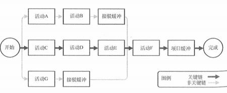

15、资源优化技术（09 上 24）（10 上 43）（11 下 35）

（2）资源平滑对进度模型中的活动进行调整，从而使项目资源需求不超过预定的资源限制的

一种技术。相对于资源平衡而言，资源平滑不会改变项目关键路径，完工日期也不会延迟。也就 是说，活动只在其自由浮动时间和总浮动时间内延迟。因此， 资源平滑技术可能无法实现所有资

源的优化。（17 下 49）（18 上 48）

16、建模技术---包括（但不限于）：

（1）假设情景分析。假设情景分析是对各种情景进行评估， 预测它们对项目目标的影响（积 极或消极的）。假设情景分析就是对“如果情景 X 出现， 情况会怎样？ ”这样的问题进行分析，即 基于已有的进度计划，考虑各种各样的情景（12 下 39）（13 下 41）

（2）模拟。模拟技术基于多种不同的活动假设计算出多种可能的项目工期， 以应对不确定性。 最常用的模拟技术是蒙特卡洛分析，它首先确定每个活动的可能持续时间的概率分布，然后据此

计算出整个项目的可能工期概率分布。

### 17、进度压缩

（1）赶工。通过增加资源， 以最小的成本增加来压缩进度工期的一种技术。赶工的例子包括： 批准加班、增加额外资源或支付加急费用，来加快关键路径上的活动。 赶工只适用于那些通过增 加资源就能缩短持续时间的，且位于关键路径上的活动。赶工并非总是切实可行， 它可能导致风

险和/或成本的增加。（12 下 40）（17 上 42）

（2）快速跟进。一种进度压缩技术， 将正常情况下按顺序进行的活动或阶段改为至少是部分 并行开展。例如，在大楼的建筑图纸尚未全部完成前就开始建地基。快速跟进可能造成返工和风  险增加。它只适用于能够通过并行活动来缩短项目工期的情况。（10 上 39）（12 上 38）（12 下 51）

（16 下 42）

18、里程碑图（甘特图）：与横道图类似， 但仅标示出主要可交付成果以及关键的外部接口的

规定开始与完成日期。（15 下 67）

19、控制进度是监督项目活动状态， 更新项目进展， 管理进度基准变更， 以实现计划的过程。 20、进度控制关注如下内容： （11 下 39）（18 上 49）

（1）确定项目进度的当前状态。

（3）确定项目进度已经变更。

22、

23、这块必考计算题的， 这个必须掌握的， 主要是一些网络图、关键路径、六标时、 PERT 等

下 40）（14 上 41）（17 上 45）（18 上 47）（18 下 47、48）

自由时差和总时差的关系要能区分；关键链法和关键路径法是不同的；外部依赖关系也可以 了解下，资源平衡中最少人员数量要会算，另外， PERT 图中对称轴对应的概率是 50%。希望大家 可以从人、机、料、法、环等方面去考虑各因素对进度的影响，建议大家能够从历年考题中挖掘 一些知识点。

在给出工程的最可能完工时间、最乐观完工时间和最悲观完工时间的基础上，计算工程的估 算工期及标准差，或者计算工程在某时间段内完工的概率。

活动持续时间/期望值 te=（to+4*tm+tp）/6

最可能时间：tm、最乐观时间：to、最悲观时间：tp

持续时间标准差=（to-tp）/6

算完工概率：需要记住 3 个数字 68%，95%，99%，面积法解题，注意听课听懂即可

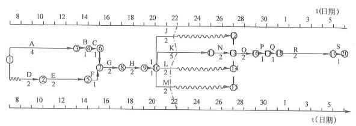

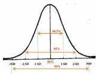

图的含义为：工程在估算工期前后 1σ期间内完工的概率为 68%，在估算工期前后 2σ期间 内完工的概率为 95%，估算工期前后 3σ期间内完工的概率为 99%。

时标网络图水平坐标表示工作时间，以实箭线表示项目活动，实箭线的水平投影长度表示该 活动的持续时间；以虚箭线表示虚活动，由于虚活动的持续时间为零，故虚箭线只能垂直画；以

波形线表示活动与其紧后活动之间的自由浮动时间。

本章历年考题和答案解析汇总：

#### 【试题 1】---2009 上真题 24

,、在项目某阶段的实施过程中， A 活动需要 2 天 2 人完成， B 活动需要 2 天 2 人完成，C 活动需 要 5 天 4 人完成， D 活动需要 3 天 2 人完成， E 活动需要 1 天 1 人完成， 该阶段的时标网络图如  下。该项目组共有 8 人，且负责 A.E 活动的人因另有安排，无法帮助其他人完成相应工作， 且项 目整个工期刻不容缓。以下（1）安排是恰当的，能够使实施任务顺利完成。

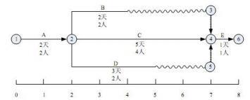

（1）A.B 活动提前两天开始          B.B 活动推迟两天开始

C.D 活动提前两天开始          D.D 活动推迟两天开始

#### 【答案】D

#### 【解析】 此题考察的是进度网络图，必须掌握， 高频考点

假定负责 A 活动的 2 人，其中有 1 个人可以实施 E 活动。这 2 个人另有安排，无法帮助其他人 完成相应工作， 且项目整个工期刻不容缓。那么项目组还剩下 6 个人， B 活动有 3 天的浮动时间.D 活动有 2 天的浮动时间， C 活动为关键路径没有浮动时间， 人力资游也不能释放。因此， 选择推迟 D 活动 2 天开始，等 B 活动在项目的第 3 天开始、第 4 天完成，释放出 2 人之后，D 活动利用该 2 人完成。

#### 【点评】双代号时标网络图，考的不多，尽量看懂即可，比较简单，必须得分

#### 【试题 2】---2009 上真题 26

2、某项目计划 08 年 12 月 5 日开始进入首批交付的产品测试工作， 估算工作量为 8（人）根10（天）， 误差为 2 天，则以下（2）理解正确（天指工作日）。

（2）A.表示活动至少需要 8 人天，最多不超过 10 人天

B.表示活动至少需要 8 天， 最多不超过 12 天

C.表示活动至少需要 64 人天，最多不超过 112 人天

D.表示活动至少需要 64 天，最多不超过 112 天

#### 【答案】B

#### 【解析】 此题考察的是进度管理历时估算，必须掌握，高频考点

该产品测试工作需要的工作量为： 8 人工作 10 天， 为 80 人天。产品测试工作的历时为 I0士2 天，因此该产品测试工作的历时在 8~12 天之内。

#### 【点评】常考题，理解，比较简单，必须得分

#### 【试题 3】---2009 上真题 27

3、某项目完成估计需要 12 个月。在进一步分析后认为最少将花 8 个月，最糟糕的情况下将花 28 个月。那么，这个估计的 PERT 值是（3）个月。

（3）A.9     B.11     C.13     D.14

#### 【解析】三点估算PERT 估算的活动历时均值=（悲观估计值+4 最可能估计值十乐观估计值）/6 估计该项目完成的时间为（8+4x12+28）/6=14 个月

#### 【试题 4】 ---2009 上真题 28

4、在项目进度控制中，（4）不适合用于缩短活动工期。

（4）A.准确确定项目进度的当前状态    B.投入更多的资源

C.改进技术                      D.缩减活动范围

#### 【答案】A

#### 【解析】 缩短活动的工期办法：

（1）赶工，投入更多的资源或增加工作时间，以缩短关键活动的工期;

（2）快速跟进，并行施工，以缩短关键路径的长度；

（3）使用高素质的资源或经验更丰富的人员；

（4）减小活动范围或降低活动要求；

（5）改进方法或技术，以提高生产效率；

（6）加强质量管理，及时发现问题：减少返工，从而缩短工期。

而准确确定项目进度的当前状态是进度控制关注的内容之一，不适合用于缩短活动工期。

#### 【试题 5】---2009 上真题 51

。、在项目实施中间的某次周例会上， 项目经理小王用下表向大家通报了目前的进度。根据这个表 格，目前项目的进度（5）。

| 活  动 | 计划值 | 完成百分比 | 实际成本 |
|---|---|---|---|
| 基础设计 | 20000 元 | 90% | 10000 元 |
| 详细设计 | 50 000 元 | 90% | 60000 元 |
| 测试 | 30 000 元 | 100% | 40 000 元 |

（5）A.提前于计划 7%                                  B.落后于计划 18%

C.落后于计划 7%                                  D.落后于计划 7.5%

#### 【答案】C

#### 【解析】 此题考察的是挣值分析，必须掌握，必考

在目前的监控点，该项目的挣值 EV.PV 及 SPI 如下：

EV= 20 000x 90%+50 000x 90% +30 000x100%= 93 000

PV= 20 000 +50 000+30 000= 100 000

SPI= EV/PV= 93 0001100 00d=93%

落后于进度计划：1-93% =7%

#### 【点评】必考题，比较简单，必须得分

#### 【试题 6】---2009 下真题 34

6、某单位要对一个网络集成项目进行招标， 由于现场答辩环节没有一个定量的标准，相关负责人 在制定该项评分细则时规定本项满分为 10 介， 但是评委的打分不得低于 5 分。这一规定反映了制 定招标评分标准时（6）。

A.以客观事实为依据      B.得分应能明显分出高低

C.严格控制自由裁量权    D.评分标准应便于评审

#### 【解析】本题中明显不符合“严格控制自由裁量权”一条。

#### 【试题 7】---2009 下真题 35

7、不属于活动资源估算输出的是（7）。

（7）A.活动属性  B.资源分解结构    C.请求的变更  D.活动清单

#### 【答案】D

#### 【解析】 活动资源估算的输出包括活动资源要求、活动属性、资源分解结构、资源日历和请求的变更。 而“活动清单”属于活动资源估算的输入。

#### 【试题 8】---2009 下真题 36

8、某项目中有两个活动单元： 活动一和活动二，其中活动一开始后活动二才能开始。能正确表示 这两个活动之间依赖关系的前导图是（8）。

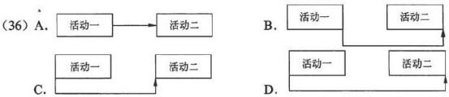

#### 【答案】C

#### 【解析】 此题考察的是活动排序技术的理解，必须掌握，高频考点

活动排序所采用的主要方法和技术节中介绍了前导图的含义及使用方法。

#### 【点评】常考，命题的热点，简单题， 必须得分

#### 【试题 9】 ---2009 下真题 37~38

9 、A 公司的某项目即将开始，项目经理估计该项目 10 天即可完成， 如果出现问题耽搁了也不会 超过 20 天完成，最快 6 天即可完成。根据项目历时估计中的 3 点估算法，你认为该项目的历时为 （37），该项目历时的估算标准差为（38）。

（37） A.10 天      B.11 天      C.12 天       D.13 天

（38） A.2.1 天    B.2.2 天    C.2.3 天     D.2.4 天

#### 【答案】BC

#### 【解析】 此题考察的是活动历时估算，必须掌握，必考

三点估算法：

活动的历时=（最乐观历时+4x最可能历时+最悲观历时） /6=（6+10x4+20）/6=66/6=11 活动历时标准差=（最悲观历时-最乐观历时） /6= （20-6）/6=2.3

#### 【点评】必考的，这个必须要会算的， 简单题，命题的热点，必须得分

#### 【试题 10】---2009 下真题 56

10、对以下箭线图， 理解正确的是（10）。

（10）A.活动 A 和 B 可以同时进行； 只有活动 A 和 B 都完成后，活动 C 才开始 B.活动 A 先于活动 B 进行；只有活动 A 和 B 都完成后，活动 C 才开始

C.活动 A 和 B 可以同时进行； A 完成后 C 即可开始

D.活动 A 先于活动 B 进行； A 完成后 C 即可开始

#### 【答案】A

#### 【解析】 此题考察的是箭线图，必须掌握，高频考点

为了绘图的方便，人们引入了一种额外的、特殊的活动，叫做虚活动。它不消耗时间，在网 络图中由一个虚箭线表示，如下图示。

注：活动 A 和 B 可以同时进行；只有活动 A 和 B 都完成后， 活动 C 才能开始。

#### 【点评】常考，命题的热点，简单题， 必须得分

#### 【试题 11】---2010 上真题 36

11、项目经理对某软件需求分析活动历时估算的结果是： 该活动用时 2 周（假定每周工作时间是 5  天）。随后对其进行后备分析， 确定的增加时间是 2 天。以下针对该项目后备分析结果的叙述中， （11）是不正确的。

（11）A.增加软件需求分析的应急时间是 2 天

B.增加软件需求分析的缓冲时间是该活动历时的 20%

C.增加软件需求分析的时间储备是 20%

D.增加软件需求分析的历时标准差是 2 天

#### 【答案】D

#### 【解析】 此题考察的是活动历时估算，必须掌握，高频考点

在活动历时估算所采用的主要方法和技术中包含有后备分析。后备分析是在时间估算的基础 上考虑一些时间储备和富裕量。也可称为“应急时间”、“时间储备”、“缓冲时间”，而该活动用时 2 周（假定每周工作日为 5 天），则总工作日为 10 天，确定的增加时间是 2 天， 因此后备分析可以 增加 2 天或 20%。因此“增加软件需求分析的应急时间是 2 天”、“增加软件需求分析的缓冲时间是 该活动历时的 20% ",“增加软件需求分析的时间储备是 20%”等三种表述方式是一致的。

标准差是三点估算中的统计学术语，通过最乐观估时和最悲观估时来计算标准差，其计算方法不同于后备分析， 因此应选择 D。

#### 【试题 12】---2010 上真题 37

12、在工程网络计划中， 工作 M  的最早开始时间为第 16 天， 其持续时间为 5 天。该工作有三项 紧后工作， 他们的最早开始时间分别为第 25 天、第 27 天和第 30 天，最迟开始时间分别为第 28 天、第 29 天和第 30 天。则工作 M  的总时差为（12）天。

（12）A.5         B.6        C.7            D.9

#### 【答案】C

#### 【解析】 此题考察的是总时差和自由时差，必须掌握，高频考点

工作 M 的最早开始时间为第 16 天，其持续时间为 5 天。因此， 工作 M 的最早结束时间为第 16+5=21 天。

工作 M 有三项紧后工作， 他们的最迟开始时间分别为第 28 天、第 29 天和第 30 天。因此工 作 M 的最迟结束时间为三者之中最小的第 28 天。

工作 M 的总时差=工作 M 的最迟结束时间-工作 M 的最早结束时间=28-21=7 天。 【  点评】考的不是很多，掌握算法即可，简单题，必须得分

#### 【试题 13】---2010 上真题 38

13、以下关于关键路径法的叙述，（13）是不正确的。

（13）A.如果关键路径中的一个活动延迟，将会影响整个项目计划

B.关键路径包括所有项目进度控制点

C.如果有两个或两个以上的路径长度一样，就有可能存在多个关键路径

D.关键路径可随项目的进展而改变

#### 【答案】B

#### 【解析】 此题考察的是关键路径，必须掌握，高频考点

关键路径分析是通过对各条路径的分析用时最长的那条路径为关键路径，关键路径只有一个 决定因素就是路径用时，如果有两个或两个以上的路径长度一样，就有可能存在多个关键路径。	 项目进度用时是由关键路径决定的，在关键路径上的活动叫做关键活动，其时差为零，如果关键 路径中的一个活动延迟，将会影响整个项目计划。在项目进展过程中，由于资源平衡，关键路径 可能用时缩短，比其他的路径用时还少，这时关键路径就发生变更。

关键路径并不包含全部项目活动，因此关键路径不能包括所有项目进度控制点。 根据上述分析， 应选 B。

#### 【  点评】常考，命题的热点，简单题，必须得分

#### 【试题 14】---2010 上真题 39

14、在软件开发项目实施过程中， 由于进度需要，有时要采取快速跟进措施。（14）属于快速跟进范畴。 （14）A.压缩需求分析工作周期

B.设计图纸全部完成前就开始现场施工准备工作

C.使用最好的工程师，加班加点尽快完成需求分析说明书编制工作

D. 同其他项目协调好关系以减少行政管理的磨擦

#### 【答案】B

#### 【解析】 此题考察的是加快进度的方法，必须掌握， 高频考点

快速跟进是指计划时串行的活动，当实施时进度落后时，改为并行或部分并行（当然前提是 串行的活动，本身的顺序是可以改变的）。

#### 【  点评】常考，命题的热点，简单题，必须得分

#### 【试题 15】---2010 上真题 40

15、某软件开发项目的实际进度已经大幅滞后于计划进度，（15）能够较为有效地缩短活动工期。 （15）A.请经验丰富的老程序员进行技术指导或协助完成工作

B.要求项目组成员每天加班 2~3  个小时进行赶工

C.招聘一批新的程序员到项目组中

D.购买最新版本的软件开发工具

#### 【答案】A

#### 【解析】 此题考察的是缩短工期的方法，必须掌握， 高频考点

项目进度控制是依据项目进度基准计划对项目的实际进度进行监控，使项目能够按时完成。 当项目的实际进度滞后于进度计划时，首先发现问题、分析问题根源并找出妥善的解决办法。通 常可以采用以下一些方法缩短活动的工期:

①投入更多的资源以加速活动进程②指派经验更丰富的人去完成或帮助完成项目工作。  	③减少活动范围或降低活动要求④通过改进方法或技术提高生产率.⑤快速跟进

若没找出造成拖期的原因而“要求项目组成员每天加班 2~3 个小时进行赶工”不会有明显的 效果。“招聘一批新的程序员到项目组中”还要进行培训.培训后效率也不会比老员工效率高。

通常情况下，通过新版本的软件开发工具不会对缩短进度有太大影响，并且新工具又面临一 个熟悉过程。而“请经验丰富的老程序员进行技术指导或协助完成工作”可以凭借其丰富的经验 帮助项目组找出拖期原因，并通过其高效的工作来缩短工期。因此应选择 A。

#### 【  点评】常考，命题的热点，简单题，必须得分

#### 【试题 16】---2010 上真题 43

16、下列关于资源平衡的描述中，（16）是正确的。

（16）A.资源平衡通常用于已经利用关键链法分析过的进度模型之中

B.进行资源平衡的前提是不能改变原关键路线

C.使用按资源分配倒排进度法不一定能制定出最优项目进度表

D.资源平衡的结果通常是使项目的预计持续时间比项目初步进度表短

#### 【答案】C

#### 【解析】 此题考察的是资源平衡，必须掌握，高频考点

资源平衡是一种进度网络分析技术，用于已经利用关键路线法分析过的进度模型之中。资源 平衡的用途是调整时间安排需要满足规定交工日期的计划活动，处理只有在某些时间动用或只能 动用有限数量的必要的共用或关键资源的局面，或者用于在项目工作具体时间段按照某种水平均

匀地使用选定资源。这种均匀使用资源的办法可能会改变原来的关键路线。

资源平衡是一种进度网络分析技术，用于己经利用关键路线法（非关键链法）分析过的进度 模型之中；资源平衡可能会改变原来的关键路线；资源平衡的结果经常是项目的预计持续时间比初 步项目进度表长；按资源分配倒排进度法不一定能制定出最优项目进度表。因此应选 C。拥有数量 有限但关键的项目资源，资源可以从项目的结束日期反向倒排，可以制定出一个较好的项目进度 表，但不一定能制定出最优项目进度表。

#### 【  点评】常考，命题的热点，简单题，必须得分

#### 【试题 17】---2010 下真题 35~36

17、某工程建设项目中各工序历时如下表所示，则本项目最快完成时间为（17）周。同时，通过 （36）可以缩短项目工期。

| 工序名称 | 紧前工序 | 持续时间（周） |
|---|---|---|
| A | — | 1 |
| B | A | 2 |
| C | A | 3 |
| D | B | 2 |
| E | B | 2 |
| F | C.D | 4 |
| G | E | 4 |
| H | B | 5 |
| I | G、H | 4 |
| J | F | 3 |

（35）A.7                 B.9                     C.12                  D.13

①压缩 B 工序时间     ②压缩 H 工序时间      ③同时开展 H  工序与 A 工序

④压缩 F 工序时间     ⑤压缩 G 工序时间

（3）A.①⑤      B.①③        C.②⑤        D.③④

#### 【答案】D A

#### 【解析】 此题考察的是网络图，必须掌握，高频考点

本题考查项目工期计算、压缩关键路径活动历时可缩短工期的知识。画网络图是解题的基础， 画单代号网络图，如下图所示：

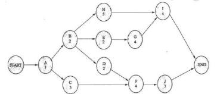

找出关键路径（最长路径），并计算关键路径上的总历时，即可算出本项目最快完成时间：压 缩关键路径上的活动可以缩短项目工期。

通过此图可直观看出，从开始到结束共有 4 条路径， ABEGI 为最长路径， 历时为 13 周， 即试题 （35）D 是正确答案。

由于 B, G 在关键路径上，故压缩 B.G 可缩短项目工期:F, H 不在关键路径上， 压缩它们不能 缩短工期；由于 H 工序与 A 工序无并行关系，H 是 A 的紧后活动 B 的紧后活动，所以不能将 H 工序 与 A 工序并行。即试题（36）A 是正确答案。

#### 【点评】常考，命题的热点，简单题， 必须得分

#### 【试题 18】---2010 下真题 37

18、某项目有五个独立的子项目，小张和小李各自独立完成项目所需的时间如下表所示：

|  | 小张 | 小李 |
|---|---|---|
| 甲 | 6 | 5 |
| 乙 | 4 | 8 |
| 丙 |  | 7 |
| 丁 | 4 | 2 |
| 成 | 3 | 2 |

则如下四种安排中（18）的工期最短。

（18）A.小张做甲和乙，小李做丙、丁和成     B.小张做乙，小李做甲、丙、丁和成

C.小张做乙、丁和成，小李做甲和丙     D.小张做甲、乙和丁， 小李做丙和成

#### 【答案】A

#### 【解析】 此题考察的是运筹学中标准指派的问题，必须掌握，高频考点

此题为运筹学中非标准的指派问题。由于只有小张和小李两个人，所以直接针对给出的选项 来进行计算，比较出最短工期就可以解出此题：

A:工期为小张 10，小李 11;      B:工期为小张 4， 小李 16;

C:工期为小张 11，小李 12;      D:工期为小张 14，小李 90

在两人独自完成的情况下，A 中并行历时是最短的， 只有 11。

#### 【点评】常考，命题的热点，简单题， 必须得分

#### 【试题 19】---2010 下真题 38

19、某项目经理在对项目历时进行估算时， 认为正常情况下完成项目需要 42 天， 同时也分析了影 响项目工期的因素， 认为最快可以在 35 天内完成工作，而在最不利的条件下则需要 55 天完成任 务。采用三点估算得到的工期是（19）天。

（19）A.42                     B.43                    C.44                    D.55

#### 【答案】B

#### 【解析】P261此题考察的是三点估算，必须掌握，高频考点

三点估算得到的工期=（35 + 4*42+ 55）/ 6=43

#### 【点评】常考，命题的热点，简单题， 必须得分

#### 【试题 20】---2010 下真题 40

20、某公司接到一栋大楼的布线任务， 经过分析决定将大楼的四层布线任务分别交给甲、乙、丙、 丁四个项目经理，每人负责一层布线任务，每层面积为 10000 平米。布线任务由同一个施工队施 工，该工程队有 5  个施工组。甲经过测算， 预计每个施工组每天可以铺设完成 200 平米，于是估 计任务完成时间为 10  天，甲带领施工队最终经过 14 天完成任务；乙在施工前咨询了工程队中有 经验的成员，经过分析之后估算时间为 12 天，乙带领施工队最终经过 13 天完成； 丙参考了甲、  乙施工时的情况， 估算施工时间为 15  天， 丙最终用了 21  天完成任务； 丁将前三个施工队的工期 代入三点估算公式计算得到估计值为 15  天， 最终丁带领施工队用了 15  天完成任务。以下说法正 确的是（20）。

（20）A.甲采用的是参数估算法，参数估计不准确导致实际工期与预期有较大偏差 B. 乙采用的是专家判断法，实际工期偏差只有 1  天与专家的经验有很大关系 C.丙采用的是类比估算法，由于此类工程不适合采用该方法，因此偏差最大 D.丁采用的是三点估算法， 工期零偏差是因为该方法是估算工期的最佳方法

#### 【答案】B

#### 【解析】 此题考察的是活动估算的工具，必须掌握， 高频考点

活动历时估算所采用的主要方法和技术如下:

（1）专家判断

由于影响活动持续时间的因素太多，如资源的水平或生产率，所以常常难以估算。只要有可 能，就可以利用以历史信息为根据的专家判断。如果无法请到这种专家，则持续时间估计中的不 确定性和风险就会增加。B 是正确的。

（2）类比估算

持续时间类比估算就是以从前类似计划活动的实际持续时间为根据，估算将来的计划活动的 持续时间。当有关项目的详细信息数量有限时，如在项目的早期阶段，就经常使用这种办法估算 项目的持续时间。类比估算利用历史信息和专家判断。

当以前的活动事实上而不仅仅是表面上类似，而且准备这种估算的项目团队成员具备必要的 专业知识时，类比估算最可靠。c 是错误的。丙采用的是类比估算法， 此类工程采用类比估算法没 有不适合的问题，工期偏差的产生应该是源于施工队施工水平、质量、熟练程度、项目经理的控 制能力等。

（3）参数估算

用欲完成工作的数量乘以生产率可作为估算活动持续时间的量化依据。例如，将图纸数量乘 以每张图纸所需的人时数估算设计项目中的生产率；将电缆的长度（米） 乘以安装每米电缆所需的 人时数得到电缆安装项目的生产率。用计划的资源数目乘以每班次需要的工时或生产能力再除以 可投入的资源数目， 即可确定各工作班次的持续时间。例如，每班次的持续时间为 5 天，计划投 入的资源为 4 人，而可以投入的资源为 2 人，则每班次的持续时间为 10 天（（4X5/2=10）。

A 不对。甲采用的确实是参数估算法，但测算不准确，导致工期偏差很大。 （4）三点估算

考虑原有估算中风险的大小，可以提高活动历时估算的准确性。三点估算就是在确定三种估 算的基础上做出的。三点估算一般用在没有经验数据的情况下。

故 B 是正确答案。

#### 【点评】常考，命题的热点，简单题， 必须得分

#### 【试题 21】---2010 下真题 48

21、围绕三点估算技术在风险评估中的应用，以下论述（21）是正确的。

（21）A.三点估算用于活动历时估算，不能用于风险评估

B.三点估算用于活动历时估算，不好判定能否用于风险评估

C.三点估算能评估时间与概率的关系，可以用于风险评估，不能用于活动历时估算 D.三点估算能评估时间与概率的关系，可以用于风险评估，属于定量分析

#### 【答案】D

#### 【解析】 此题考察的是活动历时估算，必须掌握，高频考点

活动历时估算所采用的主要方法和技术包括：专家判断、类比估算、参数估算、三点估算、后 备分析。

定量风险分析的工具与技术主要包括：期望货币值、计算分析因子、计划评审技术（三点估算）、 蒙特卡罗分析。可见只有 D 是正确的。

#### 【点评】常考，命题的热点，简单题， 必须得分

#### 【试题 22】---2011 上真题 34

zz、依据下面的项目活动网络图中，该项目历时为（22）天。

（22）A.10        B.11     C.13    D.14

#### 【答案】D

#### 【解析】 此题考察的是关键路径，必须掌握，高频考点

标号法计算关键路径，具体算法见上课的讲解：

#### 【点评】关键路径的问题，常考，简单，必须得分

#### 【试题 23】---2011 上真题 35

23、下列（23）做法不属于进度压缩。

（23）A.某项目经理发现项目工期延后，于是开始让项目组成员开始加班加点，提高加班工资， 以期待能在规定时间内完成项目

B.某项目经理发现项目组成员由于对技术的掌握不熟练，造成进展缓慢， 延误工期，于是 指派了有经验的人员帮助完成

C.为了节省时间，在需求设计还没有完成时， 项目经理就通知组内编程人员开始编写代码

D.项目经理启用应急时间来增加一些项目时间

#### 【答案】D

#### 【解析】 此题考察的是进度压缩的技术，必须掌握， 高频考点

进度压缩的技术有以下几种:

（1）赶进度。对费用和进度进行权衡，确定如何在尽量少增加费用的前提下最大限度地缩短 项目所需时间。

（2）快速跟进。这种进度压缩技术通常同时进行按先后顺序的阶段或活动。

在备选项中，选项 A 和选项 B 属于赶进度， 选项 C 属于快速跟进。选项 D 启用了应急时间，  意味着可能改变了项目的进度制约条件、强加日期或其他进度目标， 不符合进度压缩的前提条件， 因此选项 D 不属于进度压缩， 应选 D。

#### 【点评】进度压缩，常考，简单，必须得分

#### 【试题 24】---2011 上真题 36

24、出现“关键路径上的活动总时差是零和负数”情况下，下列分析正确的是（24）。

（24）A.关键路径上的活动总时差可能为零的原因是每个相邻活动都是紧前或紧后的，需要调整 以给活动留出时间余地

B.关键路径上的活动总时差可能为负的原因是由于安排调配不得当所造成的活动非合理性 交错现象， 有必要调整活动持续时间、逻辑关系等使得活动总时差为零

C.关键路径上的活动总时差可能为负的原因是因为用最早时间减去最晚时间，不需要调整 以给活动留出余地

D.关键路径上的活动总时差可能为零的原因是由于安排活动进度没有余地，需要调整以给 活动留出余地

#### 【答案】B

#### 【解析】 此题考察的是关键路径，必须掌握，高频考点

根据关键路径法，关键路径上的活动总时差可能为负的原因是由于安排调配不得当所造成的 活动非合理性交错现象造成的，因此应选 B。其他三个选项，逻辑上均有明显的错误。

#### 【点评】关键路径的问题，常考，简单，必须得分

#### 【试题 25】---2011 上真题 37

25、下列做法无助于缩短活动工期的是（25）。

（25）A.投入更多的资源以加快活动进程      B.减小活动范围或降低活动要求

C.通过改进方法或者技术提高生产率    D.采用甘特图法

#### 【答案】D

#### 【解析】 此题考察的是缩短工期的方法，必须掌握， 高频考点

通常可以用以下一些方法缩短活动的工期:

（1）投入更多的资源以加速活动进程。

（2）指派经验更丰富的人去完成或帮助完成项目工作.

（3）减少活动范围或降低活动要求。

（4）通过改进方法或技术提高生产率。

甘特图又叫横道图、条状图。它用横道表示活动，注明了活动的开始与结束日期，以及活动 的预期持续时间。横道图容易看懂，经常用于向管理层介绍情况。采用甘特图作为制定项目计划 的具体工具，与项目活动工期的长短没有必然的联系。

选项 A.B.C 均属于进度压缩技术，而选项 D 不属于。选项 D 无助于缩短活动工期。

#### 【点评】进度压缩，常考，简单，必须得分

#### 【试题 26】---2011 下真题 35

26、某项目发生了进度延误，于是项目经理在项目关键路径上增加了资源，但是工期仍然未能有 效缩短，其可能的原因是（26）。

（26）A.关键活动的历时总是固定不变的

B.关键活动所配置的资源数量总是充足的

C.关键路径上的活动是不依赖于资源的

D.资源的增加可能会导致额外问题的产生从而降低效率

#### 【答案】D

#### 【解析】 此题考察的是关键路径，理解题，必须掌握，高频考点

关键路线法是利用进度模型时使用的一种进度网络分析技术，在关键路线上的计划活动叫做 “关键活动”。历时指完成某项活动所需的时间， 通常以天、月或年来表示。工作量指完成一项活 动所需的人工单位的数量， 通常以人天、人月或人年来表示， 既可以连续也可以间断。一般而言， 如果不考虑对所投入的人力资源的额外管理，当某项活动的工作量不变时，该活动的历时将随着 所投入人力资源的多寡而变化，并非总是固定不变的，因此选项 A 的表述是错误的。

项目是为创建某一独特产品、服务或成果而临时进行的一次性努力。对项目更具体的解释是 利用有限的资源、有限的时间为特定客户完成特定目标的一次性工作。在实际项目进行中，各项 活动所能获得的资源往往是不充足的， 因此选项 B 的表述也是错误的。

除虚活动外，所有的活动都是依赖于时间或资源的，因此选项 C 的表述也是错误的。

当项目进度滞后时，项目经理常常会试图通过增加人力来解决问题。但是人员和时间的可替 代性需要两个前提：首先任务是可以分解的：其次负责任务的人员之间不需要交流、培训。如果项 目各个任务之间的关联性和复杂性需要大量沟通、交流，那么增加人力有可能产生额外的问题并 且降低效率。活动的历时有时会受到具体项目的约束，因此即使增加资源也不能缩短工期。因此 选项 D 的表述是正确的。

#### 【点评】常考，命题的热点，简单题， 必须得分

#### 【试题 27】---2011 下真题 36

27、以下关于项目进度网络图的描述中，正确的是（27）。

（27）A.它应该包含项目的全部细节活动

B.它是活动排序的输入和制定进度计划的输出

C.前导图法和箭线图法都是绘制项目进度网络图的具体方法

D.它仅以图形方式展示项目各计划活动及逻辑依赖关系，简单直观

#### 【答案】C

#### 【解析】 此题考察的是网络图，必须掌握，高频考点

项目进度网络图既可以包括项目的全部细节，也可以只有一项或若干项概括性活动。因此选 项 A 的表述是错误的。

活动排序的输入包括：项目范围说明书、活动清单、活动属性、里程碑清单、批准的变更请求。 制定进度计划的输出包括：项目进度表、进度模型数据、进度基准、资源要求（更新）、活动属性  	（更新）、项目日历（更新）、请求的变更、项目管理计划（更新）、进度管理计划（更新）。显然  其中并不包括“项目进度网络图”，而“项目进度网络图”应该是活动排序的输出。 因此选项 B 的 表述是错误的。

编制项目进度网络图可以采用前导图法（PAM）或者箭线图法（ADM），它们都是的具体绘图方 法，因此选项 C 的表述是正确的。

项目进度网络图使用图形来展示项目各计划活动及逻辑关系（依赖关系），同时要附有简要的 文字，来说明活动排序使用的基本方法。凡不寻常的活动序列均应在这段文字中加以详细说明。 因此选项 D 的表述是错误的。

根据以上分析可知，正确答案应选 C。

#### 【点评】常考，命题的热点，简单题， 必须得分

#### 【试题 28】---2011 下真题 37

28、某项目经理正在进行活动资源估算，他可以采用的方法和技术中不包括（28）。 （28）A.已有案例的估算数据   B.项目管理软件   C.多方案分析  D.后备分析	 【答案】D

#### 【解析】P258  此题考察的是活动资源估算，必须掌握，高频考点

活动资源估算时可以采用的方法和技术包括：专家判断、多方案分析、出版的估算数据、项目 管理软件自下而上估算。

因此可知“后备分析”不属于进行活动资源估算应该采用的方法或技术。实际上“后备分析 ” 是进行活动历时估算所采用的一种方法。

因此正确答案应选 D。

#### 【点评】常考，命题的热点，简单题， 必须得分

#### 【试题 29】---2011 下真题 38

29、活动资源估算的输出不包括（29）。

（29）A.资源分解结构   B.请求的变更    C.项目进度网络图   D.资源日历

#### 【答案】C

#### 【解析】 此题考察的是活动资源估算，必须掌握，高频考点

活动资源估算的输出包括：活动资源要求、活动属性、资源分解结构、资源日历、请求的变更； 选项“C.项目进度网络图”是活动排序的结果。

#### 【点评】常考，命题的热点，简单题， 必须得分

#### 【试题 30】---2011 下真题 38

30、进度控制的一个重要作用是（30）。

（30）A.判断为产生项目可交付成果所需的活动时间

B.判断是否需要对发生的进度偏差采取纠正措施

C.评价范围定义是否足以支持进度计划

D.保持团队的高昂士气，使团队成员能充分发挥潜力

#### 【答案】B

#### 【解析】 此题考察的是进度控制，必须掌握，高频考点

进度控制是指监控项目状态以便采取相应措施维护项目进度以及管理进度变更的过程。有效 项目进度控制的关键是要对项目的实际进度进行监控，及时、定期地将其与计划进度进行比较， 并立即采取必要的纠正措施，以使项目能够按时完成。当项目的实际进度滞后于计划进度时，首 先发现问题、分析问题根源并找出妥善的解决方法。

#### 【点评】常考，命题的热点，简单题， 必须得分

#### 【试题 31】---2011 下真题 40

31、某信息系统集成项目经理王某收到客户的最新变更要求，他带领其团队成员经过认真分析， 发现这次变更将导致项目范围增加近 70%，初步估计成本将增加 5 倍。王某必须要在已被批准的 项目计划中改变原定的开始和结束日期，那么他的第一步工作应该是（31）。

（31）A.修改合同                 B.增加人员和资源

C.重新制订基准计划         D.采用一个新的目标进度计划

#### 【答案】D

#### 【解析】 此题考察的是偏差纠偏，理解题，必须掌握，高频考点

进度修正属于一种特殊的进度更新，这种更新将导致项目开始和结束日期的变更。日期通常 根据项目范围或估计的变更而修正。如果进度延误非常严重以至于需要实际的数据来测算绩效， 就需要重新制定基准计划。但是重新制订基准计划只能作为进度控制的最后手段，采用新的目标 进度则是进度修正的常用方式。而由于项目范围变化以及成本增加等因素造成的包括修改合同和 增加资源等后继活动则并非首要工作。

#### 【点评】常考，命题的热点，简单题， 必须得分

#### 【试题 32】---2012 上真题 35--同 31 题

#### 【试题 33】---2012 上真题 36

33、过去几年小李完成了大量网卡驱动模块的开发， 最快 6 天完成，最慢 36 天完成，平均 21 天 完成。如今小李开发一个新网卡驱动模块，在 21 天到 26 天内完成的概率是（33）。

（33）A.68.3%        B.34.1%        C.58.2%      D.28.1%

#### 【答案】B

#### 【解析】 此题考察的是 PERT，必须掌握，高频考点

面积法， 估计工时：乐观工时=6天， 最可能工时=21天， 悲观工时=36天， 标准差（36-6）/6 =5天，6至36共有6个标准差； 21至26天刚好落在U至1西格码之间。

#### 【点评】完工概率，多次考了，必须会算，必须得分

#### 【试题 34】---2012 上真题 37

34、图 2 右侧是单代号网络图（单位为工作日），左侧是图列。在确保安装集成活动尽早开始的前 提下，软件开发活动可以推迟（34）个工作日。

| 最早开始时间 | 持续时间 | 最早完成时间 |
|---|---|---|
| 活动名称 | 活动名称 | 活动名称 |
| 最迟开始时间 |  | 最迟完成时间 |

（34）A.0        B.1          C.2        D.4

#### 【答案】B

#### 【解析】 此题考察的是网络图，必须掌握，高频考点

所以软件开发活动可以推迟 1 个工作日。

#### 【试题 35】---2012 上真题 38

35、快速跟进是进度控制的手段之一。以下对快速跟进的理解，（35）是正确的。

（35）A.调整部分工作的顺序关系，使用网络图和关键路径分析等进度计划工具，尽可能将一些 工作并行进行

B.充分利用周六、周日或晚上等非工作时间段实施项目

C.充分发挥每一个成员的作用，用积极的绩效考核方法，提升每个成员的技能水平和绩效 D.加强项目干系人之间的交流和沟通，以加快项目的进度

#### 【试题 36】---2012 上真题 39

36、项目进度表至少包括每项计划活动的计划开始日期与计划完成日期，常见的做法是用一种或 多种格式的图形表示。在下面的图表中，常用于表示项目进度表的是（36）。

（36）A.横道图    B.排列图    c.鱼骨图   D.趋势图

#### 【答案】A

#### 【解析】 此题考察的是质量控制的工具，必须掌握， 高频考点

横道图【甘特图】，它是以图示的方式通过活动列表和时间刻度形象地表示出任何特定项目 的活动顺序与持续时间。

排列图是为寻找主要问题或影响质量的主要原因所使用的图。 它是由两个纵坐标、 一个横坐 标、几个按高低顺序依次排列的长方形和一条累计百分比折线所组成的图.排列图又称帕累托（柏 拉 ）图。

因果图又叫石川图或鱼骨图，它说明了各种要素是如何与潜在的问题或结果相关联。它可以 将各种事件和因素之问的关系用图解表示。

趋势图：趋势图，也可称为统计图或统计图表， 是以统计图的呈现方式。

#### 【点评】质量控制的工具和技术，必考的，简单，必须得分

#### 【试题 37】---2012 上真题 40

37、进度网络分析技术中的一种方法是（37），它可以根据有限的资源对项目进度表进行调整。在 确定了关键路线之后，将资源的有无与多寡考虑进去，确定资源制约进度表，并增加了持续时间 缓冲段，这些持续时间缓冲段属于非工作计划活动。

（37）A.关键路径法  B.假设情景分析法  C.关键链法  D.资源平衡法

#### 【答案】C

#### 【解析】 此题考察的是进度控制方法的定义，必须掌握，高频考点

关键链法是一种进度网络分析技术，可以根据有限的资源对项目进度计划进行调整。关键链 法结合了确定性与随机性办法。开始时利用进度模型中活动持续时间的估算，根据给定的依赖关 系与限制条件绘制项目进度网络图，然后计算关键路径。在确定关键路径后，将资源的有无与多 寡的情况考虑进去， 确定资源限制进度计划。这种资源限制进度计划经常改变项目的关键路径。 帕肯森定律：工作总是拖延到它所允许最迟完成的那一天。原因：主观原因：没有压力就没有动 力；客观原因：没有激励就没有动力； 避免的方式： 安全裕量（浮动时间）不要放在具体的活动 上，而是集中管理。

#### 【点评】制定进度计划的工具和技术， 必考的，简单，必须得分

#### 【试题 38】---2012 下真题 39

38、某公司承接了城市道路信息系统建设项目。由于施工日期正好是 7 月份的雨季。项目团队为 了管理好项目的进度，最好采用（38）进行进度管理。

（38）A.进度比较横道图   B.资源平衡方法  C.假设情景分析方法   D.关键链法

#### 【答案】C

#### 【解析】 此题考察的是进度管理的方法，必须掌握， 高频考点

制定进度计划所采用的主要技术和工具。资源平衡是一种进度网络分析技术，用于已经利用 关键路线法分析过的进度模型之中。资源平衡的用途是调整时间安排需要满足规定交工日期的计 划活动，处理只有在某些时间才能动用或只能动用有限数量的必要的共用或关键资源的局面，或 者用于在项目工作具体时间段按照某种水平均匀地使用选定资源。这种均匀使用资源的办法可能 会改变原来的关键路线。

关键链法是另一种进度网络分析技术， 可以根据有限的资源对项目进度表进行调整。关键链 法结合了确定性与随机性办法。

假设情景分析就是对“情景 X 出现时应当如何处理”这样的问题进行分析。 进度网络分析是 利用进度模型计算各种各样的情景， 如推迟某大型部件的交货日期， 延长具体设计工作的时间等。 假设情景分析的结果可用于估计项目进度计划在不利条件下的可行性，用于编制克服或减轻由于 出乎意料的局面造成的后果的应急和应对计划。模拟指对活动做出多种假设，计算项目多种持续 时间。最常用的技术是蒙特卡洛分析， 这种分析为每一计划活动确定一种活动持续时间概率分布， 然后利用这些分布计算出整个项目持续时间可能结果的概率分布。

#### 【点评】进度管理计划的工具和技术， 必考的，简单，必须得分

#### 【试题 39】---2012 下真题 40

39、对成本和进度进行权衡，确定如何尽量少增加费用的前提下最大限度地缩短项目所需要的时 间，称为（39）。

（39）A.快速跟进    B.赶进度    C.资源平衡     D.资源日历

#### 【答案】B

#### 【解析】 此题考察的是压缩工期的方法，必须掌握， 高频考点

对成本和进度进行权衡，确定如何尽量少增加费用的前提下最大限度地缩短项目所需要的时 间，称为赶进度也称赶工。

快速跟进：调整逻辑关系，通过对各种逻辑关系并行确定来缩短项目周期。在进行项目设计中，当 风险不大时，通过精心安排而使项目的前后阶段相互搭接以加快项目进展速度的做法叫快速跟进。

资源平衡：使资源利用更合理， 会导致进度计划延长。调整任务的时间安排以使得资源不被过 分使用，这被称为资源平衡。资源平衡通常不会被用来缩短进度。

资源日历：在项目日历上定义的工作时间和休息日是每个资源或资源组的默认工作时间。换 句话说，资源日历初始确定为项目日历。

#### 【点评】压缩工期的方法，多次考了， 简单，必须得分

#### 【试题 40】---2012 下真题 65

40、下图中，如果核对完成活动 1 、2 和 3 概率都是 60%，活动 4 在第 6 天开始的概率是（40）。

（40）A.30%            B.40%        C.22%        D.60%

#### 【答案】C

#### 【解析】 这个题考你的应变能力了，哈哈

60%*60%60%=36*0.6=21.6~22

#### 【点评】需要稍微理解下，不难的，和资源平衡思想相似，简单，必须得分

#### 【试题 41】---2013 上真题 30

41、某施工单位在一个多雨季节开展户外施工，在做进度计划时项目经理将天气因素纳入项目活 动依赖关系之中，制订了项目活动计划，本项目中， 项目经理采用（）技术，确定项目各活动中 的依赖关系。

（41）A.强制性依赖关系       B.可斟酌处理的依赖关系   C.外部依赖关系    D.网络图

#### 【答案】C

#### 【解析】 此题考察的是活动依赖关系，必须掌握，高频考点

在确定活动之间的先后顺序时有三种依赖关系：

（1）强制性依赖关系。

项目管理团队在确定活动先后顺序的过程中，要明确哪些依赖关系属于强制性的。  	（2）可斟酌处理的依赖关系。

项目管理团队在确定活动先后顺序的过程中，要明确哪些依赖关系属于可斟酌处理的。  	（3）外部依赖关系。

项目管理团队在确定活动先后顺序的过程中，要明确哪些依赖关系属于外部依赖的。

#### 【点评】活动依赖关系，书上原话，稍微理解下不难得出，比较简单，必须得分

#### 【试题 42】---2013 上真题 31~32

42、某活动的工期采用三点估算法进行估算，其中最悲观估算是 23 天，最乐观估算是 15 天， 最 可能的估算是 19 天， 则该活动的历时大致需要  31    天，该活动历是标准差大概是 32 。

（31  ）A.19            B.23        C.15        D.20

（32） A.0.7          B.1.3        C.8          D.4

#### 【答案】AB

#### 【解析】 此题考察的是 PERT，必须掌握，必考

PERT 估算值=（23+19*4+15）/6=19 丽 PERT 标准差=（23-15）/6=1.3

#### 【点评】三点估算的计算，必须会算的，比较简单， 必须得分

#### 【试题 43】---2013 上真题 36

43、关键路经法是利用进度计划网络图所进行的一种分析技术，下面关于关键路经的说法中，是 正确的 43  。

（43）A.网络图中只有一条关键路经

B.关键路经上各活动的时间之和最少

C.非关键路经上某活动发生延误后项目总工期必然会发生延误

D.非关键路经上的活动延误时间如果不超过总时差， 项目总工期就不会发生延误 【答案】D

#### 【解析】P264此题考察的是关键路径，必须掌握，必考

在任何网络路线上，进度余地的大小由最早与最迟日期两者之间正的差值决定，该差值叫做 “总时差”。关键路线有零或负值总时差，在关键路线上的计划活动叫做“关键活动”。为了使 路线总时差为零或正值，有必要调整活动持续时间、逻辑关系、时间提前与滞后量或其他进度制 约因素。 一旦路线总时差为零或正值，则还能确定自由时差。自由时差就是在不延误同一网络路 线上任何直接后继活动最早开始时间的条件下，计划活动可以推迟的时间长短。 由于关键路径可 以有多条，所以 A 错误；在关键路径上的活动时间之和应该最多，所以 B 错误；非关键路经上某 活动发生延误后只要没有超过自由时差，项目总工期不会发生延误，所以 C 错误；D 正确；

#### 【点评】关键路径，书上原话，多次考了，比较简单，必须得分

#### 【试题 44】---2013 上真题 40

44、在根据计划对项目进展情况进行跟踪时，项目经理发现最终可交付成果按照管理层规定的交 付日期完工。这时项目经理应  44  。

（44）A.驱动项目团队更加快速的工作，以便弥补丢失的时间

B.不要同意管理层要求的不合理的工期

C.通过消减最终可交付成果的规模或延长项目工期的某种结合重新洽谈 D.重新计算项目进度，并按照沟通计措进行分发。

#### 【答案】A

#### 【解析】 此题考察的是变更管理，必须掌握，高频考点

发现无法按期完成，首先应与干系人沟通协商，看能否对范围、进度、成本、质量等要素进 行变更（就是 C 选项）；如果能变更且决定要变后，才涉及 D 选项；如果不可变， 可以考虑发挥 项目团队的主观能动性（就是 A 选项）

题意隐含计划已开始执行，则 BD 不考虑，A 积极，C 消极，故选 A。

#### 【点评】进度的调整措施，理解下，难题，尽量得分

#### 【试题 45】---2013 下真题 39

45、在进行项目活动历时估算时，（45）属于参数估算。

（45）A.从以前类似计划活动的实际持续时间为依据来估算

B.用需要完成工作的数量乘以完成单位工作所需时间为估算活动时间的依据 C.利用有可能的历时估算，最乐观的历时估算和最悲观的历时估算来计算

D.利用以历时信息为依据的专家判断估算

#### 【答案】B

#### 【解析】 此题考察的是参数估算，必须掌握，高频考点

参数估算是利用历史数据和一些变量之间的统计关系，计算活动资源成本。

#### 【点评】活动历时估算的工具，常考， 简单，送分

#### 【试题 46】---2013 下真题 40

46、某项活动的最早开始日期为本月 11  日，最晚开始日期是本月 19  日，该活动的持续时间为 4 天，如果不涉及非工作日，从上述信息可以判断，（46）是正确的。

（46）A.活动的总体时差为 9 天

B.活动的最早完成时间为本月 14 日

C.活动的最晚完成时间为本月 23 日

D.如果资源分配翻倍，则活动可以在 2 天完成

#### 【答案】B

#### 【解析】 此题考察的是单代号网络图，必须掌握，高频考点

活动历时为 4 天，最晚开始为 19 日（包含当天），则最迟结束应为 23 日（包含当天）。

实际中资源翻倍，并不等于工期减半，资源增加牵涉到的管理、沟通、协调比原来复杂，再加上 活动本身之间存在一些内在的制约关系。总时差为 8 天。

#### 【点评】六标时的计算，常考，必须得分

#### 【试题 47】---2013 下真题 41

47、在进度控制中使用假设情景分析的目的是（47）。

（47）A.评审各种情景，使进度与计划保持一致     B.记录请求的变更

C.针对何时应更新进度基准，提供额外详情   D.更新活动属性

#### 【答案】A

#### 【解析】 此题考察的是制定进度计划的工具和技术， 必须掌握，必考

情景假设是假设将来存在一些异常情况，提前假设预知，目的还是使实际进度和计划保持一致。

#### 【点评】以前考过多次了，书上有原话，送分

#### 【试题 48】---2014 上真题 39

48、项目经理对某软件开发流程中的“概要设计”活动进行历时估算时，参考了以往相关项目活 动情况，他采用的是（48）方法。

（48）A.专家判断   B.类比估算   C.参数估算   D.三点估算

#### 【答案】B

#### 【解析】 此题考察的是类比估算，必须掌握，高频考点

参考了以往相关项目得到新项目历时的方法是类比估算。

#### 【试题 49】---2014 上真题 40

49、进度报告是实施项目进度控制的一个主要工具,在进度报告中可不包括（49）。

（49）A.实际开始与完成日期               B.项目例会的时间

C.未完成计划活动的剩余持续时间    D.正在进行的计划活动的完成百分比

#### 【答案】B

#### 【解析】 此题考察的是进度报告的内容，必须掌握， 高频考点

可不包括项目例会的时间。

#### 【试题 50】---2014 上真题 41

50、已知网络计划中工作 M 有两项紧后工作，这两项紧后工作的最早开始时间分别为第 12 天和 第 15 天，工作 M 的最早开始时间和最迟开始时间分别为第 6 天和第 8 天，如果工作 M 的持续时 间为 4 天， 则工作 M 总时差为（50）天

（50）A.1      B.2    C.3          D.4

#### 【答案】B

#### 【解析】 此题考察的是总时差的计算，必须掌握，考的不多

总时差=LS（最晚开始时间） -ES（最早开始时间）=2

#### 【点评】之前考过一次，不难，必须得分的

#### 【试题 51】---2014 下真题 38

51、在制订项目进度计划过程中，（51）可以根据有限的资源对项目进度进行调整，是一种结合了 确定性与随机性的一种方法。

（51）A.关键链方法   B.专家评估方法   C.假设情景方法   D.资源平衡方法

#### 【试题 52】---2014 下真题 39

52、某公司与客户签订了一个系统集成项目合同， 对于项目的范围和完成时间做出了明确的规定。 在制定进度计划时， 项目经理发现按照估算的活动时间和资源编制的进度计划无法满足合同工期， 为了达到合同要求， 项目经理不宜采用的方法是（52）。

（52）A.赶工    B.并行施工   C.增加资源投入   D.缩小项目范围

#### 【答案】D

#### 【解析】 此题考察的是缩短工期的方法，必须掌握， 高频考点

从题干中的信息“对于项目的范围和完成时间做出了明确的规定”可以看出项目的范围和进度优 先级最高， 项目经理可以用来追赶进度的方法显然不能考虑调整范围。

#### 【点评】多次考了，比较简单，送分的

#### 【试题 53】---2015 上真题 38

53、项目经理小李对某活动工期进行估算时，发现人员的熟练程度和设备供应是否及时对工期至 关重要。如果形成最有利组合时，预计 17 天可以完成：如果形成最不利组合时， 预计 33 天可以 完成：按照公司的正常情况， 一般 22 天可以完成， 该项目的工期可以估算为（） 天。

A.22      B.23        C.24              D.25

#### 【答案】B

#### 【解析】 此题考察的是三点估算，必须掌握，常考

PERT 估算的活动历时均值=（悲观估计值+4 最可能估计值+乐观估计值） /6，估计该项目完成的时 间为（17+4x22+33）/6=23 天。

#### 【点评】多次考了，简单，必须得分

#### 【试题 54】---2015 上真题 39

54、在制定进度计划时，已经完成了：

①绘制进度网络图： ②活动资源估算： ③活动历时估算。

此时为了确定各项活动的时差可进行（）。

A.资源平衡分析   B.进度压缩分析   C.关键路线分析     D.假设情景分析

#### 【答案】C

#### 【解析】 此题考察的是制定进度计划的工具和技术， 必须掌握，常考

（1） 进度网络分析。使用一种进度模型和多种分析技术，如采用关键路线法、局面应对分析资源平衡 （2） 关键路线法。沿着项目进度网络路线进行正向与反向分析， 从而计算出所有计划活动理论上

的最早开始与完成日期、最迟开始与完成日期， 不考虑任何资源限制。

（3） 进度压缩。指在不改变项目范围、进度制约条件、强加日期或其他进度目标的前提下缩短项 目的进度时间。

（4）假设情景分析。对“某情景出现时应当如何处理”这样的问题进行分析。

（5） 资源平衡。调整时间安排需要满足规定交工日期的计划活动，处理只有在某些时间才能动用 或只能动用有限数量的必要的共用或关键资源的局面，或者用于在项目工作具体时间段按照某种 水平均匀地使用选定资源。这种均匀使用资源的办法可能会改变原来的关键路线。

#### 【点评】多次考了，简单，必须得分

#### 【试题 55】---2015 下真题 36

55、某研发项目由于很多技术细节不是特别清晰，所以在制定研发项目的进度计划时应该采用( ) 来制定进度计划 。

（55）A.关键链法    B.关键路径法    C.资源平衡法    D.资源日历

#### 【答案】A

#### 【解析】 此题考察的是制定进度计划的工具和技术， 必须掌握，高频考点

关键链法它可以根据有限的资源对项目进度表进行调整。在确定了关键路线之后，将资源的有无 与多寡考虑进去，确定资源制约进度表，并增加了持续时间缓冲段，这些持续时间缓冲段属于非 工作计划活动。

#### 【点评】送分题，多次考了，简单

#### 【试题 56】---2015 下真题 55

56、活动排序是指识别与记载计划活动之间的逻辑关系， 项目经理对所管理的项目进行活动排序。 ( )是在活动排序过程中所需要的信息和资料。

（56）A.项目进度网络图  B.请求的变更  C.项目范围说明书  D.更新的活动清单

#### 【答案】C

#### 【解析】 此题考察的是活动排序，必须掌握，高频考点

活动排序的输入：项目范围说明书、活动清单、活动属性、里程碑清单、批准的变更请求

#### 【点评】送分题，多次考了，简单

#### 【试题 57】---2015 下真题 56

57、公司刚承接了一个系统集成及运行维护的项目， 在做集成验收活动的资源估算时，需要综合 考虑完成活动的工程师的经验及技能，各种大小或类型的机器，各种测试工具（手工操作或自动

化工具），以及所需资源的自制或购买决策等， 此种资源估算法为（ ） 。

（57）A.自上而下估算  B.多方案分析  C.专家判断   D.项目管理软件

#### 【答案】B

#### 【解析】 此题考察的是资源估算，必须掌握，高频考点

多方案分析：很多计划活动都可利用多种形式完成。其中包括利用各种水平的资源能力或技能， 各种大小或类型的机器，各种工具（手工操作或自动化工具）， 以及有关资源自制或购买的决策。

活动资源估算所采用的主要方法和技术

#### 【点评】送分题，多次考了，简单

#### 【试题 58】---2016 上真题 55

58、项目经理小李对某活动工期进行估算时，发现人员的熟练程度和设备供应是否及时对工期至 关重要。如果形成最有利组合时，预计 9 天可以完成；如果形成最不利组合时，预计 23 天可以完 成；按照公司的正常情况， 一般 13 天可以完成。该项目的工期可估算为（58）天。

A.12      B.13        C.14          D.15

#### 【答案】C

#### 【解析】 此题考察的是三点估算，必须掌握，高频考点

（9+13*4+23）/6=14

#### 【点评】送分题，常考，必须得分

#### 【试题 59】---2016 上真题 56

59、（59）不属于编制进度计划所采用的工具和技术。

A.进度网络分析     B.确定依赖关系    C.进度压缩    D.资源平衡

#### 【答案】B

#### 【解析】 此题考察的是进度计划的工具和技术， 必须掌握，高频考点

进度计划主要技术和工具： 1.进度网络分析 2.关键路线法 3.进度压缩 4.假设情景分析 5.资源平 衡 6.关桂链法 7.项目管理软件 8.应用日历 9.调整时间提前与滞后 10.进度模型

#### 【点评】送分题，常考，必须得分

#### 【试题 60】---2016 下真题 42

60、在项目进度管理中，对项目进度压缩是一种常用的方法，其中将正常情况下按照顺序进行的 活动或阶段改为至少是部分并行开展的技术称为（）。

A.赶工    B.快速跟进   C.资源优化    D.提前量和滞后量

#### 【答案】B

#### 【解析】P311此题考察的是进度压缩，必须掌握，高频考点

快速跟进。一种进度压缩技术， 将正常情况下按顺序进行的活动或阶段改为至少是部分并行开展。 例如，在大楼的建筑图纸尚未全部完成前就开始建地基。快速跟进可能造成返工和风险增加。它  只适用于能够通过并行活动来缩短项目工期的情况。

#### 【点评】送分题，常考，必须得分

#### 【试题 61】---2016 下真题 43

61、进行活动历时压缩时， 项目经理可以对关键路径上的活动增加资源， 这时必须进一步考虑（）。 A.其他活动均延迟                       B.是否出现新的关键路径

C.分配给关键路径上其他任务的资源      D.进度计划中历时最长的任务

#### 【答案】B

#### 【解析】P309此题考察的是进度压缩，必须掌握，高频考点

关键路径上的活动被称为关键活动。进度网络图中可能有多条关键路径。在项目进展过程中有的

活动会提前完成，有的活动会推迟完成，有的活动会中途取消，新的活动可能会被中途加入，网 络图在不断变化，关键路径也在不断变化之中。

#### 【点评】送分题，常考，必须得分

#### 【试题 62】---2017 上真题 42

62、通过增加资源来压缩进度工期的技术称为（）。

A.快速跟进    B.持续时间缓冲    C.赶工    D.提前量管理

#### 【解析】P311此题考察的是进度压缩工具和技术，必须掌握，高频考点

制定进度计划的工具和技术：

进度压缩：赶工。通过增加资源，以最小的成本增加来压缩进度工期的一种技术。

#### 【试题 63】---2017 上真题 45

63、下面的箭线图中（活动的时间单位： 周），活动 G 最多可以推延（）周而不会影响项目的完工日期。

A.1      B.2      C.3        D.4

#### 【答案】D

#### 【解析】 此题考察的是网络图，必须掌握，高频考点

关键路径 D啸H啸C， 总工期 12 周，D 的 EF=8，LF=12，D 的总时差为 12-8=4 周

#### 【点评】常考，比较简单，必须得分

#### 【试题 64】---2017 下真题 46

64、（）不是规划项目进度管理的输入。

A.项目范围说明书    B.WBS 和 WBS 字典    C.活动清单    D.项目章程

#### 【试题 65】---2017 下真题 47

65、下图中（单位： 天）关于活动 H 和活动 I 之间的关系描述正确的是（）。

A.活动 H 开始时，开始活动 I

B.活动 H 完成 10 天后，开始活动 I

C.活动 H 结束时， 开始活动 I

D.活动 H 开始 10 天后，开始活动 I

#### 【答案】D

#### 【解析】P295此题考察的是网络图，必须掌握，高频考点

SS 表示前序活动开始后，后续活动才能开始

#### 【点评】常考，比较简单，必须得分

#### 【试题 66】---2017 下真题 48

66、项目经理小李在制定进度计划时采用下图所示的工具，该工具是（）。

A.关键链法    B.关键路径法    C.进度网络分析    D.建模技术

#### 【试题 67】---2017 下真题 49

67、在制定进度计划时，可以采用多种工具与技术，如关键路径法、资源平衡技术、资源平滑技 术等，在以下叙述中，不正确的是（）。

A.项目的关键路径可能有一条或多条

B.随着项目的开展， 关键路径法可能也随着不断变化

C.资源平衡技术往往会导致关键路径延长

D.资源平滑技术往往会改变项目关键路径，导致项目进度延迟

#### 【点评】常考，比较简单，必须得分

#### 【试题 68】---2018 上真题 46

68、（）属于规划项目进程过程的输出。

A.项目管理计划    B.项目章程    C.事业环境因素    D.控制临界值

#### 【解析】排除法， ABC 都为规划项目进程的输入

#### 【试题 69】---2018 上真题 47

69、某项目的双代号网络图如下所示， 该项目的工期为（）。

A.17        B.18    C.19    D.20

#### 【试题 70】---2018 上真题 48

70、关于制定进度计划的工具和技术的描述，不正确的是（）。

A.总浮动的时间等于本活动的最迟完成时间减去本活动的最早完成时间

B. 自由浮动时间等于紧后活动的最早开始时间的最小值减去本活动的最早完成时间 C.资源平滑技术通过缩短项目的关键路径来缩短完工时间

D.关键路径上活动的总浮动时间与自由浮动时间都为

#### 【解析】相对于资源平衡而言，资源平滑不会改变项目关键路径，完工日期也不会延迟，活动只在其自由浮动时间和总浮动时间内延迟。因此资源平滑技术可能无法实现所有资源的优化。

#### 【试题 71】---2018 上真题 49

71、（）属于控制进度的工作内容。

A.确定完成项目工作所需花费的时间量

B.确定完成项目工作所需的资源

C.确定工作之间的逻辑关系

D.确定是否对工作进度偏差采取纠正措施

#### 【试题 72】---2018 下真题 46

72、规划项目进度管理是为实施项目进度管理制定政策、程序。并形成文档化的项目进度管理计 划的过程，（）不属于规划项目进度管理的输入。

A.项目章程    B.范围基准    C.里程碑清单    D.组织文化

#### 【答案】C

#### 【解析】里程碑清单是定义活动的输出，排列活动顺序的输入，不是规划进度管理的输入

#### 【试题 73、】---2018 下真题 47

73、下图某工程单代号网络图中，活动 B 的总浮动时间为（）天。

A.1    B.2   C.3    D.4

#### 【解析】可以填好前导图。用关键路径 ADF 工期 20-B 活动所在最长路径 ABEF16=4 天。

#### 【试题 74】---2018 下真题 48

74、某工程由 8 个活动组成，其各活动情况如下表所示，该工程关键路径为()

| 活动 | 紧前活动 | 所需天数 | 活动 | 紧前活动 | 所需天数 |
|---|---|---|---|---|---|
| A |  | 3 | F | C | 6 |
| B | A | 2 | G | E | 2 |
| C | B | 5 | H | FG | 5 |
| D | B | 7 | I | HD | 2 |
| E | C | 4 |  |  |  |

A.ABCEGI    B.ABCFHI    C.ABDHI    D.ABDI

#### 【答案】B

#### 【解析】P313 此题考察的是网络图，必须掌握，高频考点

画单代号图，然后列出各路径:

ABCEGHI=3+2+5+4+2+5+2=23；ABCFHI=3+2+5+6+5+2=23；ABDI=3+2+7+2=14

有两条关键路径，不过根据答案来看， 只有 B 是对的。

#### 【试题 75】---2018 下真题 49

75、关于项目控制进度过程，不正确的是:（）。

A.有效项目进度控制的关键是严格按照制定的项目进度计划执行， 避免项目偏离计划 B.当项目的实际进度滞后于进度计划时，可以通过赶工，投入更多的资源或增加工作时间来缩短工期 C.项目控制进度的工具与技术有关键路径法、趋势分法等

D.项目控制进度旨在发现计划偏离并及时采纠正措施，以降低风险

#### 【答案】C

#### 【解析】P312 此题考察的是进度控制，必须掌握，高频考点

关键路径法是制定进度计划的工具，但不是控制进度的工具，c 是错误的。

#### 【试题 76】---2019 上真题 48

76、前导图法可以描述四种关键活动类型的依赖关系，对于接班同事 A 到岗， 交班同事 B 才可以 下班的交接班过程， 可以用（）描述。

A.S-F        B.F-F        C.S-S        D.F-S

#### 【答案】A

#### 【解析】P300 此题考察的是前导图四种依赖关系，必须掌握，高频考点

接班同事 A 开始到岗-交班同事 B 下班完成，是开始到完成的关系。类似的例子还有新系统上线 -老系统下线等。

#### 【试题 77】---2019 上真题 48

77、下图为某规划的进度网络图（单位:周），在实际实施过程中活动 B-E 比计划延迟了 2 周，活 动 J-K 比计划提前了 3 周，则该关键路径是（），总工期是（）。

47）A.A-D-G-I-J-K       B.A-B-F-K        C.A-B-E-H-K        D.A-D-F-K

48）A.15        B.14        C.13        D.12

#### 【答案】CA

#### 【解析】P313 此题考察的是网络图，必须掌握，高频考点

把全部路径列出来， 然后根据题目来对各涉及路径进行调整即可：

ABEHK=3+（4+2）+2+4=15（B-E 延迟 2 周）；

ABFK=3+6+3=12；

ACFK=2+4+3=9；

ADFK=2+3+3=8；

ADGIJK=2+4+3+2+（5-3）=13（J-K 提前了 3 周）

#### 【试题 78】---2019 上真题 48

78、某大型项目原计划于 6 个月后交付目前由于设备故障、人员流失和客户审缓慢导致项目实际 进展比计划延迟了 1 个月作为项目经理首先应该做的是（）。

A.对关键路径活动进行分析，评估是否可以进行赶工

B.重新设立进度基线并对新的进度基线进行评审

C.记录进展缓慢的相关问题， 并报告管理层

D.与客户沟通项目延期的可能性

#### 【答案】A

#### 【解析】P313 此题考察的是进度赶工，必须掌握，高频考点

已经延期了，可以考虑压缩工期，A 选项对关键路径进行赶工分析是可以的。

B 选项错误， 一延期就改基线不合适。选项 C 和 D 都不是积极主动的做法。

#### 【试题 79】---2019 下真题 43

79、关于项目进度管理计划的描述，正确的是（）。

A.项目进度管理计划一旦确定， 不能被修改

B.在制定项目进度管理计划时，应该考虑项目章程

C.项目进度管理计划一定要形成正式的文件

D.项目进度管理计划是详细的， 不能是高度概括的

#### 【答案】B

#### 【解析】P293 此题考察的是进度管理计划，必须掌握，高频考点；

项目管理计划也可以通过变更来修订， 选项 A 错误。

选项 B 是正确的，制定进度管理计划的输入里面有项目章程。

根据项目需要，进度管理计划可以是正式或非正式的，非常详细或高度概括的，选项 C 和 D 也是 错误的。

#### 【试题 80】---2019 下真题 44

80、关于箭线图的描述不正确的是（）。

A.流入同一节点的活动均有共同的紧前活动

B.任两项活动的紧前事件和紧后事件代号至少有一个不同

C.每一个活动和每一个事件都必须有唯一代号

D.虚活动不消耗时间， 也不消耗资源，主要用于表达活动之间的关系

#### 【答案】A

#### 【解析】P301 此题考察的是网络图，必须掌握，高频考点；

流入同一节点的活动均有共同的后续活动。流出同一节点的活动均有共同的紧前活动

#### 【试题 81】---2019 下真题 45

81、某项目的网络图如下，活动 D 是自由浮动时间为（）天。

A.0        B.1        C.2      D.3

#### 【解析】把上面的 7 格图补充完整，可以看出活动 D 自由浮动时间为 9-8=1。

#### 【试题 82】---2019 下真题 46

82、（）不是常用的缩短项目工期的方法。

A.使用高素质的资源或使用经验丰富的人员

B.改进方法和技术， 提高工作效率

C.采用资源平滑技术，使项目资源需求不超过预定的资源限制

D.采用快速跟进技术， 将顺序进行的活动改为部分并行

六、项目成本管理

考点分析与预测：项目成本管理一般上午考察 3 分， 非常重要， 成本控制的好不好，直接关 乎项目的质量，因此成本管理此章节非常重要；案例分析可能会出案例分析计算的，主要集中在 挣值、预测技术等方面，上午历年考试的重点在成本的类型、管理储备、成本基准、挣值、预测 技术等方面，这部分的考察力度还是非常大的，考点也很清晰；建议大家在掌握历年的高频考点 后尽量去学习其他方面的知识点。

本章知识点下午试主要有以下 3 种命题思路。

命题思路 1： 给出某项目在某个时间点上各任务的计划成本、实际成本及完成百分比的案例 说明， 要求计算该项目的 PV、EV、AC、CPI、SPI、ETC、EAC、TCP I 等参数值（可以有多种组合形 式、多种表现形式）；要求分析该项目在进度、成本方面的绩效执行情况并给出相应的解决措施； 要求绘制出反映该项目当前执行情况的挣值图等。

成本管理的过程、输入、输出、工具和技术汇总表：

| 规划成本管理--估算成本--制定预算--项目成本控制 | 规划成本管理--估算成本--制定预算--项目成本控制 | 规划成本管理--估算成本--制定预算--项目成本控制 | 规划成本管理--估算成本--制定预算--项目成本控制 |
|---|---|---|---|
| 过程名 | 输入（依据） | 工具和技术（方法） | 输出（结果） |
| 1、规划成本 管理 | ①项目管理计划 ②项目章程 ③事业环境因素 ④组织过程资产 | ①专家判断 ②分析技术 ③会议 | 2、 成本管理计划 |
| 2、估算成本 | ①成本管理计划 ②人力资源管理计划 ③范围基准 ④项目进度计划 ⑤风险登记册 ⑥事业环境因素 ⑦组织过程资产 | ①专家判断 ②类比估算 ③参数估算 ④自下而上估算 ⑤三点估算 ⑥储备分析 ⑦质量成本 ⑧项目管理软件 ⑨卖方投标分析 ⑩群体决策技术 | ①活动成本估算 ②估算依据 ③项目文件更新 |
| 3、制定预算 | ①成本管理计划 ②范围基准 ③活动成本估算 ④估算依据 ⑤项目进度计划 ⑥资源日历 ⑦风险登记册 ⑧协议 ⑨组织过程资产 | ①成本汇总 ②储备分析 ③专家判断 ④历史关系 ⑤资源限制平衡 | ①成本基准 ②项目资金需求 ③项目文件（更新） |
| 4、控制成本 （12 下 44） | ①项目管理计划 ②项目资金需求 ③工作绩效数据 ④组织过程资产 | ①挣值管理 ②预测 ③完工尚需绩效指数 ④绩效审查 ⑤项目管理软件 ⑥储备分析 | ①工作绩效信息 ②成本预测 ③变更请求 ④项目管理计划（更新） ⑤项目文件（更新）  ⑥组织过程资产（更新） |

本章金色考点汇总：

1、成本管理要靠制定成本管理计划、成本估算、成本预算、成本控制等 4 个过程来完成：

（1）制定成本管理计划——制定了项目成本结构、估算、预算和控制的标准。

（2）成本估算——编制完成项目活动所需资源的大致成本。

（3）成本预算——合计各个活动或工作包的估算成本，以建立成本基准。

（4）成本控制——影响造成成本偏差的因素， 控制项目预算的变更。（14 下 47）

2、发生成本失控的原因主要有以下几点：①对工程项目认识不足；②组织制度不健全；③方

法问题；④技术的制约；⑤需求管理不当

3、产品全生命周期成本： 产品或系统的整个使用生命期内， 在获得阶段（设计、生产、安装 和测试等活动， 即项目存续期间）、运营与维护、生命周期结束时对产品的处置所发生的全部成本

5、应急储备是包含在成本基准内的一部分预算， 用来应对已经接受的已识别风险， 以及已经 制订应急或减轻措施的已识别风险。 应急储备通常是预算的一部分，用来应对那些会影响项目的 “ 已知一未知”。（12 上 45）（12 下 46）

6、管理储备是为了管理控制的目的而特别留出的项目预算，用来应对项目范围中不可预见的工作。 管理储备用来应对会影响项目的“未知一未知”风险。

预算和资金需求的一部分， 使用前需要得到高层管理者审批。当动用管理储备资助不可预见的工作时， 就要把动用的管理储备增加到成本基准中， 从而导致成本基准变更。（16 上 45）

7、成本管理计划包含在项目管理计划中， 或是作为项目管理计划的从属分计划。 成本管理计 划可以是正式的，也可以是非正式的， 可以是非常详细的，也可以是概括性的。

8、估算活动的成本， 涉及估算完成每项活动所需资源的近似成本。 在估算成本时，估算时需 考虑成本估算偏差的可能原因（包括风险）  ，但是不需要考虑项目是否盈利；

9、 编制项目成本估算需要进行以下三个主要步骤：（09 下 44）

（1）识别并分析成本的构成科目

（2）根据已识别的项目成本构成科目， 估算每一科目的成本大小。

（3）分析成本估算结果，找出各种可以相互替代的成本， 协调各种成本之间的比例关系。

### 10、成本估算的工具和技术

| 1 | 专家判断 | 专家判断可以对项目环境及以往类似项目的信息提供有价值的见解 |
|---|---|---|
| 2 | 类比估算 | 指利用过去类似项目的实际成本作为当前项目成本估算的基础。 当对项目的详细 情况了解甚少时（如在项目的初期阶段），往往采用这种方法估算项目的成本。 类比估算是一种专家判断。类比估算通常成本较低、耗时较少，但准确性也较低 。类比估算可以针对整个项目或项目中的某个部分。 |

| 3 | 参数估算 | 参数估算是指利用  历史数据之间的统计关系和其他变量 （如建筑施工中的平方 米）,来进行项目工作的成本估算。参数估算的准确性取决于参数模型的成熟度和 基础数据的可靠性。参数估算可以针对整个项目或项目中的某个部分， 并可与其 他估算方法联合使用。（14 下 46）（15 下 57）（17 上 49）（19 下 49） |
|---|---|---|
| 4 | 自下而上 估算 | 首先对单个工作包或活动的成本进行最具体、细致的估算；然后把这些细节性成 本向上汇总或“滚动”到更高层次,用于后续报告和跟踪。 准确性及其本身所需的 成本，通常取决于单个活动或工作包的规模和复杂程度。（13 上 38）（14 上 38） |
| 5 | 储备分析 | 应急储备是成本基准的一部分， 也是项目整体资金需求的一部分。也可以估算项 目所需的管理储备。 |
| 6 | 其他 | 三点估算（18 上 51）（19 上 51）、质量成本（COQ）、卖方投标分析、群体决策技术 |
| 6 |  | 三点估算（18 上 51）（19 上 51）、质量成本（COQ）、卖方投标分析、群体决策技术 |

成本估算时可以用专家判断，让最有经验、对活动最熟悉的人来估算，通常与估算人员的技术和管理经验是相关的。项目估算的准确性随着项目的进展而提高

### 11、项目成本预算的特征：

（1）计划性： 指在项目计划中，尽量精确地将费用分配到 WBS 的每一个组成部分， 从而形成与 WBS 相同的系统结构。

（2）约束性：指预算分配的结果可能并不能满足所涉及的管理人员的利益要求，而表现为一 种约束。

（3）控制性： 指项目预算的实质就是一种控制机制。

13、成本预算的步骤： （14 上 45）（16 上 44）

（1）将项目总成本分摊到项目工作分解结构的各个工作包。分解按照自顶向下，根据占用资 源数量多少而设置不同的分解权重。

（2）将各个工作包成本再分配到该工作包所包含的各项活动上。

（3）确定各项成本预算支出的时间计划及项目成本预算计划。

14 、成本基准  是按时间分段的预算，用做度量和监控项目整体成本执行（绩效）的基准。它 按时段汇总估算的成本编制而成，通常以 S 曲线的形式表示；（10 下 45）

15、许多项目，特别是大项目，可能有多个成本基准 （或资源基准）和消耗品生产基准（如 每天的混凝土立方米），来量度项目绩效的不同方面。

16、最大资金需求和成本基准末端值的差异就是管理储备（15 上 57）

### 17、成本预算的组成：

18、资金限制平衡---应该根据对项目资金的任何限制，来平衡资金支出。如果发现资金限制 与计划支出之间的差异，则可能需要调整工作的进度计划，以平衡资金支出水平。这可以通过在 项目进度计划中添加强制日期来实现。

19 、项目成本控制主要内容： ---背诵，案例分析可能考

（1）对造成成本基准变更的因素施加影响；

（2）确保所有变更请求都得到及时处理；

（3）当变更实际发生时，管理这些变更；

（4）确保成本支出不超过批准的资金限额，既不超出按时段、按 WBS 组件、按活动分配的 限额，也不超出项目总限额；

（5）监督成本绩效， 找出并分析与成本基准间的偏差；

（6）对照资金支出， 监督工作绩效；

（7）防止在成本或资源使用报告中出现未经批准的变更；

（8）向有关干系人报告所有经批准的变更及其相关成本；

（9）设法把预期的成本超支控制在可接受的范围内。

20、成本控制是项目管理的重要活动不只是个人的活动。

21、挣值、预测技术（09 上 51）（09 下 46）（10 上 45、46）（10 下 38、46）（11 上 33、43、

44）（11 下 46）（12 上 46）（12 下 57）（12 下 66）（13 上 39）（13 下 46）（14 上 46）（14 下

| 48~49、68）（15 上 47、60）（15 下 47）（16 上 57）（16 下 45/46）（17 下 52）（18 上 52）（18 |
|---|
| 下 52）（19 上 52）（19 下 50） 成本估算和成本预算要能区分；典型、非典型是一定要会判断的， 根据 SPI=EV/PV，可知 |

EV=PV*SPI （总之，要根据题干中给出的意思找出或求出挣值分析中的其余参数）；另外， 预计

完工日期可以根据预测完工成本/每日成本算出。希望大家可以从人、机、料、法、环等方面去考 虑各因素对成本的影响，建议大家能够从历年考题中挖掘一些知识点。

第一类计算：绩效衡量分析（挣值） ---上午选择，案例分析都考

挣值技术是将已经完成工作的预算成本（挣值），按原先分配的预算值进行累加获得的累加值， 与计划工作的预算成本（计划值）和已完成的工作的实际成本（实际值） 进行比较。

需要掌握记住挣值的 3 个参数， 4 个指标：

PV、EV、AC、CV、SV、CPI、SPI。需要深入考核 PV 、EV 、AC 的理解， 从一段文字描述 中计算出 PV 、EV 、AC，对于概念没有掌握者， 很难拿全分。

要熟悉挣值分析法来分析时间/进度/成本偏差，会画图和看图分析：

PV ：预算值；应该完成多少工作,  （按照计划截止目前应该花费的预算）

EV ：已完成任务的预算值； 完成了多少预算的工作（实际完成的工作，按照预算标准应该有的花费）

AC ：已完成任务的实际值；完成工作的实际成本是多少 （截止目前实际的花费）

进度偏差： SV=EV -PV          进度执行指数：SPI=EV/PV

成本偏差： CV=EV -AC        成本执行指数：CPI=EV/AC；

记忆方法：

1、都是 EV 在前（除法时，在前面），因为这是挣值管理，挣值（EV）最牛放在最前面。

2、大家都喜欢大的：大就是好。结果凡是大于 0（除法是：大于 1），就表示是好的：进度提

前、成本节约。（相反： 结果小于 0 或者除法时的小于 1，就表示坏的：进度滞后、成本超支） 所 以 SV>0，CV>0 都是好的 <0 都是不好的；CPI>1，SPI>1 都是好的 <0 都是不好的；

|  | 参数关系 | 偏差指标 | 绩效指标 | 调整措施 |
|---|---|---|---|---|
| 1 | AC>PV>EV | CV=EV-AC<0， 说 明资金投资超前； SV=EV-PV<0 ， 说 明进度拖延 | CPI=EV/AC<1 ， 说明 资金使用效率低； SPI=EV/PV<1,说明进 度效率低 | 加强成本监控， 并行 工作，  提高工作效率 |
| 2 | PV>AC=EV | CV=EV-AC<0， 说 明成本支出适当； SV=EV-PV<0 ， 说 明进度拖延 | CPI=EV/AC<1 ， 说明 资金使用效率一般； SPI=EV/PV<1,说明进 度效率低 | 加大成本投入来提高进度 效率；赶工、并行工作以 追赶进度；  增加高效人员 投入 |
| 3 | AC=EV>PV | CV=EV-AC<0， 说 明成本支出适当； SV=EV-PV>0 ， 说 明进度提前 | CPI=EV/AC<1 ， 说明 资金使用效率一般； SPI=EV/PV>1,说明进 度效率高 | 加大成本投入来进一步提 高整体效率，加强人员培 训和质量控制 |
| 4 | EV>PV>AC | CV=EV-AC>0， 说 明资金投入延后； SV=EV-PV>0 ， 说 明进度提前 | CPI=EV/AC>1 ， 说明 资金使用效率高； SPI=EV/PV>1,说明进 度效率高 | 加强质量控制， 密切监控 项目 |

另外考生还需会看和会画挣值分析图；经常考；

第二类计算：预测技术（完工预测） ---上午选择，案例分析都考

完工预测：难点。关键在于掌握典型偏差和非典型偏差，早期记公式，能够判断典型或非典 型偏差即可解题，现在考核对公式的理解，要求能够推到出典型偏差的公式，并能够充分理解。

完成尚需估算 ETC.完成时估算 EAC.项目总预算 BAC=完工时的 PV 总和

ETC 有 2 个计算公式，必须掌握：

1）非典型的偏差计算 ETC（当前的偏差被视为一种特例， 并且项目团队认为将来不会发生类 似的偏差，需要纠偏）：

ETC=BAC 一 截止到目前的累加 EV

2）典型的偏差计算 ETC（当前出现的偏差被视为具有典型性，可以代表未来的偏差）： ETC =（BAC 一 截止到目前的累加 EV）/ 累加 CPI

EAC 也分两种，基于典型和非典型， 但公式一样 ：EAC=AC + ETC

记忆方法：

广州曾经有个非典，非典会危害到人民的生命，肯定需要进行根治，需要改正，需要纠偏，	 所以看到题目说采取了措施对项目进度进行了纠偏，那么就是非典型，否则不纠偏，按照当前发 展状况下去就是典型；要会判断，必须；

对于 ETC 和 EAC 不要死记公式，大部分题目可以按照公式去解决，部分题目需要你深层次理 解 EAC 和 ETC，ETC 是剩下的活还需多少去完成， EAC 是完成时总的估算；用定义去解题；

本章历年考题和答案解析汇总：

#### 【试题 1】---2009 上真题 36

,、如果项目受资源限制， 往往需要项目经理进行资源平衡。但当（1）时，不宜进行资源平衡。

（1）A.项目在时间上有一定的灵活性          B.项目团队成员一专多能

C.项目在成本上有一定的灵活性          D.项目团队处理应急风险

#### 【解析】 此题考察的是资源平衡的问题，书上不详， 理解题，尽量掌握，考的不多

B.项目团队成员一专多能    D.项目团队处理应急风险

资源平衡是制定进度计划时，科学利用资源的一种方法。

例如通过利用活动的浮动时间等进行科学的进度安排，以尽量使用一个稳定的团队来完成所 有的项目任务，尽量使人力资源的工作负载安排在合理的、均衡的范围内。

如果项目在成本上有一定的灵活性，或者项目团队成员一专多能，都会有助于资源平衡。

对来预计到的风险， 首先使用权变措旋来应急，此时首要的任务是处理应急风险而不是资源平衡。

#### 【点评】考的不是很多，需要稍微理解下题意，会做资源平衡类似的计算，必须得分

#### 【试题 2】---2009 上真题 51

z、在项目实施中间的某次周例会上， 项目经理小王用下表向大家通报了目前的进度。根据这个表 格，目前项目的进度（2）。

| 活动 | 计划值 | 完成百分比 | 实际成本 |
|---|---|---|---|
| 基础设计 | 20000 元 | 90% | 10000 元 |
| 详细设计 | 50 000 元 | 90% | 60000 元 |
| 测试 | 30 000 元 | 100% | 40 000 元 |

（2）A.提前于计划 7%                                  B.落后于计划 18%

C.落后于计划 7%                                  D.落后于计划 7.5%

#### 【答案】C

#### 【解析】 此题考察的是挣值分析，必须掌握，必考

在目前的监控点，该项目的挣值 EV.PV 及 SPI 如下：

EV= 20 000X 90%+50000X 90% +30000X100%= 93 000

PV= 20 000 +50000+30000= 100 000    SPI= EV/PV= 93000/110000d=93%

落后于进度计划：1-93% =7%

#### 【点评】必考题，比较简单，必须得分

#### 【试题 3】---2009 下真题 44

3、某项目经理正在负责某政府的一个大项目，采用自下而上的估算方法进行成本估算，一般而言， 项目经理首先应该（3）。

（3）A.确定一种计算机化的工具，帮助其实现这个过程

B.利用以前的项目成本估算来帮助其实现

C.识别并估算每一个工作包或细节最详细的活动成本

D. 向这个方向的专家咨询， 并将他们的建议作为估算基础

#### 【答案】C

#### 【解析】 此题考察的是成本估算的步骤，必须掌握， 高频考点

编制项目成本估算需要进行以下 3 个主要步骤：（1）识别并分析成本的构成科目。（2）根据 已识别的项目成本构成科目，估算每一科目的成本大小③分析成本估算结果，找出可以相互替代 的成本，协调各种成本之间的比例关系。

#### 【点评】常考，命题的热点，简单题， 必须得分

#### 【试题 4】 ---2009 下真题 45

4、企业的保安费用对于项目而言属于（4）。

（4）A.可变成本    B. 固定成本    C. 间接成本    D.直接成本

#### 【试题 5】---2009 下真题 46

5、在某项目进行的第三个月， 累计计划费用是 25 万元人民币，而实际支出为 28 万元，以下关于 这个项目进展的叙述，正确的是（5）。

（5）A.提供的信息不全，无法评估    B. 由于成本超支，项目面临困难

C.项目将在原预算内完成       D.项目计划提前

#### 【答案】A

#### 【解析】 此题考察的是成本管理，必须掌握，高频考点

根据成本控制的方法，本题所给参数不全， 无法判断是否超出预算。

#### 【点评】常考，命题的热点，简单题， 必须得分

#### 【试题 6】---2010 上真题 44

6 、 某企业今年用于信息系统安全工程师的培训费用为 5 万元，其中有 8000  元计入 A 项目成本， 该成本属于 A 项目的（6）。

（6）A.可变成本            B.沉没成本      C.实际成本（AC）     D. 间接成本

#### 【答案】D

#### 【解析】 此题考察的是成本的类型，必须掌握， 必考

解析同题目 4

某企业今年用于信息系统安全工程师的培训费用为 5 万元，其中只有 8000 元计入 A 项目成本， A 项目的该成本可归入一般管理费用科目，同时是几个项目共同担负的项目成本所分摊给 A 项目的 费用，因此应属于间接成本， 选择 D。

#### 【  点评】必考，命题的热点，简单题，必须得分

#### 【试题 7】---2010 上真题 45

7、项目进行到某阶段时，项目经理进行了绩效分析，计算出 CPI  值为 0.91。这表示（7）。 （7）A.项目的每 91  元人民币投资中可创造相当于 100  元的价值

B. 当项目完成时将会花费投资额的 91%

C.项目仅进展到计划进度的 91%

D.项目的每 100  元人民币投资中只创造相当于 91  元的价值

#### 【解析】 此题考察的是挣值分析，必须掌握，必考

根据 CPI 的定义，项目经理进行了绩效分析计算出 CPI 值为 0.91，表示项目的每 100 元人民 币投资中只创造相当于 91 元的价值。因此应选 D。

#### 【试题 8】---2010 上真题 46

8、下图是一项布线工程计划和实际完成的示意图’2009  年 3 月 23   日的 PV、EV、AC 分别是（8）。

（8）A.PV=4000  元、 EV=2000  元、 AC=3800  元

B.PV=4000  元、 EV=3800  元、 AC=2000  元

C.PV=3800  元、 EV=4000  元、 AC=2000  元

D.PV=3800  元、 EV=3800  元、 AC=2000  元

#### 【答案】A

#### 【解析】 此题考察的是挣值分析，必须掌握，必考

根据 PV，EV, AC 定义，到 2009 年 3 月 23 日， 计划预算即 PV 为 4000 元。 到 23 日时实际花费的费用即 AC，为完成第一层用掉的 3800 元。

到 23 日时实际才完成了第一层的布线工作，而第一层布线工作对应的预算为 2000 元，即 EV 为 20D0 元。因此选择 A。

#### 【  点评】必考，命题的热点，简单题，必须得分

#### 【试题 9】 ---2010 下真题 39

9、甲公司生产急需 5000 个零件’承包给乙工厂进行加工’每个零件的加工费预算为 20 元’计划 2 周（每周工作 5 天）完成。甲公司负责人在开工后第 9 天早上到乙工厂检查进度’发现已完成加 工 3600 个零件’支付款项 81000 元。经计算’（9）。

（9）A.该项目的费用偏差为-18000 元    B.该项目的进度偏差为-18000  元

C.该项目的 CPI  为 0.80                        D.该项目的 SPI  为 0.90

#### 【答案】D

#### 【解析】 此题考察的是挣值分析，必须掌握，高频考点

本题给定了总预算为 20 X 5000 元，总工期是 10 个工作日。要求运用挣值分析法， 计算累计

到第 8 个工作日的费用偏差、进度偏差、成本绩效指数、进度绩效指数情况：

PV=80000  EV=72000 AC=81000    CV=EV-AC=72000-81000=-9000

SV=EV-PV=72000-80000=-8000      CPI=EV/CV=72000/81000=0.89

SPI=EV/PV=72000/80000=0.9

#### 【点评】常考，命题的热点，简单题， 必须得分

#### 【试题 10】---2010 下真题 44

10、（10）不是系统集成项目的直接成本。

（10）A.进口设备报关费     B.第三方测试费用  C.差旅费   D.员工福利

#### 【答案】D

#### 【解析】 此题考察的是成本的分类，必须掌握， 必考

直接成本：直接可以归属于项目工作的成本为直接成本，属于项目执行过程中直接投入并发生的费 用。如项目团队差旅费、工资、项目使用的物料及设备使用费， 以及资料费、咨询鉴定费、培训费等。

间接成本：来自一般管理费用科目或几个项目共同担负的项目成本所分摊给本项目的费用，就 形成了项目的间接成本，如税金、额外福利和保卫费用等。

D 不属于为完成系统集成项目支付的直接费用， 所以不属于直接成本。

#### 【点评】常考，命题的热点，简单题， 必须得分

#### 【试题 11】---2010 下真题 45

11、项目经理创建了某软件开发项目的 WBS 工作包，其中一个工作包举例如下： 130（注： 工作 包编号， 下同）需求阶段； 131  需求调研；132 需求分析； 133   需求定义。通过成本估算， 131  预 计花费 3  万元； 132 预计花费 2 万元； 133  预计花费 2.5  万元。根据各工作包的成本估算，采用 （11）方法，能最终形成整个项目的预算。

（11）A.资金限制平衡      B.准备金分析   C.成本参数估算      D.成本汇总

#### 【答案】D

#### 【解析】 此题考察的是成本预算，必须掌握，高频考点

成本预算指将单个活动或工作包的估算成本汇总， 以确立衡量项目绩效情况的总体成本基准。

本题目中创建了 WBS 工作包，并给出了某工作包的估算结果，得到各工作包估算数据后，需 要将这些详细成本汇总到更高层级，以最终形成整个项目的总体预算。故采用的方法为 D。

#### 【点评】常考，命题的热点，简单题， 必须得分

#### 【试题 12】---2010 下真题 46

12、根据以下布线计划及完成进度表，在 2010 年 6 月 2  日完工后对工程进度和费用进行预测， 按

此进度，完成尚需估算（ETC）为（12）。

|  | 计划开始 时间 | 计划结束 时间 | 计划费用 | 实际开始 时间 | 实际结束 时间 | 实际完成 费用 |
|---|---|---|---|---|---|---|
| 1  号区域 | 2010 年 6 月 1   日 | 2010 年 6 月 1   日 | 10000  元 | 2010 年 6 月 1   日 | 2010 年 6 月 2  日 | 18000  元 |
| 2 号区域 | 2010 年 6 月 2  日 | 2010 年 6 月 2  日 | 10000  元 |  |  |  |
| 3  号区域 | 2010 年 6 月 3   日 | 2010 年 6 月 3   日 | 10000  元 |  |  |  |

（12）A.18000  元      B.36000 元         C.20000 元        D.54000 元

#### 【答案】B

#### 【解析】P294~296 此题考察的是挣值，必须掌握， 高频考点

总预算 BAC=10000 + 10000 + 10000=30000

截止到 2010 年 6 月 2 日下午完工时的挣值 EV=10000

实际成本 AC=18000，  CPI=EV/AC

ETC=（BAC - EV）/CPI=20000 * 18000 / 10000=36000

#### 【点评】常考，命题的热点，简单题， 必须得分

#### 【试题 13】---2011 上真题 33

13、项目经理王某对其负责的系统集成项目进行了成本估算和进度安排，根据团队成员的情况分 配了任务，并制定出计划执行预算成本的基准。由于公司高层领导非常重视该项目，特地调配了 几名更有经验（薪水更高）的技术骨干参与项目，这种变化对项目绩效造成的最可能影响是（13）。 （13）A.正的成本偏差 CV  ，正的进度偏差 SV    B.负的成本偏差 CV  ，正的进度偏差 SV

C.正的成本偏差 CV  ，负的进度偏差 SV    D.负的成本偏差 CV  ，负的进度偏差 SV

#### 【试题 14】---2011 上真题 42

14 某公司按照项目核算成本， 在针对某化工厂信息化咨询项目中，需进行 10 天的驻场研究，产 生成本如下：①公司管理费用的项目分摊成本； ②咨询顾问每人每天出差补贴 500 元，入工资结 算；③顾问如需进入生产车间，每人额外增加健康补助 100 元/天。按照成本类型分类，上述三类

成本应分别列入（14）。

（14）A.①间接成本

B.①间接成本

C.①直接成本

D.①直接成本

②间接成本

②直接成本

②直接成本

②间接成本

③可变成本

③可变成本

③固定成本

③固定成本

公司管理费用的项目分摊成本属于间接成本，咨询顾问每人每 天出差补贴 500 元（计入工资结算）为直接成本， 顾问如需进入生产车间，每人额外增加健康补 助 100 元/天，该成本随着产量、工作量或时间而变，属于可变成本。因此，正确答案应选 B。

#### 【试题 15】---2011 上真题 43

15、挣值管理是一种综合了范围、时间、成本绩效测量的方法，通过与计划完成的工作量、实际 挣得的收益、实际的成本进行比较，可以确定成本进度是否按计划执行。下图中标号所标示的区 间依次应填写（15）。

（15）A.①进度落后  ②成本差 CV③进度差 SV

B.①成本差 CV  ②进度差 SV③进度落后时间

C.①进度差 SV  ②成本差 CV  ③进度落后时间

D.①进度落后  ②进度差 SV  ③成本差 CV

#### 【答案】C

#### 【解析】 此题考察的是挣值分析，必须掌握，必考

在挣值分析中， 计划值（PV）是在既定的时间段内实际完工工作的预算成本。实际成本（AC） 是在既定时间段内实际完成工作发生的实际总成本。挣值（EV）是在既定的时间段内实际完工工  作的预算成本。

成本偏差（CV）等于 EV 减 AC。进度偏差（SV）等于 EV 减 PV。在上图中，线段①表示当前时 间点下， EV 和 PV 之间的差值，即进度差 SV;线段②表示当前时间点下， EV 和 AC 之间的差值，即 成本差 CV;线段③表示当前时间点下， 计划时间和实际时间的差，即进度落后时间。因此应选 C。

#### 【点评】挣值的计算，必考，简单，必须得分

#### 【试题 16】---2011 上真题 44

16、某信息化施工项目一共要进行 30 天， 预算总成本 60 万元，其中 5 万元为管理成本， 40 万元 为物料使用费，其余为人工成本。按照管理计划，每 5 天进行一次挣值分析以评价项目绩效。在 第 5 天绩效评价时计算得到 CPI（绩效评价指数）为 0.95，则说明在前 5 天的施工中，实际成本 ①预算成本；如果要使下一次绩效评价时 CPI 为 1，且人工、物料使用成本不能改变，以免影响 施工质量，则在这两次绩效评价间，每天平均可花费的管理成本为②元。上述①和②依次序应该 填写（16）（假设所有成本按照天数平均分配， 工程进度不存在延时或提前情况）。

（16）A.①低于  ②614 元         B.①高于        ②614 元

C.①低于  ②1052 元        D.①高于       ②1052 元

#### 【答案】B

#### 【解析】 此题考察的是挣值分析，必须掌握，必考

CPI=0.95，则说明在前 5 天的施工中，实际成本高于预算成本。因假设所有成本按照天数平 均分配，工程进度不存在延时或提前情况，所以 SPI=1。因此 EV=PV，

前 5 天的 AC=EV/CPI=PV/CPI=10/0.95=10.5263

后 5 天，每天的管理费=0.3070 万元/5=614 元

#### 【点评】挣值的计算，必考，简单，必须得分

#### 【试题 17】---2011 上真题 51

| 姓名 | 技能 | 费率（元,小 时） | 工作量  （工时） | 差旅 | 人力资源 成本 |
|---|---|---|---|---|---|
| 张三风 | 管理，系统分析 | Y37.50/h | 100 | 250 | 4000 |
| 李立华 | 系统分析 | Y37.50/h | 100 | 100 | 3850 |
| 王锋 | 硬件设计 | Y32/h | 50 | 0 | 1600 |
| 刘丽芳 | 系统分析， 写作 | Y30.00/h | 80 | 0 | 2400 |
| …… | …… | …… |  |  |  |

#### 【答案】C

#### 【解析】 此题考察的是成本估算的工具，必须掌握， 高频考点

成本类比估算，指利用过去类似项目的实际成本作为当前项目成本估算的基础。类比估算是 一种专家判断。

自下而上估算是指估算单个工作包或细节最详细的活动的成本，然后将这些详细成本汇总到 更高层级， 以便用于报告和跟踪目的。

参数估算法是一种运用历史数据和其他变量之间的统计关系，来计算活动资源成本的估算技 术。与成本估算相关的例子是，将工作的计划数量与单位数量的历时成本相乘得到估算成本。

成本汇总发是一种项目成本预算技术，是对计划活动的成本估算，根据 WBS 汇总到工作包， 然后工作包的成本估算汇总到 WBS 中的更高一级（如控制账目），最终形成整个项目的预算。

题干中所采用的估算方法是典型的将工作的计划数量与单位数量的历时成本相乘得到估算成 本的方法， 采用的是参数估算法。因此应选 c。

#### 【点评】成本估算的方法，常考，简单，必须得分

#### 【试题 18】---2011 下真题 44

18、某单位规定对所有承担的项目全部按其报价的 15%提出公司管理费，该项费用对于项目而言 属于（18）。

（18）A.直接成本     B. 间接成本      C. 固定成本      D.可变成本

#### 【试题 19】---2011 下真题 45

#### 【试题 20】---2011 下真题 46

20、某信息系统集成项目采用挣值分析技术进行成本控制，假设当前状态数据如下表所示，则该 项目的 CPI、EAC. 当前项目的状态分别是（20）。

| 工作参数 | 预算 | 完成百分比 | AC |
|---|---|---|---|
| 活动 1 | 800 | 100% | 700 |
| 活动 2 | 10000 | 90% | 10000 |
| 活动 3 | 20000 | 60% | 16000 |

（20）A.0.82 ，37676 元，进度滞后且成本超支

B.0.8 ，12500 元，进度提前且成本超支

C.1.25 ，12500 元，进度滞后且成本低于预算

D.1.25 ，12500 元， 进度提前且成本低于预算

#### 【答案】A

#### 【解析】 此题考察的是挣得，必须掌握，必考

EV=21800，PV=30800，AC=26700；   CPI=0.82，成本超支。 SPI=0.71，进度滞后。

此时， PV=BAC，EAC=AC +ETC=26700+（BAC-EV）/CPI=37676

#### 【试题 21】---2012 上真题 34

21、单位在项目执行过程中，由于质量管理方面的问题造成了局部范围的返工，单位变失去了承 建另外一个项目的机会，这属于 21   。

A.质量成本    B.机会成本    C.时间成本     D.无形成本

#### 【试题 22】---2012 上真题 44

22、企业为某客户实施电子商务平台建设项目， 需要采购 5  台交付给客户使用服务器，这部分成 本属于该项目的（22）。

A.直接成本  B. 间接成本  C. 固定成本  D.机会成本

#### 【试题 23】---2012 上真题 45

23、某项目经理已经完成了 WBS 和每个工作包的成本估算。要根据这些数据编制项目成本估算， 该项目经理要（23）。

（23）A.使用 WBS 的最高层次进行类比估算    B.计算工作包和风险储备估算的总和

C.把工作包估算累计成为项目估算总和    D.获得专家对项目成本总计晌意见

#### 【解析】 考查项目成本估算的主要相关因素 除了项目直接成本外，项目估算还需要考虑但容易被忽视 的主要因素有以下几种：（1） 非直接成本；（2）学习曲线③项目完成的时限（4）质量要求；（5）储备：包括应急储备和管理储备，主要为防范风险所预留的成本。但这部分成本往往被管理层或 客户给压缩掉，这是不对的。其作用就像战争中的预备队，是非常重要的。估算必须包括用于风 险的储备。这种储备可以是时间或成本的储备。

成本估算就是 B 做的事情，而 C 是成本预算的内容。

#### 【试题 24】---2012 上真题 46

24、某ERP软件开发项目共有12个模块，项目经理对较件进行了成本预算，预算每个模块的开发成本为5万元，按照项目管理计划， 每月开发一个模块，12个月完成开发工作。在项目进行到第3 个月底的时候，项目经理对照计划， 发现刚完成了 2 个模块的开发工作，经统计，实际花费 的成本为 15 万元。若按照目前的绩效情况，到所有模块开发完成时预计托费的总成本为（24）。

（24）A.90 万    B. 75 万    C. 70 万    D. 66,7.万

#### 【答案】A

#### 【解析】 此题考察的是挣值分析，必须掌握，高频考点

BAC=12*5=60   pV=3*5=15    EV= 2*5=10     AC=15

Cpl=EV/AC=10/15=2/3，ETC= （BAC-EV） /Cpl=（60-10）/（2/3）=75，EAC=AC 十 ETC=15+75=90

#### 【点评】挣值分析的计算，必考，简单，必须得分

#### 【试题 25】---2012 下真题 44

25、（25）技术是确定为了完成项目工作所需的资源和技能水平的最佳方法。

（25）A.预测     B.挣值      C.专家判断    D.帕累托图

#### 【试题 26】---2012 下真题 45

26、每次项目投标， 都需要向招标方交纳一定比例的押金，由此产生的费用属于（26）。

（26）A. 固定成本    B.直接成本    C.机会成本     D. 间接成本

#### 【试题 27】---2012 下真题 46

27、项目预算中包含应急储备的目的是（27）。

（27）A.降低范围变更的概率       B.杜绝范围变更

C. 降低成本超支的概率       D.杜绝成本超支

#### 【试题 28】---2012 下真题 47

28、某软件公司项目的利润分析如下表所示。设贴现率为 10%，则第二年结束时的利润总额净现 值为（28）元。

| 利润分析 | 第零年 | 第一年 | 第二年 | 第三年 |
|---|---|---|---|---|
| 利 润 值 |  | 110 000 | 121 000 | 123 000 |

（28）A.1 00000           B.200000        C.220000                D.210000

#### 【答案】B

#### 【解析】 高项常考，中项首次考察，这个考点以后值得考生重视。

经济可行性是对一个项目或方案的成本效益的度量。有三种常用的技术可用于评估经济可行性， 也称为成本效益：投资回收分析、投资回报率和净现值。现值的计算公式为：

Pvn  = 1/(1 + i)n ，其中， Pvn  是从现在起第n 年 1.00 人民币的现值，i 是贴现率。所以第二年的利

润现值是Pv2  = 1/(1 + 0.1)2  = 121000/1.21=100000（元）。

则第二年结束时的利润总额净现值为 PV1+PV2=100000+100000=200000 元。

#### 【试题 29】---2012 下真题 56

29、夏工是一个负责大型信息项目造价工程师。为准备预算，基于类似项目创建了一个模板。可 以用于 5~20 层建筑物成本预算。它把成本分解成每平方米墙壁、地板、窗户，类似工程的成本， 这属于（29）。

（29）A.似量化与类比的估算     B.参数模型估算    C. 自上往下的估算    D.类比估算

#### 【解析】 此题考察的是成本估算的方法，必须掌握， 高频考点

#### 【试题 30】---2012 下真题 57

30、如果挣值 EV  是 300 万元，实际成本 AC  是 350 万元， 计划值 PV  是 375 万元。进度执行 指 数显示（30）。

（30）A.仅以原始计划速率的 86%进行项目     B.正在以原始计划速率的 93%进行项目

C.正在以原始计划速率的 107%进行项目  D.仅以原始计划速率的 80%进行项目

#### 【答案】D

#### 【解析】P292此题考察的是挣值，必须掌握，必考

依题意， EV=300 万元，AC=350 万元，PV=37 万元，则进度执行指数（SPI）=EV/PV=300/375=0.8<1.0, 表明该项目进度效率较低，进度滞后（即仅以原始计划速率的 80%进行项目）。

#### 【点评】挣值，几乎必考的，简单，必须得分

#### 【试题 31】---2012 下真题 66

31、在各种绩效报告工具或技巧中，通过（31）方法可综合范围、成本（或资源）和进度信息作 为关键因素。

（31）A.绩效评审   B.趋势分析      C.偏差分析      D.挣值分析

#### 【答案】D

#### 【解析】P280此题考察的是项目管理工具和技术，必须掌握，高频考点

#### 【试题 32】---2013 上真题 34

#### 【试题 33】---2013 上真题 35

| 年份 | 0 | 1 | 2 | 3 |
|---|---|---|---|---|
| 利润 |  | 11000 | 12100 | 14500 |

#### 【答案】B

#### 【点评】净现值的计算，以前也考过一次，比较简单，必须得分

#### 【试题 34】---2013 上真题 38

34、自下而上估算方法是指估算单个工作包或细节详细活动的成本，然后简写详细的成本汇总到 更高层级估算的方法，下面关于该方法的描述中  34    是错误的。

（34）A.其精确性取决于估算对象的规模和复杂程度

B.便于报告和跟踪

C.适于对项目情况了解较少时采用

D.该估算方法的准确性通常高于其他估算方法

#### 【答案】C

#### 【解析】P284此题考察的是成本估算的方法，必须掌握，高频考点

自下而上估算这种技术是指估算单个工作包或细节最详细的活动的成本，然后将这些详细成 本汇总到更高层级，以便用于报告和跟踪目的。自下而上估算方法的成本，其准确性取决于单个 活动或工作包的规模和复杂程度。 一般地说，需要投入量较小的活动，其活动成本估算的准确性 较高； 包括 ABD，没有 C。

#### 【点评】成本估算，书上原话，常考，此题考的比较细，需要认真阅读教程，有一定的难度，尽 量得分

#### 【试题 35】---2013 上真题 39

35、在某一时刻，项目 CPI 为 1.05，这表示   35 。

（35）A.项目 100 元的成本创造了 105 元的价值     B.项目 100 元的成本创造了 100 元的价值

C.项目进度提前了 5%                                            D.项目进落后了 5%

#### 【答案】A

#### 【解析】 此题考察的是挣值分析，必须掌握，高频考点

成本执行（绩效） 指数（CPI）。CPI 等于 EV 和 AC 的比值。CPI 是最常用的成本效率指标。计 算公式为： CPI=EV/AC ，CPI 为 1.05，其含义为 EV 大于 AC，则 A 选项正确；

#### 【点评】挣值计算，理解下，多次考了，比较简单， 必须得分

#### 【试题 36】---2013 下真题 45

36、在项目的各种成本中，税金、额外福利属于（36）。

（36）A.可变成本    B. 固定成本    C.直接成本    D. 间接成本

#### 【答案】D

#### 【解析】P276此题考察的是成本的类型，必须掌握， 高频考点

税金、额外福利不是直接归属项目的， 是可以分摊的。

#### 【点评】每次必考的，提干的也是书上的例子，送分

#### 【试题 37】---2013 下真题 46

37、某信息化建设项目的状态数据为：实际成本（AC）=44150 元，计划值（PV）= 40800，挣值 （EV）=36610 元，则成本执行（绩效）指数是（37）。

（37）A.-7540        B.-4190          C.0.83            D.0.90

#### 【答案】C

#### 【解析】 此题考察的是挣值的计算，必须掌握， 高频考点

直接用 CPI=EV/AC=36610/44150=0.83

#### 【点评】挣值的计算，必考的，记住公式带进去算即可，送分

#### 【试题 38】---2014 上真题 38

38、某项目经理绘制的 WBS 局部图如下图所示,BC 工作包的负责人对人日数进行了估算， 依据他 们的估算结果，项目经理得出了分项工程 A 的人日数结果，他采用的是（38）方法。

| A |
|---|

| B |
|---|

（38）A.类比估算  B. 自上而下估算  C. 自下而上估算  D.多方案分析估算

#### 【解析】先求 B.C 工作包人日，再汇总得到 A 的人日，这是自下而上估算。

#### 【试题 39】---2014 上真题 44

39 、WBS 工作包中一般不包括的成本是（39）。

（39）A.管理成本  B.设备采购成本  C.项目人员成本   D.直接成本

#### 【答案】A

#### 【解析】 此题考察的是成本的类型，必须掌握， 高频考点

WBS 工作包中一般不包括的成本是间接成本，管理成本属于间接成本，所以不包含

#### 【试题 40】---2014 上真题 45

40、在完成项目估算后，要制定项目的成本预算，其基本流程是：①将项目总成本分推到各个工 作包：②（40）③确定各项成本再分配的时间： ④确定项目成本预算计划。

（40）A.将工作包成本再分解到相关活动上   B.进行准备金分析并分解到相关活动上

C.进行挣值分析和绩效预估           D.提出項目资金需求

#### 【答案】A

#### 【解析】 此题考察的是成本预算的流程，必须掌握， 高频考点

这是成本预算最基本的流程， 需要记住成本预算的步骤：

（1） 将项目总成本分摊到项目工作分解结构的各个工作包。分解按照自顶向下，根据占用资 源数量多少而设置不同的分解权重。

（2）将各个工作包成本再分配到该工作包所包含的各项活动上。

（3）确定各项成本预算支出的时间计划及项目成本预算计划。

#### 【试题 41】---2014 上真题 46

41、某项目计划安排为： 2014 年 4 月 30  日完成 1000 万元的投资任务。在当期进行项目绩效时评 估结果为： 完成计划投资额的 90%，而 CPI 为 50%，这时的项目实际花费为（41）万元。

（41）A.450      B.900        C.1800        D.2000

#### 【答案】C

#### 【解析】 此题考察的是挣值的计算，必须掌握， 几乎必考

完成计划投资额的 90%,所以 EV=900 万；CPI=EV/AC,所以 AC=1800 万

#### 【试题 41】---2014 下真题 44

41、企业管理费属于信息工程项目投资的（41）。

（41）A.工程前期费   B.直接费用   C. 间接费用    D.措施费

#### 【答案】C

#### 【解析】P276此题考察的是成本的类型，必须掌握， 高频考点

间接成本：来自一般管理费用科目或几个项目共同担负的项目成本所分摊给本项目的费用，就形 成了项目的间接成本，如税金、额外福利和保卫费用等。

管理费用属于所有项目共同分担的费用，也就是间接费用

#### 【点评】几乎每次必考的，比较简单， 送分的

#### 【试题 42】---2014 下真题 45

42、项目的成本估算要经过识别并分析成本的构成科目、估算每一科目的成本大小、分析成本估 算结果三个步骤。在第一个步骤中无法形成的是（42）。

（42）A.低成本的替代方案   B.会计科目表   C.项目资源矩阵  D.项目资源数据表

#### 【答案】A

#### 【解析】 此题考察的是成本估算的步骤，必须掌握， 高频考点

编制项目成本估算需要进行以下三个主要步骤。

（1）识别并分析成本的构成科目。

该部分的主要工作就是确定完成项目活动所需要的物质资源（人、设备、材料）的种类。制作项 目成本构成科目后， 会形成“资源需求”和“会计科目表”，说明工作分解结构中各组成都分需要 资源的类型和所需的数量。这些资源将通过企业内部分派或采购得到。形成项目资源矩阵;

（2）根据已识别的项目成本构成科目， 估算每一科目的成本大小。

（3）分析成本估算结果，找出各种可以相互替代的成本，协调各种成本之间的比例关系。

#### 【点评】多次考了，比较简单，送分的

#### 【试题 43】---2014 下真题 46

43、在进行成本估算时，将工作的计划数量与单位数量的历史成本相乘得到估算成本的方法称为 （43）。

（43）A.自下而上估算法   B.类比估算法   C.参数估算法   D.质量成本估算法

#### 【答案】C

#### 【解析】 此题考察的是成本估算的工具和技术， 必须掌握，高频考点

参数估算法是一种运用历史数据和其他变量（如施工中的平方米造价，软件编程中的编码行数， 要求的人工小时数，软件项目估算中的功能点方法等）之间的统计关系，来计算活动资源成本的 估算技术。这种技术估算的准确度取决于模型的复杂性及其涉及的资源数量和成本数据。与成本 估算相关的例子是， 将工作的计划数量与单位数量的历史成本相乘得到估算成本。

44、项目成本控制是指（）。

（44）A.对成本费用的趋势及可能达到的水平所作的分析和推断

B.预先规定计划期内项目施工的耗费和成本要达到的水平

C.确定各个成本项目内比预计要达到的降低额和降低率

D.在项目施工过程中，对形成成本的要素进行监督、调节和控制

#### 【解析】项目成本控制工作是在项目实施过程中，通过项目成本管理尽量使项目实际发生的成本控制在预 算范围之内。

45、某项目计划成本为 400 万元， 计划工期为 4 年， 项目进行到两年时， 监理发现预算成本为 200   万元， 实际成本为 100 万元， 挣值为 50 万元，则项目成本偏差为（1）万元，项目进度偏差为（2） 万元。

#### 【解析】挣值分析， 必须掌握，高频考点

在项目进行到两年时的 PV=200 万， AC=100 万， EV=50 万

成本偏差 CV=EV-AC=50-100=-50 万      进度偏差 SV=EV-PV=50-200=-150 万

46、在项目实施期间的某次周例会上，项目经理向大家通报了项目目前的进度。根据以下表格， 目前的进度（）。

| 活动 | 计划值（元） | 完成百分比 | 实际成本（元） |
|---|---|---|---|
| 基础设计 | 20000 | 90% | 10000 |
| 详细设计 | 50000 | 90% | 60000 |
| 测试 | 30000 | 100% | 40000 |

（46）A.提前计划 7%      B.落后计划 15%    C.落后计划 7%      D.提前计划 15%

#### 【解析】挣值分析 SPI=EV/PV=（20000*90%+50000*90%+30000*100%） /（20000+50000+30000）=0.93

47、成本基准是对项目进行成本管控的重要措施，成本基准是指按时间分段的项目（）。

A.成本估算   B.成本预算    C.实际成本      D.隐形成本

项目成本预算的输出（1）成本基准。是按时间分段的预算，用做度量和监控项目整体成本执行（绩效）的基准。

48、某项目成本明细如下：设备费 1.5 万元，差旅费 0.5 万元，设备租赁费 0.8 万元，管理分摊费 用 0.3 万元。下列说法中，（） 是不正确的。

A.设备费 1.5 万元属于直接成本         B.差旅费 0.5 万元属于直接成本

C.设备租赁费 0.8 万元属于间接成本     D.管理分摊费用 0.3 万元属于间接成本

### 49、项目经理在制定项目成本预算时采取以下步骤：

①估算项目的总成本； ②将项目的总成本分解到 WBS 工作包③将各个工作包成本再分解到相关活 动；④公司对预算草案进行审批围绕该步骤，下列说法中，（）是正确的

A.项目经理不应该将各个工作包成本再分解到相关活动

B.项目经理采用至上而下分解成本的方法是不对的，应该直接对工作包进行估算

C.该流程中缺乏成本预算支出的时间计划

D.预算由项目经理批准即可，不必公司批准

#### 【解析】

3.制定项目成本预算所经过的步骤

（1） 将项目总成本分摊到项目工作分解结构的各个工作包，因此分解按照自顶向下，根据占用资 源数量多少而设置不同的分解权重；因此 A，B 不正确。

（2）将各个工作包成本再分配到该工作包所包含的各项活动上。

（3）确定各项成本预算支出的时间计划及项目成本预算计划； 因此 C 正确。

（4）预算必须经公司批准，项目经理方可支配；因此 D 不正确。

50、某土方工程总挖方量为 4000 立方米。预算单价为 45 元/立方米。计划用 10 天完成， 每天 400 立方米。开工后第 7 天早晨刚上班时业主项目管理人员前去测量，取得了两个数据；已完成挖方 2000 立方米，支付给承包单位的工程进度款累计已支付 120000 元，那么此时项目 CPI 和 SPI 分别 为（）。

A.CPI=0.75；SP1=0.75      B.CPI=0.83；SPI=0.83

C.CPI=0.75；SPI=0.83      D.CPI=0.83；SPI=0.75

#### 【解析】挣值分析计算

填空法：“花了 120000，干了 2000 立方米，该干 6*400 立方米 ”

EV=45 元/立方米X2000 立方米=90000 元

PV=6X400X45=108000 元            AC=120000 元

CV:CV=EV-AC=90000-120000=-3000 元， 表示承包单位已经超支。

SV:SV=EV-PV=90000-108000=-18000 元，表明承包单位进度已经拖延。

CPI:CPI=EV/AC=90000/120000=0.75。

SPI:SPI=EV/PV=90000/108000=0.83。

51、某项目的绩效报告给出了该项目的 PV 、EV 、AC 、CV 、SV 、CPI、SPI，据此可判断出该项 目的（）。

A.成本偏差、进度偏差              B.成本绩效指数、质量绩效指数

C.进度绩效指数、质量绩效指数      D.质量偏差、进度偏差

#### 【解析】CPI=EV/AC;SPI=EV/PV,只可以得出进度和成本的情况，其他不能

52、某公司有一个项目，发生的财包括：

1.项目团队人员工作 50 万元     2.项目团队差旅费 10 万元

3.项目税金 10 万元             4.项目分摊公司保卫费 5 万元

5.项目物料及设备使用费 20 万元

其中直接成本包括( )

A.12345         B.123         C.1235         D.1324

53、项目经理正在估算某个 ERP 项目的成本， 此时尚未掌握项目的全部细节， 项目经理此时可用 ( )来估算成本。

A.类比估算法  B. 自上而下估算法  C.蒙特卡洛分析  D.参数模型

#### 【解析】

类比估算法 “自上而下估算法”。这种方法的基本操作步骤是：首先，项目的上层管理人员收 集以往类似项目的有关历史资料； 其次， 会同有关成本专家对当前项目的总成本进行估算；再次， 将估算结果按照项目工作分解结构图的层次传递给相邻的下一层管理人员，在此基础上，他们对 自己所负责的工作和活动的成本进行估计；最后，继续向下一层管理人员传递他们的估计信息，  直至项目基层人员。“类比估算”，顾名思义足通过同以往类似项目相类比而得出估算，为了使这 种方法更为可靠和实用，进行类比的以往项目不仅在形式上要与新项目类似，而且在实质上也要 非常趋同。这种方法的优点在于简单易行，花费少， 尤其是当项目的详细资料难以得到时，此方 法是估算项目总成本的一种行之有效的办法。

54、（ ）不是成本估算的方法；

A.估算法  B.确定资源费率  C.工料清单法  D.挣值分析法

#### 【解析】 成本估算的工具、方法与技术有：类比估算、确定资源费用率、自下而上估算、参数估算、项目 管理软件、供货商投标分析、准备金分析。

55、某项目经理 2015 年 6 月 1 日为止的成本执行（绩效） 数据为：PV（计划 值）=20000 元， EV （挣值） =21000 元。 AC（实际成本） =22000 元。则 SV（进度偏差）是（ ）元。

A.1000         B.-1000           C.2000           D.-2000

#### 【解析】 公式SV=EV-PV=21000-20000=1000

56、如果项目实施进度比计划提前 20%，实际成本只用了预算成本的 60%，首先应该（ ）。

A.重新修订季度计划    B.给项目团队加薪， 开表彰大会

C.重新进行行成本核算  D.找出最初计划产生差别的原因

#### 【解析】 在项目的实施阶段，项目经理收集实际的进度与实际的成本，并将其与计划数值进行比较。面对 实际数据与计划数据的差距， 首先要分析产生差距的原因，然后再根据原因制定相应的对策。针对本题的情况，差距产生的原因可能是项目的计划脱离实际、过于主观，也可能是项目实 施的内外环境产生了对项目极为有利的变化，也有可能是项目团队的超常发挥，也有可能是 其他原因。总之，首先应分析差距产生的原因。

57、在估算项目中软件开发的工作量时，项目经理按照自己的经验，利用了以下公式：活动历时 （软件开发）=5X19XP （P 为开发人员的经验系数，19 位开发人员的平均工作时间）。该项目经 理采用的估算方法是（ ）。

A.参数估算  B.类比估算  C.三点估算法  D.专家判断

#### 【解析】 参数估算法是一种运用历史数据和其他变量（如施工中的平方米造价，软件编程中的编码行数， 要求的人工小时数，软件项目估算中的功能点方法等）之间的统计关系，来计算活动资源成本的 估算技术。比如将工作的计划数量与单位数量的历史成本相乘得到估算成本。下列情况参数估算 最可靠：信息是准确的、参数是容易量化的、模型是可以扩展的

58、小张在得到项目的成本估算后，开始制定项目的成本预算。他首先应该做的事情是（58）。

A.确定项目成本预算计划

B.识别并分析成本的构成科目

C.确定各项成本预算指出的时间计划及项目成本预算计划

D.将项目总成本分配到项目工作分解结构的各个工作包

59、以下关于项目成本预算的工具与技术的叙述中， 不正确的是（59）。

A.管理储备金包含在项目预算范围内，是项目成本基准的一部分

B.参数估算技术是运用数学模型根据项目特性预测项目成本

C.资金限制平衡需要对工作安排进行调整

D.工作包的成本估算汇总到 WBS 中的更高一级， 最终形成项目预算

#### 【解析】 管理储备金是为应对未计划但有可能需要的项目范围和成本变更而预留的预算。它们是“未知的未 知”，并且项目经理在动用或花费这笔准备金之前必须获得批准。管理储备金不是项目成本基准的一 部分，但包含在项目的预算之内。因为它们不作为预算分配，所以也不是挣值计算的一部分。

60、项目成本控制是指（60）。

A.对成本费用的趋势及可能达到的水平所作的分析和推断

B.预先规定计划期内项目施工的耗费和成本要达到的水平

C.确定各个成本项与计划值相比的差额和变化率

D.在项目施工过程中，对形成成本的要素进行监督、调节和控制

#### 【解析】 项目成本控制工作的主要内容包括：

识别可能引起项目成本基准计划发生变动的因素，并对这些因素施加影响， 以保证该变化朝 着有利的方向发展。

以工作包为单位，监督成本的实施情况，发现实际成本与预算成本之间的偏差，查找出产生 偏差的原因，做好实际成本的分析评估工作。

对发生成本偏差的工作包实施管理，有针对性地采取纠正措施，必要时可以根据实际情况对 项目成本基准计划进行适当地调整和修改，同时要确保所有的相关变更都准确地记录在成本 基准计划中。

将核准的成本变更和调整后的成本基准计划通知项目的相关人员。

防止不正确的、不合适的或未授权的项目变更所发生的费用被列入项目成本预算。在进行成 本控制的同时，应该与项目范围变更、进度计划变更、质量控制等紧密结合，防止因单纯控 制成本而引起项目范围、进度和质量方面的问题，甚至出现无法接受的风险。

61、某项目当前的 PV=150 、AC=120 、EV=140，则项目的绩效情况是（61）。

A.进度超前，成本节约     B.进度滞后，成本超支

C.进度超前，成本超支     D.进度滞后，成本节约

#### 【解析】 CV=EV-AC=140-120=20      SV=EV-PV=140-150=-10

62、在北方的冬季， 一般企业都会给员工发放采暖费。对于项目管理来说，企业支付的这部分成 本属于（）。

A. 固定成本    B. 隐形成本   C. 间接成本    D.沉没成本

63、某个项目的预算是 3000 万元，工期为 5 个月。现在过去了 3 个月，实际成本是 1800 万元，项目 进度和绩效都符合计划、而且这种情况也会持续下去。则再过 3 个月， 项目的 EV 是（）万元。

A.1800        B.2400        C.1200          D.3000

#### 【解析】挣值分析，必须掌握

每个月计划为 600，过去 3 个月，实际为 1800，进度和绩效都正常， 则再过 2 个月项目就完成了， 3 个月项目还是处于完成状态，则 EV=BAC=3000，理解题

64、挣值管理是项目监控的重要手段， EAC=AC+BAC-EV 公式所计算的是项目的（）。 A.完工尚需估算    B.进度绩效指数    C.完工估算     D.完工偏差

#### 【解析】EAC 是完工估算

65、在管理项目及投资决策过程中,需要考虑很多成本因差, 比如人员的工资、项目过程中需要的物 料、设备等,但是在投资决策的时候我们不需要考虑（），还应尽量排除它的干扰。

A.机会成本    B.沉没成本    C.可变成本    D. 间接成本

66、进行项目估算时,需要根据项目的特点等因素,决定采用何种估算方法。（）方法的准确性会受 到所采用估算模型的成熟度和基础数据可靠性的影响。

A.专家判断    B.类比估算    C.参数估算    D. 自下而上估算

67、不随生产量、工作量或时间的变化而变化的非重复成本属于（）。

A. 固定成本    B.直接成本    C. 间接成本   D.沉没成本

68、在进行项目成本估算时， 可以使用多种技术和工具， 其中，（） 相对于其他估算技术来说， 成 本较低，耗时较少，但准确性也较低。

A.专家判断    B.类比估算    C.参数估算    D.三点估算

#### 【试题 69】---2017 下真题 52

69、下表给出某信息化建设项目到 2017 年 9 月 1 日为止的成本执行（绩效）数据，基于该数据， 项目经理对完工估算（EAC）进行预测，假设当前的成本偏差被看作是可代表未来偏差的典型偏 差时， EAC 应为（） 元。

A.45000.00        B.50000.00        C.53200.00        D.62500.00

#### 【解析】EAC=BAC/CPI=50000/（12800/16000）=62500.或者 EAC=AC+ETC

70、成本分类是指根据成本核算和成本管理的不同要求，将成本分成不同的类别。其中，项目团对差旅费、工资属于（）

A.直接成本    B.沉没成本    C. 固定成本    D.机会成本

71 、A 公司的某项目即特开始，项目经理估计该项目需12 人天完成，如果出现问题耽搁则20 人天完成，最快 10 人天完成。根据项目成本估计中的三点结算法。该项目预计花费（）人天。

A.14        B.13        C.12      D.11

#### 【解析】三点估算

72、某信息化项目到 2017 年 12 月 31  日的成本执行（精效） 数据如下表。根据表不正确的是（）。

| 活动编码 | 活动 | PV/元 | AC/元 | EV/元 |
|---|---|---|---|---|
| 1 | 召开项目会议 | 2000 | 2000 | 2000 |
| 2 | 制定项目计划 | 900 | 1000 | 900 |
| 3 | 客户需求分析 | 5000 | 5500 | 5000 |
| 4 | 系统总体设计 | 10500 | 11500 | 7350 |
| 5 | 系统编码 | 20500 | 22500 | 19000 |
| 6 | 界面设计 | 5200 | 5250 | 4160 |
| 合计 |  | 44100 | 47750 | 38410 |
| 项目总预算（BAC）： 167500 | 项目总预算（BAC）： 167500 | 项目总预算（BAC）： 167500 | 项目总预算（BAC）： 167500 | 项目总预算（BAC）： 167500 |

A.非典型偏差时，完工估算（EAC）为 176840 元

B.该项目成本偏差为-9340 元

C.该项目进度绩效指数为 0.80

D.此项目目前成本超支，进度落后

#### 【解析】SPI 进度绩效指数=EV/PV=38410/44100=0.87

73、投资者赵某可以选择股票和储蓄存款两种投资方式。他于 2017 年 1 月 1 日用 2 万元购进某股 票，一年后亏损了 500 元，如果当时他选择储蓄存款，一年后将有 360 元的收益。由此可知，赵某投 资股票的机会成本为（）元

A.500    B.360    C.860    D.140

#### 【解析】机会成本：是利用一定的时间或资源生产一种商品时，而失去的利用这些资源生产其他最佳替代品的机会就是机会成本，泛指一切在做出选择后其中一个最大的损失。是选择一个而放弃另一个选择所损失的收益， 所以机会成本是选择储蓄存款的 360 元， 推荐答案 B。这时不应再加上投票投资的损失，这个不是机会成本。

74、关于项目成本估算所采用的技术和工具，不正确的是:（）。

A.成本估算需要采用定量方法，与估算人员的技术和管理经验无关

B.三点估算法涉及到最可能成本、最乐观成本和最悲观成本

C.类比估算相对于其他估算技术，具有成本低、耗时少、准确率低的特点

D.在估算活动成本时，可能会受到质量成本因素的影响

#### 【解析】成本估算时可以用专家判断，让最有经验、对活动最熟悉的人来估算，通常与估算人员的技术和管理经验是相关的。

75、某工程项目，完工预算为 2000 万元。到目前为止，由于某些特殊原因，实际支出 800 万元，成本 绩致指数为 0.8,假设后续不再发生成本偏差，则完工预算（EAC）为（）万元。

A.2500    B.2160    C.2000    D.2800

#### 【解析】ETC=BAC-EV,BAC=2000 万元，EV=AC*CPI=800*0.8=640 万元，得 ETC=2000-640=1360， 非典型 EAC=ETC+AC=1360+800=2160

76、关于成本类型的描述，不正确的是（）。

A.项目团队差旅费、工资、税金、物料及设备使用费为直接成本

B.随着生产量、工作量或时间而变的成本称为变动成本

C.利用一定时间或资源生产-种商品时， 便失去了使用这些资源生产其它最佳替代品的机会， 称为机会成本

D.沉没成本是一种历史成本，对现有决策而言是不可控成本

77、某公司组织专家对项目成本进行评估， 得到如下结论:最可能成本为 10 万元， 最乐观成本为 8 万元最悲观成本 12 万元。采用“三点估算法"该项目成本为（）。

A.9        B.10        C.11        D.12

#### 【解析】三点估算（8+10x4+12）/6=10

78、关于进度偏差、成本偏差的描述， 不正确的是（）。

A.项目延期完工时，进度偏差和成本偏差均为 0

B.成本偏差和进度偏差均为负值说明项目成本超支进度落后

C. 当进度偏差大于 0 时说明进度超前

D. 当成本偏差大于 0 时说明成本节省

#### 【解析】项目延期完工进度偏差是小于0的

79、关于成本的描述，正确的是（）。

A.在投资决策时应避免受到沉没成本的干扰

B.项目团队差旅费、工资、物料费属于间接成本

C.管理储备是用于应对已识别风险

D.管理储备是包含在成本基准内的一部分预算

#### 【解析】B 应该是直接成本。C 是未知的未知风险， 管理储备不在基线中。

80、关于成本估算的描述，不正确的是（）。

A.成本估算时应考虑管理成本、房屋租金、保险等非直接成本

B.在项目生命周期内，项目估算的准确性随看项目的进展而降低

C.项目团队成员学习过程所引起的成本应该被纳入项目成本中

D.应急储备和管理储备应被计入项目成本中
