# 02-历年真题解析_第411-820页

81 、关于成本估算相关技术的描述，正确的是（）

A参数估算中会使用到历史数据，因此比类比估算的准确性要高

B.参数估算适合在项目的早期阶段详细信息不足时采用

C.类比估算法通常成本较高、耗时较多

D.类比估算既可以针对整个项目，也可以针对项目中的某个部分

#### 【解析】“参数估算是指利用历史数据之间的统计关系和其他变量（如建筑施工中的平方米),来进行项目工作的成本估算。参数估算的准确性取决于参数模型的成熟度和基础数据的可靠性。参数估算可以针对整个项目或项目中的某个部分，并可与其他估算方法联合使用。”参数估算用于对项目掌握比较多信息的时候使用，类比估算通常成本较低、耗时较少，但准确性也较低，可以针对整个项目或项目中的某个部分。

| 活动编号 | 活动 | 预计完成百分 比% | 实际完成百分 比% | 计划值 Pv（元） | 实际成本 AC（元） |
|---|---|---|---|---|---|
| 1 | A | 100 | 100 | 2000.00 | 2000.00 |
| 2 | B | 100 | 100 | 1600.00 | 1800.00 |
| 3 | C | 100 | 100 | 2500.00 | 2800.00 |
| 4 | D | 100 | 80 | 1500.00 | 1600.00 |
| 5 | E | 100 | 75 | 2000.00 | 2800.00 |
| 6 | F | 100 | 60 | 2500.00 | 2200.00 |
| 合计 | 合计 | 合计 | 合计 | 12100.00 | 12200.00 |
| 项目总预算（BAC）：50000.00 | 项目总预算（BAC）：50000.00 | 项目总预算（BAC）：50000.00 | 项目总预算（BAC）：50000.00 | 项目总预算（BAC）：50000.00 | 项目总预算（BAC）：50000.00 |
| 报告日期： 2019 年 8 月 1  日 | 报告日期： 2019 年 8 月 1  日 | 报告日期： 2019 年 8 月 1  日 | 报告日期： 2019 年 8 月 1  日 | 报告日期： 2019 年 8 月 1  日 | 报告日期： 2019 年 8 月 1  日 |

82、下表给出了某信息化建设项目到 2019 年 8月1 日为止的成本执行（绩效数据， 如果当前的成本偏差是非典型的， 则完工估算 EAC 为（）。

A.59238        B.51900        C.50100        D.48100

#### 【解析】挣值分析计算EV=2000+1600+2500+1500+0.8+2000*0.75+2500+0.6=10300

EAC=AC+（BAC-EV）=12200+50000-10300=51900

七、项目质量管理

考点分析与预测：质量是项目管理的核心，质量管理非常重要；此部分重点在质量管理 3 个过程的工具和技术、相关质量管理理论、 CMMI 模型等知识点上

本章金色考点汇总：

1.质量与等级是两个不同的概念。质量作为实现的性能或成果，是“一系列内在特性满足要求的程度（ISO9000）”。等级作为设计意图，是对用途相同但技术特性不同的可交付成果的级别分类。例：

一个低等级（功能有限）、高质量（无明显缺陷， 用户手册易读）的软件产品，该产品适合一般使用，可以被认可。

一个高等级（功能繁多）、低质量（有许多缺陷， 用户手册杂乱无章） 的软件产品，该产品的功能会因质量低劣而无效和/或低效率，不会被使用者接受。

2、质量管理方法和技术包括： ①准时化生产（JIT）；②看板生产（kanben）；③质量改进（kaizen）； ④质量功能展开（QFD）；⑤田口方法；⑥新七工具等。

3、在全面质量管理阶段，TQM 的发展又经历了三个步骤， 从最初的以顾客为中心的质量保证， 到强调持续改进的质量管理阶段，最终发展成为现在的全面质量管理阶段。（17 下 63）

全面质量管理（TQM）是一种全员、全过程、全企业的品质管理。

全员参加的质量管理、全过程的质量管理、全面方法的质量管理和全面结果的质量管理。（19 下 62）

质量管理阶段大致经历了手工艺人时代、质量检验阶段、统计质量控制阶段，全面质量管理阶段（18 下 63）

质量管理是指确定质量方针、目标和职责，并通过质量体系中的质量[规划、保证、控制、改进]

来使其实现所有管理职能的全部活动。在质量方面指挥和控制的活动，包括质量方针和质量目标以及质量规划.质量保证,质量控制,质量改进

4、 质量管理3大过程：规划质量管理，质量保证、质量控制

（1）规划质量管理：识别与项目相关的质量标准以及确定如何满足这些标准，确定需要对哪些过程和工作产品进行质量管理；

（2）质量保证：所有的有计划地、系统地为保证项目能够满足相关的质量标准而建立的活动， 主要是确保过程质量； （13 下 38）

（3）质量控制：采取措施，监督项目的具体实施结果是否符合有关的项目质量标准，并确定消除产品不良结果的原因；

5、规划质量管理的工具与技术包含：成本收益分析法、质量成本法、标杆对照、实验设计等。（17 下 64）

（1）成本效益分析法：对每个质量活动进行成本效益分析，就是要比较其可能的成本与预期 的效益。达到质量要求的主要效益包括减少返工、提高生产率、降低成本、提升干系人满意度及 提升赢利能力。

（2）质量成本法（10 上 70）：质量成本指在产品生命周期中发生的所有成本，包括为预防不 符合要求、为评价产品或服务是否符合要求，以及因未达到要求而发生的所有成本。质量成本类型见图：（18 下 64）（19 下 63）

（3）标杆对照：是将实际或计划的项目实践与可比项目的实践进行对照，以便识别最佳实践， 形成改进意见，并为绩效考核提供依据。（10 上 69）

（4）实验设计（DOE）是一种统计方法，用来识别哪些因素会对正在生产的产品或正在开发 的流程的特定变量产生影响。 DOE 可以在质量规划管理过程中使用，以确定测试的数量和类别， 以及这些测试对质量成本的影响。（11 下 69）（14 下 67）（16 上 67）（16 下 47）（18 上 64）

（5）其他质量管理工具：①头脑风暴；②力场分析（19 上 64）；③名义小组技术。

头脑风暴： 用于产生创意的一种技术。

力场分析：显示变更的推力和阻力的图形。

名义小组技术：先由规模较小的群体进行头脑风暴，提出创意，再由规模较大的群体对创意进行评审。

6、质量管理计划是项目管理计划的组成部分，可以是正式的，也可以是非正式的，可以是非常详细的，也可以是高度概括的。

7、过程改进计划需要考虑的方面：①过程边界②过程配置③过程测量指标④绩效改进目标。

8、实施质量保证过程也为持续过程改进创造条件。持续过程改进是指不断地改进所有过程的 质量。通过持续过程改进，可以减少浪费，消除非增值活动，使各过程在更高的效率与效果水平上运行。

9、质量保证的方法与工具：①质量审计；②过程分析方法③质量管理和控制的工具

10、过程分析是  指按照过程改进计划中概括的步骤来识别所需的改进。它也要检查在过程运行期间遇到的问题、制约因素，以及发现的非增值活动。（16 上 69）

11、质量审计【保证体系审核】，是对具体质量管理活动的结构性的评审。质量审计的目标是：（10 下 70）（11 下 70）（12 下 70）（15 上 66）

1）识别全部正在实施的良好及最佳实践；

2）识别全部违规做法、差距及不足；

3）分享所在组织或行业中类似项目的良好实践；

4）积极、主动地提供协助，以改进过程的执行，从而帮助团队提高生产效率；

5）强调每次审计都应对组织经验教训的积累做出贡献。

12、质量审计可以是事先安排，也可随机进行。在具体领域中有专长的内部审计师或第三方组织都可以实施质量审计可由内部或外部审计师进行。（16 下 48）

13、质量审计还可确认已批准的变更请求 （包括更新、纠正措施、缺陷补救和预防措施）的 实施情况。

14、评审环节是不可缺少的，一再强调的，通过阶段性的评审可以保证项目的质量，同时评审也是保证质量的一个重要环节。

15、质量保证人员，在整个项目中应该完成的工作：

（1）计划阶段制定质量管理计划和相应的质量标准

（2） 按计划实施质量检查， 是否按标准过程实施项目工作。注意项目过程中的质量检查， 每 次进行检查之前准备检查清单（checklist），并将质量管理相关情况予以记录

（3） 依据检查的情况和记录， 分析问题， 发现问题， 与当事人协商进行解决。问题解决后要 进行验证； 如果无法与当事人达成一致，应报告项目经理或更高层领导， 直至问题解决；

（4）定期给项目干系人发质量报告

（5）为项目组成员提供质量管理要求方面的培训或指导

16、质量保证的提供对象通常是项目管理班子和执行组织的管理层，而质量保证活动的参与者应是项目的全体工作人员。通常，质量保证人员（QA）的作用不仅限于发现和报告项目的问题。典型的 QA 的职责包括过程指导、过程评审、产品审计、过程改进和过程度量等。（15 下 68）

17、质量控制是监督并记录质量活动执行结果，以便评估绩效，并推荐必要的变更的过程。 本过程的主要作用包括：

（1）识别过程低效或产品质量低劣的原因，建议并采取相应措施消除这些原因；

（2）确认项目的可交付成果及工作满足主要干系人的既定需求，足以进行最终验收。

### 18、质量控制工具与技术：

①七种基本质量工具（用于在 PDCA 循环的框架内解决与质量相关的问题）；

②统计抽样（从目标总体中抽取一部分相关样本用于检查和测量）；

③检查（审查、同行审查、审计或巡检等，检查也可用于确认缺陷补救）；

④审查已批准的变更请求。（10上 68）（12 下 69）（13 上 67）（16 上 69）（17 下 65）

19、七种基本质量工具---老七工具和新七工具。

（1）老七工具: 因果图、流程图、核查表、帕累托图、直方图、控制图和散点图

①因果图（鱼骨图或石川图）问题陈述放在鱼骨的头部，作为起点，用来追溯问题来源，回推到可行动的根本原因。在问题陈述中，通常把问题描述为一个要被弥补的差距或要达到的目标。通过看问题陈述和问“为什么”來发现原因，直到发现可行动的根本原因，或者列尽每根鱼骨上的合理可能性。（12 上 67）（15 下 66）（19 下 69）

②流程图（过程图），用来显示在一个或多个输入转化成一个或多个输出的过程中，所需要的步骤顺序和可能分支。流程图可能有助于了解和估算一个过程的质量成本。通过工作流的逻辑分支及其相对频率，来估算质量成本。这些逻辑分支，是为完成符合要求的成果而需要开展的一致性工作和非一致性工作的细分。用于帮助分析问题发生的缘由。（10 下 68）（15 上 69）

③核查表（计数表），是  用于收集数据的查对清单。

④帕累托图（垂直条形图），用于识别造成大多数问题的少数重要原因。在横轴上所显示的原因类别，作为有效的概率分布，涵盖100%的可能观察结果。横轴上每个特定原因的 相对频率逐渐减少，直至以“其他”来涵盖未指明的全部其他原因。在帕累托图中，通常按类

排列条形，以测量频率或后果。该法则认为：相对来说数量较小的原因往往造成绝大多数的问题或者缺陷。此项法则往往称为二八原理，即80%的问题是20%的原因所造成的 。（10 上 68）（10

⑤直方图，是一种特殊形式的条形图，用于描述集中趋势、分散程度和统计分布形状。与控制图不同，直方图不考虑时间对分布内的变化的影响。

⑥控制图，又叫管理图、趋势图， 是一张实时展示项目进展信息的图表。 控制图可以判断某 一过程处于控制之中还是处于失控状态。

⑦散点图，可以  显示两个变量之间是否有关系。

（2）新七工具:亲和图、过程决策程序图、关联图、树形图、优先矩阵、活动网络图和矩阵图

①亲和图。心智图相似。针对某个问题，产生出可联成有组织的想法模式的各种创意。在项 目管理中， 使用亲和图确定范围分解的结构，有助于 WBS 的制订。

②过程决策程序图（PDPC）。用于理解一个目标与达成此目标的步骤之间的关系。 PDPC有助于制订应急计划，因为它能帮助团队预测那些可能破坏目标实现的中间环节。

③关联图。是关系图的变种，有助于在包含相互交叉逻辑关系的中等复杂情形中创新性地解 决问题。可以使用其他工具（诸如亲和图、树形图或鱼骨图）产生的数据，来绘制关联图。

④树形图。也称系统图，可用于表现诸如 WBS、RBS（风险分解结构）和 。BS（组织分解结构）的层次分解结构。在项目管理中，树形图依据定义嵌套关系的一套系统规则，用层次分解  形式直观地展示父子关系。树形图可以是横向（如风险分解结构） 或纵向（如团队层级图或 。BS） 的。因为树形图中的各嵌套分支都终止于单一的决策点，就可以像决策树一样为己系统图解的、

数量有限的依赖关系确立预期值。

⑤优先矩阵。用来识别关键事项和合适的备选方案，并通过一系列决策，排列出备选方案的优先顺序。先对标准排序和加权， 再应用于所有备选方案， 计算出数学得分，对备选方案排序。

⑥活动网络图[箭头图]，包括两种格式的网络图： AOA（活动箭线图）和最常用的 AON（活动节点图）。活动网络图连同项目进度计划编制方法一起使用，如计划评审技术（PERT）、关键路径法（CPM）和紧前关系绘图法（PDM）。（10 上 67）

⑦矩阵图。一种质量管理和控制工具，使用矩阵结构对数据进行分析。在行列交叉的位置展示因素、原因和目标之间的关系强弱。

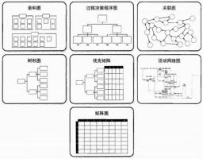
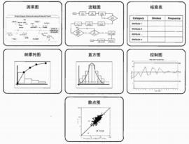

20、统计抽样是指从目标总体中抽取一部分相关样本用于检查和测量，以满足质量管理计划 中的规定。抽样的频率和规模应在质量规划管理过程中确定，以便在质量成本中考虑测试数量和 预期废料等。

21、检查是指检验工作产品，以确定是否符合书面标准。检查也可称为  审查、同行审查、审 计或巡检等。检查也可用于确认缺陷补救。（11 下 11）

22 、测试属于质量控制的工具和技术，虽然第二版教材删了（16 下 50）

### 23、质量保证和质量控制的区别

| 质量保证 | 1、按项目计划开展具体的质量活动，把项目过程及产品做得符合质量要求； 即： 按照计划做质量。 2、设法提高项目干系人对项目将要满足质量要求的信心， 以便减少来自干系人的干扰， 扩 大他们的支持。 3、按照过程改进计划，进行过程改进， 使项目过程更加稳定， 并减少非增值环节。 4、根据过去的质量控制测量结果（质量偏差），对质量标准（要求）进行重新评价，确保 所采用的质量标准（要求）是合理的、可操作的。 |
|---|---|
| 质量控制 | 1、按照质量标准检查质量，发现质量偏差和质量缺陷，并对不可接受的质量偏差提出纠偏 建议，对质量缺陷提出缺陷补救建议。这两种建议都属于变更请求。 2、对已经完成的可交付成果进行质量合格性检查； 如果合格， 就得到“确认的可交付成果”； 如果不合格，就提出变更请求（缺陷补救建议）。 3、对已批准的缺陷补救措施的实施情况进行检查； 如果已实施到位，就得到“确认的变更”； 否则，就要求执行过程继续实施缺陷补救。 |
| 区别： 实施质量保证是针对过程改进和审计的，强调的是过程改进和信心保证。 | 区别： 实施质量保证是针对过程改进和审计的，强调的是过程改进和信心保证。 |

注意：质量保证是一项管理职能，包括所有的有计划的系统地为保证项目能够满足相关的质量标准而建立的活动，质量保证应该贯穿于整个项目生命期。质量保证一般由质量保证部门或者类似的相关部门完成。项目经理不能担任 QA;

### 24、提升项目质量的基本步骤：

（1）建立项目质量目标；

（2）建立工作中的质量保证和质量控制规范；

（3）建立对质量（过程和产品）参数的度量体系；

（4）在项目中对过程和产品进行测量/检查，将实际情况与目标和规范进行对比以发现质量问 题，并对质量问题的处理进行监督和控制；

（5）对质量问题的出现次数和影响程度依次进行分析，找出原因并提出改进措施；

（6）在上述基础上， 不断循环，坚持不懈地提升项目质量。

本章历年考题和答案解析汇总：

1、为保证项目的质量，要对项目进行质量管理，项目质量管理过程的第一步是（1）。

A.制定项目质量计划    B.确立质量标准体系 C.对项目实施质量监控 D.将实际与标准对照

2、在制定项目质量计划时对实现既定目标的过程加以全面分析，估计到各种可能出现的障碍及结 果，设想并制定相应的应变措施和应变计划，保持计划的灵活性。这种方法属于（2）  。

A.流程图法    B.实验设计法   C.质量功能展开    D.过程决策程序图法

3、质量管理六西格玛标准的优越之处不包括（3）。

A.从结果中检验控制质量   B.减少了检控质量的步骤 C.培养了员工的质量意识  D.减少了由于质量问题带来的返工成本

#### 【解析】六西格玛的优越之处在于从项目实施过程中改进和保证质量，而不是从结果中检验控制质量。这样做不仅减少了检控质量的步骤，而且避免了由此带来的返工成本。更为重要的是，六西格玛管理培养了员工的质量意识，并且把这种质量意识融入企业文化中。

4、在项目质量监控过程中，在完成每个模块编码工作之后就要做的必要测试，称为（4）。

（4）A.单元测试    B.综合测试    C.集成测试    D.系统测试

#### 【解析】软件测试在软件生存期横跨2个阶段，

单元测试:通常在编写出每一个模块之后就对它做必要的测试。

测试阶段:对软件系统要进行各种综合测试，软件生存期的另一个独立阶段。

5、质量管理人员在安排时间进度时，为了能够从全局出发、抓住关键路径、统筹安排、集中力量，从而达到按时或提前完成计划的目标，可以使用（5）。

（5）A.活动网络图   B. 因果图  C.优先矩阵图   D.检查表

#### 【解析】 质量控制的工具

优先矩阵图也被认为是矩阵数据分析法，与矩阵图法类似，它能清楚地列出数据的格子，将 大量数据排列成阵列，能容易了解和看到它是一种定量分析问题的方法。

因果图（石川图、鱼刺图）是由日本管理大师石川聲先生发明推出的。它是一种发现问题 “根本原因”的方法，原本用于质量管理。

检查表通常用于收集反映事实的数据，便于改进检查表上记录着的可视内容，特点是容易记 录数据并能自动分析这些数据。

活动网络图（箭条图法、矢线图法），是网络图在质量管理中的应用。它是计划评审法在质量管理中的具体运用，使质量管理的计划安排具有时间进度内容的一种方法。可以达到从全局出发、抓住关键路径、统筹安排、集中力量，从而达到按时或提前完成计划的目标。

6、排列图（帕累托图）可以用来进行质量控制是因为（6）。

A.它按缺陷的数量多少画出一条曲线，反映了缺陷的变化趋势

B.它将缺陷数量从大到小进行了排列，使人们关注数量最多的缺陷

C.它将引起缺陷的原因从大到小排列，项目团队应关注造成最多缺陷的原因

D.它反映了按时间顺序抽取的样本的数值点， 能够清晰地看出过程实现的状态

#### 【解析】质量控制的工具

帕累托图[排列图]，一种柱状图，按事件发生的频率排列而成，它显示由于某种原因引起的缺陷数量或不一致的排列顺序，是找出影响质量的主要因素的方法。帕累托图是直方图，用来确认问题和问题排序。分析是确认造成系统质量问题的诸多因素中最为重要的几个因素。

帕累托分析[80-20法则]，80%的问题经常是由于 20%的原因引起。它将引起缺陷的原因从大到小排列，项目团队应关注造成最多缺陷的原因。

7 、 CMMI  所追求的过程改进目标不包括（7）。

A.保证产品或服务质量  B.项目时间控制  C.所有过程都必须文档化   D.项目成本最低

#### 【解析】 CMMI模型

CMMI是软件能力成熟度模型，该模型包含了从产品需求、设计、开发、编码、测试、交付运行到产品退役的整个生命周期中各个过程的各项基本要素，是过程改进的有机汇集，旨在为各类组织包括软件企业、系统集成企业等改进其过程和提高其对产品或服务的开发、采购以及维 护的能力提供指导。

它的过程改进目标为A保证产品或服务质量，B项目时间控制，C最低的成本，因此CMMI所追求的过程改进目标并不包括所有过程都必须文档化。

8、项目经理在进行项目质量规划时应设计出符合项目要求的质量管理流程和标准，由此而产生的质量成本属于（8）。

（8）A.纠错成本    B.预防成本   C.评估成本    D.缺陷成本

#### 【解析】 考察质量成本的分类

纠错成本是为消除已发现的不合格所采取的措施而发生的成本。与预防成本的区别是不合格 是否发生，故也可叫做缺陷成本。

评估成本指为使工作符合要求目标而进行检查和检验评估所付出的成本。

预防成本是指那些为保证产品符合需求条件，无产品缺陷而付出的成本。是采取预防措施防止不合格产品发生而产生的成本。项目经理在进行项目质量规划时应设计出符合项目要求的质量

管理流程和标准，其目标就是制定措施，防止不合格的发生，由此而产生的质量成本属于预防成本。

9、甲公司承担的某系统开发项目， 在进入开发阶段后， 出现了一系列质量问题。为此， 项目经理 召集项目团队，列出问题，并分析问题产生的原因。结果发现，绝大多数的问题都是由几个原因 造成的，项目组有针对性地采取了一些措施。这种方法属于（9）法。

（9）A.因果图       B.控制图      C.排列图      D.矩阵图

#### 【解析】 考察质量控制的工具

因果图[因果分析图、石川图,鱼刺图]。因果图直观地反映了影响项目的各种潜在原因或 结果及其构成因素同各种可能出现的问题之间的关系。

控制图（管理图、趋势图）它是一种带控制界限的质量管理图表。

排列图（帕累托图）是按照发生频率大小顺序绘制的直方图， 表示有多少结果是由己确认类型或范畴的原因所造成的。按等级排序的目的是指导如何采取主要纠正措施。

矩阵图：矩阵图是指借助数学的矩阵形式，把与问题有对应关系的各个因素列成一个矩阵；然后，根据矩阵图的特点进行分析，从中确定关键点（或着眼点）的方法

#### 【试题 10】---2010 下真题 68

10、在质量管理中可使用下列各图作为管理工具，这 4  种图按顺序号从小到大依次是（10）。

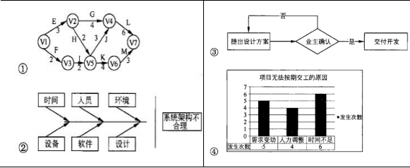

A.相互关系图、控制图、流程图、排列图

B. 网络活动图、因果图、流程图、直方图

C. 网络活动图、因果图、过程决策程序图、直方图

D.相互关系图、控制图、过程决策程序图、排列图

图①为活动网络图法（箭条图法、矢线图法），是网络图在质量管理中的应用。活动网络 图法用箭线表示活动，活动之间用节点（称作“事件，，）连接，表示“结束—开始”关系，可以 用虚工作线表示活动间的逻辑关系。

图②为因果图（因果分析图、石川图或鱼刺图）。因果图直观地反映了影响项目的各种潜在原因或结果及其构成因素同各种可能出现的问题之间的关系。

图③展示了从设计到开发的流程，该流程图体现了设计评审需经业主确认，业主同意后才能 交付开发。

图④是直方图。直方图/柱形图指一种横道图，可反映各变量的分布。每一栏代表一个问题或 情况的一个特征或属性。每个栏的高度代表该种特征或属性出现的相对频率。

11、甲公司最近中标某市应急指挥系统建设，为保证项目质量，项目经理在明确系统功能和性能 的过程中，以本省应急指挥系统为标杆，定期将该项目的功能和性能与之比较。这种方法属于（11）。

（11）A.实验设计法   B.相互关系图法    C.优先矩阵图法   D.基准比较法

#### 【解析】 考察质量控制的工具

实验设计法：是一种统计方法，它帮助确定影响特定变量的因素，最常用于项目产品的分析。

相互关系图法：相互关系图法是指用连线图来表示事物相互关系的一种方法。它也叫关系图法。专家们将此绘制成一个表格。图表中各种因素 A, B, C, D, E, F, G 之间有一定的因果关系。 其中因索 B 受到因素 A,C, E 的影响， 它本身又影响到因素 F,而因素 F 又影响着因素 C 和 G,……， 这样，找出因素之间的因果关系，便于统观全局，分析研究以及拟定出解决问题的措施和计划。

优先矩阵图法：优先矩阵图法也被认为是矩阵数据分析法，与矩阵图法类似，它能清楚地列出关键数据的格子，将大量数据排列成阵列，能够容易地看到和了解关键数据。

基准比较法：是指将项目的实际做法或计划做法与其他项目的实践相比较，从而产生改进的思路并提出度量绩效的标准。其他项目既可以是实施组织内部的，也可以是外部的，既可以来自同一应用领域，也可以来自其他领域。

故本题目中“以本省应急指挥系统为标杆，定期将该项目的功能和性能与之比较”的方法

12、关于项目质量审计的叙述中，（12）是不正确的。

A.质量审计是对其他质量管理活动的结构化和独立的评审方法

B.质量审计可以内部完成，也可以委托第三方完成

C.质量审计应该是预先计划的，不应该是随机的

D.质量审计用于判断项目活动是否遵从于项目定义的过程

#### 【解析】 考察质量审计

质量审计是对其他质量管理活动的结构化和独立的评审方法，用于判断项目活动的执行是否遵从于组织及项目定义的方针、过程和规程。质量审计的目标是:识别在项目中使用的低效率以及无效果的政策、过程和规程。后续对质量审计结果采取纠正措施的努力，将会达到降低质量成本和提高客户或（组织内的）发起人对产品和服务的满意度的目的，质量审计可以是预先计划的，也可以是随机的；可以是组织内部完成，也可以委托第三方（外部）组织来完成。质里审计还确认批准过的变更请求、纠正措施、缺陷修订以及预防措施的执行情况。

13、某项目经理在制定项目质量计划时，从客户对项目交付物的质量要求出发，先识别客户在功 能方面的要求，然后把功能要求与产品的特性对应起来，形成功能要求与产品特性的关系矩阵， 进而确定产品的技术参数。他采用的方法是（13）。

（13）A.质量成本分析  B.效益/成本分析    C.质量功能展开  D.过程决策程序图法

#### 【解析】 考察制定质量管理计划的工具

质量成本分析:指为了达到产品/服务的质量要求所付出的全部努力的总成本，既包括为确保 符合质量要求所做的全部工作（如质量培训、研究和调查等），也包括因不符合质量要求所引起的 全部工作（如返工、废物、过度库存、担保费用等）。

效益/成本分析:项目质量计划过程必须权衡考虑效益/成本的利益。满足质量要求最主要的好 处就是减少返工，这意味着提高生产率、降低成本和增加项目干系人的满意度。为满足质量要求 所付出的主要成本是指用于开展项目质量管理活动的开支。质量管理的原则就是收益胜过成本。质量功能展开:质量功能展开就是将项目的质量要求、客户意见转化成项目技术要求的专业方法。过程程序决策图法:过程决策图法的主要思想是， 在制定计划时对实现既定目标的过程加以全 面分析，估计到种种可能出现的障碍及结果，设想并制定相应的应变措施和应变计划，保持计划 的灵活性。

14、（14）不是进行项目质量保证采用的方法和技术。

A.制定质量保证规划   B.质量活动分解   C.建立质量保证体系  D.统计抽样

#### 【解析】 考察质量保证的方法

很明显， 选项 A 和 C 既重复又矛盾，针对项目则需要“A.制定项目的质量保证计划”，针对一 个企业则要“C.建立质量保证体系”。选项“D.统计抽样”虽然用于质量控制，但也可以用于项目 质量保证过程中的抽查。

15、某公司对本单位负责的信息系统集成项目实施失败原因进行分析后，发现约 80%的原因都是 用户需求不明确、授权不清晰、以及采用了不适宜的技术，而其他十几种原因造成的失败较少。 根据这些分析结果， 该公司所采用项目质量控制的方法是（15）。

（15）A.散点图法 B.直方图法      C.帕累托法      D.控制图法

#### 【解析】

散点图显示两个变量之间的关系和规律。通过该工具，质量团队可以研究并确定两个变量的 变更之间可能存在的潜在关系。将独立变量和非独立变量以圆点绘制成图形。

直方图/柱形图指一种横道图， 可反映各变量的分布。每一栏代表一个问题或情况的一个特征 或属性。 每个栏的高度代表该种特征或属性出现的相对频率。这种工具通过各栏的形状和宽度来 确定问题的根源。

排列图也被称为帕累托图，是按照发生频率大小顺序绘制的直方图，表示有多少结果由已确认类型或范畴的原因所造成的。按等级排序的目的是指导如何采取主要纠正措施。项目团队应首先采取措施纠正造成最多数量缺陷的问题。

控制图[管理图、趋势图]是一种带控制界限的质量管理图表。运用控制图的目的之一就是，通过观察控制图上产品质量特性值的分布状况，分析和判断生产过程是否发生了异常，一 旦发现异常就要及时采取必要的措施加以消除， 使生产过程恢复稳定状态。

根据上述方法的定义，题干中所述方法为帕累托图法

16 下图所表示的质量控制工具为（16）。

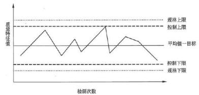

（16）A.散点图法  B. 因果图       C.帕累托图      D.控制图

#### 【解析】 散点图显示两个变量之间的关系和规律。通过该工具，质量团队可以研究并确定两个变量的 变更之间可能存在的潜在关系。将独立变量和非独立变量以圆点绘制成图形。

直方图胜形图指一种横道图，可反映各变量的分布。每一栏代表一个问题或情况的一个特征 或属性。每个栏的高度代表该种特征或属性出现的相对频率。

控制图又叫管理图、趋势图，它是一种带控制界限的质量管理图表。运用控制图的目的之一 就是，通过观察控制图上产品质量特性值的分布状况，分析和判断生产过程是否发生了异常， 一 旦发现异常就要及时采取必要的措施加以消除，使生产过程恢复稳定状态。控制图是对生产过程 质量的一种记录图形，图上有中心线和上下控制限， 并有反映按时间顺序抽取的各样本统计量的 数值点。中心线是所控制的统计量的平均值，上下控制界限与中心线相距数倍标准差。

17、在进行项目质量控制时， 统计方法强调一切用数据说话，而（17）则主要用事实说话， 靠“灵 感”发现新思想、解决新问题。

（17）A.帕累托图     B.树状图        C.相互关系图      D.亲和图

#### 【解析】考察质量控制的工具

排列图[帕累托图]， 是按照发生频率大小顺序绘制的直方图。表示有多少结果是由己确认类型或范畴的原因所造成的。

树状图[系统图、家谱图、组织图]：树状图由方块和箭头构成，形状似树枝，是系统地分析、探求实现目标的最好手段的方法。

相互关系图法[关系图]：相互关系图法是指用连线图来表示事物相互关系的一种方法,专家们将此绘制成一个表格。

亲和图[KF法]，KJ 法则主要用事实说话， 靠“灵感”发现新思想、解决新 问题。 KJ 法认为许多新思想、新理论都往往是灵机一动、突然发现。

18、某项目质量管理员希望采用一些有助于分析问题发生原因的工具，来帮助项目组对各出现的 质量问题进行预测并制订应对措施，以下工具中，能够满足其需要的是（18）。

（18）A.控制图       B.流程图        C.树状图        D.活动网络图

#### 【解析】 此题考察的是质量管理的工具，必须掌握， 必考

控制图是对生产过程质量的一种记录图形， 图上有中心线和上下控制限，并有反映 按时间顺序抽取的各样本统计量的数值点。 中心线是所控制的统计量的平均值，上下控 制界限与中心线相距数倍标准差。多数的制造业应用三倍标准差控制界限，如果有充分 的证据也可以使用其他控制界限。

流程图：流程图用于帮助分析问题发生的缘由。所有过程流程图都具有几项基本要素， 即活动、 决策点和过程顺序。 它表明一个系统的各种要素之间的交互关系。

树状图：树状图由方块和箭头构成， 形状似树枝， 又叫系统图、家谱图、组织图等等，是系统

地分析、探求实现目标的最好方法。

活动网络图：活动网络图法又称箭条图法、矢线图法， 是网络图在质量管理中的应用。它是计划评审法在质量管理中的具体运用，使质量管理的计划安排具有时间进度内容的一种方法。它有 利于从全局出发、统筹安排、抓住关键线路，集中力量，按时和提前完成计划。

根据上述内容可知，流程图是有助于分析问题发生原因的质量控制工具，因此正确答案应选 B。

19、在项目管理中经常需要在成本与进度之间做出权衡，尽管聘用高级程序员的花费要比初级程 序员高得多，却可以获得更高的生产效率。如果项目经理在编制项目质量计划时，希望确定聘用 高级程序员和初级程序员的最佳人数比例，同时还要明确质量标准以及达到标准的最佳方法，最 适合采用的方法是（19）。

（19）A.基准比较     B.效益/成本分析     C.实验设计  D.质量成本分析

#### 【解析】 此题考察的是编制质量管理计划的工具，

基准比较：基准比较是指将项目的实际做法或计划做法与其他项目的实践相比较， 从而产生改 进的思路并提出度量绩效的标准。 其他项目既可以是实施组织内部的也可以是外部的，既可以来 自同一应用领域也可以来自其他领域。

效益/成本分析：项目质量计划过程必须权衡考虑效益/成本的利弊。 满足质量要求最主要的好 处就是减少返工，这意味着提高生产率、降低成本和增加项目干系人的满意度。为满足质量要求 所付出的主要成本是指用于开展项目质量管理活动的开支。质量管理原则的就是收益胜过成本。

实验设计：实验设计是一种统计方法，它帮助确定影响特定变量的因素。 此项技术最常用于项 目产品的分析，例如，计算机芯片设计者可能想确定材料与设备如何组合，才能以合理的成本生 产最可靠的芯片。然而，实验设计也能用于诸如成本与进度权衡的项目管理问题。

质量成本分析：质量成本指为了达到产品满意的质量要求所付出的全部努力的总成本， 既包括 为确保符合质量要求所做的全部工作（如质量培训、研究和调查等），也包括因不符合质量要求所 引起的全部工作（如返工、废物、过度库存、担保费用等）。质量成本分为预防成本、评估成本和 缺陷成本。 项目成功的标准就是增加预防成本要比设法降低弥补成本更值得。

根据上述内容可知，最适合本题案例所述情况的方法是实验设计，因此正确答案应选 c。

20、某系统集成公司制订了一系列完备的质量管理制度，其中一项是要求每个项目在各个阶段的 最后都必须进行质量审计。这种审计活动是（20）过程的一部分工作。

（20）A.质量保证     B.质量改进      C.质量控制      D.质量计划

#### 【解析】 在进行项目质量保证活动时可以采用的技术和方法包括如下内容：（1）项目质量管理通用方法（2）过程分析（3）项目质量审计, 项目质量审计是一种独立的结构化审查，用来确定项目活

动是否遵循了组织和项目的政策、过程与程序。它是实施项目质量保证过程的一部分工作。

21 、一个项目经理和他的团队正在使用鱼骨图（Ishikawa  图）讨论所发现的一个重大质量问题的 原因，这属于质量管理中的（21）。

A.质量计划编制   B.质量工具  C.质量保证  D.质量控制

#### 【解析】考查项目质量控制的方法、技术和工具[鱼骨图/石川图/因果图]，属于质量控制的工具。

22、控制图中的控制上限和控制下限标明（22）。

A.客户将要接受的界限          B.可能出现的过程的偏差范围

C.可以接受的过程的偏差范围    D.判断项目成败的统计控制点

#### 【解析】控制图中的控制上限和控制下限标明可以接受的过程的偏差范围。控制限值比规范限值的限 制力度更强。这样，如果一个数据在控制限值范围之外， 但是，也可以仍旧在规范限值范围之内。

23、（23）不是质量控制的方法、技术和工具。

A.趋势图    B.检查表   C.控制图   D.制定参数基准表

#### 【解析】 这些图表，在控制产品质量的过程中相互交错，应灵活运用。不包含制定参数基准表。

24、质量保证部门最近对某项目进行了质量审计，给出了一些建议和规定，一项建议看来关键应 该采纳执行。因为它将影响到这个项目是成功地交给客户。如果建议不被执行，产品就不能满足 需要。该项目的项目经理下一步应该（24）。

（24）A.开一个项目团队会议，以确定谁对这个问题负责

B.重新分配任务并且发现这个错误负有责任队员

C.立即进行产品的返工

D.发布一项变更申请以采取必要的纠正措施

#### 【解析】发布一项变更申请以采取必要的纠正措施

专业分析：通过质量审计获取的信息可以用于改善质量系统和业绩水平。在大多数情况下， 实施质量改善工作需要先准备变更要求。

25、应用Paretol 图可以（25）。

（25）A.将精力集中到最关键的因素上     B.量化风险  C.帮助预测未来的问题             D.改进风险管理

#### 【解析】排列图【帕累托图】，是按照发生频率大小顺序绘制的直方图.表示有多少结果是由已确 认类型或范畴的原因所造成的。按等级排序的目的是指导如何采取主要纠正措施。项目团队应首 先采取措施纠正造成最多数量缺陷的问题。

26 一般不是用于质量控制的方法和技术。

（26）A.趋势分析    B.检验    C.控制图   D.制定参数基准

#### 【解析】基准分析（标杆对照） 是质量规划的工具和技术，不是质量控制的工具和技术

27、质量保证是项目管理中非常重要的活动， 质量保证除了为项目提供支持外还为（27）创造了条件。

（27）A.产品改进    B.过程改进   C.质量控制  D.成本控制

#### 【解析】 质量保证必须制定质量标准、流程和准备相应的资源，是进行质量控制的前提

28、在某操作系统中，47%的错误时由该系统 4%的程序模块产生的，该现象（28）特征。

（28）A.蒙特卡洛    B.大数定律    C.帕累托定律    D.PDP

#### 【解析】

帕累托法认为，相对而言，数据较少的原因往往造成绝大多数的问题或缺陷。该法则通常称为 80/20 原则，即 80%的问题是由 20%的原因导致的。

#### 【试题 29】---2013 下真题 67

29、某公司的质量目标是每千行代码缺陷数不大于 2.5 个， 项目组为确保， 并能对软件开发项目组 5 个代码编写人员各自的质量进行趋势分析，适合质量工具是（29）。

（29）A.散点图     B.矩阵图     C.控制图      D.亲和图

#### 【解析】控制图【趋势图】缺陷不大于 2.5， 实际可理解缺陷范围是 0 到 2.5 之间， 刚好是我们控制图的基本思想。

#### 【试题 30】---2014 上真题 57

30、质量管理体系文件包括质量手册、程序文件和（30）。

（30）A.质量计划   B.质量目标   C.质量方针   D.质量记录

#### 【解析】质量体系文件包括： 质量手册、程序文件、作业指导书、规范、外来文件、表单、记录等

#### 【试题 31】---2014 下真题 66

31、六西格玛管理方法的核心是将所有的工作作为一种流程，采取量化的方法分析流程中影响质 量的因素， 找出最关键的因素加以改进从而提高客户满意度。具体的改进流程为（）。

A.①确定②测量③分析④改进⑤控制    B.①测量②分析③确定④改进⑤控制

C.①测量②分析③改进④确定⑤控制    D.①控制②测量③分析④改进⑤确定

#### 【解析】六西格玛管理法的核心是将所有的工作作为一种流程，采用量化的方法分析流程中影响质量的因素，找出最关键的因素加以改进从而达到更高的客户满意度，即采用 DMAIC（确定、测量、分析、改进、控制）改进方法对组织的关键流程进行改进

#### 【试题 32】---2014 下真题 67

32、在制定项目质量计划中，（）运用统计方法帮助项目确定影响特定变量的因素，经常用于项 目产品的分析。

A.基准比较  B.质量成本分析  C.流程图  D.实验设计

#### 【解析】实验设计是一种统计方法，它帮助确定影响特定变量的因素。此项技术最常用于项目产品的分析，例如，计算机芯片设计者可能想确定材料与设备如何组合，才能以合理的成本生产最可靠的芯片。

#### 【试题 33】---2015 上真题 66

33、为了识别项目中使用的无效和低效政策、过程和程序，可以采用（）方法。

A.检查   B.质量审计   C.标杆对照      D.过程分析

#### 【解析】 质量审计是对其他质量管理活动的结构化和独立的评审方法，用于判断项目活动的执行是否 遵从于组织及项目定义的方针、过程和规程。质量审计的目标是：识别在项目中使用的低效 率以及无效果的政策、过程和规程。后续对质量审计结果采取纠正措施的努力，将会达到降 低质量成本和提高客户或（组织内的）发起人对产品和服务的满意度的目的。质量审计可以 是预先计划的，也可是随机的：可以是组织内部完成，也可以委托第三方（外部）组织来完 成。质量审计还确认批准过的变更请求、纠正措施、缺陷修订以及预防措施的执行情况。

#### 【试题 34】---2015 上真题 67~68

34、项目的质量保证不包括（1），采用的方法和技术不包括（2）。

（1）A.产品的质量保证   B.系统的质量保证     C.人员的质量保证 D.服务的质量保证

（2）A.确定质量目标      B.确定保证范围的等级 C.质量检验    D.制定质量保证规划

#### 【试题 35】---2015 上真题 69

35、为了实现项目质量控制， 经常用到各种图形工具，下面是（）。

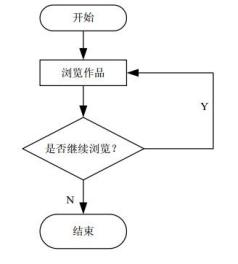

A. 因果图   B.流程图   C.直方图      D.控制图

#### 【解析】 流程图是指任何显示与某系统相关的各要素之间相互关系的示意图。流程图是流经一个系统的信息流、观点流或部件流的图形代表。

因果图（又叫因果分析图、石川图或鱼刺图）直观地反映了影响项目的各种潜在原因或结果 及其构成因素同各种可能出现的问题之间的关系。

直方图[条形图]、质量分布图、矩形图、频数分布图等，是通过对抽查质量数据的加工整 理，找出其分布规律，从而判断整个生产过程是否正常。直方图是由平行条状的若干条宽度 相同的矩形构成，矩形的排列可以是纵向的，也可以是横向的。根据矩形的分布形状和公差 界限相对关系来探索质量分布规律，分析、判断整个作业过程是否正常、稳定。具体方法可 以直接观察分析， 也可以将直方图与规格标准进行比较。这种方法是一种“基量整理”方法， 其不足是不能反映质量的动态变化，且对数据的量要求较大。

控制图[管理图]，用于决定一个过程是否稳定或者可执行，是反映生产程序随时间变化 而发生的质量变动的状态图形，是对过程结果在时间坐标上的一种图线表示法。

#### 【试题 36】---2015 上真题 70

36、项目具体结果包括项目的最终产品或服务，也包括项目过程的结果。项目过程结果的质量需 要由（）进行控制。

A.质量控制职能部门    B.质检员    C.项目经理       D.项目管理组织的成员

#### 【解析】 2.项目质量控制的内容

项目质量控制活动一般包括：保证由内部或外部机构进行检测管理的一致性，发现与质量标准的 差异，消除产品或服务过程中性能不能被满足的原因，审查质量标准以决定可以达到的目标及成 本、效率问题，并且需要确定是否可以修订项目的质量标准或项目的具体目标。

项目具体结果既包括目的最终产品（可交付成果等） 或服务，也包括项目过程的结果。项目产品 的质量控制一般由质量控制职能部门负责，而项目过程结果的质量，却需要由项目管理组织的成 员进行控制。质量控制过程还可能包括详细的活动和资源计划。

#### 【试题 37】---2015 下真题 66~67

37、在信息项目建设开发中，（1）不能用来描述项目的进度安排，（2）可动态地反应项目的建设情况。

（1）A.甘特图  B.PERT 图    C.PERT/CPM 图    D.鱼骨图

（2）A.甘特图  B.PERT 图    C.PERT/CPM 图    D.鱼骨图

#### 【答案】DA

#### 【解析】 鱼骨图是质量控制工具

甘特图、 PERT（计划评审技术）图及 CPM（关键路径法）图是软件项目管理中常用的管理开

发进度的工具。鱼骨图是常用来发现问题根源并提出解决问题的有效办法的工具。在这三种 系开发进度管理工具图中， 甘特图能够清晰描述每个任务的开始/结束时间及各任务之间的并 行性。也可以动态地反映项目的开发进展情况， 但难以反映多个任务之间存在的逻辑关系；

PERT利用项目的网络图和各活动所需时间的估计值（通过加权平均得到的）去计算项目总时 间，强调任务之间的先后关系，但不能反映任务之间的并行性，以及项目的当前进展情况； CPM 借助网络图和各活动所需时间，计算每一活动的最早或最迟开始和结束时间。 CPM 的关 键是计算总时差，这样可决定哪一活动有最小时间弹性。 PERT 利用项目的网络图和各活动所 需时间的估计值（通过加权平均得到的） 去计算项目总时间。PERT 不同于 CPM 的主要点在于 PERT 利用期望值而不是最可能的活动所需时间估计（在 CPM 法中用的）

#### 【试题 38】---2015 下真题 68

38、项目质量保证活动的参与者应为（ ）。

（38）A.项目经理                       B.负责执行项目的管理层

C.负责项目执行的一线工作人员     D.全体工作人员

#### 【解析】 项目质量保证活动的参与者应该是全体工作人员，而不是某一类人。

#### 【试题 39】---2016 上真题 66

39、以下关于质量管理的叙述中，不正确的是（33）。

A.产品等级高就是质量好

B.质量管理注重预防胜于检查

C.质量方针由最高管理者批准并发布

D.质量目标是落实质量方针的具体要求，从属于质量方针

#### 【解析】 产品等级高不一定质量就好；

#### 【试题 40】---2016 上真题 67

40、在制定项目质量计划过程中，可以采用（40）方法以识别哪些因素会对特定变量产生影响。 A.散点图   B.检查表   C.质量功能展开    D.实验设计

#### 【解析】实验设计是一种统计方法，它帮助确定影响特定变量的因素。此项技术最常用于项目产品的分析，例如，计算机芯片设计者可能想确定材料与设备如何组合，才能以合理的成本生产最可靠的芯片。

#### 【试题 41】---2016 上真题 68~69

41、在质量控制过程中，经常会使用一些工具和方法。（68）是一种基于 80/20 原理， 用于找出影 响项目产品或服务质量的主要因素的方法。（69）不属于质量控制活动。

（68）A.流程图     B.帕累托图   C.控制图                 D.鱼骨图

（69）A.产品测试   B.抽样       C.对不合格进行原因分析   D.过程分析

#### 【答案】BD

#### 【解析】 过程分析是质量保证的技术和工具。

排列图也被称为帕累托图，是按照发生频率大小顺序绘制的直方图.表示有多少结果是由已确认类型或范畴的原因所造成的。按等级排序的目的是指导如何采取主要纠正措施。项目团队应首 先采取措施纠正造成撮多数量缺陷的问越。从概念上说，帕累托图与帕累托法则一脉相承，该法 则认为：相对来说数量较小的原因往往造成绝大多数的问题或者缺陷。此法则往往称为二八原理，即 80%的问题是 20%的原因所造成的

#### 【试题 42】---2016 下真题 47

42、规划质量管理的过程中可以用到多种工具和技术。（） 是一种统计方法，用来识别哪些因素会 对正在生成的产品或正在开发的流程的特定变量产生影响。

A.成本效益分析法   B.质量成本法    C.标杆对照    D.实验设计

#### 【解析】实验设计（DOE）是一种统计方法，用来识别哪些因素会对正在生产的产品或正在开发的流程的特 定变量产生影响。DOE 可以在质量规划管理过程中使用，以确定测试的数量和类别， 以及这些测试 对质量成本的影响。

#### 【试题 43】---2016 下真题 48

43、以下关于质量审计的叙述中，不正确的是（）。

A.质量审计是对具体质量管理活动的结构性评审

B.质量审计可以是事先安排， 也可以随机进行

C.质量审计只能由外部审计师进行

D.质量审计可检查已批准的变更请求的实施情况

#### 【解析】质量审计，又称质量保证体系审核，是对具体质量管理活动的结构性的评审。

质量审计可以是事先安排，也可随机进行。在具体领域中有专长的内部审计师或第三方组织都可 以实施质量审计可由内部或外部审计师进行。

质量审计还可确认已批准的变更请求（包括更新、纠正措施、缺陷补救和预防措施） 的实施情况。

#### 【试题 44】---2016 下真题 49

44、在质量管理中，可以使用（）判断一个过程是否处于控制状态还是处于失控状态。 A.散点图    B.运行图    C.控制图   D.因果图

#### 【解析】控制图，是一张实时展示项目进展信息的图表,可以判断某一过程处于控制之中还是处于失控状态。

#### 【试题 45】---2016 下真题 50

45、某项目组的测试团队对项目的功能及性能进行全面测试，来保证项目的可交付成果及工作满 足主要干系人的既定需求。项目组所采用的质量管理方式是（）。

A.规划质量   B.质量控制   C.实施质量保证    D.质量改进

#### 【解析】测试属于质量控制的工具和技术，虽然第二版教材删了，但是第一版教程是有的，质量控制针对的是结果

#### 【试题 46】---2017 上真题 50

46、在质量管理中,（）可以识别造成大多数问题的少数重要原因。

A.直方图    B.控制图    C.核查表    D.帕累托图

#### 【解析】P366此题考察的是质量控制的工具和技术，

帕累托图（80/20 原则），用于识别造成大多数问题的少数重要原因。

核查表[计数表]用于收集数据的查对清单。用核查表收集的关于缺陷数量或后果的数据，又经常使用帕累托图来显示。

直方图，用于描述集中趋势、分散程度和统计分布形状,不考虑时间对分布内的变化的影响。

控制图，是一张实时展示项目进展信息的图表。可以判断某一过程处于控制之中还是处于失控状态七点运行定律是指在一个质量控制图中，一行上的 7 个数据点都低于平均值或高于平均值， 或者都是上升的，或者都是下降的， 那么这个过程就需要因为非随机问题而接受检查。

#### 【试题 47】---2017 上真题 51

47、下图是（）。

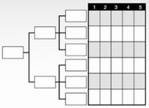

A.亲和图    B.过程决策程序图    C.矩阵图    D.优先矩阵图

#### 【解析】优先矩阵图用来识别关键事项和合适的备选方案，并通过一系列决策，排列出备选方案的优先顺序。先对标准排序和加权，再应用于所有备选方案，计算出数学得分，对备选方案排序。

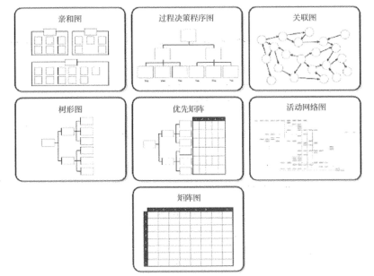

#### 【试题 48】---2017 下真题 63

48、质量管理发展过程中，从（）开始，质量管理从“对已完成产品的事后检验”提前到“对产 品生产过程中的全过程监控”。

A.手工艺人时代    B.质量检验阶段    C.统计质量控制阶段    D.全面质量管理阶段

#### 【解析】在全面质量管理阶段，TQM 的发展又经历了三个步骤，从最初的以顾客为中心的质量保证， 到强调, 持续改进的质量管理阶段，最终发展成为现在的全面质量管理阶段。

#### 【试题 49】---2017 下真题 64

49、（）属于质量管理中规划质量过程的工具和技术。

A.成本效益分析法    B.质量审计    C.控制图    D.甘特图

#### 【解析】规划质量过程的工具和技术：1.成本效益分析法 2.质量成本法 3.标杆对照 4.实验设计 5.其他质量管理工具；B 是质量保证的工具和技术，C 是质量控制的工具和技术， D 为进度里面的

#### 【试题 50】---2017 下真题 65

50、在进度管理中常用的活动网络图，如计划评审技术（PERT），关键路径法等，也可以应用于 质量管理的（）过程中。

A.规划质量管理    B.实施质量保证    C.质量控制    D.质量改进

#### 【试题 51】---2018 上真题 63

51、“某型号手机，主打商务智能， 无线充电、价格低廉， 像素高,续航强”。（）属于对质量的描述。 A.商务智能    B.无线充电    C.价格低廉    D.像素高,续航强

#### 【试题 52】---2018 上真题 64

52、生产过程中，需要通过统计返工和废品的比率来进行质量管理，这种方法在质量管理中属于 ()。

A.质量成本法    B.标杆对照    C.实验设计    D.抽样统计

#### 【解析】实验设计是一种统计方法。

#### 【试题 53】---2018 上真题 65

53、某项目的质量管理人员在统计产品缺陷时’绘制了如下统计图’并将结果反绩至项目经理’ 但是由于工期紧张’下列选项中()缺陷可以暂时搁置。

A.起皱     B.缺边     C.划伤     D.磕碰

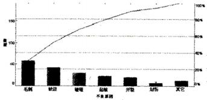

#### 【答案】C

#### 【解析】P361此题考察的是帕累托图，

将影响最小的搁置。这就是帕累托的应用

#### 【点评】以前考过，常考，比较简单， 必须得分

#### 【试题 54】---2018 下真题 63

54、质量管理的阶段，大致经历了手工艺人时代、质量检验阶段、统计质量控制阶段和（） 四个阶 段。

A.零缺陷质量管理    B.全面质量管理    C.过程质量管理    D.精益质量管理

#### 【答案】B

#### 【解析】P356-357，此题考察的是质量管理的阶段，

质量管理阶段大致经历了手工艺人时代、质量检验阶段、统计质量控制阶段和全面质量管理阶段。

#### 【试题 55】---2018 下真题 64

55、针对规划质量管理的工具和技术，不正确的是（）。

A.成本效益法通过比较可能的成本和预期的收益来提高质量

B.预防成本是质量成本，内部失败成本不是质量成本

C.统计抽样的频率和规模应在规划质量管理过程中确定

D.实验设计是规划质量管理过程中使用的一种统计方法

#### 【答案】B

#### 【解析】P361，此题考察的是规划成本管理的工具和技术， 质量成本包括一致性和非一致性的成本，当然也包括内部失败成本。

56、（）属于规划质量管理的输出。

A.项目管理计划    B.需求文件    C.风险登记册    D.质量核对单

#### 【解析】质量核对单是规划质量的输出。

57、质量管理通过质量体系中的质量规划、质量保证、质量控制和（）的实现。 A.质量分析    B.质量改进    C.质量检验    D.质量度量

#### 【解析】质量管理是指确定质量方针、目标和职责，并通过质量体系中的质量规划、质量保证和质量控制 以及质量改进来使其实现所有管理职能的全部活动。

58、质量管理工具或技术中，（）用图形方式显示变更的推力和阻力。

A.头脑风暴    B.实验设计    C.力场分析    D.名义小组技术

#### 【解析】力场分析， 显示变更的推力和阻力的图形。

59、关于质量管理七种工具的描述.不正确的是（）。

A.帕累托图用于识別造成大多数问题的少数重要原因

B.控制图展示了项目进展信息用于判断某一过程是否失控

C.直方图用于指述集中趋势分散程度和统计分布，反映了时间对分化的影响

D.过程决策程序图用于理解一个目标与达成此目标的步骤之间的关系

#### 【解析】直方图，是一种特殊形式的条形图，用于描述集中趋势、分散程度和统计分布形状。与控制图不 同，直方图不考虑时间对分布内的变化的影响。

60、（）将质量控制扩展到产品生命周期全过程。

A.检验技术    B.统计质量控制    C.抽验检验方法    D.全面质量管理

#### 【解析】全面质量管理（TQM）是一种全员、全过程、全企业的品质管理。全员参加的质量管理、全过程的质量管理、全面方法的质量管理和全面结果的质量管理

61、某电池生产厂商为了保证产品的质量，在每一块电池出厂前做破坏性测试所产生的成本属于 ()。

A.项目开发成本，不属于质量成本

B.质量成本中的非一致性成本

C.质量成本中的评价成本

D.质量生产中的内部失败成本
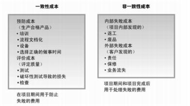

62、某制造商面临大量产品退货，产品经理怀疑是采购和货物分类流程存在问题，此时应该采用 ()进行分析。

A.流程图    B.质量控制图    C.直方图    D.鱼骨图

#### 【解析】7 种质量工具；

因果图【鱼骨图/石川图】问题陈述放在鱼骨的头部，作为起点，用来追溯问题来源，回推到可 行动的根本原因。在问题陈述中，通常把问题描述为一个要被弥补的差距或要达到的目标。通过看问题陈述和问“为什么”来发现原因，直到发现可行动的根本原因，或者列尽每根鱼骨上的合理可能性。 要在被视为特殊偏差的不良结果与非随机原因之间建立联系，鱼骨图往往是行之有效的。

八、项目人力资源管理

考点分析与预测： 人力资源管理一般上午考察 2 分左右，项目中的所有活动，归根结底都是 由人来完成的。在项目的所有干系人中，项目团队对项目的成功至关重要。如何选对人，如何培 养人，如何充分发挥每个人的作用，又如何把人组织成高绩效的团队，对于项目的成败起着至关 重要的作用， 人力资源管理也非常重要，在案例分析中出现的问题也教多，但是考察的几率并不 是很大，上午历年考试的重点在 WBS/0BS/RAM，人员配备管理计划，团队的阶段，激励理论，冲 突解决的方法，组建项目团队的工具和技术，这部分的还是蛮重要的，考点也很清晰；建议大家 在掌握历年的高频考点后尽量去学习其他方面的知识点。

本章下午案例分析主要有以下两种命题思路：

命题思路 1： 给出某项目在人力资源管理方面的案例场景描述，要求指出该案例场景中存在 哪些问题并说明相关原因； 要求给出解决这些问题的补救措施（或建议）；给出 1 个该案例涉及且 与人力资源管理基础知识点相关的简答题（或判断题、填空题、选择题等）。

人力资源管理的过程、输入、输出、工具和技术汇总表：

| 人力资源管理：项目人力资源计划编制-组建项目团队-项目团队建设-管理项目团队 | 人力资源管理：项目人力资源计划编制-组建项目团队-项目团队建设-管理项目团队 | 人力资源管理：项目人力资源计划编制-组建项目团队-项目团队建设-管理项目团队 | 人力资源管理：项目人力资源计划编制-组建项目团队-项目团队建设-管理项目团队 |
|---|---|---|---|
| 过程名 | 输入（依据） | 工具和技术（方法） | 输出（结果） |
| 1、项目人力资 源计划编制 | ①项目管理计划 ②活动资源需求 ③事业环境因素 ④组织过程资产 | ①组织图与职位描述 ②人际交往（16 上 49） ③组织理论 ④专家判断 ⑤会议    （11 下 47） | ①项目人力资源计划 |

| 2、组建项目团队 | ①项目人力资源计划 ②环境和组织因素 ③组织过程资产 | ①预分派 ②谈判 ③招募 ④虚拟团队（09 上 33） ⑤多标准决策分析 | ①项目人员分派 ②资源日历 ③项目管理计划（更 新） |
|---|---|---|---|
| 3、项目团队建设 | ①人力资源管理计划 ②项目人员分派 ③资源日历 | ①人际关系技能 ②培训 ③团队建设活动 ④基本规则 ⑤集中办公 ⑥认可与奖励 ⑦人事测评工具（15下50） | ①团队绩效评价 ②事业环境因素（更 新） |
| 4、管理项目团队 | ①人力资源管理计划 ②项目人员分派 ③团队绩效评价 ④问题日志 ⑤工作绩效报告 ⑥组织过程资产 | ①观察和交谈 ②项目绩效评估 ③冲突管理 ④人际关系技能 | ①变更请求 ②项目管理计划（更新） ③项目文件（更新）  ④事业环境因素（更新） ⑤组织过程资产（更新） |

本章金色考点汇总：

### 1、项目人力资源管理包括如下过程：

（1）编制项目人力资源计划：确定与识别项目中的角色、所需技能、分配项目职责和汇报关 系’并记录下来形成书面文件’其中也包括项目人员配备管理计划。

（2）组建项目团队：通过调配、招聘等方式得到需要的项目人力资源。

（3）建设项目团队：培养提高团队个人的技能’改进团队协作’提高团队的整体水平以提升 项目绩效。

（4）管理项目团队：跟踪团队成员个人的绩效和团队的绩效’提供反绩’解决问题并协调变 更以提高项目绩效。

其中：（1）属于计划过程组；（2）（3）（4）属于执行过程组；

2、通过编制项目人力资源计划过程’确定项目的角色、职责以及汇报关系’并编制人员配备   管理计划。在大多数项目中’编制项目人力资源计划过程主要作为项目最初阶段的一部分。但是’ 这一过程的结果应当在项目的整个生命周期中进行经常性地复查’以保证它的持续适用性。如果   最初的项目人力资源计划不再有效’就应当立即修正。

编制项目人力资源计划过程总是与沟通计划编制过程紧密联系’因为项目组织结构会对项目 的沟通需求产生重要影响。（18 上 53）

在编制项目人力资源计划时’要注意到与项目成本、进度、风险、质量及其他因素间的相互 影响’同时也应注意到其他项目对同类人员的争夺’所以项目要有备选人员。

3、组织结构图主要有三种：层次结构图、责任分配矩阵和文本格式。（13 上 48） 4、层次结构图（15 上 49）（18 下 53）

①用工作分解结构（WBS）来确定项目的范围’将项目可交付物分解成工作包即可得到该项

目的 WBS。也可以用 WBS 来描述不同层次的职责。

②组织分解结构（BS）与工作分解结构形式上相似，但是它不是根据项目的交付物进行分 解，而是根据组织现有的部门、单位或团队进行分解。把项目的活动和工作包列在负责的部门下 面。（10 上 47）（11 上 45）

③资源分解结构（RBS）是另一种层次结构图， 它用来分解项目中各种类型的资源。

区别和联系： OBS 和 WBS 类似，区别在于。BS 不是按照项目可交付成果的分解而组织的， 而是按照组织所设置的部门、单位和团队而组织的；

5、矩阵图： 反映团队成员个人与其承担的工作之间联系的方法有多种，而责任分配矩阵 	（RAM）是最直观的方法。 在大型项目中，可以制定多个层次的 RAM；矩阵图能反映与每个人 相关的所有活动， 以及与每项活动相关的所有人员。它也可确保任何一项任务都只有一个人负责， 从而避免职责不清。（13 上 56）（13 下 48）（14 上 48）（16 上 50）（17 上 52）（17 下 53）（19 上 53）

（19 下 51）

RAM 表示完成工作与成员间的关系； RAM 是将 WBS 中的每一项工作指派到。BS 中的执 行人员所形成的一个矩阵：

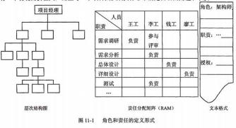

6、文本格式： 团队成员职责需要详细描述时， 可以用文字形式表示。通常提供如下信息： 职 责、权利、能力、资格等。（16 下 51）

7、 人际交往活动的例子包括主动写信、午餐会、非正式对话（如会议和活动）、贸易洽谈会 和座谈会。人际交往在项目初期特别有用，在项目期间及项目结束后有效促进项目管理职业的发 展。

8、人员配备管理计划是项目管理计划的一个分计划，描述的是何时以及怎样满足人力资源需 求。根据项目的需要，它可以是正式的或者非正式的，既可以是非常详细的，也可以是比较概略 的。为了指导正在进行的团队成员招聘和团队建设活动，人员配备管理计划随着项目的持续进行 而经常更新。（09 上 44）（12 上 47）（16 下 52）

9、人力资源管理计划的内容： ①角色和职责②项目的组织结构图③人员配备管理计划（15 下 51）

10、人员配备管理计划包括： ①人员招募；②资源日历③人员遣散计划；④培训需求； ⑤表彰和奖励；⑥遵守的规定；⑦安全性

11、组建项目团队的方法：（1）事先分派（2）谈判（找部门经理、其他项目管理团队）（3） 招募（招聘）（4）虚拟团队（需要制定一个可行的沟通计划，不在一起的一起工作的团体，要制 订一个可行的沟通计划）（5）多标准决策分析

12、虚拟团队可以被定义为有共同目标、在完成各自任务过程中很少有时间或者没有时间能 面对面工作的一组人员。 虚拟团队缺点：可能产生误解、有孤立感、团队成员之间难以分享知识 和经验、采用通信技术也要花费成本等。在建立一个虚拟团队时，制订一个可行的沟通计划就显

得更加重要（17 上 53）（19 下 52）

通过虚拟团队的形式，我们可以：①在公司内部建立一个由不同地区员工组成的团队。②为 项目团队增加特殊技能的专家，即使这个专家不在本地③把在家办公的员工纳入虚拟团队，以协 同工作。④由不同班组（早班、中班和夜班）员工组成一个虚拟团队。⑤把行动不便或残疾的员 工纳入团队。⑥可以实施那些原本因为差旅费用过高而被忽略的项目。

13、典型的激励理论有马斯洛需要层次理论、X/Y 理论、赫淡伯格的双因素理论和期望理论：

（09 上 46）（09 下 41）（11 上 46）（12 下 60）（13 下 47）

14、马斯洛需要层次理论： （14 上 47）

②安全需要： 包括对

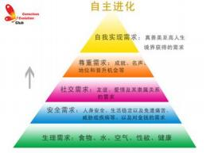

失业以及免遭痛苦、威胁或疾病

③社会交往的需要： 包括对

的需要。

④自尊的需要：指自尊心和荣誉感。

⑤自我实现的需要：指想获得更大的空间以实现 的需要。

### 15、赫淡伯格的双因素理论

双因素理论认为有两种完全不同的因素影响着人们的工作行为。

第一类是保健因素这些因  素是与工作环境或条件有关的，能防止人们产生不满意感的一类因素， 包括工作环境、工资薪水、 公司政策、个人生活、管理监督、人际关系等。当保健因素不健全时，人们就会产生不满意感。但即使保健因素很好时，也仅仅可以消除工作中的不满意，却无法增加人们对工作的满意感，所 以这些因素是无法起到激励作用的。

第二类是激励因素这些因素是与员工的工作本身或工作内容有关的、能促使人伺产生工作 满意感的一类因素，是高层次的需要，包括成就、承认、工作本身、责任、发展机会等。当激励 因素缺乏时，人们就会缺乏进取心，对工作无所谓，但一旦具备了激励因素，员工则会感觉到强 大的激励力量而产生对工作的满意感，所以只有这类因素才能真正激励员工。

16、期望理论认为， 一个目标对人的激励程度受两个因素影响。

（l）目标效价，指实现该目标对个人有多大价值的主观判断。如果实现该目标对个人来说很有价值，个人的积极性就高；反之，积极性则低。

（2）期望值，指个人对实现该目标可能性大小的主观估计。只有个人认为实现该目标的可能 性很大，才会去努力争取实现，从而在较高程度上发挥目标的激励作用；如果个人认为实现该目 标的可能性很小，甚至完全没有可能，目标激励作用则小，以至完全没有。

17 、X/Y 理论

X 理论主要体现了独裁型管理者对人性的基本判断，这种假设认为：

（1）一般人天性好逸恶劳，只要有可能就会逃避工作

（2）人生来就以自我为中心， 漠视组织的要求

（3）人缺乏进取心， 逃避责任，甘愿听从指挥，安于现状，没有剖造性。（4）人们通常容易受骗，易受人鳩动

（5）人们天生反对改革。

Y 理论对人性的假设与 x 理论完全相反，其主要观点为：

（1）一般般人天生并不是好逸恶劳，他们热爱工作，从工作得到满足感和成就感。

（2）外来的控制和处罚对人们实现组织的目标不是一个有效的办法，下属能够自我确定目标，

自我指挥和自我控制。

（3）在适当的条件下，人们愿意主动承担责任。

（4）大多数人具有一定的想蒙力和创造力。

（5）在现代社会中， 人们的智慧和潜能只是部分地得到了发挥。

X理论体现了独裁型管理者对人性的判断，Y理论则相反。用X理论可以加强管理，但项目团队成员比较被动的工作；用Y理论可以激发员工积极性，但又可能放任过度。可以在项目团队的开始阶段用X理论，在项目团队进入执行阶段时用Y理论。

18、领导权变理论的基本观点是：认为不存在一种普遍适用、唯一正确的领导方式，只有结 合具体情景，因时、因地、因事、因人制宜的领导方式，才是有效的领导方式。有效领导取决于 领导者自身、被领导者与领导过程所处的环境。领导管人，管理管事

有效地领导取决于领导者自身、被领导者与领导过程所处的环境。例如，在项目早期团队组 建的过程中，或对于新员工，领导方式可以是专断型（或者说独裁式、指导式）                           ；当团队成员熟悉情况后，可以采用民主型甚至可以部分授权。（18 上 54）

19、项目经理 5 种权利：①合法的权利；②强制力③专家权利；④奖励权利；⑤感召权利； 最好用 奖励权利和专家权利来影响团队成员，避免

是来自公司的授权， 其他权利来自项目经理本人。

①合法的权力，指在高级管理层对项目经理授权的基础上，项目经理让员工进行工作的权力。 ②强制力， 是指用惩罚、威胁或者其他消极手段强迫员工做他们不想做的事。

③专家权力，就是用个人知识和技能让员工改变他们的行为。

④奖励权力， 就是使用一些激励措施来引导员工去工作。奖励包括薪金、职位、认可度、特 殊的任务以及其他的奖励员工满意行为的手段。

⑤感召权力，是建立在个人感召权力的基础上。人们非常尊重某些具有感召权力的人， 会按 照他们所说的去做。

### 20、成功的项目团队的特点：

（1）团队的目标明确，成员清楚自己的工作对目标的贡献。

（2）团队的组织结构清晰，岗位明确。

（3）有成文或习惯的工作流程和方法， 而且流程简明有效。

（4）项目经理对团队成员有明确的考核和评价标准，工作结果公正公开、赏罚分明- （5）共同制订并遵守的组织纪律。

（6）协同工作，也就是一个成员工作需要依赖于另一个成员的结果，善于总结和学习。

21、团队建设的工具和技术：①人际关系技能；②培训；③团队建设活动；④基本原则；⑤集中办公（也称紧密矩阵）；⑥认可与奖励；应只奖励那些被认可的、积极的行为，而计划不周、方法不当、效率不高而导致的加班不在奖励之列。奖励和认可也必须考虑文化差异。⑦人事测评工具。（14 下 50）

22、项目团队建设的五个阶段：形成阶段；震荡阶段；规范阶段；发挥阶段；结束阶段； 新

成员的加入或者老人的离职都从形成阶段开始；（09 上 34）（13 下 49）（15 上 48）（15 下 49）

优秀的团队不是一腻而就的， 一般要依次经历以下 5 个阶段：

（1）形成阶段（Forming）：一个个的个体成员转变为团队成员，开始形成共同目标；对未来团队往往有美好的期待。

（2）震荡阶段（Storming）: 团队成员开始执行分配的任务，一般会遇到超出预想的困难， 希望被现实打破。个体之间开始争执，互相指责，并且开始怀疑项目经理的能力。（14 上 49）

（3） 规范阶段（Norming）:经过一定时间的磨合，团从成员之间相互熟悉和了解，矛盾基本 解决，项目经理能够得到团队的认可。（16 下 53）

（4）发挥阶段（Performing）:随着相互之间的配合默契和对项目经理的信任，成员积极工作， 努力实现目标。这时集体荣誉感非常强，常将团队换成第一称谓，如“我们那个组” 、“我们部门” 等，并会努力捍卫团队声誉。

（5）结束阶段（Adjouming）:随着项目的结束，团队也被遣散了。

23、管理项目团队是指跟踪个人和团队的绩效，提供反绩，解决问题和协调变更，以提高项目的绩效。

24、管理项目团队工具与技术：①观察和交谈；②项目绩效评估③问题清单；④人际关系技

能（17 下 54）--具体内容翻书看看

25、项目冲突应该被尽早发现，利用私下但直接的、合作的方式来处理冲突。如果冲突持续 分裂，那么需要使用正式的处理过程，包括采取惩戒措施。

26、冲突的特点：①冲突是自然的；②冲突是一个团队问题；③应公开地处理冲突；④冲突的解决应聚焦在问题；⑤冲突的解决应聚焦在现在。（16 下 54）（18 下 54）

27、冲突的根源：①项目的高压环境；②责任模糊；③存在多个上级；④新科技的使用。（14

上 50）

28 、不管冲突对项目的影响是正面的还是负面的，项目经理都有责任处理它，以减少冲突对 项目的不利影响，增加其对项目积极有利的一面。（12 上 49）

29、冲突管理的6种方法： ①问题解决②合作③强制④妥协⑤求同存异⑥撤退

最好的最有效的是问题解决，最不好的是撤退；

1） 问题解决（problem solving/confrontation）。是冲突各方一起积极地定义问题、收集问题的信息、制定解决方案，最后直到选择一个最合适的方案来解决冲突，此时为双赢或多赢。

这是冲突管理中最理想的一种方法

2）合作（collaborating）。集合多方的观点和意见，得出一个多数人接受和承诺的冲突解决方案。

（19 下 53）

3）强制（Forcing）。是以牺牲其他各方的观点为代价，强制采纳一方的观点。一般只适用于赢一输这样的零和游戏情景里。

4）妥协（compromising）。冲突的各方协商并且寻找一种能够使冲突各方都有一定程度满 意、但冲突各方没有任何一方完全满意、是一种都做一些让步的冲突解决方法。

5）求同存异（smoothing/Accommodating）。是冲突各方都关注他们一致的一面，而淡化不 一致的一面。一般求同存异要求保持一种友好的气氛，但是回避了解决冲突的根源。也就是让大 家都冷静下来，先把工作做完。

6）撤退（withdrawing/Avoiding）。把眼前的或潜在的冲突搁置起来，从冲突中撤退

30、积极沟通，并采用合适的方案来解决问题，会使冲突的双方最满意，也是冲突管理最有效 的一种方法。

31、“让非管理层的团队成员参与到项目计划制订过程中 ”的活动则是一种通过提高团队成员 的参与意识、增进团队的凝聚力，进而利用其附属效应来提高团队绩效的措施。（11 下 48）

32、由于项目经理目前仅仅是感觉上的“怀疑”并没有充分的证据, 因此比较恰当的处理措 施是：提醒团队成员注意并有针对性地制定出相关的预防措施（如信息保密等）。

33 、对于核心人员，一定要注意其突然离职，因此，要用到AB 角色配置；

本章历年考题和答案解析汇总：

#### 【试题 1】---2009 上真题 33

1、（1）不是组建项目团队的工具和技术。

（1）A.事先分派   B.资源日历    C.采购    D.虚拟团队

#### 【解析】组建项目团队的工具和技术，事先分派、谈判、采购和虚拟团队,资源日历是结果输出

#### 【试题 2】---2009 上真题 34

2、团队建设一般要经历几个阶段，这几个阶段的大致顺序是（2）。

（2）A.震荡期、形成期、正规期、表现期     B.形成期、震荡期、表现期、正规期

C.表现期、震荡期、形成期、正规期     D.形成期、震荡期、正规期、表现期

#### 【试题 3】---2009 上真题 46

3、在当今高科技环境下， 为了成功激励一个IT项目团队，（3）可以被项目经理用来激励项目团 队保持气氛活跃、高效率的士气。

（3）A.期望理论和 X 理论                      B.Y 理论和马斯洛理论

C.Y 理论、期望理论和赫滋伯格的卫生理论   D.赫滋伯格的卫生理论和期望理论

#### 【解析】 此题考察的是激励理论

（1）激励理论。典型的激励理论有马斯洛需要层次理论、赫荧伯格的双因素理论和期望理论。 马斯洛需要层次理论以金字塔结构的形式表示人们的行为受到一系列需求的引导和刺激，在不同  的层次满足不同的需要，才能达到激励的作用；赫荧伯格的双因素理论认为保健因素和激励因素  影响着人们的日常行为，保健因素可以消除工作中的不满意，激励因素可以产生强大的激励力量  而使员工对工作产生满足； 期望理论关注的不是人们需要的类型， 而是人们获取报酬的思维方式， 认为当人们预期某一行为能给个人带来预定的结果，且这种结果对个体具有吸引力时，人们就会  采取这一特定行动。

（2）X理论和Y理论。

X理论主要体现了独裁型管理者对人性的基本判断，主要特点是：人性好逸恶劳；人以自我为中心；人缺乏进取心：人容易受骗和被鳩动：人天生反对改革。

Y 理论与 X 理论的观点截然相反。X 理论可以加强管理，但项目团队成员通常比较被动地工作；Y 理论可以激发员工主动性，但对于员工把握工作而言可能放任过度。

Y 理论、期望理论和赫返伯格的理论都是对追求较高层次需求的人们可以产生激励的理论， 与高科技环境下项目团队成员的高学历、高素质相对应。

#### 【试题 4】 ---2009 下真题 39

4、项目人力资源计划编制完成以后，不能得到的是（4）。

（4）A.角色和职责的分配    B.项目的组织结构图

C.人员配置管理计划    D.项目团队成员的人际关系

#### 【答案】D

#### 【解析】 此题考察的是人力资源计划的内容，

项目人力资源计划编制的输出中指出：人力资源计划应该包括但不限于以下内容：角色和职 位的分配、项目的组织结构图、人员配备管理计划。

#### 【试题 5】---2009 下真题 40

5、公司要求项目团队中的成员能够清晰地看到与自己相关的所有活动以及和某个活动相关的所有 成员。项目经理在编制该项目人力资源计划时应该选用的组织结构图类型是（5）。

（5）A.层次结构图    B.矩阵图    C.树形图  D.文本格式描述

#### 【答案】B

#### 【解析】 此题考察的是矩阵图的应用，

层次结构图、责任分配矩阵和文本格式是常用的描述项目角色和职责的结构图。其中， 责任 矩阵图是反映团队成员个人与其承担的工作之间联系的最直观方法。

#### 【点评】常考，命题的热点，简单题， 必须得分

#### 【试题 6】---2009 下真题 41

6、一些公司为了满是公司员工社会交往的需要会经常组织一些聚会和社会活动， 还为没有住房的 员工提供住处。这种激励员工的理论属于（6）。

（6）A.赫淡伯格的双因素理论    B.马斯洛需要层次理论

C.期望理论                D.X 理论和 Y 理论

#### 【答案】B

#### 【解析】 此题考察的是激励理论，必须掌握，必考

典型的激励理论有马斯洛需要层次理论、赫荧伯格的双因素理论和期望理论。 其中马斯洛需 要层次理论是一个 5 层的金字塔结构。该理论以金字塔结构形式表示人们的行为受到一系需求的 引导和刺激，在不同的层次满足不同的需要才能达到激励的作用。 生理需要、安全需求、社会交 往的需要、自尊的需要和自我实现的需要是该理论的各层次。在马洛斯需要层次中，底层的 4 种 需要，即生理、安全、社会和自尊被认为是基本的需要，而自我实现的需要是最高层次的需要。

#### 【点评】常考，命题的热点，简单题， 必须得分

#### 【试题 7】---2010 上真题 47

7、在项目人力资源计划编制中，一般会涉及到组织结构图和职位描述。其中，根据组织现有的部 门、单位或团队进行分解，把工作包和项目的活动列在负责的部门下面的图采用的是（7）。

（7）A.工作分解结构（WBS）     B.组织分解结构（OBS）

C.资源分解结构（RBS）      D.责任分配矩阵（RAM）

#### 【答案】B

#### 【解析】P327 此题考察的是人力资源计划编制的方法，

①工作分解结构（WBS）来确定项目的范围， 将项目可交付物分解成工作包即可得到该项目的 WBS。②组织分解结构（0BS）与工作分解结构形式上相似，但是它不是根据项目的交付物进行分解，

而是根据组织现有的部门、单位或团队进行分解。

③资源分解结构（RBS）是另一种层次结构图， 它用来分解项目中各种类型的资源。 ④责任分配矩阵（RAM）反映团队成员个人与其承担的工作之间联系。

#### 【  点评】常考，命题的热点，简单题，必须得分

#### 【试题 8】---2010 上真题 48

8、在组建项目团队时，人力资源要满足项目要求。以下说法，（8）是不妥当的。

A.对关键岗位要有技能标准，人员达标后方可聘用

B.与技能标准有差距的员工进行培训，合格后可聘用

C.只要项目经理对团队成员认可就可以

D.在组建团队时要考虑能力、经验、兴趣、成本等人员因素

#### 【解析】 此题考察的是组建项目团队，

企业在人力资源管理体系建立过程中的基本要求为：基于适当的教育、培训、技能和经验，从事影响产品与要求的符合性工作的人员是能够胜任的。要确定从事影响产品与要求的符合性工作 的人员所必要的能力， 即制定关键岗位的技能标准， 可考虑能力、经验、兴趣、成本等人员因素： 如果目前一些人员达不到标准要求，要提供培训或采取其他措施以获得所需的能力。而不建立人 力资源管理制度，或在项目团队组建时完全由项目经理个人好恶决定项目成员是不符合科学管理 潮流的。

综合以上分析，“只要项目经理对团队成员认可就可以”属于在项目团队组建时完全由项目经 理个人好恶决定项目成员的做法，这种做法是不符合科学管理的。因此选择 C。

#### 【  点评】常考，命题的热点，简单题，必须得分

#### 【试题 9】 ---2010 上真题 49

9、项目经理管理项目团队有时需要解决冲突，（9）属于解决冲突的范畴。

A.强制、妥协、撤退                B.强制、求同存异、观察

C.妥协、求同存异、增加权威        D.妥协、撤退、预防

#### 【解析】P346此题考察的是冲突的解决方法，

解决冲突的方法有： 解决问题、强制、妥协、撤退、求同存异（调和）等。

#### 【试题 10】---2011 上真题 45

10、下列工具或方法均可用来描述项目组织，以下说法中，不正确的是（10）。

（10）A.组织分解结构（OBS）与工作分解结构（WBS）形式上相似，是根据项目的交付物进行 分解，把项目的活动和工作包列在负责的部门下面

B.资源分解结构（RBS）用于分解项目中各类型的资源，除了包含人力资源之外还可以包括 各种资源类型，例如材料和设备

C.工作分解结构（WBS）可以用来确定项目的范围， 也可以同来描述不同层次的职责

D. 团队成员职责需要详细描述时， 可以采用文档文字形式， 详细提供职责、权力、能力和资 格等信息

#### 【答案】A

#### 【解析】 此题考察的是人力资源相关工具和技术，

用工作分解结构（WBS ）来确定项目的范围，将项目可交付物分解成工作包即可得到该项目 的 WBS，也可以用 WBS 来描述不同层次的职责。

组织分解结构（0BS）与工作分解结构形式上相似，但是它不是根据项目的交付物进行分解，  而是根据组织现有的部门、单位或团队进行分解。把项目的活动和工作包列在负责部门的下面。

资源分解结构（RBS）是另一种层次结构图，它用来分解项目中各种类型的资源。 RBS 除了包 含人力资源之外还包括各种资源类型， 例如材料和设备。

反映团队成员个人与其承担的工作之间联系的方法有多种， 而责任分配矩阵是最直观的方法。 团队成员职责需要详细描述时，可以用文字形式表示。通常提供如下的信息：职责、权利、能力和 资格。综上所述，选项 A 的说法是不正确的，因此应选 A。

#### 【点评】人力资源的工具和技术，常考，简单，必须得分

#### 【试题 11】---2011 上真题 46

11、在进行项目团队的激励时， 一般不会采用的方法是（11）。

（11）A.马斯洛的需要层次理论       B.赫滋伯格的双因素理论

C.人际网络管理              D.期望理论

#### 【解析】所谓激励，就是如何发挥员工的工作积极性的方法。典型的激励理论有马斯洛的需要层次理 论、赫荧伯格的双因素理论和期望理论。

人际网络管理主要用于沟通和营销，不是主要的激励理论。

#### 【试题 12】---2011 上真题 47

12、下列关于冲突及其解决方式的描述中，不正确的是（12）。

（12）A.冲突是自然的团队问题，不是某人的个人问题

B.冲突的产生原因有项目的高压环境、责任划分不清楚、存在多个上级或者新科技的使用等 C.冲突的解决方法有合作、强制、妥协等，但不能将冲突搁置起来，从中撤退

D.冲突应早被发现，利用私下但直接的、合作的方式来处理冲突

#### 【解析】 冲突就是计划与现实之间的矛盾，或人与人之间不同期望之间的矛盾，或人与人之间利益的 矛盾。项目冲突应该被尽早发现，利用私下但直接的、合作的方式来处理冲突。当在一个团队的 环境下处理冲突时， 项目经理应该认识到冲突的下列特点:

（1）冲突是自然的，而且要找出一个解决办法;

（2）冲突是一个团队问题，而不是某个人的问题;

（3）应公开地处理冲突:

4）冲突的解决应聚焦在问题，而不是人身攻击;

5）冲突的解决应聚焦在现在而不是过去;

冲突的管理有6 种方法：问题解决、合作、强制、妥协、求同存异和撤退。

#### 【试题 13】---2011 下真题 47

13、在制定人力资源计划时， 不适合采用的工具或技术是（13）。

（13）A.人际交往    B.组织理论   C.组织结构图与职位描述  D.专家判断

#### 【解析】 在制定人力资源计划时，采用的主要工具或技术有：

1组织结构图和职位描述 2人力资源模板  3非正式的人际网络  4组织理论

#### 【试题 14】---2011 下真题 48

14、项目团队建设活动的首要目的是提高团队绩效， 而很多活动所产生的附属效应也能够提高团 队绩效。以下活动中，（14）就代表了这种情况。

（14）A.建立一套以团队为基础的奖励与表彰系统

B.让非管理层的团队成员参与到项目计划制订过程中

C.确定团队绩效的目标，并审查达到这些目标的最佳方法

D.为所有团队成员安排一间大办公室进行集中工作

#### 【解析】 此题考察的是团队建设，理解题，

选项 A, C, D 所采用的措施均是通过活动本身来直接提高团队绩效的方法，而选项 B 中“让 非管理层的团队成员参与到项目计划制订过程中”的活动则是一种通过提高团队成员的参与意识、 增进团队的凝聚力， 进而利用其附属效应来提高团队绩效的措施。

#### 【试题 15】---2011 下真题 49

15、某项目小组的两位技术骨干分别提出了一套技术解决方案并因此发生激烈争论。项目经理决 定召开团队会议，让两人进行公开讨论，直到最终选择出一套最佳方案。该项目经理所采用的冲 突管理方法是（15）。

A.解决问题     B.撤退       C.妥协    D.合作

#### 【解析】在本题案例中， 项目经理让冲突双方通过公开讨论， 最终选择出一个最佳的方案来解决冲突， 达到双赢的结果，因此其所采取的冲突管理方法是问题解决。

#### 【试题 16】---2012 上真题 47

16、人员配备管理计划描述何时以及怎样满足人力资源需求。关于人员既备管理计划的叙述中， （16）是正确的。

（16）A.制定人员配备管理计划可采用工作分解结构、组织分解结构和资源分解结构等描述工具 B.项目人力资源计划可以是正式或非正式的，， 但人员配备管理管理计划是不能省略的正式计划 C.人员配备管理计划通过通常制定人员需求和人力资源时间安排，不涉及人员培训和奖惩措施  D.项目人力资源计划是项目人员配备管理计划的一个分计划

#### 【答案】A

#### 【解析】 此题考察的是人力资源管理，

考查人员配备管理计划 A 正确， 制定人员配备管理计划可采用工作分解结构、组织分解结构 和资源分解结构等描述工具。B 说法有误，项目人力资源计划是正式的。C 说法有误，要涉及人员 培训和奖惩措施。D 说反了， 项目人员配备管理计划是项目人力资源计划的一个分计划。

#### 【点评】人力资源管理计划，多次考了，简单，必须得分

#### 【试题 17】---2012 上真题 48

17、项目团队建设对项目的成功至关重要，在项目经理的下述做法中，有可能不利于团队建设的 是（）。

A.鼓励团队成员间的沟通   B.奖励加班的成员

C.尽早建立团队基本规则   D.尽早发现冲突，利用私下、直接但合法的方式处理

#### 【解析】项目团队建设对项目的成功至关重要，奖励加班的成员,而计划不周、方法不当、效率不高而导致的加班便不在奖励之列，否则会破坏团队建设。

#### 【试题 18】---2012 上真题 49

18、关于项目管理环境中的冲突管理的叙述中，（18）是正确的。

A.通过建立团队基本规则及实施可行的项目管理经验，冲突是可以避免的

B.解决冲突最理想方法是求同存异

C.冲突管理的最终目的是消除意见分歧

D.不管冲突对项目的影响是正面的还是负面的，项目经理都有责任处理它

#### 【答案】D

#### 【解析】冲突是不可避免的；最理想方法是问题解决；冲突管理的最终目的是问题解决；不管冲突对项目的影响是正面的还是负面的，项目经理都有责任处理它。

#### 【试题 19】---2012 下真题 58

19、一个新测试中心将在两年内建成。项目发起人和项目经理已经确定并且高层次估算已经开始。 预计该项目可以在预算内按进度计划完成。唯一的难点是获得完成工作所需的具有正确专门核算 的人力资源。在这种情况下， 项目经理应花更多时间建立（19）。

（19）A.风险分析    B.责任分配矩阵  C.责任图    D.受资源限制的进度计划

#### 【答案】D

#### 【解析】 此题考察的是项目管理相关文件，理解题，

题意中关键信息“唯一的难点是获得完成工作所需的具有正确专门技能的人力资源”可知，  该项目人力资源受到制约。在这种情况下，项目经理应花更多时间建立受资源限制的进度计划。

选项 A 的“风险分析”可能有帮助， 但不如答案选项 D。“责任分配矩阵（RAM）”或“责任图 ” 能直观地反映出团队成员个人与其承担的工作之间的联系，但它们不会帮助项目经理管理受资源   限制的项目。

#### 【点评】责任分配矩阵，多次考了，简单，必须得分

#### 【试题 20】---2012 下真题 60

20 、一家公司为了满足员工社会交往的需要会经常组织一些聚会和社会活动，还为没有住房的员 工提供抵押贷款，这些激励员工的理论基础是（20）。

（20）A.期望理论              B.X  理论和 Y  理论

C.赫淡伯格的双因素理论  D.马斯洛需要层次理论

#### 【答案】D

#### 【解析】 此题考察的是激励理论，必须掌握，必考

马斯洛需要层次理论是一个5层的金字塔结构。

安全需要：安全需要包括对人身安全、生活稳定、不致失业以及免遭痛苦、威胁或疾病等的 需要。和生理需要一样，在安全需要没有得到满足之前，人们一般不追求更高层的需要。

社会交往的需要：社会交往（社交）需要包括对友谊、爱情以及隶属关系的需要。当生理需 要和安全需要得到满足后，社交需要就会突出出来， 进而产生激励作用。这些需要如果得不到满 足，就会影响员工的精神，导致高缺勤率、低生产率、对工作不满及情绪低落。

自尊的需要：指自尊心和荣誉感。

自我实现的需要：指想获得更大的空间以实现自我发展的需要。

马斯洛需要层次中，底层的 4 种需要：生理、安全、社会、自尊被认为是基本的需要，

自我实现的需要是最高层次的需要。

#### 【试题 21】---2013 上真题 48

21、一个新测试中心将在两年内建成。项目发起人和项目经理已经确定并且高层次估算已经开始。 预计该项目可以在预算内按进度计划完成。唯一的难点是获得完成工作所需的具有正确专门技能 的人力资源。在这种情况下， 项目经理应建立（21）。

（21）A.风险分析    B.责任分配矩阵    C.责任图     D.受资源限制的进度计划

#### 【答案】D

#### 【解析】 此题考察的是人力资源管理，

B 和 C 类似，需要在资源确定后再分配责任  12 下原题

依题意唯一的难点是获得完成工作所需的具有正确专门技能的人力资源。说明人力资 源受到 制约，在这种情况下，项目经理应花更多时间建立受资源限制的进度计划。

#### 【点评】以前考过的题目，有一定的难度，必须得分

#### 【试题 22】---2013 上真题 49

22、某公司刚刚宣布下个月将要裁员，并且极可能包括张工项目团队里的一些成员。团队成员议 论纷纷， 已无心正常工作。张工告诉团队：“让我们冷静下来， 回到工作上去，也许我们下个月的 绩效可以保住我们的工作”。此时，张工采取的冲突解决技术是 22 。

（22）A.妥协      B.强制     C.安抚[求同存异]        D.撤退

#### 【解析】smoothing缓解/包容/调和/求同存异（smoothing / Accommodating）

求同存异（Smoothing/Accommodating）。求同存异的方法就是冲突各方都关注他们一致的一面， 而淡化不一致的一面。一般求同存异要求保持一种友好的气氛，但是回避了解决冲突的根源。也就是让大家都冷静下来，先把工作做完。

#### 【试题 23】---2013 上真题 56

23 、一个公司的新员工被分配到一个正处在计划编制阶段的项目中工作，她必须决定是否接受分 配到这个项目或者要求被分配到另一个不同的项目。但是项目经理没有上班并且也联系不上。项 目团队成员可以查看()以帮助她确认分配的工作。

（23）A.活动定义      B.项目计划     C.工作说明      D.责任分配矩阵

#### 【解析】 责任分配矩阵又称表格， 可以使每个成员看到与自己相关的所有活动以及和某个活动相关的 所有成员，反映团队成员个人与其承担的工作之间联系；

#### 【试题 24】---2013 下真题 47

24、很多因素会影响员工对工作的的满意，但即使这些因素很好的被提供了，也不能增加员工对 工作的满意感，这种激励理论是（24）

（24）A.马斯洛的需求层次理论       B.赫淡伯格的双因素理论

C.维克多.弟洛姆的期望理论     D.道格拉斯.麦格雷戈的 X-Y 理论

#### 【解析】赫菠伯格的双因素理论包含保健因素 （主要改善物质条件，单员工根本对工作本身不认可，	所以激励作用）和激励因素（员工认可工作本身，通过一些激励因素，使员工对工作充满激情和 满意感）

#### 【试题 25】---2013 下真题 48

25、责任分配矩阵式一种常用的描述项目角色和职责的方式，关于责任分配的说法错误的是（25）。 （25）A.在反映团队成员个人与其承担的工作时，责任分别配矩阵不够直观

B.责任分配矩阵可以分成多个层级

C.高层级的责任分配矩阵可以界定团队中的哪个小组负责工作分解中的哪一部分工作

D.底层级的责任分配矩阵用来在小组内为具体活动分配角色、职责层次

#### 【解析】RAM，责任分配矩阵， 就是一个表格， 上面有活动（一般纵向）、人员（一般横向），在人员和 活动之间确定责任分配关系。

#### 【试题 26】---2013 下真题 49

26 、一个优秀项目团队的形成，一般需要经历 5 个阶段，按次序分别是（26）。

（26）A.形成  震荡  规范  发挥  结束     B.形成  发挥  震荡

C.形成  震荡  发挥  规范  结束     D.形成  规范  震荡

#### 【解析】建设项目团队要依次经历的5个阶段：形成期、震荡期、正规期（或规范期）、表现期（或 发挥期）和结束期

规范

发挥

结束

结束

#### 【试题 27】---2013 下真题 50

27、在冲突管理中，经常要集合多方观点和意见，得出一个多数人接受和承诺的解决方案。这种 冲突管理的方法被称为（27）.

（27）A.合作      B.强制     C.妥协    D. 回避

#### 【解析】冲突管理，

6 种常用的冲突解决方法是：①撤退/回避；②求同存异③妥协；④强迫； ⑤合作； ⑥问题解决。 其中，合作是综合考虑不同的观点和意见，引导各方达成一致意见并加以遵守的解决方法。 强制是以牺牲其他方为代价， 推行某一方的观点；只提供赢-输方案。

#### 【试题 28】---2014 上真题 47

28、为了满足员工的归属感需要，某公司经常为新员工组织一些聚会或者社会活动，按照马斯洛

的需要层次理论，这属于满足员工的（27）的需要。

（28）A.安全   B.社会交往   C. 自尊   D. 自我实现

#### 【试题 29】---2014 上真题 48

29、项目经理在项目管理时使用了下图，该图是（29）

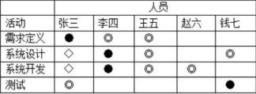

（29）A.责任分配矩阵   B.沟通计划表  C.列表式   D.组织结构分解图

#### 【解析】责任分配矩阵的作用，责任分配矩阵显示项目组成员和活动的责任关系。

#### 【试题 30】---2014 上真题 49

30、由于在执行任务时，遇到了超出想象的困难，项目团队成员之间开始争执互相指责，并开始 怀疑项目经理的能力。按照项目团队建设的阶段来划分，该阶段属于（30）。

（30）A.形成阶段   B.震荡阶段   C.规范阶段    D.发挥阶段

#### 【解析】团队建设的阶段 震荡阶段，团队开始工作，遇到困难和挑战，成员间可能出现各类 冲突。

#### 【试题 31】---2014 下真题 50

31、进行团队建设时可以采取的方式有（31）。

A.培训、拓展训练， 认可和奖励        B.冲突管理、观察和对话、绩效评估

C.冲突管理、观察帮对话、认可和奖励   D.谈判、采购、虚拟团队

#### 【答案】A

#### 【解析】团队建设的工具和技术团队建设方法：通用管理技能、培训、团队建设活动（如拓展训练）、基本规则、集中办公、奖励与表彰

#### 【试题 32】---2015 上真题 48

32 、一个五人组成的项目团队已经进入到了项目团队的正规期，但是由于项目任务比较紧张。又 增添了两名新成员进入团队， 则此时项目团队处于（）。

A.震荡期    B.形成期     C.变现期     D.正规期

解析】 此题考察的是团队阶段，必须掌握，常考

优秀的团队一般要依次经历以下 5 个阶段：

（1） 形成阶段（Forming）:—个个独立的个体成员转变为团队成员，开始形成共同目标，对未来 团队往往有美好的期待。

（2）震荡阶段（storming）：团队成员开始执行分配的任务， 一般会遇到超出预想的困难，希望 被现实打破。个体之间开始争执，互相指责，并且开始怀疑项目经理的能力。

（3） 规范阶段（Norming）：经过一定时间的磨合，团队成员之间相互熟悉和了解，矛盾基本解决， 项目经理能够得到团队的认可。

（4）发挥阶段（performing）：随着相互之间的配合默契和对项目经理的信任，成员积极工作，

努力实现目标。这时集体荣誉感非常强，常将团队换成第一称谓，如“我们那个组 ”“我们部门 ” 等，并会努力捍卫团队声誉。

（5）结束阶段（Adjourning）：随着项目的结束，团队也被遣散了。

#### 【试题 33】---2015 上真题 49

33、（）不属于编制人力资源计划的工具与技术。

A.OBS        B.RAM        C.RBS            D.SWOT

#### 【解析】编制人力资源计划的工具和技术

OBS 组织分解结构。RAM 责任分配矩阵。RBS 资源分解结构。SWOT 优势劣势优势挑战分析方法。

#### 【试题 34】---2015 上真题 50

34、在管理项目团队时，项目经理可以运用（） 等方法来解决冲突。

A.求同存异、观察、强制         B.求同存异、妥协、增加权威

C.强制、问题解决、撤退         D.强制、妥协、预防

#### 【答案】C

#### 【解析】冲突管理

冲突管理的方法有：问题解决、妥协、求同存异、撤退、强迫。其中，问题解决是指冲突双方积 极地定义问题、收集问题的信息、开发并且分析解决方案，直到解决问题。如果双方能以合适的 方式来解决问题就会实现双赢，所以它是冲突管理中最有效的方法。

#### 【试题 35】---2015 下真题 49

35、塔库曼的团队建设理论认为，项目团队建设的生命周期中不包括（ ）阶段。

（35）A.形成（forming） B.磨合（running） C.震荡（storming） D.规范（norming）

#### 【解析】团队建设的 5 个阶段[形成、震荡、规范、发挥、结束]

#### 【试题 36】---2015 下真题 50

### 36、项目团队建设的内容一般不包括( )

（36）A.培训  B.认可和奖励  C.职责分配  D. 同地办公

#### 【解析】团队建设的工具和技术，

团队建设的内容，依据其使用的工具和技术有一般管理技能、培训、团队建设活动、基本原则、同地办公（集中）、认可和奖励等。

职责分配是人力资源计划编制过程要完成的工作，不属于团队建设内容。

#### 【试题 37】---2015 下真题 51

37、项目人力资源管理计划一般不包括（ ）。

（37）A.项目中的角色和职责  B.绩效报告 C.项目组织结构图  D.人员配备管理计划

#### 【解析】人力资源管理计划的内容，

项目人力资源管理计划包括但不限于如下内容。

①角色和职责。包含了参加评估的、每一个员工的角色和职责清单。

②项目的组织结构图。提供了项目团队成员的汇报关系图。

（3）人员配备管理计划。列出了团队成员在项目中的工作周期，同时也包括培训计划、资格要求， 以及与某些规章制度、合约的一致性问题。

#### 【试题 38】---2015 下真题 29

38、信息系统集成项目的技术性很强，是智力密集， 劳动密集型项目，必须在人才激励和团队管 理的问题上给与足够的重视。（ ）不是造成信息系统项目必须注重团队管理的主要原因 。

A.项目成员的机构对系统集成项目的质量有重要的影响

B.信息系统集成项目通常包括软硬件集成

C.项目成员的责任心和稳定性对系统集成项目是否成功有决定性的影响。

D. 团队成员专业分工合理

#### 【答案】B

#### 【解析】 此题考察的是团队管理，

信息系统集成项目通常包括软硬件集成与团队管理无关。

#### 【点评】送分题，多次考了，简单

#### 【试题 39】---2016 上真题 49

39、虽然项目具有独特性，但考虑到当前进行的项目和去年已完工的一个项目类似，为了加快人 力资源计划的编制，项目经理小王采用了这个类似项目的任务或职责定义、汇报关系、组织架构 图和职位描述。小王在人力资源计划的编制过程中采用了（39）方法。

A.组织结构图和职位描述       B.人力资源模板

C.非正式的人际网络           D.活动资源估算

#### 【答案】B

#### 【解析】 人力资源模板：虽然每个项目都是独一元二的，但大多数项目会在某种程度上与其他项目类似。 运用一个以前类似项目的相应文档，如任务或职责的定义、汇报关系、组织架构图和职位描述， 能有助于减少疏漏重大职责， 加快项目人力资源计划的编制。

#### 【点评】送分题，常考，必须得分

#### 【试题 40】---2016 上真题 50

40 、一个为期 2 年的项目已经实施了 1 年，在项目期间不同的项目成员进进出出， 团队成员已经 发生了较大的变化，而相应的团队职责分工也已经与原计划有了很多出入。最近团队成员在为一 个工作包由谁来负责产生了分歧，项目经理查看了项目计划，他发现很多工作包都没有规定负责 人，或者是原定的负责人已经发生了变更。针对这种情况，项目经理应该首先（40）以加强对项 目的管控。

A.为该工作包指定负责人     B.重新制定责任分配矩阵

C.重新分解项目工作包      D.重新制定人力资源计划

#### 【解析】 编制人力资源计划的工具有三种：层次结构图、责任分配矩阵、文本格式的角色描述。项目经理似 乎不知道是谁的责任，当务之急是要落实责任，所以为了重新控制这个项目，该项目经理需要和 项目团队一起准备一个责任分配矩阵。

#### 【试题 41】---2016 上真题 51

41、对团队成员的激励永远是困扰项目经理的一个问题，对于高创新要求的项目团队来说，利用 （）方法相对会更加有效。

A.赋予更大的责任和权力      B.大幅增加薪酬

C.给予必要的关心和照顾     D.给予更高的社会地位

#### 【解析】 赋予更大的责任和权力会鼓励员工，发挥员工的积极性

#### 【点评】送分题，常考，理解下就好把题目做出来

#### 【试题 42】---2016 下真题 51

42、可采用多种形式描述项目的角色和职责。下图所示的描述角色和职责的方法是（）。

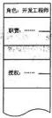

A.层次结构图   B.RAM 图   C.文本格式    D.RACI 图

#### 【答案】C

#### 【解析】P375此题考察的是角色和职责的表示，

图显示的是文本格式的范例

#### 【点评】送分题，常考，必须得分

#### 【试题 43】---2016 下真题 52

43、描述项目团队成员在项目中何时，以何种方式，以及在项目中工作持续时日等相关信息的是（）。 A.项目组织结构  B.角色职责分配    C.活动资源需求  D.人员配备管理计划

#### 【答案】D

#### 【解析】P379此题考察的是人员配备管理计划，

人员配备管理计划是项目人力资源管理计划的一部分，描述的是何时、以何种方式、他们需要在 项目中工作多久以及怎样满足人力资源需求。

#### 【点评】送分题，常考，必须得分

#### 【试题 44】---2016 下真题 53

44、项目团队形成要经历 5 个阶段，其中经过一段时间的磨合， 团队成员之间已经相互熟悉和了 解，团队矛盾已经基本解决的阶段是（）。

A.形成阶段    B.发挥阶段    C.震荡阶段     D.规范阶段

#### 【答案】D

#### 【解析】P385此题考察的是团队建设的阶段，

优秀的团队一般要依次经历以下 5 个阶段：

（1） 形成阶段（Forming）:—个个独立的个体成员转变为团队成员， 开始形成共同目标， 对未来 团队往往有美好的期待。

（2）震荡阶段（storming）：团队成员开始执行分配的任务， 一般会遇到超出预想的困难，希望 被现实打破。个体之间开始争执，互相指责，并且开始怀疑项目经理的能力。

（3） 规范阶段（Norming）：经过一定时间的磨合，团队成员之间相互熟悉和了解，矛盾基本解决， 项目经理能够得到团队的认可。

（4）发挥阶段（Performing）：随着相互之间的配合默契和对项目经理的信任，成员积极工作，

努力实现目标。这时集体荣誉感非常强，常将团队换成第一称谓，如“我们那个组 ”“我们部门 ” 等，并会努力捍卫团队声誉。

（5）结束阶段（Adjourning）：随着项目的结束，团队也被遣散了。

#### 【试题 45】---2016 下真题 54

45、成功的冲突管理可以大大地提高团队生产力并促进积极的工作关系。以下关于冲突的叙述中， 不正确的是（）。

A.一般来说， 冲突是一个团队问题，而不是某人的个人间题

B.冲突的解决应聚焦问题

C.冲突的解决应聚焦在过去，分析冲突造成的原因

D.冲突是自然的， 而且要找出一个解决办法

#### 【解析】P391此题考察的是冲突管理，

当在一个团队的环境下处理冲突时，项目经理应该认识到冲突的下列特点。

①冲突是自然的，而且要找出一个解决办法。

②冲突是一个团队问题，而不是某人的个人问题。

③应公开地处理冲突。

④冲突的解决应聚焦在问题，而不是人身攻击。

⑤冲突的解决应聚焦在现在，而不是过去。

#### 【试题 46】---2017 上真题 52

46、当需要确保每一个工作包只有一个明确的责任人,而且每一个项目团队成员都非常清楚自己的 角色和职责时,应采用的工具和技术是（）。

A.组织结构图和职位描述    B.人际交往    C.组织理论    D.专家判断

#### 【答案】A

#### 【解析】责任分配矩阵，

编制人力资源计划的工具与技术：可采用多种格式来记录团队成员的角色与职责。大多数格 式属于以下三类： 层级型、矩阵型和文本型。此外，有些项目人员安排可在子计划（如风险、 质量或沟通管理计划）中列出。无论使用什么方法，  目的都是要确保每个工作包都有明确的 责任人，确保全体团队成员都清楚地理解其角色和职责。

任务分配矩阵或称责任分配矩阵（RAM）：用来表示需要完成的工作由哪个团队成员负责的矩 阵，或需要完成的工作与哪个团队成员有关的矩阵。

#### 【试题 47】---2017 上真题 53

47、在实施某项目时, 由于地域限制,必须建立一个虚拟团队,此时制定（） 就显得更加重要。 A.一个可行的沟通计划    B.一个可行的风险计划

C.一个可行的采购计划    D.一个可行的质量计划

#### 【解析】P383此题考察的是沟通管理计划，

在建立一个虚拟团队时，制订一个可行的沟通计划就显得更加重要。可能需要额外的时间以设定 明确的目标，制定方案以处理冲突，召集人员参与决策过程，并与虚拟团队一起通力合作，以使 项目成功。

#### 【试题 48】---2017 下真题 53

48、以下关于编制人力资源计划的工具和技术的叙述中，不正确的是（）。

A.可使用多种形式描述项目的角色和职责

B.每个工作包可分配多人负责，做好工作备份

C.职责分配矩阵是反映团队成员与其承担工作之间联系的最直观的方法

D.描述职责时，需要让每一位项目成员都非常清楚自己的角色和职责

#### 【解析】P376此题考察的是责任分配矩阵，

矩阵图反映团队成员个人与其承担的工作之间联系的方法有多种，而责任分配矩阵（RAM）是最直 观的方法。在大型项目中， RAM 可以分成多个层级。例如， 高层级的 RAM 可以界定团队中的哪个小 组负责工作分解结构图中的哪一部分工作；而底层级的RAM被用来在小组内，为具体活动分配角色、 职责和授权层次。矩阵格式，又称表格，可以使每个成员看到与自己相关的所有活动以及和与某 个活动相关的所有成员。

#### 【试题 49】---2017 下真题 54

49、可以通过多种方法实现对项目团队的管理，随着远程通讯方式的快速发展，虚拟团队成为了 项目管理的方式。作为项目经理，想要管理好虚拟团队，采用（）方法更合适。

A. 问题清单    B.冲突管理    C.风险管理    D.观察和交流

#### 【解析】P390此题考察的是团队管理的工具和技术，

可以通过如下的工具与技术， 实现对项目团队的管理：

1、观察和交谈用于随时了解团队成员的工作情况和思想状态。如果是虚拟团队，这要求项目管理 团队进行更加积极主动的、经常性的沟通，不管是面对面还是以其他合适的方式。

2、项目绩效评估：在项目实施期间进行绩效评估的目的是澄清角色、责任，从团队成员处得到建设性的反绩， 发现一些未知的和未解决的问题， 制订个人的培训和训练计划， 为将来一段时间制定具体目标。

3、问题清单： 在管理项目团队的过程中出现的问题，记录在问题清单里有助于知道谁在预定日期 前负责解决这个问题。

4,人际关系技能：项目经理应该综合运用技术、人际技能来分析形势，并与团队成员有效互动。 恰当地使用人际关系技能，可充分发挥全体团队成员的优势。

#### 【点评】常考，比较简单，必须得分

#### 【试题 50】---2018 上真题 53

50、在编制项目管理计划过程中，项目管理的其他分领域计划也在同步编制。作为项目经理，编 制项目人力资源管理计划过程，需要与编制（） 的过程紧密关联。

A.沟通计划    B.质量计划    C.风险计划    D.采购计划

#### 【解析】有人员就会涉及到沟通，教材原话：编制项目人力资源计划过程总是与沟通计划编制过程紧密联 系，因为项目组织结构会对项目的沟通需求产生重要影响。

#### 【试题 51】---2018 上真题 54

51、项目经理常用领导力、影响力和有效决策等人际关系技能来管理团队，根据项目管理的领导 与管理理论，如果针对新员工，采用（）领导方式更有效。

A. 民主型    B.部分授权    C.放任型    D.指导型

#### 【解析】P399此题考察的是领导方式，

有效地领导取决于领导者自身、被领导者与领导过程所处的环境。例如，在项目早期团 队组建的过程中， 或对于新员工， 领导方式可以是专断型（独裁式、指导式）； 当团队成员熟悉情况后，可以采用民主型甚至可以部分授权。

#### 【试题 52】---2018 下真题 53

52、层次结构图用于描述项目的组织结构，常用的层次结构图不包含（）。

A.工作分解结构    B.组织分解结构    C.资源分解结构    D.过程分解结构

#### 【答案】D

#### 【解析】P375: 此题考察的是层次结构图，

层次结构图包括 WBS,OBS,RBS，不包括 D。

#### 【试题 53】---2018 下真题 54

53、关于项目团队管理，不正确的是（）。

A.项目团队管理用于跟踪个人和团队的绩效，解决问题和协调变更

B.项目成员的工作风格差异是冲突的来源之一

C.在一个项目团队环境下，项目经理不应公开处理冲突

D.合作、强制、妥协、求同存异等是解决冲突的方法

#### 【解析】团队管理项目经理应公开地处理冲突

#### 【试题 54】---2019 上真题 53

54、关于责任分配矩阵（RAM）的描述， 不正确的是（）。

A.大型项目中，RAM 可分为多个层

B.针对具体的一项活动可分配多个成员每个成员承担不同职责

C.RAM 中用不同的字母表示不同的职责

D.RAM 中每项活动中可以有一个以上成员对任务负责

#### 【答案】D

#### 【解析】P376 此题考察的是 RAM，

RAM 中活动可以多人参与，但必须只能有唯一责任点，只能有一个负责人。

#### 【试题 55】---2019 上真题 54

55、（）属于人力资源管理中的Y理论。

A.一般人天性好逸恶劳，只要有可能就会逃避工作

B.在适当的条件下，人们愿意主动承担责任

C.人缺乏进取心逃避职责，甘愿听从指挥安于现状，没有创新性

D.人生来就以自我为中心，漠视组织的要求

#### 【解析】P397 此题考察的是 Y 理论，

Y 理论是积极的,选项 A、C、D 都属于 X 理论。

#### 【试题 56】---2019 下真题 51

56、（）反映了团队成员个人与其承担的工作之间的联系。

A.层次结构图    B.工作分解结构    C.矩阵图    D.文本格式

#### 【解析】P376 此题考察的是矩阵图，；

选项 C 中的矩阵图指 RAC I 矩阵，其他选项均不对。

#### 【试题 57】---2019 下真题 52

57、关于虚拟团队的描述，不正确的是（）。

A.现代通信技术，如 Email、微信等，有助于虚拟团队的沟通和管理

B.虚拟团队有助于将行动不便，在家办公或有特殊技能的人纳入团队

C.与实体团队相比， 虚拟团队成员之间更容易分享知识和经验

D.与实体团队相比，在虚拟团队中制定可行的沟通计划更加重要

#### 【解析】虚拟团队也有一些缺点，比如可能产生误解、有孤立感、团队成员之间难以分享知识，采用通信 技术也要花费成本。虚拟团队都不在一起，不方便分享知识和经验。

#### 【试题 58】---2019 下真题 53

58、（）指的是集合多方的观点和意见， 得出一个多数人接受和承诺的冲突解决的方案。 A.合作    B.强制    C.妥协    D. 问题解决

#### 【解析】（1）问题解决：问题解决就是冲突各方一起积极地定义问题、收集问题的信息、制定解决方案， 最后直到选择一个最合适的方案来解决冲突，此时为双赢或多赢。但在这个过程中，需要公开地协商，这是冲突管理中最理想的一种方法。

（2）合作： 集合多方的观点和意见，得出一个多数人接受和承诺的冲突解决方案。 （3）强制： 强制就是以牺牲其他各方的观点为代价，强制采纳一方的观点。

（4） 妥协：妥协就是冲突的各方协商并且寻找一种能够使冲突各方都有一定程度满意、但冲突各 方没有任何一方完全满意、是一种都做一些让步的冲突解决方法。

（5） 求同存异：求同存异的方法就是冲突各方都关注他们一致的一面， 而淡化不一致的一面。 一 般求同存异要求保持一种友好的气氛，但是回避了解决冲突的根源。也就是让大家都冷静下来， 先把工作做完。

（6）撤退： 撤退就是把眼前的或潜在的冲突搁置起来，从冲突中撤退。

九、项目沟通管理、项目干系人管理

考点分析与预测：  沟通管理一般上午考察 3 分左右，项目经理的大部分时间（80%~90%）都 在进行各方面各类型沟通工作，而项目管理要求沟通是主动和受控的，沟通也涉及项目的各个阶 段，出现问题绝大数可能是沟通出现了问题，沟通管理也非常重要，在案例分析中出现的问题也 教多，但是考察的几率并不是很大，上午历年考试的重点在沟通管理计划的内容、沟通的方式、	 沟通的渠道、状态评审会议，这部分的还是蛮重要的，考点也很清晰；建议大家在掌握历年的高 频考点后尽量去学习其他方面的知识点。

本章知识点的下午试命题思路可能表现为：给出某项目在沟通管理方面的案例场景描述，要 求指出该案例场景中存在哪些问题并说明相关原因；要求给出解决这些问题的补救措施（或建议）； 给出 1 个该案例涉及且与沟通管理基础知识点相关的简答题（或判断题、填空题等。本章里所列 出的内容大家都必须掌握。

沟通管理的过程、输入、输出、工具和技术汇总表：

| 沟通管理：规划沟通管理-管理沟通-控制沟通 | 沟通管理：规划沟通管理-管理沟通-控制沟通 | 沟通管理：规划沟通管理-管理沟通-控制沟通 | 沟通管理：规划沟通管理-管理沟通-控制沟通 |
|---|---|---|---|
| 过程名 | 输入（依据） | 工具和技术（方法） | 输出（结果） |
| 1、规划沟通管 理 | ①项目管理计划 ②干系人登记册 ③事业环境因素 ④组织过程资产 | ①沟通需求分析 ②沟通技术 ③沟通模型 ④沟通方法 ⑤会议 | ①沟通管理计划 ②项目文件（更新） |
| 2、管理沟通 | ①沟通管理计划 ②工作绩效报告 ③事业环境因素 ④组织过程资产 | ①沟通技术 ②沟通模型 ③沟通方法 ④信息管理系统 ⑤报告绩效 | ①项目沟通 ② 项目管理计划（更新） ③项目文件（更新）  ④组织过程资产（更新） |
| 3、控制沟通 | ①项目管理计划 ②项目沟通 ③问题日志 ④工作绩效数据 ⑤组织过程资产 | ① 信息管理系统 ②专家判断 ③会议 （17 下 55） | ①工作绩效信息 ②变更请求 ③项目管理计划（更新） ④项目文件（更新）  ⑤组织过程资产（更新） |
| 项目干系人管理：识别干系人-规划干系人管理-管理干系人参与-控制干系人参与 | 项目干系人管理：识别干系人-规划干系人管理-管理干系人参与-控制干系人参与 | 项目干系人管理：识别干系人-规划干系人管理-管理干系人参与-控制干系人参与 | 项目干系人管理：识别干系人-规划干系人管理-管理干系人参与-控制干系人参与 |
| 过程名 | 输入（依据） | 工具和技术（方法） | 输出（结果） |
| 1、识别干系人 | ①项目章程 ②采购文件 ③事业环境因素 ④组织过程资产 | ①干系人分析 ②专家判断 ③会议 | ①干系人登记册 |
|  | ①项目管理计划 | ①专家判断 | ①干系人管理计划 |
| 2、规划干系人 管理 | ②干系人登记册 ③事业环境因素 ④组织过程资产 | ②会议 ③分析技术 | ②项目文件（更新） |
| 3、管理干系人 参与 | ①干系人管理计划 ②沟通管理计划 ③变更日志 ④组织过程资产 | ①沟通方法 ②人际关系技能 ③管理技能 | ①问题日志 ②变更请求 ③项目管理计划（更新） ④项目文件（更新）  ⑤组织过程资产（更新） |
| 4、控制干系人 参与 | ①项目管理计划 ②问题日志 ③工作绩效数据 ④项目文件 | ①信息管理系统 ②专家判断 ③会议 | ①工作绩效信息 ②变更请求 ③项目管理文件（更新） ④项目文件（更新）  ⑤组织过程资产（更新） |

本章金色考点汇总：

1、潜在的沟通渠道数量公式： M=n*（n-1）/2,其中 n >1  .

应灵活选择沟通渠道（18 下 55）

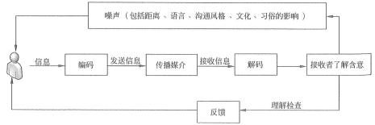

2、噪音的三种形式：①外部噪音；②内部噪音；③语义噪音。

3、沟通方式分类：①参与讨论方式；②征询方式③推销方式（说明）④叙述方式。 控制程度由弱到强

4、沟通方式的选择基于以下因素：①掌握信息的能力；②是否需要听取其他人的意见和想法； ③是否需要控制信息内容。

| 5、沟通渠道的表达方式维度：文字可以一目十行 （19 下 54） | 5、沟通渠道的表达方式维度：文字可以一目十行 （19 下 54） |  |  |  |
|---|---|---|---|---|
| 分类 | 优点 | 优点 | 缺点 | 缺点 |
| 文字 | ①可永久性保存，容易查询； 节约时间， 阅读速度要高于语言速度； ②读者可根据自己的速度进行调整； ③无地理位置要求； 更为精确和准确； ④理论上可以多次无损复制传播。 | ①可永久性保存，容易查询； 节约时间， 阅读速度要高于语言速度； ②读者可根据自己的速度进行调整； ③无地理位置要求； 更为精确和准确； ④理论上可以多次无损复制传播。 | ①纯文字资料损失了大量非语言符号，不利 于情感的传递； ②对于阅读者的选择没有控制力； ③无法控制何时，以及是否被阅读。 | ①纯文字资料损失了大量非语言符号，不利 于情感的传递； ②对于阅读者的选择没有控制力； ③无法控制何时，以及是否被阅读。 |
| 语言 | ①可以传递情感； ②可以同时进行跨地域沟通； ③比邮件快； ④不需要保存传递信息的优先选择渠道。 | ①可以传递情感； ②可以同时进行跨地域沟通； ③比邮件快； ④不需要保存传递信息的优先选择渠道。 | ①不利于建立促进个人关系； ②无法表现肢体语言； ③做不到文字资料的精确性和准确性，把握 细节的能力不足; ④说的速度比阅读速度相对要慢。 | ①不利于建立促进个人关系； ②无法表现肢体语言； ③做不到文字资料的精确性和准确性，把握 细节的能力不足; ④说的速度比阅读速度相对要慢。 |

6、在发送方自认为已经掌握了足够的信息，有了自己的想法且不需要进一步听取多方意见时，

往往选择控制力极强、参与程度最弱的“叙述方式 ”；其次，选择“推销方式 ”;而当自己掌握信 息有限， 没有完整成型的意见，需要更多的听取意见时， 一般选择“讨论方式 ”或者“征询方式”。

讨论（头脑风暴）；征询（调查问卷）；推销（叙述解释）；叙述（劝说鼓动）。

7、会议方式是最常见的一种沟通渠道。会议的管理和控制都是非常重要的。

成功会议的特征：①会议有准备；②会中有控制；③会后有结论

8、在项目的早期，应该随着项目管理计划的制订，就着手制订项目沟通管理计划，根据项目 的规模大小以及涉及的干系人的特点， 可以单独制订项目沟通管理计划，也可以将沟通管理计划 作为项目整个管理计划的一部分而不需要形成单独的文档。

9、干系人登记册信息：①主要沟通对象（主要干系人）；②关键影响人；③次要沟通对象。 10、沟通管理计划的内容： （10 下 59）（12 上 59）（13 上 53、57）（14 下 58）（16 上 59）

（1）干系人的沟通需求。

（2）针对沟通信息的描述，包括格式、内容、详尽程度等。

（3）发布信息的原因。

（4）负责信息沟通工作的具体人员。

（5）负责信息保密工作的具体人员的授权。

（6）信息接收的个人或组织。

（7）沟通渠道的选择。

（8）信息传递过程中所需的技术或方法。

（9）进行有效沟通所必须分配的各种资源，包括时间和预算。

（10）沟通频率，例如，每周沟通等。

（11）上报过程，针对下层无法解决的问题，确定问题上报的时间要求和上报路径。

（12）项目进行过程中，对沟通管理计划更新与细化的方法。

（13）通用词语表、术语表。

（14）项目信息流向图、工作流程图、授权顺序、报告清单，会议计划等。

（15）沟通过程中可能存在的各种制约因素。

（16）沟通工作指导以及相关模板。

（17）有利于有效沟通的其他方面，比如，建议的搜索引擎，软件使用手册等。

11、沟通管理计划可以以多种方式存在，正式的或非正式的、详细的或简单概括的、包括在 项目总体管理计划内或者项目总体管理计划的从属部分等。

12、管理沟通包括生成、收集、发布、存储、检索、处置项目信息等过程。进行沟通过程管 理的最终目标，就是保障干系人之间有效地沟通。

13、项目经理在深入研究项目的要求和特点后，在不同的项目实施阶段，针对不同的干系人， 选择适合的沟通渠道。（18 下 55）

14、项目经理在进行控制的过程中，一般性的沟通目标的改变、或者绩效指标发生偏差时， 无需进行大规模的调整；但是，如果出现严重的偏差，项目经理需要对项目进行大规模调整的时 候，针对沟通管理的调整就是必要的。

15、项目中的会议： （1）项目的例会（2）项目启动会议（3）项目总结会议；

（1）项目的例会---通常是项目中最重要的会议之一，一般以周为单位召开，是项目团队内部 沟通的主要平台。对于某些大型项目也可以双周或月为周期。

（2）项目例会由项目经理主持召开，主要议题如下：

（a）项目进展程度调查和汇报；（b）项目问题的解（c）项目潜在风险的评估；（d）项目团队人力资源协调。

（3）项目启动会议一般在项目团队内部和外部分别举行内部启动会议重要解决内部的资

源调配和约束条件的确认，而外部启动会议主要是协调甲方和乙方的项目接口工作。

### 15、项目总结会议的目的如下：

（1）了解项目全过程的工作情况以及相关的团队或成员的绩效状况；

（2）了解出现的问题并提出改进措施；

（3）了解项目全过程中出现的值得吸取的经验并进行总结；

（4）对总结过后的文档进行讨论，通过后就存入公司的知识库，从而形成公司的知识积累。 16、沟通管理和项目干系人管理的联系和区别：沟通管理强调对项目信息的计划、收集、存

储、组织、发布，以及监控沟通以保证它的高效性。项目干系人管理强调的不仅是要管理干系人

的期望，更要保证他们的适度参与，而后者是项目成功非常关键的因素之一。

沟通过程管理的最终目标就是                       。（18 上 55）

17、通常，由        负责项目干系人管理。

18、项目干系人管理，并不是领导项目的干系人，而是对项目干系人的需要、希望和期望的 识别，并通过沟通上的管理来满足其需要、与干系人一起解决问题的多个过程。项目干系人管理 努力争取更多关系人的支持、努力降低干系人中的反对者的阻力，持续不断地推动项目向目标前 进，从而能够确保项目取得成功。启动的时候识别干系人；（16 下 55）（18 上 56）

19、干系人管理具体内容：①识别干系人（19 上 56）；②编制项目干系人管理计划；③管理 干系人参与；④项目干系人参与的监控。

20、识别干系人输入：①项目章程；②采购文件。工具与技术：①组织相关会议；②专家判 断；③干系人分析。

因为一次识别不能穷尽所有的项目干系人，况且项目在动态地变化着，因此应

定期检查干系人登记册，必要时补充、更新干系人登记册, 因为可能会识别出新的干系人、也可能调整登记册。

21、干系人分析步骤：①识别全部潜在项目干系人及其相关信息；②识别每个干系人可能产 生的影响或提供的支持；③评估关键干系人对不同情况可能做出的反应或应对。

22 、权利/利益方格：首先关注 B 区（重点管理、及时汇报）；C 区（随时告知）；A 区（令其 满意）；D 区（化最少的精力来监督他们）。

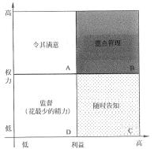

干系人权力/利益方格： （17 上 55）（17 下 56）（18 下 56）

B 区的干系人， 他们对项目有很高的权力， 也很关注项目的结果， 项目经理应该“重点管理，及时报告”。 项目的客户和项目经理的主管领导，就是这样的项目干系人。

C 区干系人权力低，但关注项目的结果，因此项目经理要“随 时告知”项目状况

项目经理对 A 区干系人的管理策略应该是“令其满意”。

D  区干系人的特点是“权力低、对项目结果的关注度低”， 因此项目经理主要是通过“花最少的精力来监督他们”即可

23、干系人分类模型如下： （掌握）（19 下 55）

①权利/利益方格。根据干系人的职权大小和对项目结果的关注（利益）程度进行分类。

②权利/影响方格。干系人的职权大小以及主动参与（影响）项目的程度进行分类。

③影响/作用方格。干系人主动参与（影响） 项目的程度及改变项目计划或者执行的能力进行分类。

④凸显模型。根据干系人的权力（施加自己意愿的能力）、紧迫程度和合法性对干系人进行分类。

24、干系人参与评估矩阵（17 上 56）

25、通过干系人分析技术把干系人分类：①不了解；②抵制；③中立；④支持；⑤领导。  ①不了解。对项目和潜在影响不知晓。

②抵制。了解项目和潜在影响，抵制项目。

③中立。了解项目， 既不支持，也不反对。

④支持。了解项目和潜在影响，支持项目。

⑤领导。了解项目和潜在影响，积极致力于保证项目成功。

26、干系人管理计划可以是正式或非正式的，非常详细或高度概括的。

### 27、干系人管理计划通常还包括：

①关键干系人的所需参与程度和当前参与程度；

②干系人变更的范围和影响；

③干系人之间的相互关系和潜在交叉；

④项目现阶段的干系人沟通需求；

⑤需要分发给干系人的信息，包括语言、格式、内容、详细程度和发送频率； ⑥分发相关信息的理由，以及可能对干系人参与所产生的影响；

28、管理干系人参与过程是一个执行过程。管理干系人参与，就是依据干系人管理计划，在 整个项目生命周期中，与干系人进行日常的沟通和协作，以满足其需要与期望，解决实际出现的 问题，并促进干系人合理参与项目活动的过程。

通过管理干系人参与，不仅让干系人中的支持者清晰地理解项目目的、目标、收益和风险以 争取其支持，还要让干系人中的反对者降低敌意，从而提高项目成功的概率。必要时还要请干系 人协助指导项目活动和项目决策。

通常， 干系人对项目的影响能力通常在项目启动阶段最大，而后随着项目的进展逐渐降低。 因此，         负责调动各干系人参与项目时，应尽早开展，并对他们进行管理，必要时可以寻

求项目发起人的帮助，以降低项目的风险和阻力。（18 上 56）

29、常用的沟通方法：①交互式沟通；②推式沟通；③拉式沟通。

①交互式沟通。在两方或多方之间进行多向信息交换。这是确保全体参与者对特定话题达成 共识的最有效的方法，包括                              等。

②推式沟通。把信息发送给需要接收这些信息的特定接收方。这种方法可以确保信息的发送，

| 信件、备忘录、报告、电子邮件、传 |
|---|

③拉式沟通。用于信息量很大或受众很多的情况。要求接收者自主自行地访问信息内容。这 种方法包括                                               等。

30、在管理干系人参与时，应该使用在沟通管理计划中确定的针对每个干系人的沟通方法。

31 、控制干系人参与输入：①项目管理计划；②问题日志； ③工作绩效数据； ④项目文件。 工具与技术：①信息管理系统；②专家判断；③会议。

输出：①工作绩效信息；②纠正措施；③变更请求； ④项目管理计划更新⑤项目文件更新； ⑥组织过程资产更新。

32、如何召开高效的会议：1）事先制定例会制度 2）放弃可开可不开的会议 3）明确会议的 地点和期望结果 4）发布会议通知 5）在会议之前将会议资料转发给参会人员 6）可以借助视频设 备 7）明确会议规则：主持人、职责、有效控制、活跃的会议气氛 8）会后要有总结落实 9）会议 要有纪要 10）做好会议的后勤保障。（10 上 58）

本章历年考题和答案解析汇总：

#### 【试题 1】---2009 上真题 32

1、项目绩效评审的主要目标是（1）。

（1）A.根据项目的基准计划来决定完成该项目需要多少资源

B.根据过去的绩效调整进度和成本基准

C.得到客户对项目绩效认同

D.决定项目是否应该进入下一个阶段

#### 【解析】 此题考察的是绩效评审的目标，必须掌握， 高频考点

为了方便管理，项目经理或其所在的组织会将项目分成几个阶段来管理，以加强对项目的管 理控制并建立起项目与组织的持续运营工作之间的联系。

在完成本阶段所做的工作和可交付物的技术和设计评审后，项目绩效评审的主要目标是评价 项目的绩效、请客户决定是否接受阶段成果，以及是否还要做额外的工作，最后决定是否要结束 这个阶段。

在获得授权的情况下，阶段末的评审可以结束当前阶段并启动后续阶段。有些时候一次评审 就可以取得这两项授权。这样的阶段末评审通常被称为阶段出口、阶段验收或终止点。

#### 【点评】常考题，比较简单，必须得分

#### 【试题 2】---2009 上真题 48

2、项目绩效审计不包括（2）。

（2）A.决算审计     B.经济审计    C.效率审计     D.效果审计

#### 【答案】A

#### 【解析】 此题考察的是 3E 审计，必须掌握，考的不多

续效审计是经济审计、效率审计和效果审计的合称， 故也称三E审计。

#### 【试题 3】---2010 上真题 57

3、某公司正在计划实施一项用于公司内部的办公自动化系统项目， 由于该系统的实施涉及到公司 很多内部人员，因此项目经理打算制定一个项目沟通管理计划， 他应采取的第一个工作步骤是（3）。

（3）A.设计一份日程表，标记进行每种沟通的时间 B.分析所有项目干系人的信息需求C.构建一个文档库并保存所有的项目文件    D.描述准备发布的信息

#### 【解析】 此题考察的是沟通管理计划，

沟通管理计划编制过程一般分为如下几个步骤：①确定干系人的沟通信息需求， 即哪些人需要 沟通，谁需要什么信息，什么时候需要以及如何把信息发出去。②描述信息收集和文件归档的机 构③发送信息和重要信息的格式，主要指创建信息发送的档案；获得信息的访问方法。

根据上述沟通管理计划的一般编制过程，应选择 B。

#### 【试题 4】 ---2010 上真题 58

4、召开会议就某一事项进行讨论是有效的项目沟通方法之一，确保会议成功的措施包括提前确定 会议目的、按时开始会议等，（4）不是确保会议成功的措施。

（4）

A.项目经理在会议召开前一天， 将会议议程通过电子邮件发给参会人员

B.在技术方案的评审会议中，某专家发言时间超时严重，会议主持人对会议进程进行控制

C.某系统验收会上， 为了避免专家组意见太发散， 项目经理要求会议主持人给出结论性意见

D.项目经理指定文档管理员负责会议记录

#### 【解析】考察会议，确保讨论会议成功的措施包括提前确定会议目的、提前进行会议准备、按时开始会议、把握会议的发言节奏、进行会议记录等能使会议组织好的措施。讨论会议的主要目的是让与会人员充分发表意见，按照程序形成结论，而不能提前给出结论性的意见。

#### 【试题 5】---2010 上真题 59

5、某项目组的小组长王某和程序员李某在讨论确定一个功能模块的技术解决方案时发生激烈争 执，此时作为项目经理应该首先采用（5）的方法来解决这一冲突。

（5） A.请两人先冷静下来， 淡化争议，然后在讨论问题时求同存异

B.帮助两人分析对错，然后解决问题

C.要求李某服从小组长王某的意见

D.请两人把当前问题搁置起来，避免争吵

#### 【解析】 冲突就是计划于现实之间的矛盾，由于王某和程序员李某己发生了激烈争执，首先应该先平息俩人的争执，让他们冷静下来。由于是讨论问题，解决该冲突的核心还是要求同存异，在不能 求同存异的情况下才能“要求李某服从小组长王某的意见”，而“请两人把当前问题搁置起来，避免争吵”可能解决冲突，但不能解决问题，是不可取的方法。而要想“帮助两人分析对错”必须先“请两人先冷静下来”，并且项目经理如果对该技术不是很有权威， 帮助分析对错往往无法切中 要害，不宜于解决冲突和问题。

#### 【试题 6】---2010 下真题 57

6、小张最近被任命为公司某信息系统开发项目的项目经理， 正着手制定沟通管理计划， 下列选项 中（6）属于小张应该采取的主要活动。

①找到业主，了解业主的沟通需求      ②明确文档的结构

③确定项目范围                      ④明确发送信息的格式

（6）A.①②③④         B.①②④         C.①③④         D.②③④

#### 【答案】B

#### 【试题 7】---2012 上真题 57

7、在项目沟通管理过程中存在若干影响因素， 其中潜在的技术影响因素包括（7）。 ①对信息需求的迫切性         ②资金是否到位

③预期的项目人员配备         ④项目环境     ⑤项目时间的长短

（7）A.①③④⑤      B.①②③④        C.①②④⑤        D.②③④⑤

#### 【答案】A

沟通技术是项目管理者在沟通时需要采用的方式和需要考虑的限定条件。 影响项目沟通的技 术因素如下:  （1）对信息需求的紧迫性（2）技术是否到位（3）预期的项目人员配备（4）项目

时间的长短（5）项目环境

#### 【试题 8】---2010 下真题 59

8、某公司正在编制项目干系人沟通的计划，以下选项中（8）属于干系人沟通计划的内容。

①干系人需要哪些信息   ②各类项目文件的访问路径

③各类项目文件的内容   ④各类项目文件的接受格式   ⑤各类文件的访问权限

（8）A.①②③④⑤       B.①②③④        C.①②④⑤        D.②③④⑤

在了解和调查干系人之后， 就可以根据干系人的需求进行分析和应对， 制定干系人沟通计划。 其主要内容是：项目成员可以看到哪些信息， 项目经理需要哪些信息， 高层管理者需要哪些信息以 及客户需要哪些信息等；文件的访问权限、访问路径以及文件的接受格式等。

根据项目团队组织结构确定内部人员的信息測览权限，还需要考虑客户、客户的领导层和分 包商等关键的干系人的沟通需求。

项目还应该在初期计划的时候规定好一些主要的沟通规则。例如，哪类事情是由谁来发布、 哪些会议由谁来召集、由谁来发布正式的文档等。以上内容都应反映到沟通管理计划中。

#### 【试题 9】 ---2012 上真题 57

9、（9）是制订项目沟通管理计划的输入。

（9）A.项目管理计划     B.项目可行性分析    C.成本控制  D.项目范围说明书

#### 【解析】 ①项目管理计划②干系人登记册③事业环境因素④组织过程资产

#### 【试题 10】---2012 上真题 58

10、状态会议的目的是（10）。

（10）A.交换项目信息    B.让团队成员汇报正在执行的工作

C.签发工作授权    D.确认团队提交的成本的准确性

#### 【解析】 状态评审会议是预先规定的、定期进行的交流有关项目信息的事件，即其目的是交换项目信息。 项目组通过定期召开项目状态评审会议，对重要问题进行专门的讨论，从而突出一些重要项目文件提供的信息， 迫使干系人正视项目的进展并对自身的工作负责。

#### 【试题 11】---2012 上真题 59

11、某项目的现状是： 已经被按照沟通计划发布了项目信息； 一些项目可交付物成果发生了变更； 这些变更是按照变更控制计划做出的；一位干系人在得知以前曾经公布过的项目可交付物成果变 更时， 感觉十分惊讶；其余干系人都收到了变更通知的消息。针对这种情况， 项目经理应该（11）。 （11）A.告知干系人信息公布的日期

B.审核沟通计划，确定为什么干系人不理解自己的职责

C.对沟通计划进行审核，如需要，对沟通计划进行修改

D.在下次项目工作会议上说明该问题，以便其他干系人不会遗忘公布的变更信息

#### 【解析】 制订沟通管理计划是确定项目干系人的信息需求，并定义沟通方法的过程。若沟通规划不当，	 将会导致信息传递延误、向错误的受众传递敏感信息或与某些干系人沟通不足等问题。项目经理 应该在沟通计划中记录与干系人进行有效率、有效果的沟通的方法。 信息接人应该确认完整地緬信息并理解信息。题意描述项目经理应制定沟通管理计划进行审核，如需要，对沟通管理计划进 行修改。

#### 【试题 12】---2013 上真题 44

12、在沟通管理中， 沟通方式的选择是一项重要的工作。不是书面沟通的特点。

（12）A.沟通速度快    B.歧义性少    C. 内容清晰      D.信息充分

#### 【解析】 书面的沟通方式优点是清晰，二义性少以及可以作为备忘录，也可作为双方沟通的证据。而缺点是缺乏人性化， 如某些用语较为生硬的话， 容易使双方的关系出现矛盾。

#### 【试题 13】---2013 上真题 53

13、项目沟通管理涉及到项目管理的诸多内容。 一般而言，（13）不属于项目沟通管理计划的主要 内容。

（13）A.项目干系人沟通需求   B.传递信息的技术和方法  C.项目会议频率    D.通用词语表

#### 【解析】沟通管理计划的主要内容：（1）项目干系人沟通要求（2）对要发布信息的描述，包括格式、 内容和详尽程度（3）信息接收的个人或组织（4）传达信息所需的技术或方法，如备忘录、电子 邮件和/或新闻发布等（5）沟通频率，如每周沟通等 （6）上报过程，对下层无法解决的问题， 确定问题上报的时间要求和管理链（7）随项目的进展对沟通管理计划更新与细化的方法（8）通 用词语表。  选 C 其实有点牵强，但只能选 C 了，

#### 【点评】沟通管理计划的内容，书上原话，常考的， 比较简单，必须得分

#### 【试题 14】---2013 上真题 57

14、项目经理编制了一份项目沟通计划。其主要内容包括项目干系人要求、发布信息的描述、传 达信息所需的技术方法和沟通频次。这份计划中还欠缺的最主要内容是（14）。

（14）A.信息接收的个人和组织   B.沟通计划检查要求   C.沟通备忘录  D.干系人分析

#### 【答案】A

#### 【解析】 此题考察的是沟通管理计划的内容，

沟通管理计划的主要内容：（1） 项目干系人沟通要求。（2） 对要发布信息的描述， 包括格式、 内容和详尽程度③信息接收的个人或组织。（4）传达信息所需的技术或方法，如备忘录、电子邮 件和/或新闻发布等。（5）沟通频率，如每周沟通等。（6）上报过程，对下层无法解决的问题，	 确定问题上报的时间要求和管理链。（7）随项目的进展对沟通管理计划更新与细化的方法。（8）	 通用词语表。沟通管理计划的主要内容有 A，没有 BCD。

#### 【点评】沟通管理计划的内容，书上原话，常考的， 比较简单，必须得分

#### 【试题 15】---2013 上真题 58

15、沟通是项目管理和团队建设中的重要环节。下面关于沟通的说法中。（15）是正确的。 （15）A.正式沟通优于非正式沟通。项目经理不应鼓励团队成员的非正式沟通和交流。

B.水平沟通优于垂直沟通。项目经理不应鼓励团队成员的垂直沟通。

C.集中办公和会议有利于提高沟通效率。是团队建设的有效手段。

D.沟通的及时性是沟通的第一目标。项目的所有问题需第一时间与干系人沟通。

#### 【解析】 此题考察的是沟通管理，

水平沟通优于垂直沟通。项目经理应鼓励团队成员的垂直沟通；沟通的有效性是沟通的第一目标

#### 【试题 16】---2013 下真题 58

16、在信息分发过程中，如果为了使沟通更加清晰、减少二义性，并且可以留备忘录，那么应该 采取的沟通方式是（16）。

A.书面沟通      B. 电话录音      C.垂直沟通    D.水平沟通

#### 【解析】通过题目清晰、减少二义性、备忘录可知是书面沟通的特点

#### 【试题 17】---2013 下真题 59

17、绩效报告是指搜集所有基准数据并向项目干系人提供项目绩效信息，为了绩效报告，首先要 收集材料， 这些材料不包括（17）。

（17）A.被评价项目资料的清单   B.项目绩效预测   C.调查问卷     D.征询函

#### 【解析】绩效报告需要准备一些基础资料，包括需要被评价项目资料的清单、调查问卷和编制征询函 等。收集材料，肯定是收集已经发生的执行信息（客观存在的）。

#### 【试题 18】---2014 上真题 50

18、在项目实施过程中，（18）容易增加冲突发生的概率.

A.保证资源的供给 B.项目组织结构由矩阵结构改为项目型结构

C.项目实施中引入新技术 D. 明确责任

#### 【解析】 常识题，引入新技术会有很多不确定性，当然会增加冲突发生的概率。

#### 【试题 19】---2014 上真题 58

19、在项目管理中，讲行信息分发时，（19）的特点是：复杂程度高，往往不受当事人的控制。 A.正式沟通   B.非正式沟通  C.垂直沟通   D.水平沟通

#### 【解析】通常情况下，正式（如报告、情况介绍会等）的沟通是在项目会议时进行的，而非正式（如

备忘录、即兴谈话等）的项目沟通属于大多数场合的方式。

#### 【试题 20】---2014 下真题 58

20、项目沟通管理计划的主要内容中不包括（20）。

（20）A.信息的传递方式           B.项目问题的解决

C.更新沟通管理计划的方法   D.项目干系人沟通要求

#### 【解析】P353此题考察的是沟通管理计划的内容，

沟通管理计划应该包括：

（1）项目干系人沟通要求。

（2）对要发布信息的描述，包括格 式、内容和详尽程度

（3）信息接收的个人或组织。

（4） 传达信息所需的技术或方法，如备忘录、电 子邮件和/或新闻发布等。

（5）沟通频率，如每周沟通等。

（6）上报过程，对下层无法解决的问 题， 确定问题上报的时间要求和管理链（名称）。

（7）随项目的进展对沟通管理计划更新与细化的 方法。

（8） 通用词语表。

#### 【试题 21】---2014 下真题 59

21、项目经理小张想要与客户就合同变更事宜进行沟通，他应该采取（21）沟通方式比较合适。 （21）A.口头、非正式   B.书面、非正式   C. 口头、正式   D.书面、正式

#### 【解析】 此题考察的是沟通技术，

作为沟通过程的一部分，发送方要保证信息内容清晰明确、不模棱两可和完整无缺，以便让接收 方能正确接收，并确认理解无误。接收方的责任是保证信息接收完整无缺，信息理解正确无误。 沟通过程有多种方式，包括：

1、书面与口头， 听与说。

2、对内（在项目内） 与对外（对顾客、媒体、公众等）。

3、正式（如报告、情况介绍会等）与非正式（如备忘录、即兴谈话等）。

4、垂直与水平。

由于合同变更本身具有的严肃正式的特点，应该采用书面、正式的沟通方式。

#### 【试题 22】---2014 下真题 60

22、对项目干系人管理的主要目标是（22）。

A.调查项目干系人的需求和期望，以了解项目干系人的目标、目的和沟通层次

B.充分理解项目干系人的需求以便充分与干系人合作，以达到项目的目标

C.使用沟通管理计划中为每个项目干系人确定的沟通方式讨论、解决问题

D.促进干系人对项目的理解与支持， 使干系人了解项目的进展和有可能带来的影响

#### 【解析】项目干系人管理的方法，对干系人管理的主要目标是促进干系人对项目的理解与支持，使干系人了解项目的进展和有可能带来的影响。

#### 【点评】书上原话，容易错选为 B，掌握

#### 【试题 23】---2015 上真题 58

23、项目绩效报告就是要搜集项目（） 并向项目干系人提供绩效信息。

A.干系人偏好    B.资源使用情况    C. 团队绩效   D.所有基准数据

#### 【解析】 此题考察的是绩效报告，必须掌握，常考

绩效报告是指搜集所有基准数据井向项目干系人提供项目绩效信息。 一般来说，绩效信息包括为 实现项目目标而输入的资源的使用情况。绩效报告一般应包括范围、进度、成本和质量方面的信 息。许多项目也要求在绩效报告中加入风险和采购信息。报告可草拟为综合报告，或者报导特殊 情况的专题报告。

#### 【试题 24】---2015 上真题 59

24、某项目经理在与项目干系人的沟通过程中运用了多种沟通方法。有项目日志、项目例会、甲 方代表参与的项目会议等，但仍有些关键问题未能与客户达成一致。根据沟通原则，可建议承建 单位采用（）方法。

A.给用户发送绩效报告  B.双方高层沟通  C.提交仲裁   D.请用户参加娱乐活动

#### 【解析】 此题考察的是沟通管理的措施，必须掌握， 常考

在沟通管理计划中确定的对每个项目干系人的沟通方法应用于整个的项目干系人管理过程。面对面的会议是最有效的沟通和解决项目干系人之间的问题的方法。如果现在一些项目中，面对面的 会议不能保证或实现， 电视电话会议，电子邮件或其他电子工具可有助于交流信息和对话。

系统集成工程建设的沟通协调非常重要， 有效沟通可以提升效率、降低内耗。在信息系统项目中， 为了提高沟通的效率和效果，需要把握如下一些基本原则：沟通内外有别、非正式的沟通有助于 关系的融洽、采用对方能接受的沟通风格、沟通的升级原则、扫除沟通的障碍，在项目经理通过 自己权限范围内无法解决问题时，可采取沟通升级，让自己的领导和对方的领导沟通。

#### 【试题 25】---2015 下真题 58

25、关于项目沟通管理计划编制的叙述，不正确的是( )

（25）A.沟通管理计划编制是确定干系人的信息与沟通需求的过程

B.沟通管理计划应描述信息收集和文件归档的结构

C.沟通管理计划中应明确发送信息和重要信息的格式

D.编制沟通计划的最后一步是项目干系人分析

#### 【解析】准备沟通管理计划的第一步是进行项目干系人分析以评价对信息的需求。

在日常实践中，沟通管理计划编制过程一般分为如下几个步骤。

（1） 确定干系人的沟通信息需求，即哪些人需要沟通，谁需要什么信息，什么时候需要以及如何 把信息发送出去。

（2）描述信息收集和文件归档的结构。

（3）发送信息和重要信息的格式，主要指创建信息发送的档案：获得信息的访问方法。

#### 【试题 26】---2015 下真题 59

26、关于项目沟通方式的叙述，不正确的是( )

A.沟通方式的选择与沟通渠道有关，与沟通技术无关

B.常用的沟通方式有书面沟通，口头沟通

C. 口头的沟通方式比较为人性化， 容易使沟通双方充分了解

D.必要时要用正式会议的形式进行沟通

#### 【试题 27】---2015 下真题 60

27、根据项目干系人权利/利益的分类，针对项目有重大影响，同时项目执行对其有明显利益关系 的干系人应采用（ ）的管理策略。

A.监督  B.随时告知  C.令其满意 D.重点管理

#### 【解析】针对项目有重大影响，同时项目执行对其有明显利益关系的干系人肯定要重点管理。

随时告知不现实、令其满意这个太宽泛，不能做到完全令其满意的;

#### 【试题 28】---2016 上真题 58

28、沟通管理计划的编制是确定（28）的过程，即明确谁需要何种信息，何时需要以及如何向他 们传递。

A.干系人信息与沟通需求           B.沟通方式与信息发布

C.干系人提供的绩效信息           D.干系人管理与经验教训总结

#### 【试题 29】---2016 上真题 59

29、项目经理 80%甚至更多的时间都用于进行项目沟通工作。在项目的沟通管理计划中可以不包 括（29）。

A.传达信息所需的技术或方法  B.沟通频率

C.干系人登记册              D.对要发布信息的描述

#### 【解析】沟通管理计划应该包括

（1）项目干系人沟通要求。

（2）对要发布信息的描述，包括格 式、内容和详尽程度

（3）信息接收的个人或组织。

（4）传达信息所需的技术或方法，如备忘录、 电子邮件和/或新闻发布等。

（5）沟通频率，如每周沟通等。

（6）上报过程，对下层无法解决的 问题，确定问题上报的时间要求和管理链（名称）。

（7）随项目的进展对沟通管理计划更新与细化 的方法。

（8）通用词语表。

#### 【试题 30】---2016 上真题 60

30、为使项目团队提高项目管理效率， 项目经理张工非常注重在项目进行过程中召开经验总结会， 对经验教训进行汇编、格式化以及正式归档等相关工作。这种经验总结会应由（30）参加。

A.项目负责人和项目主要技术人员     B.公司质量经理和项目主要负责人

C.公司内部和外部的主要项目干系人   D.项目甲方业务代表和公司质量经理

#### 【解析】 经验总结会一般会全员参与， 相关项目干系人都需要参加

#### 【试题 31】---2016 下真题 55

31 、管理项目干系人参与过程的主要作用是（）。

A. 限制干系人参与项目          B.鼓励干系人参与项目

C.提升干系人对项目的支持      D.与干系人进行沟通

#### 【解析】项目干系人管理，并不是领导项目的干系人，而是对项目干系人的需要、希望和期望的识别，并 通过沟通上的管理来满足其需要、与干系人一起解决问题的多个过程。项目干系人管理努力争取 更多关系人的支持、努力降低干系人中的反对者的阻力，持续不断地推动项目向目标前进，从而 能够确保项目取得成功。

#### 【试题 32】---2017 上真题 54

32、在沟通过程中, 当发送方自认为已经掌握了足够的信息,有了自己的想法且不需要进一步听取多 方意见时,一般会选择（）进行沟通。

A.征询方式    B.参与讨论方式    C.推销方式    D.叙述方式

#### 【解析】在发送方自认为已经掌握了足够的信息，有了自己的想法且不需要进一步听取多方意见时，往往选择控制力极强、参与程度最弱的“叙述方式”；其次，选择“推销方式”；而当自己掌握信息有限，没有完整成型的意见，需要更多的听取意见时， 一般选择“讨论方式”或者“征询方式”。

#### 【试题 33】---2017 上真题 55

33、权力/利益方格根据干系人权力的大小, 以及利益大小（或项目关注度）对干系人进行分类,是干 系人分析的方法之一。对于那些对项目有很高的权力同时又非常关注项目结果的干系人，项目经 理应采取的干系人管理策略是（）。

A.令其满意    B.重点管理    C.随时告知    D.监督

#### 【解析】P425此题考察的是权力/利益方格，

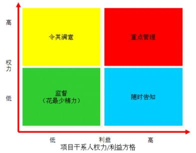

#### 【点评】常考，比较简单，必须得分

#### 【试题 34】---2017 上真题 56

34、某项目经理在编制干系人管理计划,绘制的如下表格是（）。

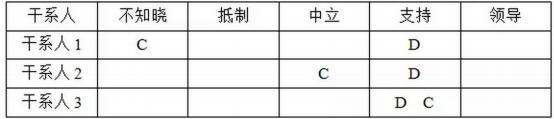

A.干系人职责分配矩阵    B.干系人优先矩阵

C.干系人参与评估矩阵    D.干系人亲和图

#### 【试题 35】---2017 下真题 55

35、以下（）不是控制沟通的技术和方法。

A.业务数据分析    B.项目例会   C.信息管理系统    D.专家判断

#### 【解析】控制沟通的技术和方法： 1.信息管理系统 2.专家判断 3.会议

#### 【试题 36】---2017 下真题 56

36、在进行项目干系人分析时， 经常用到权力/利益分析法， 对待属于第 A 区域的项目干系人，应 采取的策略是（）。

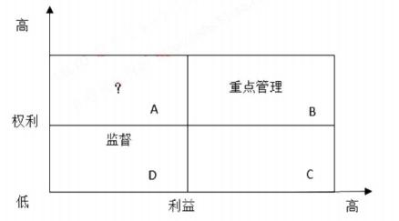

A.随时告知    B.令其满意    C.花较少的精力    D.争取支持

#### 【答案】B

#### 【解析】P425此题考察的是权利利益方格，

解析参考 33 题图

#### 【点评】常考，比较简单，必须得分

#### 【试题 37】---2018 上真题 55

37、沟通过程管理的最终目标是（）。

A.严格执行沟通计划        B.保障干系人之间有效沟通

C.与干系人建立沟通机制    D.正确传递项目信息

#### 【解析】原文，沟通过程管理的最终目标就是保障干系人之间有效沟通。

#### 【试题 38】---2018 上真题 56

38、关于干系人管理的描述。不正确的是:（）。

A.干系人分析在项目立项时进行，以便尽早了解干系人对项目的影响

B.识别干系人的方法包含组织相关会议、专家判断、干系人分析等

C.干系人分析是系统地收集干系人各种定性和定量信息的一种方法

D.典型的项目干系人包含客户、用户、高层领导、项目团队和社会成员等

#### 【解析】A 选项应该是在项目启动的时候，而不是项目立项的时候。

#### 【试题 39】---2018 下真题 55

39、关于管理沟通的工具，不正确的是:()

A.沟通模型的各要素会影响沟通的效率和效果

B.管理沟通过程中要确保已创建并发布的信息能够被接受和理解

C.项目经理在项目进行中，应定期或不定期进行绩效评估

D.为了方便快捷地进行沟通，项目进行过程中需选择固定的沟通渠道

#### 【答案】D

#### 【解析】P414 此题考察的是沟通管理的工具，

应灵活选择沟通渠道，D 是错误的。注意 C 是绩效报告是 内容，属于管理沟通的工具。

#### 【试题 40】---2018 下真题 56

40、下图干系人权力和利益的描述，不正确的是（）。

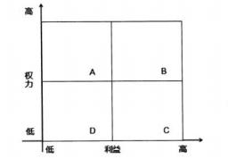

A.项目经理的主管领导就是 A 区的干系人，要“令其满意 ”

B.项目客户是 B 区的干系人，要“重点管理、及时报告 ”

C.对于 C 区的干系人，要“随时告知”

D.对于 D 区干系人，花费最少的精力监督即可

#### 【答案】A

#### 【解析】项目经理的主管领导是 B 区的，不是 A 区的

#### 【试题 41】---2019 上真题 55

41、项目团队中原来有 5 名成员，后来又有 4 人加入项目.与之前相比项目成员之间沟通渠道增加 ()条。

A.26      B.10        C.20        D.36

#### 【答案】A

#### 【解析】增加后 9x（9-1）/2=36，原来是 5x（5-1）/2=10 条，所以增加了 26 条

#### 【试题 42】---2019 上真题 56

42、识别项目干系人的活动按时间先后排序正确的是（）。

①对干系人分类②识别干系人及其信息

③制定干系人管理计划④评估关键干系人的诉求和影响力

A.④③②①    B.②④①⑧    C.①②③④    D.②①④③

#### 【解析】在项目的初期、在制定项目计划之前， 就要识别项目的干系人， 并分析他们的利益层次、个人期 望、重要性和影响力，这对项目成功非常重要……。

由于项目经理的时间有限，必须尽可能有效地利用，因此应该按干系人的利益、影响力和参与项

目的程度对其进行分类，并注意到有些干系人可能直到项目或阶段的较晚时期才对项目产生影响 或显著影响。通过分类，项目经理就能够专注于那些与项目的成功密切相关的重要干系人。

所以正确顺序是②识别干系人及信息-④评估关键干系人的诉求和影响力-①对干系人分类-③ 制定干系人管理计划。注意干系人分类一般是在评估了干系人利益、影响力等基础上进行的，所 以要先评估后分类。

#### 【试题 43】---2019 下真题 54

43、关于沟通表达方式的描述，不正确的是（）。

A.文字沟通的优点是读者可以根据自己的速度进行调整

B.文字沟通的缺点是无法控制何时， 以及是否被阅读

C.语言沟通的优点是节省时间，因为语言速度高于阅读速度

D.语言沟通的缺点是达不到文字资料的精确性和准确性

#### 【解析】阅读速度高于语言速度。

#### 【试题 44】---2019 下真题 55

44、对项目干系人进行分类时，常用的分类方法不包括（）。

A.权利/利益方格    B.权利影响方格    C.影响/作用方格    D.影响/意愿方格

#### 【解析】干系人分类模型：

（1）权利/利益方格。根据干系人的职权大小和对项目结果的关注（利益）程度进行分类。

（2）权利/影响方格。干系人的职权大小以及主动参与（影响） 项目的程度进行分类。

（3）影响/作用方格。干系人主动参与（影响）项目的程度及改变项目计划或者执行的能力进行 分类。

（4）凸显模型。根据干系人的权力（施加自己意愿的能力）、紧迫程度和合法性对干系人进行分 类。

十、项目合同管理

亏考点分析与预测：  信息系统工程的建设过程实际上就是合同的执行和监控过程， 合同管理  是信息系统工程建设合同得到有效履行的有力保障。合同管理不属于 10 大管理，但是和《合同法》 一起会在上午考 3 分左右， 可能考查的知识点为： 合同表现形式， 合同的要素（内容），合同的分  类， 合同的 4 个管理（签订、履行、变更、归档），赔的定义、分类、流程、依据以及期限， 希望  大家能够重视。 而且在下午案例分析里经常出现，因此，这一块非常重要。希望大家把以下知识  点尽力掌握。关于合同法内容，在本章不再列出，本章只列出教材上的相关重点。

本章下午试出题思路： 从近几年真题的命题情况看， 本知识模块更趋向于与项目整体管理、 范围管理、沟通管理、变更管理和风险管理等知识模块，以及《合同法》、《政府采购法》、《招标 投标法》相结合进行案例分析方面的综合命题。本章知识点命题思路主要表现为：给出某项目在 合同管理方面的案例场景描述，要求结合相关法律法规，指出该案例场景中存在哪些问题并说明 相关原因； 给出解决这些问题的补救措施（或建议）；给出 1 个该案例涉及且与合同管理基础知识 点相关的简答题（或判断题、填空题、选择题）等。

本章金色考点汇总：

1、合同是指：平等主体的自然人、法人、其他组织之间设立、变更、终止民事权利义务关系 的协议。但不包括婚姻、收养、监护等有关身份关系的协议。（09 上 38）

2、无效合同通常需具备下列任一情形：（09 下 50）--违法

（1）一方以欺诈、胁遗的手段订立合同。

（2）恶意串通，损害国家、集体或者第三人利益。

（3）以合法形式掩盖非法目的。

（4）损害社会公共利益。

（5）违反法律、行政法规的强制性规定。

### 3、合同的分类

| 按信息系统范围划分的合同分类：（10 下 50）（11 上 48）（12 上 50） | 按信息系统范围划分的合同分类：（10 下 50）（11 上 48）（12 上 50） | 按信息系统范围划分的合同分类：（10 下 50）（11 上 48）（12 上 50） |
|---|---|---|
| 1 | 总承包合同 | 总承包合同也称“交钥匙承包”，发包人把信息系统工程建设从开始立项、论证、 施工到竣工的全部任务， 一并发包给一个具备资质的承包人。 这种承包方式有利于充分发挥那些在工程建设方面具有较强的技术力量、丰富 的经验和组织管理能力的大承包商的专业优势，保证工程的质量和进度， 提高 投资效益。采用总承包的方式进行承包，发包人和承包人要签订总承包合同。 |
| 2 | 单项项目承 包合同 | 发包人将信息系统工程建设的不同工作任务，分别发包给不同的承包人。 |
| 3 | 分包合同 |  |
| 按项目付款方式划分的合同分类：（10 上 50）（14 上 51）（18 下 57） | 按项目付款方式划分的合同分类：（10 上 50）（14 上 51）（18 下 57） | 按项目付款方式划分的合同分类：（10 上 50）（14 上 51）（18 下 57） |
| 1 | 总价合同 |  |
| 2 | 单价合同 |  |
| 3 | 成本加酬金 合同 |  |

4、合同的内容就是当事人订立合同时的各项合同条款， 主要内容包括当事人各自权利、义务、 项目费用及工程款的支付方式、项目变更约定和违约责任等。

5、项目费用及工程款的支付方式明确以下 3 部分的内容： ①支付货款的条件。②结算支付的 方式。③拒付货款的条件。发包方有权部分或全部拒付货款。

6、项目变更约定---合同生效后， 当事人不得因姓名、名称的变更或者法定代表人、负责人、 承办人的变动而不履行合同义务。

7、合同法规定了 4 种违约责任的承担方式： （1）继续履行（2）采取补救措施（3） 赔偿损失 	（4）支付约定违约金或定金。

8、合同管理包含合同签订、合同履行、合同变更和合同档案管理（09 下 51）（13 下 51）（16 上 54）

一、合同签订（14 上 53）（15 上 53）

项目合同签订的注意事项：（16 上 53）

（1）当事人的法律资格：民事权力能力

（2）质量验收标准：验收是否合格

（3）验收时间：什么时候验收

（4）技术支持服务：明确技术支持，后续服务

（5）损害赔偿：

（6）保密约定：当事人在订立合同过程中知悉的商业秘密， 无论合同是否成立， 不得泄露或 者不正当地使用

（7）知识产权约定：合同生效后， 当事人就质量、价款或者报酬、履行地点等内容没有约定 或者约定不明确的，可以协议补充： 不能达成补充协议的， 按照合同有关条款或者交易习惯确定；

（8）合同附件;法律公证

在合同签订的时候，一定注意用语，比如合同中有这样一句话：买方将尽快“安排付款” ，那 么“尽快”和“安排付款”都是十分含混的规定。对此应改进，应该在付款期限方面加以明确规定。（09

下 54）（10 上 51）（10 下 52）（15 下 52）

9、合同谈判分如下 6 个阶段：（1）准备阶段（2）开局摸底阶段（3）报价阶段（4）硅商阶 段（5）成交阶段（6）认可阶段

10、例如，合同中有这样一句话：“买方将尽快安排付款'那么“尽快”和“安排付款”都是 十分含混的规定。对此应改进，应该在付款期限与付款金额等方面加以明确规定。

### 11、合同履行

对于合同不明确的情况， 应该先协商，达成补充协议。达不成协议的，依照合同其他条款或 交易习惯确定。如果依此不能明确有关条款的含义， 那就要用《合同法》第 62 条来解决：

第 62 条是针对那些常见的条款和质量、价款、履行地点、履行方式等约定欠缺或不明确所提 供的一个法定硬标准，是确定当事人义务的法定依据。

（1）当事人对标的物的质量要求不明确的，按国家标准和行业标准。没有这些标准的， 按产 品通常标准或符合合同目的的标准。

（2）履行地点不明确时，按标的性质不同而定： 接受货币在接受方， 交付不动产的在不动产 所在地，其他标的在履行义务方所在地。履行地在法律上具有非常重要的意义，它可以确定由谁 负担，货物的所有权何时何处转移，货物丢失风险由谁承担等，在诉讼中，也是确定管辖权的重 要依据，所以签订合同对履行地条款要特别注意。

（3） 履行期限不明的，债务人可随时履行， 债权人可随时要求履行， 但应给对方必要的准备 时间。在这里特别提醒债权人要注意诉讼时效，关于随时履行受不受诉讼时效的制约目前仍有争 议，不过最好在时效以内主张权利。

（4）履行费用负担不明确的，由履行义务一方负担。履行费用是履行义务过程中各种附随发 生的费用。在合同中应该考虑各种费用的分担， 如果没有约定， 视为由履行义务~方承担。

补充：大写与小写不一致，以大写为准；单价与总价不一致，以单价为准；

12、合同变更管理（17 下 58）

有多种因素会导致合同变更，例如范围变更、成本变更、进度变更、质量要求的变更甚至人

员变更都可能会引起合同的变更，乃至重新修订。

变更申请、变更评估和变更执行等必须以书面形式出现。（14 下 51）

合同变更的处理由合同变更控制系统来完成。（18 下 58）

按照合同签约备方的约定，合同变更控制系统的一般处理程序如下：（19 上 58）

（1）变更的提出。 合同签约各方都可以向监理单位（或变更管理委员会） 提出书面的合同变 更请求。

（2）变更请求的审查。合同签约各方提出的合同变更要求和建议， 必须首先交由监理单位（或 变更管理委员会）审查后，提出合同变更请求的审查意见，并报业主。

（3）变更的批准。 监理单位（或变更管理委员会） 批准或拒绝变更。

（4）变更的实施。 在组织业主与承包人就合同变更及其他有关问题协商达成一致意见后， 由 监理单位（或变更管理委员会）正式下达合同变更指令，承包人组织实施。

“公平合理”是合同变更的处理原则， 变更合同价款按下列方法进行。（18 上 58）（19 下 57）

（1）首先确定合同变更量清单，然后确定变更价款。

（2）合同中已有适用于项目变更的价格，按合同已有的价格变更合同价款。  	（3）合同中只有类似于项目变更的价格，可以参照类似价格变更合同价款。

（4）合同中没有适用或类似项目变更的价格，由承包人提出适当的变更价格， 经监理工程师 和业主确认后执行。

13、合同档案管理亦即合同文件管理，是整个合同管理的基础。（12 下 53）

合同文本是合同内容的载体。对合同文本进行管理既是档案法的要求，也是企业自身的需要。 合同文本管理还包括正本和副本管理、合同文件格式等内容。在文本格式上，为了限制执行人员  随意修改合同， 一般要求采用计算机打印文本，手写的旁注和修改等不具有法律效力。（16 下 56）

14 、索赔是在工程承包合同履行中，当事人一方由于另一方未履行合同所规定的义务而遭受 损失时，向另一方提出赔偿要求的行为。 在实际工作中， “索赔”是双向的，建设单位和承建单位 都可能提出索赔要求。通常情况下，索赔是指承建单位在合同实施过程中，对非自身原因造成的 工程延期、费用增加而要求建设单位给予补偿损失的一种权利要求。

15 、索赔的性质属于经济补偿行为，而不是惩罚； 索赔在一般情况下都可以通过协商方式友 好解决， 若双方无法达成妥协时，可通过仲裁解决。（09 下 55）（10 下 66）（11 下 63）（13 上 43）

（13 下 52）（15 下 53）

16、索赔的分类（10 下 54）

（1）按索赔的目的分类可分为工期索赔和费用索赔。

（2）按索赔的依据分类可分为合同规定的索赔和非合同规定的索赔。

（3）按索赔的业务性质分类可分为工程索赔和商务索赔。

（4）按索赔的处理方式分类可分为单项索赔和总索赔。

17、合同索赔构成条件（10 上 56）（10 下 55）

合同索赔的重要前提条件是合同一方或双方存在违约行为和事实，并且由此造成了损失，责 任应由对方承担。对提出的合同索赔，凡属于客观原因造成的延期、属于业主也无法预见到的情 况，如特殊反常天气，达到合同中特殊反常天气的约定条件，承包商可能得到延长工期，但得不 到费用补偿。对于属于业主方面的原因造成拖延工期，不仅应给承包商延长工期，还应给予费用 补偿。

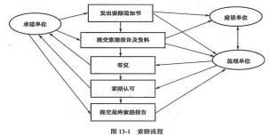

### 18、合同索赔依据

（1）国家有关的法律如《合同法》、法规和地方法规。

（2）国家、部门和地方有关信息系统工程的标准、规范和文件。

（3）本项目的实施合同文件， 包括招标文件、合同文本及附件。

（4）有关的凭证，包括来往文件、签证及更改通知，会议纪要，进度表，产品采购等。 （5）其他相关文件， 包括市场行情记录、各种会计核算资料等。

19、索赔的 28 天期限：

①当出现索赔事项时，索赔方以书面的索赔通知书形式，在索赔事项发生后的 28 天以内，向 监理工程师正式提出索赔意向通知；（15 下 54）

②监理工程师在收到送交的索赔报告有关资料后，于 28 天内给予答复，或要求索赔方进一步 补充索赔理由和证据；

③监理工程师在收到承包人送交的索赔报告的有关资料后 28 天未予答复或未对承包人作进一 步要求， 视为该项索赔已经认可；（10 上 55）（10 下 56）

④当索赔事件持续进行时，索赔方应当阶段性向工程师发出索赔意向，在索赔事件终了后 28 天内， 向工程师送交索赔的有关资料和最终索赔报告，工程师应在 28 天内给予答复或要求索赔方 进一步补充索赔理由和证据；

### 20、索赔的流程：

（1）提出索赔要求

（2）报送索赔资料

（3）监理工程师答复。

（4）监理工程师逾期答复后果。

（5）持续索赔

（6）仲裁与诉讼（15 下 58）（17上 61）

21、项目发生索赔事件后， 一般先由监理工程师调解，若调解不成，由政府建设主管机构进 行调解，若仍调解不成， 由经济合同仲裁委员会进行调解或仲裁。 在整个索赔过程中，遵循的原

则是索赔的有理性、索赔依据的有效性、索赔计算的正确性。（10 上 54）（15 上 52）

| 建设单位违约 | 不按时支付项目预付款；不按合同约定支付项目款， 导致实施无法进行；建设单 位无正当理由不支付项目竣工款；不履行合同义务； 违反工程合同设计部分的责 任：违反工程合同实施部分的责任等 |
|---|---|
| 承建单位违约 | 承建单位出现的违约事件主要包括；未按合同规定履行或不完全履行合同约定的 义务， 人为原因使项目质量达不到合同约定的质量标准：无视监理工程师的替告， 忽视合同规定的责任和义务；未经监理工程师同意， 随意分包项目或将整个项目 分包出去等。（14 下 52） 对承建单位违约可视以下两种情况进行处:（16 下 57） ①有质量问题，可要求承建单位无偿返工、完善， 由此造成逾期交工的，应赔偿逾期违约金。 ②承建单位严重违约的，可部分或全部终止合同，并采取善后控制措施。 |
| 对其他类型违 约 | 1.其他违约管理主要是指由于不可抗力的自然因素或非建设单位原因导致实施合 同终止时， 监理单位应按实际合同规定处理合同解除后的有关事宜。 |

|  | 2.不可抗力事件结束后约定时间（如 48 小时）内承建单位向监理单位通报受害情 况’及预计清理和修复费用。 3.因不可抗力事件导致的费用及延误的工期由双方分别承担。 |
|---|---|

22：要约和要约邀请：（09 上 39）

（1）要约是希望和他人订立合同的意思， 要约的内容应具体明确， 并且表明经受要约人承诺， 要约人即受该要约的约束。

（2）要约邀请是希望他人向自己发出要约的意思表示。

（3）承诺是受要约人同意要约的意思表示。

例如： 一个女孩想让男朋友请她看电影， 就说“你请我看电影”这是要约邀请， 男孩说;“我 请你看电影好吗?”这是邀约。女孩说：“好”，这属于承诺。

本章历年考题和答案解析汇总：

#### 【试题 1】---2009 上真题 38

1、合同法律关系是指由合同法律规范调整的在民事流转过程中形成的（1）。

（1）A.买卖关系  B.监督关系   C.权利义务关系   D.管控关系

#### 【解析】合同是指：平等主体的自然人、法人、其他组织之间设立、变更、终止民事权利义务关系的协议。

#### 【试题 2】---2009 上真题 39

2、（2）属于要约。

A.商场的有奖销售活动   B.商业广告    C.寄送的价目表     D.招标公告

#### 【解析】 此题考察的是要约的定义，必须掌握， 高频考点

根据《中华人民共和国合同法》第十四条规定， 要约是希望和他人订立合同的意思表示。该 意思表示应当符合下列规定：

（一）内容具体确定（二）表明经受要约人承诺，要约人即受该意思表示约束。

《中华人民共和国合同法》第十五条规定， 要约邀请是希望他人向自己发出要约的意思表示。 寄送的价目表、拍卖公告、招标公告、招股说明书和商业广告等为要约邀请。而商场的有奖销售  活动则符合要约的规定。

#### 【试题 3】---2009 上真题 40

3、（3） 属于《合同法》规定的合同内容。

（3）A.风险责任的承担    B.争议解决方法      C.验收标准     D.测试流程

#### 【解析】根据《中华人民共和国合同法》第十二条规定，合同的内容由当事人约定，一般包括以下条

款：（一）当事人的名称或者姓名和住所：（二）标的 （三）数量：（四）质量；（五） 价款或者报

酬：（六）履行期限、地点和方式（七） 违约责任；（八）解决争议的方法。

#### 【试题 4】 ---2009 上真题 41

《合同法》规定，价款或酬金约定不明的，按（4）的市场价格履行。

（4）A.订立合同时订立地     B.履行合同时订立地

C.订立合同时履行地     D.履行合同时履行地

#### 【解析】P372此题考察的是合同不明确处理的情况，

《中华人民共和国合同法》第六十二条之第二个规定：价款或者报酬不明确的，按照订立合 同时履行地的市场价格履行； 依法应当执行政府定价或者政府指导价的， 按照规定履行。

#### 【试题 5】---2009 下真题 50

5、合同一旦签署了就具有法律约束力，除非（5）。

（5）A.一方不愿意履行义务    B.损害社会公共利益

C.一方宣布合同无效      D.一方由于某种原因破产

#### 【解析】与有效合同对应，需要避免无效合同。无效合同通常需具备下列任一情形：（1） 一方以欺诈、 胁迫的手段订立合同（2）恶意串通，损害国家、集体或者第三人利益（3）以合法形式掩盖非法目的（4）损害社会公共利益（5）违反法律、行政法规的强制性规定。

#### 【试题 6】---2009 下真题 51

6、项目合同管理不包括（6）。

（6）A.合同签订    B.合同履行    C.合同纠纷仲裁    D.合同档案管理

#### 【解析】 合同管理的主要内容包括合同签订管理、合同履行管理、合同变更管理和合同档案管理。

#### 【试题 7】---2009 下真题 52

7、合同的内容就是当事人订立合同时的各项合同条款，下列不属于项目合同主要内容的是（7）。

（7）A.项目费用及支付方式    B.项目干系人管理

C.违约责任             D. 当事人各自权力、义务

#### 【解析】

合同的内容就是当事人订立合同时的各项合同条款。主要内容包括当事人各自权力、义务、 项目费用及工程款的支付方式、项目变更和违约责任等。

#### 【试题 8】---2009 下真题 53

8、承建单位有时为了获得项目可能将信息系统的作用过分夸大，使得建设单位对信息系统的预期 过高。除此之外，建设单位对信息系统的期望可能会随着自己对系统的熟悉而提高。为避免此类 情况的发生，在合同中清晰地规定（8）对双方都是有益的。

（8）A.保密约定  B.售后服务    C.验收标准    D.验收时间

#### 【解析】质量验收标准是一个关键指标。如果双方的验收标准不一致， 就会在系统验收时产生纠纷。在 某种情况下，承建单位为了获得项目，也可能将信息系统的功能过分夸大，使得建设单位对信息系统功能的预期过高。另外，建设单位对信息系统功能的预测可能会随着自己对系统的熟悉而捉 高标准。为避免此类情况的发生，清晰地规定质量验收标准对双方都是有益的。

#### 【试题 9】 ---2009 下真题 54

9、为出售公司软件产品， 张工为公司草拟了一份合同， 其中写明“软件交付以后， 买方应尽快安 排付款”。经理看完后让张工重新修改， 原因是（9）  。

（9）A.没有使用国家或行业标准的合同形式     B.用语含混不清，容易引起歧义

C.名词术语使用错误                    D.措辞不够书面化

#### 【解析】合同签订与谈判指出的合同签订与谈判中的注意事项，本题明显属于“用语含混不清，容易引起歧义”。

#### 【试题 10】---2009 下真题 55

10、下列关于索赔的描述中，错误的是（10）。

（10）A.索赔必须以合同为依据

B.索赔的性质属于经济惩罚行为

C.项目发生索赔事件后， 合同双方可以通过协商方式解决

D.合同索赔是规范合同行为的一种约束力和保障措施

#### 【解析】 索赔以合同为依据；索赔的性质属于经济补偿行为，而不是惩罚；索赔在一般情况下都可以 通过协商方式友好解决。

#### 【试题 11】---2010 上真题 53

11、系统集成商与建设方在一个ERP项目的谈判过程中，建设方提出如下要求，系统初验时间为 2010  年 6 月底（付款 50%）；正式验收时间为 2010 年 10 月底（累计付款 80%）；系统运行服务 期限为一年（可能累计付款100%）；并希望长期提供应用软件技术支持。系统集成商在起草项目 建设合同时，合同期限设定到（11）为妥。

（11）A.2010 年 10 月底    B.2011  年 6 月底  C.2011 年10 月底   D.长期

#### 【解析】 此题考察的是合同法，

根据《中华人民共和国合同法》第四十六条，“当事人对合同的效力可以约定附期限。附生效 期限的合同，自期限届至时生效。附终止期限的合同，自期限届满时失效”。

系统集成可分为系统设计、系统集成、系统售后服务三个阶段，建设方提出的付款条件也是按照集成、售后服务阶段划分的。一年的售后服务圆满完成后意味该项集成合同的结束，至于建设方在售后服务期满后希望承建方长期提供应用软件技术支持，可再签订运维合同

#### 【试题 12】---2010 上真题 54

12、某软件开发项目合同规定，需求分析要经过客户确认后方可进行软件设计。但建设单位以客  户代表出国、其他人员不知情为由拒绝签字，造成进度延期。软件开发单位进行索赔一般按（12） 顺序较妥当。

①由该项目的监理方进行调解 ②由经济合同仲裁委员会仲裁 ③由有关政府主管机构仲裁

（12）A.①②③   B.①③②   C.③①②    D.②①③

#### 【解析】索赔是在工程承包合同履行过程中，当事人一方由于另一方未履行合同所规定的义务而遭受损失时，向另一方提出索赔要求的行为。项目发生索赔事件后，一般先由监理工程师调解，若调解不成，由政府建设主管机构进行调解，若仍调解不成，由经济合同仲裁委员会进行调解或仲裁。在整个索赔过程中，遵循的原则是索赔的有理性、索赔依据的有效性、索赔计算的正确性。

#### 【试题 13】---2010 上真题 55

13、按照索赔程序，索赔方要在索赔通知书发出后（13）内，向监理方提出延长工期和（或）补 偿经济损失的索赔报告及有关资料。

（13）A.2 周    B.28天    C.30  天    D.3周

#### 【解析】按照索赔程序，当出现索赔事项时，首先由索赔方以书面的索赔通知书形式，在索赔事项发生后的 28 天以内，向监理工程师正式提出索赔意向通知书。在索赔通知书发出后的 28 天内， 向监理工程师提出延长工期和（或） 补偿经济损失的索赔报告及有关资料。

#### 【试题 14】---2010 上真题 56

14、某项工程需在室外进行线缆铺设，但由于连续大雨造成承建方一直无法施工，开工日期比计 划晚了 2 周（合同约定持续 1 周以内的天气异常不属于反常天气），给承建方造成一定的经济损失。 承建方若寻求补偿， 应当（14）。

A.要求延长工期补偿               B.要求费用补偿

C.要求延长工期补偿、费用补偿     D. 自己克服

#### 【解析】合同索赔的重要前提条件是合同一方或双方存在违约行为和事实，并且由此造成了损失，责任应由对方承担。对提出的合同索赔，凡属于客观原因造成的延期、属于业主也无法预见到的情况，如特殊反常天气，达到合同中特殊反常天气的约定条件，承包商可能得到延长工期，但得不到费用补偿。对于属于业主方面的原因造成拖延工期，不仅应给承包商延长工期，还应给予费用补偿。

#### 【试题 15】---2010 下真题 50

15、某机构将一大型信息系统集成项目分成 3  个包进行招标，共有3 家承包商中标，发包人与承 包商应签署（15）。

（15）A.技术转让合同   B.单项项目承包合同   C.分包合同      D.总承包合同

#### 【解析】 《中华人民共和国合同法》有如下相关规定:

第二百五十一条承揽合同是承揽人按照定作人的要求完成工作，交付工作成果，定作人给付 报酬的合同。承揽包括加工、定作、修理、复制、测试、检验等工作。

第二百七十二条发包人可以与总承包人订立建设工程合同，也可以分别与勘察人、设计人、 施工人订立勘察、设计、施工承包合同。发包人不得将应当由一个承包人完成的建设工程肢解成 若干部分发包给几个承包人。

第三百四十二条技术转让合同包括专利权转让、专利申请权转让、技术秘密转让、专利实施 许可合同。技术转让合同应当采用书面形式。

故本题目中，发包人与承包商应签署单项项目承包合同。不是总承包合同、分包合同，也不

是技术转让合同。

#### 【试题 16】---2010 下真题 51

16、根据合同法规定，（16）不属于违约责任的承担方式。

（16）A.继续履行   B.采取补救措施  C.支付约定违约金或定金  D.终止合同

#### 【解析】 合同法规定了4 种违约责任的承担方式。

（1）继续履行 （2）采取补救措施（3）赔偿损失（4）支付约定违约金或定金

#### 【试题 17】---2010 下真题 52

17、小张草拟了一份信息系统定制开发合同，其中写明“合同签订后建设单位应在 7 个工作日内 向承建单位支付60%合同款；系统上线并运行稳定后，建设单位应在7个工作日内向承建单位支 付 30%合同款”。上述条款中存在的主要问题为（17）。

（17）A.格式不符合行业标准的要求      B.措辞不够书面化

C.条款描述不清晰、不准确        D.名词术语不规范

#### 【解析】 本题目中合同条款的核心在于约定费用的分期支付，但此内容没有描述清楚分期支付的具体额度，“合同款”这种表述不清晰、不准确。对“运行稳定”没有确切定义， 另外也没有说明余下的10%合同款的支付方式与时间

#### 【试题 18】---2010 下真题 53

18、为保证合同订立的合法性，关于合同签订，以下说法不正确的是（18）。

（18）A.订立合同的当事人双方，应当具有相应的民事权利能力和民事行为能力

B.为保障双方利益，应在合同正文部分或附件中清晰规定质量验收标准，并可在合同签署 生效后协议补充

C.对于项目完成后发生技术性问题的处理与维护，如果合同中没有相关条款，默认维护期限为一年

D.合同价款或者报酬等内容，在合同签署生效后，还可以进行协议补充

#### 【解析】 根据《中华人民共和国合同法》的规定:

第二条本法所称合同是平等主体的自然人、法人、其他组织之间设立、变更、终止民事权利 义务关系的协议。

第九条当事人订立合同， 应当具有相应的民事权利能力和民事行为能力。即 A 是正确的。

第六十一条合同生效后，当事人就质量、价款或者报酬、履行地点等内容没有约定或者约定 不明确的， 可以协议补充；不能达成补充协议的，按照合同有关条款或者交易习惯确定。与履行合同有关的技术背景资料、可行性论证和技术评价报告、项目任务书和计划书、技术 标准、技术规范、原始设计和工艺文件，以及其他技术文档，按照当事人的约定可以作为合同的 组成部分。合同法没有对于项目完成后发生技术性问题的处理与维护问题、维护期限问题进行约定。

#### 【试题 19】---2010 下真题 54

19、下述关于项目合同索赔处理的叙述中，不正确的是（19）。

（19）A.按业务性质分类，索赔可分为工程索赔和商务索赔

B.项目实施中的会议纪要和来往文件等不能作为索赔依据

C.建设单位向承建单位要求的赔偿称为反索赔

D.项目发生索赔事件后一般先由监理工程师调解

#### 【解析】 索赔是在工程承包合同履行中，当事人一方由于另一方未履行合同所规定的义务而遭受损失时，向另一方提出赔偿要求的行为。建设单位对于属于承建单位应承担责任造成的，且实际发生了的损失，向承建单位要求赔偿，称为反索赔。索赔的性质属于经济补偿行为，而不是惩罚。索赔在一般情况下都可以通过协商方式友好解决，若双方无法达成妥协时，可通过仲裁解决。

项目实施中的会议纪要和来往文件等可以作为索赔依据

项目发生索赔事件后，一般先由监理工程师调解，若调解不成，由政府建设主管机构进行调解，若仍调解不成，由经济合同仲裁委员会进行调解或仲裁。在整个索赔过程中，遵循的原则是索赔的有理性、索赔依据的有效性、索赔计算的正确性。

#### 【试题 20】---2010 下真题 55

20、某信息系统集成项目实施期间，因建设单位指定的系统部署地点所处的大楼进行线路改造， 导致项目停工一个月，由于建设单位未提前通知承建单位，导致双方在项目启动阶段协商通过的 项目计划无法如期履行。根据我国有关规定，承建单位（20）。

（20）A.可申请延长工期补偿，也可申请费用补偿

B.可申请延长工期补偿， 不可申请费用补偿

C.可申请费用补偿，不可申请延长工期补偿

D.无法取得补偿

#### 【答案】A

#### 【解析】P379  此题考察的是索赔，

合同索赔的重要前提条件是合同一方或双方存在违约行为和事实，并且由此造成了损失，责 任应由对方承担。对提出的合同索赔，凡属于客观原因造成的延期、属于业主也无法预见到的情 况，如特殊反常天气，达到合同中特殊反常天气的约定条件，承包商可能得到延长工期，但得不 到费用补偿。对于属于业主方面的原因造成拖延工期，不仅应给承包商延长工期，还应给予费用 补偿。

本题目中由于建设单位的原因，导致项目停工一个月，双方在项目启动阶段协商通过的项目 计划无法如期履行。承建单位不但可申请延长工期补偿，还可申请费用补偿，即 A 是正确的。

#### 【点评】常考，命题的热点，简单题， 必须得分

#### 【试题 21】---2010 下真题 56

21、某机构信息系统集成项目进行到项目中期，建设单位单方面终止合作，承建单位于 2010  年 7 月 1  日发出索赔通知书，承建单位最迟应在（21）之前向监理方提出延长工期和（或）补偿经济 损失的索赔报告及有关资料。

（21）A.2010  年 7 月 31   日        B.2010  年 8  月 1   日

C.2010  年 7 月 29   日        D.2010  年 7  月 16  日

#### 【答案】C

#### 【解析】 此题考察的是索赔，

在索赔通知书发出后的 28 天内，向监理工程师提出延长工期和（或） 补偿经济损失的索赔报 告及有关资料。索赔报告的内容主要有总论部分、根据部分、计算部分和证据部分。

#### 【点评】常考，命题的热点，简单题， 必须得分

#### 【试题 22】---2011 上真题 48

22、某项目在招标时被分成 5 个标段，分别发包给不同的承包人。承包人中标后与招标人签订的 是（22）。

（22）A.单项项目承包合同 B.分包合同 C.单价合同       D.总承包合同

#### 【答案】A

#### 【解析】 此题考察的是合同的分类，必须掌握， 高频考点

按信息系统范围划分的合同类型有：总承包合同、单项项目承包合同和分包合同。

总承包合同也称为“交钥匙承包”，发包人把信息系统工程建设从开始立项、论证、施工到竣 工的全部任务， 一并发包给一个具备资质的承包人。单项项目合同是发包人将信息系统工程建设 的不同任务，分别发包给不同的承包人。分包合同是指总承建单位将其承包的某一部分或某几部 分项目，再发包给子承建单位。

由上述合同类型的定义可知，项目在招标时被分成若干标段，分别发包给不同的承包人，承 包人中标后与招标人应签订单项项目承包合同， 因此选 A。

#### 【点评】合同的作用，常考，简单，必须得分

#### 【试题 23】---2011 上真题 49

23、甲公司在进行采购时选定了乙公司的产品，但在签订采购合同时没有对采购内容的交付时间 进行约定， 则以下说法错误的是（23）。

（23）A.可以通过协议或交易习惯确定交付时间

B.不能通过协议或交易习惯确定的，则采购合同无效

C. 乙公司可以随时履行交付义务

D. 甲公司可以随时要求乙公司履行交付义务

#### 【答案】B

#### 【解析】 此题考察的是合同法，

《合同法》第 61 条明确规定， 对于合同不明确的情况， 应当先协商， 达成补充协议。达不成 协议的，依照合同其他条款或交易习惯确定。如果依此不能明确有关条款的含义，那就要用《合 同法》第 62 条来解决。对于履行期限不明的， 债务人可随时履行， 债权人可随时要求履行， 但应 给对方必要的准备时间。

根据上述法律规定可知， 选项 B 的说法是错误的，因此选 B。

#### 【点评】合同法考点，常考，简单，必须得分

#### 【试题 24】---2011 上真题 50

24、某项目甲乙双方签订了建设合同，其中对工程款支付及知识产权的描述分别是“…… 甲方在 系统安装完毕， 经试运行及初验合格后， 收到乙方材料 XX  日内， 支付第二笔款 XXXX 元。乙方 提供的材料包括： ①商业发票；②…… ”, 从上述描述可看出， 支付第二笔款还必须附加的材料是（24）。 （24）A.第三方测试报告   B.初验报告  C.专家评审报告 D.监理工作总结报告

#### 【答案】B

#### 【解析】 此题考察的是合同管理知识，

根据题干的叙述，甲乙双方约定初验合格后，甲方向乙方递交材料， 乙方收到材料后 XX 日内， 支付第二笔款 XXXX 元。由此可知， 该材料应是试运行、初步验收或财务方面的材料， 在备选项中， 只有初验报告是初步验收材料。由于合同背景中没有提及监理、专家评审和第三方测试等事宜，  因此最合适的选项应为 B。

#### 【点评】验收报告，理解题，掌握截题的方法，简单，必须得分

#### 【试题 25】---2011 下真题 53

25、以下关于项目合同签订的描述中， 正确的是（25）。

（25）A.只有具有相应民事权利能力的自然人、法人或其他组织才可订立合同

B.如果合同中对技术支持服务期限未作出任何规定， 则认为企业所有的维护要求都要另行付费

C.对于当事人在订立合同中熟悉的商业秘密， 一旦合同成立，在执行合同过程中造成泄密， 必须承担经济损害赔偿

D.为了避免合同纠纷，当事人必须将签订的合同进行公证，使之获得法律强制执行效力 【答案】B

#### 【解析】 此题考察的是合同的签订，必须掌握， 高频考点

选项 A 中，当事人也可以依法可以委托代理人订立合同。

选项 B 是正确的。

选项 C 中，无论合同签订与否，不得泄露或者不正当地使用商业秘密。

选项 D 中，合同可以公证，也可以不公证。

#### 【点评】常考，命题的热点，简单题， 必须得分

#### 【试题 26】---2011 下真题 63

26、M 公司委托 T 公司开发一套新的管理信息系统， T 公司未能按合同规定的日期交付最终产品， 给 M 公司照成巨大的运营损失，因此 M 公司向 T 公司提出索赔，其中不包括（26）。

（26）A.清算赔偿金       B. 间接损失赔偿金    C.补偿性赔偿金 D.惩罚性赔偿金

#### 【答案】D

#### 【解析】P378此题考察的是索赔，

索赔是在工程承包合同履行中，当事人一方由于另一方未履行合同所规定的义务而遭受损失 时， 向另一方提出赔偿要求的行为。在实际工作中，“索赔”是双向的， 建设单位和承建单位都可 能提出索赔要求。通常情况下，索赔是指承建单位在合同实施过程中，对非自身原因造成的工程 延期、费用增加而要求建设单位给予补偿损失的一种权利要求。而建设单位对于属于承建单位应 承担责任造成的，且实际发生了的损失，向承建单位要求赔偿，称为反索赔。 索赔的性质属于经 济补偿行为，而不是惩罚。 索赔在一般情况下都可以通过协商方式友好解决，若双方无法达成妥 协时，可通过仲栽解决。

惩罚性赔偿是用来惩罚过错方，它也因此而被称为处罚。因为违反合同并不是违法的，所以 不能裁定惩罚性赔偿。本题中选项 A, B, C 所列出的其他赔偿方法均可以用来对买方的损失进行 补偿。因此正确答案应选 D。

#### 【点评】常考，命题的热点，简单题， 必须得分

#### 【试题 27】---2012 上真题 50

27、某电信企业要建设一个 CRM 系统（包括呼叫中心和客服中心），系统集成一级资质企业甲和 系统集成二级资质企业乙参与该系统建设。关于合同的签订，下面说法中，（27）是正确的。

（27）A.如电信企业和乙签订 CRM 建设总包台同，则乙和甲就呼叫中心的建设只能签订分包公司 B.如电信企业和乙签订客服中心建设总包台同， 则电信企业和甲就 CRM 的建设只能签定总价合同

C.如电信企业和乙签订客服中心建设单项承包合同， 则电信企业和甲就 CRM 的建设只能签定单 项承包合同

D.如电信企业和甲签订 CRM 建设总价合同， 则甲和乙就呼叫中心帕建设只能签订单价合同 【答案】A

#### 【解析】P365此题考察的是合同的分类，必须掌握， 高频考点

按项目付款方式划分可将合同分为总价合同、单价合同和成本加酬金合同。按信息系统范围 划分可将合同分为总承包合同、单项项目承包合同和分包合同。 其中，签订分包合同应当同时具 备两个条件：①承包人只能将自己承包的部分工程分包给具有相应资质条件的分包人； ②分包工程 必须经过发包人同意。由于企业甲的系统集成资质比企业乙高， 呼叫中心和 客服中心仅是 CRM 系 统的一部分，因此若电信企业和企业乙签订了 CRM 建设总包合同，则企业 乙和.企业甲就呼叫中 心的建设只能签订分包合同。

#### 【点评】合同法的考点，多次考了，记住即可，难题，必须得分

#### 【试题 28】---2012 上真题 51

28、建设方和承建方甲就某信息系统建设项目进行了多次合同谈判均未达成一致，未能签定系统 建设合同，但在谈判期间建设方获悉了甲的行业关键技术指标。之后建设方与另一承建方乙经过 合同谈判后就系统建设签定了合同，同时将甲的关键技术指标透露给乙，导致甲蒙受损失。下列 说法中，（28）是正确的。

（28）A.建设方对甲蒙受的损失应承担赔偿责任

B.建设方和甲未签定合同，对甲蒙受的损失不应承担赔偿责任

C. 乙和甲未签定合同，对甲蒙受的损失不应承担赔偿责任

D. 甲的损失是由于其自身保密工作未做好，其损失应全部由其自身承担

#### 【答案】A

#### 【解析】 此题考察的是合同的管理，必须掌握， 高频考点

当事人在订立项目合同过程中知悉的商业秘密，无论合同是否成立，不得泄露或者不正当地 使用。泄露或者不正当地使用该商业秘密给对方造成损失的，应当承担损害赔偿责任。依题意， 建设方将承建方甲的行业关键技术指标透露给承建方乙， 导致承建方甲蒙受损失。 为此，建设方 对甲蒙受的损失应承担赔偿责任。

#### 【点评】合同法的考点，多次考了，记住即可，简单，必须得分

#### 【试题 29】---2012 上真题 52

29、某系统集成商 M 公司于甲方签订了一份电子商务平台建设项目， 合同中规定， 如果系统交付 后存在质量问题， 系统集成商 M 应提供免费的及时维护服务， M 公司按合同要求交付了系统， 双 方签订了验收报告。在此后的一年内， M 公司及时响应了甲方的维护要求，一年之后， M 公司向 甲方提出此后的技术服务应该为有偿服务，甲方认为合同中提到的免费服务并无具体期限， M  公 司的收费要求是不合理的。下列说法中（29）是最恰当的。

（29）A.因为合同中规定的免费服务并无具体期限， 因此 M 公司要求收费不合理

B.应对甲方的服务要求进行分类， 如是处理质量问题，则 M 公司应无限期免费服务 C.M 公司已经提供了一年的免费服务，此后要求对服务收费是合理的

D.合同内容不明确，可根据有关信息化工程建设的法律、法规处理

#### 【答案】D

#### 【解析】 此题考察的是合同法知识，必须掌握， 高频考点

D 说的最全面，包含了 ABC3 个选项！

#### 【点评】合同不明确情况的处理，多次考了，记住即可，简单，必须得分

#### 【试题 30】---2012 上真题 53

30、某办公大楼的开发商将办公楼的智能楼宇系统承包给 H 公司， 双方签订了合同， 开发商海聘 请了监理方对此项目进行监理。期间， 消防子系统验收延误，开发商认为是 H 公司的责任，向监 理方提出索赔要求。关于索赔流程，下列说法中，（30）是正确的。

（30）A.开发商应在验收延误事件发生后 20 天内提出索赔意向通知

B.监理方收到索赔通知后，应在 28 天内帮助开发商编制出索赔报告

C.监理方应在索赔报告中充分论证该事件的确为开发商带来了损失，并提出具体的赔偿方案 D.如果 H 公司不同意监理方作出的索赔决定，可提请仲裁或法律诉讼

#### 【答案】D

#### 【解析】 此题考察的是索赔，

依题意， 在验收延误事件发生后的 28 天以内，开发商应向监理方正式提出索赔意向通知。据 此，选项 A 的说法有误。

在索赔通知书发出后的 28天内，开发商应向监理方提交索赔报告及有关资料。索赔报告的内 容 主要有总论部分、根据部分、计算部分和证据部分。索赔报告编写的一般要求有①索赔事件应 该 真实；②责任分析应清楚、准确、有根据③充分论证事件给索赔方造成的实际损失； ④索赔计 算 必须合理、正确； ⑤文字要精炼、条理要清楚、语气要中肯。据此， 选项 B 和选项 C 的说法有 误。 若 H 公司或开发商不能接受监理方所提出的索赔答复，则可以进入仲裁或法律诉讼程序。

#### 【试题 31】---2012 下真题 53

31、合同管理是项目管理中一个重要的组成部分、其中合同（31）管理是合同管理的基础。

（31）A.索赔     B.履行    C.档案    D.变更

#### 【解析】合同档案的管理，亦即合同文件管理，是整个合同管理的基础。

#### 【试题 32】---2012 下真题 63

32、某小型系统集成项目，甲乙双方只订立了口头合同。工程完工后，因甲方拖欠乙方工程款项 发生风险， 应当认定该合同  （32） 。

（32）A.未成立    B.补签后成立   C.成立     D.备案登记后成立

#### 【解析】 此题考察的是合同管理，

《中华人民共和国民法通则》第五十六条规定：“民事法律行为可以采用书面形式、口头形式 或者其他形式。法律规定用特定形式的，应当依照法律规定。”

《合同法》第十条规定，当事人订立合同，有书面形式、口头形式和其他形式。法律、行政法 规规定采用书面形式的，应当采用书面形式。当事人约定采用书面形式的，应当采用书面形式。 因此，可以认为口头协议也是合同的一种表现形式，如果双方都认可的口头协议，在法律上认定 为有效，但如果一方违约，主张一方的举证能形成完整的证据链，口头协议也具有法律效力。国 家法律规定的应当采取书面合同的，当事双方却仅进行口头约定，主张方能举证证明自己已经履 行了协议，可以视为有效。

法律规定，订立合同的形式可以是书面的方式，也可以是口头合同。口头合同比起书面合同 简便易行，只要法律没有规定一定要订立书面合同，而口头合同只要是双方真实的意思表示，也 同样是有效的。国家法律规定的必须要采用书面协议的方式，比如建设工程合同、技术开发合同、 房屋销售合同等，如果这类合同采取口头约定的形式，那么可视无效，不受法律保护。

#### 【试题 33】---2012 下真题 64

33、甲乙双方订立合同，规定甲应予 2007 年 8 月 1  日交货，乙应予同年 8 月 7  日付款，7 月底， 甲发现乙财产状况恶化，已没有支付货款的能力，并有确切证据，甲提出终止合同，但乙未允。 基于上述情况，甲于 8 月 1  日未按约定交货，依照合同法的原则。下列关于甲行为的论述中，正 确的是（33）。

（33）A.甲必须按合同约定交货，但可以要求乙提供相应的担保

B. 甲有权不按合同约定交货，除非乙提供了相应的担保

C. 甲必须按合同约定交货，但可以仅先交付部分货物

D. 甲应按合同约定交货，如乙不支付货款可追究其违约责任

#### 【解析】不安抗辩权又称先履行抗辩权，指双务合同成立后，应当先履行的当事人有证据证明对方不 能履行合同义务，或者有不能履行合同义务的可能性时，在对方没有履行或提供担保前，有权中止履行合同义务。

依《合同法》第六十八条规定，应当先履行债务的当事人，有确切证据证明对方有下列情形 之一的，可以中止履行：①经营状况严重恶化；②转移财产、抽逃资金，以逃避债务③丧失商业 信誉；④有丧失或者可能丧失履行债务能力的其他情形。

不安抗辩权的构成要件：①双方当事人因同一双务合同而互负债务；②后给付义务人的履行 能力明显降低，有可能为对待给付的现实危险③后给付义务人未提供适当担保。

#### 【点评】合同法考点，难题，尽量得分

#### 【试题 34】---2013 上真题 43

34.索赔是合同管理中经常会碰到的问题，以下关于索赔管理的描述中，  34   是正确的。 A.一方或双方存在违约行为和事实是合同索赔的前提

B.凡是遇到客观原因造成的损失， 承包商都可以申请费用补偿

C.索赔是对对方违约行为的一种惩罚

D.承建方应该将索赔通知书直接递交建设方，监理方不参与索赔管理

#### 【解析】 合同索赔的重要前提条件是合同一方或双方存在违约行为和事实，并且由此造成了损失，责 任应由对方承担。对提出的合同索赔，凡属于客观原因造成的延期、属于业主也无法预见到的情 况，如特殊反常天气，达到合同中特殊反常天气的约定条件，承包商可能得到延长工期，但得不 到费用补偿。对于属于业主方面的原因造成拖延工期，不仅应给承包商延长工期，还应给予费用补偿。 所以 A 正确； B 错， 客观原因只能申请工期索赔； C 错， 索赔是补偿， 而不是不是一种惩罚性行为；  D错，索赔怎能没有监理呢？

#### 【试题 35】---2013 上真题 50

35.某项目在启动阶段难以确定所需要的人员和资源， 需要在实施过程中动态增加较多人员、专家 和外部资源。在为该项目制订采购计划时需要确定采购合同类型，最适合该项目的合同类型是  35  。

A.时间和材料合同     B.成本加固定酬金合同  C.成本补偿合同  D. 固定总价合同

#### 【解析】题干中没有提是建设方还是承建方，应选折衷的时间和材料合同

飞 难以确定所需要的人员和资源的项目，比较适合时间和材料合同

#### 【试题 36】---2013 上真题 52

36.甲公司与乙公司订立了一份总货款额为 20 万元的设备供货合同。合同约定的违约金为货款总额 总值的 10%。同时，甲公司向乙公司给付定金 5000 元。后乙公司违约， 给甲公司造成损失 2 万元。 乙公司依法向甲公司支付违约金（36）万元。

A.2            B.2.5              C.4              D.1.5

#### 【解析】 《合同法》  第一百一十六条 当事人既约定违约金，又约定定金的，一方违约时，对方可以选择适用违约金或者定金条款。

#### 【试题 37】---2013 下真题 51

37、系统集成合同管理是管理建设方与承建方的关系，保证承建方的实际工作合同要求的过程。 其内容不包括（37）。

（37）A.合同签订管理     B.合同履行管理   C.合同变更管理  D.合同违法管理

#### 【解析】 合同管理包含合同签订、履行、变更、档案管理

#### 【试题 38】---2013 下真题 52

38、按照我国建设部、财政部下达的通用条款，下列关于索赔的说法错误的是（38）。

（38）A.索赔必须以合同为依据       B.索赔必须注意资料的积累

C.索赔是一种惩罚行为         D.索赔处理要及时、合理

#### 【解析】 索赔的性质属于经济补偿行为，而不是惩罚。

#### 【试题 39】---2014 上真题 51

39、按照付款方式的不同，工程合同分（51）。

①总价合同 ②单价合同（3）分包合同 ④成本加酬金合同

（39）A.1234          B.123        C.124                    D.134

#### 【解析】 按照付款方式的不同，工程合同分总价合同、单价合同、成本加酬金合同

#### 【试题 40】---2014 上真题 52

40、在信息系统建设中，建设方与承建方的合同可用于（）。

①作为监理工作的基本依据②规定总监工程师的职责③确定項目的工期④规定双方的经济关系⑤ 规定扣除招标公司费用的比例

（40）A.123          B.134              C.2345              D.12345

#### 【解析】规定总监工程师的职责是建设方和监理方的合同约定内容规定扣除招标公司费用的比例是建设方和招标代理机构委托合同里规定的。

#### 【试题 41】---2014 上真题 53

41、在合同谈判前，要制定切合实际的谈判目标，要抓住实质问题， 要营造一个平等协商的氛围。 这些工作在合同管理中属于（41）管理。

A.合同签订  B.合同履行   C.合同变更   D.合同档案

#### 【解析】 合同管理过程主要包括签订管理、履行管理、变更管理、档案管理

#### 【试题 42】---2014 下真题 51

42、以下关于合同变更的叙述中，（42）是不正确的。

A.合同变更一般处理程序如下：变更的提出、变更请求的审查、变更的批准、变更的实施

B.变更申请可以以口头形式提出， 变更评估必须采取书面方式

C.对于任何变更的评估都应该有变更影响分析

D.合同变更的处理由合同变更控制系统来完成

#### 【解析】变更申请、变更评估和变更执行等必须以书面形式出现。

#### 【试题 43】---2014 下真题 52

43、如果承建单位项目经理由于工作失误导致采购的设备不能按期到货,施工合同没有按期完成, 则建设单位可以要求（43）承担责任。

A.承建单位   B.监理单位   C.设备供应商  D.项目经理

#### 【解析】考察的是违约责任，承建单位出现的违约事件主要包括；未按合同规定履行或不完全履行合同约定的义务，人为原因 使项目质量达不到合同约定的质量标准：无视监理工程师的替告，忽视合同规定的责任和义务；未经监理工程师同意，随意分包项目或将整个项目分包出去等。

对承建单位违约可视以下两种情况进行处:

①有质量问题，可要求承建单位无偿返工、完善，由此造成逾期交工的，应赔偿逾期违约金。 ②承建单位严重违约的，可部分或全部终止合同，并采取善后控制措施。

#### 【试题 44】---2015 上真题 51~52

44、工程建设合同纠纷的仲裁由（1）的仲裁委员会仲裁,仲裁委员会作出裁决以后,当事人应当履行。 当一方当事人不履行仲裁裁决时。另一方当事人可以依照民事诉讼法的有关规定向（2）申请执行。

（1）A.工程所在地    B.建设单位所在地    C.承建单位所在地     D.合同双方选定

（2）A.当地人民政府  B.人民法院          C.仲裁委员会         D.调节委员会

#### 【解析】 工程建设合同纠纷的仲裁由工程项目所在地的仲裁委员会仲裁。仲裁委员会做出裁决以后，当事 人应当履行。当一方当本人不履行仲裁裁决时，另一方当本人可以依照民事诉讼法的有关规定向 人民法院申请执行。

#### 【试题 45】---2015 上真题 53

45、签订信息系统工程项目合同时有需要注意事项。下列选项中（）在合同签订时不要考虑。 A. 当事人的法律资格   B.验收标准   C.项目管理计划    D.技术支持服务

#### 【解析】 项目合同签订的注意事项 1.当事人的法律资格 2.质量验收标准 3.验收时间 4.技术支持服务 5.损害赔偿 6.保密约定 7.合同附件 8.法律公证

#### 【试题 46】---2015 上真题 54

46 、一个具有五个分包商的项目,分包商递交了变更请求,希望扩大其工作范围,根据对此请求 的评审,决定对合同进行修订,该活动属于（）。

A.管理采购    B.实施采购    C.形成合同     D.解决争议

#### 【解析】管理采购过程旨在确保卖方绩效达到采购要求，并且买方也按合同条款履约。合同关系的法律性质，要求项目管理团队清醒地意识到其管理采购的各种行动的法律后果。对于有多个供应商的较大型项目，合同管理的一个重要方面就是管理各个供应商之间的界限。

#### 【试题 47】---2015 下真题 52

47、小张模拟了一份信息系统定制开发合同， 其中“合同签订后建设单位应在 74 个工作日内向承 建单位支付 60%合同款： 系统上线并运行稳定后，建设单位应在 7 个工作日内向承建方单位支付 30%合同款.”。上诉条款中存在的主要问题为( )

A.格式不符合行业标准的要求    B.措辞不够书面化

C.条款描述不清晰，不准确      D.名词术语不规范

#### 【解析】信息系统定制开发合同属于技术合同。根据《中华人民共和国合同法》，技术合同的内容由当事人 约定， 一般包括以下条款：（一）项目名称；（二）标的的内容、范围和要求；（三） 履行的计划、 进度、期限、地点、地域和方式；（四）技术情报和资料的保密；（五） 风险责任的承担；（六） 技 术成果的归属和收益的分成办法；（七）验收标准和方法；（八）价款、报酬或者使用费及其支付  方式；（九）违约金或者损失赔偿的计算方法；（十）解决争议的方法；（十一）名词和术语的解释。 本题目中合同条款的核心在于约定费用的分期支付，但此内容没有描述清楚分期支付的具体额度， “合同款”这种表述不清晰、不准确。

#### 【试题 48】---2015 下真题 53

### 48、开发合同中索赔的性质属于( )

A.经济补偿 B.经济惩罚  C.经济制裁   D.经济补偿和经济制裁

#### 【解析】 索赔是一种经济补偿行为

#### 【试题 49】---2015 下真题 54

49、索赔是合同管理的重要环节， 甲单位在进行某一工程项目时，于 2015 年 3 月 1  日发生了一项 索赔的事项，则需在（ ）提出索赔意向通知。

A.2015 年 3 月 29  日前向建设方项目经理  B.2015 年 3 月 31  日前向监理工程师

C.2015 年 3 月 29 日前向监理工程师      D.2015 年 3 月 31  日前向建设方项目经理

#### 【解析】

当出现索赔事项时，索赔方以书面的索赔通知书形式，在索赔事项发生后的28天以内向监理工程 师正式提出索赔意向通知。

#### 【试题 50】---2015 下真题 61

50、项目采购计划的编制需要有适宜的方法，以规避项目风险，实现项目本目标，（ ）不属于项 目采购计划编制采用的技术

A.专家判断 B.合同类型  C. 自制/采购分析  D.工作说明书

#### 【解析】 采购计划编制的工具与技术：自制/外购分析、专家判断、合同类型

#### 【试题 51】---2015 下真题 62

51、对于工作模式或产品界定不甚明确的外包项目，承建方一般愿意采用的合同形式是( ) A.固定总价合同  B.成本补偿合同  C.工时和材料合同  D.采购单

#### 【解析】 此题考察的是合同的分类，必须掌握， 高频考点

固定总价合同： 这类合同对一个明确定义的产品采用一个固定总价格。固定价格合同也包括对 达到或超过既定项目目标的奖励。

成本补偿合同：这类合同按卖方实际费用加卖方利润进行支付。费用分为直接费用和间接费用。 直接费用指为取得项目自身的收益而发生的费用（如，全职员工的薪水）。间接费用也叫管理 费用，指由执行组织分摊到该项目的管理费用（例如，公司董事的薪水）。间接费 用一般按  直接费用的一定百分比计算。

工时和材料合同（单价合同）：工时与材料合同是一种混合型合同，同时具有费用补偿合同和 固定总价合同的特征。

#### 【试题 52】---2016 上真题 52

52、项目合同评审是项目管理中一项重要工作， 其中不包括（52）。

A.确认合同的需求         B.进行初步的项目任务分解

C.对合同条款进行分析     D.对自身的资源和能力进行确认

#### 【解析】 合同评审是指接到客户订单以后，为了确认能够保质保量地完成订单，对生产能力和物料进行确 认，扫除生产过程中的不确定因子，避免因生产过程中出现解决不了的问题而影响产品质量和交 货时间的一项活动

#### 【试题 53】---2016 上真题 53

53、合同内容是当事人订立合同时的各项合同条款。合同的主要内容包括（53）。

①当事人各自的权利、义务②项目费用及工程款的支付方式③项目变更约定④违约责任⑤保密约定A.①②④    B.①②③④⑤   C.①②③⑤    D.②③④

#### 【解析】项目合同签订的注意事项：1）当事人的法律资格：民事权力能力 2）质量验收标准 3）验收时间

4）技术支持服务 5）损害赔偿： 6）保密约定 7）知识产权约定 8）合同附件；法律公证

#### 【试题 54】---2016 上真题 54

54、加强合同管理对于提高合同执行水平、减少合同纠纷、进而加强和改善建设单位和承建单位 的经营管理、提高经济效益， 都具有十分重要的意义。该过程主要包括（54）内容。

A.合同签订管理、合同履行管理、合同变更管理以及合同档案管理

B.合同签订管理、合同索赔管理、合同变更管理以及合同绩效管理

C.合同谈判管理、合同履行管理、合同纠纷管理以及合同档案管理

D.合同谈判管理、合同风险管理、合同变更管理以及合同档案管理

#### 【解析】合同管理的 4 个方面，合同管理包含合同[签订、履行、变更,档案]管理

#### 【试题 55】---2016 上真题 61

55、某承建单位准备把机房项目中的消防系统工程分包出去，并准备了详细的设计图纸和各项说

明。该项目工程包括：火灾自动报警、广播、火灾早期报警灭火等。为使总体成本可控， 该分包合同宜采用（55）方式。

A.单价合同   B.成本加酬金合同   C.总价合同   D.委托合同

#### 【解析】合同的类型，

总价合同又称固定价格合同，是指在合同中确定一个完成项目的总价，承包人据此完成项目全部 合同内容的合同。这种合同类型能够使建设单位在评标时易于确定报价最低的承包商，易于进行支付计算。适用于工程量不太大且能精确计算、工期较短、技术不太复杂、风险不大的项目，同时要求发包人必须准备详细全面的设计图纸和各项说明，使承包人能准确计算工程量。

#### 【试题 56】---2016 下真题 56

56、以下关于合同管理的叙述中，不正确的是（）。

A.合同管理主要包括合同签订管理、合同履行管理、合同变更管理和合同档案管理

B.有多重因素会导致合同变更，例如范围变更、成本变更、质量要求的变更甚至人员变更都 可能引起合同的变更甚至重新签订

C.“ 公平合理”是合同变更的处理原则之一

D.合同一般要求采用计算机打印文本，手写的旁注和修改等同样具有法律效力

#### 【解析】ABC 均可以在教材找到原文，正确， D 选项错误， 依据：合同文本是合同内容的载体。对合同文本进行管理既是档案法的要求，也是企业自身的需要。合同文本管理还包括正本和副本管理、合同 文件格式等内容。在文本格式上，为了限制执行人员随意修改合同，一般要求采用计算机打印文本，手写的旁注和修改等不具有法律效力。

#### 【试题 57】---2016 下真题 57

57、根据合同违约管理的有关规定，以下叙述中，不正确的是（）。

A.承建单位有质量问题的，监理单位可要求承建单位无偿返工整改，由此造成逾期交工的， 承建单位应赔偿预期违约金

B.承建单位出现严重违约，监理单位应该采取善后措施，不能终止合同

C. 因不可抗力导致项目费用增加和延期，由建设单位和承建单位协商解决

D.在不可抗力事件结束后的约定时间内，承建单位应向监理单位通报受害情况以及预计清理

和修复费用

#### 【解析】对承建单位违约可视以下两种情况进行处理：（1）有质量问题，可要求承建单位无偿返工完善， 由此造成逾期交工的，应赔偿逾期违约金。（2）承建单位严重违约的，可部分或全部终止合同， 并采取善后控制措施。

#### 【试题 58】---2016 下真题 58

58、合同索赔是合同管理的一项重要内容。合同索赔流程的正确步骤是（）。

①发出索赔通知书②监理工程师答复③提交索赔材料④索赔认可⑤提交索赔报告 A.①②③⑤④  B.②①③⑤④   C.①③②④⑤   D.  （3）②①④⑤

#### 【解析】索赔流程: 1）提出索赔要求 2）报送索赔资料 3） 监理工程师答复 4）索赔认可 5）关于持续索赔

#### 【试题 59】---2017 上真题 57

59、以下关于不同项目合同类型的叙述中,不正确的是:（）。

A.成本补偿合同也称成本加酬金合同,承包人无成本风险

B.总价合同又称固定价格合同,适用于工期短、风险大的项目

C.工时和材料合同又称单价合同,是综合了固定价格合同和成本补偿合同两者优点的一种合同类型

D. 固定单价合同中合同单价一次性明确, 固定不变, 即不再因为环境的变化和工程量的增减而变化

#### 【解析】合同分类（1~3 按照范围划分；4~6 按照付款方式划分）

1.总承包合同有利于充分发挥那些在工程建设方面具有较强的技术力量，丰富的经验和组织管理能力的大承包商的专业优势

2.单项工程承包合同有利于吸引较多的承包人参与投标竞争，使发包人有更大的选择余地。较适用于那些对工程建设有较强管理能力的发包人

3.分包合同，签订分包合同同时具备两个条件：①承包人只能将自己承包的非关键、非主体部分工程 分包给具有相应资质条件的分包人， 而且不可以进行二次分包； ②分包工程必须经过发包人同意

4.总价合同适用于工程量不太大且能精确计算、工期较短、技术不太复杂、风险不大的项目。详细全面的设计图纸和各项说明

5.成本补偿合同，发包人须承担项目实际发生的一切费用，因此也承担了项目的全部风险，承包人无风险，其报酬往往也较低。适用于以下项目：①需立即开展工作的项目；②对项目内容及技术经济指标未确定的项目③风险大的项目

6.工料合同，在不能很快编写出准确工作说明书的情况下，经常使用工料合同来增加人员、聘请专家和寻求其他外部支持。这类合同的适用范围比较宽，其风险可以得到合理的分摊，并且能鼓励承包人通过提高工效等手段从成本节约中提高利润

#### 【试题 60】---2017 上真题 61

60、某项目因甲方不能提供实施环境，严重影响了项目进度， 为此项目组按下列流程提出了索赔。 图中各方指的是（）。

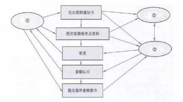

A.①招标单位②承建单位③建设单位    B.①政府部门②建设单位③承建单位

C.①建设单位②承建单位③监理单位    D.①承建单位②建设单位③监理单位

#### 【答案】D

#### 【解析】索赔的处理：项目发生索赔事件后，一般先由监理工程师调解，若调解不成，由政府建设主管机构进行调解，若仍调解不成，由经济合同仲裁委员会进行调解或仲裁。

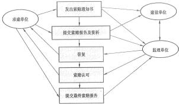

#### 【试题 61】---2017 下真题 57

61、某系统集成商中标一个县政府办公系统的开发项目，该项目在招标时已经明确确定该项目的 经费不超过 150 万元，此项目适合签订（）。

A.工料合同    B.成本补偿合同    C.分包合同    D.总价合同

#### 【试题 62】---2017 下真题 58

62、某系统集成商中标一个县政府办公系统的开发项目，在合同执行过程中，县政府提出在办公 系统中增加人员考勤管理的模块，由于范围发生变化，合同管理人员需要协调并重新签订合同， 该合同的管理内容属于（）。

A.合同签订管理    B.合同履行管理    C.合同变更管理    D.合同档案管理

#### 【解析】有多种因素会导致合同变更，例如范围变更、成本变更、进度变更、质量要求的变更甚至人员变更都可能会引起合同的变更，乃至重新修订。很明显属于合同变更

#### 【试题 63】---2018 上真题 57

63、（）类合同的适用范围比较宽， 风险可以得到合理的分摊， 但在履行中需要注意双方对实际工 作量的确认。

A.总价    B.成本补偿    C.工料    D.分包

#### 【解析】工料合同：适用范围比较宽，风险可以得到合理的分摊，并且能鼓励承包人通过提高工效等手段从成本节约中提高利润。这类合同履行中需要注意的问题是双方对实际工作量的确定。

#### 【试题 64】---2018 上真题 58

64、合同变更处理的首要原则是（）。

A.公平合理    B.经济利益优先    C.安全环保    D. 甲方优先

#### 【试题 65】---2018 下真题 57

65、关于项目合同的分类，正确的是:()

A.信息系统工程项目合同通常按照信息系统范围和项目总价划分

B.需要立即开展工作的项目不适宜采用成本补偿合同

C.工程量大、工期较长、技术复杂的项目宜采用总价合同

D.工料合同兼有成本补偿合同和总价合同的特点，适用范围较宽

#### 【解析】

A 错。是按信息系统范围和付款方式划分。

B 错。成本补偿合同主要适用于：需立即开展工作的项目；对项目内容及技术经济指标未确定的项 目；风险大的项目。

C 错。工程量大， 工期较长的项目不适宜用总价合同。

D 正确。中级教材第二版 P447，工料合同适用范围比较宽，其风险可以得到合理的分摊，并且能 鼓励承包人通过提高工效等手段从成本节约中提高利润。

#### 【试题 66】---2018 下真题 58

66、合同变更的处理由（）来完成

A.配置管理系统    B.变更控制系统    C.发布管理系统    D.知识管理系统

#### 【解析】合同变更的处理由合同变更控制系统来完成。

#### 【试题 67】---2019 上真题 57

67、（）的项目不适合使用总价合同。

A.工程量不大且能精确计算    B.技术不复杂    C.项目内容未确定    D.风险较小

#### 【解析】项目内容未确定就难以确定项目范围，这种情况下不适用总价合同

#### 【试题 68】---2019 上真题 58

### 68、合同变更一般包括以下活动:

①变更实施②变更请求审查③变更批准④变更提出

上述活动正确的排列顺序是()

A.①②③④    B.④②③①    C.④①③②    D.④③①②

#### 【解析】正确顺序为：提出申请-审查-批准-实施。

#### 【试题 69】---2019 下真题 56

69、成本补偿合同不适用于（）的项目。

A.需立即开展工作

B.对项目内容和技术经济未确定

C.风险大

D.工程量不大、且能精准计算工期、工期较短。

#### 【解析】工程量不太大且能精确计算，工期较短的项目适用总价合同。

成本补偿合同主要适用于以下项目：

（1）需立即开展工作的项目。

（2）对项目内容及技术经济指标未确定的项目。

（3）风险大的项目。

#### 【试题 70】---2019 下真题 57

70、关于合同变更的描述，不正确的是（）。

A.对于任何变更的评估都应该有变更影响分析

B.合同变更时应首先确定合同变更价款，然后确定合同变更量清单

C.合同中已有适用于项目变更的价格，按合同己有的价格变更合同条款

D.合同变更申请、变更评估和变更执行等必须以书面形式呈现

#### 【解析】

“公平合理”是合同变更的处理原则，变更合同价款按下列方法进行。

（1）首先确定合同变更量清单，然后确定变更价款。

（2）合同中己有适用于项目变更的价格，按合同已有的价格变更合同价款。

（3）合同中只有类似于项目变更的价格，可以参照类似价格变更合同价款。

（4） 合同中没有适用或类似项目变更的价格，由承包人提出适当的变更价格，经监理工程师和业 主确认后执行。

十一、项目采购管理

|  |  |  |  |  |  |  |  |  |  |  |  |  |  |  |  |  |  |  |  |  |  |  |
|---|---|---|---|---|---|---|---|---|---|---|---|---|---|---|---|---|---|---|---|---|---|---|
| 分值        年份 考点情况 | 09 上 | 09 下 |  |  |  |  | 12 上 | 12 下 | 13 上 | 13 下 | 14 上 | 14 下 | 15 上 | 15 下 | 16 上 | 16 下 | 17 上 | 17 下 | 18 上 | 18 下 | 19 上 | 19 下 |
| 1、采购管理计划 | 1 | 1 | 1 |  |  |  | 1 | 2 | 2 |  |  | 1 | 1 | 1 | 1 |  |  | 1 | 1 | 1 |  |  |
| 2、询价 |  |  |  |  |  |  | 1 | 1 | 1 | 1 |  | 1 |  |  |  |  |  |  |  |  |  |  |
| 3、投标人会议 |  |  |  |  |  | 1 |  |  | 1 |  |  |  |  |  |  |  | 1 |  |  |  |  |  |
| 4、供方选择/加权系统 |  | 1 |  |  |  |  |  |  |  |  |  |  |  |  |  |  |  |  |  |  |  |  |
| 5、合同管理收尾/审计 | 1 |  | 1 |  |  |  |  |  | 1 |  |  |  |  |  |  |  |  |  |  |  |  |  |
| 6、采购管理/采购文件 |  |  |  |  |  |  |  |  |  |  |  |  | 2 |  |  |  |  |  |  |  |  |  |
| 7、实施采购 | 为第二版教材修改内容 | 为第二版教材修改内容 | 为第二版教材修改内容 | 为第二版教材修改内容 | 为第二版教材修改内容 | 为第二版教材修改内容 | 为第二版教材修改内容 | 为第二版教材修改内容 | 为第二版教材修改内容 | 为第二版教材修改内容 | 为第二版教材修改内容 | 为第二版教材修改内容 | 为第二版教材修改内容 | 为第二版教材修改内容 | 为第二版教材修改内容 | 1 |  |  |  |  | 1 | 1 |
| 8、控制采购 | 为第二版教材修改内容 | 为第二版教材修改内容 | 为第二版教材修改内容 | 为第二版教材修改内容 | 为第二版教材修改内容 | 为第二版教材修改内容 | 为第二版教材修改内容 | 为第二版教材修改内容 | 为第二版教材修改内容 | 为第二版教材修改内容 | 为第二版教材修改内容 | 为第二版教材修改内容 | 为第二版教材修改内容 | 为第二版教材修改内容 | 为第二版教材修改内容 | 1 | 1 |  | 1 |  | 1 | 1 |
| 9、合同的分类 | 为第二版教材新增内容 | 为第二版教材新增内容 | 为第二版教材新增内容 | 为第二版教材新增内容 | 为第二版教材新增内容 | 为第二版教材新增内容 | 为第二版教材新增内容 | 为第二版教材新增内容 | 为第二版教材新增内容 | 为第二版教材新增内容 | 为第二版教材新增内容 | 为第二版教材新增内容 | 为第二版教材新增内容 | 为第二版教材新增内容 | 为第二版教材新增内容 |  |  | 1 |  |  |  |  |
| 总的分值 | 2 | 2 | 2 | 2 | 1 | 2 | 2 | 3 | 5 | 1 |  | 2 | 3 | 1 | 1 | 2 | 2 | 2 | 2 | 1 | 2 | 2 |
| 学习建议：采购管理不是很， 案例分析一般不考，掌握历年考试重点，必须得分 | 学习建议：采购管理不是很， 案例分析一般不考，掌握历年考试重点，必须得分 | 学习建议：采购管理不是很， 案例分析一般不考，掌握历年考试重点，必须得分 | 学习建议：采购管理不是很， 案例分析一般不考，掌握历年考试重点，必须得分 | 学习建议：采购管理不是很， 案例分析一般不考，掌握历年考试重点，必须得分 | 学习建议：采购管理不是很， 案例分析一般不考，掌握历年考试重点，必须得分 | 学习建议：采购管理不是很， 案例分析一般不考，掌握历年考试重点，必须得分 | 学习建议：采购管理不是很， 案例分析一般不考，掌握历年考试重点，必须得分 | 学习建议：采购管理不是很， 案例分析一般不考，掌握历年考试重点，必须得分 | 学习建议：采购管理不是很， 案例分析一般不考，掌握历年考试重点，必须得分 | 学习建议：采购管理不是很， 案例分析一般不考，掌握历年考试重点，必须得分 | 学习建议：采购管理不是很， 案例分析一般不考，掌握历年考试重点，必须得分 | 学习建议：采购管理不是很， 案例分析一般不考，掌握历年考试重点，必须得分 | 学习建议：采购管理不是很， 案例分析一般不考，掌握历年考试重点，必须得分 | 学习建议：采购管理不是很， 案例分析一般不考，掌握历年考试重点，必须得分 | 学习建议：采购管理不是很， 案例分析一般不考，掌握历年考试重点，必须得分 | 学习建议：采购管理不是很， 案例分析一般不考，掌握历年考试重点，必须得分 | 学习建议：采购管理不是很， 案例分析一般不考，掌握历年考试重点，必须得分 | 学习建议：采购管理不是很， 案例分析一般不考，掌握历年考试重点，必须得分 | 学习建议：采购管理不是很， 案例分析一般不考，掌握历年考试重点，必须得分 | 学习建议：采购管理不是很， 案例分析一般不考，掌握历年考试重点，必须得分 | 学习建议：采购管理不是很， 案例分析一般不考，掌握历年考试重点，必须得分 | 学习建议：采购管理不是很， 案例分析一般不考，掌握历年考试重点，必须得分 |

采购管理的过程、输入、输出、工具和技术汇总表：

| 采购管理：规划采购管理-实施采购-控制采购-结束采购 | 采购管理：规划采购管理-实施采购-控制采购-结束采购 | 采购管理：规划采购管理-实施采购-控制采购-结束采购 | 采购管理：规划采购管理-实施采购-控制采购-结束采购 |
|---|---|---|---|
| 过程名 | 输入（依据） | 工具和技术（方法） | 输出（结果） |
| 1、规划采购管理 （09 上 57） | ①项目管理计划 ②需求文件 ③风险登记册 ④活动资源需求 ⑤项目进度计划 ⑥活动成本估算 ⑦干系人登记册 ⑧事业环境因素 ⑨组织过程资产（18 下 59） | ①自制或外购分析 ②专家判断 ③市场调研 ④会议 （15 下 61） | ①采购管理计划 ②采购工作说明书 ③采购文件 ④供方选择标准 ⑤自制或外购决策 ⑥变更请求 ⑦项目文件（更新） |
| 2、实施采购 | ①项目管理计划 ②采购文件 ③供方选择标准 ④卖方建议书 ⑤项目文件 ⑥自制或外购决策 ⑦采购工作说明书 ⑧组织过程资资产 | ①投标人会议 ②建议书评价技术 | ①选定的卖方 ②协议 |
| 3、控制采购 | ①项目管理计划 ②采购文件 ③协议 ④批准的变更请求 ⑤工作绩效报告 ⑥工作绩效数据 | ①合同变更控制系统 ②采购绩效审查 ③检查与审计 ④报告绩效 ⑤支付系统 ⑥索赔管理（19 上 60） ⑦记录管理系统 | ①工作绩效信息 ②变更请求 ③项目管理计划（更新） ④项目文件（更新）  ⑤组织过程资产（更新） |
| 4、结束采购 | ①项目管理计划 ②采购文件 | ①采购审计 ②采购谈判 ③记录管理系统 | ①结束的采购 ②组织过程资产（更新） |

本章金色考点汇总：

### 1、采购管理包括如下几个过程：

（1）编制采购计划。决定采购什么，何时采购，如何采购，还要记录项目对于产品、服务或 成果的需求，并且寻找潜在的供应商。

（2）实施采购。从潜在的供应商处获取适当的信息、报价、投标书或建议书。选择供方，审 核所有建议书或报价，在潜在的供应商中选择， 并与选中者谈判最终合同。（12 下 62）

（3）控制采购。管理合同以及买卖双方之间的关系，监控合同的执行情况。审核并记录供应 商的绩效以采取必要的纠正措施，并作为将来选择供应商的参考。管理与合同相关的变更。

（4）合同收尾。完成并结算合同：包括解决任何未解决的问题，并就与项目或项目阶段相关 的每项合同进行收尾工作。

2、编制采购计划过程的第一步是要确定项目的哪些产品、服务和成果是项目团队自己提供合 算， 还是通过采购来满足更为合算。如果需采购还要确定采购的方法和流程以及找出潜在的卖方， 以确定采购多少、何时采购，并把这些结果都写到项目采购计划中。

3、采购工作说明书是对所购买的产品、成果或服务来说， 采购工作说明书定义了与合同相关 的部分项目范围。 每个采购工作说明书来自于项目范围基准。（15 上 61）

采购工作说明书描述足够的细节，以允许预期的卖方确定他们是否有提供买方所需的产品、  成果或服务的能力。这些细节将随采购物的性质、买方的需要或着预期的合同形式而变化。 采购 工作说明书描述了由卖方提供的产品、服务或者成果。（10 下 60）（10 下 61）（11 下 60）（12 上

60）（13 下 31）

采购工作说明书中的信息有规格说明书、期望的数量和质量的等级、性能数据、履约期限、  工作地以及其他要求。

工作说明书应该清楚描述工作的具体地点、完成的预定期限、具体的可交付成果、付款方式 和期限、相关质量技术指标、验收标准等内容。（14 下 62）

采购过程中，可以随着项目的调整修改 SOW；（16 上 62）

采购计划为整个采购过程的安排提供了指南（18 上 59）

下 60）

7、合同分成三种： ①总价合同； ②成本补偿合同； ③工料合同。采用总价合同，买方必须准 确定义要采购的产品或服务。总价合同进一步分固定总价合同和变动总价合同两种。

8、固定总价合同特点是范围确定。 对卖方（乙方）来说， 卖设备时使用此种合同，固定总价 合同最简单的形式就是一个采购单。如下项目可签订固定总价合同： ①工程量小、工期短；②工 程设计详细，图纸完整； ③风险小；④投标期相对宽裕；⑤验收标准明确。总价加激励费用合同

（FPIF），要设置一个价格上限。总价加经济价格调整合同（FP-EPA）：允许根据条件变化以事先

确定的方式对合同价格进行最终调整。（17 下 59）

9、成本补偿合同：向卖方支付为完成工作而发生的全部合法实际成本、人工费用以及合理的 利润。成本加固定费用合同（CPFF），费用只能针对已完成的工作来支付。

成本加激励费用（CPIF），向卖方支付预先确定的激励费用， 如果最终成本低于或高于原始估

算成本，则买方和卖方需要根据事先商定分摊超出费用。

成本加奖励费用（CPAF），为卖方报销履行合同工作所发生的一切合法成本，但是只有在满足 了合同中规定的某些笼统、主观的绩效标准的情况下，才能向卖方支付大部分费用。完全由买方 根据自己对卖方绩效的主观判断来决定奖励费用，并且卖方通常无权申诉。成本加成本百分比， 卖方的实际项目成本，买方报销。卖方的费用以实际成本的百分比来计算。

10、工料合同（T&M）适应情况： 当不能迅速确定准确的工作量或者工作说明书时， 工料合同 适用于动态增加人员、专家或其他外部支持人员等情况。在时间紧急的情况下，选择工料合同比

较稳妥。

11、采购文件：当选择卖方的决定基于价格是，通常使用标书、投标或报价而不是报价建议 书。如果主要依据其他考虑来选择卖方时，则通常使用建议书这个术语。通常的采购文件有方案 邀请书（RFP）、报价邀请书（RFQ）、征求供应商意见书（RFI）、投标邀请书（IFB）、招标通知、  洽谈邀请以及承包商初始建议征求书。（13 上 59）（14 下 61）

12、影响自制或外购决策的因素：①项目实施单位的核心能力；②合格供应商所能提供的价 值；③用经济有效的方法实现需求的风险；④项目实施单位内部能力与供应商能力的比较。

13、采购工作说明书是采购过程中的一个关键文件， 可以根据需要进行修改，直到达成最终 协议。

14、投标人会议（又称承包商会议、供货商会议或投标前会议）就是在投标书或建议书提交 之前，在买方和所有潜在卖方之间召开的会议。会议的目的是保证所有潜在卖方对采购要求都有 清楚且一致的理解，保证没有任何投标人会得到特别优待。为公平起见，买方必须尽力确保每个 潜在卖方都能听到任何其他卖方所提出的问题，以及买方所做出的每个回答。可以运用相关技术 来促进公平，例如，在召开会议之前就收集投标人的问题或安排投标人考察现场。要把对问题的 回答，以修正案的形式纳入采购文件中。（11 下 61）（17 上 58）

15、选中卖方后， 在双方签订合同前，通过采购谈判可以澄清双方对合同结构和要求的理解， 使双方达成一致意见。采购谈判过程以买卖双方签署文件（如合同、协议）为结束标志。对于复 杂的采购事项，合同谈判应是一个独立的过程，有自己的依据和成果。采购谈判工作组有技术人 员、商务人员、法律人员、财务人员、翻译人员、谈判领导人员。

。在合同谈判期间， 项目管理团队可列席，并在需要时，就项目的技术、质量和管理要求进行 澄清。（19 下 59）

16、实施采购的主要输出：①选中的卖方；②合同。根据采购的内容， 合同可以是一个复杂 的文件，也可以是一个简单采购单。

### 17、招投标

1.在要求提交投标文件截止时间至少 15 日前， 招标人可以以书面形式对已发出的招标文件进 行必要的澄清或者修改。

2.自招标文件开始发出之日起至提交投标文件截止之日止，最短不得少于 20 日。 3.中标通知书发出之日起 30 日内，订立书面合同。

4.中标人的投标应当符合条件： ①能够最大限度地满足招标文件中规定的各项综合评价标准； ②能够满足招标文件的实质性要求，并且经评审的招标价格最低。但是，投标价格低于成本的除 外。

5.以行贿的手段谋取中标的，中标无效，处中标项目金额千分之五以上千分之十以下罚款，

对单位负责人处单位罚款数额百分之五以上百分之十以下罚款。

18、控制采购过程是买卖双方都需要的。该过程确保卖方的执行过程符合合同需求，确保买 方可以按合同条款去执行。对于使用来自多个供应商提供的产品、服务或成果的大型项目来说， 合同管理的关键是管理买方卖方间的接口，以及多个卖方间的接口。（16 下 60）（18 上 60）

19、控制采购的依据：项目管理计划、采购文件、合同及合同管理计划、绩效报告、已批准 的变更申请、工作绩效报告和工作绩效信息

20、控制采购的工具和技术有： 合同变更控制系统、买方主持的绩效评审、检查和审计、绩 效报告、支付系统、索赔管理和自动的工具系统等

21 、采购审计的目标是找出本次采购的成功和失败之处，以供项目执行组织内的其他项目借 鉴。（09 下 58）（10 上 63）

22、采购绩效审查在成本和进度内完成项目范围和达到质量要求的情况。绩效审查的目的在 于发现履约情况的好坏。

23、项目经理采用记录管理系统来管理合同、采购文档和相关记录。

24、完成每一次项目采购，都需要结束采购过程。

25、合同变更控制系统包括： 变更过程的书面记录工作、变更跟踪系统、变更争议解决程序， 已经各种变更所需的审批层次。（17 上 59）

本章历年考题和答案解析汇总：

#### 【试题 1】---2009 上真题 57

1、（1）活动应在编制采购计划过程中进行。

（1）A.自制或外购决策     B. 回答卖方的问题    C.制订合同    D.制订 RFP 文件

#### 【答案】A

#### 【解析】 此题考察的是采购计划，

在编制采购计划的过程中，首先要确定项目的哪些产品、成果或服务自己提供更合算，还是 外购更合算？这就是“自制/外购”决策，在这个过程中可能要用到专家判断， 最后也要确定合同 的类型，以转移风险。

对供应商问题的答复可能作为修订条款包含到采购文件中。

供方选择过程在向每一个选中的供方提供一份合同前，应当先制订合同。

#### 【点评】常考题，比较简单，必须得分

#### 【试题 2】---2009 上真题 58

2、采购审计的主要目的是（2）。

（2）A.确认合同项下收取的成本有效、正确       B.简要地审核项目

C.确定可供其他采购任务借鉴的成功之处    D.确认基本竣工

#### 【答案】C

#### 【解析】 此题考察的是采购审计，

采购审计的目标是找出本次采购的成功和失败之处， 以供项目执行组织内的其他项目借鉴。

#### 【点评】常考题，比较简单，必须得分

#### 【试题 4】 ---2009 下真题 61

4、在采购中，潜在卖方的报价建议书是根据买方的（4）制定的。

（4）A.采购文件  B.评估标准    C.工作说明书    D.招标通知

#### 【答案】A

#### 【解析】 此题考察的是项目建议书，必须掌握， 高频考点

“建议书应按照相应的采购文件的要求拟定， 并可反映相关的合同原则 ”。

#### 【点评】常考，命题的热点，简单题， 必须得分

#### 【试题 5】---2009 下真题 62

5、在对某项目采购供应商的评价中， 评价项有技术能力、管理水平、企业资质等，假定满分为 10 分，技术能力权重为 20% ，3 个评定人的技术能力打分分别为 7 分， 8 分， 9 分，那么该供应商的 “技术能力,,的单项综合分为（5）。

（5）A.24        B.8        C.4.8        D.1.6

#### 【答案】D

#### 【解析】P400  此题考察的是供应商的评分方法，

供方选择中的评分方法： 先取平均分再乘以权重，即【（7+8+9）/3】x20%=1.6。

#### 【点评】会算就好，考的不是很多，简单题，必须得分

#### 【试题 6】---2010 上真题 51

6、小王为本公司草拟了一份计算机设备采购合同， 其中写到“乙方需按通常的行业标准提供技术 支持服务”。经理审阅后要求小王修改， 原因是（6）。

（6）A.文字表达不通顺                    B.格式不符合国家或行业标准的要求

C.对合同标的的描述不够清晰、准确    D.术语使用不当

#### 【答案】C

#### 【解析】 此题考察的是合同的格式，必须掌握， 高频考点

对“合同标的”的描述务必达到“准确、简练、清晰”的标准要求，切忌含混不清。如合同 标的是提供服务的， 一定要写明服务的质量、标准或效果要求等，切忌只写“按照行业的通常标 准提供服务或达到行业通常的服务标准要求等”之类的描述。

综合以上分析，经理审阅后要求小王修改其草拟的合同，是因为对“合同标的”的描述不够 清晰、准确。因此选择 C。

#### 【  点评】常考，命题的热点，简单题，必须得分

#### 【试题 7】---2010 上真题 60

7、以下关于采购工作说明书的叙述中，（7）是错误的。

（7）A.采购说明书与项目范围基准没有关系

B.采购工作说明书与项目的工作说明书不同

C.应在编制采购计划的过程中编写采购工作说明书

D.采购工作说明书定义了与项目合同相关的范围

#### 【答案】A

#### 【解析】 此题考察的是采购工作说明书，必须掌握， 高频考点

对所购买的产品、成果、服务来说，采购工作说明书定义了与合同相关的部分项目范围。每 个采购工作说明书来自于项目范围基准。工作说明书（SOW）是对项目所要提供的产品、成果或服 务的描述。在一些应用领域中，对于一份采购工作说明书有具体的内容和格式要求。每一个单独 的采购项需要一个工作说明书。然而，多个产品或服务也可以组成一个采购项，写在一个工作说 明书里。

随着采购过程的进展，采购工作说明书可根据需要修订和更进一步明确。编制采购管理计划 过程可能导致申请变更，从而可能会引发项目管理计划的相应内容和其他分计划的更新。

综上所述，可以分析得出， 采购工作说明书与项目的工作说明书之间存在区别和联系。采购 工作说明书不是一次编写完成的，编制采购管理计划的过程可能会引起采购工作说明书的变更，  采购工作说明书定义了与合同相关的部分项目范围。每个采购说明书来自于项目的范围基准，与 项目范围基准之间存在密切关系。 因此应选择 A。

#### 【  点评】必考，命题的热点，简单题，必须得分

#### 【试题 8】---2010 上真题 63

8、某项采购已经到了合同收尾阶段，为了总结这次采购过程中的经验教训，以供公司内的其他项 目参考借鉴，公司应组织（8）。

（8）A.业绩报告          B.采购评估      C.项目审查   D.采购审计

#### 【答案】D

#### 【解析】 此题考察的是合同收尾，

对采购合同收尾使用的工具和技术有采购审计和合同档案管理系统， 采购审计是对采购的过 程进行系统的审查，除找出本次采购的成功失败之处外，还发现经验教训，以供公司内的其他项 目参考借鉴。 “采购评估”不是项目管理中的标准名词，而项目审查、业绩报告主要针对整个项目 而不仅仅是采购，即使是指在采购中的业绩报告和项目审查，它们也没有“采购审计”表述准确 和完整。因此选择 D。

#### 【  点评】常考，命题的热点，简单题，必须得分

#### 【试题 9】 ---2010 下真题 60

9、某项目建设方没有聘请监理，承建方项目组在编制采购计划时可包括的内容有（9）。 ①第三方系统测试服务；     ②设备租赁；   ③建设方按照进度计划提供的货物； ④外部聘请的项目培训；

（9）A.①②③      B.②③④      C.①③④      D.①②④

#### 【答案】D

#### 【解析】 此题考察的是采购管理计划的内容，

有些产品、服务和成果，项目团队不能自己提供，需要采购。或者即使项目团队能够自己提 供，但有可能购买比由项目团队完成更合算。所以编制采购计划过程的第一步是要确定项目的某 些产品、服务和成果是项目团队自己提供还是通过采购来满足，然后确定采购的方法和流程以及 找出潜在的卖方，确定采购多少，确定何时采购，并把这些结果都写到项目采购计划中。

需要采购的内容应该包括由项目组之外的其他组织提供的产品、服务和成果。本题目中“①

第三方系统测试服务、②设备租赁、④外部聘请的项目培训”都应属于采购计划中可以包括的内 容。“③建设方按照进度计划提供的货物”不属于此范畴。故 D 是正确答案。

#### 【点评】常考，命题的热点，简单题， 必须得分

#### 【试题 10】---2010 下真题 61

10、编制采购计划时，项目经理把一份“计算机的配置清单及相关的交付时间要求”提交给采购 部。关于该文件与工作说明书的关系， 以下表述（10）是正确的。

（10）A.虽然能满足采购需求，但它是物品清单不是工作说明书

B.该清单不能作为工作说明书，不能满足采购验收需要

C.与工作说明书主要内容相符

D.工作说明书由于很专业应由供应商编制

#### 【答案】B

#### 【解析】 此题考察的是项目管理相关文件，

对所购买的产品、成果或服务来说，采购工作说明书定义了与合同相关的部分项目范围。每 个采购工作说明书来自项目范围基准。

由此可知，本题中的“计算机的配置清单及相关的交付时间要求”与项目采购工作说明书有 本质的不同。它的内容与工作说明书主要内容不相符。它不能作为工作说明书，不能满足采购验 收需要。它是由项目组出具， 经项目管理团队批准的。即 A, C, D 都是错误的，B 是正确的。

#### 【点评】常考，命题的热点，简单题， 必须得分

#### 【试题 11】---2011 上真题 58

11、某企业在项目实施过程中，为降低项目成本、更好的满足客户需求，按照以下流程对项目所 需的部分产品进行了采购：

①记录项目对于产品、服务或成果的需求，并且寻找潜在的供应商；

②从供应商处获取相关信息、报价和建议书；

③审核所有建议书， 在供应商中进行选择，并与选中者谈判签订最终合同；

④管理合同以及买卖双方的关系，并管理与合同相关的变更。

该企业的采购流程缺少了（11）环节。

（11）A.编制采购计划    B.编制询价计划   C.询价、招投标   D.合同管理和收尾

#### 【解析】采购管理包括4个过程:（1）编制采购计划（2）实施采购（3）控制采购（4）合同收尾

#### 【试题 12】---2011 下真题 60

12、某公司承担了一项系统集成项目，正在开发项目适用的软件系统，但是需要从其他公司购买 一些硬件设备。该公司的转包合同负责人应当首先准备一份（12）。

（12）A.项目章程    B.项目范围说明书     C.工作说明书        D.外包合同

#### 【答案】C

#### 【解析】 此题考察的是项目管理相关文件，

许多项目涉及到一个组织（卖方）根据合同为另一个组织（买方）工作。在这种情况下，买 方提供最初的产品描述，这份产品描述又被称为采购工作说明书。每个采购工作说明书来自于项 目范围基准，描述了由卖方提供的产品、服务或者成果。

采购工作说明书中的信息有规格说明书、期望的数量和质量的等级、性能数据、履约期限、	 工作地以及其他要求。采购工作说明书提供足够的细节描述，以允许预期的卖方确定他们是否有 提供买方所需的产品、成果或服务的能力。这些细节将随采购物的性质、买方的需要或者预期的 合同形式而变化。

#### 【点评】常考，命题的热点，简单题， 必须得分

#### 【试题 13】---2011 下真题 61

13、投标人会议是在（13）过程中采用的一种方法。

（13）A.开标     B.询价      C.评标          D.投标

#### 【解析】 此题考察的是询价，

在询价时可以采用的方法和技术包括：投标人会议、刊登广告、制定合格卖方清单；

投标人会议（也称为发包会、承包商会议、供应商会议、投标前会议或竞标会议）是指在准备建 议书之前与潜在供应商举行的会议。投标人会议用来确保所有潜在供应商对采购目的（如技术要 求和合同要求等）有一个清晰、共同的理解。对供应商问题的答复可能作为修订条款包含到采购 文件中。在投标人会议上，所有潜在供应商都应得到同等对待，以保证一个好的招标结果。投标 人会议是采购管理中询价过程采用的一种方法。

#### 【点评】常考，命题的热点，简单题， 必须得分

#### 【试题 14】---2012 上真题 60

14、某项目经理要求采购管理员从外面供货商那里采购硬件设备时，需要准备一个（14）以描述 采购设备的相关质量技术指标、验收标准和付款方式与期待等内容。

（14）A.工作说明书      B.合同范围说明      C.项目章程      D.合同

#### 【答案】A

【解析此题考察的是项目管理相关文件，必须掌握， 高频考点

采购工作说明书 对所购买的产品、成果或服务来说， 采购工作说明书定义了与合同相关的部 分项目范围。每个采购工作说明书来自于项目范围基准。

采购工作说明书描述足够的细节，以允许预期的卖方确定他们是否有提供买方所需的产品、  成果或服务的能力。这些细节将随采购物的性质、买方的需要或着预期的合同形式而变化。采购 工作说明书描述了由卖方提供的产品、服务或者成果。

采购工作说明书中的信息有规格说明书、期望的数量和质量的等级、性能数据、履约期限、

工作地以及其他要求。

#### 【点评】工作说明书的内容，必考，简单，必须得分

#### 【试题 15】---2012 上真题 61

15、在采购管理中， 编制询价计划需要用到（15）。

（15）A.标准表格    B.评估标准    C.采购管理计划  D.采购文件

#### 【解析】编制询价计划输入：1 采购管理计划 2 工作说明书SOW  3 项目管理计划

#### 【试题 16】---2012 下真题 59

16、某系统集成一级企业年项目合同额近 3 亿元。采购部门从交换机商家定购的大量的采购任务， 下面的采购措施中， 不可能的是（16）  。

A.为防止采购人员可能出现经济问题， 所有产品都按照统一规则、统一方法进行采购

B.按照重量粒度将产品分为 A 级、 B 级、 C 级， 分别制定采购规则， A 类产品要通过招标， C 类产品可简化采购手续

C.无论采购产品还是服务，都要建立对供应商的评价制度

D.建立和维护合格供应商名录来缩小采购选择的范围

#### 【解析】采购管理

项目合同额近3亿元， 采购部门要面临从交换机到固定螺丝及相关服务的大量采购任务， 不可 能对所有产品都按照统一规则、统一方法进行采购。

#### 【试题 17】---2012 下真题 62

17、某项目采购人员接到一个紧急采购任务后启动了询价流程。关于询价，下面说法不正确的是（17）。 （17）A.询价就是询问卖方的产品价格

B.询价主要是以卖方处获取如何满足项目需要的答复

C.询价过程是确定合格供应商名单

D.询价过程中却使卖方参与了大部分工作，买方也无需为其直接支付费用 【答案】A

#### 【解析】此题考察的是询价，

询价过程从潜在的卖方处获取如何满足项目需求的答复，如投标书和建议书。通常在这个过程中 由潜在的卖方完成大部分实际工作，项目或买方无需支付直接费用。

#### 【点评】询价的定义，书上原话，多次考了，简单， 必须得分

#### 【试题 19】---2013 上真题 51

19、某公司现有的职员能轻易满足某新项目的一部分要求，但是这个项目的其他方面对该公司 来 说是新的。项目经理经过调研了解到一些供应商专业生产这类产品，可能能满足项目很多 或全部 需要。项目经理在准备项目计划和决定怎样招聘最佳人选及处理所需要的资源时，首先应该（19。）

（19）A.进行自制/外购分析

B.进行市场调查

C.通过邀请提交建议书（RFP）向供应商征求方案来决定是否将项目外包出去

D.评审公司采购部门提供的合格的卖方名单，并向选定的卖方发邀请提交建议书 【答案】A

#### 【解析】 此题考察的是自制/外购分析，理解题，

采购相关的，首先是自制和外购分析。

#### 【点评】采购相关的，多次考了，通过题目分析不难得出结果，简单，必须得分

#### 【试题 20】---2013 上真题 59

20、用来征求潜在供应商建议的文件一般称为（20）。

（20）A.RFI        B.IFB      C.RFQ              D.RFP

#### 【解析】 此题考察的是询价文件，

邀请提交信息（RF I）、邀请提交建议书（RFP）、报价邀请书（RFQ）、投标邀请书（IFB） 方案邀请书（RFP）是用来征求潜在供应商建议的文件，有人称 RFP 为请求建议书；

报价邀请书（RFQ）是一种主要依据价格选择供应商时，用于征求潜在供应商报价的文件。

#### 【试题 21】---2013 上真题 60

21、技术部给采购部提供了一份采购产品的技术标准和要求，这份文件可被称做（21）。

（21）A.项目建议书    B.工作说明书    C.工作包    D.项目范围说明书

#### 【解析】 此题考察的是工作说明书，必须掌握， 高频考点

采购工作说明书是对所购买的产品、成果或服务来说，采购工作说明书定义了与合同相关的 部分项目范围。 每个采购工作说明书来自于项目范围基准。

采购工作说明书描述足够的细节，以允许预期的卖方确定他们是否有提供买方所需的产品、  成果或服务的能力。这些细节将随采购物的性质、买方的需要或着预期的合同形式而变化。 采购 工作说明书描述了由卖方提供的产品、服务或者成果。

#### 【试题 22】---2013 上真题 61

22、在项目采购中经常使用询价过程， 询价过程的输出不包括 22。

（22）A.合格卖方清单    B.采购工作说明书    C.采购建议书

#### 【答案】D

#### 【解析】 此题考察的是采购管理计划，

D.采购管理计划

询价的输出:1）合格卖方清单 2）采购文件3）建议书，采购管理计划是采购管理第一个过程 采购规划的输出

#### 【点评】询价的输出，书上原话，常考的，比较简单，必须得分

#### 【试题 23】---2013 下真题 23

23、编制询价计划的过程是为下一步招标所需要的文件做准备，并确定“选择”所需要的评定标 准。（23）不属于编制询价计划过程的输出。

（23）A.采购建议书   B.采购文档   C.评估标准    D.更新的工作说明书

#### 【答案】A

#### 【解析】 此题考察的是编制询价计划，

A 是询价的输出，这个是最基本的第三层次的内容。编制询价计划是确定潜在的卖家有哪些， 以及这些卖家各自的技术特点等等，  因此必须制定评估标准（用于评标）、采购文档（用来获得 卖家的建议书）、更新的工作说明书

#### 【点评】询价计划的输入，需要记住， 没有记住分析排除法可以得出，建议得分

#### 【试题 24】---2013 下真题 30

24、某信息系统集成项目经理需要为项目采购硬件设备，那么项目经理需要在（24）中对该采购 物品进行描述。

（24）A.建议邀请书     B.合同     C.合同范围说明书     D.项目工作说明书

#### 【答案】D

#### 【解析】 此题考察的是项目工作说明书，必须掌握， 高频考点

SOW 是对产品或成果的服务性描述， 在采购管理的采购计划输出中就有采购工作说明书以及 工作说明书。如果 D 是采购工作说明书就更好， 但是不影响选择。

#### 【点评】必考的， SOW，比较简单，送分

#### 【试题 25】---2013 下真题 53

25、编制询价计划的过程是为下一步招标所需要的文件做准备，并确定“选择供方”所需要的评 定标准，（25）不属于编制询价计划过程的输出

（25）A.采购建议书   B.采购文档   C.评估标准    D.更新的工作说明书

#### 【答案】A

#### 【解析】 此题考察的是询价计划，

编制询价计划是确定潜在的卖家有哪些，以及这些卖家各自的技术特点等等，因此必须制定评估 标准（用于评标）、采购文档（用来获得卖家的建议书）、更新的工作说明书

#### 【点评】询价的输出，书上原话，常考的，比较简单，必须得分

#### 【试题 26】---2014 下真题 61

26、某系统集成项目的项目经理需采购第三方软件插件，在编制询价计划时，由于待采购软件插 件比较专业，为了更加明确采购需求， 该项目经理需要使用的文件为（）。

（26）A.供应商意见书    B.方案邀请书    C.投标邀请书     D.报价邀请书

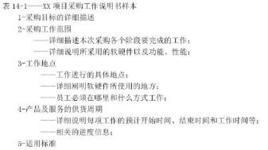

#### 【答案】A

#### 【解析】 此题考察的是采购文件，

采购文件用来得到潜在卖方的报价建议书。当选择卖方的决定基于价格（例如当购买商业产品或 标准产品）时，通常使用标价或报价而不是报价建议书这个术语；而当技术能力或技术方法等其 他的考虑极为重要时，则通常使用建议书这个术语。但人们经常交替使用这些术语，如果出现了 这种情况就要搞清楚这些术语的真实含义。

供应商意见书（RF I）用来征求供应商意见，以使需求明确化。

#### 【点评】多次考了，比较简单，送分的

#### 【试题 27】---2014 下真题 62

27、某项目经理在执行项目时，在详细了解了项目所需要采购的产品和服务后，制订了包含如下 所示的采购说明书模板让采购人员填写。该工作说明书中缺少了（）。

（27）A.拟采购产品和服务的规格说明  B.验收标准  C.质量要求  D.工作方式

#### 【解析】 此题考察的是采购工作说明书，必须掌握， 必考

采购工作说明书应该清楚描述工作的具体地点、完成的预定期限、具体的可交付成果、付款方式 和期限、相关质量技术指标、验收标准等内容。 一份优秀的工作说明书可以让供应商对买方的需 求有较为清晰的了解，便于供应商提供相应产品和服务。

#### 【试题 28】---2015 上真题 61

28、采购是项目管理工作的重要组成部分。以下关于采购的叙述中，（）是不正确的。

A.采购管理计划是评估卖方的衡量指标    B.采购工作说明书不是来自于项目范围基准

C.采购工作说明书描述采购产品的细节    D.采购管理计划确定采用的合同类型

#### 【答案】B

#### 【解析】 此题考察的是采购相关名词定义，必须掌握，常考

编制采购计划的输入、输出（2）采购工作说明书：对所购买的产品、成果或服务来说，采购工作 说明书定义了与合同相关的部分项目范围。每个采购工作说明书来自于项目范围基准。

#### 【点评】多次考了，简单，必须得分

#### 【试题 29】---2015 上真题 62

29、采购文件可用于识别干系人过程， 因为这些文件（）。

A.是事业环境因素，并且是过程的输入 B.是组织过程资产，并且是过程的输入

C.将关键干系人标注为合同中的当事方  D.作为设立干系人优先级并将干系人分类的一种方式

#### 【解析】 采购文件是买方准备发给每一个卖方的正式邀请，它描述了要采购的原材料、产品、货物或服务，它是卖方准备投标文件的依据。有时采购文件不是单独的一个而是一个文件包。采购文件也可以发送给部分或全部潜在的供应商，以确定它们是否有兴趣成为潜在的合格供应商。最后把所有潜 在的、合格的供应商信息记入供应商清单，并把该清单录入企业的信息系统，作为组织的过程资产予以保留，以备企业未来的项目共享使用。

#### 【试题 30】---2015 下真题 61

30、项目采购计划的编制需要有适宜的方法，以规避项目风险，实现项目本目标，（ ）不属于项 目采购计划编制采用的技术

（30）A.专家判断 B.合同类型  C. 自制/采购分析  D.工作说明书

#### 【解析】 采购计划编制的工具与技术： 自制/外购分析、专家判断、合同类型

#### 【试题 31】---2016 上真题 62

31、以下关于工作说明书 SOW 的叙述中，不正确的是（31）。

A.SOW 包括的主要内容有前言、服务范围、方法、假设条件、变更管理等 B.采购过程中,不能修改 SOW

C.对内部项目而言， SOW 有时可称为任务书

D.SOW 与范围说明书不同，SOW 是对项目所要提供的产品、成本或服务的描述

#### 【解析】采购过程中，工作说明书【SOW】可以随着项目的调整修改SOW；

#### 【试题 32】---2016 下真题 59

32、实施采购过程中往往需要综合采用多种方法，来保证采购能够顺利进行。（）不属于实施采购 过程中需要用到的方法和技术。

A.投标入会议   B.“ 自制/外购”分析   C.独立估算     D.采购谈判

#### 【试题 33】---2016 下真题 60

33、采购过程需要进行控制，以发现采购计划与实施采购过程中的偏差。以下关于采购控制的叙 述中，不正确的是（）。

A.控制采购过程是买方需要做的，卖方不需要控制采购

B.控制采购是管理采购关系、监督合同执行情况，并根据需要实施变更和采取纠正措施的过程 C.控制采购过程中可通过绩效评估， 预测卖方未来项目执行能力

D.控制采购中需要进行财务管理工作

#### 【解析】控制采购，控制采购过程是买卖双方都需要的。该过程确保卖方的执行过程符合合同需求，确保买方可以按合同条款去执行。对于使用来自多个供应商提供的产品、服务或成果的大型项目来说，合同管理 的关键是管理买方卖方间的接口，以及多个卖方间的接口。

#### 【试题 34】---2017 上真题 58

34、小王作为某项目的项目经理,决定采用投标人会议的方式选择卖方。以下做法中,正确的是（）。 A. 限制参会者提问的次数，防止少数人问太多的问题

B. 防止参会者试下提问

C.小王不需要参加投标人会议,只需采购管理员参加即可

D.设法获得每个参会者的机密信息

#### 【解析】P476此题考察的是高效会议，

投标人会议（又称承包商会议、供货商会议或投标前会议）就是在投标书或建议书提交之前，在 买方和所有潜在卖方之间召开的会议。会议的目的是保证所有潜在卖方对采购要求都有清楚且一 致的理解，保证没有任何投标人会得到特别优待。为公平起见，买方必须尽力确保每个潜在卖方 都能听到任何其他卖方所提出的问题，以及买方所做出的每个回答。可以运用相关技术来促进公 平，例如，在召开会议之前就收集投标人的问题或安排投标人考察现场。要把对问题的回答，以 修正案的形式纳入采购文件中。

#### 【试题 35】---2017 上真题 59

35、合同变更控制系统用来规范合同变更，保证买卖双方在合同变更过程中达成一致,其内容不包 括（）。

A.变更跟踪系统    B.变更书面记录    C.变更争议解决程序    D.合同审计程序

#### 【解析】合同变更控制系统包括：变更过程的书面记录工作、变更跟踪系统、变更争议解决程序，已经各种变更所需的审批层次。

#### 【试题 36】---2017 下真题 59

36、对于提供长期（一般为 3 年）涉外人力资源外包服务的软件企业，面对国际金融汇率波动较 大和区域人力资源成本攀升速度较快的情况，应与客户签订（） 类合同。

A. 固定总价合同    B.成本补偿合同    C.工时合同    D.总价加经济价格调整合同

#### 【解析】（3）总价加经济价格调整合同（FP-EPA）

如果卖方履约要跨越相当长的周期例如不少于 2 年，就应该使用本合同类型。如果买卖方之间要 维持长期关系，也可以采用这种合同类型。它是一种特殊的总价合同，允许根据条件变化（如通 货膨胀、某些特殊商品的成本增加或降低），以事先确定的方式对合同价格进行最终调整。

#### 【试题 37】---2017 下真题 60

37、以下关于说明书（SOW）的叙述中，不正确的是（）。

A.SOW 的内容主要包括服务范围、方法、假定、工作量、变更管理等

B. 内部的 SOW 有时可称为任务书

C.SOW 的变更应由项目变更控制过程进行管理

D.SOW 通过明确项目应该完成的工作来确定项目范围

#### 【解析】工作说明书（SOW）是对项目所要提供的产品、成果或服务的描述。对内部项目而言， 项目发 起者或投资人基于业务需要、产品或服务的需求提出工作说明书。内部的工作说明书有时也  叫任务书。工作说明书包括的主要内容有前言、服务范围、方法、假定、服务期限和工作量  估计、双方角色和责任、交付资料、完成标准、顾问组人员、收费和付款方式、变更管理等。

工作说明书与项目范围说明书的区别：工作说明书是对项目所要提供的产品或服务的叙述性的述；项目范围说明书则通过明确项目应该完成的工作来确定项目的范围。D 选项说的是项 目范围；

#### 【试题 38】---2018 上真题 59

38、采购人员按照（）的安排实施采购活动。

A.采购工作说明书    B.需求文档    C.活动资源需求    D.采购计划

#### 【解析】题目中题眼“安排”，采购计划为整个采购过程的安排提供了指南

#### 【试题 39】---2018 上真题 60

39、关于控制采购的描述，不正确的是:（）。

A.控制采购是管理采购关系、监督合同执行情况， 并依据需要实施变更和采取纠正措施的过程 B.采购是买方行为， 卖方不需要控制采购过程

C.控制采购过程中， 还需要财务管理工作

D.控制采购可以保证采购产品质量的控制

#### 【解析】买卖双方都需要进行采购控制

#### 【试题 40】---2018 下真题 59

40、项目经理赵某负责公司的大数据分析平台项目，搭建该平台需要大规模的计算能力。经过市场 调研，国内 A 公司可提供大规模计算服务。赵某在编制项目的采购计划时，正确的做法是（）。

A.直接把 A 公司的大规模计算服务列入采购计划

B.将国际上最先进的高性能计算服务器列入采购计划

C.考虑项目管理计划、项目需求文档、活动成本估算等输入

D.以 A 公司的采购政策和工作程序作为采购指导

#### 【解析】编制采购管理计划的输入，考的是编制采购管理计划的输入

#### 【试题 41】---2018 下真题 60

41、控制采购的输入不包括（）。

A.合同管理计划    B.采购档案    C.合同    D.采购文件

#### 【解析】合同管理计划不是控制采购的输入，各过程输入中也没有此类说法。

#### 【试题 42】---2019 上真题 59

42、关于“自制/外购”分析的描述不正确的是（）。

A.有能力自行研制某种产品的情况下也有可能需要外部采购

B.决定外购后，需要进一步分析是购买还是租借

C.总价合同对进行“自制/外购”分析过程没有影响

D.任何预算限制都有可能影响“自制/外购”分析

#### 【解析】编制采购计划过程应该考虑与每一个“自制/外购”决定关系密切的风险，还要考虑评审合同的类型以减轻风险或把风险转移到卖方

#### 【试题 43】---2019 上真题 60

43、（）不属于控制采购过程的工具与技术。

A.工作绩效信息    B.合同变更控制系统    C.采购绩效审计    D.检查与审计

#### 【解析】工作绩效信息是输出，不是工具与技术。

#### 【试题 44】---2019 下真题 58

44、“自制/外购”分析过程中，（）时，项目不应从外部进行采购。

A. 自制成本高于外购

B.与其他项目有资源冲突

C.项目需要保密

D.技术人员能力不足

#### 【解析】项目需要保密时，就不应该外购。

#### 【试题 45】---2019 下真题 59

45、关于采购谈判的描述，不正确的是（）。

A.采购谈判过程中以买卖双方签署文件为结束标志

B.项目经理应是合同的主谈人

C.项目团队可以列席谈判

D.合同文本的最终版本应反映所达成的协议

#### 【解析】采购谈判，采购谈判工作组有技术人员、商务人员、法律人员、财务人员、翻译人员、谈判领导人员。项目 经理可以不是合同的主谈人。在合同谈判期间，项目管理团队可列席，并在需要时，就项目的技 术、质量和管理要求进行澄清。

十二、项目信息（文档）和配置管理

配置管理不属于 10 大管理，可能考查的知识点为：文档管理的分类、等级、作用、配置项，配置库，配置管理流程与活动，版的变迁，配置管理中各角色及其权限，配置审计等知识点

本章金色考点汇总：

一、信息文档管理：

1、信息系统相关信息（文档） 按照要求分类： 正式与非正式文档；按项目周期分类：开发文

档、产品文档、管理文档； （10 上 64）（16 上 63）（16 下 61）

：、软件文档分为三类：开发文档、产品文档、管理文档。

| 类型 | 作用 | 文档种类 |
|---|---|---|
| 开发文档 | 描述开发过程本身 | 可行性研究报告和项目任务书；需求规格说明； 功能规格说 明；设计规格说明， 包括程序和数据规格说明； 开发计划； 软件集成和测试计划；质量保证计划； 安全和测试信息。（18 下 61） |

| 产品文档 | 描述开发过程的产物 | 培训手册；参考手册和用户指南； 软件支持手册；产品手册 和信息广告。 |
|---|---|---|
| 管理文档 | 记录项目管理的信息 | 开发过程的每个阶段的进度和进度变更的记录； 软件变更情 况的记录； 开发团队的职责定义。 |

### 3、文档的质量可以分为四级：

4、信息系统项目相关信息（文档） 管理的规则和方法：（12 上 64）（17 下 61）（19 上 61）

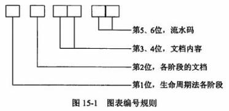

1 、软件配置管理涵盖了项目的整个生命周期。（14 上 55）

2 、配置管理包括 6 个主要活动：制定配置管理计划、配置标识、配置控制、配置状态报告、 配置审计、发布管理和交付。

3、典型配置项包括项目计划书、需求文档、设计文档、源代码、可执行代码、测试用例、运 行软件所需的各种数据，它们经评审和检查通过后进入软件配置管理；（11 上 61）

注意点： 测试报告、会议纪要、工作记录不计入配置项的内容；因为一经形成就不好修改了！ 4、所有配置项的操作权限由配置管理人员（CMO）严格管理，基本原则是： 基线配置项向软件

开发人员开放读权限；非基线配置项向 PM，变更控制委员会（CCB）及相关人员开放。（16 上 64）

5、基线配置项可能包括所有的设计文档和源程序等； 非基线配置项可能包括项目的各类计划 和报告等；

6、配置项的状态可分为“草稿” 、“正式”和“修改”三种。配置项刚建立时，其状态为“草稿”。 配置项通过评审后，其状态变为“正式”。此后若更改配置项， 则其状态变为“修改”。当配置项修改 完毕并重新通过评审时， 其状态又变为“正式” ；（11 下 66）（12 上 66）（14 上 65）（14 下 65）（15

上 65）（15 下 65）（16 上 65）（16 下 62）（17 下 62）（19 下 60）

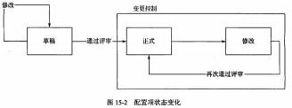

①处于“草稿”状态的配置项的版本号格式为 0.YZ ，YZ 的数字范围为 01~99。随着草稿的修 正， YZ 的取值应递增。 YZ 的初值和增幅由用户自己把握。

②处于“正式”状态的配置项的版本号格式为 X.Y ，X 为主版本号，取值范围为 1~9 。Y 为次 版本号，取值范围为 0~9。

配置项第一次成为“正式”文件时，版本号为 1.0。

③处于“修改”状态的配置项的版本号格式为 X.YZ。配置项正在修改时， 一般只增大 Z 值，  X.Y 值保持不变。 当配置项修改完毕，状态成为“正式” 时，将 Z 值设置为 0，增加 X.Y 值。

7、配置项的版本控制作用于多个配置管理活动之中， 如创建配置项、配置项的变更和配置项 的评审等。在项目开发过程中， 绝大部分的配置项都要经过多次的修改才能最终确定下来。对配 置项的任何修改都将产生新的版本。由于我们不能保证新版本一定比旧版本“好”，所以不能抛弃 旧版本。版本控制的目的是按照一定的规则保存配置项的所有版本，避免发生版本丢失或混淆等

现象，并且可以快速准确地查找到配置项的任何版本。（13 上 65）（13 下 65）

8、基线： 由一组配置项组成， 这些配置项构成一个相对稳定的逻辑实体。 基线中的配置项被 	“冻结”了，不能再被任何人随意修改。对基线的变更必须遵循正式的变更控制程序。

在建立基线以前，工作产品所有者能快速、非正式的对产品做出变更。在基线建立后，变更 要通过评价和验证变更的正式程序来控制。

9、基线由一组配置项组成，这些配置项构成了一个相对稳定的逻辑实体。基线中的配置项被 冻结了，不能再被任何人随意修改。基线通常对应于开发过程中的里程碑， 一个产品可以有多个 基线， 也可以只有一个基线。通常将总价值给客户的基线称为一个发行基线“Release"，为内部开 发用的基线则称为一个构造基线“Build"。配置项是可以更改的，在项目开发过程中， 绝大部分的 配置项都要经过多次的修改才能最终确定下来，只是需要做好版本控制管理。（15 下 63）

10 、一组拥有唯一标识号的需求、设计、源代码文卷以及相应的可执行代码、构造文卷和用 户文档构成一条基线。产品的一个测试版本 （可能包括需求分析说明书、 .概要设计说明书、详细 设计说明书、已编译的可执行代码、测试大纲、测试用例、使用手册等） 是基线的一个例子。

11、对于每一个基线，要定义下列内容：建立基线的事件、受控的配置项、建立和变更基线 的程序、批准变更基线所需的权限。在项目实施过程中，每个基线都要纳入配置控制，对这些基 线的更新只能采用正式的变更控制程序。

### 12、建立基线还可以有如下好处：

（1）基线为开发工作提供了一个定点和快照。

（2）新项目可以在基线提供的定点上建立。新项目作为一个单独分支， 将与随后对原始项目 （在主要分支上）所进行的变更进行隔离。

（3）当认为更新不稳定或不可信时，基线为团队提供一种取消变更的方法。

（4）可以利用基线重新建立基于某个特定发布版本的配置，以重现己报告的错误。  13、配置库可以分为开发库、受控库、产品库 3 种类型。（17 上 62-63）（18 下 62）

（1）开发库（DevelopmentLibrary）,也称为动态库、程序员库或工作库，用于保存开发人员

当前正在开发的配置实体，动态中的配置项被置于版本管理之下。动态库是开发人员的个人 工作区，由开发人员自行控制。库中的信息可能有较为频繁的修改。（19 上 62）

（2）受控库（controlledLibrary），也称为主库，包含当前的基线加上对基线的变更。受控库 中的配置项被置于完全的配置管理之下。在信息系统开发的某个阶段工作结柬时，将当前的 工作产品存入受控库。

（3）产品库（productLibrary），也称为静态库、发行库、软件仓库，包含已发布使用的各种 基线的存档，被置于完全的配置管理之下。在开发的信息系统产品完成  系统测试之后，作为 最终产品存入产品库内，等待交付用户或现场安装。（16 下 66）

基于配置库的变更控制流程：①将待升级的基线从产品库中取出， 放入受控库； ②程序员将欲修改的代码段从受控库中检出（ check  out），放入自己的开发库中进行修改。代码被 check out  后即被“锁 定”，以保证同一段代码只能同时被一个程序员修改，如果甲正对 其修改， 乙就无法 check out；③程序员将开发库中修改好的代码 段检入（ check in）受控库。  check in  后， 代码的“锁定”被解 除，其他程序员可以 check  out  该代码段了；④软件产品的升级 修改工作全部完成后， 将受控库中的新基线存入产品库中。
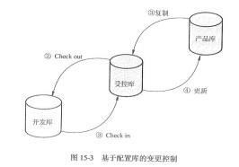

14、配置库的建库模式有两种：按配置项类型建库和按任务建库。

（1）按配置项的类型分类  建库， 适用于通用软件的开发组织。在这样的组织内， 产品的继承 性往往较强，工具比较统一，对并行开发有一定的需求。使用这样的库结构有利于对配置项 的统一管理和控制，同时也能提高编译和发布的效率。但由于这样的库结构并不是面向各个 开发团队的开发任务的，所以可能会造成开发人员的工作目录结构过于复杂，带来一些不必 要的麻烦。（18 上 62）

（2）按开发任务  建立相应的配置库， 适用于专业  软件的开发组织。在这样的组织内， 使用的 开发工具种类繁多，开发模式以线性发展为主，所以就没有必要把配置项严格地分类存储， 人为增加目录的复杂性。对于研发性的软件组织来说，采用这种设置策略比较灵活。

15、用于建立配置库的工具： VSS、CVS ；  也可以通过手工方式进行建库；

### 16、配置库的操作权限

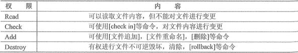

### 17、受控库的权限设置

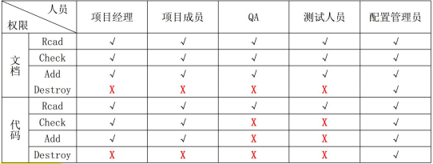

### 18、产品库的权限设置

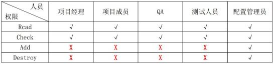

19、配置（标识） 识别是配置管理员职能， 内容：（10 上 65）（13 上 62、64）（15 上 64）（17 上 60） （1）识别需要受控的配置项；

（2）为每个配置项指定唯一性的标识号；

（3）定义每个配置项的重要特征；

（4）确定每个配置项的所有者及其责任；

（5）确定配置项进入配置管理的时间和条件；

（6）建立和控制基线；

（7）维护文档和组件的修订与产品版本之间的关系。

### 20、配置管理计划的主要内容为：

（1）配置管理活动， 覆盖的主要活动包括配置标识、配置控制、配置状态报告、配置审计、 发布管理与交付；

（2）实施这些活动的规范和流程；

（3）实施这些活动的进度安排；

（4）负责实施这些活动的人员或组织， 以及他们和其他组织的关系。

21、配置状态报告也称配置状态统计,其任务是有效地记录和报告管理配置所需要的信息，目 的是及时、准确地给出配置项的当前状况，供相关人员了解，以加强配置管理工作。配置状态报

告应着重反映当前基线配置项的状态， 以向管理者报告系统开发活动的进展情况。

### 22、配置状态报告应该包含以下内容：

（1）每个受控配置项的标识和状态。一旦配置项被置于配置控制下， 就应该记录和保存它的 每个后继进展的版本和状态。

（2）每个变更申请的状态和已批准的修改的实施状态。

（3）每个基线的当前和过去版本的状态以及各版本的比较。

（4）其他配置管理过程活动的记录。

23、配置审计的实施是为了确保项目配置管理的有效性，不允许出现任何混乱现象，例如： （1）防止向用户提交不适合的产品，如交付了用户手册的不正确版本；

（2）发现不完善的实现，如开发出不符合初始规格说明或未按变更请求实施变更； （3）找出各配置项间不匹配或不相容的现象；

（4）确认配置项己在所要求的质量控制审核之后纳入基线并入库保存； （5）确认记录和文档保持着可追溯性。

### 24、配置审计可分为功能性配置审计和物理配置审计：

25、功能配置审计是进行审计以验证以下几个方面： （18 下 14）

（l）配置项的开发已圆满完成

（2）配置项已达到规定的性能和功能特定特性

### 26、物理配置审计是进行审计以验证如下方面：

| 工作 负责人 | 编制配置 管理计划 | 创建配置 管理环境 | 审核变更 计划 | 变更申请 | 变更实施 | 变更发布 |
|---|---|---|---|---|---|---|
| CCB |  |  | J |  |  |  |
| CM0 | J | J |  |  |  | J |
| 项目经理 |  |  |  | J |  |  |
| 开发人员 |  |  |  |  | J |  |

（1）每个构建的配置项符合相应的技术文档

（2）配置项与配置状态报告中的信息相对应

（3）配置项的运行和支持文档已完成并且是符合要求的

27、项目经理组织修改相关的配置项，并在相应的文档或程序代码中记录变更信息。（16 下 63）   28、发布管理与交付包含： 存储、复制、打包、交付、重建 。（19 下 61）

### 29、配置管理中各个成员的职责

（注：变更申请可以由 CM0,项目经理或开发人员提出，只要不选 CCB 即算正确）

配置管理人员制订配置管理计划并交给配置控制委员会审批，并按照配置控制委员会的意见 修改配置管理计划， 直到配置管理计划被批准为止。

本章历年考题和答案解析汇总：

#### 【试题 1】---2009 上真题 45

1、进行配置管理的第一步是（1）。

（1）A.制定识别配置项的准则        B.建立并维护配置管理的组织方针

C.制定配置项管理表            D.建立 CCB

#### 【解析】 配置管理的流程如下：（1） 建立并维护配置管理的组织方针（2） 制定项目配置管理计划（3） 确定配 置标识规则（4） 实施变更控制（5）报告配置状态（6）进行配置审核（7）进行版本管理和发行管理。

#### 【试题 2】---2009 上真题 47

2、（2）不是创建基线或发行基线的主要步骤。

创建基线或发行基线的主要步骤如下：（1）配置管理员识别配置项；（2）为配置项分配标识 ③为项目创建配置库，并给每个项目成员分配权限；（4）各项目团队成员根据自己的权限操作配 置库；（5） 创建基线或发行基线并获得 CCB 的授权。把上述步骤记录为文档。

#### 【试题 3】---2010 上真题 64

#### 【解析】P491此题考察的是软件文档管理指南，

文档定义：一种数据媒体和其上所记录的数据。它具有永久性并可以由人或机器阅读， 通常仅 用于描述人工可读的内容，例如技术文件、设计文件、版本说明文件等。

软件文档可分为三种类别：开发文档描述开发过程本身；产品文档描述开发过程的产物：管理 文档记录项目管理的信息。

程序源代码清单属于文档。按照质量要求，文档可分为 4 个级别。正式文档（第 4 级）适合 那些要正式发行供普遍使用的软件产品。关键性程序或具有重复管理应用性质如工资计算的程序 需要第 4 级文档。因此“文档按重要性和质量要求可以分为正式文档和非正式文档”是正确的。 因此选择 C。

#### 【  点评】常考，命题的热点，简单题，必须得分

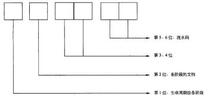

#### 【试题 4】 ---2010 上真题 65

4 、 配置识别是软件项目管理中的一项重要工作，它的工作内容不包括（4）。

（4）A.确定需要纳入配置管理的配置项      B.确定配置项的获取时间和所有者

C.为识别的配置项分配唯一的标识     D.对识别的配置项进行审计

#### 【答案】D

#### 【解析】 此题考察的是配置识别的步骤，必须掌握， 高频考点

配置识别的内容如下：①别需要受控的软件配置项。  ②给每个产品和它的组件及相关的文档分配 唯一标识③定义每个配置项的重要特征及识别其所有者。④识别组件、数据及产品获取点和准则。

⑤建立和控制基线。⑥维护文件和组件的修订与产品版本之间的关系。

其中不包括“对识别的配置项进行审计”，因此应选 D。

#### 【  点评】常考，命题的热点，简单题，必须得分

#### 【试题 5】---2010 上真题 66

5、某开发项目配置管理计划中定义了三条基线， 分别是需求基线、设计基线和产品基线，（5）应 该是需求基线、设计基线和产品基线均包含的内容。

（5）A.需求规格说明书   B.详细设计说明书    C.用户手册   D.概要设计说明书

#### 【答案】A

#### 【解析】 此题考察的是基线的分类，必须掌握， 高频考点

软件需求是软件配置控制的基础。软件设计、实现、测试和维护等所有软件开发生命周期中 的活动所产生的产品都要建立与软件需求之间的追溯关系。通常，要唯一地标识软件需求，才能 在整个软件生命周期中，进行软件配置控制。因此， 需求基线、设计基线和产品基线必然要包括 软件的需求，通常用需求规格说明书来表达软件需求。因此选择 A。

#### 【  点评】常考，命题的热点，有一定难度，建议得分

#### 【试题 6】---2011 上真题 60

6、在管理信息系统的开发过程中用到很多图表，对这些图表进行有规则的编号， 可以方便图表的 查找。根据生命周期的 5 个阶段，可以给出下图所示的分类编号规则，其中第 3、4 位应该表示（6）。

（6）A.文档页数      B.文档编号  C.文档内容  D.文档目录

#### 【答案】C

#### 【解析】P492此题考察的是文档管理，

在管理信息系统开发过程中用到很多的图表，对这些图表进行有规则的编号，可以方便图表 的查找。图表的编号一般采用分类结构。根据生命周期法的 5 个阶段，可以给出题干所示的分类 编号规则图。根据该规则，就可以通过图表编号判断出该图表出于系统开发周期的哪一个阶段， 属于哪一个文档，文档中的哪一部分及第几张图表。

其中，第 5, 6 位，流水码。第 3, 4 位，文档内容。第 2 位，各阶段文档。第 1 位，生命周 期法各阶段。因此正确答案应选 C。

#### 【点评】文档管理的编号，常考，简单，必须得分

#### 【试题 7】---2011 上真题 61

7、件开发项目中的很多过程产出物都属于配置项， 一般意义上来讲， 以下可以不作为配置项的是（7）。

（7）A.项目计划书        B.需求文档      C.程序代码      D.会议记录

#### 【答案】D

#### 【解析】 此题考察的是配置项的内容，

#### 【点评】配置项的内容，常考，简单， 必须得分

#### 【试题 8】---2011 上真题 62

| 权限 | 内容 |
|---|---|
| Read |  |
| Check |  |
| Add |  |
| Destroy |  |

| Release（产品库） | Release（产品库） | Release（产品库） | Release（产品库） | Release（产品库） | Release（产品库） |
|---|---|---|---|---|---|
| 人员权限 | 项目经理 | 项目成员 | QA | 测试人员 | 配置管理员 |
| Read | + | + | + | + | + |
| Check | ① | ② | （3） | ④ | ⑤ |
| Add | 根 | 根 | 根 | 根 | + |
| Destroy | 根 | 根 | 根 | 根 | + |

其中J表示该人员具有相应权限， x表示该人员没有相应权限，则产品库权限分配表中用①②（3） ④⑤标出的位置，应填写的内容为（8）。

（8）A.①J；②x③x；④J；⑤J    B.①x；②x③x； ④x；⑤J

C.①J；②J③J；④x；⑤J     D.①x；②J③x；④x； ⑤J

#### 【答案】B

#### 【解析】 此题考察的是配置管理中相关人员的权限，

受控库也称为主库或系统库，是用于对当前基线和控制对基线的变更。软件工程师和其他人 员可以自由地复制受控库中的单元或组件。然而，必须有适当的权限授权变更。受控库中的单元 或组件用于创建集成、系统和验收测试或对用户发布的构建。产品库是受控库的一部分。对于受 控库， 配置管理员拥有具体执行变更的权限， 其他人员则有读取的权限。很明显，配置管理员 CMO 的权限都是d，因此⑤是可不予考虑的，测试人员是没有 ADD 权限的，项目成员是没有 CHECK 权 限的，只有 CMO 才有 CHECK 权限，因此我高度怀疑项目经理对代码的 CHECK 权限！如果项目经理 对代码的 CHECK 权限是 “x”，那么选项 B 是正确的。因此正确答案应选 B。

#### 【点评】配置管理中人员的权限，常考，简单，必须得分

#### 【试题 9】 ---2011 下真题 65

9、以下关于配置项的描述中， 不正确的是（9）。

（9）A.使用配置管理工具后，所有配置项要以一定的目录结构保存在配置库中 B.所有配置项的操作权限应该由项目经理严格统一管理

C.所有配置项都必须按照相关规定进行统一编号

D.基线配置项要向软件开发人员开放读取的权限

#### 【答案】B

#### 【解析】 此题考察的是配置管理，

所有配置项都应按照相关规定统一编号，按照相应的模板生成，并在文档中的规定章节（部 分）记录对象的标识信息。在引入软件配置管理工具进行管理后，这些配置项都应以一定的目录 结构保存在配置库中。所有配置项的操作权限应由 CMO（配置管理员）严格管理，基本原则是：基 线配置项向软件开发人员开放读取的权限；非基线配置项向 PM, CCB 及相关人员开放。

#### 【点评】常考，命题的热点，简单题， 必须得分

#### 【试题 10】---2011 下真题 66

10、配置项的版本号规则与配置项的状态相关， 以下叙述中正确的是（10）。

（10）A.处于“正式”状态的配置项版本号格式为 X.Y，当配置项升级幅度较大时，可以将变动 部分制作为配置项的附件，附件版本依次为 1.0，1.1，

B.处于“修改”状态的配置项版本号格式为 X.YZ，其中 X 保持不变， YZ 在 01~99 之间递增

C.处于“草稿”状态的配置项版本号格式为 0.YZ，随着草稿的修改， YZ  取值逐步递增， 而 YZ 的初值和幅值由用户自行把握

D.处于“草稿”状态的配置项版本号格式为 X.YZ，当配置项通过评审， 状态第一次成为“正 式”时，版本号直接设置为 1.0

#### 【答案】C

#### 【解析】 此题考察的是版本管理，

配置项的版本号规则与配置项的状态相关。

（1）处于“草稿”状态的配置项的版本号格式为 0.YZ, YZ 的数字范围为 O1 -99，随着草稿 的修正， YZ 的取值应递增。 YZ 的初值和增幅由用户自己把握。

为次版本号，取值范围为 0根9。

配置项第一次成为“正式”文件时，版本号为 1.0。

如果配置项升级幅度比较小，可以将变动部分制作成配置项的附件， 附件版本依次为 1.0, 1.1,……。当附件的变动积累到一定程度时，配置项 Y 值可适量增加， Y 值增加一定程度时， X 值 将适量增加。当配置项升级幅度比较大时，才允许直接增大 X 值。

（3）处于“修改”状态的配置项的版本号格式为 X.YZ。配置项正在修改时， 一般只增大 Z 值， X.Y 值保持不变。当配置项修改完毕，状态成为“正式”时，将 Z 值设置为 0，增加 X.Y 值。 参见上述规则（2）。

根据上述内容分析可知， 正确答案应选 C。

#### 【点评】常考，命题的热点，简单题， 必须得分

#### 【试题 11】---2012 上真题 64

11、信息系统文档的管理主要体现在文档书写规范、图表编号规则、文档目录编写标准和（11） 等几个方面。

（11）A.文档管理方法   B.文档管理制度  C.建立文档规范  D.文档使用权限控制重

#### 【答案】B

#### 【解析】 此题考察的是文档管理，

管理信息系统文档的规范化管理主要体现在文档书写规范、图表编号规则、文档目录编写标 准和文档管理制度等几个方面。

#### 【点评】文档管理的内容，多次考了， 简单，必须得分

#### 【试题 12】---2012 上真题 65

12、下面任务中，（12）不是在配置管理过程中执行的内容。

（12）A.确认一个条目或一个系统的功能和物理特征

B.针对特证控制变更

C.对项目范围进行审核以检验当前的项目是否与预定的要求相符

D.允许对变更自动承认

#### 【答案】D

#### 【解析】 此题考察的是配置管理，

配置管理活动和流程主要包括：①制定配置管理计划；②配置识别与建立基线③建立配置管 理系统；④版本管理（或发布管理）；⑤变更控制； ⑥配置状态报告；⑦配置审计。

配置识别是配置管理的一个要素，包括选择一个系统的配置项和在技术文档中记录配置项的 功能和物理特性。

变更控制的目的在于：防止配置项被随意修改而导致混乱。通常，对变更的申请、评估、头 施、验证与确认、发布等工作需要人为确认和审批， 而不允许自动承认。

#### 【点评】配置管理的内容，多次考了， 简单，必须得分

#### 【试题 13】---2012 上真题 66

13、如果一个配置项的版本号为 1.1，那么这个配置项处于（13）状态。

（13）A.草稿  B.正式   C.修改  D.完成

#### 【解析】 此题考察的是版本管理，

配置项的版本号与配置项的状态紧密相关：

（1）处于“草稿”状态的配置项的版本号格式为： 0.YZ 。YZ 数字范围为 01-99。随着草稿 的不断完善， “YZ”的取值应递增。“YZ”的初值和增幅由用户自己把握。

（2）处于“正式发布”状态的配置项的版本号格式为： X.Y，X 为主版本号，Y 为次版本号。 配置项第一次“正式发布”时， 版本号为 1.0。如果配置项的版本升级幅度比较小，一般只增大 Y 值，X 值保持不变。只有当配置项版本升级幅度比较大时，才允许增大 X 值。

（3）处于“正在修改”状态的配置项的版本号格式为： X.Y.Z，配置项正在修改时， 一般只 增大 Z 值，X.Y 值保持不变。Z 的初值和增幅由用户自己把握。 当配置项修改完毕，状态重新成为 “正式发布”时，去掉 Z 值，增加 X.Y 值。参见规则 1。在文件名中使用配置项的版本号时， 用下 划线代替版本号中的点。

#### 【点评】版本管理，多次考了，简单， 必须得分

#### 【试题 14】---2013 上真题 27

14、配置管理作为项目综合变理管理的重要支持，为项目综合变理管理提供了标准化的，有效率 的变理管理平台，配置管理系统在项目变更中的作用不包括  14  。

（14）A.建立一种前后一致的变理管理方法    B.定义变理控制委员会的角色和责任

C.提供改进项目的机会               D.提供了统一的变理发布方发

#### 【答案】B

#### 【解析】 此题考察的是配置管理，

配置管理系统在项目范围的应用，包括变更控制过程，实现下列目标。

（1） 建立一种方法， 前后一贯地识别与提出对基准的变更请求， 并且评估这些变更的价值和 有效性。（2）通过考虑每一变更的影响，提供改进项目的机会。

（3）向项目管理团队提供方法，以前后一致的方式把批准的和拒绝的所有交更告知项目干系人。 （4）整体变更控制过程里面的一些配置管理括动如下： 配置识别项、配置状态、配置核实和审计；

配置管理系统的实现目标，有 ACD，没有 B。

#### 【点评】配置管理的目标，书上原话， 多次考了，比较简单，必须得分

#### 【试题 15】---2013 上真题 62

15、配置识别是配置管理的一个要素，包括选择一个系统的配置项和在技术文档中配置项目的功 能和物理特性， （15）是配置管理员的关键职责。

（15）A.识别软件开发中产生的所有工作结果

B.给每个产品及其组件和相关的文档分配标识

C.定议每个配置项目的重要特征以及识别其所有者

D.修改基线

#### 【解析】P410此题考察的是配置管理员的职责，

选项 D 是配置管理员的重要职责， 但不是配置识别阶段的工作； 配置管理员关键职责就是对 权限进行管理；

#### 【点评】配置管理中人员的职责，常考的，通过分析不难得出，比较简单，必须得分

#### 【试题 16】---2013 上真题 63

16、从软件开发生命周期的角度划分， 可将项目文档分为开发文档、产品文档和（16）。

（16）A.记录文档    B.测试文档    C.维护文档   D.管理文档

#### 【解析】P491此题考察的是软件文档管理指南，必须掌握，必考

从软件开发生命周期的角度划分，可将项目文档分为开发文档、产品文档、管理文档；

#### 【试题 17】---2013 上真题 64

17、软件开发项目中选用了配置管理工具对文档进行管理，下面关于配置权限符合配置管理要求 的是（17）。

（17）A.测试报告向项目经理开放读取权限     B.源代码向质保人员开放读写权限

C.需求说明书向测试人员工放读写权限   D.所有配置权限都由项目经理严格管理

#### 【答案】A

#### 【解析】P494此题考察的是配置管理权限分配，

所有配置项的操作权限由配置管理人员（CM0）严格管理， 基本原则是： 基线配置项向软件开 发人员开放读权限； 非基线配置项向 PM，变更控制委员会（CCB）及相关人员开放。 B 和 C 错在 了写权限上；D 错在配置权限应该由配置管理员统一管理

#### 【点评】配置管理中人员的职责，常考的，书上原话，比较简单，必须得分

#### 【试题 18】---2013 上真题 65

18、配置项的版本控制作用于多个配置管理活动之中，如创建配置项，配置项的变更和配置项的 评审等。下面关于配置项的版本控制的描述中，（18）是正确的。

（18）A.在项目开发过程中，绝大部分的配置项目都要经过多次的修改才能最终确定下来 B.对配置项的修改不一定产生新版本

C.版本控制的目的是按照一的规则有选择地保存配置项的必要的版本

D. 由于我们保证新版本一定比旧版本好，所以可以抛弃旧版本

#### 【答案】A

#### 【解析】 此题考察的是版本管理，

配置项的版本控制作用于多个配置管理活动之中，如创建配置项、配置项的变更和配置项的 评审等。在项目开发过程中，绝大部分的配置项都要经过多次的修改才能最终确定下来。对配置 项的任何修改都将产生新的版本。由于我们不能保证新版本一定比旧版本“好”，所以不能抛弃 旧版本。版本控制的目的是按照一定的规则保存配置项的所有版本，避免发生版本丢失或混淆等 现象，并且可以快速准确地查找到配置项的任何版本。

版本控制不是一次修改就可以确定下来的，所以 A 正确；修改一定会产生新版本， 旧的版本 也需要进行保留，防止以后发生变更， 可以进行追溯，所以 B 和 D 错；

#### 【点评】版本管理，常考的，书上原话，比较简单， 必须得分

#### 【试题 19】---2013 下真题 64

19、（19）不属于配置是别的内容。

（19）A.给每个产品和它的组件及相关的文档分配唯一的标识

B.定义每个配置项的重要特征以及识别其所有者

C.维护文档和组件的修订与产品版本之间的关系

D.确定配置库程序的标志和管理机制

#### 【答案】D

#### 【解析】 此题考察的是配置识别的内容，必须掌握， 高频考点

配置识别是配置管理的一个要素，包括选择一个系统的配置项和在技术中记录配置项的功能 和物理特性。它是配置管理员（CM0）的工作职责之一，其内容包括（但不限于）：①识别需要受 控的每个配置项；②给每个产品和它的组件及相关的文档分配唯一的标识； 3 定义每个配置项的 重要特征以及识别其所有者；④识别组件、数据及产品获取点和准则；⑤建立和控制基线；⑥维 护文档和组件的修订与产品版本之间的关系等。

#### 【点评】配置识别的内容，多次考了， 简单，必须得分

#### 【试题 20】---2013 下真题 65

20、以下关于版本控制的说法中，（20）是错误的。

（20）A.版本管理主要控制配置项的创建过程

B.软件开发过程中，绝大多数配置项都要经过多次修改才能最终确定下来 C.对配置项的任何修改都将产生新的版本

D.版本控制的目的是避免版本丢失或混饶等现象

#### 【答案】A

#### 【解析】 此题考察的是版本管理，

版本控制的目的是按照一定的规则保存配置项的所有版本， 避免发生版本丢失或混淆等现象， 并且可以快速、准确地查找到配置项的任何版本。

#### 【点评】版本管理的知识点，多次考了，简单，必须得分

#### 【试题 21】---2014 上真题 55

21、软件配置管理（SCM）是一组用于在软件（21）管理变化的活动。

（21）A.交付使用后   B.开发过程中   C.整个生命周期内   D.测试过程中

#### 【答案】C

#### 【解析】 此题考察的是配置管理，

软件配置管理涵盖了项目的整个生命周期。

#### 【点评】多次考了，简单，必须得分的

#### 【试题 22】---2014 上真题 56

22、（22）可作为软件生存期中各开发阶段的一个质量检查点。

（22）A.配置项   B.程序  C.基线   D.过程

#### 【答案】C

#### 【解析】 此题考察的是检查点、基线，

最要的检查点是里程碑，最要的里程碑是基线。可见基线也是检查点。

#### 【点评】多次考了，简单，必须得分的

#### 【试题 23】---2014 上真题 65

23、某软件开发项目中将《详细设计说明书》作为配置项，项目的开发人员正在编写一份《详细 设计说明书》的版本号为 V0.1，此后他对这份文件进行了修改并保存，版本号应升级为（23）

（23）A.V0.2          B.V0.5        C.V1.0                    D.V1.1

#### 【答案】A

#### 【解析】 此题考察的是版本管理的内容，必须掌握， 高频考点

个人觉得这个题目有点牵强，建议不需要纠结，知道大致是什么意思就好。其实选项 C 也有道理；

#### 【点评】多次考了，简单，必须得分的

#### 【试题 24】---2014 下真题 64

24、建立配置管理方案首先要组建配置管理方案构造小组， 该小组包括四类成员，其中设计人员、 编码人员、测试人员均属于（24）。

（24）A.小组负责人   B.技术支持专家  C.配置管理技术专家  D.配置管理系统用户代表 【答案】D

#### 【试题 25】---2014 下真题 65

25、某软件集成公司承接了一个软件开发项目，需求分析师张工在公司刚完成的类似项目的需求 规格说明书 V3.0 版本上， 增加了新项目的需求， 拟准备和用户开会讨论确认， 此时需求规格说明 书的版本是（25）。

（25）A.V0.1      B.V3.1      C.V1.0      D.V3.01

#### 【答案】A

#### 【解析】P494此题考察的是版本管理，

配置项版本规则：

草稿：处于草稿状态版本号为 0.YZ；YZ 的数字范围是 01~99

正式发布： 处于正式发布状态版本号为 X.Y；X 为主版本，取值 1~9；Y 为次版本， 取值 1~9； 正在修改：处于正在修改状态版本号为 X.YZ；一般只增大 Z 值， X.Y 不变， 修改完毕，Z 置为 0。

配置项版本控制流程：创建配置项——修改处于“草稿”状态的配置项（此时，配置项版本 为 0.YZ）——技术评审或领导审批——正式发布（此时，配置项版本为 X.Y）—— 变更（此时， 配置项版本为 X.YZ），变更完成后，转到技术评审或领导审批。

#### 【点评】多次考了，比较简单，送分的

#### 【试题 26】---2014 下真题 70

26、在进行项目文档及配置管理时，引入“基线”这一概念的目的是（26）。

（26）A.保证成果的完整与正确   B.合理分配权限

C.保证成果相互依赖性     D.合理控制变更

#### 【答案】D

#### 【解析】P495此题考察的是基线，

基线化的工作产品变更时需要走严格的变更管理流程; 软件配置项分类软件的开发过程是一个不断变化着的过 程，为了在不严重阻碍合理变化的情况下来控制变化，软件配置管理引入了“基线”这一概念。

#### 【点评】书上原话，理解下不难得出， 送分的

#### 【试题 27】---2015 上真题 64

27、配置识别是配置管理的一项活动，包括选择一个系统的配置项和在技术文档中记录配置项的 功能和物理特性。其功能不包括（）。

A.识别需受控的软件配置项                 B.建立和控制基线

C.识别组件、数据及产品获取点和准则       D.识别源程序

#### 【答案】D

#### 【解析】 此题考察的是配置识别的内容，必须掌握， 常考

配置识别是配置管理员的职能，包括如下内容：（1）识别需要受控的软件配置项（2）给每个产品  和它的组件及相关的文档分配唯一的标识（3）定义每个配置项的重要特征以及识别其所有者（4） 识别组件、数据及产品获取点和准则（5）建立和控制基线（6）维护文档和组件的修订与产品版  本之间的关系。

#### 【点评】多次考了，简单，必须得分

#### 【试题 28】---2015 上真题 65

28、配置项的状态可分为“草稿”、“正式”和“修改”三种。以下关于三种状态变化的叙述中() 是正确的。

A. “草稿”经过修改未通过评审时， 状态为“修改 ”

B. “草稿”经过修改未通过评审时，状态仍为“草稿”

C. “草稿”经过修改通过评审时， 状态为“修改 ”

D. “正式”的配置项发生变更，状态变为“草稿 ”

#### 【答案】B

#### 【解析】 此题考察的是版本管理，必须掌握，常考

配置项刚建立时其状态为“草稿”。配置项通过评审（或审批）后，其状态变为“正式发布”。此 后若更改配置项， 必须依照“变更控制规程”执行， 其状态变为“正在修改”。当配置项修改完毕 并重新通过评审（或审批）时，其状态又变为“正式发布”，如此循环。

#### 【点评】多次考了，简单，必须得分

#### 【试题 29】---2015 下真题 63

29、关于软件配置管理中的“基线“这一概念的理解，不正确的是( )

（29）A.软件开发中的所有配置项不一定都要建立基线

B.对基线配置项设置操作权限的基本原则： 向软件开发人员开发读取的权限 C.基线中的配置项将不能再被更改

D.建立和控制基线是配置识别所包含的内容之一

#### 【答案】C

#### 【解析】 此题考察的是基线，

配置项是可以更改的，在项目开发过程中，绝大部分的配置项都要经过多次的修改才能最终确定 下来，只是需要做好版本控制管理。

#### 【点评】送分题，多次考了，简单

#### 【试题 30】---2015 下真题 64

30、对于软件开发项目来说，基线是软件生存期各个开发阶段的工作成果，测试阶段的基线( ) （30）A.可提交软件  B.被测试的程序  C.提交报告  D.测试报告

#### 【答案】D

#### 【解析】 此题考察的是基线，

基线（baseline）是软件生命期各个开发阶段末尾的特定点，也叫做里程碑（milestone）。

连续的开发工作在这些点上被分割开来进行成果检验， 必要时可以进行变更控制。有了基线，就可以 防止开发中的错误跨越阶段向后扩散，也可以防止跨越里程碑去修改另一开发阶段的工作成果。

#### 【点评】送分题，多次考了，简单

#### 【试题 31】---2015 下真题 65

31、如果一个配置项的版本号为 1.1，那么这个配置处于（ ）状态。

（31）A.草稿  B.正式发布  C.修改  D.完成

#### 【答案】B

#### 【解析】 此题考察的是版本管理，

配置项的版本号规则与配置项的状态相关。

（1）处于“草稿”状态的配置项的版本号格式为 0.YZ。

（2）处于“正式”状态的配置项的版本号格式为 X.Y。

（3）处于“修改”状态的配置项的版本号格式为 X.YZ。

#### 【点评】送分题，多次考了，简单

#### 【试题 32】---2016 上真题 63

32、《计算机软件产品开发文件编制指南》明确了软件文档分为（32）三种类型。

A.需求文档、设计文档、总结文档           B.开发文档、实施文档，验收文档 C.需求说明书、详细设计说明书、操作手册   D.开发文档、产品文档、管理文档

#### 【答案】D

#### 【解析】 此题考察的是软件文档，

软件文档分为开发文档、产品文档、管理文档三种类型。

#### 【点评】送分题，常考，必须得分

#### 【试题 33】---2016 上真题 64

33、以下关于基线和配置项的叙述中， 不正确的是（33）。

A.所有配置项的操作权限应由变更管理委员会严格管理

B.基线配置项向软件开发人员开放读取的权限

C.非基线配置项可能包含项目的各类计划和报告等

D.每个配置项的基线都要纳入配置控制，对这些基线的更新只能采用正式的变更管理过程 【答案】A

#### 【解析】 此题考察的是配置权限的分配，必须掌握， 高频考点

所有配置项的操作权限由配置管理人员（CM0）严格管理， 基本原则是： 基线配置项向软件开发人 员开放读权限；非基线配置项向 PM，变更控制委员会（CCB）及相关人员开放。

#### 【点评】送分题，常考，必须得分

#### 【试题 34】---2016 上真题 65

34、配置项的状态可分为“草稿”、“正式”和“修改”三种。以下关于配置项状态的叙述中，不 正确的是（34）。

A.配置项处于“草稿”状态时，版本号格式为 0.YZ

B.配置项第一次成为“正式”文件时，版本号为 1.0

C.配置项处于“修改”状态时，版本号应改回 0.YZ

D.对于配置项的任何版本都应该保存，不能抛弃旧版本

#### 【答案】C

#### 【解析】 此题考察的是版本管理，

①处于 “草稿 ”状态的配置项的版本号格式为 0.YZ，YZ 的数字范围为 01~99。随着草稿的 修正， YZ 的取值应递增。 YZ 的初值和增幅由用户自己把握。

②处于 “正式 ”状态的配置项的版本号格式为 X.Y，X 为主版本号，取值范围为 1~9。Y 为次 版本号，取值范围为 0~9。

配置项第一次成为“正式”文件时，版本号为 1.0。

（3）处于 “修改 ”状态的配置项的版本号格式为 X.YZ。配置项正在修改时， 一般只增大 Z 值， X.Y 值保持不变。 当配置项修改完毕，状态成为“正式”时，将 Z 值设置为 0，增加 X.Y 值。 	【点评】送分题，常考，必须得分

#### 【试题 35】---2016 下真题 61

35、软件文档分为（）三类。

A.需求分析文档、设计文档、编码文档

B.开发文档、实施文档、维护文档

C.项目文档、产品文档、培训文档

D.开发文档、产品，文档、管理文档

#### 【答案】D

#### 【解析】P491此题考察的是软件文档的分类，

软件文档分为三类： 开发文档、产品文档、管理文档。

#### 【点评】送分题，常考，必须得分

#### 【试题 36】---2016 下真题 62

36、配置项的状态可分为草稿、（）、修改三种， 下图体现了配置项的状态变化。

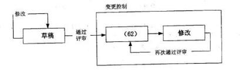

A.发布    B.正式   C.基线    D.基准

#### 【答案】B

#### 【解析】P494此题考察的是配置项状态变化，

配置状态变化：

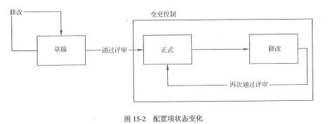

#### 【点评】送分题，常考，必须得分

#### 【试题 37】---2016 下真题 63

37、配置控制与变更包含着几个重要的任务，变更申请、变更评估、通报评估结果、变更实施、 变更验证与确认、变更发布等。其中变更实施的主要负责人一般是（）。

A.CCB        B.项目经理   C.配置管理员     D.QA

#### 【答案】B

#### 【解析】P499此题考察的是变更流程，

项目经理组织修改相关的配置项，并在相应的文档或程序代码中记录变更信息。

#### 【点评】送分题，常考，必须得分

#### 【试题 38】---2016 下真题 66

38、在以下基于配置库的变更控制的图示中，①应为（）。

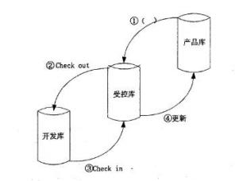

A.读写   B.删除   C.变更    D.复制

#### 【答案】D

#### 【解析】P500此题考察的是配置库，

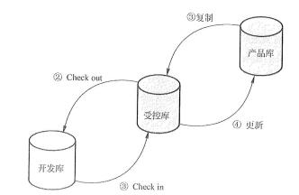

39、编写配置管理计划、识别配置项的工作是（）的职责。

A.配置管理员    B.项目经理    C.项目配置管理委员会    D.产品经理

#### 【解析】配置管理员进行的配置管理活动：①编写配置管理计划；②建立和维护配置管理系统③建立和维 护配置库；④配置项识别；⑤建立和管理基线；⑥版本管理和配置控制；⑦配置状态报告；⑧配 置审计；⑨发布管理和交付； ⑩对项目成员进行配置管培训。

40、配置库可用来存放配置项并记录与配置项相关的所有信息，是配置管理的有力工具。根据配 置库的划分，在信息系统开发的某个阶段工作结束时形成的基线应存入（）；开发的信息系统产品 完成系统测试之后等待交付用户时应存入（）。

（62）A.开发库    B.受控库    C.产品库    D.动态库

（63）A.开发库    B.受控库    C.产品库    D.基线库

#### 【解析】配置库可以分为开发库、受控库、产品库 3 种类型。

（1）开发库（DevelopmenTLibrary），也称为动态库、程序员库或工作库，用于保存开发人员当 前正在开发的配置实体，如：新模块、文档、数据元素或进行修改的已有元素。动态中的配置项 被置于版本管理之下。动态库是开发人员的个人工作区，由开发人员自行控制。库中的信息可能 有较为频繁的修改，只要开发库的使用者认为有必要，无需对其进行配置控制，因为这通常不会 影响到项目的其他部分。

（2）受控库（Controlled Library），也称为主库，包含当前的基线加上对基线的变更。受控库 中的配置项被置于完全的配置管理之下。在信息系统开发的某个阶段工作结束时，将当前的工作 产品存入受控库。

（3）产品库（ProducTLibrary），也称为静态库、发行库、软件仓库，包含已发布使用的各种基 线的存档，被置于完全的配置管理之下。在开发的信息系统产品完成系统测试之后，作为最终产 品存入产品库内，等待交付用户或现场安装。

41、项目验收时发现项目经理签字确认的《需求规格说明书》纸质文档内容与配置服务器上的产 品库同一文档内容不一致，最有可能是在（）的执行上出现了问题。

A.文档管理规范   B.文档目录编写标准    C.文档书写规范    D. 图表编号规则

#### 【解析】文档的规范化管理体现在文档书写规范、图表编号规则、文档目录编写标准和文档管理制度等方面： 1）文档书写规范

管理信息系统的文档资料涉及文本、图形和表格等多种类型，无论是哪种类型的文档都应该遵循 统一的书写规范，包括符号的使用、图标的含义、程序中注释行的使用、注明文档书写人及书写 日期等。例如，在程序的开始要用统一的格式包含程序名称、程序功能、调用和被调用的程序、 程序设计人等。

2）图表编号规则

在管理信息系统的开发过程中用到很多的图表，对这些图表进行有规则的编号，可以方便图表的 查找。图表的编号一般采用分类结构。

3）文档目录编写标准

为了存档及未来使用的方便应该编写文档目录。管理信息系统的文档目录中应包含文档编号、文

档名称、格式或载体、份数、每份页数或件数、存储地点、存档时间、保管人等。 4）文档管理制度

文档的管理制度需根据组织实体的具体情况而定，主要包括建立文档的相关规范、文档借阅记录 的登记制度、文档使用权限控制规则等。

42、某软件开发项目的《概要设计说明书》版本号为 V2.13，该配置项的状态是（）。

A.首次发布    B.正在修改    C.正式发布  D.草稿

#### 【解析】

配置项的状态可分为 “草稿”、“正式”和“修改 ”三种。

处于 “草稿 ”状态的配置项的版本号格式为 0.YZ

处于 “正式 ”状态的配置项的版本号格式为 X.Y

处于 “修改 ”状态的配置项的版本号格式为 X.YZ。

43、在开发人员编写程序时， 程序的开始要用统一的格式，包含程序名称、程序功能、调用 和被调用的程序、程序设计人等信息， 体现了信息系统文档管理的（）。

A.文档书写规范    B. 图表编写规则    C.文档目录编写标准    D.文档管理制度

#### 【解析】信息系统项目相关信息（文档）管理的规则和方法。

44、配置库的建库模式有多种，在产品继承性较强， 工具比较统一，采用并行开发的组织， 一般 会按（）建立配置库。

A.开发任务    B.客户群    C.配置项类型    D.时间

#### 【解析】配置库建库模式有 2 种，分别是按配置项类型建库和按任务建库。

（1） 按配置项的类型分类建库， 适用于通用软件的开发组织。使用这样的库结构有利于对配置项 的统一管理和控制，同时也能提高编译和发布的效率。但由于这样的库结构并不是面向各个开发  团队的开发任务的， 所以可能会造成开发人员的工作目录结构过于复杂， 带来一些不必要的麻烦。 （2） 按开发任务建立相应的配置库，适用于专业软件的开发组织。在这样的组织内， 使用的开发 工具种类繁多，开发模式以线性发展为主，所以就没有必要把配置项严格地分类存储，人为增加 目录的复杂性。对于研发性的软件组织来说，采用这种设置策略比较灵活。

45、质量保证计划属于软件文档中的（）。

A.开发文档    B.产品文档    C.管理文档    D.说明文档

#### 【解析】质量保证计划属于开发文档。

46、关于配置库的描述，不正确的是（）。

A.开发库用于保存开发人员当前正在开发的配置项

B.受控库包含当前的基线及对基线的变更

C.产品库包含已发布使用的各种基线

D.开发库是开发人员的个人工作区， 由配置管理员控制

#### 【解析】开发库无需配置管理，不需要配置管理员来控制。

47、关于配置管理，不正确的是（）。

A.配置管理计划制定时需了解组织结构环境和组织单元之间的联系

B.配置标识包含识别配置项，并为其建立基线等内容

C.配置状态报告应着重反映当前基线配置项的状态

D.功能配置审计是审计配置项的完整性，验证所交付的配置项是否存在

#### 【解析】

P137 软件配置管理计划的制定需要了解组织结构环境和组织单元之间的联系，明确软件配置控制 任务。 软件配置标识活动识别要控制的配置项，并为这些配置项及其版本建立基线。软件配置控制关 注的是管理软件生命周期中的变更。软件配置状态记录标识、收维护并报告配置管理的配置状态信息。 中级教材第二版 P502：

1.功能配置审计是审计配置项的一致性（配置项的实际功效是否与其需求一致），具体验证： （1）配置项的开发已圆满完成。

（2）配置项已达到配置标识中规定的性能和功能特征。

（3）配置项的操作和支持文档已完成并且是符合要求的。

2.物理配置审计是审计配置项的完整性（配置项的物理存在是否与预期一致），具体验证： （1）要交付的配置项是否存在。（2）配置项中是否包含了所有必需的项目。

答案 D 是错误的，说反了，其内容是物理配置审计的内容。

48、在审查项目需求规格说明书时，发现该文档图编号混乱，建立（）解决上述问题。

①文档管理制度②文档书写规范③图表标号规则④文档加密

A.①②④    B.②③④    C.④②③    D.①③④

#### 【解析】信息系统文档的规范化管理主要体现在文档书写规范、图表编号规则、文档目录编写标准和文档 管理制度。

49、研发人员应将正在研发调试的模块、文档和数据元素存入（）。

A.开发库    B.产品库    C.受控库    D.基线库

#### 【解析】开发库【动态库、程序员库或工作库】，用于保存开发人员当前正在开发的配置实体。

50、关于配置管理的描述，不正确的是（）。

A.所有配置项的操作权限，应由配置管理员严格管理

B.配置项的状态分为“草稿”和，“正式”两种

C.配置基线由一组配置项组成，这些配置项构成一个相对稳定的逻辑实体 D.配置库可分为开发库、受控库、产品库三种类型

51、（）不属于发布管理与交付活动的工作内容。

A.检入    B.复制    C.存储    D.打包

#### 【解析】发布管理与交付包含：存储、复制、打包、交付、重建

十三、项目变更管理

变更无处不在，变更涉及项目的整个阶段，可能考查的知识点为： 变更控制委员会、变更控制系统、变更控制流程、变更注意事项等知识点，

变更管理是为了使项目实际执行情况和项目基准相一致而对项目变更进行管理，其可能的结果是拒绝变更或调整基准。

项目变更的原因很多，常见的有：

（1）产品范围（成果）定义的过失或者疏忽；

（2）项目范围（工作）定义的过失或者疏忽；

（3）客户提出新需求；

（4）应对风险的紧急措施或规避措施；

（5）项目执行过程与项目基准要求不一致带来的被动调整（如进度、质量、成本等）；

（6）项目团队人员调整；

（7）技术革新的要求；

（8）外部事件（例如政策变动或自然环境变化等）。

1、项目变更是指在信息系统项目的实施过程中， 由于项目环境或者其他原因而对项目产品的 功能、性能、架构、技术指标、集成方法、项目的范围基准、进度基准和成本基准等方面做出的改变。

4、项目变更有多种分类方式， 如：

（1）按变更性质分为重大变更、重要变更和一般变更，可通过不同审批权限控制。

（2）按变更的迫切性分为紧急变更和非紧急变更， 可通过不同的变更处理流程进行控制。

（3）按变更所发生的领域和阶段， 可分为进度变更、成本变更、质量变更、设计变更、实施

变更和工作（产品） 范围变更等。

5、变更管理的基本原则是首先建立项目基准、变更流程和变更控制委员会。

1）基准管理： 基准是变更的依据。在项目实施过程中，制定基准计划并经过评审后即建立 初始基准， 此后应针对每次批准的变更重新确定基准。

2）建立变更控制流程：所有变更都必须遵循这个流程进行控制。

3）建立变更控制委员会：建立 CCB 并明确其职责，明确变更流程中相关工作的角色及其职责。

4）完整体现变更的影响:变更的来源是多样的， 既包括客户可见的工作成果、交付期等的变更， 又包括客户不可见的项目内部工作的变更，如实施方的人员变更、内部管理变更等。

5）变更产生的相关文档应纳入配置管理中:可以使用手工或自动化工具进行配置管理

6、常用的配置管理工具有 RationalClearCase、perforce、CACCC/Havest、MerantpVCS、 MicrosoftVSS、CVS 等，常用的开源免费的配置管理工具有 SVN、GIT、CVS 等。

7、变更流程： 1）提出变更申请；2）变更影响分析；3）CCB（变更控制委员会）审查批准；4）变更实施 5）监控变更实施 6）结束变更

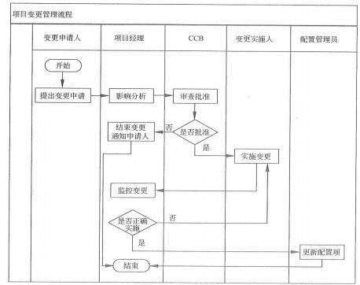

也可以是： 变更申请---变更评估---变更决策---变更实施---变更验证---沟通存档

|  | 角色职责 | 相关要点 |
|---|---|---|
| 1 | 变更申请人 | 项目的任何干系人都可以提出变更申请，所有变更申请必须以书面形式记录 |
| 2 | 项目经理 | 项目经理对项目负责，也对整个项目变更管理过程负责。 项目经理负责变更申请的影响分析， 负责召开变更控制委员会会议，负责监 控变更及已批准变更的正确实施等。（17 上 41） 项目经理在变更中的作用是：响应变更提出者的要求， 评估变更对项目的影 响及应对方案， 将要求由技术要求转化为资源需求，供授权人决策；并据评审绪 果实施即调整项目基准， 确保项目基准反映项目实施情况。 变更的效率不是变更 效果评估的内容；（14 上 67） |

| 3 | 变更控制委员会 | 变更控制委员会（CCB）是一个正式的组织，负责审查、评价、批准、推迟 或否决项目变更。CCB 由项目所涉及的多方人员共同组成， 通常包括甲方和乙方 的决策人员。 作为决策机构，CCB 在变更管理过程中负责对提交的变更申请进行 审查，并对变更申请做出批准、否决或其他决定。 项目变更控制委员会或更完整的配置控制委员会（CCB），或相关职能的类似 组织，是项目的所有者权益代表， 负责裁定接受哪些变更。 CCB  由项目所涉及的多方人员共同组成， 通常包括用户和实施方的决策人 员。可以包括高层经理、项目经理（技术负责人）、配置管理负责人、质量保证 负责人、测试负责人等； 该组织不必是常设机构，包括的人员也不必面面俱到， 可以根据项目的实际情况决定其人员组成；小的项目中 CCB 可以只有一个人或者多个人，甚至只是兼职人员； （13 下 66、69） CCB 是决策机构，不是作业机构（只是决定是否能够进行变更，不会提出具 体的方案的）。通常CCB的工作是通过评审手段来决定项目是否能变更，但不提出变更方案。（13 上 69）（14 上 69）（16 上 38~39） CCB 的主席，在 CCB 意见不一致的时候可以独自做出裁决； 变更控制委员会是项目中重要的角色， 是批准、否定、监督变更的重要机构， CCB 审查通过文档会签的形式， 也可以召开正式会议。决策可以是： ①批准； 设置多个的话，可能会导致项目混乱。（14 上 37） ②否决③延期；④要求补充材料。 |
|---|---|---|
|  | 变更控制委员会 | 变更控制委员会（CCB）是一个正式的组织，负责审查、评价、批准、推迟 或否决项目变更。CCB 由项目所涉及的多方人员共同组成， 通常包括甲方和乙方 的决策人员。 作为决策机构，CCB 在变更管理过程中负责对提交的变更申请进行 审查，并对变更申请做出批准、否决或其他决定。 项目变更控制委员会或更完整的配置控制委员会（CCB），或相关职能的类似 组织，是项目的所有者权益代表， 负责裁定接受哪些变更。 CCB  由项目所涉及的多方人员共同组成， 通常包括用户和实施方的决策人 员。可以包括高层经理、项目经理（技术负责人）、配置管理负责人、质量保证 负责人、测试负责人等； 该组织不必是常设机构，包括的人员也不必面面俱到， 可以根据项目的实际情况决定其人员组成；小的项目中 CCB 可以只有一个人或者多个人，甚至只是兼职人员； （13 下 66、69） CCB 是决策机构，不是作业机构（只是决定是否能够进行变更，不会提出具 体的方案的）。通常CCB的工作是通过评审手段来决定项目是否能变更，但不提出变更方案。（13 上 69）（14 上 69）（16 上 38~39） CCB 的主席，在 CCB 意见不一致的时候可以独自做出裁决； 变更控制委员会是项目中重要的角色， 是批准、否定、监督变更的重要机构， CCB 审查通过文档会签的形式， 也可以召开正式会议。决策可以是： ①批准； 设置多个的话，可能会导致项目混乱。（14 上 37） ②否决③延期；④要求补充材料。 |
| 4 | 变更实施人 | 变更实施人是实施己批准的变更的相关人员，变更申请内容不同，相应的变更实施人 员也不同。变更实施人负责执行已批准的变更，也要参与变更正确性的确认工作。 |
|  | 变更实施人 | 变更实施人是实施己批准的变更的相关人员，变更申请内容不同，相应的变更实施人 员也不同。变更实施人负责执行已批准的变更，也要参与变更正确性的确认工作。 |
| 5 | 配置管理员 | 变更过程的相关产物应纳入配置管理系统中。配置管理员负责把变更后的基准纳 入整个项目基准中， 变更过程中的其他记录文件也应纳入配置管理系统。 |
|  | 配置管理员 | 变更过程的相关产物应纳入配置管理系统中。配置管理员负责把变更后的基准纳 入整个项目基准中， 变更过程中的其他记录文件也应纳入配置管理系统。 |

（3）变更的操作过程应当规范化。

8、在项目整体压力较大的情况下， 更需强调变更的提出、处理应当规范化， 可以使用分批处 理、分优先级等方式提高效率。（10 下 65）

9、项目规模小、与其他项目的关联度小时， 变更的提出与处理过程可在操作上力求简便、高效，但仍应注意以下几点：（09 下 66）（10 下 65）（13 下 70）

（1）对变更产生的因素施加影响。 防止不必要的变更，减少无谓的评估，提高必要变更的通过效率。 （2）对变更的确认应当正式化。

10、但是变更申请可以是口头的，也可以是书面的， 但是必须要有书面记录；

11、更管理要能体现出它的两个重要用途，一个是控制变更，保证项目可控；一个是变更度 量分析，帮助组织提供自己的开发能力。（16 上 39）

### 12、对于变更评审：

（1）CCB 在收到了变更请求后， 会有专门的人员做一个初步的分析，主要是评估变更的来源、 理由、产生的影响、以及变更的代价；

（2）某些申请会在这一阶段先做一个初步的处理（描述不清的申请会被要求重新提交、明显 错误的变更申请会被删除、简单且影响较小的变更申请会被直接分配并处理），其余的申请会被提 交到 CCB 进行评审。

13、变更初审的目的如下：（12 上 69）

①对变更提出方施加影响，确认变更的必要性， 确保变更是有价值的。

②格式校验，完整性较验，确保评估所需信息准备充分。

③在干系人间就提出供评估的变更信息达成共识。

④变更初审的常见方式为变更申请文档的审核流转。

14、变更管理活动的内容：1.识别可能发生的变更 2.管理每个已识别的变更 3.维持所有基线 的完整性 4.根据已批准的变更， 更新范围、进度、成本、预算、质量要求，协调整体项目内 的变更 5.基于质量报告， 控制项目质量使其符合标准 6.维护一个及时、精确的关于项目产品 及其相关文档的信息库，直至项目结束（15 下 38）

本章历年考题和答案解析汇总：

#### 【试题 1】---2009 下真题 63

1 、变更常常是项目干系人由于项目环境或者是其他各种原因要求对项目的范围基准等进行修改。 如某项目由于行业标准变化导致变更， 这属于（1）。

（1）A.项目实施组织本身发生变化   B.客户对项目、项目产品或服务的要求发生变化

C.项目外部环境发生变化      D.项目范围的计划编制不周密详细

#### 【答案】C

#### 【解析】 此题考察的是变更的原因，必须掌握， 高频考点

本题中的情况显然属于项目酌外部环境发生了变化。

#### 【点评】常考，命题的热点，简单题， 必须得分

#### 【试题 2】---2009 下真题 64

2、整体变更控制过程实际上是对（2）的变更进行标识、文档化、批准或拒绝，并控制的过程。

（2）A.详细的 WBS 计划    B.项目基准    C.项目预算    D. 明确的项目组织结构

#### 【答案】B

#### 【解析】 此题考察的是变更控制，

项目变更就是对被批准的项目管理计划的变更， 而被批准的项目管理计划就是项且基准。

#### 【点评】常考，命题的热点，简单题， 必须得分

#### 【试题 3】---2009 下真题 65

3、项目变更贯穿于整个项目过程的始终，项目经理应让项目干系人（特别是业主）认识到  （3） 。

——

（3）A.在项目策划阶段，变更成本较高         B.在项目执行阶段，变更成本较低

C.在项目编码开始前，变更成本较低       D.在项目策划阶段， 变更成本较低

#### 【答案】D

#### 【解析】 此题考察的是变更与成本的关系，

根据软件工程的知识，变更越早， 成本越低。

#### 【点评】常考，命题的热点，简单题， 必须得分

#### 【试题 4】 ---2009 下真题 66

4、项目规模小并且与其他项目的关联度小时，变更的提出与处理过程可在操作上力求简便和高效。 关于小项目变更，不正确的说法是（4）。

（4）A.对变更产生的因素施加影响以防止不必要的变更并减少无谓的评估

B.应明确变更的组织与分工合作

C.变更流程也要规范化

D.对变更的申请和确认，既可以是书面的也可以是口头的，以简化程序

#### 【答案】D

#### 【解析】 此题考察的是变更的工作内容，必须掌握， 高频考点

项目规模小并且与其他项目的关联度小时，变更的提出与处理过程可在操作上力求简便和高效， 但仍应注意以下几点：（1）对变更产生的因素施加影晌， 以防止不必要的变更，减少无谓的评估， 提高必要变更的通过效率。（2）对变更的确认应当正式化③变更的操作过程应当规范化。

#### 【点评】常考，命题的热点，简单题， 必须得分

#### 【试题 5】---2010 下真题 64

5、甲公司承担了某市政府门户网站建设项目，与该市信息中心签订了合同。在设计页面的过程中， 经过多轮讨论和修改，页面在两周前终于得到了信息中心的认可，项目进入开发实施阶段。然而， 信息中心本周提出，分管市领导看到页面设计后不是很满意，要求重新设计页面。但是，如果重 新设计页面，可能会影响项目工期，无法保证网站按时上线。在这种情况下，项目经理最恰当的 做法是（5）。

（5）A.坚持原设计方案，因为原页面已得到客户认可

B.让设计师加班加点，抓紧时间修改页面

C. 向领导争取网站延期上线，重新设计页面

D.评估潜在的工期风险，再决定采取何种应对措施

#### 【答案】D

#### 【解析】 此题考察的是问题的应对措施，理解题，

项目是为达到特定的目的、使用一定资源、在确定的期间内、为特定发起人而提供独特的产 品、服务或成果而进行的一次性努力。

项目目标包括成果性目标和约束性目标。项目的成果性目标有时也简称为项目目标，指通过 项目开发出的满足客户要求的产品、系统、服务或成果。项目的约束性目标也叫管理性目标，是 指完成项目成果性目标需要的时间、成本以及要求满足的质量。

项目经理的首要责任就是要满足项目目标。本题中给出了项目的核心目标：重新设计页面，网 站按时上线。可见:

“ 坚持原设计方案，因为原页面已得到客户认可”不能满足项目目标，故 A 是错误的。

“让设计师加班加点， 抓紧时间修改页面”没有计划， 仍不一定满足进度要求，故 B 是不恰当的。 “ 向领导争取网站延期上线，重新设计页面”不能满足网站按时上线的要求，故 C 不是恰当做法。

题目中已说明，如果重新设计页面，可能会影响项目工期。那么为了确保满足工期目标应该 对工期风险有充分的认识， 做好应对计划，并严格按计划执行。“评估潜在的工期风险，再决定采 取何种应对措施”是为了满足项目目标的妥善做法。故 D 是恰当的。

#### 【点评】常考，命题的热点，简单题， 必须得分

#### 【试题 6】---2010 下真题 65

6、某公司最近承接了一个大型信息系统项目，项目整体压力较大，对这个项目中的变更，可以使 用（6）等方式提高效率。

①分优先级处理  ②规范处理 ③整批处理  ④分批处理

（6）A.①②③    B.①②④  C.②③④  D.①③④

#### 【答案】B

#### 【解析】 此题考察的是变更的处理方式，必须掌握， 高频考点

由于变更的实际情况千差万别，可能简单，也可能相当复杂。越是大型的项目，调整项目基 准的边际成本越高，随意地调整可能带来的麻烦也越大越多，包括基准失效、项目干系人冲突、 资源浪费和项目执行情况混乱等。

在项目整体压力较大的情况下， 更需强调变更的提出、处理应当规范化， 可以使用分批处理、 分优先级等方式提高效率。

项目规模小、与其他项目的关联度小时，变更的提出与处理过程可在操作上力求简便、高效， 但仍应注意以下几点:  （1）对变更产生的因素施加影响。防止不必要的变更，减少无谓的评估，  提高必要变更的通过效率（2） 对变更的确认应当正式化（3）变更的操作过程应当规范化。

由此可知，对于大型、项目整体压力较大的信息系统项目中的变更，要提高效率，强调变更 的规范化、次序化， 不能整批处理。故试题（65）中 B 是正确的。

#### 【点评】常考，命题的热点，简单题， 必须得分

#### 【试题 7】---2010 下真题 66

7、合同变更控制系统规定合同修改的过程，包括（7）。

①文书工作     ②跟踪系统    ③争议解决程序     ④合同索赔处理

（7）A.①②③   B.②③④  C.①②④      D.①③④

#### 【答案】A

#### 【解析】 此题考察的是合同变更控制系统，

合同变更控制系统规定合同修改的过程，包括文书工作、跟踪系统、争议解决程序以及批准 变更所需的审批层次。合同变更控制系统应当与整体变更控制系统结合起来。

由此可知合同变更控制系统规定合同修改的过程不包括合同索赔处理， 即试题（66）中 A 是正确的。

#### 【点评】常考，命题的热点，简单题， 必须得分

#### 【试题 8】---2011 下真题 40

8、某信息系统集成项目经理王某收到客户的最新变更要求， 他带领其团队成员经过认真分析， 发 现这次变更将导致项目范围增加近 70%，初步估计成本将增加 5 倍。王某必须要在已被批准的项 目计划中改变原定的开始和结束日期， 那么他的第一步工作应该是（8）。

（8）A.修改合同                  B.增加人员和资源

C.重新制订基准计划          D.采用一个新的目标进度计划

#### 【答案】D

#### 【解析】 此题考察的是偏差纠偏，理解题，

进度修正属于一种特殊的进度更新，这种更新将导致项目开始和结束日期的变更。日期通常

根据项目范围或估计的变更而修正。如果进度延误非常严重以至于需要实际的数据来测算绩效， 就需要重新制定基准计划。但是重新制订基准计划只能作为进度控制的最后手段，采用新的目标 进度则是进度修正的常用方式。而由于项目范围变化以及成本增加等因素造成的包括修改合同和 增加资源等后继活动则并非首要工作。

#### 【点评】常考，命题的热点，简单题， 必须得分

#### 【试题 9】 ---2011 下真题 43

9、某项目小组在定义项目的工作构成时设计一份材料清单来代替工作分解结构 WBS，客户在对 材料清单进行评审时发现其中缺少一项会导致范围变更的需求， 后来这一变更需求被补充了进去。 造成这一次单位变更的主要原因是（9）。

（9）A.设计人员提出了新手段      B.客户对项目要求发生变化

C.项目外部环境发生变化      D.定义项目范围过程中发生的错误和遗漏

#### 【答案】D

#### 【解析】P243  此题考察的是变更，

在本题案例中，由于项目组没有采用工作分解结构（WBS ）来定义项目的工作构成，却仅仅 设计了一份材料清单， 这种草率地做法最终导致遗漏了一项会导致范围变更的需求， 因此， 选项 D “定义项目范围过程中发生的错误或遗漏”是造成这一次范围变更的主要原因。

#### 【点评】常考，命题的热点，简单题， 必须得分

#### 【试题 10】---2012 上真题 69

10、在变更管理中，“变更初审”的目的是（10）。

（10）A.确保评估所需信息准备的必要性

B.在干系人间就提出供评估的变更信息达成共识

C. 以项目基准为评估依据

D.对变更实施进行监控

#### 【答案】B

#### 【解析】 此题考察的是变更，

变更初审的目的如下：

①对变更提出方施加影响，确认变更的必要性， 确保变更是有价值的。

②格式校验，完整性较验，确保评估所需信息准备充分。

③在干系人间就提出供评估的变更信息达成共识。

④变更初审的常见方式为变更申请文档的审核流转。

#### 【点评】变更的知识点，必考的，简单，必须得分

#### 【试题 11】---2012 上真题 70

11、进度变更的控制活动包括（ 11  ）。

（11）A.判断项目进度的当前状态，对造成进度变更的因素施加影响，查明进度是否已经改变， 在实际变更出现时对其进行调整

B.判断项目进度的当前状态， 对造成成本变更的因素施加影响， 查明进度是否已经改变， 在

实际变更出现时对其进行管理

C.判断项目进度的当前状态， 对造成进度变更的因素施加影响， 查明进度是否已经改变， 在 实际变更出现时对其进行管理

D.判断项目进度的当前状态， 对造成进度变更的因素施加影响， 查明进度改变的原因， 在实 际变更出现时对其进行调整

#### 【答案】C

#### 【解析】 此题考察的是进度控制，

进度控制关注如下内容：（1）确定项目进度的当前状态。（2）对引起进度变更的因素施加影 响，以保证这种变化朝着有利的方向发展（3）确定项目进度已经变更（4）当变更发生时管理实 际的变更

#### 【点评】进度控制，常考，简单，必须得分

#### 【试题 12】---2012 下真题 50

12、某软件开发项目进度紧迫， 在设计方案还没完成前， 项目经理改变计划，停止设计工作，  要 求项目组成员立即转入代码编写。关于项目经理的行为，下面说法正确的是（12）

（12）A.项目经理的行为不妥，等 CCB  批准后方可改变计划

B.项目经理有权改变流程，不需审批

C.这种行为属于赶工，项目经理可直接安排实施

D.这种行为属于快速跟进， 项目经理有权决定

#### 【答案】A

#### 【解析】 此题考察的是变更的流程，必须掌握， 必考

项目经理的行为不妥，变更要经过一定的流程，需要变更委员会批准， 即等 CCB 批准后方 可改变计划

#### 【点评】变更流程，必考的，简单，必须得分

#### 【试题 13】---2012 下真题 51

13 、 一 家大型信息技术质询公 司的 一 名项目 经理在某软件整合项目进度计 划制订 负责该项目。客户的项目管理层向项目经理提出：市场竞争压力要求项目比计划期提前一个月完 工，他们已经对项目期限进行了审核，认为无法对期限进行缩减，他们同时告诉项目经理如果每 项任务的历时可以削减 10%，这个提前完工的目标就可以实现。在这种情况下，项目经理能够采 取的最合适的措施是（13）。

（13）A.启动变更控制程序，说明项目进度计划需要变更，并审核涉及的风险 B.与团队开会， 审核每项任务如何削减 10%，以便满足目标

C.并行进行更多的关键路径任务

D.与管理层一起审核最初的项目计划并讨论压缩进度可以采取的范围变更 【答案】C

#### 【解析】 此题考察的是问题解决，理解题，

依题意，该项目经理最合适采取的措施是在防范风险目的前提下，部分工作并行施工（快速 跟进）以压缩项目工期这样能够将更多的精力集中到关键路径上。

因为“他们（即） 已经对项目范围进行了审核”，并且“认为无法对范围进行削减”，所以与管 理层会面， 讨论范围变更事宜将无济于事。

#### 【点评】有一定难度，需要稍微理解分析下，尽量得分

#### 【试题 14】---2013 上真题 37

14、某企业的管理系统已进入试运行阶段，公司领导在试用该系统时认为他使用的出差报销表格 的栏目设置不合理，便电话要求负责系统建设的项目经理修改，根据变理管理的要求，项目经理 正确的做法是 14 。

（14）A.告诉公司领导，项目试运行结束后再统一修改

B.让开发人员修，再通知公司领导确认

C.将公司领导的要求记录下来，确认变理内容后提出正式的变理申请

D.亲自督促对该表格的修改，完成后亲自确认并向公司领导汇报。

#### 【答案】C

#### 【解析】 此题考察的是变更管理，必须掌握，必考

变更流程： 1）提出变更申请; 2）变更影响分析; 3）CCB（变更控制委员会）审查批准; 4） 变更实施 5）监控变更实施 6）结束变更，对于变更， 我们第一步需要把变更记录下来， 然后去申 请，走变更控制流程；

#### 【点评】变更流程，书上原话，必考的，比较简单， 必须得分

#### 【试题 15】---2013 上真题 69

15、以下关于项目变更控制委员会的描述中（15）是正确的。

（15）A.CCB 是作业机构

B.CCB 的工作是通过评审手段来决定项目是否能变更，并提出变更方案

C.CCB 是决策机构，又是作业机构

D.CCB 是决策机构

#### 【答案】D

#### 【解析】P420，上数第 11 行。此题考察的是变更管理，必须掌握，必考

CCB 是决策机构， 不是作业机构（  只是决定是否能够进行变更， 不会提出具体的方案的）。通 常， CCB 的工作是通过评审手段来决定项目是否能变更，但不提出变更方案。

#### 【点评】变更知识点 ，必考的，书上原话，比较简单，必须得分

#### 【试题 16】---2013 上真题 70

16、变更管理的工作程序包括：接受变更申请、对变更的初审、（16）、CCB 决定是否批准、发出 变更通知并开始实施、变更实施监控、变更效果评估。

（16）A.变更实施      B.变更方案论证

C.组建 CCB.        D.判断发生变更的项目是辣己纳入正常轨道

#### 【答案】B

#### 【试题 17】---2013 下真题 29

17、某项目经理在项目执行过程中得知公司新的规章将导致该项目绩效的测试发生变化，为了保 证该变更纳入到项目计划之中，项目经理应当（17）。

（17）A.要求召开变更控制委员会议

B.变更工作分解结构、进度计划， 以在项目管理计划中反映新的要求

C.准备变更申请

D.反对公司新计划

#### 【答案】C

#### 【解析】P420~421此题考察的是变更的流程，必须掌握，必考

通常，项目整体变更控制流程是：①提出书面的变更申请；②对变更可能造成的影响进行评估③ 提交 CCB 进行审批；④获得批准后，安排相关人员实施变更；⑤对变更的结果进行追踪与审核（验证 或确认） ; ⑥沟通存档。依题意，准备书面的变更申请是项目经理实施项目变更控制的第一步；

#### 【点评】必考的，变更流程，比较简单，送分

#### 【试题 18】---2013 下真题 60

18、在进行项目整体变更控制过程中， 首先要受理变更申请，接下来（18）。

（18）A.接受或拒绝变更                     B.执行变更

C.进行变更结果追踪与审核             D.进行变更的整体影响分析

#### 【答案】D

#### 【解析】 此题考察的是变更的流程，必须掌握， 高频考点

变更申请后，需要进行变更的影响分析。

#### 【点评】变更的流程，必考的知识点， 简单，必须得分

#### 【试题 19】---2013 下真题 66

19、以下有关变更控制方面的描述中，（17）是正确的。

（19）A.任何变更都要得到三方（建设单位、监理单位和承建单位）的， 严禁擅自变更 B.承建单位或建设单位是变更的申请者， 监理方不能提出变更申请

C.承建单位提出变更申请，一般应首先递交业主初审，同意后再确定变更方法

D.建设单位不能提出变更申请

#### 【答案】A

#### 【解析】 此题考察的是变更的知识点，

项目三方都可以提出变更申请，据此选项 B 和选项 D 的说法有误。承建单位提出变更申请， 一般先提交监理方初审，据此选项 C 的说法有误。

#### 【点评】变更的知识点，必考的，简单，必须得分

#### 【试题 20】---2013 下真题 67

20、以下关于需求变更策略的叙述中，（20）是错误的。

（20）A.所有需求变更必须遵循变更控制过程

B.对于未获得核准的变更，不应该做变更实现工作

C.完成了对某个需求的变更之后， 就可以删除或者修改变更请求的原文档

D.每一个需求变更必须能追溯到一个经核准的变更请求

#### 【答案】C

#### 【解析】 此题考察的是变更知识，

存档是项目整体变更控制一般处理流程中的步骤之一。某个需求变更完成之后，变更请求的 原始文档资料必须保存，不能随意的删除或修改。

#### 【点评】需求变更的知识点，也属于文档管理，简单，必须得分

#### 【试题 21】---2013 下真题 68

21、以下关于变更控制委员会 CCB 的描述中，（21）是正确的。

（21）A.CCB 是作业机构            B.CCB 在审批变更时要提出变更

C.CCB 项目经理不能进入      D.CCB 的权利包含对储备资源的

#### 【答案】D

#### 【解析】 此题考察的是变更的知识点，

CCB 是决策机构， 只负责决策， 不提出方案， CCB 可以是一个人， 项目经理可以是 CCB 的成员。

#### 【点评】变更的知识点，必考的，简单，必须得分

#### 【试题 22】---2013 下真题 69

22、以下关于变更的流程和规则的做法中，（22）是错误的。

（22）A.以口头方式提出某项变更， 在评估前针对该变更提交了书面报告

B.项目组成员变更以邮件发出，在评审前填写了变更申请

C.为了规范，监理不对变更进行分级，所有变更流程都不能简化

D.按照影响范围、紧急程度把变更分为 3 个优先级别

#### 【答案】C

#### 【解析】 此题考察的是变更的知识点，

提出变更的方式可以多种多样（例如口头、电子邮件等），只要在变更影 响评估前以书面的形式 正式提出即可。 按照影响范围、紧急程度可以将变更分为重大、重要、 一般 3 个优先级别。当项 目规模较小、与其他项目的关联度较小时，变更的提出和处理过程可在操作 上力求简便、高效。

#### 【点评】变更的知识点，必考的，简单，必须得分

#### 【试题 23】---2014 上真题 36

23、在项目变更时， 如果有人要求项目进度提前，那么根据变更控制流程，首先应该（23）。

（23）A.提交书面的进度变更申请单     B.变更的影响分析

C.对该变更接受或拒绝           D.执行变更

#### 【答案】A

#### 【解析】 此题考察的是变更流程，必须掌握，几乎必考了

最基本的变更的流程，必须掌握，第一步是变更申请。

#### 【点评】多次考了，简单，必须得分的

#### 【试题 24】---2014 上真题 37

24、整体变更控制过程基于项目的执行情况对项目的过程进行控制。以下关于整体变更控制的描 述，（24）是不恰当的。

（24）A.每一个变更都需要跟踪和确认        B.设置多个变更控制委员会

C.变更过程需要维持所有基线的完整    D.整体变更控制在不同层次上实施

#### 【答案】B

#### 【解析】 此题考察的是变更知识，

变更控制委员会是项目中重要的角色，是批准、否定、监督变更的重要机构，设置多个的话，可 能会导致项目混乱。

#### 【点评】多次考了，简单，必须得分的

#### 【试题 25】---2014 上真题 64

25、项目发生变更在所难免， 但项目经理应让项目干系人（特别是业主） 认识到（25）。

（25）A.在项目策划阶段， 变更成本较高           B.在项目策划阶段，变更成本较低

C.在项目策划阶段，变更带来的附加值较低   D.在项目执行阶段，变更成本较低

#### 【答案】B

#### 【解析】 此题考察的是变更的内容，必须掌握， 高频考点

越是接近项目开始阶段，变更成本越低

#### 【点评】多次考了，简单，必须得分的

#### 【试题 26】---2014 上真题 67

26、对变更效果的评估是变更管理中非常重要的一环。（26）不属于变更效果评估的内容。

（26）A.项目基准是评估依据             B.是否达到了变更提出时的要求

C.在干系人间就变更达成共识       D.评估变更的效率和效果

#### 【答案】D

#### 【解析】 此题考察的是变更知识，必须掌握，必考

变更的效率不是变更效果评估的内容；

#### 【点评】多次考了，简单，必须得分的

#### 【试题 27】---2014 上真题 69

27、依据项目变更管理流程， 项目中的正式变更手续应该由（27）来进行审批。

（27）A.项目经理               B.公司高层领导

C.变更控制委员会         D.公司高层领导与客户方高层领导共同

#### 【答案】C

#### 【解析】 此题考察的是变更知识，必须掌握，必考

正式变更应该由变更控制委员会审批

#### 【点评】多次考了，简单，必须得分的

#### 【试题 28】---2014 上真题 70

28、某项目的项目经理在进行项目范围变更时,在对项目的技术和管理文件做了必要的修改后，他 下一步应该（28）。

（28）A.及时通知项目干系人      B.修改公司的知识管理系统

C.获取客户的正式认可      D.获得政府认可

#### 【答案】C

#### 【解析】 此题考察的是变更知识，必须掌握，必考

变更需要得到干系人认可；

#### 【点评】多次考了，简单，必须得分的

#### 【试题 29】---2014 下真题 43

29、系统集成公司 A 为保险公司 B 开发非核心业务系统， 项目开发过程中客户常常提出一些新的 要求，如界面上的按钮位置、业务流程上的更改。以下项目经理的做法中，（29）是正确的。

（29）A.对于要求更改操作界面的颜色、按钮位置这样小的变更要求，开发人员可以请示项目经 理后直接更改，不用保存变更记录

B.对于修改业务流程这样的要求， 项目经理可以单独批准

C.项目经理应考虑客户需求方面的变更对进度、成本等方面是否有较大的影响， 如果有较大 影响并决定变更，需要修订相应的项目管理计划及其子计划

D.项目经理应尽量找到有说服力的理由来劝说客户不要进行变更

#### 【答案】C

#### 【解析】 此题考察的是变更的知识，必须掌握， 高频考点

A 选项，对于任何的变更都要保存变更记录，以便追溯

—     B 选项，业务流程的变更属于比较大的变更，需要变更控制委员会来批准

D 选项，变更是不可避免的， 不能一味的找理由来阻止变更

#### 【点评】多次考了，比较简单，送分的

#### 【试题 30】---2015 下真题 43

30、小张是软件研发和项目经理，负责的某项目已进入实验阶段，此时用户提出要增加一项新的 功能，小张应该（ ）。

（30）A.拒绝该变更        B.通过变更控制流程进行处理

C.立即实现该变更    D.要求客户应先去与公司领导协商

#### 【答案】B

#### 【解析】 此题考察的是项目变更的流程，必须掌握， 高频考点

在项目的执行过程中，变更是不可避免的，因而必须强制实施某种形式的变更控制。依题意，对 于项目实施过程中用户提出的增加新系统功能的需求，项目经理应该严格遵循事先与建设方共同 制订的变更控制流程来管理该变更。

#### 【点评】送分题，多次考了，简单

#### 【试题 31】---2015 下真题 43

31、（ ）不属于变更控制过程所包含的变更管理活动。

（31）A.识别可能发生的变更      B.维持所有基线的完整性

C.完成防灾演习等特定工作  D.系统升级

#### 【答案】C

#### 【解析】 此题考察的是变更管理包含的活动，

变更管理活动的内容： 1.识别可能发生的变更 2.管理每个已识别的变更 3.维持所有基线的完整性 4.根据已批准的变更，更新范围、进度、成本、预算、质量要求，协调整体项目内的变更

5.基于质量报告，控制项目质量使其符合标准 6.维护一个及时、精确的关于项目产品及其相关文 档的信息库，直至项目结束

#### 【点评】送分题，多次考了，简单

#### 【试题 32】---2016 上真题 37~38

32、项目变更是项目管理中的一项重要工作，项目变更控制委员会是（37），其参与变更管理时， 一般不进行（38）工作。

（37）A.执行机构   B. 固定机构     C.决策机构       D.管理机构

（38）A.变更执行   B.变更结果确认 C.变更计划确认   D.变更方案选择

#### 【答案】CA

#### 【解析】 此题考察的是变更知识点，必须掌握， 高频考点

项目变更控制委员会（CCB）是项目的所有者权益代表，负贵裁定接收哪些变更。 CCB 由项目所涉 及的多方人员共同组成， 通常包括双方项目管理人员（高层经理、项目经理）、项目组成员（开发 人员、测试负贵人、质量保证负贵人 QA）等。 CCB 是决策机构， 不是作业机构。

#### 【点评】送分题，常考，必须得分

#### 【试题 33】---2016 上真题 39

33、变更管理有两个重要的用途， 一是（39）；二是变更度量分析，帮助组织提升自身的项目管理能力。

（1）A.分析变更的原因，并管理这些原因    B.规避风险，确保项目顺利

C. 限制变更，维持项目的计划          D.控制变更，保证项目可控

#### 【答案】D

#### 【解析】 此题考察的是变更的知识点，

孤立的看单个变更（CR）的生命周期，那么它是比较简单的，大致就是提出-审核-修改这么一 个过程。但变更管理并不是单纯的一个数据库记录， 做个备忘而已。在这么一个简单的流程中，  变更管理要能体现出它的两个重要用途，一个是控制变更， 保证项目可控； 一个是变更度量分析， 帮助组织提供自己的开发能力。

#### 【点评】送分题，常考，尽量得分

#### 【试题 34】---2016 上真题 47

34、某信息系统集成公司为客户公司开发非核心业务系统，项目开发过程中客户常常提出一些新 的要求， 如界面上的按钮位置、业务流程上的更改等。针对此状况， 项目经理的正确做法是（34）。 A.对于要求更改操作界面的颜色、按钮位置这样小的变更要求，开发人员可以请示项目经理

后直接更改，不用保存变更记录

B.对于修改业务流程这样的要求， 项目经理可以单独批准

C.应考虑客户需求方面的变更对进度、成本等方面是否有较大的影响，如果有较大影响并决 定变更，需要修订相应的项目管理计划及其子计划

D.应尽量找到有说服力的理由来劝说客户不要进行变更

#### 【答案】C

#### 【解析】 此题考察的是变更的知识点，

14 年下半年原题

A 选项，对于任何的变更都要保存变更记录，以便追溯

B 选项，业务流程的变更属于比较大的变更，需要变更控制委员会来批准

D 选项，变更是不可避免的， 不能一味的找理由来阻止变更

#### 【点评】送分题，常考，必须得分

#### 【试题 35】---2017 上真题 44

35、下图是变更控制管理流程图,该流程图缺少（）。

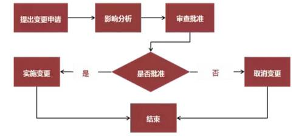

A.评估影响记录    B.配置审计    C.变更定义    D.记录变更实施情况

#### 【答案】D

#### 【解析】P266此题考察的是变更流程，

实施整体变更控制的概述:

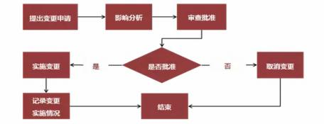

#### 【点评】常考，比较简单，必须得分

#### 【试题 36】---2017 上真题 41

36、在项目变更管理中，变更影响分析一般由（）负责。

A.变更申请提出者    B.变更管理员    C.变更控制委员会    D.项目经理

#### 【答案】D

#### 【解析】P259此题考察的是变更流程，

实施整体变更控制的概述:

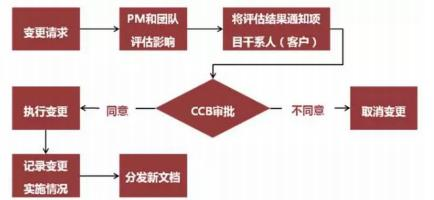

#### 【点评】常考，比较简单，必须得分

#### 【试题 37】---2017 上真题 59

37、合同变更控制系统用来规范合同变更，保证买卖双方在合同变更过程中达成一致,其内容不包 括（）。

A.变更跟踪系统    B.变更书面记录    C.变更争议解决程序    D.合同审计程序

#### 【解析】合同变更控制系统包括：变更过程的书面记录工作、变更跟踪系统、变更争议解决程序，已经各 种变更所需的审批层次。

十四、信息安全管理

考点分析与预测： 信息安全在本试中一般会涉及到 2-3 分， 主要是集中在上午考试， 关于 信息安全，在标准规范，比如机房工程里也有涉及， 而且经常考一些书上没有的知识点，希望大 家可以认真学习课本，尽力多涉足相关知识，尽力多得分，这一块是大家考试的难点之一。本章 节在本次考试中可能考查的知识点为：安全属性、实现各属性可以采用的方法和技术，计算机机 房安全、物理安全、人员安全的一些措施， 大家需要看看，系统运行安全与保密的层次构成（4 级）， 系统运行安全管理制度等等知识点，希望大家能够重视，关于信息安全的知识，我希望大家都能 够尽力的多涉足一点；

信息安全属性及目标：保密性、完整性、可用性、不可抵赖性

（1）保密性是指“信息不被泄漏给未授权的个人、实体和过程或不被其使用的特性。（15 下 22）

应用系统常用的保密技术如下：①最小授权原则 ②防暴露③信息加密④物理保密

（2）完整性是信息未经授权不能进行改变的特性。即应用系统的信息在存储或传输过程中保 持不被偶然或蓄意地删除、修改、伪造、乱序、重放和插入等破坏和丢失的特性。（18 上 21）

保障应用系统完整性主要方法如下： ①协议②纠错编码方法③密码校验和方法④数字签名⑤

公证（17 上 68）（19 下 68）

（3）可用性  是应用系统信息可被授权实体访问并按需求使用的特性。即信息服务在需要时， 允许授权用户或实体使用的特性，或者是网络部分曼损或需要降级使用时，仍能为授权用户提供

有效服务的特性。

（4）不可抵赖性也称作不可否认性， 在应用系统的信息交互过程中， 确信参与者的真实同一 性。即所有参与者都不可能否认或抵赖曾经完成的操作和承诺。

2、信息安全技术体系：（1）物理安全（2）运行安全-安全审计（3） 数据安全（12 下 26）（14

上 29）（18 下 69）

应用安全是保障相关业务在计算机网络系统是安全运行，应用安全脆弱性是可能给信息化系 统带来最大损失的致命威胁，主要针对应用程序或工其在使用过程中可能出现计算、传输数据的 泄密和失窃提供安全保护措施。（15 上 26）

. 数据安全是保护在存储、操作和处理中的数据。

. 介质安全主要用来保护存储介质，包括移动硬盘、软盘、u 盘、磁带等。

. 物理安全——侧重于保护建筑物和物理场所的安全。

"  3、物理安全管理 2.电源

根据对机房安全保护的不同要求，机房供、配电分为如下几种。（10 上 24）

②紧急供电： 配置抗电压不足的基本设备、改进设备或更强设备， 如基本 UPS，改进的 UPS、 多级 UPS 和应急电源（发电机组）等。

④稳压供电：采用线路稳压器，防止电压波动对计算机系统的影响。

⑥不间断供电：采用不间断供电电源，防止电压波动、电器干扰和断电等对计算机系统的不 良影响。

3.计算机设备

计算机设备的安全保护包括设备的防盗和防毁以及确保设备的安全可用。

（1）设备的防盗和防毁。

根据对设备安全的不同要求， 设备的防盗和防毁分为如下几种。

①设备标记要求：计算机系统的设备和部件应有明显的无法去除的标记，以防更换和方便查 找赃物。（10 上 25）

②计算中心防盗。

计算中心应安装妨盗报警装置，防止从门窗进入的盗窃行为。

计算中心应利用光、电、无源红外等技术设置机房报警系统，并由专人值守，防止从门 窗进入的斑窃行为。

利用闭路电视系统对计算中心的各重要部位进行监视，并有专人值守，防止从门窗进入 的盗窃行为。

（3）机房外部设备防盗； 机房外部的设备，应采取加固防护等措施，必要时安排专人看管， 以防止盗窃和破坏。

人员进出机房和操作权限范围控制：（10 下 34）

应明确机房安全管理的责任人， 机房出入应有指定人员负责， 未经允许的人员不准进入机房； 获准进入机房的来访人员，其活动范围应受限制，并有接待人员陪同；机房钥匙由专人管理，未 经批准，不准任何人私自复制机房钥匙或服务器开机钥匙；没有指定管理人员的明确准许，任何 记录介质、文件材料及各种被保护品均不准带出机房，与工作无关的物品均不准带入机房； 机房 内严禁吸烟及带入火种和水源。

应要求所有来访人员经过正式批准，登记记录应妥善保存以备查：获准进入机房的人员， 一 般应禁止携带个人计算机等电子设备进入机房，其活动范围和操作行为应受到限制，并有机房接 待人员负责和陪同。

①机房和重要的记录介质存放间，其建筑材料的耐火等级，应符合规定的二级耐火等级； 机 房相关的其余基本工作房间和辅助房， 其建筑材料的耐火等级应不低于二级防火等级。

吊顶上和活动地板下设置火灾自动探测器，通常有两种方式。 一种方式是均匀布置，但密度 要提高， 每个探测器的保护面积为 10一15 世。另一种方式是在易燃物附近或有可能引起火灾的部

位以及回风口等处设置探测器。

2.防漏水和水灾

由于计算机系统使用电源，因此水对计算机也是致命的威胁，它可以导致计算机设备短路， 从而损害设备。所以，对机房必须采取防水措施。机房的防水措施应考虑如下几个方面。

①与主机房无关的给排水管道不得穿过主机房。

②主机房内如设有地漏，地漏下应加设水封装置，并有防止水封破坏的措施。

（3） 机房内的设备需要用水时， 其给排水干管应暗敷，引入支管宜暗装。管道穿过主机房墙

壁和楼板处，应设置套管，管道与套管之间应采取可靠的密封措施。

④机房不宜设置在用水设备的下层。

⑤机房房顶和吊顶应有防渗水措施。

⑥安装排水地漏处的楼地面应低于机房内的其他楼地面。

机房隔壁不能为卫生间或水房，因为漏水等情况会对机房造成损害， 同时机房肯定不能用水 来灭火了。（15 下 25）

3.防静电

主机房内绝缘体的静电电位不应大于 1kv。

对需要防止电磁泄露的计算机设备应配备电磁干扰设备，在被保护的计算机设备工作时电磁 干扰设备不准关机；必要时可以采用屏蔽机房。屏蔽机房应随时关闭屏蔽门； 不得在屏蔽墙上打 钉钻孔，不得在波导管以外或不经过过滤器对屏蔽机房内外连接任何线缆；应经常测试屏蔽机房 的泄露情况并进行必要的维护。

. 主机房、基本工作间应设卤代炕灭火系统

. 主机房宜采用感烟探测器，可在主机柜、磁盘机和宽行打印机附件安装探测器。空调设备应 考虑在回风口附近安装探测器。

"  4、人员安全管理

对信息系统岗位人员的管理， 应根据其关键程度建立相应的管理要求。（14 上 27）（18 上 69）

（19 上 70）（19 下 69）

（1）对安全管理员、系统管理员、数据库管理员、网络管理员、重要业务开发人员、系统维 护人员和重要业务应用操作人员等信息系统关键岗位人员进行统一管理； 允许一人多岗，但业务 应用操作人员不能由其他关键岗位人员兼任；关键岗位人员应定期接受安全培训，加强安全意识 和风险防范意识。

（2）兼职和轮岗要求： 业务开发人员和系统维护人员不能兼任或担负安全管理员、系统管理 员、数据库管理员、网络管理员和重要业务应用操作人员等岗位或工作：必要时关键岗位人员应 采取定期轮岗制度。

（3） 权限分散要求： 在上述基础上， 应坚持关键岗位“权限分散、不得交叉覆盖” 的原则，系 统管理员、数据库管理员、网络管理员不能相互兼任岗位或工作。

（4）多人共管要求： 在上述基础上， 关键岗位人员处理重要事务或操作时，应保持二人同时 在场，关键事务应多人共管。

（5）全面控制要求： 在上述基础上， 应采取对内部人员全面控制的安全保证措施，对所有岗 位工作人员实施全面安全管理。

对人员高岗的管理，可以根据离岗人员的关键程度， 采取下列控制措施。

（I）基本要求： 立即中止被解雇的、退休的、辞职的或其他原因离开的人员的所有访问权限； 收回所有相关证件、徽章、密钥和访问控制标记等； 收回机构提供的设备等。

（2）调离后的保密要求：在上述基础上，管理层和信息系统关键岗位人员调离岗位，必须经 单位人事部门严格办理调离手续，承诺其调离后的保密要求。

（3） 离岗的审计要求： 在上述基础上， 设计组织机构管理层和信息系统关键岗位的人员调离 单位，必须进行离岗安全审查，在规定的脱密期限后，方可调离。

应及时修改相关密码和口令。（09 下 27）（11 上 26）（16 上 25）

安全、数据域安全。（09 下 26）（10 上 26）（10 下 33）（17 下 69）（19 上 69）程序资源访问控制

（1）系统级安全。

安全的粒度大小界于系统级安全和功能性安全两者之间，是最常见的应用系统安全问题，几乎所 有的应用系统都会涉及这个安全问题。

企业应用系统越来越复杂，因此制定得力的系统级安全策略才是从根本上解决问题的基础。 应通过对现行系统安全技术的分析， 制定系统级安全策略， 策略包括敏感系统的隔离、访问 IP 地 址段的限制、登录时间段的限制、会话时间的限制、连接数的限制、特定时间段内登录次数的限 制以及远程访问控制等， 系统级安全是应用系统的第一道防护大门。

（2）资源访问安全。

对程序资源的访问进行安全控制，在客户端上，为用户提供和其权限相关的用户界面，仅出 现和其权限相符的菜单和操作按钮： 在服务端则对 URL 程序资源和业务服务类方法的调用进行访 问控制。

（3）功能性安全。

功能性安全会对程序流程产生影响，如用户在操作业务记录时，是否需要审核，上传附件不 能超过指定大小等。这些安全限制已经不是入口级的限制，而是程序流程内的限制，在一定程度 上影响程序流程的运行。

（4）数据域安全。（13 上 20）（18 上 70）

数据域安全包括两个层次，其一是行级数据域安全，即用户可以访问哪些业务记录， 一般以

用户所在单位为条件进行过滤；其二是字段级数据域安全，即用户可以访问业务记录的哪些字段。

7、企业要加强对应用系统安全运行管理工作的领导，每年至少组织有关部门对系统运行工作 进行一次检查。部门每季度进行一次自查。要加强对所辖范围内应用系统运行工作的监督检查。 检查可采取普查、抽查、专项检查的方式定期或不定期地进行。（11 上 26）

安全组织由单位主要领导人领导，不能隶属于计算机运行或应用部门。

8、根据应用系统所处理数据的秘密性和重要性确定安全等级， 并据此采用有关规范和制定相 应管理制度。安全等级可分为保密等级和可靠性  等级两种，系统的保密等级与可靠性等级可以不 同。保密等级应按有关规定划为绝密、机密和秘密。可靠性等级可分为三级，对可靠性要求  最高

的为 A 级，系统运行所要求的最低限度可靠性为 C 级，介于中间的为 B 级。（11 上 25）（12 下

29）（15 上 24）

9、《信息安全等级保护管理办法》将信息系统的安全保护等级分为 5 级。第一级（个人合法 权益造成损害）；第二级（个人合法权益严重损害， 或社会利益遭到损害）；第三级（公共利益造 成严重损害或国家安全造成损害）；第四级（公共利益造成特别严重损害或国家安全造成严重损 害）；第五级（国家安全造成特别严重损害）（17 上 13）（18 下 70）

10、计算机系统安全保护能力的五个等级，即： 用户自主保护级、系统审计保护级、安全标 记保护级、结构化保护级、访问验证保护级。（15 下 24）

### 11、典型的加密算法：

| 算法 | 典型代表 | 特征 |
|---|---|---|
| 对称密钥 算法 | SDBI、IDEA（128 位）、RC4、DES（64 位）、3DES（128 位） 相关协议有 Kerberos，该认证首先要向密钥分 发中心 KDC 发送初始票据 TGT 来请求会话票据， 以 便获取服务器提供的服务。（15 上 25） | 加密和解密采用相同的密钥，加密速度快，一 般用来加密大批量数据 |
| 非对称密 钥算法 | RSA（一般为 512 位，最高可达 1024 位）、ECC RSA 基于大数分解，ECC 椭圆曲线。 相关协议有 PKI | 加密和解密采用不同的密码，发送者用接收者 的公钥（可以公开的密钥）加密，接收者收到 信息后要用自己的私钥解密。加密速度较慢，	 一般用在少量数据的加密中 |
| HASH算法 | SDH、SHA、MD5 | 具有不可逆性，用于签名和用户身份验证、不 可抵赖性 |

算法缺点：加密算法简单；密钥分发困难。加密和解密用同一个密钥，是对称密钥。（15 下 26）

非对称密钥算法，公钥加密，私钥解密。优点：加密算法复杂，密钥长度任意；适宜一对多 的信息加密交换。缺点：加解密速度慢；秘钥管理复杂；

本章历年考题和答案解析汇总：

#### 【试题 1】---2009 下真题 25

1、应用数据完整性机制可以防止（1） 。

（1）A.假冒源地址或用户地址的欺骗攻击    B.抵赖做过信息的递交行为

C.数据中途被攻击者窃听获取         D.数据在途中被攻击者篡改或破坏

#### 【解析】数据完整性是指“保证数据的一致性， 防止数据被非法用户篡改”。

#### 【试题 2】---2009 下真题 26

2、应用系统运行中涉及的安全和保密层次包括 4 层，这 4 个层次按粒度从粗到细的排列顺序是一（2）。

（2）A.数据域安全、功能性安全、资源访问安全、系统级安全

B.数据域安全、资源访问安全、功能性安全、系统级安全

C.系统级安全、资源访问安全、功能性安全、数据域安全

D.系统级安全、动能性安全、资源访问安全、数据域安全

#### 【解析】 系统运行安全与保密的层次构成中指出：应用系统运行中涉及的安全和保密层次， 按照粒度 从粗到细的排序是系统级安全、资源访问安全、功能性安全和数据域安全。

#### 【点评】常考，命题的热点，简单题， 必须得分

#### 【试题 3】---2009 下真题 27

3、为了确保系统运行的安全， 针对用户管理，下列做法不妥当的是（3）。

（3）A.建立用户身份识别与验证机制，防止非法用户进入应用系统

B.用户权限的分配应遵循“最小特权”原则

C.用户密码应严格保密， 并定时更新

D.为了防止重要密码丢失， 把密码记录在纸质介质上

#### 【解析】 系统运行的安全管理中关于用户管理制度的内容包括建立用户身份识别与验证机制，防止非  法用户进入应用系统；对用户及其权限的设定进行严格管理， 用户权限的分配遵循“最小特权 ” 原则；用户密码应严格保密，并及时更新；重要用户密码应密封交安全管理员保管，人员调离时  应及时修改相关密码和口令。

#### 【试题 4】 ---2010 上真题 24

4 、 某机房部署了多级 UPS  和线路稳压器， 这是出于机房供电的（4）需要。

A.分开供电和稳压供电     B.稳压供电和电源保护

C.紧急供电和稳压供电     D.不间断供电和安全供电

#### 【解析】 根据对机房安全保护的不同要求，机房供、配电分为如下几种:

①分开供电：机房供电系统应将计算机系统供电与其他供电分开，并配备应急照明装置。

②紧急供电：配置抗电压不足的基本设备、改进设备或更强设备， 如基本 UPS,改进的 UPS、多

级 UPS 和应急电源（发电机组）等。

③备用供电：建立备用的供电系统，以备常用供电系统停电时启用， 完成对运行系统必要的保留。 ④稳压供电：采用线路稳压器，防止电压波动对计算机系统的影响。

⑤电源保护：设置电源保护装置， 如金属氧化物可变电阻、二极管、气体放电管、滤波器、电 压调整变压器和浪涌滤波器等，防止/减少电源发生故障。

⑥不间断供电：采用不间断供电电源， 防止电压波动、电器干扰和断电等对计算机系统的不良影响。 ⑦电器噪声防护：采取有效措施，减少机房中电器噪声干扰，保证计算机系统正常运行。

⑧突然事件防护：采取有效措施， 防止减少供电中断、异常状态供电（指连续电压过载或低电 压）、电压瞬变、噪声（电磁干扰）以及由于雷击等引起的设备突然失效事件的发生。

根据上述定义，采用 UPS 和线路稳压器是分别出于机房紧急供电和稳压供电的需要

#### 【试题 5】---2010 上真题 25

5、以下关于计算机机房与设施安全管理的要求，（5）是不正确的。

A.计算机系统的设备和部件应有明显的标记， 并应便于去除或重新标记

B.机房中应定期使用静电消除剂， 以减少静电的产生

C.进入机房的工作人员， 应更换不易产生静电的服装

D.禁止携带个人计算机等电子设备进入机房

#### 【解析】 对计算机机房的安全保护包括机房场地选择、机房防火、机房空调、降温、机房防水与防潮、 机房防静电、机房接地与防雷、机房电磁防护等。答案选项涉及的相关要求如下:

标记和外观：系统设备和部件应有明显的无法擦去的标记。

服装防静电：人员服装采用不易产生静电的衣料，工作鞋采用低阻值材料制作。 静电消除要求：机房中使用静电消除剂，以进一步减少静电的产生。

机房物品：没有管理人员的明确准许，任何记录介质、文件资料及各种被保护品均不准带出机 房，磁铁、私人电子计算机或电设备等不准带入机房。

分析上述要求和答案选项，答案选项 A 中“设备和部件应有明显的标记，并应便于去除或重  新标记”的提法与上述“标记和外观”要求中的“系统设备和部件应有明显的无法擦去的标记 ” 不符。应选择 A。

#### 【试题 6】---2010 上真题 26

6、某企业应用系统为保证运行安全， 只允许操作人员在规定的工作时间段内登录该系统进行业务 操作，这种安全策略属于（6）层次。

（6）A.数据域安全        B.功能性安全  C.资源访问安全       D.系统级安全

#### 【解析】应用系统运行中安全和保密层次:[系统级、资源访问、功能性,数据]安全

4个层次的安全，按照粒度从粗到细的排序:系统级安全、资源访问安全、功能性安全、数据域安全。程序资源访问控制安全的粒度大小界于系统级安全和功能性安全两者之间，是最常见的应用系统安全问题，几乎所有的应用系统都会涉及这个安全问题。

（1）系统级安全

企业应用越来越复杂，因此制定得力的系统级安全策略才是从根本上解决问题的基础。通过 对现行安全技术的分析，制定系统级安全策略，策略包括敏感系统的隔离、访问 IP 地址段的限制、 登录时间段的限制、会话时间的限制、连接数的限制、特定时间段内登录次数的限制以及远程访 问控制等，系统级安全是应用系统的第一级防护大门。

（2）资源访问安全  （3）功能性安全 （4）数据域安全

数据域安全包括两个层次，其一是行级数据域安全，即用户可以访问哪些业务记录，一般以用户所在单位为条件进行过滤；其二是字段级数据域安全，即用户可以访问业务记录的哪些字段。不同的应用系统数据域安全的需求存在很大的差别， 业务相关性比较高。

根据上述定义，只允许操作人员在规定的工作时间段内登录该系统进行业务操作，属于“系 统级安全”层次。

#### 【试题 7】---2010 上真题 27

7、基于用户名和口令的用户入网访问控制可分为（7）三个步骤。

A.用户名的识别与验证、用户口令的识别与验证、用户账号的默认限制检查

B.用户名的识别与验证、用户口令的识别与验证、用户权限的识别与控制

C.用户身份识别与验证、用户口令的识别与验证、用户权限的识别与控制

D.用户账号的默认限制检查、用户口令的识别与验证、用户权限的识别与控制

#### 【解析】入网访问控制为网络访问提供了第一层访问控制。它控制哪些用户能够登录到服务器并获取 网络资源，控制准许用户入网的时间和准许他们在哪台工作站入网。用户的入网访问控制可分为3个步骤：用户名的识别与验证、用户口令的识别与验证、用户账号的默认限制检查。3道关卡中只要任何一关未过，该用户便不能进入该网络。对网络用户的用户名和口令进行验证是防止非法 访问的第一道防线。为保证口令的安全性，用户口令不能显示在显示屏上，口令长度应不少于6 个字符，口令字符最好是数字、字母和其他字符的混合，用户口令必须经过加密。用户还可采用 一次性用户口令，也可用便携式验证器（如智能卡） 来验证用户的身份。网络管理员可以控制和 限制普通用户的账号使用、访问网络的时间和方式。用户账号应只有系统管理员才能建立。

因此， 基于用户名和口令的用户入网访问控制可分为用户名的识别与验证、用户口令的识别与验证、用户账号的默认限制检查等三个步骤。

#### 【试题 8】---2010 下真题 32

8、关于计算机机房安全保护方案的设计，以下说法错误的是（8）。

（8）A.某机房在设计供电系统时将计算机供电系统与机房照明设备供电系统分开

B.某机房通过各种手段保障计算机系统的供电，使得该机房的设备长期处于 7*24  小时连续 运转状态

C.某公司在设计计算机机房防盗系统时， 在机房布置了封闭装置，当潜入者触动装置时， 机 房可以从内部自动封闭，使盗贼无法逃脱

D.某机房采用焊接的方式设置安全防护地和屏蔽地

#### 【解析】 机房防盗重在防止侵入， 一旦有人试图侵入，应及时报警。机房防盗不是捉耗子，机房里的 设备、数据、系统比盗贼更为重要。而一些机房如放置网站服务器的机房、银行的机房等，其中 的设备的确需要 7*24 小时连续不间断地运行。

#### 【试题 9】---2010 下真题 33

9、应用系统运行中涉及的安全和保密层次包括系统级安全、资源访问安全、功能性安全和数据域 安全。以下关于这四个层次安全的，错误的是（）。

（9）A.按粒度从粗到细排序为系统级安全、资源访问安全、功能性安全、数据域安全

B.系统级安全是应用系统的第一道防线

C.所有的应用系统都会涉及资源访问安全问题

D.数据域安全可以细分为记录级数据域安全和字段级数据域安全

#### 【解析】 应用系统运行中涉及的安全和保密层次包括系统级安全、资源访问安全、功能性安全和数据 域安全。这 4 个层次的安全， 按粒度从粗到细的排序是：系统级安全、资源访问安全、功能性安全、 数据域安全。（可见 A 是正确的。）程序资源访问控制安全的粒度大小界于系统级安全和功能性安 全两者之间，是最常见的应用系统安全问题，凡乎所有的应用系统都会涉及这个安全问题。（2）资源访问安全

对程序资源的访问进行安全控制，在客户端上，为用户提供和其权限相关的用户界面，仅出 现和其权限相符的菜单和操作按钮；在服务端则对URL程序资源和业务服务类方法的调用进行访问 控制。可见不是“所有的应用系统都会涉及资源访问安全问题”，C 是错误的。

#### 【试题 10】---2010 下真题 34

10、某公司接到通知，上级领导要在下午对该公司机房进行安全检查，为此公司做了如下安排： ①了解检查组人员数量及姓名，为其准备访客证件

②安排专人陪同检查人员对机房安全进行检查

③为了体现检查的公正，下午为领导安排了一个小时的自由查看时间

④根据检查要求，在机房内临时设置一处吸烟区， 明确规定检查期间机房内其他区域严禁烟火 上述安排符合《GB/T20269-2006 信息安全技术信息系统安全管理要求》的做法是（10）。

（10）A.③④      B.②③        C.①②        D.②④

#### 【答案】C

#### 【解析】 此题考察的是安全管理要求，

在《信息安全技术信息系统安全管理要求）物理安全管理中给出了技术控制方法（1）检测监视系统

应建立门禁控制手段，任何进出机房的人员应经过门禁设施的监控和记录，应有防止绕过门  禁设施的手段（可见“（3）为了体现检查的公正，下午为领导安排了一个小时的自由查看时间 ” 是错误的）；门禁系统的电子记录应妥善保存以备查；进入机房的人员应佩戴相应证件（可见“①  了解检查组人员数量及姓名，为其准备访客证件”是正确的）；未经批准，禁止任何物理访问；未  经批准，禁止任何人移动计算机相关设备或带离机房。机房所在地应有专设警卫，通道和入口处  应设置视频监控点。24 小时值班监视；所有来访人员的登记记录、门禁系统的电子记录以及监视录  像记录应妥善保存以备查；禁止携带移动电话、电子记事本等具有移动互联功能的个人物品进入机  房。

（2）人员进出机房和操作权限范围控制

应明确机房安全管理的责任人， 机房出入应有指定人员负责， 未经允许的人员不准进入机房; 获准进入机房的来访人员，其活动范围应受限制，并有接待人员陪同（可见“②安排专人陪同检 查人员对机房安全进行检查”是正确的） ；机房钥匙由专人管理，未经批准， 不准任何人私自复制 机房钥匙或服务器开机钥匙；没有指定管理人员的明确准许， 任何记录介质、文件材料及各种被保 护品均不准带出机房， 与工作无关的物品均不准带入机房；机房内严禁吸烟及带入火种和水源（可 见“④根据检查要求，在机房内临时设置一处吸烟区，明确规定检查期间机房内其他区域严禁烟 火”是错误的）。

应要求所有来访人员经过正式批准， 登记记录应妥善保存以备查；获准进入机房的人员， 一般 应禁止携带个人计算机等电子设备进入机房，其活动范围和操作行为应受到限制，并有机房接待 人员负责和陪同。

#### 【试题 11】---2011 上真题 25

11、信息安全的级别划分有不同的维度， 以下级别划分正确的是（11）。

A.系统运行安全和保密有5个层次，包括设备级安全、系统级安全、资源访问安全、功能性安全和数据安全

B.机房分为 4 个级别： A 级、 B 级、 C 级、 D 级

C.根据系统处理数据划分系统保密等级为绝密、机密和秘密

D.根据系统处理数据的重要性，系统可靠性分 A 级和 B 级

#### 【答案】C

#### 【解析】 根据《电子信息系统机房设计规范》（GB 50174-2008 ）可知，电子信息系统机房分为三级，由高到低分别为 A 级、B 级和 C 级。应用系统中涉及的安全保密层次包括系统级安全、资源访问安全、功能性安全和数据域安全。 安全等级可分为保密等级和可靠性等级两种，系统的保密等级与可靠性等级可以不同。保密等级应按有关规定划为绝密、机密和秘密。可靠性等级可分为三级， 对可靠性要求最高的是 A 级，系

统运行所要求的最低限度可靠性为 C 级，介于中间的为 B 级。综上可知，保密等级应按有关规定划为绝密、机密和秘密

#### 【试题 12】---2011 上真题 26

12、系统运行安全的关键是管理，下列关于日常安全管理的做法，不正确的是（12）。A.系统开发人员和系统操作人员应职责分离

B.信息化部门领导安全管理组织，一年进行一次安全检查

C.用户权限设定应遵循“最小特权”原则

D.在数据转储、维护时要有专职安全人员进行监督

#### 【解析】在系统运行的安全管理组织中，安全组织由单位主要领导人领导，不能隶属于计算机运行或应用 部门。在系统运行操作规程中，对系统开发人员和系统操作人员要进行职责分离。在用户管理制  度中，对用户及其权限的设定应进行严格管理，用户权限的分配必须遵循“最小特权”原则。在  系统运行维护制度中，对系统进行维护时，应采取数据保护措施。如数据转储、涂抹、卸下磁盘  磁带， 维护时安全人员必须在场等。 选项 B 是不正确的，应由单位领导牵头负责而不应部门领导。

#### 【试题 13】---2011 上真题 27

13、在某次针对数据库的信息安全风险评估中，发现其中对财务核心数据的逻辑访问密码长期不 变。基于以上现象， 下列说法正确的是（13）。

（13）A.该数据不会对计算机构成威胁，因此没有脆弱性

B.密码和授权长期不变是安全漏洞，属于该数据的脆弱性

C.密码和授权长期不变是安全漏洞，属于对该数据的威胁

D.风险评估针对设施和软件，不针对数据

#### 【答案】B

#### 【解析】 此题考察的是安全知识，理解题，

威胁、脆弱性、影响之间存在着一定的对应关系， 威胁可看成从系统外部对系统产生的作用， 而导致系统功能及目标受阻的所有现象。而脆弱性则可以看成是系统内部的薄弱点。脆弱性是客 观存在的，脆弱性本身没有实际的伤害，但威胁可以利用脆弱性发挥作用。假设威胁不存在，系  统本身的脆弱性仍然带来一定的风险。系统本身脆弱性导致的损失，与威胁不一定相关。

密码和授权长期不变是系统内部客观存在的薄弱点， 因此属于脆弱性，应选 B。

#### 【点评】信息安全，稍微理解分析下不难，尽量得分

#### 【试题 14】---2011 下真题 24

14、完整性是信息系统未经授权不能进行改变的特性，它要求保持信息的原样。下列方法中，不 能用来保证应用系统完整性的措施是（14）。

（14）A.安全协议     B.纠错编码    C.数字签名    D.信息加密

#### 【解析】 完整性是信息未经授权不能进行改变的特性。即应用系统的信息在存储或传输过程中保持不 被偶然或者蓄意地删除、修改、伪造、乱序、重放和插入等破坏和丢失的特性。完整性是一种面 向信息的安全性，它要求保持信息的原样，即信息的正确生成及正确存储和传输。

完整性与保密性不同，保密性要求信息不被泄露给未授权的人，而完整性则要求信息不致受到各种原因的破坏。

保障应用系统完整性的主要方法包括：协议、纠错编码、密码教育和方法、数字签名、公证。

#### 【试题 15】---2011 下真题 25

15、在信息系统安全技术体系中，环境安全主要指中心机房的安全保护。以下不属于该体系环境 安全内容的是（15）。

A.设备防盗器    B.接地和防雷击    C.机房控制    D. 防电磁泄漏

#### 【解析】 选项 B.C.D 属于中心机房的安全保护范畴。选项“A.设备防盗器”属于防备单个设备的被盗，而不是防止整个机房被盗

#### 【试题 16】---2011 下真题 26

16、物理安全是整个信息系统安全的前提，以下安全防护措施中不属于物理安全范畴的是（16）。 A.安装烟感、温感报警系统，禁止工作人员在主机房内吸烟或者使用火源

B.要求工作人员在主机房内工作时必须穿着防静电工装和防静电鞋，并定期喷涂防静电剂

C.为工作人员建立生物特征信息库，并在主机房入口安装指纹识别系统，禁止未经授权人员进入主机房

D.对因被解雇、退休、辞职活其他原因离开信息系统岗位的人员，收回所有相关证件、徽 章、密匙和访问控制标记等

#### 【解析】选项 D 属于“人员安全管理”，不属于物理安全。

#### 【试题 17】---2011 下真题 27

17、以下各项措施中，不能够有效防止计算机设备发生电磁泄漏的是（17）。

（17）A.配备电磁干扰设备，且在被保护的计算机设备工作时不能关机

B.设置电磁屏蔽室，将需要重点保护的计算机设备进行隔离

C.禁止在屏蔽墙上打钉钻孔，除非连接的是带金属加强芯的光缆

D.信号传输线、公共地线以及电源线上加装滤波器

#### 【解析】对需要防止电磁泄漏的计算机设备应配备电磁干扰设备，在被保护的计算机设备工作时电磁干扰设备不能关机；必要时可以采用屏蔽机房。屏蔽机房应随时关闭屏蔽门；不得在屏蔽墙上打钉钻孔，不得在波导管以外或不经过过滤器对屏蔽机房内外连接任何线缆；应经常测试屏蔽机房的泄 漏情况并进行必要的维护。尽管光缆不会电磁泄漏，但电磁可以通过屏蔽墙上的钻孔泄漏。

#### 【试题 18】---2012 上真题 26

18、系统运行安全和保护的层次按照粒度从粗到细排序为（18） 。

A.系统级安全，资源访问安全，数据域安全， 功栽性安全

B.系统级安全，资源访问安全，功能性安全，数据域安全

C.资源访问安全，系统级安全，数据域安全，功能性安全

D.资源访问安全， 系统级安全，功能性安全， 数据域安全

#### 【解析】系统安全与保密层次按粒度由粗到细：系统级安全、资源访问级安全、功能性安全、数据域级安全

#### 【试题 19】---2012 上真题 27

19、以下不属于主动式攻击策略的是（19）。

A.中断    B.篡改    C.伪造    D.窃听

#### 【解析】 此题考察的是威胁，理解题，

计算机网络上的通信面临以下的四种威胁：

（1） 截获—从网络上窃听他人的通信内容

（2） 中断—有意中断他人在网络上的通信。

（3） 篡改—故意篡改网络上传送的报文

（4） 伪造—伪造信息在网络上传送。

通常，网络安全攻击可分为被动攻击和主动攻击两类。

被动攻击的特性是对传输过程中的信 息进行窃听和监测， 例如流量分析和信息内容泄露等。

主动攻击包括对数据流进行中断、篡改或 伪造，主要包括数据伪装、消息重放、消息篡改和分布式拒绝服务等。

#### 【试题 20】---2012 下真题 25

20、在信息系统安全管理中，业务流控制，路由选择控制和审计跟踪等技术主要用于提高信息系 统的（20）。

A.保密性         B.可用性         C.完整性       D.不可抵赖性

#### 【解析】在信息系统安全管理中，可用性是应用系统信息可被授权实体访问并按需求使用的特性。用 于提高信息系统的可用性的主要技术有身份识别与确认、访问控制、业务流控制、路由选择控制 和审计跟踪等。

信息加密、物理保密、防暴露、最小授权原则等是应用系统常用的保密技术。

安全协议、数字签名、纠错编码方法、密码校验和方法、公证等是保障应用系统完整性的主要方法。

#### 【试题 21】---2012 下真题 26

21、根据《信息安全技术信息系统安全通用性技术要求 GB/T27201-2006》，信息系统安全的技术 体系包括（21）。

A.物理安全、运行安全、数据安全   B.物理安全、网络安全、运行安全

C.人类安全、资源安全、过程安全   D.方法安全、过程安全、工具安全

#### 【解析】 信息系统安全技术体系有：（1）物理安全（2） 运行安全（3）数据安全。

#### 【试题 22】---2012 下真题 29

22、按照系统安全等级中的可靠性等级由高到低分别为（）。

A.绝密、机密、秘密       B.军用、商用、民用

C.A 级、 B 级、 C 级      D.使用级、修改级、控制级

#### 【解析】 信息系统安全等级可分为保密等级和可靠性等级两种

保密等级应按有关规定划分为绝密、机密和秘密；

可靠性等级可分为A.B.C三级，对可靠性要求最高的为A级，最低为C级。

#### 【试题 23】---2013 上真题 20

23、应用系统运行的安全管理中心，数据域安全是其中非常重要的内容数据域安全包括 ()。

A.行级数据域安全，字段级数据域安全    B.系统性数据域安全，功能性数据域安全

C.数据资源安全，应用性数据安全       D.组织级数据域安全，访问性数据域安全

#### 【解析】数据域安全包括2个层次，一是行级数据域安全，即用户可以访问哪些业务记录，一般以 用户所在单位为条件进行过滤；二是字段级数据域安全，即用户可以访问业务记录的哪些字段。

#### 【试题 24】---2013 下真题 24

24、某公司系统安全管理员在建公司的“安全管理体系”时， 根据 GB/T20269-2006《信息安全技 术  信息系统安全管理要求》，对当前公司的安全风险进行了分析和评估， 他分析了常见病毒对计

算机系统、数据文件等的破坏程度及感染特点，制定了相应的防病毒措施。这一做法符合（24） 的要求。

A.资产识别和评估  B.威胁识别和分析  C.脆弱性识别和分析   D.等保识别和分析

#### 【解析】信息系统安全风险分析和评估的管理要求主要包括： 资产识别和分析、威胁识别和分析、 脆 弱性识别和分析、风险分析和评估要求。 根据题干描述的对当前公司的安全风险进行了分析和评 估，他分析了常见病毒对计算机系统、数据文件等的破坏程度及感染特点，制定了相应的防病毒措施。

#### 【试题 25】---2013 下真题 25

25、信息安全策略应该全面地保护信息系统整体的安全，网络安全体系设计是逻辑设计工作的重 要内容之一，可从物理线路安全、网络安全、系统安全、应用方面来进行安全体系的设计与规则。 其中，数据库的容灾属于（25）的内容。

A.物理线路安全与网络安全           B.网络安全与系统安全

C.物理线路安全与系统安全           D.系统安全与应用安全

#### 【解析】 网络安全体系设计是逻辑设计工作的重要内容之一，数据库容灾属于系统安全和应用安全考虑范畴。数据库容灾， 即在异地部署一个一模一样的数据库，一个数据库所处的地理位置发生自燃灾害了导致当前数据库发生灾难，另一个数据库会立马顶替工作。

#### 【试题 26】---2013 下真题 26

26、以下不属于物理访问控制要点的是（26）。

A.硬件设施在合理范围内是否能防止强制入侵

B.计算机设备的钥匙是否具有良好的控制

C.计算机设备电源供应是否能适当控制在合理的规格范围内

D.计算机设备在搬动时是否需要设备授权通行的证明

#### 【答案】C

#### 【解析】物理访问控制是设计用以保护组织防止未授权的访问， 并限制只

有经过管理阶层授权的人员才能进入。物理访问控制要点主要包括：

（1）硬件设施在合理范围内是否能防止强制入侵。

（2）计算机设备的钥匙是否有良好的控制以降低未授权者进入的危险。

（3）智能终端是否上锁或有安全保护， 以防止电路板、芯片或计算机被搬移。  	（4）计算机设备在搬动时是否需要设备授权通行的证明。

对于应用系统中的数据库应考虑定期定时备份的方式进行容灾保护，这属于应用安全和系统安全 方面的设计内容。

#### 【试题 27】---2013 下真题 27

27 、MD5 常用于数据（27）保护。

（27）A.校验     B.完整    C.机密     D.可靠

#### 【解析】 消息认证又称为完整性校验，能使接收者识别信息源的真伪、信息内容的真伪和消息的时间戳是否正确。MD5 和 SHA-1 是常用的消息认证算法（或函数）

#### 【试题 28】---2014 上真题 26

28、在设计计算机机房时，（） 做法是不恰当的。

A.机房设置在 20 层大楼的 18 层，该楼层人员流动最少

B.机房设置在大楼偏角上，远离停车场及运输通道等公共区域

C.考察机房所在附近区域，避开油库和其它易燃物

D.为机房设置较完备的中央空调系统，保证机房各区域温度变化满足计算机系统要求

#### 【解析】 第 2.1.1 条电子计算机机房在多层建筑或高层建筑物内宜设于第二、三层。

第 2.1.2 条电子计算机机房位置选择应符合下列要求：

一、水源充足、电子比较稳定可靠，交通通讯方便，自然环境清洁；

二、远离产生粉尘、油烟、有害气体以及生产或贮存具有腐蚀性、易燃、易爆物品的工厂、仓库、堆场等； 三、远离强振源和强噪声源；

四、避开强电磁场干扰。

机房不宜设置在楼上，设备不方便运输，解决漏水、承重、制冷的成本更高。

#### 【试题 29】---2014 上真题 27

29、具有保密资质的公司中一名涉密的负责信息系统安全的安全管理员提出了离职申请，公司采 取的以下安全控制措施中，（29）可能存在安全隐患.

A.立即终止其对安全系统的所有访问权限

B.收回所有相关的证件、徽章、密钥、访问控制标志、提供的专用设备等

C.离职员工办理完人事交接，继续工作一个月后离岗

D.和离职人员签订调离后的保密要求及协议

#### 【解析】 继续工作一个月以后离岗，存在较大的安全隐患。

#### 【试题 30】---2014 上真题 30

30、依据 GB/T20271-2006《信息系统安全技术信息系统通用安全技术要求》中的规定，（）不 属于信息系统安全技术体系包含的内容。

（30）A.物理安全   B.运行安全   C.人员安全   D.数据安全

#### 【解析】信息系统安全技术体系包括：物理安全、运行安全、数据安全

#### 【试题 31】---2015 上真题 23

31、不同安全等级的安全管理机构应该建立自己的信息系统安全组织机构管理体系。在该体系中， 最低级别的安全管理要求是（）。

A.建立信息安全保密管理部门   B.成立安全领导小组

C.建立安全职务部门           D.配备安全管理人员

#### 【试题 32】---2015 上真题 24

32、信息安全的级别划分为不同的维度，在下列划分中，正确的是（）。

A.系统运行安全和保密有 5 个层次，包括设备级安全、系统级安全、资源访问安全、功能性 安全和数据安全

B.机房分为 4 个级别： A 级、 B 级、 C 级、 D 级

C.根据系统处理数据的重要性，系统可靠性分 A 级和 B 级

D.根据系统处理数据划分系统保密等级为绝密、机密和秘密

应用系统运行中涉及的安全和保密层次包括系统级安全、资源访问安全、功能性安全和数据域安全。 ①系统安全等级管理。

应用系统运行中涉及的安全和保密层次包括系统级安全、资源访问安全、功能性安全和数据 域安全。这4个层次的安全，按粒度从粗到细的排序是：系统级安全、资源访问安全、功能 性安全、数据域安全。几乎所有的应用系统都会涉及这个安全问题。

电子信息系统机房应划分为 A、B、C 三级。设计时应根据机房的使用性质、管理要求及其在 经济和社会中的重要性确定所属级别。

根据系统处理数据划分系统保密等级为绝密、机密和秘密

可靠性等级可分为三级，对可靠性要求屈高的为 A 级，系统运行所要求的最低限度可靠性为 C

级，介于中间的为 B 级。

#### 【试题 33】---2015 上真题 25

33、下列属于对称密切加密算法的是（）。

A.RSA 加密体制    B.DES 加密体制     C.BCC 加密体制     D.ELGamal 加密体制

#### 【解析】 对称加密算法是应用较早的加密算法， 技术成熟。在对称加密算法中， 数据发信方将明文（原 始数据）和加密密钥一起经过特殊加密算法处理后， 使其变成复杂的加密密文发送出去。收 信方收到密文后，若想解读原文，则需要使用加密用过的密钥及相同算法的逆算法对密文进 行解密，才能使其恢复成可读明文。在对称加密算法中，使用的密钥只有一个，发收信双方 都使用这个密钥对数据进行加密和解密，这就要求解密方事先必须知道加密密钥。

具体算法： DES 算法，3DES 算法， TDEA 算法， Blowfish 算法， RC5 算法， IDEA 算法。

#### 【试题 34】---2015 上真题 26

34、针对应用程序或工具在使用过程中可能出现计算、传输数据的泄露和失窃，通过其他安全工 具或策略来消除隐患属于安全保护措施中的（）。

A.应用安全    B.物理安全    C.介质安全     D.数据安全

#### 【解析】 此题考察的是信息安全，必须掌握，常考

应用安全是保障相关业务在计算机网络系统是安全运行，应用安全脆弱性是可能给信息化系统带 来最大损失的致命威胁，主要针对应用程序或工其在使用过程中可能出现计算、传输数据的泄密 和失窃提供安全保护措施。

数据安全是保护在存储、操作和处理中的数据。

介质安全主要用来保护存储介质，包括移动硬盘、软盘、u 盘、磁带等。

物理安全——侧重于保护建筑物和物理场所的安全。

#### 【试题 35】---2015 下真题 22

35、某公司财务管理数据只能提供给授权用户， 通过采取安全管理措施确保不能被未授权的个人、 实体或过程利用或知悉，以确保数据的（ ）;

A.保密性   B.完整性   C.可用性  D.稳定性

#### 【解析】 网络安全中的保密性是指信息按给定要求不泄漏给非授权的个人、实体或过程。

#### 【试题 36】---2015 下真题 23

36、访问控制是信息安全管理的重要内容之一，以下关于访问控制规则的叙述中，（） 是不正确的 A.应确保授权用户对信息系统的正常访问

B. 防止对操作系统的未授权访问

C. 防止对外部网络未经授权进行访问，对内部网络的访问则没有限制

D.访问对应用系统中的信息未经授权进行访问

#### 【解析】 访问控制是为了限制访问主体对访问客体的访问权限，从而使计算机系统在合法范围内使用的安 全措施

#### 【试题 37】---2015 下真题 24

37、依据（2007）43 号《信息安全等级保护管理办法》，我国对信息系统的安全保护等级分为（） 级

（37）A.三    B.五    C. 四       D.二

#### 【解析】 计算机系统安全保护能力的 5 个等级：用户自主保护级、系统审计保护级、安全标记保护级、结构化保护级、访问验证保护级。

#### 【试题 38】---2015 下真题 25

38、为了保护计算机机房及其设备的安全，（ ）做法是不合适的。

A.机房地板的阻止应控制在不易产生静电的范围

B.机房隔壁为卫生间或水房，一旦发生火灾便于取水灭火

C.机房的供电系统应将计算机系统供电与其他供电分开

D.机房设备应具有明显的且无法去除的标记， 以防更换和便于追查

#### 【解析】 机房隔壁不能为卫生间或水房，因为漏水等情况会对机房造成损害，同时机房肯定不能用水来灭火了。

#### 【试题 39】---2015 下真题 26

39、为保障数据的存储和运输安全，防止信息泄露， 需要对一些数据进行加密。由于对称密码算 法（ ），所以特别适合对大量的数据进行加密。

A.比非对称密码算法更安全   B. 比非对称密码算法密钥更长

C. 比非对称密码算法效率更高 D.还能同时用于身份认证

#### 【解析】 对称与非对称密码算法都可以用于加密，但是由于对称密码算法加解密效率比非对称算法高很多， 因此常用于对大量数据的加密。

#### 【试题 40】---2016 上真题 24

40、计算机网络安全是指利用管理和技术措施， 保证在一个网络环境里， 信息的（40）受到保护。 A.完整性、可靠性及可用性     B.机密性、完整性及可用性

C.可用性、完整性及兼容性     D.可用性、完整性及冗余性

#### 【解析】机密性、完整性及可用性

#### 【试题 41】---2016 上真题 25

41、系统运行的安全检查是安全管理中的一项重要工作，旨在预防事故、发现隐患、指导整改。 在进行系统运行安全检查时， 不恰当的做法是（41）。

A.定期对系统进行恶意代码检查，包括病毒、木马、隐蔽通道等

B.检查应用系统的配置是否合理和适当

C.检查应用系统的用户权限分配是否遵循易用性原则

D.检查应用系统的可用性， 包括系统的中断时间、正常服务时间、恢复时间等

#### 【解析】 用户权限分配是否遵循满足其工作要求的最小性原则

#### 【试题 42】---2017 上真题 13

42、根据《关于信息安全等级保护工作的实施意见》 ,如信息系统受到破坏后,会对社会秩序和公共 利益造成较大损害,或者对国家安全造成损害,该信息系统应实施（）的信息安全保护。

A.第一级    B.第二级    C.第三级    D.第四级

#### 【答案】C

#### 【解析】P541此题考察的是信息安全等级保护，

《信息安全等级保护管理办法》将信息系统的安全保护等级分为 5 级。第一级（个人合法权益造 成损害）；第二级（个人合法权益严重损害，或社会利益遭到损害）；第三级（公共利益造成严重 损害或国家安全造成损害）；第四级（公共利益造成特别严重损害国家安全造成严重损害）；第五 级（国家安全造成特别严重损害）

#### 【点评】常考，比较简单，必须得分

#### 【试题 43】---2017 上真题 68

43、数字签名技术属于信息系统安全管理中保证信息（）的技术。

A.保密性    B.可用性    C.完整性    D.可靠性

#### 【答案】C

#### 【解析】P512此题考察的是数字签名，

信息安全属性及目标： 保密性、完整性、可用性、不可抵赖性

（1）保密性是指“信息不被泄漏给未授权的个人、实体和过程或不被其使用的特性。

应用系统常用的保密技术如下：①最小授权原则 ②防暴露（3） 信息加密④物理保密

（2）完整性是信息未经授权不能进行改变的特性。即应用系统的信息在存储或传输过程中保 持不被偶然或蓄意地删除、修改、伪造、乱序、重放和插入等破坏和丢失的特性。

保障应用系统完整性主要方法：①协议②纠错编码方法（3）密码校验和方法④数字签名⑤公证

（3）可用性是应用系统信息可被授权实体访问并按需求使用的特性。即信息服务在需要时， 允许授权用户或实体使用的特性，或者是网络部分曼损或需要降级使用时，仍能为授权用户提供 有效服务的特性。

（4）不可抵赖性也称作不可否认性， 在应用系统的信息交互过程中， 确信参与者的真实同一 性。即所有参与者都不可能否认或抵赖曾经完成的操作和承诺。

#### 【点评】常考，比较简单，必须得分

#### 【试题 44】---2017 下真题 22

44、《中华人民共和国网络安全法》与 2017 年 6 月 1  日起开始施行，（）负责统筹协调网络安全工 作和相关监督管理工作。

A. 国务院电信主管部门   B.工业和信息化部主管部门    C.公安部门    D. 国家网信部门

#### 【答案】D

#### 【解析】 此题考察的是网络安全法，必须掌握， 高频考点

《网络安全法》第八条提出国家网信部门负责统筹协调网络安全工作和相关监督管理工作。电信 主管部门、公安部门和其他有关机关依照本法和有关法律、行政法规的规定，在各自职责范围内 负责网络安全保护和监督管理工作。

#### 【点评】教材没有的内容，只能根据经验去猜了

#### 【试题 45】---2017 下真题 69

45、应用系统运行中涉及的安全和保密层次包括系统级安全、资源访问安全、功能性安全和数据 域安全。针对应用系统安全管理，首先要考虑（）。

A.系统级安全    B.资源访问安全    C.功能性安全    D.数据域安全

#### 【答案】A

#### 【解析】P537此题考察的是信息安全，

应用系统运行中涉及的安全和保密层次按粒度从大到小的排序是：系统级安全、资源访问安全、 功能性安全、数据域安全。系统级安全是应用系统的第一道防护大门。

#### 【点评】常考，比较简单，必须得分

#### 【试题 46】---2018 上真题 21

46、只有得到允许的人才能修改数据，并且能够判别出数据是否已被篡改，这体现了信息安全的 ()。

A.机密性    B.可用性    C.完整性    D.可控性

#### 【答案】C

#### 【解析】P520此题考察的是信息安全的属性，

—  保密性：信息不被泄漏给未授权的个人、实体和过程或不被其使用的特性。

—  完整性：保护资产的正确和完整的特性，就是确保接收到的数据就是发送的数据。数据不应该 被改变，这需要某种方法去进行验证。例如可以用 MD5 实现。

—  可用性：需要时，授权实体可以访问和使用的特性.磁盘和系统的容错及备份、可接受的登录 及进程性能、可靠的功能性的安全进程和机制可以来实现。路由选择控制和审计跟踪等技术 主要用于提高信息系统的可用性。

—  不可抵赖性：是指建立有效的责任机制，防止用户否认其行为，这一点在电子商务中是极其 重要的。可以通过数字签名实现。

#### 【点评】以前考过，常考，比较简单， 必须得分

#### 【试题 47】---2018 上真题 69

47、关于信息系统岗位人员的安全管理的描述， 不正确的是（）。

A.对安全管理员、系统管理员、重要业务操作人员等关键岗位进行统一管理 B.紧急情况下，关键岗位人员可独自处理重要事务或操作

C.人员离岗后，应立即中止其所有访问权限

D.业务开发人员和系统维护人员不能兼任安全管理员

#### 【答案】B

#### 【解析】P534此题考察的是信息安全岗位人员要求，

关键岗位人员处理重要事务或操作时， 应保持 2 人同时在场，关键事务应多人共管。

#### 【点评】以前考过，常考，比较简单， 必须得分

#### 【试题 48】---2018 上真题 70

48、应用系统运行中涉及的安全和保密层次包括系统级安全、资源访问安全、数据域安全等。 以下描述不正确的是（）。

A.按粒度从大到小排序为系统级安全、资源访问安全、数据域安全

B.系统级安全是应用系统的第一道防线

C.功能性安全会对程序流程产生影响

D.数据域安全可以细分为文行级数据域安全和字段级数据域安全

#### 【答案】D

#### 【解析】P538此题考察的是信息安全和保密层次，

数据域安全可以细分为行级数据域安全和字段级数据域安全

#### 【点评】以前考过，常考，比较简单， 必须得分

#### 【试题 49】---2018 下真题 69

49、在信息系统安全技术体系中，安全审计属于()

A.物理安全    B.网络安全    C.数据安全    D.运行安全

#### 【答案】D

#### 【解析】P525，此题考察的是安全审计，必须掌握， 高频考点

运行安全包括安全审计。

#### 【试题 50】---2018 下真题 70

. 根据《信息安全等级保护管理办法》规定，信息系统受到破坏后，会对社会秩序和公共利益造成 严重损害，或者对国家安全造成损害，则该信息系统的安全保护等级为（50）

A.一级    B.二级    C.三级    D.四级

#### 【答案】C

#### 【解析】P541-542。此题考察的是安全保护等级，

. 第一级，信息系统受到破坏后，会对公民、法人和其他组织的合法权益造成损害，但不损害 国家安全、社会秩序和公共利益。

. 第二级，信息系统受到破坏后，会对公民、法人和其他组织的合法权益产生严重损害，或者 对社会秩序和公共利益造成损害，但不损害国家安全。

. 第三级，信息系统受到破坏后，会对社会秩序和公共利益造成严重损害， 或者对国家安全造成损害。

. 第四级，信息系统受到破坏后，会对社会秩序和公共利益造成特别严重损害，或者对国家安 全造成严重损害。

. 第五级，信息系统受到破坏后，会对国家安全造成特别严重损害。

#### 【试题 51】---2019 上真题 69

51、应用系统运行中涉及的安全和保密层次包括系统级安全、资源访问安全、功能性安全和数据 域安全,其中粒度最小的层次是（）。

A.系统级安全    B.资源访问安全    C.功能性安全    D.数据域安全

#### 【答案】D

#### 【解析】P537 此题考察的是安全保密层次，

应用系统运行中涉及的安全和保密层次包括系统级安全、资源访问安全、功能性安全和数据域安 全。这 4 个层次的安全，按粒度从大到小的排序是：系统级安全、资源访问安全、功能性安全、 数据域安全。

#### 【试题 52】---2019 上真题 70

52、关于信息系统岗位人员安全管理的描述,不正确的是（）。

A.业务应用操作人员不能由系统管理员

B.业务开发人员不能兼任系统管理员

C.系统管理员可以兼任数据库管理员

D.关键问题人员处理重要事务或操作时， 应保持二人同时在场

#### 【答案】C

#### 【解析】P534 此题考察的是安全管理要求，

对信息系统岗位人员的管理， 应根据其关键程度建立相应的管理要求：

（1） 对安全管理员、系统管理员、数据库管理员、网络管理员、重要业务开发人员、系统维护人 员和重要业务应用操作人员等信息系统关键岗位人员进行统一管理；允许一人多岗，但业务应用 操作人员不能由其他关键岗位人员兼任；关键岗位人员应定期接受安全培训，加强安全意识和风 险防范意识。

（2）兼职和轮岗要求：业务开发人员和系统维护人员不能兼任或担负安全管理员、系统管理员、 数据库管理员、网络管理员和重要业务应用操作人员等岗位或工作；必要时关键岗位人员应采取 定期轮岗制度。C 是错误的。

（3） 权限分散要求： 在上述基础上， 应坚持关键岗位“权限分散、不得交叉覆盖”的原则，系统 管理员、数据库管理员、网络管理员不能相互兼任岗位或工作。

（4） 多人共管要求： 在上述基础上， 关键岗位人员处理重要事务或操作时， 应保持二人同时在场， 关键事务应多人共管。

（5） 全面控制要求： 在上述基础上， 应采取对内部人员全面控制的安全保证措施，对所有岗位工 作人员实施全面安全管理。

#### 【试题 53】---2019 下真题 68

53、（）技术不能保障应用系统的完整性。

A.奇偶校验法    B.数字签名    C.物理加密    D.密码校验

#### 【解析】保障应用系统完整性的主要方法如下。

（1）协议（2）纠错编码方法（3）密码校验和方法（4）数字签名（5） 公证

#### 【试题 54】---2019 下真题 69

54、关于信息系统岗位人员管理的要求，不正确的是（）。

A.安全管理员和系统管理员不能由一人兼任

B.业务开发人员不能兼任安全管理员、系统管理员

C.系统管理员、数据库管理员、网络管理员不能相互兼任岗位或工作

D.关键岗位在处理重要事物或操作时，应保证二人同时在场

十五、项目风险管理

风险管理也比较重要，可能考查的知识点为：风险识别特征，定性风险分析和定量风险分析区别，概率影响矩阵，德尔菲法、 SWOT，EMV、PERT,风险应对措施，蒙特卡洛，风险管理过程的输入、输出、工具和技术等等 等知识点。

可能命题思路：

1:给出某项目在风险管理方面的案例场景描述，要求指出该案例场景中存在哪些问 题并说明相关原因：给出解决这些问题的应对措施（或建议）；给出 1 个该案例涉及且与风险管理 基础知识点相关的简答题（或填空题、选择题、计算题。

2:给出某项目在定性（或定量）风险分析、风险监控的工具和技术（如概率及影响 矩阵、决策树、蒙特卡罗仿真技术等）所需的各种参数值和相关的案例说明，要求计算该项目的 某些参数值：要求绘制出相关的图表或将已有的图表补充完整：要求分析这些图表所反映的问题 并说明相关原因：要求给出解决这些问题的补救措施等。

| 规划风险管理-识别风险-定性风险分析-定量风险分析-应对风险计划-风险监控 | 规划风险管理-识别风险-定性风险分析-定量风险分析-应对风险计划-风险监控 | 规划风险管理-识别风险-定性风险分析-定量风险分析-应对风险计划-风险监控 | 规划风险管理-识别风险-定性风险分析-定量风险分析-应对风险计划-风险监控 |
|---|---|---|---|
| 过程名 | 输入（依据） | 工具和技术（方法） | 输出（结果） |
| 1、规划风险管理 | ①项目管理计划 ②项目章程 ③干系人登记册 ④事业环境因素 ⑤组织过程资产 | ①分析技术 ②专家判断 ③会议 | 2、 风险管理计划 |

| 2、识别风险 项目文件（更新） | ①风险管理计划 ②成本管理计划 ③进度管理计划 ④质量管理计划 ⑤人力资源管理计划 ⑥范围基准 ⑦活动成本估算 ⑧活动持续时间估算 ⑨干系人登记册 ⑩项目文件 @采购文件 ⑩事业环境因素 ⑩组织过程资产 | ①文档审查 ②信息收集技术 ③核对单分析 ④假设分析 ⑤图解技术 ⑥SWOT 分析 ⑦专家判断 | ①风险登记册 （18 上 66） |
|---|---|---|---|
| 3、定性风险分析 ①数据收集和展示技术 ②定量风险分析和建模技术 ③专家判断 | ①风险管理计划 ②范围基准 ③风险登记册 ④事业环境因素 ⑤组织过程资产 |  |  |
| 4、定量风险分析 ①项目文件（更新） | ①风险管理计划 ②成本管理计划 ③进度管理计划 ④风险登记册 | （15 下 69）（18 下 67） |  |
| 5、应对风险计划 |  | ①消极风险或威胁应对策略 ②积极风险或机会应对策略 ③应急应对策略 ④专家判断（16 下 65） | ①项目管理计划（更 新） ②项目文件（更新） |
| 6、风险监控 | ①项目管理计划 ②风险登记册 ③工作绩效数据 ④工作绩效报告 | ①风险再评估 ②风险审计 ③偏差与趋势分析 ④技术绩效测量 ⑤储备分析 ⑥会议（16 下 67）（18 下 68） | ①工作绩效信息 ②变更请求 ③项目管理计划（更新） ④项目文件（更新）  ⑤组织过程资产（更新） |

本章金色考点汇总：

1、项目风险管理过程包括如下内容：（13 上 54）

（1）规划风险管理：它是定义如何实施项目风险管理活动的过程。

（2）识别风险：它是判断哪些风险可能影响项目并记录其特征的过程。

（3） 实施定性风险分析：它是评估并综合分析风险的发生概率和影响， 对风险进行优先排序， 从而为后续分析或行动提供基础的过程。（09 下 48）（12 下 54）

（4）实施定量风险分析：它是就已识别风险对项目整体目标的影响进行定量分析的过程。 （5）规划风险应对：它是针对项目目标，制定提高机会、降低威胁的方案和措施的过程。

（6）控制风险：它是在整个项目中实施风险应对计划、跟踪已识别风险、监督残余风险、识 别新风险， 以及评估风险过程有效性的过程。

其中：（1）（2）（3）（4）（5）属于计划过程组；（6） 属于监控过程组

2、按照产生原因划分：（1）自然风险（2）社会风险（3）政治风险（国家风险）（4）经济风

险（5）技术风险---会判断属于那种风险

3、 风险具有以下特性： （19 上 66）

（1）客观性  ---风险是一种不以人的意志为转移，独立于人的意识之外的客观存在。 （2）偶然性  --- 由于信息的不对称，未来风险事件发生与否难以预测。

（3）相对性  ---风险性质会因时空各种因素变化而有所变化。

（4）社会性  ---风险的后果与人类社会的相关性决定了风险的社会性，具有很大的社会影响力。 （5）不确定性---发生时间的不确定性。从总体上看， 有些风险是必然要发生的， 但何时发生 却是不确定性的。

—      4、风险管理不是一腻而就的， 不能简单地认为管理好一个风险就能达到目标。所谓风险管理， 就是要在风险成为影响项目成功的威胁之前，识别、着手处理并消除风险的源头。（风险并不 能完全消除）（12 上 55）（13 下 54）

5、风险因素大体可分为以下三类：（获得的利益越大，当然愿意承受的风险越大）（18 上 31） ①风险偏好。为了预期的回报，一个实体愿意承受不确定性的程度。

②风险承受力。组织或个人能承受的风险程度、数量或容量。

③风险临界值。干系人特别关注的特定的不确定性程度或影响程度。低于风险临界值，组织 会接受风险；高于风险临界值，组织将不能承受风险。

6、 工程项目管理方法论的核心就是风险管理和目标管理。质量风险对客户的影响最为深远。（17 上 65）

7、 风险管理计划包括内容：①方法论； ②角色与职责；③预算；④时间安排；⑤风险类别；

⑥风险概率和影响的定义；⑦概率和影响矩阵；⑧修订的干系人承受力；⑨报告格式；⑩跟踪。

8、 在制定风险管理计划时， 首先要考虑组织及参与项目人员的风险态度和风险承受度。

9 、项目风险识别的特点：（1）全员性（2）系统性（3） 动态性（4）信息依赖性（5）综合性； 风险识别活动的参与者可包括： 项目经理、项目团队成员、风险管理团队、客户、项目团队之外 的主题专家、最终用户、其他项目经理、干系人和风险管理专家。项目经理应鼓励全体项目人员 参与潜在风险的识别工作

10、风险识别是一项反复过程。随着项目生命周期的推进，新风险可能会不断出现。（11 上

67）（19 下 65）

11、风险识别的原则：①由粗及细， 由细及粗；②严格界定风险内涵并考虑风险因素之间的

相关性；③先怀疑，后排除；④排除与确认并重；⑤必要时，可作实验论证。（18 下 66）

11、风险识别风险的方法包括文档审查、信息收集技术（头脑风暴、德尔菲技术、访谈、根

本原因分析）、核对单分析、假设分析、图解技术、 SWOT 分析、专家判断（09 上 25）（09 下 47）

（11 下 57）

可用于风险识别的信息收集技术如下：

（1）德尔菲技术---一定要得出结论，做出预测，匿名，求真

德尔菲技术是众多专家就某一专题达成一致意见的一种方法。最终要对主要项目风险的一致

看法。 德尔菲技术有助于减少数据中的偏倚，并防止任何个人对结果不适当地产生过大的影响。  	（2）头脑风暴法---不一定要有结论，重在听取意见

头脑风暴法的目的是取得一份综合的风险清单。头脑风暴法通常由项目团队主持，虽然也可 邀请多学科专家来实施此项技术。在一位主持人的推动下， 与会人员就项目的风险进行集思广益。 头脑风暴可采用畅所欲言的传统自由模式，也可采用结构化的集体访谈方式。

假设分析--是检验假设条件在项目中的有效性， 并识别因其中的不准确、不稳定、不一致或不 完整而导致的项目风险。

SWOT 分析法是一种环境分析方法。所谓的 SWOT，是英文 Strength（优势）、Weakness（劣 势）、Opportunity（机遇）和 Threat（挑战） 的简写。（14 下 54）（19 上 67）

图解技术包括：①因果图；②系统或过程流程图；③影响图

12、识别风险的输出 1.风险登记册， 最初的风险登记册包括如下信息： 1）已识别风险清单 2）

潜在应对措施清单（17 下 66）

13、实施定性风险分析是评估并综合分析风险的概率和影响，对风险进行优先排序。实施定 性风险分析根据风险发生的概率或可能性、风险发生后对项目目标的相应影响及其他因素（如应 对时间要求、与项目成本、进度、范围和质量等制约因素相关的组织风险承受力），来评估已识别 风险的优先级。

14、定性风险分析工具与技术： ①风险概率和影响评估；②概率和影响矩阵；③风险数据质 量评估；④风险分类；⑤风险紧迫性评估；⑥专家判断。

15、风险概率分析指调查每项具体风险发生的可能性。风险影响评估既包括威胁所造成的消 极影响，也包括机会所产生的积极影响。（13 上 45）（17 上 66）

16、概率和影响矩阵：项目经理应该在基于风险评级结果上，对风险进行优先级排序。概率 和影响矩阵把风险划分为低、中、高风险。用不同的灰度表示不同的风险级别。深灰色区域代表 高风险，中度灰色代表中等风险，浅灰色区域代表低风险。对于高风险，需要采取优先措施和激 进的应对策略； 对于中等风险， 则应加以监督；对于低风险， 只需作为观察对象列入风险登记册， 或为之增加应急储备，而不必采取主动管理措施。（11 上 68）（12 上 54）（14 上 54）（15 上 55）

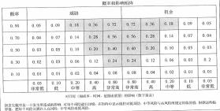

17、风险值=风险发生的概率*风险发生后的后果是在实施定性风险分析过程出现的（17 下 67）

18、在进行定量分析时也可以对单个风险分配优先级数值。

19、定量风险分析-风险登记册更新包括： 1.项目的概率分析 2.实现成本和时间目标的概率

3.量化风险优先级清单 4.定量风险分析结果的趋势（17 下 68）（19 下 66）

20、定量风险分析的工具和技术：数据收集和展示技术（访谈、概率分布）、定量风险分析和

建模技术（敏感性分析、预期货币价值分析、建模和模拟）、专家判断（18 下 67）

21、龙卷风图用于比较很不确定的变量与相对稳定的变量之间的相对重要性和相对影响。Y 轴代表处于基准值的各种不确定因素， X 轴代表不确定因素与所研究的输出之间的相关性。

22、预期货币价值分析和蒙特卡洛分析（17 上 67）

|  |  |  |  |  |
|---|---|---|---|---|

23 、风险应对计划的内容： （10 下 47）（11 上 56）（14 下 57）

24 、控制风险是在整个项目中实施风险应对计划、跟踪已识别风险、监督残余风险、识别新 风险，以及评估风险过程有效性的过程。（19 下 67）

25、控制风险的工具与技术： ①风险再评估；②风险审计；③偏差和趋势分析；④技术绩效 测量；⑤储备分析；⑥会议。

26、风险审计：风险审计是检查并记录风险应对措施在处理已识别风险及其根源方面的有效 性，以及风险管理过程的有效性。既可以在日常的项目审查会中进行风险审计，也可单独召开风

险审计会议； （18 上 68）

27、权变措施对风险事件来计划的风险事件会使用权变措施， 也就是说事先没有计划的，临 时想出来的办法；

本章历年考题和答案解析汇总：

#### 【试题 1】---2009 上真题 25

1、德尔菲法区别于其他专家预测法的明显特点是（1）。

（1）A.引入了权重参数               B.多次有控制的反绩

C.专家之间互相取长补短         D.至少经过 4 轮预测

#### 【答案】B

#### 【解析】 此题考察的是风险识别的工具和技术作用，

德尔菲法是专家们就某一主题，例如项目风险，达成一致意见的一种方法。 该法需要确定项 目风险专家，但是他们匿名参加会议。 协调员使用问卷征求重要项目风险方面的意见。然后将意 见结果反绩给每一位专家，以便进行进一步的讨论。这个过程经过几个回合，就可以在主要的项 目风险上达成一致意见。 德尔菲法有助于减少数据方面的偏见，并避免了个人因素对结果产生的 不适当的影响。

#### 【点评】常考题，理解，比较简单，必须得分

#### 【试题 2】---2009 上真题 35

2、既可能带来机会、获得利益， 又隐含威胁、造成损失的风险，称为（2）。

（2） A.可预测风险   B.人为风险   C.投机风险     D.可管理风险

#### 【答案】C

#### 【解析】 此题考察的是风险的分类，必须掌握， 考的少

既可能带来机会、，获得利益，又隐含威胁、造成损失的风险，称为投机风险。

#### 【点评】常考题，比较简单，必须得分

#### 【试题 3】---2009 上真题 37

3、定性风险分析工具和技术不包括（3）。

（3）A.概率及影响矩阵    B.建模技术  C.风险紧急度评估   D.风险数据质量评估

#### 【答案】B

#### 【解析】 此题考察的是定性风险分析工具和技术，

风险定性分析的技术方法有风险概率与影响评估法、概率和影响矩阵、风险分类、风险数据 质量评估以及风险紧迫性评估等。建模技术用于定量风险分析。

#### 【点评】常考题，比较简单，必须得分

#### 【试题 4】 ---2009 上真题 43

‘、在项目管理的下列四类风险类型中，对用户来说如果没有管理好，（4）将会造成最长久的影响。

（4）A.范围风险      B.进度计划风险     C.费用风险      D.质量风险

#### 【答案】D

#### 【解析】 此题考察的是风险的类型，必须掌握， 高频考点

项目的质量管理并不是由某个独立的部门单独完成的任务，在各项质量活动过程中，重要的 是与其他知识域如风险管理、沟通管理、采购管理、人力资源管理等多方面的工作进行协调，例 如质量目标在项目范围内与时间目标、成本目标的协调。

而对用户来说， 如果项目的质量风险没有管理好，质量风险通过对产品的影响将会对用户造 成最长久的不利影响。

#### 【点评】质量是核心，多次考了，必须得分

#### 【试题 5】---2009 下真题 47

5、德尔菲技术作为风险识别的一种方法，主要用途是（5）  。

（5）A.为决策者提供图表式的决策选择次序

B.确定具体偏差出现的概率

C.有助于将决策者对风险的态度考虑进去

D.减少分析过程中的偏见， 防止任何人对事件结果施加不正确的影响

#### 【答案】D

#### 【解析】 此题考察的是风险识别的技术，必须掌握， 必考

风险识别方法包括德尔菲技术、头脑风暴法、 SWOT 技术、检查表和图解技术。

德尔菲技术是众多专家就某一专题达成意见的一种方法。项目风险管理专家以匿名方式参与  此项活动。 主持人用问卷征询有关重要项目风险的见解，问卷的答案交回并汇总后，随即在专家  中传阅，请他们进一步发表意见。此项过程进行若干轮之后，就不难得出关于主要项目风险的一  致看法。 德尔菲技术有助于减少数据中的偏倚， 并防止任何个人对结果不适当地产生过大的影响。

#### 【点评】常考，命题的热点，简单题， 必须得分

#### 【试题 6】---2009 下真题 48

6、（6）指通过考虑风险发生的概率及风险发生后对项目目标及其他因素的影响， 对已识别风险的 优先缀进行评估。

（6）A.风险管理    B.定性风险分析    C.风险控制    D.风险应对计划编制

#### 【答案】B

#### 【解析】 此题考察的是定性风险分析，

定性风险分析是指通过考虑风险发生的概率，风险发生后对项目目标及其他因素（即费用、  进度、范围和质量风险承受度水平）的影响，对已识别风险的优先级进行评估。

#### 【点评】常考，命题的热点，简单题， 必须得分

#### 【试题 7】---2009 下真题 49

7、风险定量分析是在不确定情况下进行决策的一种量化方法， 该过程经常采用的技术有（7）。

（7）A.蒙特卡罗分析法    B.SWOT 分析法   C.检查表分析法    D.预测技术

#### 【答案】A

#### 【解析】 此题考察的是定量风险分析的方法，

风险定量分析是在不确定情况下进行决策的一种量化的方法。该项过程采用蒙特卡罗模拟与 决策树分析等技术。

#### 【点评】常考，命题的热点，简单题， 必须得分

#### 【试题 8】---2010 下真题 47

8、在信息系统试运行阶段， 系统失效将对业务造成影响。针对该风险， 如果采取“接受”的方式 进行应对， 应该（8）。

（8）A.签订一份保险合同， 减轻中断带来的损失

B.找出造成系统中断的各种因素， 利用帕累托分析减轻和消除主要因素

C.设置冗余系统

D.建立相应的应急储备

#### 【答案】D

#### 【解析】 此题考察的是风险应对措施，

应对风险的基本措施主要包括：规避、接受、减轻、转移；B 为风险规避，A 为风险转移， C 为风险减轻策略，D 为主动接受风险的方式。

#### 【点评】常考，命题的热点，简单题， 必须得分

#### 【试题 9】---2010 下真题 48

9、围绕三点估算技术在风险评估中的应用，以下论述（9）是正确的。

（9）A.三点估算用于活动历时估算， 不能用于风险评估

B.三点估算用于活动历时估算，不好判定能否用于风险评估

C.三点估算能评估时间与概率的关系，可以用于风险评估，不能用于活动历时估算

D.三点估算能评估时间与概率的关系，可以用于风险评估，属于定量分析 【答案】D

#### 【解析】 此题考察的是活动历时估算，

活动历时估算所采用的主要方法和技术包括：专家判断、类比估算、参数估算、三点估算、后 备分析。

定量风险分析的工具与技术主要包括：期望货币值、计算分析因子、计划评审技术（三点估算）、 蒙特卡罗分析。可见只有 D 是正确的。

#### 【点评】常考，命题的热点，简单题， 必须得分

#### 【试题 10】---2010 下真题 49

10、下图是某项目成本风险的蒙特卡罗分析图。以下说法中不正确的是（10）。

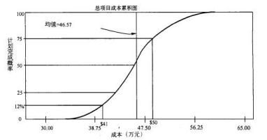

（10）A.蒙特卡罗分析法也叫随机模拟法

B.该图用于风险分析时， 可以支持定量分析

C.根据该图， 41 万元完成的概率是 12%，如果要达到 75%的概率， 需要增加 5.57  万元作 为应急储备

D.该图显示，用 45 万元的成本也可能完成计划

#### 【答案】C

#### 【解析】P471此题考察的是蒙特卡罗分析，

蒙特卡罗分析也称为随机模拟法（A 是正确的），其基本思路是首先建立一个概率模型或随机 过程，使它的参数等于问题的解，然后通过对模型或过程的观察计算所求参数的统计特征，最后 给出所求问题的近似值，解的精度可以用估计值的标准误差表示。

该图为成本风险模拟结果图，可以支持风险的定量分析。故 B 是正确的。

从该图可以看出，项目在估算值 41 万元时完成的概率是 12%，如果要达到 75%的概率， 需要 50 万元，即需要增加 9 万（41 万的 22% ）。故 C 是不正确的。

用 45 万元的成本完成计划的概率应该在 25%~50%之间。故 D 是正确的。

#### 【点评】常考，命题的热点，简单题， 必须得分

#### 【试题 11】---2011 上真题 11

11、软件开发项目规模度量 （sizemeasurement） 是估算软件项目工作量、编制成本预算、策划 合理项目进度的基础。在下列方法中，（11） 可用于软件的规模估算，帮助软件开发团队把握开 发时间、费用分布等。

（11）A.德尔菲法         B.V 模型方法       C.原型法         D.用例设计

#### 【答案】A

#### 【试题 12】---2011 上真题 67

12、有关风险识别， 以下说法不正确的是（12）。

（12）A.项目组全体成员参与风险识别

B.识别范围覆盖了项目的整个生命周期

C.风险管理计划是风险识别的输出

D.识别过程中综合运用了多种风险识别的技术和工具

#### 【答案】C

#### 【解析】 此题考察的是风险识别，

风险识别的输入包括企业环境因素、组织过程资产、项目范围说明书、风险管理计划和项目 管理计划。风险识别的输出是风险识别单。 C.风险管理计划是风险识别的输入”。

#### 【点评】风险识别，常考，简单，必须得分

#### 【试题 13】---2011 上真题 68

13、某系统集成企业为做好项目风险管理，给风险定义了 3 个参数：

1、风险严重性：指风险对项目造成的危害程度；

2、风险可能性：指风险发生的几率；

3、风险系数：是风险严重性和风险可能性的乘积。

其中，对项目进度延误、工作量偏差的风险严重性等级和风险可能性等级如下表所示： 风险严重性等级：

| 参数名 | 等级 | 值 | 描述 |
|---|---|---|---|
| 风险可能性 | 很高 | 5 | 风险发生的几率为 0.8 ~ 1.0（不包括 1.0） |
| 风险可能性 | 比较高 | 4 | 风险发生的几率为 0.6~ 0.8（不包括 0.8） |
| 风险可能性 | 高 | 3 | 风险发生的几率为 0.4 ~ 0.6（不包括 0.6） |
| 风险可能性 | 中 | 2 | 风险发生的几率为 0.2~ 0.4（不包括 0.4） |
| 风险可能性 | 低 | 1 | 风险发生的几率为 0 ~ 0.2（不包括 0 和 0.2） |

#### 【答案】C

#### 【解析】 此题考察的是风险管理，理解题，注意技巧，

请看下表：

|  |  |  | 严重性 |  | 可能性 | 系数 |
|---|---|---|---|---|---|---|
| A | 进度延误 15% | 工作量偏差 15% | 3 | 发生几率为 0.5 | 3 | 9 |
| B | 进度延误 15% | 工作量偏差 35% | 5 | 发生几率为 0.2 | 2 | 10 |
| C | 进度延误 25% | 工作量偏差 15% | 4 | 发生几率为 0.6 | 4 | 16 |
| D | 进度延误 15% | 工作量偏差 25% | 4 | 发生几率为 0.4 | 3 | 12 |

假定该企业将风险系数大于等于 15 的情况定义为红灯状态， 需要优先处理，则下列（13）的情况 属于红灯状态。

（13）A.进度延误 15%，工作量偏差 15%，发生几率为 0.5

B.进度延误 15%，工作量偏差 35%，发生几率为 0.2

C.进度延误 25%，工作量偏差 15%，发生几率为 0.6

D.进度延误 15%，工作量偏差 25%，发生几率为 0.4

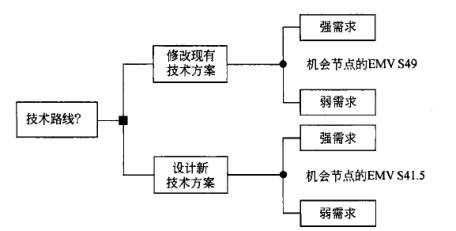

#### 【点评】风险管理的等级，常考，必须会计算，容易出错，必须得分

#### 【试题 14】---2011 上真题 69

14、风险紧迫性评估多用于（14）中。

（14）A.风险识别    B.定性风险分析    C.定量风险分析    D.风险应对

#### 【答案】B

#### 【解析】 此题考察的是定性风险分析，

风险识别是项目风险管理的基础和重要组成部分，通过风险识别，可以将那些可能给项目带 来危害和机遇的风险因素识别出来，把风险管理的注意力集中到具体的项目上来。定性风险分析 指通过考虑风险发生的概率，风险发生后对项目目标及其他因素（即费用、进度、范围和质量风 险承受度水平）的影响，对已识别的风险的优先级进行评估。 定性风险分析的技术方法有风险概 率与影响评估方法、概率和影响矩阵、风险紧迫性评估等。定量风险分析是指对定性风险分析过 程中识别出的对项目需求存在潜在重大影响而排序在先的风险进行的量化分析，并就风险分配一 个数值。风险定量分析是在不确定情况下进行决策的一种量化的方法。该项过程采用蒙特卡洛模 拟与决策树分析等项技术。风险应对就是对项目风险提出处置意见和办法。

综上所述，风险紧迫性评估是定性风险分析方法的一种，因此应选 B。

#### 【点评】风险管理的工具和技术，常考，简单，必须得分

#### 【试题 15】---2011 上真题 70

15、决策树分析是风险分析过程中的一项常用技术。某企业在项目风险分析过程中，采用了决策 树分析方法，并计算出了 EMV（期望货币值）。以下说法中，正确的是（15）。

（15）A.以上进行的是定量风险分析，根据分析结果应选择升级当前系统

B. 以上进行的是定量风险分析，根据分析结果应选择全新开发

C. 以上进行的是定性风险分析，根据分析结果应选择升级当前系统

D. 以上进行的是定性风险分析，根据分析结果应选择全新开发

#### 【答案】A

#### 【解析】P469此题考察的是决策树，

很明显，以上进行的是定量风险分析， 全新开发的 EMV=$41.5，而升级当前系统的 EMV=$49。

#### 【点评】决策树的计算，常考，简单， 必须得分

#### 【试题 16】---2011 下真题 57

16、德尔菲技术是一种非常有用的风险识别方法，其主要优势在于（16）。

（16）A.可以明确表示出特定变量出现的概率

B.能够为决策者提供一系列图表式的决策选择

C.可以过滤分析过程中的偏见，防止任何个人结果施加不当的过大影响

D.有助于综合考虑决策者对风险的态度

#### 【答案】C

#### 【解析】 此题考察的是风险识别的工具，必须掌握， 必考

德尔菲技术是众多专家就某一专题达成一致意见的一种方法。项目风险管理专家以匿名方式 参与此项活动。主持人用问卷征询有关重要项目风险的见解，问卷的答案交回并汇总后，随即在 专家之中传阅，请他们进一步发表意见。此项过程进行若干轮之后，就不难得出关于主要项目风 险的一致看法。

德尔菲技术有助于减少数据中的偏倚，并防止任何个人对结果不适当地产生过大的影响。

#### 【点评】常考，命题的热点，简单题， 必须得分

#### 【试题 17】---2011 下真题 58

17、以下关于定性风险分析的描述中， 不正确的是（17）。

（17）A.定性风险分析需要考虑风险发生的概率及其后果的影响性

B.实施定性风险分析的方法中包括 SWOT 分析法

C.通常情况下技术含量越高的项目，其风险程度也越高

D.定性风险分析的工作成果之一是按优先级形成风险总排队

#### 【答案】B

#### 【解析】 此题考察的是定性风险分析，必须掌握，必考

定性风险分析指通过考虑风险发生的概率，风险发生后对项目目标及其他因素（即费用、进 度、范围和质量风险承受度水平）的影响，对已识别风险的优先级进行评估。因此选项 A 的表述 是正确的。

定性风险分析的方法包括：风险概率与影响评估、概率和影响矩阵、风险分类、风险紧迫性评 估。其中并不包括 SWOT 分析法，而 SWOT 分析法是风险识别的具体方法之一。因此选项 B 的表述 是错误的。

依据定性风险分析， 一般情况下， 项目的技术含量越高，则风险程度也越高。因此选项 C 的 表述也是正确的。

定性风险分析的输出更新后的风险登记单，而依据风险定性分析对风险登记单进行更新的内 容包括项目风险的相对排序或优先度清单。因此选项 D 的表述也是正确的。

综上所述，选项 B 符合题干要求， 因此正确答案应选 B。

#### 【点评】常考，命题的热点，简单题， 必须得分

#### 【试题 18】---2011 下真题 59

18、以下各项中，不属于定量风险分析工作成果的是（18）

（18）A.需优先应对的风险原因     B.项目的概率分析

C.经过量化的风险优先清单   D.实现成本和时间目标的概率

#### 【答案】A

#### 【解析】 此题考察的是定量风险分析，

定量风险分析是指对定性风险分析过程中识别出的对项目需求存在潜在重大影响而排序在先 的风险进行的量化分析，并就风险分配一个数值。

定量风险分析的输出是更新后的风险登记单。风险登记单在风险识别过程中形成，并在风险 定性分析过程中更新。在风险定量分析过程中会进一步更新。风险登记单是项目管理计划的组成 部分。此处的更新内容主要包括:

（1） 项目的概率分析。项目潜在进度与成本结果的预报， 并列出可能的竣工日期或项目工期 与成本及其可信度水平。该项成果（通常以累积分布表示）与利害关系者的风险承受度水平结合 在一起，以对成本和时间应急储备金进行量化。需要把应急储备金将超出既定项目目标的风险降 低到组织可接受的水平。

（2） 实现成本和时间目标的概率。采用目前的计划以及目前对项目所面临的风险的了解，可 用风险定量分析方法估算出实现项目目标的概率。

根据上述内容分析可知， 选项 B, C.D 均是定量风险分析过程的工作成果。而选项 A 所给出的 “近期需优先应对的风险清单”是定性风险分析过程的工作成果之一。

综上所述，选项 A 符合题干要求， 因此正确答案应选 A；

#### 【点评】常考，命题的热点，简单题， 必须得分

#### 【试题 19】---2012 上真题 54

19、某集成企业在进行风险定性分析时，考虑了风险的几种因素：①威胁，指风险对项目造成的 危害程度；②机会，指对项目带来的收益程度③紧迫性，对风险返待处置的程度；④风险发生的 概率。关于该公司的定性风险分析，下列说法中，（19）是不正确的。

（19）A.①x③x④的值越大，则表明风险高，应考虑优先处理

B.②x③x④的值越大， 则表明机会大， 应考虑优先处理

C.①x②x④的值越大， 则表明风险高、机会大， 应考虑优先处理    。

D.②x④的值越大，则表明机会大， 应考虑优先处理

#### 【答案】C

#### 【解析】 此题考察的是风险管理，

通常，数值越大代表风险的危害程度越高（或收益程度越多，或紧迫性越高或发生的概率越 高），数值越小代表风险的危害程度越低（或收益程度越少，或紧迫性越或发生的概率越低）。依 题意，“威胁 X 紧迫性 X 概率”（或“威胁 X 概率”）的计算结果越大， 则表明风险高应考虑优先处 理；“机会 X 紧迫性 X 概率”（或“机会 X 概率”）的计算结果越大， 则表明机会大， 应考虑优先处 理。威胁是风险的消极面，而机会是风险的积极面， 通常不能将两者进行乘积运算，即选项 C 的 说法有误。

#### 【点评】概率和影响矩阵，考察理解， 难题，尽量得分

#### 【试题 20】---2012 上真题 55

20、关于项目的风险管理，下列说法中，（20）是不正确的。

（20）A.风险管理包括风险识别、定性分析、定量分析、风险应对、风险监控等过程 B.定性风险分析后，可制定和采取风险应对措施

C.制定了风险应对措施后，可重新进行定量风险分析，以确定风险降低的程度 D.风险管理的最终目标是消除风险

#### 【答案】D

#### 【解析】 此题考察的是风险管理，

项目风险管理就是指对项目风险从识别到分析、评价及采取应对措施等一系列过程，它包括 将积极因素所产生的影响最大化和使消极因素产生的影响最小化两方面的内容， 风险是不能消除 的，只能预防、规避、转移、降低、处理、接受。

#### 【点评】风险管理的概念，多次考察啦，记住即可， 简单，必须得分

#### 【试题 21】---2012 上真题 56

21、在一个信息系统集成项目中，对项目涉及的客户端、服务器、网络和运行环境等进行集成时， 不确定会遇到什么问题，这对项目来说是一个风险， 因此项目经理计划找一个以前有相关技术经 验的专家来处理这个风险。该应对措施属于（21）

（21）A.风险接受  B.风险转移    C.风险规避     D.风险减轻

#### 【答案】D

#### 【解析】 此题考察的是风险的应对策略，必须掌握， 高频考点

通常， 使用三种策略应对可能对项目目标存在消极影响的风险或威胁。这些策略分别是回避、 转嫁与减轻。

（1）规避： 规避风险是指改变项目计划， 以排除风险或条件， 或者保护项目目标， 使其不受 影响，或对受到威胁的一些目标放松要求。

（2）转移：转移风险是指设法将风险的后果连同应对的责任转移到他方身上。

（3）减轻：减轻是指设法把不利的风险事件的概率或后果降低到一个可接受的临界值。

#### 【点评】风险的应对措施，考的不是很多，记住即可，简单，必须得分

#### 【试题 22】---2012 下真题 54

22、根据风险的概率，及其风险发生的影响量对风险进行优先级排列的风险管理步骤是（22）。

（22）A.制订风险管理机制    B.风险识别

C.实施定性风险分析    D.定量风险分析

#### 【答案】C

#### 【解析】 此题考察的是风险管理的过程，必须掌握， 高频考点

项目风险管理过程包括如下内容：

（1）风险管理规划：决定如何进行、规划和实施项目风险管理活动。

（2）风险识别： 判断哪些风险会影响项目，并以书面形式记录其特点。

（3）定性风险分析：对风险概率和影响进行评估和汇总， 进而对风险进行排序， 以便于随后 的进一步分析或行动。

（4）定量风险分析：就识别的风险对项目总体目标的影响进行定量分析。

（5）应对计划编制：针对项目目标制订提高机会、降低威胁的方案和行动。

（6）风险监控： 在整个项目生命周期中， 跟踪已识别的风险、监测残余风险、识别 新风险，实施风险应对计划， 并对其有效性进行评估。

#### 【点评】风险管理的流程，多次考了， 简单，必须得分

#### 【试题 23】---2012 下真题 55

23、风险识别的方式从专家争执中收集意见并综合， 从而对将来的可能风险做出预测的风险识别 工具是（23）。

（23）A.风险分解结构    B.头脑风暴    C.错误方法    D.德尔菲法

#### 【答案】D

#### 【解析】 此题考察的是风险识别的工具和技术， 必须掌握，必考

在具体识别风险方法包括德尔菲法、头脑风暴法、检查表法、 SWOT技术、检查表和图解技术 等：（1）德尔菲技术。

德尔菲技术是众多专家就某一专题达成一致意见的一种方法。项目风险管理专家以匿名方式 参与此项活动。主持人用问卷征询有关重要项目风险的见解，问卷的答案交回并汇总后，随即在 专家之中传阅，请他们进一步发表意见。此项过程进行若干轮之后，就不难得出关于主要项目风 险的一致看法。德尔菲技术有助于减少数据中的偏倚，并防止任何个人对结果不适当地产生过大 的影响。

（2）头脑风暴法。

头脑风暴法的目的是取得一份综合的风险清单。头脑风暴法通常由项目团队主持，虽然也可 邀请多学科专家来实施此项技术。在一位主持人的推动下， 与会人员就项目的风险进行集思广益。 可以以风险类别作为基础框架，然后再对风险进行分门别类，并进一步对其定义加以明确。

（3） SWOT 分析法。

SWOT 分析法是一种环境分析方法。所谓的 SWOT，是英文 Strength（优势）、Weakness（劣势）、 Opportunity（机遇） 和 Threat（挑战）的简写。

（4）检查表。

（5）图解技术。

#### 【点评】风险识别工具和技术，书上原话，多次考了，简单，必须得分

#### 【试题 24】---2013 上真题 45

24、风险管理是项目管理中的重要内容，其中风险概率分析是指 24 。

（24）A.分析风险对项目的潜在影响      B.调查每项具体风险发生的可能性

C.分析风险的可能消极影响         D.分析风险的可能积极影响

#### 【答案】B

#### 【解析】 此题考察的是定性风险分析的工具和技术，

风险概率分析指调查每项具体风险发生的可能性。书上原话；

#### 【点评】风险的概念，书上原话，比较简单，必须得分

#### 【试题 25】---2013 上真题 46

25、建立一个概率模型或者随机过程，使它的参数等于问题的解，然后通过对模型或过程的观察 计算所求参数的统计特征，最后给出所求问题的近似值，解的精度可以用估计值的标准差表示。

这种技术称为  25   方法。

（25）A.期望货币分析    B.决策树分析    C.蒙特卡洛分析     D.优先顺序图

#### 【答案】C

#### 【解析】 此题考察的是蒙特卡罗分析，

蒙特卡罗分析也称为随机模拟法，其基本思路是首先建立一个概率模型或随机过程，使它的 参数等于问题的解，然后通过对模型或过程的观察计算所求参数的统计特征，最后给出所求问题 的近似值， 解的精度可以用估计值的标准误差表示。

#### 【点评】方法，需要有大致的了解，书上原话，比较简单，必须得分

#### 【试题 26】---2013 上真题 47

26、风险转移是设法将风险的后果连同应对的责任转移到他方的风险应对措施，  26 不属于风险 转移的措施。

（26）A.履约保证书    B.购买保险    C.第三方担保     D.改变工艺流程

#### 【答案】D

#### 【解析】 此题考察的是风险应对计划，

转移风险是指设法将风险的后果连同应对的责任转移到他方身上。转移风险实际只是把风险损 失的部分或全部以正当理由让他方承担，而并非将其拔除。转移工具丰富多样，包括但不限于利 用保险、履约保证书、担保书和保证书。转移中有 ABC，没有 D； 减轻中有 D。

#### 【点评】风险的应对策略，书上原话， 常考的，比较简单，必须得分

#### 【试题 27】---2013 上真题 54

27、在项目执行阶段，一名团队成员识别了一项新风险，此时， 应该（27）。

（27）A.将之涵盖在风险触发因素中     B.对假设条件进行测试

C.将之加入风险管理计划内       D.对风险进行定性分析

#### 【答案】D

#### 【解析】 此题考察的是风险管理的流程，必须掌握， 高频考点

风险管理： 制定风险管理计划-风险识别-定性风险分析-定量风险分析-应对风险计划-风险监 控；考察的是风险管理的活动和流程。风险识别的下一步是风险定性评估

#### 【点评】风险管理的流程，常考的，比较简单，必须得分

#### 【试题 28】---2013 下真题 54

28、以下关于定性风险的说法中，错去的是（28）

（28）A.风险概率分析指调查每项具体风险的发生的可能性

B.风险影响评估旨在分析风险对项目目标的潜在影响

C.风险影响评估值包括消极影响或威胁， 不包括积极影响或机会

D.可以让专家通过召开会议或进行访谈的方式对风险进行评估

#### 【答案】C

#### 【解析】 此题考察的是风险管理相关概念，

风险具有两面性，积极的一面和消极的一面，所谓高风险一般都有高机会（积极）和高威胁（消  极），项目管理者就是要关注高风险的因素， 进行重点控制（而不仅仅只关注高风险威胁的一面）。

#### 【点评】风险管理的基本概念，多次考了，简单，必须得分

#### 【试题 29】---2013 下真题 57

29、在风险监控中，如果出现了风险登记单未预期的风险或“观察清单”未创造风险，应该（29）。

（29）A.进行额外的风险应对规划       B.进行风险审计

C.进行变差和趋势分析           D.召开状态审查会

#### 【答案】A

#### 【解析】 此题考察的是风险审计，

监控项目风险的工具与技术有：①风险再评估；②风险审计③偏差和趋势分析；④技术绩效 衡量； ⑤储备金分析（预留管理）；⑥状态审查会； ⑦风险预警系统等。其中， 风险再评估是指对 新风险进行识别并对现有风险进行重新评估。应安排定期进行项目风险再评估。反复进行再评估 的次数和详细水平， 应该根据相对于项目目标的项目进展情况而定。项目团队 状态审查会的议程 中应包括项目风险管理的内容。 例如，如果出现了风险登记单未预期的风险或“观察清单”未包 括的风险，或其对目标的影响与预期的影响不同，规划的应对措施可能将无济于事，则此时需要 实行额外的风险应对规划以对风险进行控制。

#### 【点评】风险管理的应对，书上有原话，算是首次考，分析不难得出，建议得分

#### 【试题 30】---2014 上真题 54

30、在进行风险评估时，如果发现风险概率和影响很低，可（）。

（30）A.将该风险作为待观察项目列入清单中，供将来进一步监测

B.对该风险进行等级排序

C.着手消除该风除

D.不做任何措施

#### 【答案】A

#### 【解析】 此题考察的是风险的处理措施，必须掌握， 高频考点

送分的题。 B.C 是不对的，暂时不需要这样处理；D 也不对，不是不处理。只有 A 最符合。

#### 【点评】多次考了，简单，必须得分的

#### 【试题 31】---2014 下真题 53

31、由于员工对一些新技术的使用缺乏经验，而导致项目偏离轨迹，那么项目发起人可以通过（31） 来减少这一风险。

（31）A.启动风险应急计划

B.从应急储备中拨出一部分资金，雇佣外部的顾问， 为项目成员使用新技术提供培训和咨询 C.对项目利害关系者的承受水平进行修订，以适应这一突发状况

D.对这一问题进行记录、界定，并与相关人员进行必要的沟通

#### 【答案】B

#### 【解析】P473此题考察的是风险的应对措施，

管理储备是一个单列的计划出来的成本，以备未来不可预见的事件发生时使用。管理储备包含成 本或进度储备，以降低偏离成本或进度目标的风险， 管理储备的使用需要对项目基线进行变更。 因为员工普遍缺少对新技术的使用经验，因此这部分成本应该由组织来承担，即从管理储备中划 拨资金以支持培训。

应急计划是指当一项可能的风险事件实际发生时项目团队将采取的预先确定的措施。在这里风险 尚未发生， 因此不适用应急计划。

选项 C 过于消极，面对风险和问题应该积极主动的解决。

选项 D 通过沟通无助于减少该风险。

#### 【点评】多次考了，比较简单，送分的

#### 【试题 32】---2014 下真题 54

|  |  |  |
|---|---|---|
| （1）机会： 列出现有机会 | （5） |  |
| （2）挑战：列出面临的威胁 | （7） |  |

#### 【答案】A

（33）A.风险事件  B.风险事故   C.风险因素   D.风险危害

#### 【答案】B

#### 【解析】 此题考察的是风险的类型，必须掌握， 低频考点

风险事故是造成损失的直接或外在的原因，是损失的媒介物，即风险只有通过风险事故的发生才 能导致损失。就某一事件来说，如果它是造成损失的直接原因，那么它就是风险事故；而在其他 条件下，如果它是造成损失的间接原因，它便成为风险因素。

#### 【点评】考的少，稍微了解下即可

#### 【试题 34】---2014 下真题 56

34、软件风险是指在软件开发过程中面临的一些不确定性和可能造成的损失。软件风险大致可以 分为三类： 项目风险、技术风险和商业风险。下列叙述中，（34）属于商业风险。

（34）A.软件的开发时间可能会超出预期时间

B.采用的开发技术过于先进，技术本身尚不稳定

C.软件开发过程中需求一直未能稳定下来

D.软件开发过程没有得到预算或人员上的保证

#### 【答案】D

#### 【解析】 此题考察的是风险的类型，必须掌握， 低频考点

商业风险包含的五个主要的风险是：

1、市场风险：开发了一个没有人真正需要的优秀产品或系统。

2、策略风险：开发的产品不符合公司的整体商业策略。

3、销售风险：开发了一个销售部门不知道如何去卖的产品。

4、管理风险：由于重点的转移或人员的变动而失去了高级管理层的支持的风险。 5、预算风险：没有得到预算或人力上的保证。

技术风险是指在设计、实现、接口、验证、维护、规约的二义性、技术的不确定性、陈旧的技术 等方面存在的风险。技术风险威胁到软件开发的质量及交付的时间，如果技术风险变成现实，则 开发工作可能变得很困难或根本不可能。

项目风险体现在需求风险、计划编制风险、人员风险、组织管理风险、开发环境风险、客户风险、 过程风险和设计风险等方面。

#### 【点评】考的少，稍微了解下即可，此题分析不难得出

#### 【试题 35】---2014 下真题 57

35、在应对风险的基本措施中，（35）属于消极风险应对策略。

（35）A.改变项目计划，以排除风险或条件，或者保护项目目标，使其不受影响，或对受到威胁 的一些目标放松要求

B.为项目分配更多的有能力的资源，以便缩短完成时间或实现超过最初预期的高质量 C.将风险的责任分配给最能为项目的利益获取机会的第三方

D.通过提高风险的概率或其积极影响，识别并最大程度发挥这些风险的驱动因素，致力于改 变机会的“大小 ”

#### 【答案】A

#### 【解析】 此题考察的是风险的应对措施，必须掌握， 高频考点

消极风险应对策略有规避、转移、减轻。

A 选项属于改变项目计划，即规避措施。

B 选项属于积极风险或机会应对策略里的开拓策略

C 选项属于积极风险或机会应对策略里的分享策略

D 选项属于积极风险或机会应对策略里的提高策略

#### 【点评】多次考了，比较简单，送分的

#### 【试题 36】---2015 上真题 55

36、以下关于风险概率与影响评估的叙述中，（）是不正确的。

A.风险概率与影响评估是定量风险分析的一种方法。

B.风险概率分析指调查每项具体风险发生的可能性。

C.风险影响评估指在分析风险对项目目标的潜在影响，包括消极影响或威胁、积极影响或机会。

D.可采用会议或访谈等方式对风险进行评估， 组织的历史数据或经验不足时， 需要专家做出判断。

#### 【答案】A

#### 【解析】 此题考察的是风险概率和影响评估，必须掌握，常考

1.风险概率与影响评估

. 风险定性分析是指对已识别风险进行排序以便控制风险，它是综合评估风险的发生概率以及 影响程度从而确定其优先级的。在进行风险定性分析时，经常用到的技术与工具包括风险概 率及影响评估、概率及影响矩阵、风险数据质量评估、风险种类和风险紧急度评估。

. 一般在定性风险分析之后就可以进行定量风险分析。定量风险分析过程的目标是量化分析每 一风险的概率及其对项目目标造成的后果，也分析项目总体风险的程度。在进行风险定量分 析时，经常会使用到的技术与工具包括数据收集和表示技术（包括风险信息访谈、概率分布 和专家判断），定量风险分析和建模技术（包括灵敏度分析、期望货币值分析、决策树分析和 建模仿真）。

#### 【点评】多次考了，简单，必须得分

#### 【试题 37】---2015 上真题 56

37、项目范围基准应用于识别风险过程，其（）。

A.识别了所有必需完成的工作，因此包括了项目的所有风险    B.识别了项目假设

C.有助于把项目中所有必需完成的工作组织起来。             D.包括以往项目的风险信息

#### 【答案】B

#### 【解析】 此题考察的是范围基准，必须掌握，常考

项目范围基准是项目管理计划的组成部分， 包括项目范围说明书、WBS 及其词典。可从项目范围说 明书中了解项目的假设条件。应该把项目假设条件的不确定性作为项目风险的潜在原因，认真加 以评审。

#### 【点评】多次考了，简单，必须得分

#### 【试题 38】---2015 上真题 57

38、因时间紧、任务急，经过评估，某智能监控软件涉及的图像传输速度与精度指标难以满足客 户需求，故项目团队欲将该软件开发分包给技术实力很强的企业完成。这种风险应对措施被称为 风险（）。

A.接受    B.规避    C.减轻      D.转移

#### 【答案】D

#### 【解析】 此题考察的是风险的应对措施，必须掌握， 常考

该风险属于校级风险，消极风险（或威胁）的应对策略：

A.回避（规避），是指改变项目管理计划，以完全消除威胁。项目经理也可以将项目目标从风险的 影响中分离出来，或改变受到威胁的目标。例如延长进度、改变策略或缩小项目范围等。最极端

的回避策略是取消整个项目。

B.转移，是指把某风险的部分或全部消极影响连同应对责任转移给第三方。转移风险是把风险管 理责任简单地推给另一方，而并非消除风险。转移风险策略对处理风险的财务后果最有效。采用 风险转移策略，几乎总是需要向风险承担者支付风险费用。风险转移可采用多种工具，包括（但 不限于）保险、履约保证书、担保书和保证书等。

C.减轻， 是指把不利风险事件的概率和/或影响降低到可接受的临界值范围内。减轻措施的例子包 括：采用复杂性较低的流程，进行更多的测试，或者选用比较稳定的供应商。例如，在一个系统 中加入冗余部件，可以减轻主部件故障所造成的影响。

D.接受，由于几乎不可能消除项目的全部威胁， 因此就需要采用风险接受策略。

应对风险措施中：出售或外包将自己不擅长或自己开展有较大风险的部分委托他人帮助开展。

#### 【点评】多次考了，简单，必须得分

#### 【试题 39】---2015 上真题 63

39、某工厂生产雷达， 成品无效的历史数据是 4%。在工厂测试每个雷达的成本为 10000 元；工厂 测试后重新组装每个测试合格雷达的成本是 2000 元；工厂测试后修理并重新组装每个不合格雷达 的成本是 23000 元。而修理安装每个现场的不合格雷达的成本是 350000 元。利用决策树分析。若 决定对 500 个雷达进行 100%测试， 预期支出需要（）万元。

A.550        B.596      C.642          D.700

#### 【答案】C

#### 【解析】 此题考察的是成本的计算，必须掌握， 常考

该题属于不确定性问题，决策树计算题： 逐个测试成本+测试合格成本+测试不合格成本=预算支出。 500*10000+500*（1-4%）*2000+500*4%*23000=642

#### 【点评】理解题，简单，必须得分

#### 【试题 40】---2015 下真题 68

40、（ ）不属于定量风险分析的技术方法

（40）A.决策树分析   B.概率和影响矩阵       C.计划评审技术  D.蒙特卡洛分析

#### 【答案】B

#### 【解析】 此题考察的是定量风险分析的工具和技术，

概率和影响矩阵是定性风险分析的方法

#### 【点评】送分题，多次考了，简单

#### 【试题 41】---2016 上真题 48

41、某公司正在准备竞标一系统集成项目，为了估算项目的收益，技术总监带领风险管理团队，  对项目可选的两种集成实施方案进行了决策树分析，分析图如下所示。以下说法中，正确的是（41）。

A. 以上进行的是风险定性分析，根据分析，该公司应采用方案 B

B. 以上进行的是风险定量分析，根据分析，该公司应采用方案 B

C. 以上进行的是风险定性分析，根据分析，该公司应采用方案 A

D. 以上进行的是风险定量分析，根据分析，该公司应采用方案 A

#### 【答案】D

#### 【解析】 此题考察的是决策树的计算，

方案 A:（150*0.7+80*0.3）-120=9     方案 B:（280*0.7+130*0.3）-160=5

#### 【点评】送分题，常考，必须得分

42、公司任命小李作为项目 A 的项目经理。由于小李不能计划所有不测事件，他设立了一个应急 储备，包括处理已知或未知风险的时间、资金或资源。这属于（）。

A.风险回避， 用应急储备避免风险的发生

B.风险接受，用应急储备接受风险的发生

C.风险转移，因为应急储备使项目成本提高

D.不当风险规划， 因为应识别并虑及所有风险

#### 【解析】

风险接受是指项目团队决定接受风险的存在，该策略可以是被动或主动的。

被动接受策略不采取任何措施，只需要记录本策略，而无需任何其他行动，待风险发生时再 由项目团队处理。不过，需要定期复查，以确保威胁没有太大的变化。

如果采取主动接受的策略，则要在风险发生前制定应急计划。最常见的主动接受策略是建立应急储备，安排一定的时间、资金或资源来应对风险。

43、规划风险应对是针对项目目标， 制订提高机会、降低威胁的方案和措施的过程。（） 不是规划风险应对的工具与技术。

A.应急应对策略  B.概率和影响矩阵  C.专家判断 D.消极风险或威胁的应对策略

#### 【解析】 概率和影响矩阵是定性风险分析的工具和技术

44、控制风险是在整个项目中实施风险应对计划、跟踪已识别的风险、监督残余风险、识别新风 险’以及评估风险过程有效性的过程。（）不属于控制风险时使用的工具与技术。

A.偏差和趋势分析    B.SWOT 分析    C.技术绩效测量   D.风险审计

#### 【解析】控制风险的工具与技术： 1.风险再评估 2.风险审计 3.偏差和趋势分析 4.技术绩效测量 5.储备分 析 6.会议； B.SWOT 分析是风险识别的工具和技术

45、项目面临的各种风险中,（）对客户的影响最为深远。

A.范围风险    B.进度风险    C.成本风险    D.质量风险

#### 【解析】质量是核心，质量的影响最大

46、风险预测从两个方面来评估风险, 即（）和风险发生可能带来的后果。

A.风险原因分析    B.风险发生的时间    C.风险应对措施    D.风险发生的可能性

#### 【解析】实施定性风险分析是评估并综合分析风险的概率和影响，对风险进行优先排序，从而为后续分析 或行动提供基础的过程。本过程的主要作用是，使项目经理能够降低项目的不确定性级别，并重 点关注高优先级的风险。

47、某项目承包者预计该项目有 0.5 的概率获利 200000 美元,0.3 的概率亏损 50000 美元,还有 0.2 的概率维持平衡.该项目的期望货币价值为（）美元。

A.200000        B.85000        C.50000        D.180000

#### 【解析】预期收益=200000*0.5-50000*0.3=85000

48、识别风险过程的主要输出就是风险登记册，风险登记册始于识别风险过程，在项目实施过程 中供其他风险管理过程和项目管理过程使用， 风险登记册中的（） 内容是识别风险过程中产生的。

A.风险紧迫性或风险分类    B. 已识别的风险清单

C.商定的应队策略          D.风险责任人及其职责

#### 【解析】识别风险的输出 1.风险登记册，包括如下信息： 1） 已识别风险清单 2） 潜在应对措施清单

49、项目经理张工在项目风险管理过程中，使用如下公式进行风险评估：

风险值=风险发生的概率*风险发生后的后果

该项目分析管理处于（）阶段。

A.识别风险    B.实施定性风险分析    C.实施定量风险分析    D.规划风险应对

#### 【解析】风险值=风险发生的概率*风险发生后的后果是在实施定性风险分析过程出现的

50、风险相关的项目文件随着定量风险分析产生的信息而更新，（） 不是在定量风险分析过程中产 生的。

A.风险评级和分值    B.量化风险优先级清单

C.项目的概率分析    D.实现成本和时间目标的概率

#### 【解析】项目文件要随着定量风险分析产生的信息而更新。例如，风险登记册更新包括：1.项目的概率分析 2.实现成本和时间目标的概率 3.量化风险优先级清单      4.定量风险分析结果的趋势

51、人们对风险事件都有一定的承受能力，当（）时，人们愿意承担的风险越大。 A.项目活动投入的越多

B.项目的收益越大

C.个人、组织拥有的资源越少

D.组织中高级别管理人员相对较少

#### 【解析】获得的利益越大，当然愿意承受的风险越大

### 52、风险识别的输出是()

A.风险因素     B. 已识别风险清单     C.风险概率     D.风险损失

#### 【解析】考察风险识别的输出：风险登记册，其中已识别的风险清单属于风险登记册一部分

53、在进行项目风险定性分析时，可能会涉及到()

A.建立概率及影响矩阵     B.决策树分析     C.敏感性分析     D.建模和模拟

#### 【解析】风险定性分析的工具和技术有：1）风险概率和影响评估 2）概率和影响矩阵 3）风险数据质量评 估 4）风险分类 5）风险紧迫性评估 6） 专家判断

54、（） 是检查并记录风险应对措施在处理已识别风险及其根源方面的有效性， 以及风险管理过程 的有效性。

A.风险再评估     B.技术绩效测量     C.偏差和趋势分析     D.风险审计

#### 【解析】风险审计是检查并记录风险应对措施在处理已识别风险及其根源方面的有效性，以及风险管理过 程的有效性。

55、（）不是风险识别的原则。

A.由粗及细， 由细及粗    B.先怀疑，后排除   C.对客户保密    D.排除与确认并重

#### 【解析】风险识别的原则包括:

（1）由粗及细，由细及粗。

（2）严格界定风险内涵并考虑风险因素之间的相关性。

（3）先怀疑，后排除。

（4）排除与确认并重。对于肯定不能排除但又不能肯定予以确认的风险按确认考虑。

必要时，可作实验论证。

56、（56）属于定量风险分析的工具和技术。

A.概率和影响矩阵     B.风险数据质量评估

C.风险概率和影响评估    D.敏感性分析

#### 【解析】定量风险分析的工具和技术，ABC 是定性风险分析的工具，D 是定量风险分析的工具。

57、有关控制风险的描述，不正确的是:（）。

A.控制风险时，需要参考已经发生的成本

B.风险分类是控制风险过程所采用的工具和技术

C.可使用挣值分析法对项目总体绩效进行监控

D.控制风险过程中需要更新风险登记册

#### 【解析】

风险分类是定性风险过程的工具，答案 B 不正确。B,C 属于控制风险里工作绩效数据或工作绩效报 告里的内容。D 是输出，控制风险后会更新风险登记册。

58、（）不属于项目风险的特性。

A.可变性    B.必然性    C.相对性    D.不确定性

#### 【解析】必然性不是风险的特性。

59、（）从项目的优势、劣势、机会和威胁角度对项目风险进行分析与管理。

A.头脑风暴法    B.假设分析    C.影响图    D.SWOT 分析

#### 【解析】SWOT 分析是识别风险过程的工具，通过优势、劣势、机会和威胁角度来分析。

60、风险应对策略中，（ ）可用于应对积极风险。

A.规避    B.转移    C.减轻    D.分享

#### 【解析】分享机会是应对积极风险的

61 、关于风险识别的描述，不正确的是（）。

A.风险识别的原则包括:先怀疑，后排除

B.识别风险活动仅在项目启动时进行

C.风险识别技术包括文档审查，假设分析与 SWOT 分析

D.风险登记册包括己识别清单和潜在应对措施清单

#### 【解析】识别风险活动应该在整个项目过程中都进行。

62、（）不属于风险定性分析的输出。

A.风险评级和分值    B.实现项目目标的概率    C.风险紧迫性    D.风险分类

#### 【解析】B 选项属于定量分析的输出。当项目面临风险时， 可根据定量风险分析的结果来估算在现行计划下 实现项目目标的概率。实现项目目标的概率与这个没关系吧，基本的输出知识。

#### 【试题 63】---2019 下真题 67

63、某项目发生一个已知风险，尽管团队之前针对该风险做过减轻措施，但是并不成功，接下项 目经理应该通过（） 控制该风险。

A.重新进行风险识别

B.使用管理储备

C.更新风险管理计划

D.评估应急储备，并更新风险登记册

#### 【解析】

既然之前做的不成功，建议更新计划， 看有没更好的措施。

该题的答案有些争议，C 和 D 都可以解释。该题与 PMP 考试的题型类似。综合看建议选择 C 好一点； A 选项：重新进行风险识别。因并不是新的风险，不需要重新识别；

B 选项： 使用管理储备。管理储备主要是针对未知风险， 做过减轻措施，但并不成功， 可以进一步 的去评估和分析，直接就使用管理储备不合适；

C 选项： 更新风险管理计划。风险管理计划是风险管理的指南， 更新它对控制目前的具体风险没有 大帮助；

D 选项： 评估应急储备。并更新风险登记册， 碰到这种情况可以评估应急储备， 看是否有剩余的应 急储备来继续控制这个风险， 同时更新风险登记册， 因为此时该风险的状态已经改变。

十六、项目收尾管理

本章金色考点汇总：

1、项目收尾管理工作包括： ①项目验收工作； ②项目总结工作； ③系统维护工作； ④项目后 评价工作。

2、项目验收是项目收尾管理中的首要环节，只有完成项目验收工作后，才能进入后续的项目 总结、系统维护以及项目后评价等工作阶段。

3、项目验收工作需要完成正式的验收报告，对于系统集成项目， 一般需要执行正式的验收测 试工作。

4、系统集成项目在验收阶段包括： ①验收测试； ②系统试运行； ③系统文档验收； ④项目终 验。（17 上 39）

5、对于系统集成项目，所涉及的文档应该包括如下部分： ①系统集成项目介绍②系统集成项

目最终报告（3）信息系统说明手册④信息系统维护手册⑤软硬件产品说明书、质量保证书等。

6、验收测试是对信息系统进行全面的测试。系统试运行包括数据迁移、日常维护以及缺陷跟 踪和修复等方面的工作内容。系统经验收测试后，系统的文档应当逐步、全面地移交给客户。在 系统经过试运行以后的约定时间，启动项目的最终验收工作。通常情况，大型项目都分为试运行 和最终验收两个步骤。对于一般项目而言，可以将系统测试和最终验收合并进行，但需要对最终 验收的过程加以确认。

7、项目总结属于项目收尾的管理收尾。而管理收尾有时又被称为行政收尾， 就是检查项目团 队成员及相关干系人是否按规定履行了所有职责。

8、项目总结的意义： ①了解项目全过程的工作情况及相关的团队或成员的绩效状况； ②了解 出现问题并进行改进措施总结；③了解项目全过程中出现的值得吸取的经验并进行总结；④对总 结后的文档进行讨论，通过后即存入公司的知识库， 从而纳入企业的过程资产。

9、项目总结讨论的内容： ①项目绩效； ②技术绩效； ③成本绩效；④进度计划绩效；⑤项目 的沟通；⑥识别问题和解决问题；⑦意见和建议。

10、软件项目的后续工作：①软件 bug 的修改； ②软件升级；③后续技术支持。

11、系统集成项目的后续工作：①信息系统日常维护工作；②硬件产品更新；③满足信息系 统的新需求。

12、信息系统后评价工作主要内容：①信息系统目标评价；②信息系统过程评价；③信息系 统效益评价；④信息系统可持续性评价。（17 上 40）

本章历年考题和答案解析汇总：

#### 【试题 1】---2009 上真题 48

1、项目绩效审计不包括（1）。

（1）A.决算审计     B.经济审计    C.效率审计     D.效果审计

#### 【解析】 续效审计是经济审计、效率审计和效果审计的合称， 故也称三 E审计。

#### 【试题 2】---2009 上真题 49

2、在项目结束阶段， 大量的行政管理问题必须得到解决。 一个重要问题是评估项目有效性。完成 这项评估的方法之一是（2）。

（2）A.制作绩效报告   B.进行考察   C.举行绩效评估会议    D.进行采购审计

#### 【答案】C

#### 【解析】 此题考察的是项目评估的方法，必须掌握， 高频考点

所谓项目绩效评估，是指运用数理统计、运筹学原理和特定指标体系，对照统一的标准，按 照一定的程序，通过定量定性对比分析，对项目一定经营期间内的经营效益和经营者业绩做出客 观、公正和准确的综合评判。

举行绩效评估会议是完成项目评估的最常用方法之一。制作绩效报告是绩效报告过程的任务，

而单纯的“进行考察”不属于项目评估的方法， 进行采购审计是合同收尾时使用的方法。

#### 【点评】常考题，比较简单，必须得分

#### 【试题 3】---2012 下真题 48

3、项目收尾包括（3）。

（3）A.产品收尾和管理收尾         B.管理收尾和合同收尾

C.项目总结和项目审计         D.产品收尾和合同收尾

#### 【答案】B

#### 【解析】 此题考察的是项目收尾，必须掌握，高级考过的

项目收尾的具体内容主要是项目验收、项目总结和项目评估审计。

项目收尾过程包括对于管理项目或者项目阶段收尾的所有必要活动。 项目收尾包括管理收尾 和合同收尾。

#### 【点评】项目收尾的内容，书上原话， 多次考了，简单，必须得分

#### 【试题 4】---2012 下真题 49

4、承建方项目进度或监理方提交收尾或审核收尾的项目管理计划。其中必须要包括（4）。

（4）A.进度管理计划    B.质量管理计划   C.人力资源管理计划   D.成本管理计划

#### 【答案】B

#### 【解析】 此题考察的是项目管理计划，

理解题，质量是核心，必须有的，承建方项目经理向监理方提交正式审核所用的项目管理计 划。其中必须要包括质量管理计划。

#### 【点评】项目管理计划，多次考了，简单，必须得分

#### 【试题 5】---2014 上真题 5

5、项目收尾过程是结束项目某一阶段中的所有活动，正式收尾该项目阶段的过程。（5）不属于管 理收尾。

（5）A.确认项目或者执行阶段已满足所有赞助者、客户，以及其他项目干系人需求

B.确认已满足项目阶段或者整个项目的完成标准，或者确认项目阶段或者整个项目的退出标准 C. 当需要时，把项目产品或者服务转移到下一个阶段，或者移交到生产或运作

D.更新反映最终结果的合同记录并把将来会用到的信息存档

#### 【答案】D

#### 【解析】 此题考察的是收尾管理的内容，必须掌握， 高频考点

管理收尾是针对项目组内部来说的，即文档归档；对外宣称项目结束；转入维护期，把相关的产 品说明书转到维护组；进行经验教训总结。管理收尾包含项目总结、项目评估等活动。

#### 【点评】多次考了，简单，必须得分的

#### 【试题 6】---2014 上真题 60

6、系统终验是系统投入正式运行前的重要工作,系统验收工作通常是在建设方主管部门的主持下， 按照既定程序来进行，下列系统终验的做法中，（6）是错误的

（6）A.承建方应该首先提出工程终验的申请和终验方案

B.监理方应该协助建设方审查承建方提出的终验申请， 如果符合条件则开始准备系统终验； 否则，向承建方提出系统整改意见

C.监理方应协助建设方成立验收委员会，该委员会包括建设方、承建方和专家组成。

D.验收测试小组可以是专业的第三方的测试机构或者是承建方聘请的专家测试小组或者三 方共同成立的测试小组。

#### 【答案】D

#### 【解析】 此题考察的是收尾管理的内容，必须掌握， 高频考点

验收需要正式的验收报告。对于系统集成项目， 一般来讲，需要正式的验收测试工作。验收 测试工作可以由业主和承建单位共同进行，也可以由第三方公司进行，但无论哪种方式都需要双 方认可的正式文档为依据进行验收测试。 如果验收测试小组是承建方聘请的专家测试小组，则会 影响验收测试结果的公正性

#### 【点评】考的不多，理解题，容易做错，中级教程有原话

#### 【试题 7】---2014 下真题 37

7、项目收尾是项目管理中非常重要的一个环节，其中一般不包括（7）。

（7）A.项目评估审计   B. 团队成员转移   C.项目总结    D.项目验收

#### 【答案】B

#### 【解析】477此题考察的是项目收尾的内容，

项目收尾过程包括对于管理项目或者项目阶段收尾的所有必要活动。项目收尾包括管理收尾和合 同收尾。

1.管理收尾

管理收尾包括下面提到的按部就班的行动和活动。

（1）确认项目或者阶段已满足所有赞助者、客户， 以及其他项目干系人需求的行动和活动。

（2） 确认已满足项目阶段或者整个项目的完成标准， 或者确认项目阶段或者整个项目的退出标准 的行动和活动。

（3）当需要时，把项目产品或者服务转移到下一个阶段，或者移交到生产和/或运作的行动和活动。 （4）活动需要收集项目或者项目阶段记录、检查项目成功或者失败、收集教训、归档项目信息， 以方便组织未来的项目管理。

2.合同收尾

合同收尾办法涉及结算和关闭项目所建立的任何合同、采购或买进协议，也定义了为支持项目的 正式管理收尾所需的与合同相关的活动。这一办法包括产品验证和合同管理的收尾（更新反映最 终结果的合同记录并把将来会用到的信息存档） ——合同在早期中止是合同收尾可能涉及的一种 特殊情况， 这种情况一般由合同相应条款规定。

项目收尾的最后一个动作是解散团队， 一般不包括团队成员转移相关的活动。

疑问：项目收尾时，选项 B 难道不该做吗？不是项目收尾的一环吗？

#### 【点评】需要稍微分析下，考的不多

#### 【试题 8】---2015 上真题 36

8、项目收尾主要包括项目验收、项目总结和项目评估审计。其中项目评估中无需评估的内容是（）。 A.盈利要求     B.客户满意度要求    C.后续项目指标要求    D.系统是否实现既定要求

#### 【答案】D

#### 【解析】 此题考察的是收尾管理的内容，必须掌握， 常考

项目评估的依据：不同类型的项目，评估的要求不同，同一项目的评估要求每个公司也不相同。 不同的主体往往对相同的项目有着不同的要求。多数要求包括以下几个方面：

（1）盈利要求。（2） 客户满意度要求（3）后续项目指标要求。（4）内部满意度要求。

#### 【点评】多次考了，简单，必须得分

#### 【试题 9】---2015 上真题 37

9、项目团队人员转移首先应满足的条件是（）。

A.项目人力资源管理计划中所描述的人员转移条件已触发

B.项目团队成员所承担的任务已完成，提交了经过确认的可交付物并已完成工作交接 C.项目经理与项目团队成员确认该成员的工作衔接已经告一段落或者已经完成

D.项目经理签发项目团队成员转移确认文件

#### 【答案】A

#### 【解析】 此题考察的是人员转移的条件，必须掌握， 常考

一般的项目人员的转移流程如下。

（1）项目团队成员的管理计划，也就是项目人力资源管理计划中描述所说的人员转移条件已经触发。 （2）项目团队成员所承担的任务已完成，提交了经过确认的可交付物并已完成工作交接。

（3）项目经理与项目团队成员确认该成员的工作衔接已经告一段落或者已经完成。

（4）项目经理签发项目团趴成员转移确认文件。

（5）项目经理签发项目团队成员的绩效考核文件。

（6）项目经理通知所有相关的干系人。

（7） 若是项目收尾全体项目成员结束项目工作， 应召开项目总结表彰大会，肯定项目的成绩、团 队成员的业绩，同时总结项目的经验教训。

#### 【点评】以前案例考过，这次考选择了

#### 【试题 10】---2017 上真题 39

10、（）不属于项目验收的内容。

A.验收测试            B.系统维护工作    C.项目终验      D.系统试运行

#### 【答案】B

#### 【解析】P577此题考察的是项目验收的内容，

项目在验收阶段主要包含以下四方面的工作内容，分别是验收测试、系统试运行、系统文档验收 以及项目终验。

#### 【点评】常考，比较简单，必须得分

#### 【试题 11】---2017 上真题 40

11、信息系统集成项目完成验收后要进行一个综合性的项目后评估,评估的内容一般包括（）。

A.系统目标评价、系统质量评价、系统技术评价、系统可持续性评价

B.系统社会效益评价、系统过程评价、系统技术评价、系统可用性评

C.系统目标评价、系统过程评价、系统效益评价、系统可持续性评价

D.系统责任评价、系统环境影响评价、系统效益评价、系统可持续性评价

#### 【答案】C

#### 【解析】P581此题考察的是项目评估的内容，

信息系统后评价工作主要内容： ①信息系统目标评价；②信息系统过程评价③信息系统效益评价； ④信息系统可持续性评价。

#### 【点评】常考，比较简单，必须得分

十七、知识产权管理

2、邻接权是与著作权相关的、类似的权利， 通常指表演者、录音制作者、广播电视组织在传 播作品的活动方面因劳动和投资而享有的权利，即作品传播者的权利。邻接权保护期限与著作权 相同， 保护期为 50 年，截止到作品首次发表后第 50 年的 12 月 31  日；

注意： 著作权属于个人的保护期限为作者生前以及死后 50 年的第 50 年的 12 月 31  日；

著作权属于单位的的保护期限为作品首次发表后的第 50 年的 12 月 31  日；

3 、发明专利权的期限为 20 年，实用新型专利权、外观设计专利权的期限为 10 年；

4 、注册商标的有效期为 10 年；续展注册应当在有效期满前 6 个月内办理，在此期间未能提 出申请的，有 6 个月的宽展期。宽展期仍未提出申请的，注销其注册商标。每次续展注册的有效 期为 10 年， 自该商标上一届有效期满次日起计算。续展注册没有次数的限制；

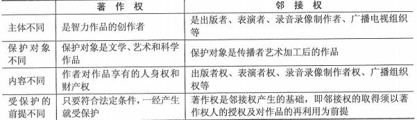

5、著作权法保护的作品类型包括：文字作品； 口述作品；音乐、戏剧、曲艺、舞蹈、杂技艺 术作品；美术、建筑作品； 摄影作品；电影作品和以类似摄影的方式创作的作品； 工程设计图、	 产品设计图、地图、示意图等图形作品和模型作品；计算机软件和法律法规规定的其他作品。

6、知识产权的特征：（15 下 70）（16 上 70）（17 上 69）

7、需要掌握的三种类型的知识产权的归属问题：（13 上 68）

（1）委托开发：A 公司委托 B 公司开发一个项目， 合同没有约定的话， 著作权一个属于 B 公司的； （2）合作开发的：著作权共同所有，如果可以分开使用，那么各自对自己开发部分具有知识产权；

（3）职务作品：上班时间的或者利用公司资源开发的， 一般著作权归属于公司；

8 、著作权保护的是文档和代码等，算法和思想是不受保护的；

| 专利权 | 保护对象 |  |  |  | 外观设计 | 国家专利局收到申请之日起计算，不可续展 （邮寄的，寄出的邮戳日为申请日） | 国家专利局收到申请之日起计算，不可续展 （邮寄的，寄出的邮戳日为申请日） |
|---|---|---|---|---|---|---|---|
| 专利权 | 保护期限 |  | 10年 | 10年 | 10年 | 国家专利局收到申请之日起计算，不可续展 （邮寄的，寄出的邮戳日为申请日） | 国家专利局收到申请之日起计算，不可续展 （邮寄的，寄出的邮戳日为申请日） |
| 商标权 |  | 注册商标 | 注册商标 | 注册商标 | 注册商标 | 核准注册之日起计算，无限续展 | 核准注册之日起计算，无限续展 |
| 商标权 |  | 10年 | 10年 | 10年 | 10年 | 核准注册之日起计算，无限续展 | 核准注册之日起计算，无限续展 |
| 著作权 | 保护对象 | 文字作品 | 建筑作品 | 建筑作品 | 图形作品 | 自作品完成之日起计算， 不可续展 | 自作品完成之日起计算， 不可续展 |
| 著作权 | 保护期限 | 署名权、修改权、保护作品完整权不受限制；发表权、使用权和获得报酬权为作者终生 及其死后50年；合作作品，截止于  最后死亡的作者死后第50年的12月31日。 | 署名权、修改权、保护作品完整权不受限制；发表权、使用权和获得报酬权为作者终生 及其死后50年；合作作品，截止于  最后死亡的作者死后第50年的12月31日。 | 署名权、修改权、保护作品完整权不受限制；发表权、使用权和获得报酬权为作者终生 及其死后50年；合作作品，截止于  最后死亡的作者死后第50年的12月31日。 | 署名权、修改权、保护作品完整权不受限制；发表权、使用权和获得报酬权为作者终生 及其死后50年；合作作品，截止于  最后死亡的作者死后第50年的12月31日。 | 署名权、修改权、保护作品完整权不受限制；发表权、使用权和获得报酬权为作者终生 及其死后50年；合作作品，截止于  最后死亡的作者死后第50年的12月31日。 | 署名权、修改权、保护作品完整权不受限制；发表权、使用权和获得报酬权为作者终生 及其死后50年；合作作品，截止于  最后死亡的作者死后第50年的12月31日。 |
| 著作权 | 著作 权的 归属 | 单位作品 | 单位作品 | 著作权归单位 | 著作权归单位 | 著作权归单位 | 招标文件；投标文件 |
| 著作权 | 著作 权的 归属 | 一般职务作品 | 一般职务作品 | 著作权归个人 单位享有前两年的优先使用权 | 著作权归个人 单位享有前两年的优先使用权 | 著作权归个人 单位享有前两年的优先使用权 | 电影剧本 |
| 著作权 | 著作 权的 归属 | 特殊职务作品 | 特殊职务作品 | 个人享有署名权、获得报酬权 其他著作权归法人 | 个人享有署名权、获得报酬权 其他著作权归法人 | 个人享有署名权、获得报酬权 其他著作权归法人 | 工程设计图；产品设计图； 地图；计算机软件 |
| 著作权 | 著作 权的 归属 | 委托作品 | 委托作品 | 有约定，按约定；无约定，归受托人 | 有约定，按约定；无约定，归受托人 | 有约定，按约定；无约定，归受托人 | 勘察文件；设计文件 |

本章历年考题和答案解析汇总：

#### 【试题 1】---2010 下真题 14

1、关于知识产权，以下说法不正确的是（1）。

（1）A.知识产权具有一定的有效期限，超过法定期限后，就成为社会共同财富 B.著作权、专利权、商标权皆属于知识产权范畴

C.知识产权具有跨地域性，一旦在某国取得产权承认和保护，那么在域外将具有同等效力 D.发明、文学和艺术作品等智力创造，都可被认为是知识产权

#### 【答案】C

#### 【解析】 此题考察的是知识产权，

世界知识产权组织（W IP0）将知识产权解释为：基于智力的创造性活动所产生的权利。广义的 知识产权从权利类型来说，包括著作权、专利权、商标权和其他知识产权。 狭义的知识产权是指 由著作权（含邻接权）、专利权和商标权三个部分组成的传统知识产权， 涉及的对象有作品、发明 创造和商标。知识产权有一定的有效期限，无法永远存续。

根据知识产权的上述概念可知，选项 C 的说法是不正确的， 因此应选 C。

#### 【点评】常考，命题的热点，简单题， 必须得分

#### 【试题 2】---2011 下真题 15

2、依照《中华人民共和国合同法》，委托开发完成的发明创造，除当事人另有约定的以外，申请 专利的权利属于（2）。

（2）A.研究开发人员      B.委托人    C.开发人与委托人共有    D. 国家所有

#### 【答案】A

#### 【解析】 此题考察的是合同法，

《合同法》第三百三十九条规定：委托开发完成的发明创造，除当事人另有约定的以外，申 请专利的权利属于研究开发人。研究开发人取得专利权的，委托人可以免费实施该专利。

#### 【点评】常考，命题的热点，简单题， 必须得分

#### 【试题 3】---2013 上真题 68

3.公民为完成法人或者其它组织工作任务所创作的作品是职务作品，对于主要是利用法人或者其它 组织的物质技术条件创作，并由法人或者其它组织承担责任的工程设计图、产品设计图、地图， 计算机软件等职务作品，其（3）。

（3）A.作者享有著作权                   B.作者享有署名权

C.法人或者其他组织享有著作权      D.法人或者其它组织享有署名权

#### 【答案】B

#### 【解析】 此题考察的是著作权法，必须掌握，必考

有下列情形之一的职务作品， 作者享有署名权，著作权的其他权利由法人或者其他组织享有，法 人或者其他组织可以给予作者奖励：

飞 （一）主要是利用法人或者其他组织的物质技术条件创作， 并由法人或者其他组织承担责任的 工程设计图、产品设计图、地图、计算机软件等职务作品；

飞 （二）法律、行政法规规定或者合同约定著作权由法人或者其他组织享有的职务作品。

飞著作权可具体细分为十七项权利， 署名权是其中的第二项， 此题目坑爹啊， 感觉是在玩文字游戏了； 	【点评】著作权法，不认真阅读法规的原文，不大好选，有点文字游戏的意思，必须得分

#### 【试题 4】---2013 下真题 62

4、（4）不需要登记或标注版权标记就应得到保护。

（4）A.专利权     B.商标权      C.著作权      D.房产权

#### 【答案】C

#### 【解析】 此题考察的是知识产权，

我国《著作权法》第二条规定： 中国公民、法人或者其他组织的作品，无论是否发表，依照 本法享有著作权， 即著作权不需要登记或标注版权标记就能得到保护。著作权是基于创作事实的， 即作品产生后，著作权即受法律保护。

#### 【点评】著作权法相关知识点，多次考了，简单，必须得分

#### 【试题 5】---2014 上真题 65

5、以下各项中，（5）不属于知识产权。

（5）A.著作权   B.专利权   C. 隐私权    D.商标权

#### 【答案】C

#### 【解析】 此题考察的是著作权法，必须掌握，必考

知识产权是一种无形的财产权，也称智力成果权，它指的是通过智力创造性劳动所获得的成果，  并且是由智力劳动者对成果依法享有的专有权利。大致包括： 著作权、专利权、商标权、发明权、 发现权和其他科技成果权。不包括隐私权；

#### 【点评】送分啊，简单，必须得分

#### 【试题 6】---2014 下真题 69

6、李某购买了一张有注册商标的应用软件光盘，则李某享有（6）。

（6）A.注册商标专用权   B.该光盘的所有权  C.该软件的著作权  D.该软件的复制权 【答案】B

#### 【解析】 此题考察的是著作权相关知识，必须掌握， 高频考点

李某是一个消费者，享有光盘所有权， 但是光盘的著作权、专用权、复制权归光盘发行公司所有；

#### 【点评】理解下不难得出，送分的

#### 【试题 7】---2015 下真题 70

7、关于知识产权的理解，不正确的是( )

（7）A.知识产权的客体不是有形物， 而 S 是知识，信息等抽象物

B.知识产权具有地域性，即在本国获得承认和保护的知识产权不具有域外效力 C.对于专利权的或外效力， 可以依赖国际公约或者双边协定取得

D.知识产权具有一定的有效期限，无法永远程序

#### 【答案】C

#### 【解析】 此题考察的是知识产权，

知识产权的地域性是指，按照一国法律获得承认和保护的知识产权，只能在该国发生法律效力， 而不具有域外效力。知识产权域外效力的取得，对著作权而言，依赖于国际公约或者双边协定即 可；专利权、商标权则必须由他国行政主管机关的确认，方可产生法律效力。

#### 【点评】送分题，多次考了，简单

#### 【试题 8】---2016 上真题 70

8、知识产权作为法律所确认的知识产品所有人依法享有的民事权利，其管理的要项中不包括（8）。 A.权利客体是一种无形财产   B.权利具有地域性

C.权利具有优先性           D.权利具有时间性

#### 【答案】C

#### 【解析】 此题考察的是知识产权，

知识产权的特征：  1）权利客体是一种无体财产 2）权利具有地域性 3）权利具有时间性 	【点评】送分题，常考，必须得分

#### 【试题 9】---2017 上真题 69

9、（）不属于知识产权的基本特征。

A.时间性    B.地域性    C.专有性    D.实用性

#### 【答案】D

#### 【解析】P584此题考察的是知识产权特征，

知识产权的特征：

| 无体性 | 对象是没有具体形体，不能用五官触觉去认识、不占任何空间但能以一定形式为人们感 知的智力创造成果， 是一种抽象的财富 |
|---|---|
| 专有性 | 知识产权的专有性是指除权利人同意或法律规定外，权利人以外的任何人不得享有或使 用该项权利。 |
| 地域性 | 知识产权只在授予其权利的国家或确认其权利的国家产生， 并且只能在该国范围内受法 律保护，而其他国家则对其没有必须给予法律保护的义务。 |
| 时间性 | 仅在法律规定的期限内受到保护， 一旦超过法律规定的有效期限，这一权利就自行消灭 |

#### 【点评】常考，比较简单，必须得分

十八、法律法规和标准规范

5.特别规定与一般规定不一致的，适用特别规定。

6.特殊情况处理原则：①法律之间对同一事项新的一般规定与旧的特别规定不一致由全国人大 常委会裁决。②地方性法规、规章新的一般规定与旧的特殊规定不一致时，由制定机构裁决。③ 地方性法规与部门规章之间对同一事项规定不一致， 不能确定如何适用时，由国务院提出意见。 国务院认为适用地方性法规的应当决定在该地方适用地方性法规的规定，认为适用部门规章的， 应当提请全国人大常委会裁决。④部门规章之间、部门规章与地方政府规章之间对同一事项的规 定不一致时，由国务院裁决。

7.①国际标准化组织（International Organizations Standardization ，ISO）；

②国际电工委员会（International Electro technical Commission ，IEC）；

1.我国目前的法律体系属于大陆体系。

2.享有民事权利的人在知道自己权利受到侵害的  2年  之内，就应当向人民法院提起诉讼。

3.如果20 年以后认为必须追诉的，要报请最高人民检察院核准。

4.宪法具有最高的法律效力， 随后依次是法律、行政法规、地方性法规、规章。全国人大及其 常委会制定的法律高于国务院、国务院各部门、各地人大及政府制定的法规和规章；国务院制定 的行政法规效力高于国务院各部门制定的规章以及各地制定的地方性法规、地方性规章；地方人 大及其常委会制定的地方性法规效力高于当地政府制定的规章。

③国际电信联盟（International Telecommunication Union ，ITU）；

④电气电子工程师学会（Institute Electrical and Electronics Engineers ，IEEE）； ⑤国际 Web 联盟（W3C）；

⑥国家标准化管理委员会（Standardization Administration of China ，SAC）； ⑦全国信息技术标准化技术委员会，简称信标委。

8.在公布国家标准之后，该项行业标准即行废止。国家鼓励企业制定严于国家标准或行业标准 的企业标准在企业内部使用。

9.标准名称组成要素： ①引导要素； ②主体要素； ③补充要素； ④4 位数的年代构成。每个标 准必须有主体要素， 即标准的主标题不能省略。

10.国家标准的制定过程 9 阶段： ①前期准备；②立项；③起草； ④征求意见；⑤审查；⑥批 准；⑦出版；⑧复审；⑨废止。

11.ISO 标准每 5 年复审一次，国家标准有效期一般为    。（19 下 70）

#### 【试题 1】---2019 下真题 70

1 、关于标准分级与类型的描述，不正确的是（）。

A.GB/T 指推荐性国家标准

B.强制性标准的形式包含全文强制和条文强制

C. 国家标准一般有效期为 3 年

D. 国家标准的制定过程包括立项、起草、征求意见、审查、批准等阶段

#### 【答案】C

#### 【解析】P605 此题考察的是国家标准，了解，很少考；

国家标准的有效期一般为 5 年。

了解，尽量得分

## 第十章、考试中涉及的法律法规

在系统集成项目管理工程师考试中，招投标法、政府采购法、合同法、著作权法属于必考 的知识点，书上没有，需要大家补充学习；本块内容一点都没有难度，大家认真看看， 一定要把 几个时间数据等搞清楚。招投标实施条例、政府采购实施条例大家尽量看，当然，其实不看也可 以的，相信通过排除法可以选对答案。

从历年的考生情况来看， 一般招投标法一般每年考 1 分， 政府采购法一般每年考 0-1 分左右， 合同法每年 0~2 分，著作权法 0~1 分，这部分总计 2 分左右，而且此部分也是非常简单的，你平 时看到了就选择出来了，没有看到过，很可能就失分了；建议考生把上述几个法规多看几遍，至 少有个印象， 结合历年考题进行操练，然后熟读本资料列出的一些高频考点；相信此部分拿到全 部的分值没有问题；法规具体原文见：

http://WWW.51kpm.com/thread-3752-1-1.html，希望认真认真阅读 2 遍，有个印象即可；

根据下表历年考点和分值分布情况，希望大家对下面所涉及到的知识点引起足够的重视：

本章金色考点汇总：

招投标法和政府采购法的关于时间的总结：

发标二零改一五，售标前后至少五，报府备案要十五。

售标前后至少五，签约退保也得五

三个 30 得牢记，定标、签约、“保证期”。

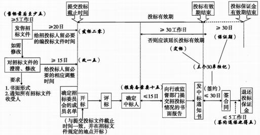

,、中华人民共和国招标投标法

第一条  为了规范招标投标活动，保护国家利益、社会公共利益和招标投标活动当事人的合 法权益，提高经济效益，保证项目质量，制定本法。

第二条  在中华人民共和国境内进行招标投标活动，适用本法。

第三条  在中华人民共和国境内进行下列工程建设项目包括项目的勘察、设计、施工、监理 以及与工程建设有关的重要设备、材料等的采购，必须进行招标： （高 09 上 9） （中 14 下 16）

（一）大型基础设施、公用事业等关系社会公共利益、公众安全的项目；

（二） 全部或者部分使用国有资金投资或者国家融资的项目；

（三） 使用国际组织或者外国政府贷款、援助资金的项目。

前款所列项目的具体范围和规模标准，由国务院发展计划部门会同国务院有关部门制订，报 国务院批准。

法律或者国务院对必须进行招标的其他项目的范围有规定的，依照其规定。

第四条

招标。

第五条 第六条

任何单位和个人不得将依法必须进行招标的项目化整为零或者以其他任何方式规避

招标投标活动应当遵循公开、公平、公正和诚实信用的原则。

依法必须进行招标的项目，其招标投标活动不受地区或者部门的限制。任何单位和

个人不得违法限制或者排斥本地区、本系统以外的法人或者其他组织参加投标，不得以任何方式 非法干涉招标投标活动。

第七条  招标投标活动及其当事人应当接受依法实施的监督。

有关行政监督部门依法对招标投标活动实施监督，依法查处招标投标活动中的违法行为。 对招标投标活动的行政监督及有关部门的具体职权划分，由国务院规定。

批准。  （高 16 上 30）

第十条   招标分为公开招标和邀请招标。

（高 06 下 50）（中 14 上 16） （中 10 上 52）（中 09 上 67）

第十三条  招标代理机构是依法设立、从事招标代理业务并提供相关服务的社会中介组织。 招标代理机构应当具备下列条件：

（一）有从事招标代理业务的营业场所和相应资金；

（二） 有能够编制招标文件和组织评标的相应专业力量；

第十五条  招标代理机构应当在招标人委托的范围内办理招标事宜，并遵守本法关于招标人 的规定。

第十六条   招标人采用公开招标方式的，应当发布招标公告。依法必须进行招标的项目的招 标公告，应当通过国家指定的报刊、信息网络或者其他媒介发布。

招标公告应当载明招标人的名称和地址、招标项目的性质、数量、实施地点和时间以及获取

招标文件的办法等事项。  （高 10 下 43）

第十七条  招标人采用邀请招标方式的，应当向三个以上具备承担招标项目的能力、资信良 好的特定的法人或者其他组织发出投标邀请书。

投标邀请书应当载明本法第十六条第二款规定的事项。

第十八条   招标人可以根据招标项目本身的要求，在招标公告或者投标邀请书中，要求潜在 投标人提供有关资质证明文件和业绩情况，并对潜在投标人进行资格审查；国家对投标人的资格 条件有规定的，依照其规定。

招标人不得以不合理的条件限制或者排斥潜在投标人， 不得对潜在投标人实行歧视待遇。（中

11 上 15A）

第十九条  招标人应当根据招标项目的特点和需要编制招标文件。招标文件应当包括招标项 目的技术要求、对投标人资格审查的标准、投标报价要求和评标标准等所有实质性要求和条件以 及拟签订合同的主要条款。（高 12 下 43A）（中 11 下 62）（中 13 下 17）

国家对招标项目的技术、标准有规定的， 招标人应当按照其规定在招标文件中提出相应要求。

招标项目需要划分标段、确定工期的，招标人应当合理划分标段、确定工期， 并在招标文件 中载明。

下 34A）

响公平竞争的有关招标投标的其他情况。 （高 13 上 3。）

招标人设有标底的，标底必须保密。 （高 12 下 43A）（高 。7 下 34B）

第二十六条  投标人应当具备承担招标项目的能力；国家有关规定对投标人资格条件或者招 标文件对投标人资格条件有规定的， 投标人应当具备规定的资格条件。

第二十七条  投标人应当按照招标文件的要求编制投标文件。 投标文件应当对招标文件提出 的实质性要求和条件作出响应。 （高 。7 下 34C）（中 11 下 63B）（中 13 下 27）

招标项目属于建设施工的，投标文件的内容应当包括拟派出的项目负责人与主要技术人员的 简历、业绩和拟用于完成招标项目的机械设备等。

第二十八条  投标人应当在招标文件要求提交投标文件的截止时间前，将投标文件送达投标 地点。招标人收到投标文件后，应当  签收保存，不得开启 。投标人少于三个的，招标人应当依照 本法重新招标。 （高 11 上 28C）（中 14 上 62） （中 11 上 15B） （中 11 下 63A）

在招标文件要求提交投标文件的截止时间后送达的投标文件，招标人应当拒收。

第二十九条  投标人在招标文件要求提交投标文件的截止时间前，可以补充、修改或者撤回 已提交的投标文件，并书面通知招标人。补充、修改的内容为投标文件的组成部分。（高 07 下

33A）

第三十条   投标人根据招标文件载明的项目实际情况， 拟在中标后将中标项目的部分非主体、 非关键性工作进行分包的，应当在投标文件中载明。

第三十一条  两个以上法人或者其他组织可以组成一个联合体，以一个投标人的身份共同投标。

联合体各方均应当具备承担招标项目的相应能力；国家有关规定或者招标文件对投标人资格 条件有规定的， 联合体各方均应当具备规定的相应资格条件。由同一专业的单位组成的联合体，  按照资质等级较低的单位确定资质等级。 （高 09 上 8）（高 07 下 33B）（中 11 下 34）（中 11

上 59）（中 10 下 16）（高 15 下 45）

联合体各方应当签订共同投标协议，明确约定各方拟承担的工作和责任，并将共同投标协议 连同投标文件一并提交招标人。联合体中标的，联合体各方应当共同与招标人签订合同， 就中标 项目向招标人承担连带责任。

招标人不得强制投标人组成联合体共同投标，不得限制投标人之间的竞争。

第三十二条  投标人不得相互串通投标报价，不得排挤其他投标人的公平竞争，损害招标人 或者其他投标人的合法权益。

投标人不得与招标人串通投标，损害国家利益、社会公共利益或者他人的合法权益。

禁止投标人以向招标人或者评标委员会成员行贿的手段谋取中标。

第三十三条   投标人不得以低于成本的报价竞标，也不得以他人名义投标或者以其他方式弄 虚作假，骗取中标。  （高 11 下 64）（高 09 下 30） （高 05 下 50）

第三十四条  开标应当在招标文件确定的提交投标文件截止时间的同一时间公开进行；开标 地点应当为招标文件中预先确定的地点。 （高 10 上 43）

第三十五条   开标由招标人主持，邀请所有投标人参加。 （高 12 上 29）

第三十六条   开标时，由投标人或者其推选的代表检查投标文件的密封情况，也可以由招标

人委托的公证机构检查并公证；经确认无误后，由工作人员当众拆封，宣读投标人名称、投标价 格和投标文件的其他主要内容。

招标人在招标文件要求提交投标文件的截止时间前收到的所有投标文件，开标时都应当当众 予以拆封、宣读。

开标过程应当记录，并存档备查。

第三十七条  评标由招标人依法组建的评标委员会负责。

依法必须进行招标的项目， 评标委员会由招标人的代表和有关技术、经济等方面的专家组成， 成员人数为五人以上单数，其中技术、经济等方面专家不得少于成员总数的三分之二。（高 11 下 65） （高 11 上 43） （中 11 上 15D） （中 10 上 62） （中 16 下 34） （中 17 下 35） （高 18 上 29）

前款专家应当从事相关领域工作满八年并具有高级职称或者具有同等专业水平，由招标人从 国务院有关部门或者省、自治区、直辖市人民政府有关部门提供的专家名册或者招标代理机构的 专家库内的相关专业的专家名单中确定； 一般招标项目可以采取随机抽取方式，特殊招标项目可 以由招标人直接确定。

与投标人有利害关系的人不得进入相关项目的评标委员会； 已经进入的应当更换。  	评标委员会成员的名单在中标结果确定前应当保密。

第三十八条  招标人应当采取必要的措施，保证评标在严格保密的情况下进行。 任何单位和个人不得非法干预、影响评标的过程和结果。

第三十九条   评标委员会可以要求投标人对投标文件中含义不明确的内容作必要的澄清或者

说明，但是澄清或者说明不得超出投标文件的范围或者改变投标文件的实质性内容。（高 13 下 31）

第四十条  评标委员会应当按照招标文件确定的评标标准和方法，对投标文件进行评审和比 较；设有标底的，应当参考标底。 评标委员会完成评标后，应当向招标人提出书面评标报告，并 推荐合格的中标候选人。

招标人根据评标委员会提出的书面评标报告和推荐的中标候选人确定中标人。 招标人也可以 授权评标委员会直接确定中标人。

国务院对特定招标项目的评标有特别规定的，从其规定。

第四十一条  中标人的投标应当符合下列条件之一： （中 14 下 33） （中 11 下 63C）

（一）能够最大限度地满足招标文件中规定的各项综合评价标准；

（二）能够满足招标文件的实质性要求，并且经评审的投标价格最低；但是投标价格低于成 本的除外。

第四十二条   评标委员会经评审，认为所有投标都不符合招标文件要求的， 可以否决所有投 标。（中 11 上 14C）（高 15 下 45）

依法必须进行招标的项目的所有投标被否决的， 招标人应当依照本法重新招标。

第四十三条  在确定中标人前，招标人不得与投标人就投标价格、投标方案等实质性内容进 行谈判。

第四十四条  评标委员会成员应当客观、公正地履行职务，遵守职业道德，对所提出的评审 意见承担个人责任。

评标委员会成员不得私下接触投标人，不得收受投标人的财物或者其他好处。

评标委员会成员和参与评标的有关工作人员不得透露对投标文件的评审和比较、中标侯选人 的推荐情况以及与评标有关的其他情况。

第四十五条  中标人确定后， 招标人应当向中标人发出中标通知书，并同时将中标结果通知 所有未中标的投标人。 （高 11 上 44）

中标通知书对招标人和中标人具有法律效力。 中标通知书发出后，招标人改变中标结果的，  或者中标人放弃中标项目的， 应当依法承担法律责任。 （高 。7 下 33C）

第四十六条  招标人和中标人应当自中标通知书发出之日起三十日内，按照招标文件和中标 人的投标文件订立书面合同。招标人和中标人不得再行订立背离合同实质性内容的其他协议。（高

1。上 43）（高。6 下 51）（高 17 下 29）

招标文件要求中标人提交履约保证金的，中标人应当提交。  （高 11 上 43）

第四十七条  依法必须进行招标的项目， 招标人应当自确定中标人之日起十五日内，向有关 行政监督部门提交招标投标情况的书面报告。

第四十八条  中标人应当按照合同约定履行义务，完成中标项目。 中标人不得向他人转让中 标项目，也不得将中标项目肢解后分别向他人转让。

中标人按照合同约定或者经招标人同意，可以将中标项目的部分非主体、非关键性工作分包 给他人完成。接受分包的人应当具备相应的资格条件，并不得再次分包。 （高 11 上 28D） （高 。7

下 33D）（中 12 上 15）

中标人应当就分包项目向招标人负责，接受分包的人就分包项目承担连带责任。（高 10 上 29）

第五十条 招标代理机构违反本法规定，泄露应当保密的与招标投标活动有关的情况和资料 的，或者与招标人、投标人串通损害国家利益、社会公共利益或者他人合法权益的，处五万元以 上二十五万元以下的罚款，对单位直接负责的主管人员和其他直接责任人员处单位罚款数额百分 之五以上百分之十以下的罚款；有违法所得的，并处没收违法所得； 情节严重的，禁止其一年至 二年内代理依法必须进行招标的项目并予以公告，直至由工商行政管理机关吊销营业执照【新法 修改】 ；构成犯罪的，依法追究刑事责任。给他人造成损失的， 依法承担赔偿责任。

前款所列行为影响中标结果的，中标无效。  （高 13 下 28）

第六十六条   涉及国家安全、国家秘密、抢险救灾或者属于利用扶贫资金实行以工代贩、需 要使用农民工等特殊情况，不适宜进行招标的项目， 按照国家有关规定可以不进行招标。

当出现招标文件中的某项规定与招标人对投标人质疑问题的书面解答不一致时，应以招标人

对投标人质疑的书面解答文件为准。 （高 13 下 43）

招标人应该根据招标项目的特点和需要编制招标文件。招标文件应当包括招标项目的技术要 求、对投标人资格审查的标准、投标报价要求和评标标准等所有实质性要求和条件，以及拟签订 合同的主要条款。 如果国家对招标项目的技术、标准有规定的，招标人应当按照其规定在招标文 件中提出相应的要求。招标项目需要划分标段、确定工期的，招标人应当合理划分标段、确定工 期，并在招标文件中阐明。招标文件不得要求或者标明特定的生产供应者，也不得含有倾向或者 排斥潜在投标人的其他内容。  （中 14 下 32）

49 条到 66 条在此去掉，不是重点，不需要重点学习！掌握以上知识点基本可以应 付考试！

招标程序一般为：1、采购人编制计划，报财政厅政府采购办审核；2、采购办与招标代理机 构办理委托手续，确定招标方式；3、进行市场调查，与采购人确认采购项目后， 编制招标文件。 4、发布招标公告或发出招标邀请函； 5、出售招标文件， 对潜在投标人资格预审； 6、接受投标人 标书； 7、在公告或邀请函中规定的时间、地点公开开标； 8、由评标委员对投标文件评标；9、依 据评标原则及程序确定中标人； 10、向中标人发送中标通知书； 11、组织中标人与采购单位签订 合同； 12、进行合同履行的监督管理，解决中标人与采购单位的纠纷。 项目投标的过程从大的方 面讲就是：招标、投标、评标和授标（中 17 上 35）

：、中华人民共和国招投标法实施条例

此部分详细见立项管理章节，掌握立项管理章节相关内容即可！

### 3、中华人民共和国政府采购法

摘自： http://WWW.51kpm.com/thread-3752-1-1.html

## 第一章总则

第一条为了规范政府采购行为，提高政府采购资金的使用效益，维护国家利益和社会公共利 益，保护政府采购当事人的合法权益， 促进廉政建设，制定本法。

第二条在中华人民共和国境内进行的政府采购适用本法。

本法所称政府采购，是指各级国家机关、事业单位和团体组织，使用财政性资金采购依法制

定的集中采购目录以内的或者采购限额标准以上的货物、工程和服务的行为。 （高 。8 上 26） 政府集中采购目录和采购限额标准依照本法规定的权限制定。

本法所称采购， 是指以合同方式有偿取得货物、工程和服务的行为， 包括购买、租赁、委托、 雇用等。

本法所称货物， 是指各种形态和种类的物品，包括原材料、燃料、设备、产品等。

本法所称工程， 是指建设工程，包括建筑物和构筑物的新建、改建、扩建、装修、拆除、修 鳍等。

本法所称服务， 是指除货物和工程以外的其他政府采购对象。

第三条政府采购应当遵循公开透明原则、公平竞争原则、公正原则和诚实信用原则。

第四条政府采购工程进行招标投标的， 适用招标投标法。

第五条任何单位和个人不得采用任何方式，阻挠和限制供应商自由进入本地区和本行业的政 府采购市场。 （高 。7 下 28A）

第六条政府采购应当严格按照批准的预算执行。

第七条政府采购实行集中采购和分散采购相结合。集中采购的范围由省级以上人民政府公布 的集中采购目录确定。

属于中央预算的政府采购项目，其集中采购目录由国务院确定并公布；属于地方预算的政府

采购项目， 其集中采购目录由省、自治区、直辖市人民政府或者其授权的机构确定并公布。  （高

。7 下 28D）

纳入集中采购目录的政府采购项目，应当实行集中采购。

第八条政府采购限额标准，属于中央预算的政府采购项目， 由国务院确定并公布；属于地方 预算的政府采购项目，由省、自治区、直辖市人民政府或者其授权的机构确定并公布。

第九条政府采购应当有助于实现国家的经济和社会发展政策目标，包括保护环境，扶持不发 达地区和少数民族地区，促进中小企业发展等。

第十条政府采购应当采购本国货物、工程和服务。但有下列情形之一的除外：  （高 。7 下 28B）

（一）需要采购的货物、工程或者服务在中国境内无法获取或者无法以合理的商业条件获取的；

（二） 为在中国境外使用而进行采购的；

（三） 其他法律、行政法规另有规定的。

前款所称本国货物、工程和服务的界定，依照国务院有关规定执行。

第十一条政府采购的信息应当在政府采购监督管理部门指定的媒体上及时向社会公开发布，  但涉及商业秘密的除外。

第十二条在政府采购活动中，采购人员及相关人员与供应商有利害关系的， 必须回避。供应 商认为采购人员及相关人员与其他供应商有利害关系的，可以申请其回避。

前款所称相关人员，包括招标采购中评标委员会的组成人员，竞争性谈判采购中谈判小组的 组成人员， 询价采购中询价小组的组成人员等。

第十三条各级人民政府财政部门是负责政府采购监督管理的部门，依法履行对政府采购活动

的监督管理职责。 （高。9 下 6A）

各级人民政府其他有关部门依法履行与政府采购活动有关的监督管理职责。

第十六条集中采购机构为采购代理机构。设区的市、自治州以上人民政府根据本级政府采购

项目组织集中采购的需要设立集中采购机构。

集中采购机构是非营利事业法人， 根据采购人的委托办理采购事宜。 （高 。9 下 6B）

第十七条集中采购机构进行政府采购活动，应当符合采购价格低于市场平均价格、采购效率 更高、采购质量优良和服务良好的要求。

第十八条采购人采购纳入集中采购目录的政府采购项目，必须委托集中采购机构代理采购；  采购未纳入集中采购目录的政府采购项目，可以自行采购，也可以委托集中采购机构在委托的范 围内代理采购。

纳入集中采购目录属于通用的政府采购项目的， 应当委托集中采购机构代理采购；属于本部 门、本系统有特殊要求的项目，应当实行部门集中采购；属于本单位有特殊要求的项目，经省级

以上人民政府批准， 可以自行采购。 （高 17 上 29）

第十九条采购人可以委托经国务院有关部门或者省级人民政府有关部门认定资格的采购代理 机构，在委托的范围内办理政府采购事宜。

采购人有权自行选择采购代理机构，任何单位和个人不得以任何方式为采购人指定采购代理

机构。 （高 16 上 28）

第二十条采购人依法委托采购代理机构办理采购事宜的，应当由采购人与采购代理机构签订 委托代理协议，依法确定委托代理的事项，约定双方的权利义务。

第二十一条供应商是指向采购人提供货物、工程或者服务的法人、其他组织或者自然人。

第二十二条供应商参加政府采购活动应当具备下列条件： （高。7 下 29）

（一）具有独立承担民事责任的能力；

（二） 具有良好的商业信誉和健全的财务会计制度；

（三） 具有履行合同所必需的设备和专业技术能力；

（四） 有依法缴纳税收和社会保障资金的良好记录；

（五） 参加政府采购活动前三年内，在经营活动中没有重大违法记录；

（六） 法律、行政法规规定的其他条件。

采购人可以根据采购项目的特殊要求，规定供应商的特定条件，但不得以不合理的条件对供 应商实行差别待遇或者歧视待遇。

第二十三条采购人可以要求参加政府采购的供应商提供有关资质证明文件和业绩情况，并根 据本法规定的供应商条件和采购项目对供应商的特定要求，对供应商的资格进行审查。

第二十四条两个以上的自然人、法人或者其他组织可以组成一个联合体，以一个供应商的身 份共同参加政府采购。 （高 。9 下 6C）

以联合体形式进行政府采购的， 参加联合体的供应商均应当具备本法第二十二条规定的条件， 并应当向采购人提交联合协议，载明联合体各方承担的工作和义务。联合体各方应当共同与采购 人签订采购合同，就采购合同约定的事项对采购人承担连带责任。 （中 12 上 16）

第二十五条政府采购当事人不得相互串通损害国家利益、社会公共利益和其他当事人的合法 权益；不得以任何手段排斥其他供应商参与竞争。

供应商不得以向采购人、采购代理机构、评标委员会的组成人员、竞争性谈判小组的组成人 员、询价小组的组成人员行贿或者采取其他不正当手段谋取中标或者成交。

采购代理机构不得以向采购人行贿或者采取其他不正当手段谋取非法利益。

## 第三章政府采购方式

第二十六条政府采购采用以下方式：  （高 10 上 28）（高 07 下 30）（高 13 下 61） 	（一）公开招标；

（二）邀请招标；

（三）竞争性谈判；

（四）单一来源采购；

（五）询价；

（六）国务院政府采购监督管理部门认定的其他采购方式。

公开招标应作为政府采购的主要采购方式（中 14 下 17）（高 10 下 58）（高 09 下 6D）（高

17 上 28）

第二十七条采购人采购货物或者服务应当采用公开招标方式的，其具体数额标准，属于中央 预算的政府采购项目，由国务院规定；属于地方预算的政府采购项目，由省、自治区、直辖市人 民政府规定；因特殊情况需要采用公开招标以外的采购方式的，应当在采购活动开始前获得设区 的市、自治州以上人民政府采购监督管理部门的批准。

10 上 28）（高 08 上 27）（中 11 上 16）（中 10 下 15）

08 上 27）（高 07 下 30）（中 11 上 16）（中 10 上 16）（中 13 上 17）（中 17 下 70）

添购资金总额不超过原合同采购金额百分之十的。 （高 10 下 29）

第三十二条采购的货物规格、标准统一、现货货源充足且价格变化幅度小的政府采购项目，

可以依照本法采用询价方式采购。  （中 11 下 16）

## 第四章政府采购程序

第三十三条负有编制部门预算职责的部门在编制下一财政年度部门预算时，应当将该财政年 度政府采购的项目及资金预算列出，报本级财政部门汇总。部门预算的审批，按预算管理权限和 程序进行。

第三十四条货物或者服务项目采取邀请招标方式采购的，采购人应当从符合相应资格条件的 供应商中， 通过随机方式选择三家以上的供应商，并向其发出投标邀请书。

第三十五条货物和服务项目实行招标方式采购的， 自招标文件开始发出之日起至投标人提交

投标文件截止之日止，不得少于二十日。 （中 10 下 62）

第三十六条在招标采购中，出现下列情形之一的，应予废标：

（高 14 下 28） （高 10 上 28）

（高 07 下 31）（中 10 下 16）

（一）符合专业条件的供应商或者对招标文件作实质响应的供应商不足三家的；  （二） 出现影响采购公正的违法、违规行为的；

（三） 投标人的报价均超过了采购预算， 采购人不能支付的；

（四） 因重大变故，采购任务取消的。

废标后，采购人应当将废标理由通知所有投标人。

第三十七条废标后， 除采购任务取消情形外， 应当重新组织招标； 需要采取其他方式采购的， 应当在采购活动开始前获得设区的市、自治州以上人民政府采购监督管理部门或者政府有关部门 批准。

第三十八条采用竞争性谈判方式采购的，应当遵循下列程序： （中 10 下 62）

（一）成立谈判小组。谈判小组由采购人的代表和有关专家共三人以上的单数组成，其中专 家的人数不得少于成员总数的三分之二。

（二）制定谈判文件。谈判文件应当明确谈判程序、谈判内容、合同草案的条款以及评定成 交的标准等事项。

（三）确定邀请参加谈判的供应商名单。谈判小组从符合相应资格条件的供应商名单中确定 不少于三家的供应商参加谈判，并向其提供谈判文件。

（四）谈判。谈判小组所有成员集中与单一供应商分别进行谈判。 在谈判中，谈判的任何一 方不得透露与谈判有关的其他供应商的技术资料、价格和其他信息。谈判文件有实质性变动的，  谈判小组应当以书面形式通知所有参加谈判的供应商。

（五）确定成交供应商。谈判结束后，谈判小组应当要求所有参加谈判的供应商在规定时间 内进行最后报价，采购人从谈判小组提出的成交候选人中根据符合采购需求、质量和服务相等且 报价最低的原则确定成交供应商， 并将结果通知所有参加谈判的未成交的供应商。

第三十九条采取单一来源方式采购的，采购人与供应商应当遵循本法规定的原则，在保证采 购项目质量和双方商定合理价格的基础上进行采购。

第四十条采取询价方式采购的，应当遵循下列程序：  （中 12 下 17） （高 10 下 30）

（一）成立询价小组。询价小组由采购人的代表和有关专家共三人以上的单数组成，其中专 家的人数不得少于成员总数的三分之二。询价小组应当对采购项目的价格构成和评定成交的标准 等事项作出规定。

（二）确定被询价的供应商名单。询价小组根据采购需求，从符合相应资格条件的  供应商名 单中确定不少于三家的供应商，并向其发出询价通知书让其报价。

（三） 询价。询价小组要求被询价的供应商一次报出不得更改的价格。

（四） 确定成交供应商。采购人根据符合采购需求、质量和服务相等且报价最低的原则确定 成交供应商，并将结果通知所有被询价的未成交的供应商

第四十一条采购人或者其委托的采购代理机构应当组织对供应商履约的验收。大型或者复杂 的政府采购项目，应当邀请国家认可的质量检测机构参加验收工作。验收方成员应当在验收书上 签字，并承担相应的法律责任。

第四十二条采购人、采购代理机构对政府采购项目每项采购活动的采购文件应当妥善保存，

不得伪造、变造、隐匿或者销毁。采购文件的保存期限为从采购结束之日起至少保存15年。  （高

15 下 29）

采购文件包括采购活动记录、采购预算、招标文件、投标文件、评标标准、评估报告、定标 文件、合同文本、验收证明、质疑答复、投诉处理决定及其他有关文件、资料。

采购活动记录至少应当包括下列内容：

（一）采购项目类别、名称；

（二） 采购项目预算、资金构成和合同价格；

（三） 采购方式，采用公开招标以外的采购方式的，应当载明原因；

（四） 邀请和选择供应商的条件及原因；

（五） 评标标准及确定中标人的原因；

（六） 废标的原因；

（七） 采用招标以外采购方式的相应记载。

## 第五章政府采购合同

第四十三条政府采购合同适用合同法。采购人和供应商之间的权利和义务，应当按照平等、 自愿的原则以合同方式约定。

采购人可以委托采购代理机构代表其与供应商签订政府采购合同。由采购代理机构以采购人 名义签订合同的，应当提交采购人的授权委托书，作为合同附件。

第四十四条政府采购合同应当采用书面形式。

第四十五条国务院政府采购监督管理部门应当会同国务院有关部门，规定政府采购合同必须 具备的条款。

第四十六条采购人与中标、成交供应商应当在中标、成交通知书发出之日起30内，按照采购文件确定的事项签订政府采购合同。

中标、成交通知书对采购人和中标、成交供应商均具有法律效力。 中标、成交通知书发出后， 采购人改变中标、成交结果的，或者中标、成交供应商放弃中标、成交项目的，应当依法承担法 律责任。

第四十七条政府采购项目的采购合同自签订之日起七个工作日内，采购人应当将合同副本报 同级政府采购监督管理部门和有关部门备案。

第四十八条经采购人同意， 中标、成交供应商可以依法采取分包方式履行合同。

政府采购合同分包履行的，中标、成交供应商就采购项目和分包项目向采购人负责，分包供 应商就分包项目承担责任。

第四十九条政府采购合同履行中，采购人需追加与合同标的相同的货物、工程或者服务的， 在不改变合同其他条款的前提下，可以与供应商协商签订补充合同，但所有补充合同的采购金额 不得超过原合同采购金额的百分之十。（高 11 下 30）

第五十条政府采购合同的双方当事人不得擅自变更、中止或者终止合同。

政府采购合同继续履行将损害国家利益和社会公共利益的，双方当事人应当变更、中止或者 终止合同。有过错的一方应当承担赔偿责任，双方都有过错的， 各自承担相应的责任。

## 第六章质疑与投诉

第五十一条供应商对政府采购活动事项有疑问的，可以向采购人提出询问，采购人应当及时 作出答复， 但答复的内容不得涉及商业秘密。

第五十二条供应商认为采购文件、采购过程和中标、成交结果使自己的权益受到损害的，可

以在知道或者应知其权益受到损害之日起七个工作日内，以书面形式向采购人提出质疑。

下 29）

第五十三条采购人应当在收到供应商的书面质疑后七个工作日内作出答复，并以书面形式通 知质疑供应商和其他有关供应商，但答复的内容不得涉及商业秘密。

第五十四条采购人委托采购代理机构采购的， 供应商可以向采购代理机构提出询问或者质疑， 采购代理机构应当依照本法第五十一条、第五十三条的规定就采购人委托授权范围内的事项作出 答复。

第五十五条质疑供应商对采购人、采购代理机构的答复不满意或者采购人、采购代理机构未 在规定的时间内作出答复的， 可以在答复期满后十五个工作日内向同级政府采购监督管理部门投

诉。  （高 13 上 25）

第五十六条政府采购监督管理部门应当在收到投诉后三十个工作日内，对投诉事项作出处理 决定，并以书面形式通知投诉人和与投诉事项有关的当事人。

,、中华人民共和国合同法

当采用书面形式。（中 12 下 16）（高 16 下 28）

第十二条  合同的内容由当事人约定， 一般包括以下条款： （中。9 上 4。）

（一）当事人的名称或者姓名和住所；（二）标的；（三）数量；（四）质量；（五）价款或者 报酬；（六） 履行期限、地点和方式；（七）违约责任；（八）解决争议的方法。

当事人可以参照各类合同的示范文本订立合同。

第十四条   要约是希望和他人订立合同的意思表示，该意思表示应当符合下列规定：（高 。8 下

28）（中 。9 上 39）

（一）内容具体确定；

（二） 表明经受要约人承诺，要约人即受该意思表示约束。

第十五条   要约邀请是希望他人向自己发出要约的意思表示。寄送的价目表、拍卖公告、招

标公告、招股说明书、商业广告等为要约邀请。（高 08 下 28）（高 14 上 29）

商业广告的内容符合要约规定的， 视为要约。

第十六条   要约到达受要约人时生效。

采用数据电文形式订立合同，收件人指定特定系统接收数据电文的，该数据电文进入该特定 系统的时间，视为到达时间；未指定特定系统的， 该数据电文进入收件人的任何系统的首次时间， 视为到达时间。

第十七条   要约可以撤回。撤回要约的通知应当在要约到达受要约人之前或者与要约同时到 达受要约人。

第二十一条   承诺是受要约人同意要约的意思表示。

第二十四条  要约以信件或者电报作出的，承诺期限自信件载明的日期或者电报交发之日开 始计算。信件未载明日期的，自投寄该信件的邮戳日期开始计算。要约以电话、传真等快速通讯 方式作出的，承诺期限自要约到达受要约人时开始计算。

第二十六条   承诺通知到达要约人时生效。承诺不需要通知的， 根据交易习惯或者要约的要

求作出承诺的行为时生效。 （高 14 上 28）

第二十七条  承诺可以撤回。撤回承诺的通知应当在承诺通知到达要约人之前或者与承诺通 知同时到达要约人。

第二十八条  受要约人超过承诺期限发出承诺的， 除要约人及时通知受要约人该承诺有效的 以外，为新要约。

第二十九条  受要约人在承诺期限内发出承诺，按照通常情形能够及时到达要约人，但因其 他原因承诺到达要约人时超过承诺期限的，除要约人及时通知受要约人因承诺超过期限不接受该 承诺的以外，该承诺有效。

采用数据电文形式订立合同的，承诺到达的时间适用本法第十六条第二款的规定。

第三十六条  法律、行政法规规定或者当事人约定采用书面形式订立合同，当事人未采用书 面形式但一方已经履行主要义务，对方接受的， 该合同成立。

第三十七条  采用合同书形式订立合同，在签字或者盖章之前，当事人一方已经履行主要义 务，对方接受的，该  合同成立。

第三十九条采用格式条款订立合同的， 提供格式条款的一方应当遵循公平原则确定当事人之 间的权利和义务， 并采取合理的方式提请对方注意免除或者限制其责任的条款，按照对方的要求， 对该条款予以说明。

格式条款是当事人为了重复使用而预先拟定， 并在订立合同时未与对方协商的条款。

第四十条格式条款具有本法第五十二条和第五十三条规定情形的，或者提供格式条款一方免 除其责任、加重对方责任、排除对方主要权利的，该条款无效。

第四十一条  对格式条款的理解发生争议的，应当按照通常理解予以解释。对格式条款有两 种以上解释的，应当作出不利于提供格式条款一方的解释。格式条款和非格式条款不一致的，应 当采用非格式条款。（高 16 下 29）

第四十三条  当事人在订立合同过程中知悉的商业秘密， 无论合同是否成立， 不得泄露或者 不正当地使用。泄露或者不正当地使用该商业秘密给对方造成损失的，应当承担损害赔偿责任。

第四十六条当事人对合同的效力可以约定附期限。附生效期限的合同，自期限届至时生效。

附终止期限的合同， 自期限届满时失效。 （中 10 上 52）

第五十二条  有下列情形之一的，合同无效：

（一）一方以欺诈、胁迫的手段订立合同， 损害国家利益；

（二） 恶意串通，损害国家、集体或者第三人利益；

（三） 以合法形式掩盖非法目的；

（四） 损害社会公共利益；

（五） 违反法律、行政法规的强制性规定。

第五十三条  合同中的下列免责条款无效：

（一）造成对方人身伤害的；

（二） 因故意或者重大过失造成对方财产损失的。

第五十四条  下列合同， 当事人一方有权请求人民法院或者仲裁机构变更或者撤销：

（一）因重大误解订立的；

（二） 在订立合同时显失公平的。

一方以欺诈、胁迫的手段或者乘人之危，使对方在违背真实意思的情况下订立的合同，受损 害方有权请求人民法院或者仲裁机构变更或者撤销。

当事人请求变更的，人民法院或者仲裁机构不得撤销。

第六十一条合同生效后，当事人就质量、价款或者报酬、履行地点等内容没有约定或者约定

不明确的，可以协议补充；不能达成补充协议的，按照合同有关条款或者交易习惯确定。 （高 。8

上 25）（中 12 上 52）（中 11 上 49）

第六十二条  当事人就有关合同内容约定不明确，依照本法第六十一条的规定仍不能确定 的，适用下列规定：（中。9 上 41）（高 13 下 3。）（高 18 上 25）

（一）质量要求不明确的，按照国家标准、行业标准履行；没有国家标准、行业标准的，按 照通常标准或者符合合同目的的特定标准履行。

（二） 价款或者报酬不明确的，按照订立合同时履行地的市场价格履行；依法应当执行政府 定价或者政府指导价的，按照规定履行。

（三） 履行地点不明确，给付货币的，在接受货币一方所在地履行；交付不动产的，在不动 产所在地履行；其他标的，在履行义务一方所在地履行。

（四） 履行期限不明确的，债务人可以随时履行，债权人也可以随时要求履行，但应当给对 方必要的准备时间。

（五） 履行方式不明确的，按照有利于实现合同目的的方式履行。

（六） 履行费用的负担不明确的，由履行义务一方负担。

第六十三条  执行政府定价或者政府指导价的， 在合同约定的交付期限内政府价格调整时，  按照交付时的价格计价。逾期交付标的物的，遇价格上涨时，按照原价格执行；价格下降时，按 照新价格执行。逾期提取标的物或者逾期付款的， 遇价格上涨时，按照新价格执行； 价格下降时，

按照原价格执行。（高 14 下 52）

第六十七条  当事人互负债务，有先后履行顺序， 先履行一方未履行的， 后履行一方有权拒绝 其履行要求。先履行一方履行债务不符合约定的， 后履行一方有权拒绝其相应的履行要求。

第六十八条  应当先履行债务的当事人， 有确切证据证明对方有下列情形之一的，可以中止履行：

（一）经营状况严重恶化；

（二） 转移财产、抽逃资金，以逃避债务；

（三） 丧失商业信誉；

（四） 有丧失或者可能丧失履行债务能力的其他情形。

当事人没有确切证据中止履行的，应当承担违约责任。

第七十八条当事人对合同变更的内容约定不明确的，推定为未变更。（高 。9 上 7）（高 。8 下 26）

第九十一条有下列情形之一的，合同的权利义务终止：（一）债务已经按照约定履行；（二）

合同解除；（三）债务相互抵销；（四）债务人依法将标的物提存；（五）债权人免除债务；（六）

债权债务同归于一人；（七）法律规定或者当事人约定终止的其他情形。（中 14 上 17）

第一百条当事人互负债务，标的物种类、品质不相同的， 经双方协商一致，也可以抵销。（高

12 上 27）

第一百一十六条当事人既约定违约金，又约定定金的， 一方违约时，对方可以选择适用违约

金或者定金条款。 （中 13 上 52）

第二百七十八条隐蔽工程在隐蔽以前， 承包人应当通知发包人检查。 发包人没有及时检查的， 承包人可以顺延工程日期，并有权要求赔偿停工、窝工等损失。（高。8 下 27）

第三百三十九条委托开发完成的发明创造，除当事人另有约定的以外，申请专利的权利属于 研究开发人。研究开发人取得专利权的，委托人可以免费实施该专利。（中 11 下 15）

研究开发人转让专利申请权的，委托人享有以同等条件优先受让的权利。

第一百四十条  标的物在订立合同之前已为买受人占有的， 合同生效的时间为交付时间。（高

14 下 29）

中标价即为签订合同的合同价。双方不得再签订违背合同实质性内容的协议或合同，也叫阴 阳合同。其实质性内容包括合同价款， 质量要求等。（高 14 下 4。）

。、中华人民共和国著作权法

知识产权是一种无形的财产权，也称智力成果权，它指的是通过智力创造性劳动所获得的成 果，并且是由智力劳动者对成果依法享有的专有权利。大致包括： 著作权、专利权、商标权、发 明权、发现权和其他科技成果权。不包括隐私权；（中 14 上 68）

第三条  本法所称的作品，包括以下列形式创作的文学、艺术和自然科学、社会科学、工程  技术等作品：（一）文字作品；（二） 口述作品；（三） 音乐、戏剧、曲艺、舞蹈、杂技艺术作品 （四） 美术、建筑作品； （五）摄影作品；（六）电影作品和以类似摄制电影的方法创作的作品；（七） 工程设计图、产品设计图、地图、示意图等图形作品和模型作品；（八）计算机软件；（九）法律、 行政法规规定的其他作品。

第五条  本法不适用于：（一）法律、法规，国家机关的决议、决定、命令和其他具有立法、 行政、司法性质的文件，及其官方正式译文；（二）时事新闻；（三）历法、通用数表、通用表格 和公式。（高 15 下 3。）

第十二条改编、翻译、注释、整理已有作品而产生的作品，其著作权由改编、翻译、注释、 整理人享有，但行使著作权时不得侵犯原作品的著作权。

第十三条两人以上合作创作的作品，著作权由合作作者共同享有。没有参加创作的人，不能 成为合作作者。

合作作品可以分割使用的，作者对各自创作的部分可以单独享有著作权，但行使著作权时不 得侵犯合作作品整体的著作权。

第十四条汇编若干作品、作品的片段或者不构成作品的数据或者其他材料， 对其内容的选择 或者编排体现独创性的作品，为汇编作品，其著作权由汇编人享有，但行使著作权时，不得侵犯 原作品的著作权。

第十六条 公民为完成法人或者其他组织工作任务所创作的作品是职务作品，除本条第二款 的规定以外，著作权由作者享有，但法人或者其他组织有权在其业务范围内优先使用。作品完成 两年内，未经单位同意，作者不得许可第三人以与单位使用的相同方式使用该作品。

有下列情形之一的职务作品，作者享有署名权，著作权的其他权利由法人或者其他组织享有，法 人或者其他组织可以给予作者奖励： （中 13 上 68）

（一）主要是利用法人或者其他组织的物质技术条件创作，并由法人或者其他组织承担责任 的工程设计图、产品设计图、地图、计算机软件等职务作品；

（二） 法律、行政法规规定或者合同约定著作权由法人或者其他组织享有的职务作品。

第十七条受委托创作的作品，著作权的归属由委托人和受托人通过合同约定。合同未作明确约定 或者没有订立合同的，著作权属于受托人。

第十八条 美术等作品原件所有权的转移，不视为作品著作权的转移，但美术作品原件的展览 权由原件所有人享有。

第二十条   作者的署名权、修改权、保护作品完整权的保护期不受限制。 （高 13 上 27）

第二十一条  公民的作品，其发表权、本法第十条第一款第（五）项至第（十七）项规定的 权利的保护期为作者终生及其死亡后五十年，截止于作者死亡后第五十年的 12 月 31  日；如果是 合作作品， 截止于最后死亡的作者死亡后第五十年的 12 月 31 日。（高 14 上 30）

法人或者其他组织的作品、著作权（署名权除外）由法人或者其他组织享有的职务作品， 其 发表权、本法第十条第一款第（五）项至第（十七） 项规定的权利的保护期为五十年，截止于作 品首次发表后第五十年的 12 月 31  日， 但作品自创作完成后五十年内未发表的，本法不再保护。

电影作品和以类似摄制电影的方法创作的作品、摄影作品，其发表权、本法第十条第一款 第（五）项至第（十七）项规定的权利的保护期为五十年，截止于作品首次发表后第五十年的 12 月 31 日，但作品自创作完成后五十年内未发表的， 本法不再保护。

‘、中华人民共和国专利法

第八条  两个以上单位或者个人合作完成的发明创造、一个单位或者个人接受其他单位或者 个人委托所完成的发明创造，除另有协议的以外， 申请专利的权利属于完成或者共同完成的单位 或者个人；申请被批准后， 申请的单位或者个人为专利权人。

第九条  同样的发明创造只能授予一项专利权。但是，同一申请人同日对同样的发明创造既 申请实用新型专利又申请发明专利，先获得的实用新型专利权尚未终止，且申请人声明放弃该实 用新型专利权的，可以授予发明专利权。

两个以上的申请人分别就同样的发明创造申请专利的， 专利权授予最先申请的人。 （高 17 上 30）

第四十二条  发明专利权的期限为二十年，实用新型专利权和外观设计专利权的期限为十年， 均自申请日起计算。

,、法律法规历年中高级历年真题分类汇总

### 1、中华人民共和国招标投标法

#### 【试题 1】---高级 2005 上真题 50

1、在招标过程中，下列中的（1）应在开标之前完成。

A.确认投标人资格   B.制定评标原则      C.答标    D.发放中标通知书

#### 【答案】A

#### 【解析】 此题考察的是招投标法，必须掌握，必考

在《中华人民共和国招标投标法》中规定的招投标主要活动有：招标、投标、开标、评标和 中标。答案中只有确认投标人资格是必须在开标之前完成的活动。 原则上 B.制定评标原则也应该 在开标前完成，所以江山老师认为 A 和 B 均可，此题出的不是很好，也不用太纠结；实际上资格 有资格前审，也有后审，A 也有一点问题

#### 【点评】必考的，招投标法，简单，必须得分

#### 【试题 2】---高级 2005 下真题 50

2、下列关于投标的叙述中，不正确的是（2）。

A.两个以上法人可以组成一个联合体，以一个投标人的身份共同投标

B.在招标文件要求提交投标文件的截止时间后送达的投标文件， 招标人应当拒收 C.招标人不得相互串通投标报价

D.竞标时，投标人可以自行决定报价，报价数额不受限制

#### 【答案】D

#### 【解析】 此题考察的是招投标法，必须掌握，必考

中华人民共和国招标投标法第三十三条明确规定：投标人不得以低于成本的报价竞标，也不 得以他人的名誉投标或者以其他的方式弄虚作假，骗取中标。 因此选项 D 中报价数额不受限制明 显错误。

#### 【点评】必考的，招投标法，简单，必须得分

#### 【试题 3】---高级 2006 下真题 50

3、公开招标是指（3）。

A.招标人以投标邀请书的方式邀请特定的法人或者其他组织投标

B.发布招标广告吸引或者直接邀请众多投标人参加投标并按照规定程序从中选择中标人的行为 C.招标人以招标公告的方式邀请不特定的法人或者其他组织投标

D.有限招标

#### 【答案】C

#### 【解析】 此题考察的是招投标法知识，必须掌握，必考

按照《中华人民共和国招标投标法》第十条规定“招标分为公开招标和邀请招标。公开招标， 是指招标人以招标公告的方式邀请不特定的法人或者其他组织投标。邀请招标，是指招标人以投 标邀请书的方式邀请特定的法人或者其他组织投标。”

#### 【点评】必考的，招投标法，简单，必须得分

#### 【试题 4】 ---高级 2006 下真题 51

4、根据有关法律，招标人与中标人应当自中标通知发出之日（4）天内，按招标文件和中标人的 投标文件订立书面合同。

A.15                B.20                C.30            D.45

#### 【答案】C

#### 【解析】 此题考察的是招投标法知识，必须掌握，必考

按照《中华人民共和国招标投标法》第四十六条规定“招标人和中标人应当自中标通知书发   出之日起三十日内，按照招标文件和中标人的投标文件订立书面合同。 招标人和中标人不得再行   订立背离合同实质性内容的其他协议。招标文件要求中标人提交履约保证金的，招标人应当提交。”

#### 【点评】必考的，招投标法，简单，必须得分

#### 【试题 5】---高级 2007 下真题 33

5、按照《中华人民共和国招标投标法》的规定，下列说法中正确的是（5）。

A.投标人在向招标方递交投标文件后，就无权对投标文件进行补充、修改或者撤回了

B.两个以上法人或者其他组织可以组成一个联合体， 以一个投标人的身份共同投标。由同一 专业的单位组成的联合体，按照资质等级较高的单位确定资质等级

C. 中标通知书发出后，中标人放弃中标项目的，不用承担法律责任

D. 中标人按照合同约定或者经招标人同意， 可以将中标项目的部分非主体、非关键性工作分包 给他人完成

#### 【答案】D

#### 【解析】 此题考察的是招投标法，必须掌握，必考

依据《中华人民共和国招标投标法》的如下规定：

第二十九条投标人在招标文件要求提交投标文件的截止时间前， 可以补充、修改或者撤回已提 交的投标文件，并书面通知招标人。补充、修改的内容为投标文件的组成部分。

第三十一条两个以上法人或者其他组织可以组成一个联合体，以一个投标人的身份共同投标。

联合体各方均应当具备承担招标项目的相应能力： 国家有关规定或者招标文件对投标人资格条 件有规定的，联合体各方均应当具备规定的相应资格条件。由同一专业的单位组成的联合体，按 照资质等级较低的单位确定资质等级。

联合体各方应当签订共同投标协议， 明确约定各方拟承担的工作和责任， 并将共同投标协议 连同投标文件一并提交招标人。联合体中标的，联合体各方应当共同与招标人签订合同， 就中 标项目向招标人承担连带责任。

招标人不得强制投标人组成联合体共同投标，不得限制投标人之间的竞争。

第四十五条中标人确定后，招标人应当向中标人发出中标通知书，并同时将中标结果通知所 有未中标的投标人。中标通知书对招标人和中标人具有法律效力。中标通知书发出后，招标人改

变中标结果的，或者中标人放弃中标项目的，应当依法承担法律责任。

第四十八条中标人应当按照合同约定履行义务，完成中标项目。中标人不得向他人转让中标 项目，也不得将中标项目肢解后分别向他人转让。

中标人按照合同约定或者经招标人同意，可以将中标项目的部分非主体、非关键性工作分包 给他人完成。接受分包的人应当具备相应的资格条件，并不得再次分包。

中标人应当就分包项目向招标人负责， 接受分包的人就分包项目承担连带责任。

综合所述，选项 D 是正确的。

#### 【点评】必考的，招投标法，简单，必须得分

#### 【试题 6】---高级 2007 下真题 34

6、按照《中华人民共和国招标投标法》的规定，下列说法中错误的是（6）。

A.招标人根据招标项目的具体情况， 可以组织潜在投标人踏勘项目现场

B.招标人不得向他人透露已获取招标文件的潜在投标人的名称、数量以及可能影响公平竞争 的有关招标投标的其他情况。招标人设有标底的，标底必须在招标文件中载明

C.投标人应当按照招标文件的要求编制投标文件。投标文件应当对招标文件提出的实质性要 求和条件做出响应

D.招标人应当确定投标人编制投标文件所需要的合理时间； 但是，依法必须进行招标的项目， 自招标文件开始发出之日起至投标人提交投标文件截止之日止， 最短不得少于二十日

#### 【答案】B

#### 【解析】 此题考察的是招投标法，必须掌握，必考

依据《中华人民共和国招标投标法》的如下规定：

第二十一条招标人根据招标项目的具体情况，可以组织潜在投标人踏勘项目现场。

第二十二条招标人不得向他人透露己获取招标文件的潜在投标人的名称、数量以及可能影响 公平竞争的有关招标投标的其他情况。

招标人设有标底的， 标底必须保密。

第二十七条投标人应当按照招标文件的要求编制投标文件。投标文件应当对招标文件提出的 实质性要求和条件作出响应。

招标项目属于建设施工的，投标文件的内容应当包括拟派出的项目负责人与主要技术人员的 简历、业绩和拟用于完成招标项目的机械设备等。

第二十四条招标人应当确定投标人编制投标文件所需要的合理时间；但是， 依法必须进行招标 的项目，自招标文件开始发出之日起至投标人提交投标文件截止之日止， 最短不得少于二十日。  综合以上所述可知选项 B 是错误的。

#### 【点评】必考的，招投标法，简单，必须得分

#### 【试题 7】---高级 2009 上真题 8

7、两个以上法人或者其他组织组成联合体投标时， 若招标文件对投标人资格条件有规定的，则联 合体（7）。

（7）A.各方的加总条件应符合规定的资格条件

B.有一方应具备规定的相应资格条件即可

C.各方均应具备规定的资格条件

D.主要一方应具备相应的资格条件

#### 【答案】C

#### 【解析】 此题考察的是招投标法，必须掌握，必考

依据《中华人民共和国招标投标法》第三十一条的如下规定：“两个以上法人或者其他组织可 以组成一个联合体，以一个投标人的身份共同投标。联合体各方均应当具备承担招标项目的相应 能力；国家有关规定或者招标文件对投标人资格条件有规定的， 联合体各方均应当具备规定的相应 资格条件。由同一专业的单位组成的联合体，按照资质等级较低的单位确定资质等级。”可知，选 项 C 是正确的。

#### 【点评】必考的，招投标法，简单，必须得分

#### 【试题 8】---高级 2009 上真题 9

8、在我国境内进行的工程建设项目，可以不进行招标的环节是（8）。

A.监理 B.可研 C.勘察设计 D.施工

#### 【解析】 招投标法第三条：在中华人民共和国境内进行下列工程建设项目包括项目的勘察、设计、施 工、监理以及与工程建设有关的重要设备、材料等的采购，必须进行招标：

#### 【试题 9】 ---高级 2009 下真题 29

9、在投标文件的报价单中，如果出现总价金额和分项单价与工程量乘积之和的金额不一致时，应 当（9）

A.以总价金额为准，由评标委员会直接修正即可

B. 以总价金额为准，由评标委员会修正后请该标书的投标授权人予以签字确认

C. 以分项单价与工程量乘积之和为准，由评标委员会直接修正即可.

D. 以分项单价与工程量乘积之和为准， 由评标委员会修正后请该标书的投标授权人予以签字确认

#### 【解析】 在投标文件的报价单中，如果出现总价金额和分项单价与工程量乘积之和的金额不一致时，应当以分项单价与工程量乘积之和为准，由评标委员会修正后请该标书的投标授权人予以签字确认。

#### 【试题 10】---高级 2009 下真题 30

10、下列描述中（10）不是《中华人民共和国招投标法》的正确内容。

A.招标人采用公开招标方式的，应当发布招标公告。

B.招标人采用邀请招标方式的，应当向三个以上具备承担招标项目的能力、资信良好的特 定的法人或者其他组织发出投标邀请书。

C.投标人报价不受限制

D. 中标人不得向他人转让中标项目，也不得将中标项目肢解后分别同他人转让。

#### 【解析】 《中华人民共和国招投标法》第二章第十六条规定，招标人采用公开招标方式的，应当发布招标公告。依法必须进行招标的项目的招标公告，应当通过国家指定的报刊、信息网络或者其他媒介发布。招标公告应当载明招标人的名称和地址、招标项目的性质、数量、实施地点和时间以 及获取招标文件的办法等事项。

《中华人民共和国招投标法》第二章第十七条规定，招标人采用邀请招标方式的，应当向三 个以上具备承担招标项目的能力、资信良好的特定的法人或者其他组织发出投标邀请书。

《中华人民共和国招投标法》第三章第三十二条规定，投标人不得相互串通投标报价，不得 排挤其他投标人的公平竞争，损害招标人或者其他投标人的合法权益。投标人不得与招标人串通 投标，损害国家利益、社会公共利益或者他人的合法权益。禁止投标人以向招标人或者评标委员 会成员行贿的手段谋取中标。

《中华人民共和国招投标法》第四章第三十三条规定，投标人不得以低于成本的报价竞标， 也不得以他人名义投标或者以其他方式弄虚作假，骗取中标。

《中华人民共和国招投标法》第四章第四十八条规定，中标人应当按照合同约定履行义务， 完成中标项目。中标人不得向他人转让中标项目，也不得将中标项目肢解后分别向他人转让。中 标人按照合同约定或者经招标人同意，可以将中标项目的部分非主体、非关键性工作分包给他人 完成。接受分包的人应当具备相应的资格条件，并不得再次分包。中标人应当就分包项目向招标 人负责，接受分包的人就分包项目承担连带责任。

可以看出，在《中华人民共和国招投标法》是对投标人的报价做出了相关限制。

#### 【试题 11】---高级 2010 上真题 29

11 、X 公司中标某大型银行综合业务系统，并将电信代管托收系统分包给了 G 公司。依据相关法 律法规，针对该项目，以下关于责任归属的叙述中，（11）是正确的。

A.X 公司是责任者，G 公词对分包部分承担连带责任

B.X 公司是责任者，与 G 公司无关

C.G 公司对分包部分承担责任， 与 X 公司无关

D.G 公司对分包部分承担责任， X 公司对分包部分承担连带责任

#### 【答案】A

#### 【解析】 此题考察的是招投标法，必须掌握，必考

根据《中华人民共和国招标投标法》第四十八条中标人应当按照合同约定履行义务，完成中标项 目。中标人不得向他人转让中标项目， 也不得将中标项目肢解后分别向他人转让。

中标人按照合同约定或者经招标人同意，可以将中标项目的部分非主体、非关键性工作分包给他 人完成。接受分包的人应当具备相应的资格条件，并不得再次分包。

中标人应当就分包项目向招标人负责， 接受分包的人就分包项目承担连带责任。故是正确的。

#### 【点评】必考的，招投标法，简单，必须得分

#### 【试题 12】---高级 2010 上真题 43

12、某省级政府对一个信息系统集成项目进行招标,2010 年 3 月 1 日发招标文件,定于 2010 年 3 月 20 日 9 点开标。在招投标过程中,（12）是恰当的。

A.3 月 10 日对招标文件内容做出了修改,3 月 20 日 9 点开标

B.3 月 20 日 9 点因一家供应商未能到场,在征得其他投标人同意后,开标时间延后半个小时 C.3 月 25 日发布中标通知书.4 月 15 日与中标单位签订合同

D.评标时考虑到支持地方企业发展,对省内企业要求系统集成二级资质,对省外企业要求系 统集成一级资质

#### 【答案】C

#### 【解析】 此题考察的是招投标法，

根据《中华人民共和国招标投标法>第三十四条开标应当在招标文件确定的提交投标文件截止 时间的同一时间公开进行；开标地点应当为招标文件中预先确定的地点。

第三十九条评标委员会可以要求投标人对投标文件中含义不明确的内容作必要的澄清或者说 明，但是澄清或者说明不得超出投标文件的范围或者改变投标文件的实质性内容。

第四十条评标委员会应当按照招标文件确定的评标标准和方法， 对投标文件进行评审和比较； 设有标底的，应当参考标底。评标委员会完成评标后，应当向招标人提出书面评标报告，并推荐  合格的中标候选人。

招标人根据评标委员会提出的书面评标报告和推荐的中标候选人确定中标人。招标人也可以 授权评标委员会直接确定中标人。

第四十六条招标人和中标人应当自中标通知书发出之日起三十日内，按照招标文件和中标人 的投标文件订立书面合同。招标人和中标人不得再行订立背离合同实质性内容的其他协议。

招标文件要求中标人提交履约保证金的，中标人应当提交。可见 C 是恰当的。

#### 【点评】必考的，招投标法，简单，必须得分

#### 【试题 13】---高级 2010 下真题 43

13、以下关于招投标的叙述,不正确的是（13）。

A.采购单位可直接从已有的供应商管理库中抽取若干供应商作为竞标者

B.采购文件是竞标方准备

C.采用加权系统对供方进行定性分析,可减少招投标活动中人为偏见带来的影响 D.对于关键性采购物,可采用多渠道采购以规避风险

#### 【答案】B

#### 【解析】 此题考察的是招投标法，必须掌握，必考

《招投标法》第十九条招标人应当根据招标项目的特点和需要编制招标文件。招标文件应当 包括招标项目的技术要求、对投标人资格审查的标准、投标报价要求和评标标准等所有实质性要 求和条件以及拟签订合同的主要条款。

国家对招标项目的技术、标准有规定的，招标人应当按照其规定在招标文件中提出相应要求。招 标项目需要划分标段、确定工期的， 招标人应当合理划分标段、确定工期，并在招标文件中载明。

#### 【点评】必考的，招投标法，简单，必须得分

#### 【试题 14】---高级 2011 上真题 28

14、下列做法符合《招投标法》相关规定的是（14）。

A.某项目的招标文件中详细介绍了招标人的名称和地址、招标项目的性质、数量、实施地点 和时间、评标委员会组成名单以及获取招标文件的办法等事项

B.投标监督员有权对标书的密封情况进行检查，投标人之间也可以相互检查标书的密封情况

C.某项目在截止时间前仅收到了两份投标文件，招标人直至收到第三份投标文件后才宣布开标 D.某企业在中标之后，将主体工程分为三个部分，并将其中两个部分分别承包给其他单位

#### 【答案】B

#### 【解析】 此题考察的是招投标法，必须掌握，必考

中华人民共和国招投标法中的相关条款如下：

第十九条招标人应当根据招标项目的特点和需要编制招标文件。招标文件应当包括招标项目 的技术要求、对投标人资格审查的标准、投标报价要求和评标标准等所有实质性要求和条件以及 拟签订合同的主要条款。国家对招标项目的技术、标准有规定的，招标人应当按照其规定在招标 文件中提出相应要求。招标项目需要划分标段、确定工期的，招标人应当合理划分标段、确定工 期，并在招标文件中载明。

第二十八条投标人应当在招标文件要求提交投标文件的截止时间前，将投标文件送达投标地 点。招标人收到投标文件后，应当签收保存，不得开启。投标人少于三个的，招标人应当依照本 法重新招标。在招标文件要求提交投标文件的截止时间后送达的投标文件，招标人应当拒收。

第四十八条中标人应当按照合同约定履行义务，完成中标项目。中标人不得向他人转让中标 项目，也不得将中标项目肢解后分别向他人转让。中标人按照合同约定或者经招标人同意，可以 将中标项目的部分非主体、非关键性工作分包给他人完成。接受分包的人应当具备相应的资格条 件，并不得再次分包。中标人应当就分包项目向招标人负责，接受分包的人就分包项目承担连带 责任。

根据上述规定可知， 选项 A,C,D 不符合招投标法的规定，因此应选 B。

#### 【点评】必考的，招投标法，简单，必须得分

#### 【试题 15】---高级 2011 上真题 43

### 15、某招标公司在为委托方的项目进行公开招标的过程如下：

①3 月15 日在互联网上公开了招标事项，写明投标的截止日期是 4 月 1 日上午 9 时整 ②从本地公证处请了 2 名工作人员对招标过程进行公证

③邀请相关行业的专家和委托方代表各 5 人成立评审委员会

④唱标结束后，请所有投标人离场，待评审委员会得出结论后再通知相关人员

⑤确定中标单位后，立即向所有参加投标的企业退还投标保证金

上述过程中不正确的包括（15）。

A.①③⑤ B.①②③ C.①②④ D.②③⑤

#### 【解析】 根据招投标法：

第二十四条 招标人应当确定投标人编制投标文件所需要的合理时间；但是，依法必须进行招标

的项目，自招标文件开始发出之日起至投标人提交投标文件截止之日止，最短不得少于20日。

第三十七条  评标由招标人依法组建的评标委员会负责。依法必须进行招标的项目，其评标 委员会由招标人的代表和有关技术、经济等方面的专家组成，成员人数为五人以上单数，其中技 术、经济等方面的专家不得少于成员总数的2/3

投标保证金，是指投标人按照招标文件的要求向招标人出具的，以一定金额表示的投标责任 担保。投标人保证其投标被接受后对其投标书中规定的责任不得撤销或者反悔。否则，招标人将 对投标保证金予以没收。从国外通行的做法看， 投标保证金的数额一般为投标价的 2%左右。对于 未中标的投标保证金，应当在发出中标通知书后一定时间内，尽快退还给投标人。

在招投标法第四十六条中，只提到了中标人提交履约保证金，没有提到“投标保证金”：“招 标文件要求中标人提交履约保证金的，中标人应当提交。”

因此是选项“A.①③⑤”。

#### 【点评】必考的，招投标法，简单，必须得分

#### 【试题 16】---高级 2011 上真题 44

16、某企业在招标时，首先通过某种资格审查选择部分供应商，并以邮件问询的方式确定它们是 否有兴趣参与竞标，然后将采购文件包发给所有有兴趣的供应商，并对供应商反绩的投标文件进 行评估，最终将中标消息通知给中标的供应商。以下关于本次招标过程的判断，正确的是（16）。

A.项目招标之前该企业不应当事先进行资格筛选

B.意见征询不应通过邮件的方式进行

C. 中标结果不应仅凭评估分数确定

D.在选定供应商后，招标结果不应只反绩给中标供应商

#### 【答案】D

#### 【解析】 此题考察的是招投标法，必须掌握，必考

这题考的也是招投标法，根据招投标法：

第四十五条  中标人确定后，招标人应当向中标人发出中标通知书，并同时将中标结果通知 所有未中标的投标人。

#### 【点评】必考的，招投标法，简单，必须得分

#### 【试题 17】---高级 2011 下真题 64

17、下列叙述中，不符合《中华人民共和国招投标法》的是（17）。

A.招标人采用公开招标发方式的，应该发布招标公告

B.招标人采用邀请招标方式的， 应当向三个以上具备承担招标项目的能力、资信良好的特定 的法人或者其他组织发出投标邀请书

C. 中标人不得向他人转让中标项目，也不得将中标项目肢解后分别向他人转让

D.投标人报价不受限制

#### 【答案】D

#### 【解析】 此题考察的是招投标法，必须掌握，必考

《招投标法》第三十三条规定：投标人不得以低于成本的报价竞标，也不得以他人名义投标 或者以其他方式弄虚作假，骗取中标。

#### 【点评】必考的，招投标法，简单，必须得分

#### 【试题 18】---高级 2011 下真题 65

18、评标委员会中， 技术、经济等方面的专家不得少于成员总数的（18）。

A.2/3      B.1/2    C.1/3          D.2/5

#### 【答案】A

#### 【解析】 此题考察的是招投标法，必须掌握，必考

《招投标法》第三十七条规定：评标由招标人依法组建的评标委员会负责。

依法必须进行招标的项目，其评标委员会由招标人的代表和有关技术、经济等方面的专家组 成，成员人数为五人以上单数，其中技术、经济等方面的专家不得少于成员总数的三分之二。

#### 【点评】必考的，招投标法，简单，必须得分

#### 【试题 19】---高级 2012 上真题 29

19、公开招标在开标时，应当由（19）。

A.招标监督机构主持，邀请所有投标人参加    B.招标监督机构主持，投标人自愿参加

C.招标人主持，邀请所有投标人参加          D.招标人主持， 投标人自愿参加

#### 【答案】C

#### 【解析】 此题考察的是招投标法，必须掌握，必考

根据中华人民共和国招投标法第三十五条规定： 开标由招标人主持，邀请所有投标人参加。

#### 【点评】必考的，招投标法，简单，必须得分

#### 【试题 20】---高级 2012 下真题 43

20、以下关于招投标的说法， 错误的是（20）

A.招标人设有标底的，标底必须保密

B.依法必须进行招标的项目， 自招标文件开始发出之日起至投标人提交投标文件截止之日止， 最短不得少于二十日

C. 国家重点项目和省、自治区、直辖市人民政府确定的地方重点项目不适宜公开招投标的， 经相关部门批准，可以不进行招标

D.招标人具有编制招标文件和组织评标能力的，可以自行办理招标事宜

#### 【答案】C

#### 【解析】 此题考察的是招投标法，必须掌握，必考

根据招投标法第第十一条规定  国务院发展计划部门确定的国家重点项目和省、自治区、直 辖市人民政府确定的地方重点项目不适宜公开招标的，经国务院发展计划部门或者省、自治区、 直辖市人民政府批准，可以进行邀请招标。所以C错误。

#### 【点评】必考的，招投标法，简单，必须得分

#### 【试题 21】---高级 2012 下真题 44

21、依照招投标法， 项目公开招标的资格预审阶段， 在“ 资格预审须知”文件中可以（21）。 A.要求投标人必须组成联合体投标         B.要出严格的专业资质等级

C.要求必须使用某种品牌的网络布线材料   D.对本行业外的投标人提出特别要求

#### 【答案】B

#### 【解析】 此题考察的是招投标法，必须掌握，必考

根据招投标法规定， 资质预审必须要有资质等级要求；

#### 【点评】必考的，招投标法，简单，必须得分

#### 【试题 22】---高级 2013 上真题 38

22、某公司采用邀请招标的方式选择承建单位， 实施过程中发生了如下事件：

①该公司向 3 家单位发出招标邀请函， 其中包括该公司的股东公司

②该公司 8 月 1  日发出邀请函，要求对方在 8 月 16 日提交投标书

③该公司外聘了 1 名法律专家，连同公司 CIO、总经理和党委书记组建了评标委员会 ④该公司的招标书中公开了项目标底

根据上述情况，下面说法中， 正确的是（22）。

（22）A.该公司的股东公司参加投标不符合招投标法规

B.该公司拟订的投标截止日期符合招投标法规

C.评标委员会的组成不符合招投标法规

D.招标书中不准公开项目标底

#### 【答案】D

#### 【解析】 此题考察的是政府采购法，必须掌握， 必考

A 选项：股东公司可以参加投标；

B 选项：自招标文件开始发出之日起至投标人提交投标文件截止之日止，最短不得少于二十日。 所以 B 选项是错误的；

C 选项： 由于招投标法里是说依法必须进行招标的项目，其评标委员会由招标人的代表和有关 技术、经济等方面的专家组成，成员人数为五人以上单数，其中技术、经济等方面的专家不得少 于成员总数的三分之二。 但是对于非法定招标项目不受主管部门监管，可随意组建评标委会（但 为了具有一定权威性，最好从招标行业主管部门认可的专家库中抽取）。

D 选项：对于设有标底的，标底必须保密，所以 D 选项是正确的

#### 【点评】必考的，招投标法，有陷阱， 必须得分

#### 【试题 23】---高级 2013 上真题 39

23、标前会议也称为投标预备会，是招标人按投标须知规定的时间和地点召开的会议。以下关于 标前会议有关文档的说法中， 错误的是（23）。

（23）A.会议纪要应以书面形式发给获得投标文件的投标人

B.会议纪要和答复函件形成招标文件的补充文件

C.补充文件与招标文件具有同等法律效力

D.会议纪要必须要说明相关问题的来源

#### 【答案】D

#### 【解析】 此题考察的是招投标法法，必须掌握， 必考

根据招投标法第二十二条   招标人不得向他人透露已获取招标文件的潜在投标人的名称、数 量以及可能影响公平竞争的有关招标投标的其他情况。

招标人设有标底的， 标底必须保密。

#### 【点评】必考的，招投标法，简单，必须得分

#### 【试题 24】---高级 2013 下真题 28

24、根据中华人民共和国招标投标法（24）是不恰当的

（24）A.机标人少于三个的，招标人应当重新招标

B. 当依法必须进行招标的项目的所有投标被否决时，招标人需重新招标

C.招标代理机构违反规定，向 A 投票机构泄露应当保密的与招标有关的情况的资料、结果 为 B 反对票机构中标， 中标无效

D.投标人相互串通反反投标或者与招标人串通投标的，投标人以向招标人或者评标委员会 成员行贿的手段谋广播操中标的，中标无效

#### 【答案】C

#### 【解析】 此题考察的是招投标法，必须掌握，必考

《中华人民共和国招标投标法》第五十条条文规定：“招标代理机构违反本法规定，泄露应当保密 的与招标投标活动有关的情况和资料的，前款所列行为影响中标结果的，中标无效。而在本试题 中，中标方为投标机构 B,而非获得泄密信息的投标机构，因此不能认定该中标结果无效。

#### 【点评】招投标法，必考的，不难，必须得分

#### 【试题 25】---高级 2013 下真题 31

25、按照招投标法律和法规的规定，开标后允许（25）

（25）A.投标人更改投标书的内容和报价

B.投标人再增加优惠条件

C.投标人对投标书中的错误以澄清

D.招标人更改招标文件中说明的评标、定标办法

#### 【答案】C

#### 【解析】 此题考察的是招投标法，必须掌握，必考

《中华人民共和国招标投标法》第四章开标、评标和中标的第三十九条条文规定：“评标委员 会可以要求投标人对投标文件中含义不明确的内容做必要的澄清或者说明，但是澄清或者说明不 得超出投标文件的范围或者改变投标文件的实质性内容。”换而言之， 开标后，当评标委员会有相 关要求时， 允许投标人对投标书中的错误予以澄清。

#### 【点评】招投标法，必考的，此题需要稍微分析理解下，不难，必须得分

#### 【试题 26】---高级 2013 下真题 42

26、某公司在制定招标评分标准时，下列做法较合适的是（26）

（26）A.对业绩评定的标准是：好， 不好

B.服务评定标准是：根据其通过 ISO20000 谁情况酌情打分

C.价格分采用优先计算

D.按照 ISO9000 认证情况， 将质量标准分为 7 个档次

#### 【答案】D

#### 【解析】 此题考察的是招投标法相关规定，

制定招标评分标准时， 应遵循“得分应能明显分出高低”和“评价标准应便于评审”原则，例 如对业绩评定的标准档次不能太少（只有“好”、“不好”两档）， 以 3~5 档为宜， 据此选项 A 做法 不合适，选项 D 做法合适；应遵循“严格控制自由裁量权”原则，在评分细则中应尽可能少出现 “由评委根据某某情况酌情打分”等字眼，据此选项 B 做法不合适。

#### 【点评】有一定难度，需要稍微理解下，尽量得分

#### 【试题 27】---高级 2013 下真题 43

27、当出现招标文件中的某项规定与招标人对投标人质疑问题的书面解答不一致时，应以（27）

（27）A.招标文件中的规定                   B.现场时招标单位的口头解释

C.招标单位在会议上的口头解答        D.对招标人质疑的书面解答问题

#### 【答案】D

#### 【解析】 此题考察的是招投标法相关规定，

当出现招标文件中的某项规定与招标人对投标人质疑问题的书面解答不一致时，应以招标人 对投标人质疑的书面解答文件为准。

#### 【点评】有一定难度，需要稍微理解下，尽量得分

#### 【试题 28】---高级 2014 上真题 41

28、某政府公开招标项目，在编制了招标文件并发布了招标公告后，招标人应随即（28） A.组织专家对招标文件进行评审       B. 出售招标文件，对潜在招标人资格预审

C.接受参与投标人的投标书           D. 由评标委员会对投标文件进行预审

#### 【答案】B

#### 【解析】 此题考察的是招投标法的内容，必须掌握， 高频考点

资格预审是指在招投标活动中， 招标人在发放招标文件前， 对报名参加投标的申请人的承包能力、 业绩、资格和资质、财物状况和信誉等进行审查， 并确定合格的投标人名单的过程。B 有分歧， B， 出售招标文件等是招标代理机构干的事

#### 【点评】招投标法的理解，比较简单， 必须得分啊

#### 【试题 29】---高级 2014 下真题 39

29、政府采购项目的招标过程应按照以下（29）的程序开展。

①项目技术可行性分析

②采购人编制采购计划，报上级单位审批，并确定招标方式

③采购人或其委托的招标代理机构编制招标文件，发出招标公告

④出售招标文件并对潜在投标人进行预审

⑤项目论证，编写投标文件

⑥接受投标人的标书

⑦制定评标的评审标准

⑧开标及评标，依据评标原则确定中标人

⑨发送中标通知书， 签订合同

（29）A、①②③④⑤⑥⑦⑧⑨   B、②④⑤⑥⑦⑧⑨

C、⑦②③④⑤⑥⑧       D、⑦②③④⑥⑧⑨

#### 【答案】D

#### 【解析】 此题考察的是政府采购法，必须掌握， 常考

政府采购的招标程序一般为：1、采购人编制计划， 报财政厅政府采购办审核；2、采购办与招标 代理机构办理委托手续， 确定招标方式； 3、进行市场调查， 与采购人确认采购项目后， 编制招标 文件。4、发布招标公告或发出招标邀请函；5、出售招标文件，对潜在投标人资格预审；6、接受 投标人标书； 7、在公告或邀请函中规定的时间、地点公开开标； 8、由评标委员对投标文件评标； 9、依据评标原则及程序确定中标人； 10、向中标人发送中标通知书； 11、组织中标人与采购单位 签订合同； 12、进行合同履行的监督管理，解决中标人与采购单位的纠纷。

项目投标的过程从大的方面讲就是：招标、投标、评标和授标，这些选项中①⑤属于项目可行性 分析和项目论证的内容，是干扰项，剩下的按照招、投、评、授的顺序排列即可

#### 【点评】通过分析得出答案，排除法解题，不难

#### 【试题 30】---高级 2014 下真题 40

30、招标确定招标人后，实施合同内注明的合同价款应为（30）。

（30）A.评标委员会算出的评标价     B.招标人编制的预算价

C. 中标人的投标价             D.所有投标人的价格平均值

#### 【答案】C

#### 【解析】 此题考察的是合同法相关思想，必须掌握， 常考

中标价即为签订合同的合同价。双方不得再签订违背合同实质性内容的协议或合同，也叫阴阳合 同。其实质性内容包括合同价款，质量要求等。

#### 【点评】常识，分析得出，不难

#### 【试题 31】---中级 2009 上真题 67

31、依据《中华人民共和国招标投标法》，公开招标是指招标人以招标公告的方式邀请（31）投标。

（31）A.特定的法人或者其他组织             B.不特定的法人或者其他组织

C.通过竞争性谈判的法人或者其他组织   D.单一来源的法人或者其他组织

#### 【答案】B

#### 【解析】P398此题考察的是招投标法，必须掌握，必考

公开招标是指招标人以招标公告的方式邀请不特定的法人或者其他组织投标。

#### 【点评】必考的，比较简单，必须得分

#### 【试题 32】---中级 2009 下真题 33

32、以下关于投标文件送达的叙述，（32）是错误的。

（32）A.投标人必须按照招标文件规定的地点、在规定的时间内送达投标文件

B.投递投标书的方式最好是直接送达或委托代理人送达， 以便获得招标机构已收到投标书的回执 C.如果以邮寄方式送达的，投标人应保证投标文件能够在截止日期之前投递即可

D.招标人收到标书以后应当签收，在开标前不得开启

#### 【答案】C

#### 【解析】 此题考察的是招投标法，必须掌握，必考

本题考查项目采购管理中的投标注意事项。

《招标投标法》规定：投标人应当在招标文件要求提交投标文件的截止时间前，将投标文件 送达投标地点。招标人收到投标文件后，应当签收保存，不得开启。

投标人必须按照招标文件规定的地点，在规定的时间内送达投标文件。投递投标书的方式最 好是直接送达或者委托代理人送达，以便获得招标机构已收到投标书的回执。

如果以邮寄方式送达的，投标人必须留出邮寄的时间，保证投标文件能够在截止日之前送达 招标人指定的地点， 而不是以“邮戳为准”。

#### 【点评】必考，相关条款必须认真看， 简单题，必须得分

#### 【试题 33】---中级 2010 上真题 52

33、组织项目招标要按照《中华人民共和国招标投标法》进行。以下叙述中，（33）是不正确的。 （33）A.公开招标和邀请招标都是常用的招标方式

B.公开招标是指招标人以招标公告方式邀请一定范围的法人或者其他组织投标 C.邀请招标是指招标人以投标邀请书的方式邀请特定的法人或者其他组织投标 D.招标人是依照本法规定提出招标项目、进行招标的法人或者其他组织

#### 【答案】B

#### 【解析】P398此题考察的是招投标法，必须掌握，必考

根据《中华人民共和国招标投标法》如下条款：

第十条  招标分为公开招标和邀请招标。

公开招标， 是指招标人以招标公告的方式邀请不特定的法人或者其他组织投标。  邀请招标， 是指招标人以投标邀请书的方式邀请特定的法人或者其他组织投标。

#### 【点评】常考，命题的热点，简单题， 必须得分

#### 【试题 34】---中级 2010 上真题 61

34、某项目建设内容包括机房的升级改造、应用系统的开发以及系统的集成等。招标人于 2010 年 3 月 25 日在某国家级报刊上发布了招标公告，并规定 4 月 20 日上午 9 时为投标截止时间和开标时 间。系统集成单位 A 、B 、C 购买了招标文件。在 4 月 10 日，招标人发现已发售的招标文件中某 技术指标存在问题， 需要进行澄清，于是在 4 月 12  日以书面形式通知 A 、B 、C 三家单位。根据 《中华人民共和国招标投标法》，投标文件截止日期和开标日期应该不早于（34）。

（34）A.5 月 5  日   B.4 月 22  日   C.4 月 25  日     D.4 月 27  日

#### 【答案】D

#### 【解析】 此题考察的是招投标法，必须掌握，必考

根据《中华人民共和国招标投标法》第二十三条规定：招标人对己发出的招标文件进行必要的 澄清或者修改的，应当在招标文件要求提交投标文件截止时间至少十五日前，以书面形式通知所 有招标文件收受人。该澄清或者修改的内容为招标文件的组成部分。招标单位在 4 月 12 日以书面 形式通知 A,B,C 三家单位需要进行澄清的技术指标问题，投标文件截止日期和开标日期应该不早 于 4 月 27 日。因此选择 D。

#### 【试题 35】---中级 2010 上真题 62

35、在评标过程中，（35）是不符合招标投标法要求的。

（35）A.评标委员会委员由 5 人组成，其中招标人代表 2 人，经济、技术专家 3 人

B.评标委员会认为 A 投标单位的投标文件中针对某项技术的阐述不够清晰， 要求 A 单位予 以澄清

C.某单位的投标文件中某分项工程的报价存在个别漏项，评标委员会认为个别漏项属于细 微偏差，投标标书有效

D.某单位虽然按招标文件要求编制了投标文件，但是个别页面没有编制页码，评标委员会 认为投标标书有效。

#### 【答案】A

#### 【解析】 此题考察的是招投标法，必须掌握，必考

评标由招标人依法组建的评标委员会负责。依法必须进行招标的项目，其评标委员会由招标 人的代表和有关技术、经济等方面的专家组成，评标委员会组成方式与专家资质将依据《中华人 民共和国招投标法》有关条款来确定。

《中华人民共和国招投标法》第三十七条规定:“依法必须进行招标的项目，其评标委员会由 招标人的代表和有关技术、经济等方面的专家组成， 成员人数为五人以上单数，其中技术、经济 等方面的专家不得少于成员总数的三分之二。”

因此，“评标委员会委员由 5 人组成， 其中招标人代表 2 人， 经济、技术专家 3 人”不符合招 投标法要求。应选 A。

#### 【试题 36】---中级 2010 下真题 16

36、某省政府采用公开招标方式采购信息系统项目及服务，招标文件要求投标企业必须具备系统 集成二级及其以上资质，提交证书复印件并加盖公章。开标当天共有 5 家企业在截止时间之前投 递了标书。根据《中华人民共和国政府采购法》，如发生以下（36）情况， 本次招标将作废标处理。

（36）A.有 3 家企业具备系统集成一级资质， 有 2 家企业具备系统集成三级资质 B.有 3 家企业具备系统集成二级资质，有 2 家企业具备系统集成三级资质

C.5 家企业都具有系统集成二级资质，其中有 2 家企业的系统集成二级资质证书有效期满未 延续换证

D.有 3 家企业具备系统集成三级资质，有 2 家企业具备系统集成二级资质 【答案】D

#### 【解析】 此题考察的是招投标法，必须掌握，必考

根据《中华人民共和国政府采购法》：第三十六条在招标采购中， 出现下列情形之一的，应予废标: （一）符合专业条件的供应商或者对招标文件作实质响应的供应商不足 3 家的;

（二）出现影响采购公正的违法、违规行为的;

（三）投标人的报价均超过了采购预算，采购人不能支付的;

（四）因重大变故， 采购任务取消的。

废标后，采购人应当将废标理由通知所有投标人。

根据上述条款，选项 D 符合第三十六条所述的情形（一），该情形应予废标，因此应选 D。

#### 【点评】常考，命题的热点，简单题， 必须得分

#### 【试题 37】---中级 2010 下真题 63

37、某企业 ERP 项目拟采用公开招标方式选择系统集成商， 2010 年 6 月 9  日上午 9 时，企业向通 过资格预审的甲、乙、丙、丁、成五家企业发出了投标邀请书， 规定投标截止时间为 2010 年 7 月 19  日下午 5  时。甲、乙、丙、成四家企业在截止时间之前提交投标文件，但丁企业于 2010 年 7 月 20 日上午 9 时才送达投标文件。

在评标过程中，专家组确认：甲企业投标文件有项目经理签字并加盖公章，但无法定代表人 签字；乙企业投标报价中的大写金额与小写金额不一致；丙企业投标报价低于标底和其他四家较 多。以下论述不正确的是（37）。

（37）A.丁企业投标文件逾期，应不予接受

B. 甲企业无法定代表人签字，做废标处理

C.丙企业报价不合理，做废标处理

D.此次公开招标依然符合投标人不少于三个的要求

#### 【答案】C

#### 【解析】 此题考察的是招投标法，必须掌握，必考

在《中华人民共和国招标投标法》中有如下规定:

第二十八条投标人应当在招标文件要求提交投标文件的截止时间前，将投标文件送达投标地 点。招标人收到投标文件后，应当签收保存，不得开启。投标人少于三个的，招标人应当依照本 法重新招标。

在招标文件要求提交投标文件的截止时间后送达的投标文件，招标人应当拒收。故 A 是正确的。

第二十七条投标人应当按照招标文件的要求编制投标文件。投标文件应当对招标文件提出的 实质性要求和条件作出响应。

通常，评标时对于有以下情况之一的投标书，按废标处理：（1）投标人或投标设备来自非指  定区域或国度；（2）投标人未提交投标保证金或金额不足、保函有效期不足、投标保证金形式或  出证银行不符合招标文件要求的；（3） 无银行资信证明；（4） 代理商投标， 投标书中无货源证明， 或无主要设备制造厂有效委托书的；（5）投标书无法人代表签字，或无法人代表有效委托书的；（6） 投标有效期不足的。

由此可见 B 是正确的。第三十三条投标人不得以低于成本的报价竞标，也不得以他人名义投 标或者以其他方式弄虚作假， 骗取中标。

第四十一条中标人的投标应当符合下列条件之一:

（一）能够最大限度地满足招标文件中规定的各项综合评价标准;

（二） 能够满足招标文件的实质性要求， 并且经评审的投标价格最低；但是投标价格低于成本 的除外。

从第三十三条和第四十一条可以看出，对于投标价格与中标价格的规定与是否低于成本价相 关，与是否低于标底无关。故 C 是错误的。

由上述分析可知，目前标书被废掉的有丁、甲， 满足要求的有乙、丙、戈，故 D 是正确的。 所以本题的正确答案为 C。

#### 【点评】常考，命题的热点，简单题， 必须得分

#### 【试题 38】---中级 2011 上真题 14

38、根据《中华人民共和国招投标法》，以下做法正确的是（38）。

A.某项目于 2 月 1 日公开发布招标文件，标明截止时间为 2011 年 2 月 14  日 9 时整 B.开标应当在招标文件确定的提交投标文件截止时间的同一时间公开进行

C.某项目的所有投标都不符合招标文件要求， 评标委员会在与招标方商量后，确定其中最接 近投标文件要求的一家公司中标

D.联合投标的几家企业中只需一家达到招标文件要求的资质即可

#### 【答案】B

#### 【解析】 此题考察的是招投标法，必须掌握，必考

《中华人民共和国招投标法》的有关法律条文如下:

第二十四条招标人应当确定投标人编制投标文件所需要的合理时间；但是， 依法必须进行招标 的项目，自招标文件开始发出之日起至投标人提交投标文件截止之日止， 最短不得少于二十日。

第四十二条评标委员会经评审， 认为所有投标都不符合招标文件要求的， 可以否决所有投标。 依法必须进行招标的项目的所有投标被否决的， 招标人应当依照本法重新招标。

第三十一条两个以上法人或者其他组织可以组成一个联合体， 以一个投标人的身份共同投标。 联合体各方均应当具备承担招标项目的相应能力；国家有关规定或者招标文件对投标人资格条件 有规定的，联合体各方均应当具备规定的相应资格条件。由同一专业的单位组成的联合体，按照  资质等级较低的单位确定资质等级。联合体各方应当签订共同投标协议，明确约定各方拟承担的  工作和责任，并将共同投标协议连同投标文件一并提交招标人。联合体中标的，联合体各方应当  共同与招标人签订合同，就中标项目向招标人承担连带责任。招标人不得强制投标人组成联合体  共同投标， 不得限制投标人之间的竞争。

根据上述法律规定， 可知选项 A,C,D 不符合招投标法的要求，而选项 B 没有违反招投标法的 要求，因此正确答案应选 B。

#### 【点评】常考，命题的热点，简单题， 必须得分

#### 【试题 39】---中级 2011 上真题 15

39、某市政府采购办公用计算机及配套软件时进行了公开招标， 以下做法正确的是（39）。 A.在招标文件中明确指出投标企业不应有外资背景

B.该项目招标结束后，招标单位向中标人发出中标通知书，但对所有未中标的投标人只通知 了中标结果

C.某项目在招标时仅有一家企业投标，于是该企业顺利中标

D.某项目的评标委员会由一名经济专家、 一名技术专家和一名招标单位负责人组成 【答案】B

#### 【解析】 此题考察的是招投标法，必须掌握，必考

《中华人民共和国招投标法》的有关法律条文如下:

第十八条招标人可以根据招标项目本身的要求，在招标公告或者投标邀请书中，要求潜在投 标人提供有关资质证明文件和业绩情况， 并对潜在投标人进行资格审查：国家对投标人的资格条件

有规定的，依照其规定。招标人不得以不合理的条件限制或者排斥潜在投标人，不得对潜在投标 人实行歧视待遇.

第二十八条投标人应当在招标文件要求提交投标文件的截止时间前，将投标文件送达投标地 点。招标人收到投标文件后，应当签收保存，不得开启。投标人少于三个的，招标人应当依照本 法重新招标。在招标文件要求提交投标文件的截止时间后送达的投标文件，招标人应当拒收。

第三十七条评标由招标人依法组建的评标委员会负责。依法必须进行招标的项目，其评标委  员会由招标人的代表和有关技术、经济等方面的专家组成， 成员人数为五人以上单数， 其中技术、 经济等方面的专家不得少于成员总数的三分之二。

第四十五条中标人确定后，招标人应当向中标人发出中标通知书，并同时将中标结果通知所 有未中标的投标人。中标通知书对招标人和中标人具有法律效力。中标通知书发出后，招标人改 变中标结果的，或者中标人放弃中标项目的，应当依法承担法律责任。

根据上述法律规定， 可知选项 A,C,D 不符合招投标法的要求，选项 B 符合投标法的要求，因 此正确答案应选 B.

#### 【点评】常考，命题的热点，简单题， 必须得分

#### 【试题 40】---中级 2011 上真题 59

40、某大型系统集成项目进行公开招标，要求投标人具有计算机系统集成二级资质，甲、乙两家 企业为提高竞争力、增加投标成功的可能性，组成联合体以一个投标人的身份共同投标，如出现 以下（40）情况，甲、乙两家企业组成的联合体将无法满足该项目的招标要求。

A. 甲、乙两家企业共同按照招标文件的要求编制投标文件，对招标文件提出的实质性要求和 条件作出了响应

B. 甲企业具有计算机系统集成二级资质， 乙企业具有计算机系统集成三级资质

C. 甲、乙两家企业签订了共同投标协议， 并将该协议连同投标文件一并提交招标人

D. 甲、乙两家企业经过协商，对招标项目提出了略低于市场价格的报价

#### 【答案】B

#### 【解析】 此题考察的是招投标法，必须掌握，必考

两个以上法人或者其他组织可以组成一个联合体，以一个投标人身份共同投标。联合体各方 均应当具备承担招标项目的相应能力：国家有关规定或者招标文件对投标人资格条件有规定的，联 合体各方均应当具备规定的相应资格条件。 由同一专业的单位组成的联合体，按照资质等级较低 的单位确定资质等级。

甲企业具有计算机系统集成二级资质，乙企业具有计算机系统集成三级资质。甲乙两企业组 成的联合体为同一专业的单位组成的联合体，按照资质等级较低的单位确定资质等级，因此该联 合体的资质等级为系统集成三级资质，不满足招标规定的资格条件（系统集成二级），该联合体将 无法满足该项目的招标要求。因此应选 B。

#### 【点评】招投标法，必考，简单，必须得分

#### 【试题 41】---中级 2011 下真题 34

41、根据《中华人民共和国招投标法》，以下叙述中，不正确的是（41）。

A.两个以上法人或组织组成联合体共同投标时， 联合体各方均应当具备承担招标项目的相应能力

B.联合体中标的， 联合体各方应当共同与招标人签订合同，就中标项目向招标人承担连带责任 C.联合体各方应当签订共同招标协议，并将共同投标协议连同投标文件一并提交给投标人 D.有同一专业的单位组成的联合体， 按照其中资质等级最高的单位确定资质等级

#### 【答案】D

#### 【解析】 此题考察的是招投标法，必须掌握，必考

根据招投标法第三十一条：两个以上法人或者其他组织可以组成一个联合体，以一个投标人 的身份共同投标。联合体各方均应当具备承担招标项目的相应能力；国家有关规定或者招标文件 对投标人资格条件有规定的，联合体各方均应当具备规定的相应资格条件。由同一专业的单位组 成的联合体，按照资质等级较低的单位确定资质等级。

#### 【点评】常考，命题的热点，简单题， 必须得分

#### 【试题 42】---中级 2011 下真题 62

42、某公司甲计划建立一套 ERP 系统， 在一家监理单位协助下开始招标工作。在以下招标过程中， 不符合《招标投标法》有关规定的是（42）。

A. 甲公司在编制了招标文件以后， 于 3 月 4 日发出招标公告， 规定投标截止时间为 3 月 25 日 17 时

B. 甲公司在收到五家公司的投标书后，开始制订相应的评标标准，并且邀请了 5 位行业专家 和 2 名公司领导组成 7 人评标委员会

C.在评标会议上，评标委员会认为 T 公司的投标书虽然满足投标文件中规定的各项要求，但 报价低于成本价，因此选择了投标书同样满足要求而报价次低的 S 公司作为中标单位

D.在 4 月 1 日发布中标公告后， S 公司希望修改合同中的付款方式， 双方经过多次协商后，于 4 月 28 日正式签订了 ERP 项目合同

#### 【答案】B

#### 【解析】 此题考察的是招投标法，必须掌握，必考

根据《招投标法》第十九条的要求，招标方在制订招标文件时，就应该开始制订相应的评标 标准，而不是收到投标文件后。

#### 【点评】常考，命题的热点，简单题， 必须得分

#### 【试题 43】---中级 2012 上真题 15

43、根据《中华人民共和国招标投标法》第四十八条对中标人的权利和义务的规定，（43）是不正确的。 （43）A、中标人不得向他人转让中标项目， 也不得将中标项目肢解后分别向他人转让

B、中标人按照合同约定或者经招标人同意，可以将中标项目的部分非主体、非关键性工作 分包给他人完成

C、接受分包的人可以再次分包

D、中标人应当就分包项目向招标人负责，接受分包的人就分包项目承担连带责任 【答案】C

#### 【解析】 此题考察的是招投标法，必须掌握，必考

根据《中华人民共和国招标投标法》第四十八条规定：中标人应当按照合同履约义务，完成 中标项目。中标人不得向他人转让中标项目，也不得将中标项目肢解后分别向他人转让。

中标人按照合同约定或者经招标人同意，可以将中标项目的部分非主体、非关键性工作分包给 他人完成。接受分包的人应当具备相应的资格条件， 并不得再次分包。

中标人应当就分包项目向招标人负责，接受分包的人就分包项目承担连带责任。

#### 【点评】招投标法，必考，简单，必须得分

#### 【试题 44】---中级 2012 下真题 68

44、下列说法不正确的是（44）。

A.招标投标法规定招标方式分为公开招标和邀请招标两类

B.只有不属于法规规定必须招标的项目才可以采用直接委托方式

C.建设行政主管部门派人参加开标、评标，定标的活动，监督招标按法定程序选择中标人； 所派人员可作为评标委员会的成员，但不得以任何形式影响或干涉招标人依法选择中标人的活动

D. 比较而言公开招标的评标工作量较大，所需招标时间长，费用高

#### 【答案】C

#### 【解析】 此题考察的是招投标法，必须掌握，必考

建设行政主管部门派员参加开标、评标、定标的活动，监督招标人按法定程序选择中标人。  所派人员不作为评标委员会的成员， 也不得以任何形式影响或干涉招标人依法选择中标人的活动。

#### 【点评】招投标法，必考，简单，必须得分

#### 【试题 45】---中级 2013 下真题 16

45、乙公司参加一个网络项目的投标，为增加中标的可能性，乙公司决定将招标文档中的一些次 要项目（约占总金额的 3%）作为可选项目， 没有计算到投标总价中，而是另作一张可选价格表， 由招标方选择是否需要。评标时，评委未计算可选价格部分，这样乙公司因报价低而中标。洽谈 合同时，甲方提出乙方所说的可选项是必须的，在招标文件中已明确说明，要求乙方免费完成， 乙方以投标文件中有说明为由不同意免费。该项目最可能的结果是（45）。

（45）A.甲方追加经费                         B.重新招标

C. 甲方不追加经费，相应部分取消          D.重新确定中标方

#### 【答案】D

#### 【解析】 此题考察的是招投标法相关规定，必须掌握，必考

在项目招投标过程中， 投标价格不是中标的唯一因素，但却是中标的关键因素。依据我国《招 标投标法》第二十七条文规定：投标人应当按照招标文件的要求编制投标文件；投标文件应当对 招标文件提出的实质性要求和条件做出响应。通常， 要求投标方对招标文件里的所有条款需要成 套提供，招标文件的次要项目也要无偏离。根据题意，在项目实施时，乙公司需要免费完成这些 所谓的“可选项目”。

所以，在项目洽谈合同阶段，若甲方（建设方）对这些所谓的“可选项目”追加经费，并由 乙公司完成，则这种做法对于-起参与该项目投标的其他公司而言， 是显失公平的。因为有可能存 在正因为这个约占总金额的 3%的差价而使乙公司中标。该项目的最终结果最可能是重新确定中标方。

#### 【点评】招投标相关知识，理解题，有一定的迷惑性，尽量得分

#### 【试题 46】---中级 2013 下真题 17

46、根据《中华人民共和国招标投标法》，以下有关招标文件的说法中，（46）是错误的 （46）A.针对邀请招标，招标人应当根据潜在投标人的情况和特点编制招标文件

B. 国家对招标项目的技术、标准有规定的，招标人应当按照其规定在招标文件中提出相应要

C.招标文件应当包括招标项目的技术要求、对投标人资格审查的标准、投标报价要求和评 标标准等所有实质性要求和条件以及拟签订的合同主要条款。

D.招标项目需要划分标段、确定工期的，招标人应当合理划分标段、确定日期，并在招标 文件中载明

#### 【答案】A

#### 【解析】 此题考察的是招投标法相关规定，必须掌握，必考

根据《中华人民共和国招标投标法》如下条款：

第十条招标分为公开招标和邀请招标。

第十九条招标人应当根据招标项目的特点和需要编制招标文件。招标文件应当包括招标项目 的技术要求、对投标人资格审查的标准、投标报价要求和评标标准等所有实质性要求和条件以及 拟签订合同的主要条款。

#### 【点评】招投标相关知识，以前经常考，简单，必须得分

#### 【试题 47】---中级 2014 上真题 16

47、根据《中华人民共和国招标投标法》，招标的方式可分为()

A.公开招标和代理招标        B.邀请招标和自行招标

C.公开招标和邀请招标       D.公开招标和自行招标

#### 【答案】C

#### 【解析】 此题考察的是招投标法，必须掌握，必考

根据《中华人民共和国招标投标法》第十条

招标分为公开招标和邀请招标。

公开招标， 是指招标人以招标公告的方式邀请不特定的法人或者其他组织投标。 邀请招标， 是指招标人以投标邀请书的方式邀请特定的法人或者其他组织投标。

#### 【点评】必考的，招投标法，简单，必须得分

#### 【试题 48】---中级 2014 上真题 62

48、根据《中华人民共和国招投标法》中关于招投标程序的规定，（48）是错误的。

A.招标人如采用公开招标方式的，应当公开发布招标公告；依法必须进行招标的项目的招标 公告，应当通过国家指定的报刊、信息网络或者其他媒介发

B.招标人根据招标项目的具体情况， 可以组织潜在投标人踏勘项目现场

C.投标人应当在招标文件要求提交投标文件的截止时间前将投标文件送达投标地点。招标人 收到投标文件后，应当签收， 并当面开启进行初审。

D.评标由招标人依法组建的评标委员会负责，中标结果确定后，评标委员会成员的名单可以 在中标公告中公布

#### 【答案】C

#### 【解析】 此题考察的是招投标法，必须掌握，必考

根据《中华人民共和国招投标法》第二十八条  投标人应当在招标文件要求提交投标文件的截止 时间前，将投标文件送达投标地点。招标人收到投标文件后，应当 签收保存，不得开启。投标人 少于三个的，招标人应当依照本法重新招标。应该是不得开启， 所以 C 选项错误；

#### 【点评】必考的，招投标法，简单，必须得分

#### 【试题 49】---中级 2014 下真题 16

49、依据《中华人民共和国招投标法》，（49）必须进行招标。

（49）A.政府部门为大型项目选择可行性研究服务提供方

B.政府部门为涉及抢险救灾项目选择承建方

C.为国际组织援助的项目选择承建方

D.为私有企业投资的信息管理系统选择承建方

#### 【答案】C

#### 【解析】 此题考察的是招投标法，必须掌握，必考

依据《中华人民共和国招投标法》 第三条  在中华人民共和国境内进行下列工程建设项目包括项 目的勘察、设计、施工、监理以及与工程建设有关的重要设备、材料等的采购，必须进行招标：

（一）大型基础设施、公用事业等关系社会公共利益、公众安全的项目；

（二） 全部或者部分使用国有资金投资或者国家融资的项目；

（三） 使用国际组织或者外国政府贷款、援助资金的项目。

前款所列项目的具体范围和规模标准，由国务院发展计划部门会同国务院有关部门制订，报 国务院批准。

#### 【点评】送分，简单，必须得分的

#### 【试题 50】---中级 2014 下真题 32

50、某招标文件包括：招标项目的技术要求、投标人员资格审查标准、投标报价要求、评标 标准。该招标文件还缺少（50）。

（50）A.评标组构成          B.拟签订合同的主要条款

C.特定的生产供应者    D.是否要求投标人组成联合体共同投标

#### 【答案】B

#### 【解析】 此题考察的是招投标法，必须掌握，必考

招标人应该根据招标项目的特点和需要编制招标文件。招标文件应当包括招标项目的技术要求、 对投标人资格审查的标准、投标报价要求和评标标准等所有实质性要求和条件，以及拟签订合同 的主要条款。 如果国家对招标项目的技术、标准有规定的，招标人应当按照其规定在招标文件中 提出相应的要求。招标项目需要划分标段、确定工期的，招标人应当合理划分标段、确定工期， 并在招标文件中阐明。招标文件不得要求或者标明特定的生产供应者，也不得含有倾向或者排斥 潜在投标人的其他内容。

#### 【点评】比较偏，考的不是很多，但是分析不难得出

#### 【试题 51】---中级 2014 下真题 33

51、以下关于评标过程和方法的叙述中，（51）是不正确的。

（51）A.在评标时，当出现最低评标价远远高于标底或缺乏竞争性等情况时，应废除全部投标

B.在评标时， 先进行初步评标， 只有在初评中确定为基本合格的投标， 才有资格进入详细评 定和比较阶段

C.评标工作结束后，评标委员会要编写评标报告， 上报采购主管部门

D.如果在投标前没有进行资格预审， 在评标后则需要对最低评标价的投标商进行资格后审。

如果审定结果认为他有资格、有能力承担合同任务， 则应把合同授与他

#### 【答案】A

#### 【解析】 此题考察的是招投标法，必须掌握，必考

根据《中华人民共和国招投标法》： 第四十一条  中标人的投标应当符合下列条件之一： （一）能够最大限度地满足招标文件中规定的各项综合评价标准；

（二）能够满足招标文件的实质性要求，并且经评审的投标价格最低；但是投标价格低于成 本的除外。

第四十二条  评标委员会经评审，认为所有投标都不符合招标文件要求的，可以否决所有投标。 依法必须进行招标的项目的所有投标被否决的， 招标人应当依照本法重新招标。

A 选项不应一家的报价远远高于标底，就“废除全部投标”。

#### 【点评】比较简单，送分的

#### 【试题 52】---高级 2015 上真题 16

52、（52）属于评标依据。

（52）A.招标文件    B.企业法人营业执照复印件   C.公司业绩     D.施工组织设计

#### 【答案】A

#### 【解析】 此题考察的是招投标法，必须掌握，常考

第四十条  评标委员会应当按照招标文件确定的评标标准和方法，对投标文件进行评审和比 较；设有标底的，应当参考标底。评标委员会完成评标后，应当向招标人提出书面评标报告，并 推荐合格的中标候选人。

招标人根据评标委员会提出的书面评标报告和推荐的中标候选人确定中标人。招标人也可以 授权评标委员会直接确定中标人。

#### 【点评】多次考了，简单，必须得分

#### 【试题 53】---中级 2015 下真题 34

53、某招标文件要求投标方应具有计算机信息集成系统集成资质和 ISO 9000 质量认证证书， 投标 人在投标文件中提供了母公司的计算机信息系统资质和 ISO 9000 质量认证证书， 则该投标人提供 的投标文件（ 53）

（53）A.符合招标要求  B.不符合招标要求  C.基本符合招标要求  D.完招标要求

#### 【答案】B

#### 【解析】 此题考察的是招投标法，必须掌握，必考

已经要求投标方应具有计算机信息集成系统集成资质和 ISO 9000 质量认证证书，所以提供母公司 的计算机信息系统资质和 ISO 9000 质量认证证书是不符合招标要求的。

#### 【点评】比较简单，送分的

#### 【试题 54】---高级 2015 下真题 45

54、根据《中华人民共和国招标法》，以下做法中，（ 54）是正确的。

A.某项目于 4 月 7 日公开发布招标文件，表明截止时间为 2015 年 4 月 14  日 13 时 B.开标应当在招标文件确定的提交投标文件截止时间的同一时间公开进行

C.某次招标活动中的所有投标文件都与招标文件要求存在一定的差异，评标委员会可以确 定其中最接近投标文件要求的公司中标

D.联合投标的几家企业中只需一家达到招标文件要求的资质即可

#### 【答案】B

#### 【解析】 此题考察的是招投标法，必须掌握，必考

《中华人民共和国招投标法》的有关法律条文如下：

第二十四条招标人应当确定投标人编制投标文件所需要的合理时间；但是，依法必须进行招 标的项目， 自招标文件开始发出之日起至投标人提交投标文件截止之日止， 最短不得少于二十日。

第四十二条评标委员会经评审， 认为所有投标都不符合招标文件要求的， 可以否决所有投标。 依法必须进行招标的项目的所有投标被否决的， 招标人应当依照本法重新招标。

第三十一条两个以上法人或者其他组织可以组成一个联合体，以一个投标人的身份共同投 标。联合体各方均应当具备承担招标项目的相应能力；国家有关规定或者招标文件对授标人资格 条件有规定的，联合体各方均应当具备规定的相应资格条件。由同一专业的单位组成的联合体， 按照资质等级较低的单位确定资质等级。联合体各方应当签订共同投标协议，明确约定各方拟承 担的工作和责任，并将共同投标协议连同投标文件一并提交招标人。联合体中标的，联合体各方 应当共同与招标人签订合同，就中标项目向招标人承担连带责任。招标人不得强制投标人组成联 合体共同投标，不得限制投标人之间的竞争。

根据上述法律规定， 可知选项 A、C、D 不符合招投标法的要求， 而选项 B 没有违反招投标法 的要求，因此正确答案应选 B。

#### 【点评】比较简单，送分的

#### 【试题 55】---中级 2016 上真题 34

55、公司的小张正在准备一份关于甲项目的标书。标书中一般不包括（55）。

A.投标书、投标报价一览表、分项一览表

B.公司的营业执照副本复印件加盖公章及其他相关证件

C.公司相关的技术资料

D. 甲项目需求合理性分析

#### 【答案】D

#### 【解析】 此题考察的是标书的内容，必须掌握， 高频考点

招标书的主要内容可分为三大部分：程序条款、技术条款、商务条款。其中又主要包含下列九项 内容： a.招标邀请函； b.投标人须知； C.招标项目的技术要求及附件； d.投标书格式； e.投标保 证文件； f.合同条件（合同有一般条款及特殊条款）；g.技术标准、规范；h.投标企业资格文件； i.合同格式。既然都准备去投标了，还会不合理吗？

#### 【点评】送分题，常考，必须得分

#### 【试题 56】---高级 2016 上真题 30

56、根据《中华人民共和国招标投标法》的规定，以下叙述中， 不正确的是（56）

（56）A.国务院发展计划部门确定的国家重点项目和省、自治区、直辖市人民政府确定的地方重 点项目不适宜公开招标的，经国务院发展计划部门或者省、自治区、直辖市人民政府批准，可以 进行邀请招标

B.招标人有权自行选择招标代理机构，委托其办理招标事宜。任何单位和个人不得以任何 方式为招标人指定招标理机构

C.招标项目按照国家有关规定需要履行项目审批手续的，可在招标前审批，也可招标后履 行审批手续

D.招标人需要在招标文件中如实载明招标项目有相应资金或者资金来源已经落实 【答案】C

#### 【解析】 此题考察的是招投标法，

《中华人民共和国招标投标法》第十一条国务院发展计划部门确定的国家重点项目和省、自治区、 直辖市人民政府确定的地方重点项目不适宜公开招标的， 经国务院发展计划部门或者省、自治区、 直辖市人民政府批准，可以进行邀请招标。A 对。

第十二条招标人有权自行选择招标代理机构，委托其办理招标事宜。任何单位和个人不得以任何 方式为招标人指定招标代理机构。B 对。

第九条招标项目按照国家有关规定需要履行项目审批手续的， 应当先履行审批手续， 取得批准。C 错。招标人应当有进行招标项目的相应资金或者资金来源已经落实，并应当在招标文件中如实载 明。D 对。

#### 【点评】送分题，常考，必须得分

#### 【试题 57】---高级 2016 下真题 30

57、依据《中华人民共和国招标投标法》，以下叙述中，不正确的是（57）。

（30）A.招标人具有编制招标文件和组织评标能力的，可以自行办理招标事宜

B.招标人不可以自行选择招标代理机构

C.依法必须进行招标的项目，招标入自行办理招标事宜的，应当向有关行政监督部门备案

D.招标代理机构与行政机关和其他国家机关不得存在隶属关系或者其他利益关系 【答案】B

#### 【解析】 此题考察的是招投标法，

第十二条招标人有权自行选择招标代理机构，委托其办理招标事宜。任何单位和个人不得以任何 方式夫招标 A 指定招标托理机构。B 错误。

#### 【点评】常考，比较简单，必须得分

#### 【试题 58】---高级 2016 下真题 39

58、投标文件中存在对招标文件响应的非实质性的微小偏差，则该投标文件应（58）。

（58）A.不予淘汰，但需订立合同前予以澄清   B.不予淘汰，但需在评标结束前予以澄清 C.不予淘汰，允许投标人重新投         D.予以淘汰

#### 【答案】B

#### 【解析】 此题考察的是招投标，

微小偏差可以在评估时进行澄清即可。

第三十九条评标委员会可以要求投标人对投标文件中含义不明确的内容作必要的澄清或者 说明，但是澄清或者说明不得超出投标文件的范围或者改变投标文件的实质性内容。

#### 【点评】常考，比较简单，必须得分

#### 【试题 59】---高级 2016 下真题 40

59、在评标过程中，发现有一投标单位提交了两份不同的投标文件，而且招标文件中也未要求提 交备选投标，则应（59）。

（59）A.否决其投标                B. 以最低报价投标文件为准

C. 以最高得分投标文件为准    D.征求投标方的建议君决定

#### 【答案】A

#### 【解析】 此题考察的是招投标，

《招投标法实施条例》

第五十一条有下列情形之一的，评标委员会应当否决其投标：

（一）投标文件未经投标单位盖章和单位负责人签字；

（二）投标联合体没有提交共同投标协议；

（三）投标人不符合国家或者招标文件规定的资格条件；

（四） 同一投标人提交两个以上不同的投标文件或者投标报价，但招标文件要求提交备选投标的除外； （五）投标报价低于成本或者高于招标文件设定的最高投标限价；

（六）投标文件没有对招标文件的实质性要求和条件作出响应；

（七）投标人有串通投标、弄虚作假、行贿等违法行为

#### 【点评】常考，比较简单，必须得分

#### 【试题 60】---中级 2016 下真题 34

60、以下关于开标与评标的叙述中，不正确的是（60）。

A.评标委员会的数量为单数，其中技术、经济等方面专家人数不得少于成员总数的 1/2

B.招标人自收到评标报告之日起 3 日内公示中标候选人，公示期不得少于 3 日 C.依法必须进行招标的项目， 招标人应当确定排名第一的中标候选人为中标人 D.评标报告应当由评标委员会全体成员签字

#### 【答案】A

#### 【解析】 此题考察的是招投标法，

评标委员会的数量为单数，其中技术、经济等方面专家人数不得少于成员总数的 2/3

#### 【点评】送分题，常考，必须得分

#### 【试题 61】---中级 2017 上真题 35

61、某系统集成商准备去投标一个政府网站开发项目，该系统集成商在项目招投标阶段的工作依 次是（）。

①组建评标小组②编制投标文件中③参写开标过程④研读招标公告⑤提交投标文件

A.①②③④⑤    B.⑤②④③    C.④②⑤③    D.①④⑤②③

#### 【答案】C

#### 【解析】 此题考察的是招投标流程，本题是送分题喷。

招标程序一般为：1、采购人编制计划，报财政厅政府采购办审核；2、采购办与招标代理机构办 理委托手续，确定招标方式；3、进行市场调查，与采购人确认采购项目后，编制招标文件。4、 发布招标公告或发出招标邀请函；5、出售招标文件，对潜在投标人资格预审；6、接受投标人标 书； 7、在公告或邀请函中规定的时间、地点公开开标； 8、由评标委员对投标文件评标； 9、依据 评标原则及程序确定中标人； 10、向中标人发送中标通知书； 11、组织中标人与采购单位签订合 同； 12、进行合同履行的监督管理，解决中标人与采购单位的纠纷。

项目投标的过程从大的方面讲就是：招标、投标、评标和授标

#### 【点评】常考，比较简单，必须得分

#### 【试题 62】---中级 2017 上真题 70

62、通过招标过程确定中标人后,实施合同内的合同价款应为（）。

A.招标预算价          B. 中标者的投标价

C.所有投标价的均价    D.评标委员会综合各方面因素后给出的建议价

#### 【答案】B

#### 【解析】 此题考察的是合同价款，

《实施条例》第五十七条规定：“招标人和中标人应当依照招标投标法和本条例的规定签订书面 合同，合同的标的、价款、质量、履行期限等主要条款应当与招标文件和中标人的投标文件的内 容一致。招标人和中标人不得再行订立背离合同实质性内容的其他协议。 ”

#### 【点评】常考，比较简单，必须得分

#### 【试题 63】---高级 2017 下真题 29

63、根据《中华人民共和国招标投标法》，招标人和中标人应当自中标通知书发出之日起（） 日内， 按照招标文件和中标人的投标文件订立书面合同。

A.30    B.20    C.15    D.10

#### 【答案】A

#### 【解析】第三版教程 P447 此题考察的是招投标法，

根据《中华人民共和国招标投标法》，招标人和中标人应当自中标通知书发出之日起 30 日内， 按 照招标文件和中标人的投标文件订立书面合同。

#### 【点评】常考，比较简单，必须得分

#### 【试题 64】---高级 2018 上真题 29

64、关于招投标的描述，不正确的是：（）。

A.招标人采用邀请招标方式的，应当向三个以上具备承担项目的能力、资信良好的特定法人 或者其他组织发出投标邀请书

B.招标人对已发出的招标文件进行必要的澄请或者修改的，应当在招标文件要求提交报标文 件截止时间至少十五日前，以书面形式通知所有招标文件收受人

C.投标人在招标文件要求提交投标文件的截止时间前，可以补充、修改或者撤回已提交的投 标文件，并书面通知招标人

D.依法必须进行招标的项目，其评标委员会由招标人的代表和有关技术、经济等方面的专家 组成，成员人数为五人以上单数，其中技术、经济等方面的专家不得少于成员总数的一半

#### 【答案】D

#### 【解析】第三版教材 P836此题考察的是招投标法，

评标由招标人依法组建的评标委员会负责。依法必须进行招标的项目，其评标委员会由招标人的 代表和有关技术、经济等方面的专家组成，成员人数为五人以上单数，其中技术、经济等方面的 专家不得少于成员总数的三分之二。

以前考过的题，送分题

#### 【试题 65】--中级 2018 上真题 34

65、在（） 时。可以不进行招标。

A.需要采用不可替代的专利或者专有技术

B.项目全部或部分使用国有投资或国家融资

C.采购大型关系公共安全的基础设施

D.使用国际组织或外国政府贷款、援助资金

#### 【答案】A

#### 【解析】P229此题考察的是招投标知识，必须掌握， 高频考点

第九条除招标投标法第六十六条规定的可以不进行招标的特殊情况外，有下列情形之一的， 可以不进行招标：

（一）需要采用不可替代的专利或者专有技术；

（二）采购人依法能够自行建设、生产或者提供；

（三）已通过招标方式选定的特许经营项目投资人依法能够自行建设、生产或者提供； （四）需要向原中标人采购工程、货物或者服务，否则将影响施工或者功能配套要求； （五）国家规定的其他特殊情形。

#### 【点评】以前考过，常考，比较简单， 必须得分

#### 【试题 66】--中级 2018 上真题 35

66、关于项目招投标的说法， 不正确的是（）。

A. 中标人确定后，招标人应当视情况向中标人发出中标通知书，将中标结果通知所有未中标 的投标人

B.依法必须进行招标的项目。招标人应当自收到评标报告之日起 3 日内公示中标候选人

C.招标人在招标文件中要求投标人提交投标保证金的，投标保证金有效期应当与投标有效期 一致

D.投标人少于 3 个的， 不得开标；招标人应当重新招标

#### 【答案】A

#### 【解析】 此题考察的是在招投标知识，

中标人确定后， 招标人应当向中标人发出中标通知书， 并同时将中标结果通知所有未中标的投标人

#### 【点评】以前考过，常考，比较简单， 必须得分

#### 【试题 67】--高级 2019 上真题 29

67、进行招标的项目，自招标文件开始发出之日起至投标人提交投标文件止，最短不得少于() 天。

A.20        B.30        C.15        D.60

#### 【答案】A

#### 【解析】P835 此题考察的是招投标，

自招标文件开始发出之日起至投标人提交投标文件止，最短不得少于 20 天。

很简单，多次考了， 送分的

### 2、中华人民共和国招投标法实施条例

#### 【试题 1】---中级 2012 下真题 61

1、某政府部门要进行采购招标，其招标的部分流程如下：

关于上述招标流程， 下面说法正确的是（1）。

（1）A.4 日内完成资格预审文件发放符合招投标相关法规

B.停止发放资格预审文件到终止提交预审资格申请的时间间隔符合招投标相关法规 C.发布资格预审合格名单和发布招标书时间间隔不符合招投标相关法规

D.招标书应在 8 月 3 日前发售

#### 【解析】 此题考察的是招投标法，必须掌握，必考

依题意， 招标人采用资格预审办法对潜在投标人进行资格审查的， 应当发布资格预审公告、编 制资格预审文件。

依 2012 年 2 月 1 日起施行的《中华人民共和国招标投标法实施条例》第十六条“资格预审文 件或者招标文件的发售期不得少于 5 日”，选项 A 的说法有误。

依《招标投标法实施条例》第十七条“招标人应当合理确定提交资格预审申请文件的时间。 依法必须进行招标的项目提交资格预审申请文件的时间，自资格预审文件停止发售之日起不得少 于 5 日”，选项 B 的说法正确。

依《招标投标法实施条例》第十九条“资格预审结束后，招标人应当及时向资格预审申请人 发出资格预审结果通知书。未通过资格预审的申请人不具有投标资格”，选项 c 的说法有误。通常， 资格预审文件和招标文件的发布时间间隔没有非常严格的限制， 选项 D 的说法有误。

#### 【点评】招投标法，必考，简单，必须得分

#### 【试题 2】---中级 2013 上真题 16

2、在某单位招标过程中发生了如下事件，根据中华人民共和国招投标法及其实施条例，当出现 2 之一时，评标委员会应当否决其投标。

1.投标文件未经投标单位盖章和单位负责人签字

2.同一投标人提交两个以上不同的投标文件，但招标文件未要求提交备选投标

3.投标报价高于招标文件设定的最高投标价

4.投标书中包括投标联合体共同签发的报价折扣声明

A.12    B.124        C.134          D.123

#### 【答案】D

#### 【解析】 根据招标投标法实施条例（2012）规定

第五十一条  有下列情形之一的，评标委员会应当否决其投标：

（一）投标文件未经投标单位盖章和单位负责人签字；

（二）投标联合体没有提交共同投标协议；

（三）投标人不符合国家或者招标文件规定的资格条件；

（四） 同一投标人提交两个以上不同的投标文件或者投标报价，但招标文件要求提交备选投标的除外；

（五）投标报价低于成本或者高于招标文件设定的最高投标限价；

（六）投标文件没有对招标文件的实质性要求和条件作出响应；

（七）投标人有串通投标、弄虚作假、行贿等违法行为。

所以没有盖章签字、 一标两投、超过限价均为无效投标

#### 【试题 3】---高级 2016 上真题 29

3、根据《中华人民共和国招标投标法》及《中华人民共和国招标投标法实施条例》，国有资金占 控股或者主导地位的依法必须进行招标的项目， 当（3）时，可以不进行招标。

（3）A.项目涉及企业信息安全及保密

B.需要采用不可替代的专利或者专有技术

C.招标代理依法能够自行建设、生产或者提供

D.为了便于管理， 必须向原分包商采购工程、货物或者服务

#### 【答案】B

#### 【解析】 此题考察的是招投标法实施条例，

《中华人民共和国招投标法实施细则》第九条除招标投标法第六十六条规定的可以不进行招标的 特殊情况外，有下列情形之一的，可以不进行招标：

（一）需要采用不可替代的专利或者专有技术；

（二）采购人依法能够自行建设、生产或者提供；

（三）已通过招标方式选定的特许经营项目投资人依法能够自行建设、生产或者提供； （四）需要向原中标人采购工程、货物或者服务，否则将影响施工或者功能配套要求；

（五）国家规定的其他特殊情形。

招标人为适用前款规定弄虚作假的，属于招标投标法第四条规定的规避招标。

#### 【点评】送分题，常考，必须得分

#### 【试题 4】 ---中级 2018 下真题 35

4、关于项目招投标的描述，不正确的是:（4）。

（4） A.招标人采用公开招标，应当发布招标公告

B.两个或两个以上法人或者其他组织可以组成一个联合体共同投标

C.招标人在招标文件中要求投标人提交投标保证金的，投标保证金有期应长于投标效期 D.评标委员会名单在中标结果确定前需保密

#### 【答案】C

#### 【解析】P230。此题考察的是招投标，

招标人在招标文件中要求投标人提交投标保证金的， 投标保证金不得超过招标项目估算价的 2%。 投标保证金有效期应当与投标有效期一致。c 是错误的。

#### 【试题 5】---中级 2019 下真题 24

5、根据 2019 年修订的《中华人民共和国招投标法实施条例》招标文件要求中标人要提交履约保 证金的，属约保证金不得超过中标合同金额的（）。

A.2%        B.5%        C.10%        D.15%

#### 【答案】C

#### 【解析】P235 此题考察的是招投标法，；

招标文件要求中标人提交履约保证金的，中标人应当按照招标文件的要求提交，履约保证金不得 超过中标合同金额的 10%。

### 3、中华人民共和国政府采购法

#### 【试题 1】---高级 2007 下真题 28

1、下列有关《中华人民共和国政府采购法》的陈述中，错误的是（1）。

A.任何单位和个人不得采用任何方式， 阻挠和限制供应商自由进入本地区和本行业的政府采购市场

B.政府采购应当采购本国货物、工程和服务。需要采购的货物、工程或者服务在中国境内无 法获取或者无法以合理的商业条件获取的则除外

C.政府采购应当采购本国货物、工程和服务。为在中国境外使用而进行采购的则除外

D.政府采购实行集中采购和分散采购相结合。其中集中采购由国务院统一确定并公布；分散 采购由各省级人民政府公布的采购目录确定并公布

#### 【答案】D

#### 【解析】 此题考察的是政府采购法，必须掌握， 必考

根据《中华人民共和国政府采购法》的如下规定：

第五条任何单位和个人不得采用任何方式，阻挠和限制供应商自由进入本地区和本行业的政 府采购市场。

第七条政府采购实行集中采购和分散采购相结合。集中采购的范围由省级以上人民政府公布 的集中采购目录确定。

属于中央预算的政府采购项目， 其集中采购目录由国务院确定并公布；属于地方预算的政府采 购项目，其集中采购目录由省、自治区、直辖市人民政府或者其授权的机构确定并公布。

纳入集中采购目录的政府采购项目，应当实行集中采购。

第十条政府采购应当采购本国货物、工程和服务。但有下列情形之一的除外：

（一）需要采购的货物、工程或者服务在中国境内无法获取或者无法以合理的商业条件获取的;

（二）为在中国境外使用而进行采购的;

（三）其他法律、行政法规另有规定的。

前款所称本国货物、工程和服务的界定，依照国务院有关规定执行。

综合上述条款可知， 选项 D 是错误的。

#### 【点评】政府采购法，常考，简单，必须得分

#### 【试题 2】---高级 2007 下真题 29

2、依据中华人民共和国政府采购法中有关供应商参加政府采购活动应当具备的条件， 下列陈述中 错误的是（2）。

A.供应商参加政府采购活动应当具有独立承担民事责任的能力

B.采购人可以要求参加政府采购的供应商提供有关资质证明文件和业绩情况，对有资质的供 应商免于资格审查

C.供应商参加政府采购活动应当具有良好的商业信誉和健全的财务会计制度

D.供应商参加政府采购活动应当具有依法缴纳税收和社会保障资金的良好记录，并且参加政 府采购活动前三年内，在经营活动中没有重大违法记录

#### 【答案】B

#### 【解析】 此题考察的是政府采购法，必须掌握， 必考

根据《中华人民共和国政府采购法》的如下规定：

第二十二条供应商参加政府采购活动应当具备下列条件：

（一）具有独立承担民事责任的能力;

（二）具有良好的商业信誉和健全的财务会计制度;

（三）具有履行合同所必需的设备和专业技术能力：

（四）有依法缴纳税收和社会保障资金的良好记录;

（五）参加政府采购活动前三年内，在经营活动中没有重大违法记录;

（六）法律、行政法规规定的其他条件。

采购人可以根据采购项目的特殊要求，规定供应商的特定条件，但不得以不合理的条件对供 应商实行差别待遇或者歧视待遇。

第二十三条采购人可以要求参加政府采购的供应商提供有关资质证明文件和业绩情况，并根 据本法规定的供应商条件和采购项目对供应商的特定要求，对供应商的资格进行审查。

根据以上条款可知， 选项 B 是错误的。

#### 【点评】政府采购法，常考，简单，必须得分

#### 【试题 3】---高级 2007 下真题 30

3、下列有关中华人民共和国政府采购法的陈述中， 错误的是（3）。

A.政府采购可以采用公开招标方式

B.政府采购可以采用邀请招标方式

C.政府采购可以采用竞争性谈判方式

D.公开招标应作为政府采购的主要采购方式， 政府采购不可从单一来源采购 【答案】D

#### 【解析】 此题考察的是政府采购法，必须掌握， 必考

根据《中华人民共和国政府采购法》的如下规定：

第二十六条政府采购采用以下方式：

（一）公开招标；（二）邀请招标；（三） 竞争性谈判；（四） 单一来源采购：（五）询价；（六） 国务院政府采购监督管理部门认定的其他采购方式。

公开招标应作为政府采购的主要采购方式。

第三十一条符合下列情形之一的货物或者服务， 可以依照本法采用单一来源方式采购： （一）只能从唯一供应商处采购的;

（二）发生了不可预见的紧急情况不能从其他供应商处采购的;

（三）必须保证原有采购项目一致性或者服务配套的要求，需要继续从原供应商处添购，且 添购资金总额不超过原合同采购金额百分之十的。

根据以上条款可知， 选项 D 是错误的。

#### 【点评】政府采购法，常考，简单，必须得分

#### 【试题 4】 ---高级 2007 下真题 31

4、依据中华人民共和国政府采购法，在招标采购中，关于应予废标的规定，（4）是不成立的。 A.符合专业条件的供应商或者对招标文件作实质响应的供应商不足三家的应予废标

B. 出现影响采购公正的违法、违规行为的应予废标

C.投标人的报价均超过了采购预算，采购人不能支付的应予废标

D.废标后，采购人将废标理由仅通知该投标人

#### 【答案】D

#### 【解析】 此题考察的是政府采购法，必须掌握， 必考

根据《中华人民共和国政府采购法》的如下规定：

第三十六条在招标采购中，出现下列情形之一的，应予废标：

（一）符合专业条件的供应商或者对招标文件作实质响应的供应商不足三家的： （二）出现影响采购公正的违法、违规行为的;

（三）投标人的报价均超过了采购预算，采购人不能支付的;

（四）因重大变故， 采购任务取消的。

废标后，采购人应当将废标理由通知所有投标人。

根据以上条款可知， 选项 D 是错误的。

#### 【点评】政府采购法，常考，简单，必须得分

#### 【试题 5】---高级 2008 上真题 26

5、（5）与《中华人民共和国政府采购法》的有关内容一致。

A.政府采购是指各级国家机关、事业单位和团体组织，使用贷款、财政性资金或自筹资金采 购依法制定的集中采购目录以内的或者采购限额标准以上的货物、工程和服务的行为

B.货物是指各种形态和种类的物品， 包括原材料、燃料、设备、产品等。工程是指建设工程， 包括建筑物和构筑物的新建、改建、扩建、装修、拆除、修鳍等

C.在技术咨询合同、技术服务合同履行过程中， 受托人利用委托人提供的技术资料和工作条 件完成的新的技术成果，属于受托人。委托人利用受托人的工作成果完成的新的技术成果，属于 委托人。当事人另有约定的， 按照其约定

D. 中标人按照合同约定或者经招标人同意， 可以将中标项目的部分非主体、非关键性工作分 包给他人完成

#### 【答案】B

#### 【解析】 此题考察的是政府采购法，必须掌握， 必考

依据“中华人民共和国政府采购法”第二条的定义：

“本法所称货物，是指各种形态和种类的物品， 包括原材料、燃料、设备、产品等。

本法所称工程， 是指建设工程，包括建筑物和构筑物的新建、改建、扩建、装修、拆除、修簿等。 ” 本题的正确选项是 B,选项 A,C,D 均不符合“中华人民共和国政府采购法”的相关规定。

#### 【点评】政府采购法，常考，简单，必须得分

#### 【试题 6】---高级 2008 上真题 27

6、根据《中华人民共和国政府采购法》的规定，当（6）时不采用竞争性谈判方式采购。 A.技术复杂或性质特殊，不能确定详细规格或具体要求

B.采用招标所需时间不能满足用户紧急需要

C.发生了不可预见的紧急情况不能从其他供应商处采购

D.不能事先计算出价格总额

#### 【答案】C

#### 【解析】 此题考察的是政府采购法，必须掌握， 必考

“中华人民共和国政府采购法”第三十条和第三十一条规定如下：

第三十条符合下列情形之一的货物或者服务，可以依照本法采用竞争性谈判方式采购： （一）招标后没有供应商投标或者没有合格标的或者重新招标未能成立的;

（二）技术复杂或者性质特殊，不能确定详细规格或者具体要求的;

（三）采用招标所需时间不能满足用户紧急需要的;

（四）不能事先计算出价格总额的。

第三十一条符合下列情形之一的货物或者服务， 可以依照本法采用单一来源方式采购： （一）只能从唯一供应商处采购的;

（二）发生了不可预见的紧急情况不能从其他供应商处采购的;

（三）必须保证原有采购项目一致性或者服务配套的要求，需要继续从原供应商处添购，且添购

资金总额不超过原合同采购金额百分之十的。

依据上述规定，当出现本题的选项 A,B,D 情形时， 可以采用竞争性谈判方式采购。当出现本题的 选项 C 这一情况时，此时不属于可以采用竞争性谈判方式采购的 4 种情形之一。按照第三十一条 规定，此时可以采用单一来源方式采购。

#### 【点评】政府采购法，常考，简单，必须得分

#### 【试题 7】---高级 2008 下真题 29

7、按照《中华人民共和国政府采购法》的规定，供应商可以在知道或者应知其权益受到损害之日 起 7 个工作日内，以书面形式向采购人提出质疑。（7）不属于质疑的范围。

A.采购过程  B.采购文件  C.合同效力  D. 中标、成交结果

#### 【答案】C

#### 【解析】 此题考察的是政府采购法，必须掌握， 高频考点

按照《中华人民共和国政府采购法》第六章“质疑与投诉”中的“第五十二条供应商认为采 购文件、采购过程和中标、成交结果使自己的权益受到损害的，可以在知道或者应知其权益受到 损害之日起七个工作日内， 以书面形式向采购人提出质疑”，可知“合同效力”不属于质疑的范围。

#### 【点评】政府采购法，常考，简单，必须得分

#### 【试题 8】---高级 2009 下真题 6

8、关于政府采购法的描述，正确的是（8）。

（6）A.各级人民政府财政部门是负责政府采购监督管理的部门， 依法履行对政府采购活动的监督 管理职责

B.集中采购机构是非营利事业法人，也可以是营利性事业法人， 根据采购人的委托办理采购事宜

C. 自然人、法人或者其他组织不能组成一个联合体以一个供应商的身份共同参加政府采购 D.竞争性谈判应作为政府采购的主要采购方式

#### 【答案】A

#### 【解析】 此题考察的是政府采购法，必须掌握， 必考

在下文中简称《中华人民共和国政府采购法》为采购法。

依据采购法第十三条的如下规定：

各级人民政府财政部门是负责政府采购监督管理的部门，依法履行对政府采购活动的监督管 理职责。各级人民政府其他有关部门依法履行与政府采购活动有关的监督管理职责。

因此，选项 A 是正确的。

而选项 B 根据采购法的第十六条如下规定：“集中采购机构为采购代理机构。设区的市、自 治州以上人民政府根据本级政府采购项目组织集中采购的需要设立集中采购机构。 ”“集中采购机 构是非营利事业法人，根据采购人的委托办理采购事宜。”可知， 选项 B 不正确。

依据采购法第二十四条的规定：“两个以上的自然人、法人或者其他组织可以组成一个联合 体，以一个供应商的身份共同参加政府采购。”可知，选项 C 不正确。

依据采购法第二十六条的规定：“公开招标应作为政府采购的主要采购方式。”因此，选项 D 也不正确。

#### 【点评】政府采购法，常考，简单，必须得分

#### 【试题 9】 ---高级 2010 上真题 28

9、某市政府采购采用公开招标。招标文件要求投标企业必须通过 IS09001 认证并提交 IS09001 证 书。在评标过程中， 评标专家发现有多家企业的投标文件没有按标书要求提供 IS09001  证书。依 据相关法律法规，以下处理方式中，（9）是正确的。

A. 因不能保证采购质量，招标无效， 重新组织招标

B.若满足招标文件要求的企业达到三家， 招标有效

C.放弃对 IS09001 证书的要求，招标有效

D.若满足招标文件要求的企业不足三家，则转入竞争性谈判

#### 【答案】B

#### 【解析】 此题考察的是政法采购法，必须掌握， 高频考点

根据《中华人民共和国政府采购法》第四条政府采购工程进行招标投标的.适用招标投标法。

第二十六条政府采购采用以下方式：（一）公开招标；（二） 邀请招标；（三） 竞争性谈判；（四） 单一来源采购；（五） 询价；（六）国务院政府采购监督管理部门认定的其他采购方式。

公开招标应作为政府采购的主要采购方式。

第三十条符合下列情形之一的货物或者服务，可以依照本法采用竞争性谈判方式采购： （一）招标后没有供应商投标或者没有合格标的或者重新招标未能成立的；

（二）技术复杂或者性质特殊，不能确定详细规格或者具体要求的；

（三）采用招标所需时间不能满足用户紧急需要的；

（四）不能事先计算出价格总额的。

第三十六条在招标采购中，出现下列情形之一的，应予废标：

（一）符合专业条件的供应商或者对招标文件作实质响应的供应商不足三家的； （二）出现影响采购公正的违法、违规行为的；

（三）投标人的报价均超过了采购预算，采购人不能支付的；

（四）因重大变故， 采购任务取消的。

废标后，采购人应当将废标理由通知所有投标人。

根据《中华人民共和国招标投标法》第十九条招标人应当根据招标项目的特点和需要编制招 标文件。招标文件应当包括招标项目的技术要求、对投标人资格审查的标准、投标报价要求和评 标标准等所有实质性要求和条件以及拟签订合同的主要条款。

国家对招标项目的技术、标准有规定的， 招标人应当按照其规定在招标文件中提出相应要求。 招标项目需要划分标段、确定工期的，招标人应当合理划分标段、确定工期，并在招标文件中载  明。由此可见选项 B 是正确的。

#### 【点评】政府采购法，常考，简单，必须得分

#### 【试题 10】---高级 2010 下真题 29

10、根据《中华人民共和国政府采购法》，针对（10）情况，不能使用单一来源方式采购。 A.只有唯一的供应商可满足采购需求

B.招标后没有供应商投标

C.发生了不可预见的紧急情况不能从其他供应商处采购

D.必须保证原有采购项目一致性或者服务配套的要求，需要继续从原供应商处添购，且添购 资金总额不超过原合同采购金额百分之十

#### 【答案】B

#### 【解析】 此题考察的是政府采购法，必须掌握， 必考

《中华人民共和国政府采购法》第三十一条符合下列情形之一的货物或者服务，可以依照本 法采用单一来源方式采购：

（一）只能从唯一供应商处采购的；

（二）发生了不可预见的紧急情况不能从其他供应商处采购的；

（三）必须保证原有采购项目一致性或者服务配套的要求，需要继续从原供应商处添购，且 添购资金总额不超过原合同采购金额百分之十的。

#### 【点评】政府采购法，常考，简单，必须得分

#### 【试题 11】---高级 2010 下真题 30

11、某地政府采取询价方式采购网络设备，（11）是符合招投标法要求的。

A.询价小组由采购人的代表和有关专家共 8 人组成

B.被询价的 A 供应商提供第一次报价后，发现报价有误，调整后提交了二次报价

C.询价小组根据采购需求，从符合资格条件的供应商名单中确定三家供应商，并向其发出询 价通知书让其报价

D.采购人根据符合采购需求、质量和服务相等且报价最低的原则确定成交供应商，最后将结 果通知成交供应商

#### 【答案】C

#### 【解析】 此题考察的是政府采购法，必须掌握， 必考

参加《中华人民共和国政府采购法》第四十条采取询价方式采购的，应当遵循下列程序：

（一）成立询价小组。询价小组由采购人的代表和有关专家共三人以上的单数组成，其中专家 的人数不得少于成员总数的三分之二。询价小组应当对采购项目的价格构成和评定成交的标准等 事项作出规定。

（二）确定被询价的供应商名单。询价小组根据采购需求，从符合相应资格条件的供应商名 单中确定不少于三家的供应商，并向其发出询价通知书让其报价。

（三）询价。询价小组要求被询价的供应商一次报出不得更改的价格。

（四）确定成交供应商。采购人根据符合采购需求、质量和服务相等且报价最低的原则确定 成交供应商，并将结果通知所有被询价的未成交的供应商。

#### 【点评】政府采购法，常考，简单，必须得分

#### 【试题 12】---高级 2010 下真题 58

12、某集成企业把部分集成项目分包出去， 准备采用竞争性谈判方式。以下叙述不正确的是（12）。 A.竞争性谈判的结果主要依据供应商的综合实力确定

B.应先确立一个标准，然后按照标准进行竞争性谈判

C.可先从合格供应商数据库中筛选供应商，再进行竞争性谈判

D.进行竞争性谈判时，选择供应商的基本原则是一致的

#### 【答案】A

#### 【解析】 此题考察的是政府采购，

谈判小组根据谈判文件中设定的评标标准进行评判并推荐出成交候选供应商，采购人从谈判小组 提出的成交候选供应商中根据符合采购需求、质量和服务相等且报价最低的原则确定成交供应商。

#### 【点评】政府采购法，常考，简单，必须得分

#### 【试题 13】---高级 2011 下真题 30

13、某采购人在履行采购金额为 1000 万元的政府采购合同中， 需要追加与该合同标的相同的货物。 根据相关法律，在不改变合同其他条款的前提下，下列说法中正确的是（13）。

A.可以与供应商协商签订补充合同， 但补充合同的采购金额不得超过 100 万元 B.可以与供应商签订补充合同，但须得到省级以上政府授权的机构批准

C.采购商不能与供应商签订单一来源的采购合同

D.可以与供应商签订补充合同，但补充合同的采购金额不得超过 1000 万元，如超过 1000 万 元则须得到省级以上授权的机构批准

#### 【答案】A

#### 【解析】 此题考察的是政府采购法，必须掌握， 必考

根据《政府采购法》第四十九条的规定：政府采购合同履行中，采购人需追加与合同标的相 同的货物、工程或者服务的，在不改变合同其他条款的前提下， 可以与供应商协商签订补充合同， 但所有补充合同的采购金额不得超过原合同采购金额的百分之十。

#### 【点评】政府采购法，常考，简单，必须得分

#### 【试题 14】---高级 2013 上真题 25

14、供应商甲在参与某政府机构办公设备采购的活动中，发现参加竞标的供应商乙的负责人与该 政府机构领导有亲属关系。甲向该政府机构提出书面质疑，该政府机构随后大幅。甲对答复结构 不满意，拟向当地采购监督管理部门提出投诉。根据政府采购法，甲应在答复期满（14）个工作 日内提出投诉。

（14）A.十五  B.二十   C.二十八    D.三十

#### 【答案】A

#### 【解析】 此题考察的是政府采购法，必须掌握， 必考

根据政府采购法第五十五条质疑供应商对采购人、采购代理机构的答复不满意或者采购人、 采购代理机构未在规定的时间内作出答复的， 可以在答复期满后十五个工作日内向同级政府采购 监督管理部门投诉。

#### 【点评】政府采购法，常考，简单，必须得分

#### 【试题 15】---高级 2014 下真题 28

15、依据《中华人民共和国政府采购法》，在招标采购中，（15）做法不符合关于废标的规定。 （15）A.出现影响采购公正的违法、违规行为的应予废标

B.符合专业条件的供应商或者对招标文作出实质响应的供应商不足三家的应予废标 C.投标人的报价均超过了采购预算，采购人不能支付的应予废标

D.某投标人被废标后，采购人将废标理由仅通知该投标人

#### 【答案】D

#### 【解析】 此题考察的是政府采购法，必须掌握， 必考

根据《中华人民共和国政府采购法》第三十六条在招标采购中，出现下列情形之一的，应予废标： （一）符合专业条件的供应商或者对招标文件作实质响应的供应商不足三家的；

（二）出现影响采购公正的违法、违规行为的；

（三）投标人的报价均超过了采购预算，采购人不能支付的；

（四）因重大变故， 采购任务取消的。

废标后，采购人应当将废标理由通知所有投标人。

#### 【点评】此题之前考过类似的，简单， 必须得分

#### 【试题 16】---高级 2015 下真题 29

16、根据政府采购法的规定， 以下叙述中，（ 16）是不正确的

（16）A.某省政府采购中心将项目采购的招标中委托给招标公司完成

B.政府采购项目完成后，采购方请国家认可的质量检测机构参与项目验收 C.政府采购项目验收合格后，采购方将招标文件进行了销毁

D.招标采购过程中， 由于符合条件的供货商不满三家，重新组织了招标

#### 【答案】C

#### 【解析】 此题考察的是政府采购法，必须掌握， 高频考点

《政府采购法》： 第四十二条采购人、采购代理机构对政府采购项目每项采购活动的采购文件应 当妥善保存，不得伪造、变造、隐匿或者销毁。采购文件的保存期限为从采购结束之日起至少保 存十五年。

#### 【点评】此题之前考过类似的，简单， 必须得分

#### 【试题 17】---中级 2010 上真题 16

17、以下采用单一来源采购方式的活动，（17）是不恰当的。

（17）A.某政府部门为建立内部办公系统，已从一个供应商采购了 120  万元的网络设备，由于办 公地点扩大，打算继续从原供应商采购 15 万元的设备

B.某地区发生自然灾害， 当地民政部门需要紧急采购一批救灾物资

C.某地方主管部门需要采购一种市政设施，目前此种设施国内仅有一家厂商生产 D.某政府机关为升级其内部办公系统，与原承建商签订了系统维护合同

#### 【答案】A

#### 【解析】 此题考察的是政府采购法，必须掌握， 必考

根据《中华人民共和国政府采购法》的如下条款：

第三十一条符合下列情形之一的货物或者服务， 可以依照本法采用单一来源方式采购：  	（一）只能从唯一供应商处采购的；

（二）发生了不可预见的紧急情况不能从其他供应商处采购的；

（三）必须保证原有采购项目一致性或者服务配套的要求，需要继续从原供应商处添购，且 添购资金总额不超过原合同采购金额百分之十的。

#### 【点评】必考，命题的热点，必须把法规条文认真看下，简单题，必须得分

#### 【试题 18】---中级 2010 下真题 15

18、关于竞争性谈判，以下说法不恰当的是（18）。

（18）A.竞争性谈判公告须在财政部门指定的政府采购信息发布媒体上发布，公告发布日至谈判 文件递交截止日期的时间不得少于 20 个自然日

B.某地方政府采用公开招标采购视频点播系统， 招标公告发布后仅 2 家供应商在指定日期前 购买标书， 经采购、财政部门认可，可改为竞争性谈判

C.某机关办公大楼为配合线路改造，需在两周内紧急采购一批 UPS 设备，因此可采用竞争性 谈判的采购方式

D.须有 3 家以上具有资格的供应商参加谈判

#### 【答案】A

#### 【解析】 此题考察的是政府采购法，必须掌握， 必考

竞争性谈判， 是指采购人或者采购代理机构直接邀请三家以上供应商就采购事宜进行谈判的方式。 符合下列情形之一的货物或者服务，可以采用竞争性谈判采购方式：

1）招标后没有供应商投标、没有合格标的或者重新招标未能成立的；

2）技术复杂或性质特殊，不能规定详细规格或者具体要求的；

3）采用招标所需时间不能满足用户紧急需要的；

4）不能事先计算出价格总额的。

根据《政府采购货物和服务招标投标管理办法》（财政部第 18 号令）第 43 条的规定， 投标截 止时间结束后参加投标的供应商不足三家的或在评标期间出现符合专业条件的供应商或者对招标 文件做出实质响应的供应商不足三家的情形的，经报政府采购监督管理部门批准，可以采用竞争 性谈判采购方式。

#### 【点评】常考，命题的热点，简单题， 必须得分

#### 【试题 19】---中级 2010 下真题 16

19、某省政府采用公开招标方式采购信息系统项目及服务，招标文件要求投标企业必须具备系统 集成二级及其以上资质，提交证书复印件并加盖公章。开标当天共有 5 家企业在截止时间之前投 递了标书。根据《中华人民共和国政府采购法》，如发生以下（19）情况， 本次招标将作废标处理。

（19）A.有 3 家企业具备系统集成一级资质， 有 2 家企业具备系统集成三级资质 B.有 3 家企业具备系统集成二级资质，有 2 家企业具备系统集成三级资质

C.5 家企业都具有系统集成二级资质，其中有 2 家企业的系统集成二级资质证书有效期满未 延续换证

D.有 3 家企业具备系统集成三级资质，有 2 家企业具备系统集成二级资质 【答案】D

#### 【解析】 此题考察的是招投标法，必须掌握，必考

根据《中华人民共和国政府采购法》 :

第三十六条在招标采购中，出现下列情形之一的，应予废标:

（一）符合专业条件的供应商或者对招标文件作实质响应的供应商不足 3 家的;

（二）出现影响采购公正的违法、违规行为的;

（三）投标人的报价均超过了采购预算，采购人不能支付的;

（四）因重大变故， 采购任务取消的。

废标后，采购人应当将废标理由通知所有投标人。

根据上述条款，选项 D 符合第三十六条所述的情形（一），该情形应予废标，因此应选 D。

#### 【点评】常考，命题的热点，简单题， 必须得分

#### 【试题 20】---中级 2010 下真题 62

20、某市经济管理部门规划经济监测信息系统，由于该领域的专业性和复杂性，拟采取竞争性谈 判的方式进行招标。该部门自行编制谈判文件并在该市政府采购信息网发布采购信息，谈判文件 要求自谈判文件发出 12 天内提交投标文档、第 15 天进行竞争性谈判。谈判小组由建设方代表 1 人、监察部门 1 人、技术专家 5 人共同组成， 并邀请 3 家有行业经验的 IT 厂商参与谈判。在此次 竞争性谈判中存在的问题是（20）。

（20）A.该部门不应自行编制谈判文件，应委托中介机构编制

B.谈判文件发布后 12 日提交投标文件违反了“招投标类采购自招标文件发出之日起至投标 人提交投标文件截止之日止， 不得少于 20 天”的要求。

C.应邀请 3 家以上（不含 3 家） IT 厂商参与谈判

D.谈判小组人员组成不合理

#### 【答案】D

#### 【解析】 此题考察的是政府采购法，必须掌握， 必考

《中华人民共和国政府采购法》第三十五条规定：贾物和服务项目实行招标方式采购的， 自招 标文件开始发出之日起至投标人提交投标文件截止之日止，不得少于二十日。采购法中只针对项  目实行招标方式采购的提交投标文件截止时间有要求，本项目不属于招标类采购，故 B 是错误的。） 第三十八条规定：采用竞争性谈判方式采购的， 应当遵循下列程序:

（一）成立谈判小组。谈判小组由采购人的代表和有关专家共三人以上的单数组成，其中专家的 人数不得少于成员总数的 2/3（本题目中的谈判小组共 5 人，技术专家 3 人，技术专家不足 2/3， 故 D 是正确的。）

（二）制定谈判文件。谈判文件应当明确谈判程序、谈判内容、合同草案的条款以及评定成交的 标准等事项。（采购法中没有规定谈判文件的制定方，故 A 是错误的。）

（三）确定邀请参加谈判的供应商名单。谈判小组从符合相应资格条件的供应商名单中确定不少 于三家的供应商参加谈判，并向其提供谈判文件。（故 C 是错误的。）

（四）谈判。谈判小组所有成员集中与单一供应商分别进行谈判。在谈判中，谈判的任何一方不 得透露与谈判有关的其他供应商的技术资料、价格和其他信息。谈判文件有实质性变动的，谈判 小组应当以书面形式通知所有参加谈判的供应商。

#### 【点评】常考，命题的热点，简单题， 必须得分

#### 【试题 21】---中级 2011 上真题 16

21、根据《中华人民共和国政府采购法》，以下做法正确的是（21）。

①某市民政局在进行政府采购的重新招标时，由于仅有两家企业的标的合格，于是报请本地采购

监督管理部门批准将招标形式转为竞争性谈判

②某市民政局在进行政府采购的公开招标时，由于没有企业投标，于是报请本地采购监督管理部 门批准将招标形式转为竞争性谈判

③某市民政局在进行政府采购的公开招标时，由于仅有一家企业的标的合格，于是报请本地采购 监督管理部门批准将招标形式转为单一来源采购

④某县民政局在进行公开招标时连续两次出现流标， 于是报请本地采购监督管理部门批准将招标 形式转为竞争性谈判

A.①②  B.①③   C.②③    D.②④

#### 【答案】A

#### 【解析】 此题考察的是政府采购法，必须掌握， 必考

依据《中华人民共和国政府采购法》是第三十条：

符合下列情形之一的货物或者服务，可以依照本法采用竞争性谈判方式采购： （一）招标后没有供应商投标或者没有合格标的或者重新招标未能成立的；

（二）技术复杂或者性质特殊，不能确定详细规格或者具体要求的；

（三）采用招标所需时间不能满足用户紧急需要的；

（四）不能事先计算出价格总额的。

依据《中华人民共和国政府采购法》第三十一条，符合下列情形之一的货物或者服务，可以 依照本法采用单一来源方式采购：

（一）只能从唯一供应商处采购的；

（二）发生了不可预见的紧急情况不能从其他供应商处采购的；

（三）必须保证原有采购项目一致性或者服务配套的要求，需要继续从原供应商处添购，且 添购资金总额不超过原合同采购金额百分之十的。

依据《中华人民共和国政府采购法》第七条，政府采购实行集中采购和分散采购相结合。集 中采购的范围由省级以上人民政府公布的集中采购目录确定。

属于中央预算的政府采购项目，其集中采购目录由国务院确定并公布；属于地方预算的政府 采购项目， 其集中采购目录由省、自治区、直辖市人民政府或者其授权的机构确定并公布。

D 选项某县民政局是没有这个权力的，只有县级以上才有这个权利，所有错误；  	【点评】常考，命题的热点，简单题， 必须得分

#### 【试题 22】---中级 2011 下真题 16

22、拟采购货物的规格、标准统一，现货货源充足且价格变化幅度小的政府采购项目， 可依照《中 华人民共和国政府采购法》采用（22）方式进行采购。

A.竞争性谈判采购   B.邀请招标   C.单一来源采购   D.询价

#### 【答案】D

#### 【解析】 此题考察的是政府采购法，必须掌握， 必考

《采购法》第三十二条规定： 采购的货物规格、标准统一、现货货源充足且价格变化幅度小 的政府采购项目，可以依照本法采用询价方式采购。

#### 【点评】常考，命题的热点，简单题， 必须得分

#### 【试题 23】---中级 2012 上真题 16

23、《中华人民共和国政府采购法》第二十四条规定， 两个以上的自然人、法人或者其他组织可以 组成一个联合体，以一个供应商的身份共同参加政府采购。以下关于联合体供应商的叙述，（23） 是不正确的。

（23）A.参加联合体的供应商均应具备相关的条件

B.参加联合体的供应商应当向采购人提交联合协议，载明联合体各方承担的工作和义务 C.参加联合体的供应商各方应当共同与采购人签订采购合同

D.参加联合体的次要供应商不需要就采购合同约定的事项对采购承担连带责任 【答案】D

#### 【解析】 此题考察的是政府采购法，必须掌握， 必考

根据《中华人民共和国政府采购法》第二十四条两个以上的自然人、法人或者其他组织可以 组成一个联合体，以一个供应商的身份共同参加政府采购。

以联合体形式进行政府采购的， 参加联合体的供应商均应当具备本法第二十二条规定的条件， 并应当向采购人提交联合协议，载明联合体各方承担的工作和义务。联合体各方应当共同与采购 人签订采购合同，就采购合同约定的事项对采购人承担连带责任。

#### 【点评】招投标法，必考，简单，必须得分

#### 【试题 24】---中级 2012 下真题 17

24、根据《中华人民共和国政府采购法》。关于询价采购的程序，下面说法不正确的是（24）。

A.询价小组应由采购人的代表和有关专家共五人以上的单数组成。其中专家的人数不得少于 成员总数的三分之二

B.询价小组按照采购需求，从符合相应资格条件的供应的商名单中确定不少于三家的供应商， 并向其发出询价通知书让其报价

C.询价小组应要求被询价的供应商一次报出不得更改的价格

D.采购人员根据符合采购需求、质量和服务同等且报价最低的原则确定成交供应商，并将结 果通知所有被询价的未成交的供应商

#### 【答案】A

#### 【解析】 此题考察的是政府采购法，必须掌握， 必考

根据《中华人民共和国政府采购法》第四十条采取询价方式采购的，应当遵循下列程序：

（一）成立询价小组。询价小组由采购人的代表和有关专家共三人以上的单数组成，其中专家 的人数不得少于成员总数的三分之二。询价小组应当对采购项目的价格构成和评定成交的标准等 事项作出规定。

（二） 确定被询价的供应商名单。询价小组根据采购需求， 从符合相应资格条件的供应商名单 中确定不少于三家的供应商， 并向其发出询价通知书让其报价。

（三）询价。询价小组要求被询价的供应商一次报出不得更改的价格。

（四） 确定成交供应商。采购人根据符合采购需求、质量和服务相等且报价最低的原则确定成 交供应商， 并将结果通知所有被询价的未成交的供应商。

#### 【点评】政府采购法，必考，简单，必须得分

#### 【试题 25】---中级 2013 上真题 17

25、根据中华人民共和国政府采购法， 下面关于采购方式的说法中 25 是不正确的。

A.采用公开招标方式的招标费用占政府采购项目总价值的比例过大的，可依照政府采购法单 一来源方式采购

B.招标后没有供应商投标或者没有合格标的或者重新招标未能成立的，可依照政府采购法采用 竞争性谈判方式采购

C.采购的货物或服务具有特殊性， 只能从有限范围的供应商处采购的， 可依照政府采购法采用 邀请招标方式采购

D.采购的货物规格，标准统一，现货货源充足且价格变化幅度小的政府采购项目，可依照政 府采购法采用询价方式采购

#### 【答案】A

#### 【解析】 此题考察的是政府采购法，必须掌握， 高频考点

这题出的很好， 一道题就把政府采购的各种方式都考到了

第二十九条符合下列情形之一的货物或者服务， 可以依照本法采用邀请招标方式采购： （一）具有特殊性， 只能从有限范围的供应商处采购的；

（二）采用公开招标方式的费用占政府采购项目总价值的比例过大的。

第三十条符合下列情形之一的货物或者服务，可以依照本法采用竞争性谈判方式采购： （一）招标后没有供应商投标或者没有合格标的或者重新招标未能成立的；

（二）技术复杂或者性质特殊，不能确定详细规格或者具体要求的；

（三）采用招标所需时间不能满足用户紧急需要的；

（四）不能事先计算出价格总额的。

第三十一条符合下列情形之一的货物或者服务， 可以依照本法采用单一来源方式采购： （一）只能从唯一供应商处采购的；

（二）发生了不可预见的紧急情况不能从其他供应商处采购的；

（三）必须保证原有采购项目一致性或者服务配套的要求，需要继续从原供应商处添 购，且添购资金总额不超过原合同采购金额百分之十的。

第三十二条采购的货物规格、标准统一、现货货源充足且价格变化幅度小的政府采购项目，可以 依照本法采用询价方式采购。

#### 【点评】政府采购法，题出的比较好， 几种采购方式的适用范围都考了，必须得分

#### 【试题 26】---中级 2014 下真题 17

26、政府采购的主要采购方式是（）。

（26）A.公开招标    B.邀请招标   C.询价   D.竞争性谈判

#### 【答案】A

#### 【解析】 此题考察的是政府采购法，必须掌握， 高频考点

《中华人民共和国政府采购法》第二十六条 政府采购采用以下方式：（一）公开招标；  （二） 邀 请招标；   （三）竞争性谈判；   （四）单一来源采购； （五）询价；   （六）国务院政府采购监 督管理部门认定的其他采购方式。 公开招标应作为政府采购的主要采购方式。

#### 【点评】送分，简单，必须得分的

#### 【试题 27】---高级 2016 上真题 28

27、根据《中华人民共和国政府采购法》，在以下与政府采购相关的行为或做法中， 不正确的是（）。

（27）A.采购人员陈某与供应商丙是亲戚，故供应商乙申请陈某回避

B.采购人的上级单位为其指定采购代理机构

C.供应商甲与供应商丁组成了一个联合体，以一个供应商的身份共同参加政府采购 D.采购人要求参加政府采购的各供应商提供有关资质证明文件和业绩情况

#### 【答案】B

#### 【解析】 此题考察的是政府采购法，必须掌握， 高频考点

见采购法：第十九条采购人可以委托经国务院有关部门或者省级人民政府有关部门认定资格的采 购代理机构，在委托的范围内办理政府采购事宜。

采购人有权自行选择采购代理机构，任何单位和个人不得以任何方式为采购人指定采购代理机构

#### 【点评】送分题，常考，必须得分

#### 【试题 28】---中级 2016 下真题 68

28、依据《中华人民共和国政府采购法（2014 年修订）》，采用竞争性谈判方式采购的，应当依次 遵循下列程序（）。

①成立谈判小组  ②谈判   ③确定成交供应商

④确定邀请参加谈判的供应商名单   ⑤制订谈判文件

A.①②③④⑤    B.①⑤②④③    C.①⑤④②③  D.①④⑤②③

#### 【答案】C

#### 【解析】 此题考察的是竞争性谈判，必须掌握， 高频考点

第三十八条  采用竞争性谈判方式采购的，应当遵循下列程序：

（一）成立谈判小组。谈判小组由采购人的代表和有关专家共三人以上的单数组成，其中专 家的人数不得少于成员总数的三分之二。

（二）制定谈判文件。谈判文件应当明确谈判程序、谈判内容、合同草案的条款以及评定成 交的标准等事项。

（三）确定邀请参加谈判的供应商名单。谈判小组从符合相应资格条件的供应商名单中确定 不少于三家的供应商参加谈判，并向其提供谈判文件。

（四）谈判。谈判小组所有成员集中与单一供应商分别进行谈判。在谈判中，谈判的任何一 方不得透露与谈判有关的其他供应商的技术资料、价格和其他信息。谈判文件有实质性变动的， 谈判小组应当以书面形式通知所有参加谈判的供应商。

（五）确定成交供应商。谈判结束后，谈判小组应当要求所有参加谈判的供应商在规定时间 内进行最后报价，采购人从谈判小组提出的成交候选人中根据符合采购需求、质量和服务相等且 报价最低的原则确定成交供应商，并将结果通知所有参加谈判的未成交的供应商。

#### 【点评】送分题，常考，必须得分

#### 【试题 29】---中级 2017 上真题 28

29、根据《中华人民共和国政府采购法》，（）应作为政府采购的主要方式。

A.公开招标    B.邀请招标    C.竞争性谈判   D.询价

#### 【答案】A

#### 【解析】 此题考察的是政府采购法，必须掌握， 高频考点

《中华人民共和国政府采购法》第二十六条政府采购采用以下方式:

（一）公开招标；

（二）邀请招标；

（三）竞争性谈判；

（四）单一来源采购；

（五）询价；

（六）国务院政府采购监督管理部门认定的其他采购方式。

公开招标应作为政府采购的主要采购方式。

#### 【点评】常考，比较简单，送分题，必须得分

#### 【试题 30】---中级 2017 上真题 29

30、根据《中华人民共和国政府采购法》，以下叙述中，不正确的是：（）。

A.集中采购机构是非营利性事业法人，根据采购人的委托办理采购事宜

B.集中采购机构进行政府采购活动，应当符合采购价格低于市场价格、采购效率更高、采购 质量优良和服务良好的要求

C.采购纳入集中采购目录的政府采购项目，必须委托集中采购机构代理采购

D.采购末纳入集中采购目录的政府采购项目， 只能自行采购，不能委托集中采购机构采购 【答案】D

#### 【解析】 此题考察的是政府采购法，必须掌握， 高频考点

《中华人民共和国政府采购法》第十八条采购人采购纳入集中采购目录的政府采购项目，必须委 托集中采购机构代理采购； 采购未纳入集中采购目录的政府采购项目， 可以自行采购，也可以委托 集中采购机构在委托的范围内代理采购。D 错误。

#### 【点评】常考，比较简单，送分题，必须得分

#### 【试题 31】---中级 2017 下真题 70

31 、以下关于政府采购的说法，不正确的是（）。

A.为在中国境外使用而进行采购的，可以不采购本国货物、工程和服务

B.两个以上的自然人、法人或者其他组织可以组成一个联合体，以一个供应商的身份共同参 与政府采购

C.招标后没有供应商投标或者没有合格标的或者重新招标未能成立的，可以采用单一来源采 购方式采购

D.公开招标应作为政府采购的主要采购方式

#### 【答案】C

#### 【解析】 此题考察的是政府采购的形式，必须掌握， 高频考点

第三十条符合下列情形之一的货物或者服务，可以依照本法采用竞争性谈判方式采购：

（一）招标后没有供应商投标或者没有合格标的或者重新招标未能成立的； （二） 技术复杂或者性质特殊，不能确定详细规格或者具体要求的；

（三） 采用招标所需时间不能满足用户紧急需要的；

（四） 不能事先计算出价格总额的。

第三十一条符合下列情形之一的货物或者服务， 可以依照本法采用单一来源方式采购 （一）只能从唯一供应商处采购的；

（二） 发生了不可预见的紧急情况不能从其他供应商处采购的；

（三）必须保证原有采购项目一致性或者服务配套的要求，需要继续从原供应商处添购，且 添购资金总额不超过原合同采购金额百分之十的。

C 选项说的情况应该采用竞争性谈判

#### 【点评】常考，比较简单，必须得分

#### 【试题 32】---高级 2018 下真题 15

### 32、政府采购的主要方式是()

A.公开招标    B.邀请招标    C.竞争性谈判    D.单一来源采购

#### 【答案】A

#### 【解析】P842 此题考察的是政府采购的形式，

公开招标应作为政府采购的主要采购方式

### 4、中华人民共和国政府采购法实施条例

### 5、中华人民共和国合同法

#### 【试题 1】---高级 2008 上真题 25

1、合同生效后， 当事人就质量、价款或者报酬、履行地点等内容没有约定或者约定不明确的，可 以以协议补充;不能达成补充协议的，按照（1）或者交易习惯确定。

A.公平原则   B.项目变更流程   C.第三方调解的结果   D.合同有关条款

#### 【答案】D

#### 【解析】 此题考察的是合同法，

依据“中华人民共和国合同法”第六十一条的如下规定：“合同生效后， 当事人就质量、价款 或者报酬、履行地点等内容没有约定或者约定不明确的， 可以协议补充；不能达成补充协议的， 按 照合同有关条款或者交易习惯确定。”

#### 【点评】常考，命题的热点，简单题， 必须得分

#### 【试题 2】---高级 2008 下真题 26

2、合同可以变更，但是当事人对合同变更的内容约定不明确的，推定为（2）。 A.变更为可撤销  B.部分变更  C. 已经变更  D.未变更

#### 【答案】D

#### 【解析】 此题考察的是合同法的内容，

依据《中华人民共和国合同法》第五章“合同的变更和转让”中的“第七十八条当事人对合

同变更的内容约定不明确的， 推定为未变更 ”.

#### 【点评】常考，命题的热点，简单题， 必须得分

#### 【试题 3】---高级 2008 下真题 27

3、根据《中华人民共和国合同法》，隐蔽工程在隐蔽以前， 承包人应当通知（3）来检查。若其没 有及时来检查，承包人可以顺延工程日期，并有权要求赔偿停工等造成的损失。

A.承建人  B.发包人  C.分包人  D.设计方

#### 【答案】B

#### 【解析】 此题考察的是合同法的内容，

根据《中华人民共和国合同法》的第十六章“建设工程合同”中的“第二百七十八条隐蔽工 程在隐蔽以前， 承包人应当通知发包人检查。发包人没有及时检查的， 承包人可以顺延工程日期， 并有权要求赔偿停工、窝工等损失”，可知“B.发包人”为正确选项。

#### 【点评】常考，命题的热点，简单题， 必须得分

#### 【试题 4】 ---高级 2008 下真题 28

4、在建设工程合同的订立过程中，投标人根据招标内容在约定期限内向招标人提交的投标文件， 此为（4）。

A.要约邀请  B.要约  C.承诺  D.承诺生效

#### 【答案】B

#### 【解析】 此题考察的是要约和邀约的区别，

根据《中华人民共和国合同法》的第一章“一般规定”中的第十四条和第十五条规定： 第十四条要约是希望和他人订立合同的意思表示，该意思表示应当符合下列规定：

（一）内容具体确定；（二）表明经受要约人承诺， 要约人即受该意思表示约束。

第十五条要约邀请是希望他人向自己发出要约的意思表示。寄送的价目表、拍卖公告、招标 公告、招股说明书、商业广告等为要约邀请。

可知，投标人根据招标内容在约定期限内向招标人提交的投标文件为“B.要约”。

#### 【点评】常考，命题的热点，简单题， 必须得分

#### 【试题 5】---高级 2009 上真题 7

5、合同可以变更，但是当事人对合同变更的内容约定不明确的，推定为（5）。

（5）A.未变更   B.部分变更   C. 已经变更    D.变更为可撤销

#### 【答案】A

#### 【解析】 此题考察的是合同法，

依据《中华人民共和国合同法》第七十八条的如下规定：“当事人对合同变更的内容约定不明 确的，推定为未变更。 ”

#### 【点评】常考，命题的热点，简单题， 必须得分

#### 【试题 6】---高级 2011 下真题 29

。、根据《合同法》的有关规定， 下列（6）一项描述不符合合同的法律性质。

A.合同是一种民事法律行为

B.合同是解决两方或多方当事人分歧的民事法律行为

C.合同是以设立、变更、终止民事权利义务关系为目的的民事法律行为

D.合同是两方或多方当事人意思表示的结果

#### 【答案】B

#### 【解析】 此题考察的是合同的性质，必须掌握， 高频考点

我国《合同法》中所称的合同是指：平等主体的自然人、法人、其他组织之间设立、变更、 终止民事权利义务关系的协议。但不包括婚姻、收养、监护等有关身份关系的协议。

#### 【点评】常考，命题的热点，简单题， 必须得分

#### 【试题 7】---高级 2012 上真题 27

7、根据合同法的相关条款，下叙述，（7）是错误的。

A.合同解除后，已经履行的，根据履行情况和合同性质，当事人可以要求恢复原状，采取其 他补救措施，并有权要求赔偿损失

B. 当事人互负到期债务，该债务的标的物种类.品质相同的， 一般情况下任何一方可以将自己 的债务与对方的债务抵销

C. 当事人互负债务，标的物种类.品质不相同的，拘不可以抵销

D. 当事人采用信件.数据电文等形式订立全同的，可以在合同成立之前要求签订确认书 【答案】C

#### 【解析】 此题考察的是合同法，

根据中华人民共和国合同法第一百条规定：当事人互负债务，标的物种类.品质不相同的， 经 双方协商一致，也可以抵销。

#### 【点评】常考，命题的热点，简单题， 必须得分

#### 【试题 8】---高级 2013 下真题 29

8、中华人民共和国合同法规定当事人订立合同， 有书面形式、口头形式和其它形式。以电子邮件 的形式订立合同属于（8）

（8）A.其它形式   B 书面形式、  C. 口头形式    D.无效合同

#### 【答案】B

#### 【解析】 此题考察的是合同法，必须掌握，常考

根据《中国人民共和国合同法》第 H 条：书面形式是指合同书、信件和数据电文（包括电报、 电传、传真、电子数据交换和电子邮件）等可以有形地表现所载内容的形式。

#### 【点评】以前考过的题，教程也有原话，不难，必须得分

#### 【试题 9】 ---高级 2013 下真题 30

9、根据中华人民共和国合同法，以下说法中， 不正确的是（9）

（9）A.价款或者报酬不明确的，按照订立合同时履行地的市场价格履行； 依法应当执行政府定价 或者政府指导价的， 按照规定履行

B.履行地点不明确的，给付货币的，在交付货币乙方所在地履行；将会不动产的，在不动

产所在地履行；其它标的，在履行义务怕在地履行

C.履行期限不明确的，债务人可以随时履行，债权人也可以随时要求履行，但应当给对方 必要的准备时间

D.履行方式不明确的，按照有利于实现合同目的的方式履行

#### 【答案】B

#### 【解析】 此题考察的是合同法，必须掌握，常考

我国《合同法》第六十=条第三款条文规定：“履行地点不明确，给付货币的，在接受货币一 方所在地履行;交付不动产的， 在不动产所在地履行；其他标的，在履行义务一方所在地履行。”

#### 【点评】合同法的内容，教程上也有原话，首次考， 不难，必须得分

#### 【试题 10】---高级 2014 上真题 28

10、某承诺文件超过要约规定时间到达要约人。依据邮寄文件收函邮局戳记标明的时间，受要约 人是在要求的时间内投邮，由于邮局错递而错过了规定时间。对此情况， 该承诺文件（10）

A. 因迟到而自然无效

B.必须经要约人发出接受通知后才有效

C.必须经要约人发出拒绝通知后才无效

D. 因非受要约人的原因迟到，要约人必须接受该承诺

#### 【答案】C

#### 【解析】 此题考察的是合同法的内容，

《合同法》第二十六条规定：承诺通知到达要约人时生效。承诺不需要通知的，根据交易习惯或者要 约的要求作出承诺的行为时生效。虽然是由于邮局错递而延误了到达时间，但是毕竟过了邀约规定的 时间，有可能造成要约人接受了别人的承诺，所以这个时候由要约人来决定是否接受是恰当的。

#### 【点评】法条的理解，比较简单，必须得分啊

#### 【试题 11】---高级 2014 上真题 29

11、某软件开发企业，在平面媒体上刊登了其开发的财务软件销售商业广告，概要介绍了产品的 功能。按照合同法规定，该商业广告属于（11）

A.要约   B.承诺    C.要约邀请    D.承诺邀请

#### 【答案】A

#### 【解析】 此题考察的是合同法的内容，

商业广告一般为要约邀请，在其内容符合要约规定的情况下，视为要约。

商业广告原则上属于要约邀请是因为一般情况下它不含有可能订立的合同的全部必要条款，收到 广告者也就无法进行承诺；另外，收到广告者人数众多，若都能据此承诺，并要求收到广告者受 同样的履行约束，则有可能出现广告发出者难以履行情况的发生。

#### 【点评】之前中级考过，有一定难度， 需要稍微理解下，必须得分啊

#### 【试题 12】---高级 2014 上真题 34

12、某网络系统安装实施合同约定的开工日为 2 月 1  日。由于机房承包人延误竣工，导致网络系 统安装承包人实际于 2 月 10 日开工。网络系统安装承包人在 5 月 1 日安装完毕并向监理工程师提

交了竣工验收报告， 5 月 10  日开始进行 5 天启动连续试运行，结果表明安装实施有缺陷。网络系 统安装承包人按照监理工程师的要求进行了调试工作，并于 5 月 25  日再次提交请求验收申请。 5 月 26 日再次试运行后表明安装工作满足合同规定的要求， 参与试运行有关各方于 6 月 1 日签署了 同意移交工程的文件。为判定承包人是提前竣工还是延误竣工，应以（12）作为网络系统安装实 施的实际工期并与合同工期比较

A.2 月 1  日至 5 月 10  日      B.2 月 1  日至 5 月 25  日

C.2 月 10  日至 5 月 26  日     D.2 月 10 日至 6 月 1  日

#### 【答案】C

#### 【试题 13】---高级 2014 下真题 29

13、信息系统设备供应在与业主单位签订采购合同前，因工期要求，已提前将所采购设备交付给 业主单位， 并通过验收。不签订合同时，合同的生效日期应当为（13）。

（13）A.交付日期   B.委托采购日期   C.验收日期    D.合同实际签订日期

#### 【答案】A

#### 【解析】 此题考察的是合同法，必须掌握，必考

根据《中华人民共和国合同法》

第三十六条  法律、行政法规规定或者当事人约定采用书面形式订立合同， 当事人未采用书 面形式但一方已经履行主要义务，对方接受的， 该合同成立。

第三十七条  采用合同书形式订立合同，在签字或者盖章之前，当事人一方已经履行主要义 务，对方接受的，该合同成立。

第一百四十条  标的物在订立合同之前已为买受人占有的， 合同生效的时间为交付时间。实 际上不签订合同而实际完成了交易的， 视为事实合同。事实合同以产品交付日期为合同生效日期。 所以选择 A；

#### 【点评】合同法的题，不难，即使没有见过根据经验分析也可得出

#### 【试题 14】---高级 2014 下真题 30

14、依据《合同法》第九十二条，合同的权利义务终止后，当事人根据交易习惯履行保密义务， 该义务的依据是（14）。

（14）A.诚实信用原则  B.协商原则  C.资源原则   D.第三方协助原则

#### 【答案】A

#### 【解析】 此题考察的是合同法，必须掌握，常考

在合同法中，后合同义务是相对于先合同义务而言的。所谓后合同义务，是指合同的履行终止后，当 事人依诚实信用的原则应当负有的某种作为或者不作为义务，例如通知、协助、保密等义务即是。

#### 【点评】常识，送分题

#### 【试题 15】---高级 2014 下真题 52

15、某通信设备采购项目，签订合同后进入了合同履行阶段，以下（15）做法是不合理的。

（15）A.合同履行过程中发现处于支付的通信设备的质量及验收要求约定不明确，双方进行商议 后以补充协议进行了规定

B. 由于采购方不具备接收通信设备的条件，要求供货方延迟货物的交付，到了实际交付时， 由于该通信设备的价格涨价，供货方要求变更合同价格

C.通信设备在运输至采购方的过程中，遇到了连续的暴雨天气无法按时交付，采购方认为合 同中没有对应的免责条款，对供货方进行经济索赔

D.合同双方在履行过程中产生了纠纷，双方无法协调一致， 因此向仲裁机构提出了仲裁申请。

#### 【解析】 根据合同法第143条：因买受人的原因致使标的物不能按照约定的期限交付的，买受人应当自违反约定之日起承担标的物毁损、灭失的风险。【条文释义】本条是关于标的物因买受人过错致使交 付迟延情况下， 风险转移的规定。依照前条， 标的物的风险自交付时起，由出卖人转移至买受人。在合同履行中发生交付迟延的情况下，就要考虑按此规则处理是否会导致对当事人各方的不公平。如果有，就需要作出相应的补充规定。在标的物迟延交付是由买受人过错造成的情况下，如果仍然坚持标的物的风险自交付起转移，则显然对出卖人是不公平的。因为他已经为标的物的交付做 好了准备，标的物已处于可交付的状态，而买受人则违反了及时接收标的物的合同义务。因此，本条作出这样的规定，是合情合理的。《联合国国际货物销售合同公约》第 69 条也规定，在相关 情况下，买方从货物交付给他处置但他不收取货物， 从违反合同时起，承担货物的风险。

这题有异议：（买方原因和卖方原因导致的延期不同）

第六十三条执行政府定价或者政府指导价的，在合同约定的交付期限内政府价格调整时，按照交 付时的价格计价。逾期交付标的物的，遇价格上涨时，按照原价格执行；价格下降时，按照新价 格执行。逾期提取标的物或者逾期付款的，遇价格上涨时，按照新价格执行；价格下降时，按照 原价格执行。

#### 【试题 16】---中级 2009 上真题 39

16、（16）属于要约。

（16）A.商场的有奖销售活动   B.商业广告   C.寄送的价目表   D.招标公告

#### 【解析】 根据《中华人民共和国合同法》第十四条规定，要约是希望和他人订立合同的意思表示。该 意思表示应当符合下列规定：

（一）内容具体确定；（二）表明经受要约人承诺， 要约人即受该意思表示约束。

《中华人民共和国合同法》第十五条规定， 要约邀请是希望他人向自己发出要约的意思表示。 寄送的价目表、拍卖公告、招标公告、招股说明书和商业广告等为要约邀请。而商场的有奖销售  活动则符合要约的规定。

#### 【试题 17】---中级 2009 上真题 40

17、（17）属于《合同法》规定的合同内容。

（17）A.风险责任的承担  B.争议解决方法  C .验收标准   D.测试流程

#### 【解析】 根据《中华人民共和国合同法》第十二条规定，合同的内容由当事人约定， 一般包括以下条款：（一）当事人的名称或者姓名和住所：（二）标的；（三）数量：（四）质量；（五）价款或者报酬：（六）履行期限、地点和方式；（七）违约责任；（八）解决争议的方法。

#### 【试题 15】---中级 2009 上真题 41

18、《合同法》规定，价款或酬金约定不明的， 按（18）的市场价格履行。

（18）A.订立合同时订立地    B.履行合同时订立地

C.订立合同时履行地    D.履行合同时履行地

#### 【解析】《中华人民共和国合同法》第六十二条之第二个规定：价款或者报酬不明确的，按照订立合同时履行地的市场价格履行；依法应当执行政府定价或者政府指导价的，按照规定履行。

#### 【试题 19】---中级 2010 上真题 53

19、系统集成商与建设方在一个 ERP 项目的谈判过程中， 建设方提出如下要求： 系统初验时间为 2010 年 6 月底（付款 50%）；正式验收时间为 2010 年 10 月底（累计付款 80%）；系统运行服务期 限为一年（可能累计付款 100%）；并希望长期提供应用软件技术支持。系统集成商在起草项目建 设合同时， 合同期限设定到（19）为妥。

（19）A.2010 年 10 月底  B.2011 年 6 月底   C.2011 年 10 月底   D.长期

#### 【答案】C

#### 【解析】 此题考察的是合同法，

根据《中华人民共和国合同法》第四十六条，“当事人对合同的效力可以约定附期限。附生效 期限的合同，自期限届至时生效。附终止期限的合同，自期限届满时失效”。

系统集成可分为系统设计、系统集成、系统售后服务三个阶段，建设方提出的付款条件也是按照 集成、售后服务阶段划分的。 一年的售后服务圆满完成后意味该项集成合同的结束，至于建设方 在售后服务期满后希望承建方长期提供应用软件技术支持，可再签订运维合同。

根据上述分析，以选项 C 为妥。

#### 【点评】常考，命题的热点，简单题， 必须得分

#### 【试题 20】---中级 2010 下真题 50

20、某机构将一大型信息系统集成项目分成 3 个包进行招标，共有 3 家承包商中标， 发包人与承 包商应签署（20）。

（20）A.技术转让合同  B.单项项目承包合同  C.分包合同   D.总承包合同

#### 【答案】B

#### 【解析】P365此题考察的是合同法，

《中华人民共和国合同法》有如下相关规定:

第二百五十一条承揽合同是承揽人按照定作人的要求完成工作， 交付工作成果， 定作人给付报 酬的合同。承揽包括加工、定作、修理、复制、测试、检验等工作。

第二百七十二条发包人可以与总承包人订立建设工程合同， 也可以分别与勘察人、设计人、施 工人订立勘察、设计、施工承包合同。发包人不得将应当由一个承包人完成的建设工程肢解成若 干部分发包给几个承包人。

第三百四十二条技术转让合同包括专利权转让、专利申请权转让、技术秘密转让、专利实施许 可合同。技术转让合同应当采用书面形式。

故本题目中，发包人与承包商应签署单项项目承包合同。不是总承包合同、分包合同，也不是 技术转让合同。

#### 【点评】常考，命题的热点，简单题， 必须得分

#### 【试题 21】---中级 2010 下真题 52

21、小张草拟了一份信息系统定制开发合同，其中写明“合同签订后建设单位应在 7 个工作日内 向承建单位支付 60%合同款；系统上线并运行稳定后，建设单位应在 7 个工作日内向承建单位支 付 30%合同款”。上述条款中存在的主要问题为（21）。

（21）A.格式不符合行业标准的要求     B.措辞不够书面化

C.条款描述不清晰、不准确       D.名词术语不规范

#### 【答案】C

#### 【解析】P371此题考察的是合同条款的格式，

信息系统定制开发合同属于技术合同。根据《中华人民共和国合同法》，技术合同的内容由当 事人约定， 一般包括以下条款:

（一）项目名称；（二）标的的内容、范围和要求;

（三）履行的计划、进度、期限、地点、地域和方式;

（四）技术情报和资料的保密；（五）风险责任的承担;

（六）技术成果的归属和收益的分成办法；（七）验收标准和方法;

（八）价款、报酬或者使用费及其支付方式；（九） 违约金或者损失赔偿的计算方法; （十）解决争议的方法；（十一）名词和术语的解释。

本题目中合同条款的核心在于约定费用的分期支付，但此内容没有描述清楚分期支付的具体额度， “合同款”这种表述不清晰、不准确。对“运行稳定”没有确切定义，另外也没有说明余下的 10% 合同款的支付方式与时间。故 C 是正确答案。

#### 【点评】常考，命题的热点，简单题， 必须得分

#### 【试题 22】---中级 2010 下真题 53

22、为保证合同订立的合法性，关于合同签订， 以下说法不正确的是（22）。

（22）A.订立合同的当事人双方，应当具有相应的民事权利能力和民事行为能力

B.为保障双方利益，应在合同正文部分或附件中清晰规定质量验收标准， 并可在合同签署 生效后协议补充

C.对于项目完成后发生技术性问题的处理与维护，如果合同中没有相关条款，默认维护期

限为一年

D.合同价款或者报酬等内容，在合同签署生效后，还可以进行协议补充 【答案】C

#### 【解析】P368~369此题考察的是合同法，必须掌握， 高频考点

根据《中华人民共和国合同法》的规定:

第二条本法所称合同是平等主体的自然人、法人、其他组织之间设立、变更、终止民事权利 义务关系的协议。

第九条当事人订立合同，应当具有相应的民事权利能力和民事行为能力。即 A 是正确的。

第六十一条合同生效后， 当事人就质量、价款或者报酬、履行地点等内容没有约定或者约定 不明确的， 可以协议补充；不能达成补充协议的，按照合同有关条款或者交易习惯确定。即 D 是正 确的。第三百二十四条技术合同的内容由当事人约定，一般包括以下条款:

（一）项目名称（二） 标的的内容、范围和要求；（三）履行的计划、进度、期限、地点、地 域和方式；（四） 技术情报和资料的保密；（五） 风险责任的承担；（六） 技术成果的归属和收益的 分成办法；（七）验收标准和方法；（八）价款、报酬或者使用费及其支付方式；（九） 违约金或者 损失赔偿的计算方法；（十）解决争议的方法；（十一）名词和术语的解释。

与履行合同有关的技术背景资料、可行性论证和技术评价报告、项目任务书和计划书、技术 标准、技术规范、原始设计和工艺文件，以及其他技术文档，按照当事人的约定可以作为合同的 组成部分。即 B 是正确的。

合同法没有对于项目完成后发生技术性问题的处理与维护问题、维护期限问题进行约定。故 C 是错误的。

#### 【点评】常考，命题的热点，简单题， 必须得分

#### 【试题 23】---中级 2011 上真题 49

23、甲公司在进行采购时选定了乙公司的产品，但在签订采购合同时没有对采购内容的交付时间 进行约定， 则以下说法错误的是（23）。

A.可以通过协议或交易习惯确定交付时间

B.不能通过协议或交易习惯确定的，则采购合同无效

C. 乙公司可以随时履行交付义务

D. 甲公司可以随时要求乙公司履行交付义务

#### 【答案】B

#### 【解析】P372此题考察的是合同法，

《合同法》第 61 条明确规定， 对于合同不明确的情况， 应当先协商， 达成补充协议。达不成 协议的，依照合同其他条款或交易习惯确定。如果依此不能明确有关条款的含义，那就要用《合 同法》第 62 条来解决。对于履行期限不明的， 债务人可随时履行， 债权人可随时要求履行， 但应 给对方必要的准备时间。

根据上述法律规定可知，选项 B 的说法是错误的，因此选 B。

#### 【点评】合同法考点，常考，简单，必须得分

#### 【试题 24】---中级 2011 下真题 15

24、依照《中华人民共和国合同法》，委托开发完成的发明创造， 除当事人另有约定的以外， 申请 专利的权利属于（24）。

A.研究开发人员   B.委托人   C.开发人与委托人共有    D. 国家所有

#### 【答案】A

#### 【解析】 此题考察的是合同法，

《合同法》第三百三十九条规定：委托开发完成的发明创造，除当事人另有约定的以外，申 请专利的权利属于研究开发人。研究开发人取得专利权的，委托人可以免费实施该专利。

#### 【点评】常考，命题的热点，简单题， 必须得分

#### 【试题 25】---中级 2012 上真题 52

25、某系统集成商 M 公司于甲方签订了一份电子商务平台建设项目， 合同中规定， 如果系统交付 后存在质量问题， 系统集成商 M 应提供免费的及时维护服务， M 公司按合同要求交付了系统， 双 方签订了验收报告。在此后的一年内， M 公司及时响应了甲方的维护要求，一年之后， M 公司向 甲方提出此后的技术服务应该为有偿服务，甲方认为合同中提到的免费服务并无具体期限， M  公 司的收费要求是不合理的。下列说法中（25）是最恰当的。

（25）A.因为合同中规定的免费服务并无具体期限， 因此 M 公司要求收费不合理

B.应对甲方的服务要求进行分类， 如是处理质量问题，则 M 公司应无限期免费服务 C.M 公司已经提供了一年的免费服务，此后要求对服务收费是合理的

D.合同内容不明确，可根据有关信息化工程建设的法律、法规处理

#### 【答案】D

#### 【解析】 此题考察的是合同法知识，必须掌握， 高频考点

考查关于合同不明确情况的处理。D 最全，包含 ABC 了

#### 【点评】合同不明确情况的处理，多次考了，记住即可，简单，必须得分

#### 【试题 26】---中级 2012 下真题 14

26、《中国人民共和国合同法》规定当事人订立合同， 有书面形式， 口头形式和其他形式， 以电子 邮件的形式订立的合同属于（26）。

A.其他形式   B.书面形式   C. 口头形式    D.无效合同

#### 【答案】B

#### 【解析】 此题考察的是合同法，

根据《中国人民共和国合同法》十一条书面形式是指合同书、信件和数据电文（包括电报、 电传、传真、电子数据交换和电子邮件）等可以有形地表现所载内容的形式。

#### 【点评】合同法考点，书上有原话，多次考了，简单，必须得分

#### 【试题 27】---中级 2012 下真题 63

27、某小型系统集成项目，甲乙双方只订立了口头合同。工程完工后，因甲方拖欠乙方工程款项 发生风险， 应当认定该合同（27）。

A.未成立   B.补签后成立   C.成立   D.备案登记后成立

#### 【答案】C

#### 【解析】 此题考察的是合同管理，

《中华人民共和国民法通则》第五十六条规定：“民事法律行为可以采用书面形式、口头形式或 者其他形式。法律规定用特定形式的， 应当依照法律规定。”

《合同法》第十条规定，当事人订立合同，有书面形式、口头形式和其他形式。法律、行政法 规规定采用书面形式的，应当采用书面形式。当事人约定采用书面形式的，应当采用书面形式。 因此，可以认为口头协议也是合同的一种表现形式， 如果双方都认可的口头协议，在法律上认定 为有效，但如果一方违约，主张一方的举证能形成完整的证据链，口头协议也具有法律效力。国 家法律规定的应当采取书面合同的，当事双方却仅进行口头约定，主张方能举证证明自己已经履 行了协议， 可以视为有效。

法律规定，订立合同的形式可以是书面的方式，也可以是口头合同。口头合同比起书面合同 简便易行，只要法律没有规定一定要订立书面合同， 而口头合同只要是双方真实的意思表示，也 同样是有效的。国家法律规定的必须要采用书面协议的方式， 比如建设工程合同、技术开发合同、 房屋销售合同等，如果这类合同采取口头约定的形式，那么可视无效，不受法律保护。

#### 【点评】合同法，非常有争议的题目， 稍微看看即可，难题，可以丢分

#### 【试题 28】---中级 2012 下真题 64

28、甲乙双方订立合同，规定甲应予 2007 年 8 月 1  日交货，乙应予同年 8 月 7  日付款，7 月底， 甲发现乙财产状况恶化，已没有支付货款的能力，并有确切证据，甲提出终止合同，但乙未允。 基于上述情况，甲于 8 月 1  日未按约定交货，依照合同法的原则。下列关于甲行为的论述中，正 确的是（28）。

A. 甲必须按合同约定交货， 但可以要求乙提供相应的担保

B. 甲有权不按合同约定交货，除非乙提供了相应的担保

C. 甲必须按合同约定交货，但可以仅先交付部分货物

D. 甲应按合同约定交货，如乙不支付货款可追究其违约责任

#### 【答案】B

#### 【解析】 此题考察的是合同法，

不安抗辩权又称先履行抗辩权，指双务合同成立后， 应当先履行的当事人有证据证明对方不 能履行合同义务，或者有不能履行合同义务的可能性时，在对方没有履行或提供担保前，有权中 止履行合同义务。

依《合同法》第六十八条规定，应当先履行债务的当事人，有确切证据证明对方有下列情形 之一的，可以中止履行：①经营状况严重恶化；②转移财产、抽逃资金，以逃避债务；③丧失商 业信誉；④有丧失或者可能丧失履行债务能力的其他情形。

不安抗辩权的构成要件：①双方当事人因同一双务合同而互负债务；②后给付义务人的履行 能力明显降低，有可能为对待给付的现实危险； ③后给付义务人未提供适当担保。

#### 【点评】合同法考点，难题，尽量得分

#### 【试题 29】---中级 2013 上真题 52

29、甲公司与乙公司订立了一份总货款额为 20 万元的设备供货合同。合同约定的违约金为货款总 额总值的 10%。同时，甲公司向乙公司给付定金 5000 元。后乙公司违约， 给甲公司造成损失 2 万

元。乙公司依法向甲公司支付违约金（29）万元。

A.2    B.2.5      C.4        D.1.5

#### 【答案】A

#### 【解析】 此题考察的是合同法，必须掌握，必考

《合同法》第一百一十六条当事人既约定违约金，又约定定金的， 一方违约时，对方可以选 择适用违约金或者定金条款。

#### 【点评】合同法里面的条款，不知道的话有一定难度，必须得分

#### 【试题 30】---中级 2014 上真题 17

30、根据《中华人民共和国合同法》，（）不属于合同的权利义务终止的条件。

A.债务已经按照约定履行   B.合同终止

C.债务相互抵销           D.债权债务同归于一人， 且涉及第三人利益

#### 【答案】D

#### 【解析】 此题考察的是合同法，

合同权利义务终止的事由，依照《合同法》第九十一条规定，有下列情形之一的，合同的权利义 务终止：（一）债务已经按照约定履行；（二）合同解除；（三）债务相互抵销；（四）债务人依法 将标的物提存；（五） 债权人免除债务；（六） 债权债务同归于一人；（七） 法律规定或者当事人约 定终止的其他情形。

#### 【点评】有一定难度，考的比较少，尽量得分

#### 【试题 31】---高级 2016 下真题 28

31、根据《中华人民共和国合同法》，以下叙述中， 正确的是（31）。

（31）A.当事人采用合同书形式订立合同的， 自合同付款时间起合同生效

B.只有书面形式的合同才受法律的保护

C. 当事人采用信件或者数据电文等形式订立合同的， 可以在合同成立之前要求签订确认书， 签订确认书时合同成立

D. 当事人采用合同书形式订立合同的，甲方的主营业地为合同成立的地点 【答案】C

#### 【解析】 此题考察的是合同法，

第三十二条当事人采用合同书形式订立合同的，自双方当事人签字或者盖章时合同成立。 A 是明显错误；

第十条当事人订立合同，有书面形式、口头形式和其他形式。法律、行政法规规定采用书面 形式的，应当采用书面形式。当事人约定采用书面形式的，应当采用书面形式。B 也是错误的。

第三十三条当事人采用信件、数据电文等形式订立合同的，可以在合同成立之前要求签订确 认书。签订确认书时合同成立。c 是正确的。

第三十四条承诺生效的地点为合同成立的地点。采用数据电文形式订立合同的，收件人的主 营业地为合同成立的地点；没有主营业地的，其经常居住地为合同成立的地点。当事人另有约定 的，按照其约定。D 是错误的，不是固定甲方的主营业地。

#### 【点评】常考，比较简单，必须得分

#### 【试题 32】---高级 2016 下真题 29

32、格式条款是当事人为了重复使用而预先拟定，并在订立合同时未与对方协商的条款。对于格 式条款，不正确的是（32）。

（32）A.提供格式条款一方免除其责任、加重对方责任、排除对方主要权利的，该条款无效 B.格式条款和非格式条款不一致的，应当采用格式条款

C.对格式条款有两种以上解释的， 应当作出不利于提供格式条款一方的解释

D.采用格式条款订立合同的，提供格式条款的一方应当遵循公平原则确定当事人之间的权 利和义务

#### 【答案】B

#### 【解析】 此题考察的是合同法，

格式条款又称为标准条款， 是指当事人为了重复使用而预先拟定、并在订立合同时未与对方 协商的条款，如保险合同、拍卖成交确认书等， 都是格式合同。

第三十九条采用订立合同的， 提供格式条款的一方应当遵循公平原则确定当事人之间的权利和 义务，并采取合理的方式提请对方注意免除或者限制其责任的条款，按照对方的要求，对该条款 予以说明。D 答案正确

格式条款是当事人为了重复使用而预先拟定，并在订立合同时未与对方协商的条款。

第四十条格式条款具有本法第五十二条和第五十三条规定情形的，或者提供格式条款一方免 除其责任、加重对方责任、排除对方主要权利的，该条款无效。A 答案正确。

第四十一条对格式条款的理解发生争议的，应当按照通常理解予以解释。对格式条款有两种 以上解释的， 应当作出不利于提供格式条款一方的解释。C 答案正确。格式条款和非格式条款不一 致的，应当采用非格式条款。B 答案不正确

#### 【点评】常考，比较简单，必须得分

#### 【试题 33】---高级 2017 下真题 28

33、甲公司因业务开展需要，拟购买 10 部手机，便向乙公司发出传真， 要求以 2000 元/台的价格 购买 10 部手机， 并要求乙公司在一周内送货上门。根据《中华人民共和国合同法》为甲公司向乙 公司发出传真的行为属于（33）。

A.邀请    B.要约    C.承诺    D.要约邀请

#### 【答案】B

#### 【解析】第三版教程 P825 此题考察的是要约和要约邀请，

要约是希望和他人订立合同的意思表示，该意思表示应当内容具体确定，表明经受要约人承诺， 要约人愿意受该意思表示约束；要约邀请是希望他人向自己发出要约的意思表示，例如寄送的价 目表、拍卖公告、招标公告、招股说明书、商业广告等，都是要约邀请。投标人根据招标内容在 约定期限内向招标人提交的投标文件，也可以看作是一种要约。另外，如果商业广告的内容符合 要约规定的，则视为要约。题目表述的意思很明确了，所以为要约；

#### 【点评】常考，比较简单，必须得分

#### 【试题 34】---高级 2018 上真题 28

34、在合同履行过程中，当事人就有关合同内容约定不明确时， 不正确的是：() A.价款或者报酬不明确的，接照订立合同时履行地的市扬价格履行

B.履行地点不明确， 给付货币的，在支付货币一方所在地履行

C.履行方式不明确的，按照有利于实现合同目的的方式履行

D.履行费用的负担不明确的，由履行义一方负担

#### 【答案】B

#### 【解析】第三版教材 P828-829此题考察的是合同法内容， 当事人就有关合同内容约定不明确的， 适用下列规定：

①质量要求不明确的，按照国家标准、行业标准履行；没有国家标准、行业标准的，按照通 常标准或者符合合同目的的特定标准履行。

②价款或者报酬不明确的，按照订立合同时履行地的市场价格履行；依法应当执行政府定价 或者政府指导价的， 按照规定履行。

③履行地点不明确，给付货币的，在接受货币一方所在地履行；交付不动产的，在不动产所 在地履行； 其他标的，在履行义务一方所在地履行。

④履行期限不明确的，债务人可以随时履行，债权人也可以随时要求履行，但应当给对方必 要的准备时间。

⑤履行方式不明确的， 按照有利于实现合同目的的方式履行。

⑥履行费用的负担不明确的，由履行义务一方负担。 以前考过的题，送分题

### 6、中华人民共和国著作权法

#### 【试题 1】---高级 2012 上真题 28

1、以下对著作仅的表述，（1）是错误的。

（1）A.中国公民、法人或者其他组织的作品，不论是否发表， 享有著作权

B.对作品、作品的片段或者不构成作品的数据或者其他材料选择、编排体现独创性的新生 作品，称为汇编作品，其著作权由汇编人享有

C.公民为完成法人或者其他组织工作任务所创作的作品是职务作品，其一般职务作品的著 作权由作者享有

D.职务作品完成两年内，作者在任何情况下均不可以许可第三人以与单位使用的相同方式 使用该作品

#### 【答案】D

#### 【解析】 此题考察的是著作权法，

根据<<中华人民共和国著作权法>>第一章第二条规定：中国公民、法人或者其他组织的作品， 不论是否发表，依照本法享有著作权。

第十四条汇编若干作品.作品的片段或者不构成作品的数据或者其他材料，对其内容的选择 或者编排体现独创性的作品，为汇编作品，其著作权由汇编人享有，但行使著作权时，不得侵犯 原作品的著作权。

第十六条 公民为完成法人或者其他组织工作任务所创作的作品是职务作品，除本条第二款

的规定以外，著作权由作者享有，但法人或者其他组织有权在其业务范围内优先使用。作品完成 两年内，未经单位同意，作者不得许可第三人以与单位使用的相同方式使用该作品。

有下列情形之一的职务作品， 作者享有署名权， 著作权的其他权利由法人或者其他组织享有， 法人或者其他组织可以给予作者奖励：

（一）主要是利用法人或者其他组织的物质技术条件创作，并由法人或者其他组织承担责任 的工程设计图、产品设计图、地图、计算机软件等职务作品；

（二） 法律、行政法规规定或者合同约定著作权由法人或者其他组织享有的职务作品。

#### 【点评】常考，简单，必须得分

#### 【试题 2】---高级 2013 上真题 27

2、根据我国著作权法，作者的署名权、修改权、保护作品完整权是著作权的一部分，他们的保护 期限为（2）。

（2）A.50 年   B.20 年   C.15 年     D.不受限制

#### 【答案】D

#### 【解析】 此题考察的是著作权法，

闪我国《著作权法》第二十条规定作者的署名权、修改权、保护作品完整权的保护期不受限制。

很多人都记得著作权的有效期是 50 年，但是发表权、署名权、修改权、保护作品完整权恰好 是前四项权利，即使时光流逝一万年， 你也不能把李白的诗篇署成自己的名！

#### 【点评】著作权法的知识，不难，必须得分

#### 【试题 3】---高级 2014 上真题 30

3、某集成企业的软件著作权登记发表日期为 2013 年 9 月 30  日，按照著作权法规定， 其权利保护期到（3） A.2063 年 12 月 31  日   B.2063 年 9 月 29  日

C.2033 年 12 月 31  日   D.2033 年 9 月 29  日

#### 【答案】A

#### 【解析】 此题考察的是著作权法的内容，必须掌握， 高频考点

软件著作权保护期限为 50 年（第 50 年 12 月 31 日）。

除署名权、修改权没有保护期限限制外，其它都是 50 年

#### 【点评】之前考过，比较简单，必须得分啊

#### 【试题 4】 ---高级 2015 下真题 30

4、（4）不受《著作权法》保护。

①文字作品 ②口述作品 ③音乐、戏剧、曲艺 ④摄影作品 ⑤计算机软件 ⑥时事新闻 ⑦通用表格 和公式

（4）A.②⑥⑦  B.②⑤⑥  C.⑥⑦  D.③⑤

#### 【答案】C

#### 【解析】 此题考察的是著作权法，

第三条  本法所称的作品，包括以下列形式创作的文学、艺术和自然科学、社会科学、工程  技术等作品：（一）文字作品；（二） 口述作品；（三） 音乐、戏剧、曲艺、舞蹈、杂技艺术作品 （四）

美术、建筑作品； （五）摄影作品；（六）电影作品和以类似摄制电影的方法创作的作品；（七） 工程设计图、产品设计图、地图、示意图等图形作品和模型作品；（八）计算机软件；（九）法律、 行政法规规定的其他作品。

第五条  本法不适用于：（一）法律、法规， 国家机关的决议、决定、命令和其他具有立法、 行政、司法性质的文件，及其官方正式译文；（二） 时事新闻；（三）历法、通用数表、通用表格 和公式。

#### 【点评】常考，命题的热点，简单题， 必须得分

#### 【试题 5】---中级 2010 下真题 14

5、关于知识产权，以下说法不正确的是（5）。

（5）A.知识产权具有一定的有效期限，超过法定期限后，就成为社会共同财富 B.著作权、专利权、商标权皆属于知识产权范畴

C.知识产权具有跨地域性，一旦在某国取得产权承认和保护，那么在域外将具有同等效力 D.发明、文学和艺术作品等智力创造，都可被认为是知识产权

#### 【答案】C

#### 【解析】P491此题考察的是知识产权，

世界知识产权组织（W IP0）将知识产权解释为：基于智力的创造性活动所产生的权利。广义的 知识产权从权利类型来说，包括著作权、专利权、商标权和其他知识产权。 狭义的知识产权是指 由著作权（含邻接权）、专利权和商标权三个部分组成的传统知识产权， 涉及的对象有作品、发明 创造和商标。知识产权有一定的有效期限，无法永远存续。

根据知识产权的上述概念可知，选项 C 的说法是不正确的，因此应选 C。

#### 【点评】常考，命题的热点，简单题， 必须得分

#### 【试题 6】---中级 2011 下真题 15

6、依照《中华人民共和国合同法》，委托开发完成的发明创造，除当事人另有约定的以外，申请 专利的权利属于（6）。

A.研究开发人员   B.委托人   C.开发人与委托人共有    D. 国家所有

#### 【答案】A

#### 【解析】 此题考察的是合同法，

《合同法》第三百三十九条规定：委托开发完成的发明创造，除当事人另有约定的以外，申 请专利的权利属于研究开发人。研究开发人取得专利权的，委托人可以免费实施该专利。

#### 【点评】常考，命题的热点，简单题， 必须得分

#### 【试题 7】---中级 2013 上真题 68

7.公民为完成法人或者其它组织工作任务所创作的作品是职务作品，对于主要是利用法人或者其它 组织的物质技术条件创作，并由法人或者其它组织承担责任的工程设计图、产品设计图、地图， 计算机软件等职务作品，其（7）。

A.作者享有著作权                 B.作者享有署名权

C.法人或者其他组织享有著作权     D.法人或者其它组织享有署名权

#### 【答案】B

#### 【解析】P486此题考察的是著作权法，必须掌握，必考

有下列情形之一的职务作品， 作者享有署名权，著作权的其他权利由法人或者其他组织享有，法 人或者其他组织可以给予作者奖励：

闪（一）主要是利用法人或者其他组织的物质技术条件创作，并由法人或者其他组织承担责任的 工程设计图、产品设计图、地图、计算机软件等职务作品；

闪（二）法律、行政法规规定或者合同约定著作权由法人或者其他组织享有的职务作品。

闪著作权可具体细分为十七项权利， 署名权是其中的第二项， 此题目坑爹啊， 感觉是在玩文字游戏了； 	【点评】著作权法，不认真阅读法规的原文，不大好选，有点文字游戏的意思，必须得分

#### 【试题 8】---中级 2013 下真题 62

8、（8）不需要登记或标注版权标记就应得到保护。

（8）A.专利权   B.商标权   C.著作权    D.房产权

#### 【答案】C

#### 【解析】 此题考察的是知识产权，

我国《著作权法》第二条规定： 中国公民、法人或者其他组织的作品，无论是否发表，依照 本法享有著作权， 即著作权不需要登记或标注版权标记就能得到保护。著作权是基于创作事实的， 即作品产生后，著作权即受法律保护。

#### 【点评】著作权法相关知识点，多次考了，简单，必须得分

#### 【试题 9】 ---中级 2014 上真题 68

9、以下各项中，（9）不属于知识产权。

A.著作权    B.专利权   C. 隐私权    D.商标权

#### 【答案】C

#### 【解析】 此题考察的是著作权法，必须掌握，必考

知识产权是一种无形的财产权，也称智力成果权，它指的是通过智力创造性劳动所获得的成果，  并且是由智力劳动者对成果依法享有的专有权利。大致包括： 著作权、专利权、商标权、发明权、 发现权和其他科技成果权。不包括隐私权；

#### 【点评】送分啊，简单，必须得分

#### 【试题 10】---高级 2017 上真题 30

10、甲乙两人分别独立开发出相同主题的阀门， 但甲完成在先， 乙完成在后。依据专利法规定，（）。

A. 甲享有专利申请权， 乙不享有

B. 甲不享有专利申请权，乙享有

C. 甲、乙都享有专利申请权

D. 甲、乙都不享有专利申请权

#### 【答案】C

#### 【解析】 此题考察的是专利法，

根据《中华人民共和国专利法》第九条：两个以上的申请人分别就同样的发明创造申请专利的，

专利权授予最先申请的人。

#### 【点评】考的不多，理解解题，必须得分

#### 【试题 11】---高级 2018 下真题 14

11 、根据著作权法规定， 当著作权属于公民时，著作权人署名权的保护期为（）。 A.永久    B.100 年    C.50 年    D.20 年

#### 【答案】A

#### 【解析】P839 此题考察的是著作权，

署名权、修改权、保护作品完整权的保护期没有任何限制，永远受法律保护；

#### 【试题 12】---高级 2019 下真题 19

12、根据著作权法和实施条例的规定， 著作权人对作品享有的权利不包括（）。 A.发表权    B.署名权    C.继承权    D.修改权

#### 【答案】C

#### 【解析】P839 此题考察的是著作权法，;

著作权人对作品享有以下五种权利：①发表权②署名权③修改权④保护作品完整权⑤使用权、使 用许可权和获取报酬权、转让权；

很简单，多次考了， 送分的

## 第十一章、考试涉及的计算题

概述： 在系统集成项目管理工程师考试中，会涉及到一些计算题，主要涉及到项目管理中的 计算， 主要集中在进度和成本 2 个方面，进度管理主要考察网络图、关键路径、总工期的计算、	 计算六标时等，成本管理的计算主要考察挣值分析和预测技术；计算题对于我们来说应该是送分 题，在上午考试中会考 2~5 分的计算，对于中级系统集成项目管理工程师下午案例分析必考一道 案例分析，高级信息系统项目管理师下午案例分析考计算的几率也非常的大；此部分丢分考试必 挂，希望考生认真学习此部分；

在此， 江山老师总结了计算题常见的考点并和历年的考题， 知识点一样， 中高级通用， 希望大 家掌握；如果大家精力有限，不想都搞懂，也无所谓， 但是成本里面的挣值、预测技术，进度网 络图里的关键路径、网络图的绘制，总时差和自由时差的计算是必须掌握的， EMV 尽量会，其余 的可以尽量掌握。

建议考生掌握江山老师讲解计算专题的所讲思想、方法； 以不变应万变； 一些经典例题必须掌 握，此文档都有标注，学有余力的朋友可以把剩余部分的历年考题都掌握了；这块对大家来说应 该是送分题；

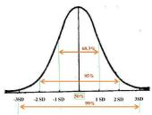

一、进度管理

1、第一类计算：算期望值、标准差、完工概率-一般上午考选择题，案例分析不考  命题方式： 用到 PERT 的命题形式： 在给出工程的最可能完工时间、最乐观完工时间和最悲观完

工时间的基础上，计算工程的估算工期及标准差，或者计算工程在某时间段内完工的概率。

我们需要掌握如下知识点：

活动持续时间/期望值 te=（to+4*tm+tp）/6

最可能时间： tm、最乐观时间： to、最悲观时间：tp

持续时间标准差(δ) =（悲观时间 tp一乐观时间 to）/6，这

个必须记住。

另外， 标准差=δ2（标准差的平方） 一一一一一这个可以不用掌握。

算完工概率：需要记住 3 个数字 68%，95%，99%，面积法解题，

注意听课听懂即可！

2、第二类计算：关键路径、单代号网络图---上午选择，案例分析都考

命题方式：

我们需要掌握如下知识点：

一、关键路径—必须掌握，必考

, 、关键路径是项目中所有路径中最长的路径， 一个项目可以有多个， 并行的关键路径；关键 路径的工期决定了整个项目的工期，任何关键路径上的终端元素的延迟在浮动时间为零或负数时 将直接影响项目的预期完成时间（例如在关键路径上没有浮动时间）。

2 、一些活动的改变可能会导致关键路径发生变化，这个是计算题经常的考点；

3、关键路径越多，风险就越大， 越难管理

4 、关键路径上的总时差总是为 , 或者负数，如果出现负数应该尽快解决，使之等于 ,； 二、网络图的计算

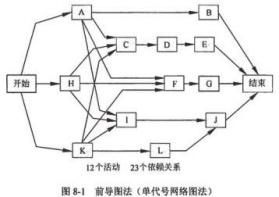

1、前导图（PDM）/单代号网络图

> 用节点表示活动，用箭线表示活动之间的关系

> 一项活动前的活动为紧后活动，后面的活动为紧后活动

> 活动之间可以表达四种依赖关系

2、箭线图（ADM）/双代号网络图

> 用箭线表示活动，活动之间用节点连接

> 有虚活动

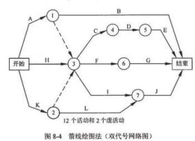

单代号网络图（六标时网络图） （必须掌握，案例必考）：

### 1、六标时图示例：

| 最早开始时间（ES） | 工期 | 最早完成时间（EF） |
|---|---|---|
| 任务编号 | 任务编号 | 任务编号 |
| 最迟开始时间（LS） | 浮动时间 | 最迟完成时间（LF） |

ES、EF、LS、LF 的概念：

1）最早开始时间（ES）:某项活动能够开始的最早时间。

2）最早完成时间（EF）:某项活动能够完成的最早时间。 EF=ES+工期估算

3）最迟完成时间（LF）:为了使项目按时完成，某项工作必须完成的最迟时间

4）最迟开始时间（LS）:为了使项目按时完成，某项工作必须开始的最迟时间

LS=LF---工期估算

5）总时差=工序推迟开工而不会影响总工期的最大时间=LS-ES=LF-EF

6）白由时差=不影响紧后工作的最早开始时间的最大时间=min{紧后工作的 ES}-EF

说明：区分总时差和自由时差，算某个活动的总时差和自由时差，应该算是个难点，那么我们怎

么区分呢？ ---看懂下面 2 个例子

A1：打比方，你有个朋友坐晚上 9 点的火车去合肥到火车站发现忘带身份证了，打电话让你帮他 送过去， 为了不耽误他赶火车，你必须在 9  点前将身份证交给他。那么当你交给他身份证时的时间与 晚上 9  点之间的差距就是自由时差，把身份证交给他是紧前工作，赶火车是紧后工作，把身份证交给 他不能影响他赶火车， 也就是紧前工作最早完成不能影响紧后工作最早开始；

A2:总时差是项目计划完工时间和被要求完工时间的差，每个活动都有总时差，可正，可负， 可为零。比如一个项目计划 20 天完成，而客户要求 22 天完成，总时差就是 22-20=2，是正的 2 天； 如果客户要求 20 天完成，总时差就是 20-20=0，如果客户要求 18 天完成， 总时差就是 18-20=-2，

是负 2 天。关键路径上的活动的总时差都是 0 或者小于 0。

自由时差是活动可以推迟，但是不影响后面活动按时开始的等待时间。 比如夫妻俩要出门， 老公洗了把脸，刮了刮胡子， 穿好外衣就 。K 了，只用了 10 分钟。可老婆又是化妆，又是梳头， 还得挑衣服，整整用了 40 分钟。老公虽然早就准备好了， 可不能自己走，得等老婆收拾好了一块 儿出门，所以老公等老婆的这半个小时，就是自由时差。与总时差不同，不是每个活动都有自由 时差，只有当几项历时不同的活动同时并行执行，并且这几项活动全部结束后才能开始后面的活 动时，这几项活动中用时较短的才有自由时差， 并且自由时差一定是大于 0 的。

怎么确定六标时？

采用正推法确定最早开始时间（ES）和最早完成时间（EF）

采用逆推法确定最迟开始时间（LS）和最迟完成时间（LF）

正向取最大值，逆向取最小值；

掌握标号法工期的确定---求最长和最短路径，非常神奇的一种方法

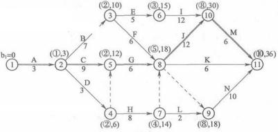

### 2、出现的问题：

（1）团队成员没有及早参与， 需求分析耗时长，要早期参与拉项目

（2）经验不足，进度计划制定不准，采取有效的历时估算方法和网络计划技术，制定进度计划 （3）考虑项目期间特定时期会对进度产生影响

（4）没有及时让开发部参与项目早期工作，需求分析耗时过长

（5）项目经理经验不足，进度估算不准确

（6）资源与配置不足

（7）没有充分利用分配项目资源

（8）在安排进度时未考虑法定节假日的因素

（9）仅仅依靠某项目来估算项目的历时根据不充分

（10）没有对项目的技术方案、管理计划进行详细的评审、需求没有经过确认 （11）增加人人员经验不足、沟通存在问题、加班使得人员的工作效率降低

### 3、解决方案：

（1）向公司申请增加资源，或使用经验丰富的员工；

（2）优化网络图，重排活动之间的顺序，压缩关键路径长度；

（3）临时加班（赶工），尽可能补救耽误的时间或提升资源的利用效率；

（4）将部分阶段的工作改为并行、内部流程优化；

（5）变更原来的进度计划。根据前阶段的绩效， 对后续工作重新估计， 修订计划， 并得到项目 干系人同意；

（6）加强同项目干系人的沟通；

（7）加强对交付物、项目阶段工作的及时检查和控制，避免后期出现返工；

（8）尽可能调配非关键路径上的资源用于关键路径上的任务；

（9）优化外包、采购等环节并全程监控。

### 4、进度压缩的主要工具：赶工和快速跟进

1）赶工

利：有可能在尽量减少费用的前提下缩短项目所需时间

弊：赶进度并非总是可行的方案，有可能反而使费用增加

2）快速跟进

利：适当增加项目的费用可以缩短项目所需时间

弊：以增加费用换取时间，可能会增加风险；

二、成本管理

命题方式： 根据题目中给出的项目成本绩效参数（如成本计划值、完成百分比、实际成本等）

情况，计算四个指标： CV、SV、CPI、SPI，并在此基础上分析项目的进度或成本现状；或者给出  项目的挣值曲线， 在此基础上分析项目的进度或成本现状； 或者在项目当前成本绩效参数前提下， 计算项目的 EAC，即进行完工预测。

第一类计算：绩效衡量分析（挣值） ---上午选择，案例分析都考

挣值技术是将已经完成工作的预算成本（挣值），按原先分配的预算值进行累加获得的累加值， 与计划工作的预算成本（计划值）和已完成的工作的实际成本（实际值） 进行比较。

需要掌握记住挣值的 3 个参数， 4 个指标：

PV、EV、AC、CV、SV、CPI、SPI。需要深入考核 PV 、EV 、AC 的理解， 从一段文字描述 中计算出 PV 、EV 、AC，对于概念没有掌握者， 很难拿全分。

要熟悉挣值分析法来分析时间/进度/成本偏差，会画图和看图分析：

PV：预算值； 应该完成多少工作, （按照计划截止目前应该花费的预算）

EV：已完成任务的预算值； 完成了多少预算的工作（实际完成的工作， 按照预算标准应该有 的花费）

AC：已完成任务的实际值；完成工作的实际成本是多少（截止目前实际的花费）

进度偏差： SV=EV -PV 进度执行指数： SPI=EV/PV

成本偏差： CV=EV -AC 成本执行指数： CPI=EV/AC；

记忆方法：

1、都是 EV 在前（除法时，在前面），因为这是挣值管理，挣值（EV）最牛放在最前面。

2、大家都喜欢大的：大就是好。结果凡是大于 0（除法是： 大于 1），就表示是好的： 进度提 前、成本节约。（相反： 结果小于 0 或者除法时的小于 1， 就表示坏的： 进度滞后、成本超支） 所 以 SV>0，CV>0 都是好的<0 都是不好的；CPI>1，SPI>1 都是好的<0 都是不好的；

|  | 参数关系 | 偏差指标 | 绩效指标 | 调整措施 |
|---|---|---|---|---|
| 1 | AC>PV>EV | CV=EV-AC<0，说明 资金投资超前； SV=EV-PV<0，说明 进度拖延 | CPI=EV/AC<1，说明 资金使用效率低； SPI=EV/PV<1,说明进 度效率低 | 加强成本监控，并行 工作，提高工作效率 |
| 2 | PV>AC=EV | CV=EV-AC<0，说明 成本支出适当； SV=EV-PV<0，说明 进度拖延 | CPI=EV/AC<1，说明 资金使用效率一般； SPI=EV/PV<1,说明进 度效率低 | 加大成本投入来提高进度 效率； 赶工、并行工作以 追赶进度； 增加高效人员 投入 |
| 3 | AC=EV>PV | CV=EV-AC<0，说明 成本支出适当； SV=EV-PV>0，说明 进度提前 | CPI=EV/AC<1，说明 资金使用效率一般； SPI=EV/PV>1,说明进 度效率高 | 加大成本投入来进一步提 高整体效率，加强人员培 训和质量控制 |
| 4 | EV>PV>AC | CV=EV-AC>0，说明 资金投入延后； SV=EV-PV>0，说明 进度提前 | CPI=EV/AC>1，说明 资金使用效率高； SPI=EV/PV>1,说明进 度效率高 | 加强质量控制， 密切监控 项目 |

另外考生还需会看和会画挣值分析图； 经常考；

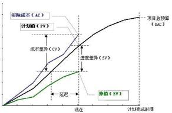

第二类计算：预测技术（完工预测） ---上午选择，案例分析都考

完工预测：难点。关键在于掌握典型偏差和非典型偏差，早期记公式，能够判断典型或非典型偏  差即可解题，现在考核对公式的理解， 因此， 要求能够推到出典型偏差的公式， 并能够充分理解。

完成尚需估算 ETC、完成时估算 EAC、项目总预算 BAC=完工时的 PV 总和

ETC 有 2 个计算公式，必须掌握：

1）非典型的偏差计算 ETC（当前的偏差被视为一种特例， 并且项目团队认为将来不会发生类 似的偏差，需要纠偏）：

ETC=BAC-截止到目前的累加 EV

2）典型的偏差计算 ETC（当前出现的偏差被视为具有典型性，可以代表未来的偏差）：： ETC=（BAC-截止到目前的累加 EV）/累加 CPI

EAC 也分两种，基于典型和非典型， 但公式一样： EAC=AC+ETC

记忆方法：

广州曾经有个非典，非典会危害到人民的生命，肯定需要进行根治，需要改正，需要纠偏，

所以看到题目说采取了措施对项目进度进行了纠偏，那么就是非典型，否则不纠偏，按照当前发

展状况下去就是典型；要会判断，必须；

解 EAC 和 ETC，ETC 是剩下的活还需多少去完成， EAC 是完成时总的估算；用定义去解题；

### 2、成本超支、进度落后的措施

（1）用高效人员替代低效人员

（1）抽调部分人员， 放慢工作进度

（2）采取措施，控制成本

（6）准确记录所有的与成本基准的偏差

（7）防止错误的，不恰当的或未获批准的变更纳入成本或资源使用报告中

（8）就审定的变更， 通知项目干系人

（9）采取措施，将预期的成本超支控制在可接受的范围内

三、立项管理

### 1、利和复利的计算—考的几率小

| 单利 | 仅用最初的本金计算各计息周期所产生的利息，只有本金计息，利息不计利息，即: “利不生利”。利息=本金根利率根时间，即 IR=P根i根n；终值 F=P根（1+i根n） |
|---|---|
| 复利 | 本金和前期的利息均计取利息的计息方式，即“利滚利”的计息方式。 |

|  |  |
|---|---|

### 2、现率与折现系数—考的几率小

折现也称贴现，就是把将来某一时点的资金额换算杨现在时点的等值金额。折现时所使用的 利率称为折现率（贴现率）。

若 n 年后能收入 F 元，那么这些钱现在的价值（现值）

称为折现系数。
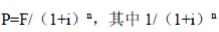

4、现值： 对未来收入或支出的一笔资金的当前价值的估算。 --必须掌握

现值： Pv=FV/1+

Fv-投资的终值，将来值（Futurevalue）;pv-现值（presentvalue）;  i-投资的利率（或资金成 本） ;n-年数;

5、净现值： 将建设项目各年的净现金流量按基准收益率折现到起点（建设初期） 的现值之和， 有 时也称为累计净现值。--必须掌握

也可以用表格计算如下：

净现金流量=收入-成本

净现值=净现金流量根贴现系数

累计净现值=净现值+上年度累计净现值

### 6、投资回收分析--必须掌握

1）投资回收期

如果以 T 作为累计现金流量首次为正值的年数， 投资回收期的计算公式为：

投资回收期（静态） =（T-1）+第（T-1）年累计现金流量绝对值/第 T 年现金流量 投资回收期（动态） =（T-1）+第（T-1）年累计折现值/第 T 年折现值

2）投资回报率

全生存期投资回报率 ROI=年平均利润总额/总投资额=（收入-成本） /成本=（累计收益现值- 累计成本现值） /累计成本现值=累计净现值/累计成本现值

年平均投资回报率=全生存期投资回报率/年限

四、其他部分

1、盈亏平衡点  --必须掌握，下面例题看懂会做即可

上面部分的例题见历年试题分类解析一书，在此不一一列举，重点还是进度和成本 2 大块，  进度成本的计算搞懂了，计算基本没有问题了！关于这块计算题汇总见真题解析！

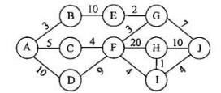

第二部分、计算题历年考试选择题汇总

,、关键路径问题的考题

#### 【试题 1】---高级 2005 上真题 8

1、以下工程进度网络图中，若结点 0 和 6 分别表示起点和终点，则关键路径为（1）

A.0一1一3一6        B.0一1一4一6        C.0一1一2一4一6        D.0一2一5一6

#### 【解析】关键线路有两种定义：①在一条线路中，每个工作的时间之和等于工程工期，这条线路就是关键线路。②若在一条线路中，每个工作的时差都是零，这条线路就是关键线路。根据定义我们可以求出关键线路是 0一1一2一4一6。

#### 【试题 2】---高级 2005 下真题 24~25

2、在下面的活动图中，从 A 到 J 的关键路径是（24），I 和 J 之间的活动开始的最早时间是（2）。

（24）A.ABEGJ          B.ADFHJ        C.ACFGJ          D.ADFIJ

（25）A.13                   B.23                 C.29                   D.40

#### 【答案】BD

#### 【解析】 此题考察的是关键路径的知识，必须掌握， 高频考点

从 A 到 J 的关键路径是 ADFHJ，因为这一条路径最长，决定了整个项目完成的最短时间。I 和 J 之间的活动开始的最早时间应该是项目开始以后 40 小时， 因为事件 F 在 19 小时后出现，而时间 H 在 39 小时后出现， 所以 I 事件的出现就在 40 小时以后了。

#### 【点评】常考，必须会计算，简单，必须得分

#### 【试题 3】---高级 2005 下真题 32

3、在下面的项目活动网络图中，关键路径的时长为 （3） 周。

A.27                 B.28                 C.29                   D.30

#### 【答案】B

#### 【解析】 此题考察的是关键路径的知识，必须掌握， 高频考点

关键路径：在项目网络图中，决定项目最早完成日期的活动路径。它必定是活动历时之和最 长的路径。可能有多条关键路径。在项目执行过程中，关键路径有可能发生变化。

通过计算， 可知路径 B啸F啸K啸0，即 28 周。

#### 【点评】常考，必须会计算，简单，必须得分

#### 【试题 4】 ---高级 2006 下真题 36（经典例题，必须会）

4、某项目最初的网络图如下， 为了压缩进度， 项目经理根据实际情况使用了快速跟进的方法：在 任务 A  已经开始一天后开始实施任务 C，从而使任务 C  与任务 A  并行 3  天。这种做法将使项 目（4）。

A.完工日期不变  B.提前 4  天完成  C.提前 3  天完成  D.提前 2  天完成

#### 【答案】D

#### 【解析】 此题考察的是进度网络图、关键路径，

依该项目最初的网络图，其关键路径为 A-C-F，项目的工期为 20 天。

使用快速跟进的方法压缩进度后， 该项目的关键路径改为 B-D-G，项目的工期为 18 天。

因此， 项目提前 2 天完成。

#### 【点评】常考，必须会计算，简单，必须得分

#### 【试题 5】---高级 2008 上真题 36（经典例题，必须会）

5、下图中活动"G"可以拖延（5）周而不会延长项目的最终结束日期。

（图中时间单位为周）

A.0          B.1          C.3            D.4

#### 【答案】D

#### 【解析】 此题考察的是进度网络图，必须掌握， 高频考点

本题问活动 G 可以拖延多少周而不会延长项目的最终结束日期， 也就是问活动 G 的浮动时间 是多少。

此时，应依据网络图首先用顺推法，得出关键路径、项目总工期、每个活动的最早开始时间 和最早完成时间。在此基础上， 再用逆推法得到每个活动的最迟开始时间和最迟完成时间。最后， 算出活动 G 的浮动时间。

对本题而言，应注意虚活动增加的路径。本题的关键路径为 D-H-C，项目总工期为 12 周， 活 动 G 所在的路径 F-G 有 4 周的浮动时间。

#### 【试题 6】---高级 2008 上真题 40（经典例题，必须会）

6 、一项任务的最早开始时间是第 3 天， 最晚开始时间是第 13 天，最早完成时间是第 9 天， 最晚 完成时间是第 19 天。该任务（6）。

A.在关键路径上    B.有滞后    C.进展情况良好      D.不在关键路径上

#### 【答案】D

#### 【解析】 此题考察的是关键路径的问题，必须掌握， 高频考点

因该任务有 10 天的浮动时间，可以断定它不在“关键路径上”。关键路径上的任务浮动时间 皆为。,题干中没有交代该项目是处于哪个阶段，也没有交代该任务的基准进度和预算，因此不能 断定它“有滞后”，还是“进展情况良好”。

#### 【点评】常考，必须会计算，简单，必须得分

#### 【试题 7】---高级 2009 上真题 40

7、某项目的时标网络图如下（时间单位：周），在项目实施过程中，因负责实施的工程师误操作 发生了质量事故， 需整顿返工，造成工作 4-6 拖后 3 周， 受此影响， 工程的总工期会拖延（7）周。

（7）A. 0            B. 1            C. 2            D. 3

#### 【答案】B

#### 【解析】 此题考察的是网络图，

本题计划的网络图中关键路径长度为 22 周，“工作 4-6”不在关键路径上。

在项目实施过程中，“工作 4-6”拖后 3 周后， 此时它用掉“工作 6-9" 2 周的自由时差， 还引 起整个项目工期 1 周的延期， 此时关键路径长度为 23 周。

#### 【点评】常考，必须会计算，简单，必须得分

#### 【试题 8】---高级 2009 下真题 37~38（经典例题，必须会）

8、下图为某工程进度网络图，

结点 1 为起点，结点 11 为终点， 那么关键路径为（37），此工程最快（38）天完成。

（37）A.1-3-5-8-9-10-11                B.1-2-4-7-11

C.1-3-5-7-11                        D.1-2-5-8-10-11

（38）A.18          B.28            C.22          D.20

#### 【答案】（37）A （38）B

#### 【解析】 此题考察的是网络图，

此工程进度网络图是一个 AOE 网，在 AOE 网中，用顶点表示事件，用有向边表示活动，边上 的权值表示活动的开销（如该活动持续的时间）。完成整个工程所必须花费的时间应该为源点（顶 点 1 到终点（顶点 m>的最大路径长度。具有最大路径长度的路径称为关键路径。本题中 AOE 网的

关键路径为 1-3-5-8-9-10-11，最大路径长度为 28.

#### 【点评】常考，必须会计算，简单，必须得分

#### 【试题 9】 ---高级 2010 上真题 66~67

9、在软件开发项目中，关键路径是项目事件网络中（66），组成关键路径的活动称为关键活动。 下图中的关键路径历时（67）个时间单位。

（66）A.最长的回路                 B.最短的回路

C.源点和汇点间的最长路径     D.源点和汇点间的最短路径

（67）A.14        B.18            C.23            D.25

#### 【答案】CC

#### 【解析】 此题考察的是网络图、关键路径，

图论中给出了关键路径的定义，即源点到汇点的最长路径为关键路径。

通过观察法可识别出关键路径为 1-2-4-5-7-8-10 ，此历时最长的路径的历时为 3+3+5+3+3+6=23。

#### 【点评】常考，必须会计算，简单，必须得分

#### 【试题 10】---高级 2010 下真题 37（经典例题， 必须会）

10、以下是某工程进度网络图，如果因为天气原因， 活动③一⑦的工期延后 2  天，那么总工期将

延后（10）  天。

#### 【答案】A

#### 【解析】 此题考察的是关键路径，

确认选 A，路径 G 有 2 天的自由时差，虽然增加了两天工作量， 他也变成关键活动之一了， 但是不会影响进度， 因为原来的关键路径还是关键路径。

#### 【点评】常考，必须会计算，简单，必须得分

#### 【试题 11】---高级 2011 上真题 37（经典例题， 必须会）

,,、依据下面的项目活动网络图中， 该项目历时为——（11）天。

A.10    B.11    C.13    D.14

#### 【答案】D

#### 【解析】P264

关键路径是从网络图起点到终点之间耗时最长的路径，网络图的工期由关键路径决定。在箭 线图中，虚活动用虚线表示， 它不消耗时间，用来表达活动之间的前后关系。

在上述箭线图中， 耗时最长的路径是①一③一④一⑦一⑧, 该路径是关键路径， 总耗时为 14， 因此，正确答案应选 D。

#### 【试题 12】---高级 2015 上真题 35

12、某项目由 ABCDE 五个活动构成，完成各活动工作所需要的最可能时间（Tm）、最乐观时间（To）、 最悲观时间（TP）见下表：

各活动之间的依赖关系如下：

则该项目工期的估算结果约为（）天。

A.22        B.23          C.24          D.25

#### 【答案】C

#### 【解析】 此题考察的是三点估算和网络图，必须掌握，常考

用三点估算法分别计算每个活动的期望工期，填入图中，如下。

三点估计法：所谓三点估计法就是把施工时间划分为乐观时间、最可能时间、悲观时间，也就是工 作顺利情况下的时间为 a， 最可能时间，就是完成某道工序的最可能完成时间 m， 最悲观的时间就 是工作进行不利所用时间 b。

活动历时均值（或估计值）=（乐观估计+4x最可能估计+悲观估计） /6

活动历时标准差=（悲观估计值-乐观估计值） /6

先找出关键路径：关键路径是：1-3-5-6，求 b,d,e3 个活动的最可能时间之和，b 是（5*4+2+10） /6,d 是（7*4+3+15）/6，e 是（10*4+6+20）/6，3 者相加等于 24。

#### 【点评】多次考了，简单，必须得分

#### 【试题 13】---高级 2015 上真题 66

13、某信息系统集成项目包括 7 个作业（A-G），各作业所需的时间、人数以及各作业之间的衔接 关系如图所示（其中虚线表示不消耗资源的虚作业）

如果各作业都按最早时间开始，那么正确描述该工程每一天所需人数的图为()

#### 【答案】D

#### 【解析】 此题考察的是网络图结合人数的安排，

此题的关键为“各作业都按最早时间开始”，所以， 该项目各作业时间和人数的安排为： 1、0-20 天， 5 人做 A，共需 5 人。

2、 21-40 天，3 人做 B，4 人做 D，2 人做 C，共需 9 人。

3、 41-50 天，2 人做 F，2 人做 E，共需 4 人。

4、 51-60 天，2 人继续做 E， 共需 2 人。

5、 61-70 天，3 人做 G，共需 3 人。

#### 【点评】和之前考过的题类似，送分题，简单

#### 【试题 14】---高级 2015 上真题 68

14、某工程的进度计划网络图如下，其中包含了①~⑩10  个结点，节点之间的剪线表示作业及其

进度方向， 剪线旁标注了作业所需的时间（单位：周）。设起始结点①的时间为 0，则结点⑤的最 早时间和最迟时间分别为（） 周。

A.9,19        B.9,18        C.15,17              D.15,16

#### 【答案】D

#### 【解析】 此题考察的是双代号网络图，

分析 1：首先，这是双代号网络图， 箭头表示工作。所以， 题中的问题“结点⑤的最早时间和最迟 时间”就描述错误！！我们只能理解为结点⑤出发的工作（有三个） 的最早开始时间和最迟开始时 间。结点⑤出发的工作的最早开始时间为 15(①啸③啸④啸⑤)

关键路径为：①啸③啸④啸⑥啸⑦啸⑨啸⑩,总工期为 28，

所以，结点⑤出发的工作的最迟开始时间为 28-5-2-5=16(⑩啸⑨啸⑦啸⑤)

分析 2: 1、⑤的紧前工作有 ④、③、  ②, 最早开始时间分别为：第 10 周、第 5 周和第 7 周，它 们的最早完成分别是第 15 周， 第 9 周和第 9 周。因此，  ⑤的最早开始是第 15 周。

2、 要确定⑤的最晚时间，则必须找出关键路径和总工期。 一般采用遍历的方式，可以从前往后 遍历， 也可以从往前遍历。如下图分析， 总工期为 28 周， 关键路径为 1-3-4-6-7-9-10。 ⑤的紧 后工作有⑨、 ⑧、 ⑦,可以看出，  ⑤-> ⑩, 最多需要 12 周，因此，  ⑤的最晚结束时间应该 是 28-12=16 周。

#### 【点评】和之前考过的题类似，网络图，有点复杂， 需要掌握方法

#### 【试题 15】---高级 2015 下真题 35

15、已知某系统由 ABCDEF 六个活动构成， 项目实习人员根据活动逻辑关系及历时等信息绘制了 该系统的网络图， 并给出了该系统的工期为 9 周，项目组其他成员纷纷提出意见， 以下意见中，( ) 是正确的。

| 工作名称 | A | B | C | D | E | F |
|---|---|---|---|---|---|---|
| 紧前关系 | -- | -- | A | A | AB | AB |
| 历时 | 2 周 | 3 周 | 4 周 | 6 周 | 5 周 | 1 周 |

（35）A.逻辑关系错误，项目工期应为 7 周       B.有循环问路，项目工期是正确的

C.节点序号编排不对，项目工期是正确的   D.项目工期为 8 周

#### 【答案】D

#### 【解析】 此题考察的是进度网络图，必须掌握， 高频考点

这题很简单，工期为 8 周

#### 【点评】常考，必须记住，不难，必须得分

#### 【试题 15】---高级 2015 下真题 35

15、已知某系统由 ABCDEF 六个活动构成， 项目实习人员根据活动逻辑关系及历时等信息绘制了 该系统的网络图， 并给出了该系统的工期为 9 周，项目组其他成员纷纷提出意见， 以下意见中，( ) 是正确的。

| 工作名称 | A | B | C | D | E | F |
|---|---|---|---|---|---|---|
| 紧前关系 | -- | -- | A | A | AB | AB |
| 历时 | 2 周 | 3 周 | 4 周 | 6 周 | 5 周 | 1 周 |

（35）A.逻辑关系错误，项目工期应为 7 周       B.有循环问路，项目工期是正确的

C.节点序号编排不对，项目工期是正确的   D.项目工期为 8 周

#### 【答案】D

#### 【解析】 此题考察的是进度网络图，必须掌握， 高频考点

这题很简单，工期为 8 周

#### 【点评】常考，必须记住，不难，必须得分

#### 【试题 16】---高级 2016 下真题 35~36

16、某项目由并行的 3 个模块 A\B 和 C 组成， 其中活动 A 需要 3 人 5 天时间完成， 活动 B 需要 6 人 7 天时间完成，活动 C 需要 4 人 2 天时间完成。为了保证项目在最低时间内完成，则最少应该 为项目组配置（35）人。假设活动 A.B 和 C 按时完成的概率分别多 80% 、70%和 100%，则该项 目按时完成的概率为（36）。

（35）A.6            B.9            C.10          D.13

（36）A.50%      B.56%        C.64%        D.90%.

#### 【答案】CB

#### 【解析】 此题考察的是网络图，

| 此为较简单的网络图，可以简单画时标即 可。见图。因为都是并行的， 所以可以将 C 移到 A 活动后面去，不同时和 A/B 并行。  这样可以在 7 天内完成，人数配置为 10 人。 项目按时完成的概率=80%*70%*100%=56% |
|---|

#### 【点评】常考，比较简单，必须得分

#### 【试题 17】---高级 2016 下真题 37

### 17、某项目包括的活动情况如下表所示：

| 活动 | 持续时间 | 活动 | 持续时间 | 活动 | 持续时间 |
|---|---|---|---|---|---|
| A | 4 | B | 3 | C | 4 |
| D | 2 | E | 3 | F | 4 |

活动 D 和活动 F 只能在活动 C 结束后开始。活动 A 和活动 B 可以在活动 C 开始后的任何时 间内开始， 但是必须在项目结束前完成。活动 E 只能在活动 D 完成后开始。活动 B 是在活动 C 开 始 1 天后才开始的。在活动 B 的过程中， 发生了一件意外事件， 导致活动 B 延期 2 天。为了确保 项目按时完成，（）。

（17）A.应为活动 B 添加更多资源              B.可不需要采取任何措施

C.需为关键路径上的任务重新分配资源    D.应为活动 D 添加更多的资源

#### 【答案】B

#### 【解析】 此题考察的是网络图，资源平衡，

| 根据题干用时标图画一 下可知，B 延期 2 天没 有关系，不影响项目按 时完成，所以可不需要 采取任何措施。见图。 |
|---|

#### 【点评】常考，比较简单，必须得分

#### 【试题 18】---高级 2017 上真题 36-37

18、下图是某项目的箭线图（时间单位：周），其关键路径是（），工期是（）周。

A.1-4-6-8-10-11        B.1-3-9-11        C.1-4-9-11        D.1-2-5-7-11

A.14        B.12        C.11                      D.13

#### 【答案】CA

#### 【解析】 此题考察的是网络图，

这道题是比较简单的~!主要考察的是“时间管理-网络图”的知识点。需要注意的是，题干中说 明了是“箭线图”，也就是“双代号网络图”，箭头代表活动（而不是节点），所以，箭头上的数字 为活动的持续时间。

用代入法最简单，先看第一小题，看四个答案中哪个选项的路径最长，最长的即为关键路径： A、 1-4-6-8-10-11=3+2+2+3+3=13

B、 1-3-9-11=2+4+5=11

C、 1-4-9-11=3+6+5=14

D、 1-2-5-7-11=3+4+2+1=10 所以答案为 C、A。

本题也可以用标号法去解题

#### 【点评】常考，比较简单，必须得分

#### 【试题 19】---中级 2017 上真题 45

19、下面的箭线图中（活动的时间单位： 周），活动 G 最多可以推延（）周而不会影响项目的完工 日期。

A.1      B.2        C.3        D.4

#### 【答案】D

#### 【解析】 此题考察的是网络图，

关键路径 D啸H啸C， 总工期 12 周，D 的 EF=8，LF=12，D 的总时差为 12-8=4 周

#### 【点评】常考，比较简单，必须得分

#### 【试题 20】---高级 2017 下真题 37-38

20、下图中（单位： 周）显示的项目历时总时长是（37）周。在项目实施过程中， 活动 D-I 比计 划延期了 2 周， 活动 a-c 实际工期是 6 周，活动 f-h 比计划提前了 1 周，此时该项目的历时总时 长为（38）周。

（37）A.14   B.18   C.16   D.13

（38）A.14   B.18    C.16   D.17

#### 【答案】CC

#### 【解析】第三版教程 P279 此题考察的是关键路径工期的计算，

关键路径为：ADFHJK，总工期为 3+4+3+5+1=16，通过分析发现： ADFHJK 现在为 15 周，关键路径 发生了变化，现在关键路径是 adik 为 16 周，注意关键路径改变的问题，

#### 【点评】常考，比较简单，必须得分

#### 【试题 21】---高级 2018 上真题 37-38

21、某项目包含 ABCDEFG 七个活动， 各活动的历时估算和活动间的逻辑关系如下表所示,活动 C 的总浮动时间是（） 天，该项目工期是（）天。

| 活动名称 | 活动历时（天） | 紧前活动 |
|---|---|---|
| A | 2 | - |
| B | 4 | A |
| C | 5 | A |
| D | 6 | A |
| E | 4 | B |
| F | 4 | C 、D |
| G | 3 | E 、F |

（37）A.0          B.1        C.2          D.3

（38）A.13        B.14      C.15        D.16

#### 【答案】BC

#### 【解析】第三版教材 P279此题考察的是网络图，

首先画出网络图：

我们发现ADFG 为关键路径，总工期为 15 天，经过 C 最大非关键路径长度为 14，所以总时差=15-14=1 网络图必考的，太简单了，送分题

#### 【试题 22】---高级 2018 上真题 66-67

22、某项工程的活动明细如下表（时间：周：费用： 万元）

| 活动 | 紧前 | 正常进度 | 正常进度 | 赶工 | 赶工 |
|---|---|---|---|---|---|
| 活动 | 紧前 | 所需时间 | 直接费用 | 所需时间 | 直接费用 |
| A | -- | 3 | 10 | 2 | 15 |
| B | A | 8 | 15 | 6 | 17 |
| C | A | 4 | 12 | 3 | 13 |
| D | C | 5 | 8 | 3 | 11 |
| 项目间接费用每周需要 1 万元 | 项目间接费用每周需要 1 万元 | 项目间接费用每周需要 1 万元 | 项目间接费用每周需要 1 万元 | 项目间接费用每周需要 1 万元 | 项目间接费用每周需要 1 万元 |

项目总预算由原先的 60 万元增加到 63 万元，根据上表，在预算约束下该工程最快能完成时间为 （66）周， 所需项目总费用为（67）万元

（66）A.9          B.8        C.14        D.12

（67）A.60        B.64        C.56        D.45

#### 【答案】AA

分析，假设按照赶工情况下的最短时间安排如下：

我们发现总费用为直接费用（15+17+13+11）+间接费用（8 万） =64 万元， 超过了 63 万元，所以我 们需要调整；

然后我们看下 A 压缩一天需要 5 元，B 压缩一天需要 1 万元，C 压缩一天需要 1 万元，D 压缩一天 需要 1.5 万元

情况 1：那么我们 C 按照正常进度来， 不压缩， 其他活动都按照最短赶工时间来， 需要 9 周完成，

总费用为直接费用（15+17+12+11）+间接费用（9 万）=64 万元， 压缩方案不行 情况 2：那么我们 BD 按照正常进度来， 总工期为 10 周，不符合条件

情况 3：那么我们 A 按照正常进度来， 不压缩， 其他活动都按照最短赶工时间来， 需要 9 周完成， 总费用为直接费用（10+17+13+11）+间接费用（9 万）=60 万元， 压缩方案不行

综合分析， 我们应该是 9 周， 压缩 A 活动，最终费用 60 万元

常规考点， 讲课强调，有一定的难度

23、某项目的双代号网络图如下所示， 该项目的工期为（）。

A.17        B.18      C.19        D.20

#### 【答案】C

#### 【解析】P313此题考察的是网络图，

项目工期就是找出时间最长的一条路径

#### 【点评】以前考过，常考，比较简单， 必须得分

#### 【试题 24】---高级 2018 下真题 38-39

24、项目经理为某政府网站改造项目制作了如下双代号网络图（单位：天），该项目的总工期为() 天。在项目实施的过程中，活动 2-7 比计划提前了 2 天， 8-10 活动的实际工期是 3 天， 活动 6-7 的工期增加了 3 天， 判断对项目总工期的影响:  ()

（38）A.40        B.37        C.34        D.32

（39）A.没有影响    B.增加了 2 天    C.增加了 3 天    D.增加了 4 天

#### 【答案】BB

#### 【解析】P279 此题考察的是网络图，

用标号法求解，黄色的为关键路径，总工期为 37 天

活动 2-7 是非关键路径，提前 2 天对总工期没有影响

活动 8-10 在关键路径上，提前了一天， 总工期缩短 1 天

活动 6-7 在关键路径上，增加了 3 天， 延误了总工期 3 天

综合来看， 对总工期造成了 2 天的延误

#### 【试题 25】---中级 2018 下真题 47

25、下图某工程单代号网络图中，活动 B 的总浮动时间为（）天。

A.1    B.2    C.3    D.4

#### 【答案】D

#### 【解析】P313 此题考察的是网络图的计算，

可以填好前导图。用关键路径 ADF 工期 20-B 活动所在最长路径 ABEF16=4 天。

#### 【试题 26】---中级 2018 下真题 48

26、某工程由 8 个活动组成，其各活动情况如下表所示，该工程关键路径为()

| 活动 | 紧前活动 | 所需天数 | 活动 | 紧前活动 | 所需天数 |
|---|---|---|---|---|---|
| A | 一 | 3 | F | C | 6 |
| B | A | 2 | G | E | 2 |
| C | B | 5 | H | FG | 5 |
| D | B | 7 | I | HD | 2 |
| E | C | 4 |  |  |  |

A.ABCEGI    B.ABCFHI    C.ABDHI    D.ABDI

#### 【答案】B

#### 【解析】P313 此题考察的是网络图，

画单代号图，然后列出各路径:

ABCEGHI=3+2+5+4+2+5+2=23

ABCFHI=3+2+5+6+5+2=23

ABDI=3+2+7+2=14

有两条关键路径，不过根据答案来看， 只有 B 是对的。

#### 【试题 27】---中级 2019 上真题 47-48

27、下图为某规划的进度网络图（单位:周），在实际实施过程中活动 B-E 比计划延迟了 2 周，活 动 J-K 比计划提前了 3 周，则该关键路径是（），总工期是（）。

47）A.A-D-G-I-J-K       B.A-B-F-K        C.A-B-E-H-K        D.A-D-F-K

48）A.15        B.14        C.13        D.12

#### 【答案】CA

#### 【解析】P313 此题考察的是网络图，

把全部路径列出来， 然后根据题目来对各涉及路径进行调整即可：

ABEHK=3+（4+2）+2+4=15（B-E 延迟 2 周）；

ABFK=3+6+3=12；

ACFK=2+4+3=9；

ADFK=2+3+3=8；

ADGIJK=2+4+3+2+（5-3）=13（J-K 提前了 3 周）

#### 【试题 28】---高级 2019 下真题 33-34

28、某项目包含 A 、B 、C 、D 、E 、F、G 七个活动。各活动的历时估算和活动间的逻辑关系如下 表所示：

| 活动名称 | 活动历时（天） | 紧前活动 |
|---|---|---|
| A | 2 | - |
| B | 4 | A |
| C | 5 | A |
| D | 3 | A |
| E | 3 | B |
| F | 4 | B 、C 、D |
| G | 3 | E 、F |

依据上表内容，活动 D 的总浮动时间是（33）天，该项目工期为（34）天

（33）A.0          B.1          C.2          D.3

（34）A.12        B.13        C.14        D.15

#### 【答案】CC

#### 【解析】P279 此题考察的是网络图计算，必须掌握， 高频考点;

首先画出简图：

我们可以看出 ACFG 时间最长， 为关键路径，时间为 14 天，D 的总浮动时间=14-12=2

很简单，多次考了， 送分的

#### 【试题 29】---中级 2019 下真题 45

29、某项目的网络图如下，活动 D 是自由浮动时间为（）天

A.0        B.1        C.2        D.3

#### 【答案】B

#### 【解析】P313 此题考察的是网络图计算，必须掌握， 高频考点；

把上面的 7 格图补充完整，可以看出活动 D 自由浮动时间为 9-8=1。

2 、PERT、完工概率的考题

#### 【试题 1】---高级 2007 下真题 37（经典例题，必须会）

1、完成活动 A 所需的时间， 悲观（P）的估计需 36 天， 最可能（ML）的估计需 21 天，乐观（O） 的估计需 6 天。活动 A 在 16 天至 26 天内完成的概率是（1）。

A.55.70%          B.68.26%            C.95.43%        D.99.73%

#### 【答案】B

#### 【解析】 此题考察的是完工概率估算，

面积法， 估计工时：乐观工时=6天， 最可能工时=21天， 悲观工时=36天， 标准差（36-6）/6 =5天，6至36共有6个标准差， 然后看面积哈！

#### 【试题 2】---高级 2010 上真题 37~38

2、完成某信息系统集成项目中的一个最基本的工作单元 A 所需的时间，乐观的估计需 8 天，悲观

的估计需 38 天，最可能的估计需 20 天，按照 PERT 方法进行估算，项目的

工期应该为（37），在 26 天以后完成的概率大致为（38）。

（37）A.20                B.21                C.22                    D.23

（38）A.8.9%        B.15.9%        C.22.2%          D.28.6%

#### 【答案】BB

#### 【解析】 此题考察的是 PERT，

期望工期=（8+4x20+38）/6=21

标准差= （38-8）/6=5

26 天与 21 天之间为 1 个标准差（而非士1 个标准差），16 天到 26 天之间为士1 个标准差， 根  据正态分布规律，故 16 天到 26 天之间完成的概率为 68.26%，26 天以后完成的概率= （l-68.26%） /2=15.87%。

#### 【点评】常考，必须会计算，简单，必须得分

#### 【试题 3】---高级 2011 上真题 36

3、某项任务由子任务I（计划编制和批准） 和子任务Ⅱ（计划实施） 组成。项目经理认为子任务 I的乐观历时为 3 天， 最可能为 4 天，悲观历时为 8 天；子任务Ⅱ的乐观历时为 5 天， 最可能 6 为天，悲观历时为 10 天。根据估算，该任务估算历时为（36）天。

A.10                  B.11                         C.12                      D.13

#### 【答案】B

#### 【解析】 此题考察的是三点估算的计算的计算，

用三点估算法，估算活动的平均时间为（乐观历时 + 4*最可能历时 + 悲观历时） /6,  按上 述公式计算， 子任务I的平均时间为 4.5 天， 子任务II 的平均时间为 6.5 天。因此该任务估算历 时为“4.5 天 + 6.5 天 二 11 天”。本题正确答案为“B.11 ”。

#### 【点评】常考，必须会计算，简单，必须得分

#### 【试题 4】 ---高级 2012 下真题 37（经典例题，必须会）

4、某项目预计最快12天完成， 最慢36天完成， 21天完成的可能性最大。公司下达的计划是18天完 成，要使计划完成的概率达到50%，在计划中需要增加（37）天应急时间。

A.4            B.6            C.8              D.22

#### 【答案】A

#### 【解析】 此题考察的是 PERT，

三点估算法求出期望工期=（12+4*21+36）/6二22，而期望工期是按时完工概率的 50%，所以如 果要 18 天完成，需要增加 22-18二4 天。

#### 【点评】常考，必须会计算，简单，必须得分

#### 【试题 5】---中级 2009 上真题 27

。、某项目完成估计需要 12 个月。在进一步分析后认为最少将花 8 个月，最糟糕的情况下将花 28 个月。那么，这个估计的 PERT 值是（5）个月。

A.9          B.11          C.13            D.14

#### 【答案】D

#### 【解析】P261   此题考察的是三点估算，

PERT 估算的活动历时均值=（悲观估计值+4 最可能估计值十乐观估计值） /6 估计该项目完成的时间为（8 +4x12+28）/6二14 个月。

#### 【点评】常考，必须会计算，简单，必须得分

#### 【试题 6】---中级 2009 下真题 37~38

6 、A 公司的某项目即将开始，项目经理估计该项目 10 天即可完成， 如果出现问题耽搁了也不会 超过 20 天完成，最快 6 天即可完成。根据项目历时估计中的 3 点估算法，你认为该项目的历时为 （37），该项目历时的估算标准差为 （38） 。

（37） A.10 天      B.11 天      C.12 天       D.13 天

（38） A.2.1 天    B.2.2 天    C.2.3 天     D.2.4 天

#### 【答案】BC

#### 【解析】P261此题考察的是活动历时估算，必须掌握，必考

三点估算法：

活动的历时=（最乐观历时+4x最可能历时+最悲观历时） /6二（6+10x4+20） /6二66/6二11

活动历时标准差=（最悲观历时一最乐观历时） /6二 （20-6） /6二2.3

#### 【点评】常考，必须会计算，简单，必须得分

#### 【试题 7】---中级 2010 下真题 38

7、某项目经理在对项目历时进行估算时，认为正常情况下完成项目需要 42  天，同时也分析了影 响项目工期的因素， 认为最快可以在 35  天内完成工作， 而在最不利的条件下则需要 55  天完成任 务。采用三点估算得到的工期是（7）天。

A.42                       B.43                    C.44                    D.55

#### 【答案】B

#### 【解析】P261此题考察的是三点估算，

三点估算得到的工期 = （35 + 4*42 + 55）/ 6=43

#### 【点评】常考，必须会计算，简单，必须得分

#### 【试题 8】---中级 2012 上真题 36（经典例题，必须会）

8、过去几年小李完成了大量网卡驱动模块的开发，最快 6 天完成， 最慢 36 天完成， 平均 21 天完 成。如今小李开发一个新网卡驱动模块，在 21 天到 26 天内完成的概率是（8）。

A.68.3%        B.34.1%        C.58.2%      D.28.1%

#### 【答案】B

#### 【解析】 此题考察的是 PERT，

面积法， 估计工时：乐观工时=6天， 最可能工时=21天， 悲观工时=36天， 标准差（36-6）/6 =5天，6至36共有6个标准差； 21至26天刚好落在U至1西格码之间。

#### 【点评】常考，必须会计算，简单，必须得分

#### 【试题 9】 ---高级 2014 上真题 36

9、项目经理小李对一个小项目的工期进行估算时，发现开发人员的熟练程度对工期有较大的影响， 如果都是经验丰富的开发人员，预计 20 天可以完成；如果都是新手，预计需要 38天；按照公司 的平均开发速度， 一般 26  天可以完成。该项目的工期可以估算为（52）天

（9）A.26                            B.27                        C.28                        D.29

#### 【答案】B

#### 【解析】 PERT（20+38+4x26）/6=27

#### 【试题 10】---高级 2017 上真题 58

10、项目经理向往在做软件项目成本估算时，先考虑了最不利的情况，估算出项目成本为 120 人 日，又考虑了最有利的情况下项目成本为 60 人日，最后考虑一般情况下的项目成本可能为 75 人 日，该项目最终的成本预算应为（）人日。

A.100        B.90        C.80        D.75

#### 【解析】三点估算用三点估算的方法计算：（120+75*4+60）/6=80

#### 【试题 11】---中级 2018 上真题 51

11 、A 公司的某项目即特开始， 项目经理估计该项目需 12 人天完成，如果出现问题耽搁则 20 人天完成，最快 10 人天完成。根据项目成本估计中的三点结算法。该项目预计花费() 人天。

A.14        B.13        C.12        D.11

#### 【解析】三点估算的计算PERT=（最乐观时间+最可能时间*4+最悲观时间）/6=（10+12*4+20）/6=13

#### 【试题 12】---中级 2019 上真题 51

12、某公司组织专家对项目成本进行评估， 得到如下结论:最可能成本为 10 万元， 最乐观成本为 8 万元最悲观成本 12 万元。采用“三点估算法"该项目成本为（）。

A.9        B.10        C.11        D.12

#### 【答案】B

#### 【解析】P338 此题考察的是三点估算，（8+10x4+12）/6=10

,、网络图的考题

#### 【试题 1】---高级 2009 上真题 57~58

1、某工程包括 A 、B、C 、D、E、F、G、H 八个作业，各个作业的紧前作业、所需时间和所需人 数如下表所示（假设每个人均能承担各个作业）  ：

| 作业 | A | B | C | D | E | F | G | H |
|---|---|---|---|---|---|---|---|---|
| 紧前作业 |  |  | A | B | C | C | D,E | G |
| 所需时间（周） | 2 | 1 | 1 | 1 | 2 | 1 | 2 | 1 |
| 所需人数 | 8 | 4 | 5 | 4 | 4 | 3 | 7 | 8 |

该工程的工期应为（57）周。按此工期，整个工程至少需要（58）人。

#### 【答案】（57）A   （58）B

#### 【解析】活动网络图，必须掌握

（57）题计算的是工程工期，该题比较简单，关键是将网络图画对，无论是双代号、单代号 都可以。可直观地看出关键路径，将此路径上活动历时相加得出工期。

为了计算（57）题，依据给定条件画出双代号网络图，再加时标，并对该网络图进行调整， 形成时标网络图。如下图所示:

从上图可以直观地看出， 关键路径为 ACEGH，工程工期为 2+1+2+2+1=80

（58）题计算的是工程使用资源的最小值。本题可依据时标网络图进行分析。依据时标网络 图可以清晰体现某一时间段哪些活动必须同时进行， 哪些活动或路径上存在可利用的机动时间， 即自由时差或总时差。

对上面的时标图进行分析，调整活动 B, D, F 的执行时间， 使同一时间段内使用的资源最少。 如下图所示:

可见，第 3 周时活动 B. C 并行，共需要 9 人， 其余时间段所需人数均少于 9 人。

#### 【点评】常考，必须会计算，简单，必须得分

#### 【试题 2】---高级 2010 上真题 35~36

2、某工程包括 A 、B 、C 、D、E 、F、G 七项工作， 各工作的紧前工作、所需时所需人数如下表所 示（假设每个人均能承担各项工作）。

| 工作 | A | B | C | D | E | F | G |
|---|---|---|---|---|---|---|---|
| 紧前工作 | -- | A | A | B | C 、D | -- | E 、F |
| 所需时间（天） | 5 | 4 | 5 | 3 | 2 | 5 | 1 |
| 所需人数 | 7 | 4 | 3 | 2 | 1 | 2 | 4 |

该工程的工期应为（35）天。按此工期，整个工程最少需要（36）人。

（35）A.13        B.14          C.15          D.16

（36）A.7          B.8            C.9            D.10

#### 【答案】CA

#### 【解析】 此题考察的是网络图，

根据题意可画出带时标的双代号网络图如下：

可识别出关键路径为： A-B-D-E-Gb 工期为 15 天。调整非关键路径上的活动， 使得各路径上并行活 动人数最少的方案如下图。

故该工程的工期应为 15 天。按此工期，整个工程最少需要 7 人。

#### 【点评】有一定的难度得分，需要稍微分析下，建议得分

#### 【试题 3】---高级 2010 上真题 54

3、某市数字城市项目主要包括 A 、B 、C 、D 、E 等五项任务，且五项任务可同时开展。 各项任务的预计建设时间以及人力投入如下表所示。

| 任务 | 预计建设时间 | 预计投入人数 |
|---|---|---|
| A | 51 天 | 25 人 |
| B | 120 天 | 56 人 |

| C | 69 天 | 25 人 |
|---|---|---|
| D | 47 天 | 31 人 |
| E | 73 天 | 31 人 |

以下安排中，（3）能较好地实现资源平衡， 确保资源的有效利用。

（3）A.五项任务同时开工

B.待 B 任务完工后，再依次开展 A、C 、D 、E 四项任务

C. 同时开展 A、B 、D 三项任务， 待 A 任务完工后开展 C 任务、 D 任务完工后开展 E 任务

D. 同时开展 A 、B 、D 三项任务，待 A 任务完工后开展 E 任务、 D 任务完工后开展 C 任务 【答案】C

#### 【解析】 此题考察的是网络图，

五项任务同时开工，总共需要 168 人， 120 天。

待 B 任务完工后，再依次开展 A、C、D、E 四项任务， 总共需要 112 人， 193 天。同时开展 A、 B、D 三项任务，待 A 任务完工后开展 C 任务、D 任务完工后开展 E

任务，总共需要 112 人， 120 天；此方案使用资源最少，历时最短，是正确答案。

同时开展 A、B、D 三项任务， 待 A 任务完工后开展 E 任务、D 任务完工后开展 C 任务，总共需 要 118 人， 124 天。

#### 【点评】常考，需要稍微分析理解下， 简单，必须得分

#### 【试题 4】 ---高级 2010 下真题 35

### 4、某项工程由下列活动组成：

（4）  是该工程的关键路径。

——         ——

A .ABEHJ          B .ACDHJ          C .ACGIJ          D.ACFJ

#### 【答案】B

#### 【解析】 此题考察的是网络图，

本题的双代号网络图：由上图可知：

由上图可知，该工程的关键（最长）路径为 ACEHJ 和 ACDHJ ， B 是正确答案。

#### 【点评】常考，必须会计算，简单，必须得分

#### 【试题 5】---高级 2010 下真题 36（经典例题，必须会）

5、下表给出了项目中各活动的乐观估计时间、最可能估计时间和悲观估计时间， 则项目的期望完 工总时间是（5）天。

A .36              B.38          C.40                    D.42

#### 【答案】C

#### 【解析】 此题考察的是网络图、 PERT，

（1）首先利用计划评审技术（PERT）计算出项目各工序的完工时间平均值;

完工时间平均值=（乐观估计时间++4*最可能估计时间十悲观估计时间） /6

（2）画出本项目的单代号网络图;

（3）通过单代号网络图， 可直观地识别出本项目的关键路径为 A, E, G;

（4）将关键路径的完成时间平均值加起来， 可得出本项目的期望完工总时间为 40 小 时:10+18+12二40。可见 C 是正确答案。

#### 【点评】常考，必须会计算，简单，必须得分

#### 【试题 6】---高级 2012 上真题 33（经典例题，必须会）

6、图1  中，工作E  总时差是（6）

（6）A.1        B.2          C.3        D.4

#### 【答案】D

#### 【解析】 此题考察的是网络图，

送分题，画出把图中单代号网络图填好即可得出答案。

#### 【点评】常考，简单，必须得分

#### 【试题 7】---高级 2012 上真题 37（经典例题，必须会）

7 、一个活动有 4  道工序， 一个工作只能负责 1  道工序。每名工人工作完成各工序所需小时数如 表 1  所示， 工序间的依赖关系如表 2  所示。完成该活动最少需要（37）

表一：

| 工人小时数工序 | 一 | 二 | 三 | 四 |
|---|---|---|---|---|
| 甲 | 4 | 6 | 5 | 8 |
| 乙 | 6 | 10 | 7 | 8 |
| 丙 | 7 | 8 | 11 | 9 |
| 丁 | 9 | 3 | 8 | 4 |

表二：

| 工序 | 紧前工序 | 紧后工序 |
|---|---|---|
| 一 |  | 二、三 |
| 二 | 一 | 四 |
| 三 | 一 | 四 |
| 四 | 二、三 |  |

A.10          B.14            C.16            D.18

#### 【答案】C

#### 【解析】 此题考察的是活动网络图，必须掌握， 高频考点

思路： min(工序一)+max(工序二、三)+min(工序四） ,要保证甲乙丙丁任务不冲突。 然后比较乙、丙最小值里，最大值 ，8；甲 4 丁 4 这两个确定下来

4+8+4=16 顺序为 1， 3，4，甲一 乙三，丙二， 丁四

#### 【点评】常考，必须会计算，简单，必须得分

#### 【试题 8】---中级 2009 上真题 24

。、在项目某阶段的实施过程中， A 活动需要 2 天 2 人完成， B 活动需要 2 天 2 人完成，C 活动需 要 5 天 4 人完成， D 活动需要 3 天 2 人完成， E 活动需要 1 天 1 人完成，该阶段的时标网络图如 下。该项目组共有 8 人，且负责 A、E 活动的人因另有安排，无法帮助其他人完成相应工作，且 项目整个工期刻不容缓。以下（24）安排是恰当的， 能够使实施任务顺利完成。

A.B 活动提前两天开始          B.B 活动推迟两天开始

C.D 活动提前两天开始          D.D 活动推迟两天开始

#### 【答案】D

#### 【解析】 此题考察的是进度网络图，必须掌握， 高频考点

假定负责 A 活动的 2 人， 其中有 1 个人可以实施 E 活动。这 2 个人另有安排，无法帮助其他 人完成相应工作，且项目整个工期刻不容缓。那么项目组还剩下 6 个人，B 活动有 3 天的浮动时间.D 活动有 2 天的浮动时间， C 活动为关键路径没有浮动时间， 人力资游也不能释放。因此， 选择推迟 D 活动 2 天开始，等 B 活动在项目的第 3 天开始、第 4 天完成，释放出 2 人之后，D 活动利用该 2 人完成。

#### 【点评】考的不是很多，必须会计算， 简单，必须得分

#### 【试题 9】 ---中级 2010 上真题 37

9、在工程网络计划中，工作 M  的最早开始时间为第 16  天，其持续时间为 5  天。该工作有三 项紧后工作，他们的最早开始时间分别为第 25  天、第 27  天和第 30  天，最迟开始时间分别为 第 28  天、第 29  天和第 30  天。则工作 M   的总时差为（37）天。

A.5         B.6         C.7            D.9

#### 【答案】C

#### 【解析】P254  此题考察的是总时差和自由时差，

工作 M 的最早开始时间为第 16 天，其持续时间为 5 天。因此， 工作 M 的最早结束时间为 第 16 +5 =21 天。

工作 M 有三项紧后工作，他们的最迟开始时间分别为第 28 天、第 29 天和第 30 天。因此 工作 M 的最迟结束时间为三者之中最小的第 28 天。

工作 M 的总时差 =工作 M 的最迟结束时间 -工作 M 的最早结束时间 = 28-21 = 7 天。

#### 【点评】考的不是很多，必须会计算， 简单，必须得分

#### 【试题 10】---中级 200 下真题 35~36（经典例题，必须会）

10、某工程建设项目中各工序历时如下表所示，则本项目最快完成时间为（35）周。同时，通过 （10）可以缩短项目工期。

| 工序名称 | 紧前工序 | 持续时间（周） |
|---|---|---|
| A | — | 1 |
| B | A | 2 |
| C | A | 3 |
| D | B | 2 |
| E | B | 2 |
| F | C 、D | 4 |
| G | E | 4 |
| H | B | 5 |
| I | G、H | 4 |
| J | F | 3 |

（35）A.7                 B.9                     C.12                    D.13

①压缩 B 工序时间 ④压缩 F 工序时间

②压缩 H 工序时间

⑤压缩 G 工序时间

③同时开展 H  工序与 A 工序

A.①⑤      B.①③        C.②⑤        D.③④

#### 【答案】D A

#### 【解析】 此题考察的是网络图，

本题考查项目工期计算、压缩关键路径活动历时可缩短工期的知识。画网络图是解题的基础， 画单代号网络图，如下图所示：

找出关键路径（最长路径），并计算关键路径上的总历时，即可算出本项目最快完成时间：压 缩关键路径上的活动可以缩短项目工期。

通过此图可直观看出，从开始到结束共有 4 条路径， ABEGI 为最长路径， 历时为 13 周， 即试题 （35） D 是正确答案。

由于 B, G 在关键路径上， 故压缩 B. G 可缩短项目工期:F, H 不在关键路径上， 压缩它们不能 缩短工期；由于 H 工序与 A 工序无并行关系，H 是 A 的紧后活动 B 的紧后活动，所以不能将 H 工序 与 A 工序并行。即试题（36） A 是正确答案。

#### 【点评】常考，必须会计算，简单，必须得分

#### 【试题 11】---中级 2012 上真题 37（经典例题， 必须会）

11、图 2 右侧是单代号网络图（单位为工作日），左侧是图列。在确保安装集成活动尽早开始的前 提下，软件开发活动可以推迟（11）个工作日。

| 最早开始时间 | 持续时间 | 最早完成时间 |
|---|---|---|
| 活动名称 | 活动名称 | 活动名称 |
| 最迟开始时间 |  | 最迟完成时间 |

（11）A.0        B.1          C.2          D.4

#### 【答案】B

#### 【解析】 此题考察的是网络图，

所以软件开发活动可以推迟 1 个工作日。

#### 【点评】常考，必须会计算，简单，必须得分

#### 【试题 12】---中级 2013 上真题 32（经典例题， 必须会）

12、在下面的项目网络图中（时间单位为天），活动 B 的自由时差和总时差分别为（32），如果活 动 A 的实际开始时间是 5 月 1 日早 8 时， 在不延误项目工期的情况下， 活动 B 最晚应在（33）前 结束。

（32）A. 0 ，0      B. 0，1           C. 1，0            D. 1 ，1

（33）A. 5 月 5  日早 8 时     B. 5 月 6  日早 8 时

C. 5 月 7 日早 8 时     D. 5 月 8 日早 8 时

#### 【答案】BC

#### 【解析】 此题考察的是单代号网络图，

#### 【点评】常考，必须会计算，简单，必须得分

#### 【试题 13】---中级 2014 上真题 41

13、已知网络计划中工作 M 有两项紧后工作，这两项紧后工作的最早开始时间分别为第 12 天和 第 15 天，工作 M 的最早开始时间和最迟开始时间分别为第 6 天和第 8 天，如果工作 M 的持续时 间为 4 天， 则工作 M 总时差为（）天

（50）A.1      B.2      C.3          D.4

#### 【答案】B

#### 【解析】 此题考察的是总时差的计算，必须掌握，考的不多

总时差=LS（最晚开始时间） -ES（最早开始时间）=2

#### 【点评】之前考过一次，不难，必须得分的

#### 【试题 14】---高级 2014 上真题 35

14、某项目各项工作的先后顺序及工作时间如下表所示，该项目的总工期为（51）天。

| 序号 | 活动名称 | 紧前活动 | 活动持续时间（天） |
|---|---|---|---|
| 1 | A | -- | 5 |
| 2 | B | A | 7 |
| 3 | C | A | 5 |
| 4 | D | A | 6 |
| 5 | E | B | 9 |
| 6 | F | C 、D | 13 |
| 7 | G | E 、F | 6 |
| 8 | H | F | 5 |
| 9 | I | G、H | 2 |

（14）A.31                                B.32                             C.33

#### 【答案】B

#### 【解析】 此题考察的是关键路径、总工期，

关键路径为：A->D->F->G->I 历时： 5+6+13+6+2=32

#### 【点评】先要画图，然后解题，不难， 常考，简单， 必须得分

#### 【试题 15】---高级 2019 上真题 37-38

15、某项目包含 A 、B 、C 、D 、E 、F、G 七个活动，各活动的历时估算和逻辑关系如下表所示， 则活动 C 的总浮动时间是（）天，项目工期是（） 天。

| 活动名称 | 紧前活动 | 活动历时（天） |
|---|---|---|
| A | - | 2 |
| B | A | 4 |
| C | A | 5 |
| D | A | 6 |
| E | B 、C | 4 |
| F | D | 6 |
| G | E 、F | 3 |

（37）A.0          B.1          C.2          D.3

（38）A.14        B.15        C.16        D.17

#### 【答案】DD

#### 【解析】P279 此题考察的是进度网络图，必须掌握， 高频考点

画图：

关键路径为 ADFG=2+6+6+3=17

C 的总时差=17-14=3

很简单，多次考了， 送分的

,、成本管理中挣值分析、预测技术

#### 【试题 1】---高级 2005 上真题 36

1、如果在挣值分析中，出现成本偏差 CV<0 的情况，说法正确的是（1）

A.项目成本超支  B.不会出现计算结果  C.项目成本节约   D.成本与预算一致

#### 【答案】A

#### 【解析】PP64~165 此题考察的是挣值的偏差分析，

CV>0，表明实际完成工作的预算成本大于实际成本，也就是项目实施处于成本节省状态：反之， CV<0，表明实际完成工作的预算成本小于实际成本， 也就是项目处于成本超支状态。

#### 【点评】常考，必须会计算，简单，必须得分

#### 【试题 2】---高级 2005 下真题 36~37（经典例题，必须会）

2、项目经理小张对自己正在做的一个项目进行成本挣值分析后，画出了如下所示的一  张图，当前时间为图中的检查日期。根据该图小张分析:该项目进度（36），成本（37）。

（36）A.正常

（37）A.正常

B.落后

B.超支

C.超前

C.节约

D.无法判断

D.无法判断

#### 【答案】（36）C  （37）B

#### 【解析】P164~165 此题考察的是挣值中的偏差分析，

该题衡量了两个指标：成本偏差和进度偏差。

成本偏差（CV）（Cost Variance）（CV二EV-AC）。CV>0，表明项目实施处于成本节省状态； CV<0， 表明项目处于成本超支状态。

进度偏差（SV）（Schedule Variance）（SV二EV-PV）。SV>0，表明项目实施超过计划进度； SV<0， 表明项目实施落后于计划进度。

由该题可以看出， 在当前时间， AC>EV，CV<0，表示进展到当前的时间时， 实际支出的成本大 于预算支出的成本， 因此成本超支； EV>PV，SV>0，表示项目的实际进度超过预算进度， 因此说明 进度超前。

#### 【点评】常考，必须会计算，简单，必须得分

#### 【试题 3】---高级 2006 下真题 37

3、项目经理小张对自己正在做的一个项目进行挣值分析后，发现 CPI>1，则可以判断该项目（3）。 A.进度超前      B.进度落后      C.成本超支      D.成本节约

#### 【答案】D

#### 【解析】 此题考察的是挣值的偏差分析，必须掌握， 高频考点

CPI = EV/AC，其中 EV 为已完成工作的计划成本，AC 为已完成工作的实际成本。  CPI> 1 说明实际完成工作所花费的成本少于计划的成本。

#### 【点评】常考，必须会计算，简单，必须得分

#### 【试题 4】 ---高级 2006 下真题 39

4 、 根据下表提供的数据，（4）最有可能在时间和成本的约束内完成。

| 项目 | PV | EV | AC |
|---|---|---|---|
| 甲 | 1200 | 900 | 700 |
| 乙 | 1200 | 700 | 900 |
| 丙 | 1200 | 900 | 1000 |

A.项目甲      B.项目乙      C.项目丙      D.项目甲和项目乙。

#### 【答案】A

#### 【解析】 此题考察的是挣值的偏差分析，必须掌握， 高频考点

本题可以通过计算并比较这三个项目的 SPI 和 CPI 来判断。 SPI=EV/PV,  CPI=EV/AC。

通过上述公式可知， SPI 的值越大，说明项目的实际进度越发会相对提前于计划进度。而 CPI 的值越大， 说明项目的实际成本相对于预算会越发节省。

经计算，项目甲乙丙的 SPl, CPI 如下表所示。

从上表中可知项目甲的 SPI, CPI 均为最大值，因此项目甲最有可能在时间和成本的约束内完成。

#### 【点评】常考，必须会计算，简单，必须得分

#### 【试题 5】---高级 2007 下真题 40

5、项目经理认为到目前为止的费用在某种程度上是项目将发生的剩余工作所需成本的指示器， 则 EAC 的公式为（5）。

A.EAC=AC+（BAC-EV）/CPI              B.EAC=AC+ETC

C.EAC=AC+BAC—EV                                D.EAC=AC+EV

#### 【答案】A

#### 【解析】P167 此题考察的是挣值分析，必须掌握， 高频考点

选项 B 没有明确 ETC 的估算方法，选项 C 假定严格按预算执行的情况下才成立，选项 D 的公 - 753 -

式本身是错误的。

CPI = EV/AC 体现的是在项目实施过程中成本的绩效指数。 CPI> I .0 表示同一工作的实际成 本少于预算成本，资金使用效率较高；CPI = 1.0 表示同一工作的实际成本等于预算成本，资金按 预算使用；CPI<1.0 表示同一工作的实际成本多于预算成本，资金使用效率较低。选项 A 才是基于 到目前为止的成本执行效率估算的、预期项目完成时的总成本估算值。

#### 【点评】常考，必须会计算，简单，必须得分

#### 【试题 6】---高级 2008 上真题 57

6、下表为同时开展的 4  个项目在某个时刻的计划值 PV、实际成本 AV  和挣值 EV，该时刻成 本超出最多的项目和进度最为落后的项目分别是（57） 。

| 项目 | PV | AC | EV | CV | SPI |
|---|---|---|---|---|---|
| 1 | 10000 | 11000 | 10000 |  |  |
| 2 | 9000 | 7200 | 6000 |  |  |
| 3 | 8000 | 8000 | 8000 |  |  |
| 4 | 10000 | 7000 | 5000 |  |  |

#### 【答案】C

#### 【解析】 此题考察的是挣值分析，

根据公式 CV = EV 一 AC, SPI = EV / PV，可以计算出 4 个项目的 CV, SPI 如下所示

| 项目 | PV | AC | EV | CV | SPI |
|---|---|---|---|---|---|
| 1 | 10000 | 11000 | 10000 | -1000 | 1 |
| 2 | 9000 | 7200 | 6000 | -1200 | 0.67 |
| 3 | 8000 | 8000 | 8000 | 0 | 1 |
| 4 | 10000 | 7000 | 5000 | -2000 | 0.5 |

4 个项目中， 具有最小 CV 值的项目为项目 4，表示项目 4 成本超出最多。4 个项目中具有最小

SPI 值的项目为项目 4，表示项目 4 进度落后最多。

#### 【点评】常考，必须会算，简单，必须得分

#### 【试题 7】---高级 2008 下真题 45~46（经典例题，必须会）

7、某正在进行中的项目，当前的 PV=2200 元、 EV=2000 元、 AC=2500 元，当前项目的 SV 和项 目状态是（45），该项目的 CPI 和成本绩效是（46）。

（45）A.-300 元;项目提前完成          B.+200 元;  项目提前完成

C.+8000 元;  项目按时完成        D.-200 元;  项目比原计划滞后

（46）A.0.20;  实际成本与计划的一致     B.0.80;  实际成本比计划成本要低

C.0.80;  实际成本超出了计划成本   D.1.25;  实际成本超出了计划成本

#### 【答案】（45）D        （46）C

#### 【解析】 此题考察的是挣值分析，

SV = EV - PV = 2000 - 2200 二-200 < 0，项目进度比原计划滞后。

CPI = EV / AC = 2000 / 2500 =0. 8 < 1，实际成本超出了计划成本。

#### 【点评】常考，必须会计算，简单，必须得分

#### 【试题 8】---高级 2009 下真题 58

8、项目甲、乙、丙、丁的工期都是三年， 在第二年末其挣值分析数据如下表所示， 按照趋势最早 完工的应是一（8）。

| 项目 | 预算总成本 | PV | EV | AC |
|---|---|---|---|---|
| 甲 | 1400 | 1200 | 1000 | 900 |
| 乙 | 1400 | 1200 | 1100 | 1200 |
| 丙 | 1400 | 1200 | 1250 | 1300 |
| 丁 | 1400 | 1200 | 1300 | 1200 |

（8）A.甲     B. 乙     C.丙      D.丁

#### 【答案】D

#### 【解析】 此题考察的是挣值分析，

项目甲、乙、丙、丁的预算总成本都是 1400，计划值（PV）都是 1200。计划值表示在当前时 间点应当完成的工作所需投入的资金。挣值（EV）是实际完成工作的预算价值。EV-PV>0 表示项目 实施超过计划进度，EV-PV<0 表示项目实施落后于计划进度， EV-PV 越大，表示项目实施超过计划 进度越多。

项目丁的 EV-PV 值最大， 因此按照趋势应最早完工。

#### 【点评】常考，简单，必须得分

#### 【试题 9】 ---高级 2009 下真题 59

9、某项目成本偏差（CV）大于 0，进度偏差（SV）小于 0，则该项目的状态是（9）。

（9）A.成本节省、进度超前      B.成本节省、进度落后

C.成本超支、进度超前      D.成本超支、进度落后

#### 【答案】B

#### 【解析】 此题考察的是挣值偏差分析，

挣值分析是测量绩效最常用的方法。挣值涉及计算每个活动的 4 个关键值：

计划值（PV），是计划在规定时间点之前在活动上花费的获得成本估算部分的总价值。即根据 批准认可的进度计划和预算到某一时间点应当完成的工作所需投入的资金。

实际成本（AC ），是在规定时间内，完成活动内工作发生的成本总额，即到某一时点已完成 的工作所实际花费或消耗的成本。

挣值（EV），是实际完成工作的预算价值。

剩余工作的成本估算（ETC），完成项目剩余工作预计还需要花费的成本。

CV=EV-AC>0，表明项目实施处于成本节省状态：CV<0，表明项目实施处于成本超支状态。 CSV=EV-PV>0，表明项目实施超过计划进度; SV<0，表明项目实施落后于计划进度。

该项目的 CV 大于 0,  SV 小于 0， 因此该项目的状态是“成本节省、进度落后。

#### 【点评】常考，必须会计算，简单，必须得分

#### 【试题 10】---高级 2010 上真题 57

10、项目 I、II、IⅡ、Ⅳ的工期都是三年， 在第二年末其挣值分析数据如下表所示，按照趋势最早 完工的应是项目（10）。

| 项目 | 预算总成本 | EV | PV | AC |
|---|---|---|---|---|
| I | 1500 | 1000 | 1200 | 900 |
| II | 1500 | 1300 | 1200 | 1300 |
| III | 1500 | 1250 | 1200 | 1300 |
| IV | 1500 | 1100 | 1200 | 1200 |

（10）A. I            B.II              C.III              D.Ⅳ

#### 【答案】B

#### 【解析】 此题考察的是网络图，

由计算结果可知项目 II 进度提前最多，成本与计划持平。故接照趋势最早完工的应是项目 II。

#### 【点评】常考，简单，必须得分

11、已知某综合布线工程的挣值曲线如下图所示： 总预算为 1230 万元， 到目前为止己支出 900 万 元，实际完成了总工作量的 60%，该阶段的预算费用是 850 万元。按目前的状况继续发展，要完 成剩余的工作还需要（11）万元。

A. 330        B.492        C.600        D. 738

#### 【答案】C

#### 【解析】 此题考察的是挣值，

首先分析题干，其中的关键字是“按目前的状况继续发展”，由此可判定计算的目标是按当前 的 CPI 来计算剩余工作的预计完工成本。

按目前 CPI 状况继续发展， 剩余工作的预计完工成本=（BAC-EV）/CPI，其中 BAC=1 230,  EV=1 230X60%=738, CPI=EV/AC=738/900=0.82a 则剩余工作的预计完工成本=（1230-738） /0.82=

600.24

所以选项 C 为正确答案。

#### 【点评】常考，必须会计算，简单，必须得分

#### 【试题 12】---高级 2011 上真题 61 （经典例题， 必须会）

12、项目计划工期为 4 年，预算总成本为 800 万元。在项目的实施过程中，通过对成本的核算和 有关成本与进度的记录得知， 开工后第 2 年末实际成本发生额为 200 万元， 所完成工作的计划预 算成本额为 100 万元。与项目预算成本比较可知： 当工期过半时，项目的计划成本发生额应该为 400 万元。此时如果不采取任何纠正措施， 照此速度发展下去， 那么到开工后第 4 年末项目会出现 （12）万元的成本超支。

A.50                  B.100                  C.200                    D.400

#### 【答案】C

#### 【解析】 此题考察的是挣值分析的计算，必须掌握， 高频考点

EAC = AC + ETC    ETC = （BAC - EV） / CPI

根据题干的介绍， AC=200，EV = 100，PV = 400，BAC = 800

故 CPI = EV / AV = 100/200 = 0.5

SPI = EV/PV = 100/400 = 0.25

因假定“不采取任何纠正措施”，所以 CPI 和 SPI 保持不变。

开工后第 4 年末， PV=800，则 EV = PV * SPI = 800 * 0.25 =200，AC = EV / CPI = 200/0.5 = 400

那么，开工后第 4 年末 CV = EV - AC = 200 - 400 = -200

因此到开工后第 4 年末项目会出现“C.200”的成本超支。

#### 【点评】常考，必须会计算，简单，必须得分

#### 【试题 13】---高级 2011 下真题 38~39（经典例题，必须会）

13、某大型项目进行到两年时，使用挣值法所需要的三个中间变量的数值分别是： 计划值 PV  为 400 万元， 实际成本 AC 为 200 万元， 挣值 EV 为 100 万元。基于该项目的成本偏差，下列描述正 确的是（38），基于该项目的成本绩效指数，下列描述中正确的是（39）。

（38）A.项目成本偏差为负且项目处于超支状态

B.项目成本偏差为正且项目处于超支状态

C.项目成本偏差为负且项目处于成本节约状态

D.项目成本偏差为正且项目处于成本节约状态

（39）A.成本绩效指数小于 1 且实际发生的成本是预算成本的 2 倍

B.成本绩效指数大于 1 且实际发生的成本是预算成本的一半

C.成本绩效指数小于 1 且实际发生的成本是预算成本的一半

D.成本绩效指数大于 1 且实际发生的成本是预算成本的 2 倍

#### 【答案】（38）A   （39）A

#### 【解析】 此题考察的是挣值偏差分析，必须掌握，几乎必考

CV = EV - AC = 100 - 200 = -100，成本超支。

CPI = EV/AC = 100/200 = 0.5<1，且实际发生的成本是预算成本的 2 倍。

#### 【点评】常考，必须会计算，简单，必须得分

#### 【试题 14】---高级 2011 下真题 57

14 、 某项目的工期为 40 周，每周可以使用 12 个工时。若用于完成该项目所有活动的资源只有 192 个工时，则此时项目资源使用率为（57）。

A.0.2                       B.0.4               C.0.8                       D.1

#### 【答案】B

#### 【解析】 此题考察的是资源使用率的计算，，比较简单   资源使用率为资源使用时间的比率，即资源使用率=192/（40*12） = 0.4

#### 【点评】常考，必须会计算，简单，必须得分

#### 【试题 15】---高级 2012 上真题 39（经典例题， 必须会）

15、根据下图，表示竣工费用超支情况的是（15） 。

A.①      B.②     C.③      D.④

#### 【答案】A

#### 【解析】P164~166 此题考察的是挣值偏差分析，

CV----成本偏差： CV=EV-AC

SV----进度偏差： SV=EV-PV

CPI----成本绩效指数：CPI=EV/AC SPI----进度绩效指数：SPI=EV/PV 对于①： CV=EV-AC<0,成本超支

对于③： SV=EV-PV>0,进度超前

CV>0 成本节约  CV<0 成本超支

SV>0 进度超前  SV<0 进度滞后

CPI>1 成本结余  CPI<1 成本超支

SPI>1 进度超前   SPI<1 进度滞后

对于②： CV=EV-AC<0,成本超支

对于④： SV=EV-PV<0,进度滞后

注意题目问的是竣工日期，所以只能是选择 1；

#### 【点评】常考，必须会计算，简单，必须得分

#### 【试题 16】---高级 2012 上真题 61

16、某信息系统集成项目的预算为5050000  元，工期6  周。某时间点，该项目花了1550000  元完 成了预计要花1690000  元的工作，而计划成本是2110000  元。则该项目的实际成（16）

A.低于预算   B.超出预算  C.符合预算   D.提供的信息不足， 无法判断

#### 【答案】A

#### 【解析】P164~165 此题考察的是挣值分析，

AC=1550000，EV=1690000 ，PV=2110000    CV--成本偏差： CV=EV-AC>0,所以成本节约。

#### 【点评】常考，必须会计算，简单，必须得分

#### 【试题 17】---高级 2013 下真题 57

17、某软件开发项目， 预算为 40 万无， 计划在 40 个工作日内完成， 当项目进行到第 10 个工作日 时， 项目经进对项目进行了绩效评估， 结果是： 项目完成当期计划进度的 70%，花费 23 万，按此

绩效还需投入（17）万才能完成项目

（17）A.10    B.12    C.19    D.21

#### 【答案】D

#### 【解析】 此题考察的是预测技术，

项目完工预算 BA040 万元， 第 30 个工作日时，计划值 PV=40 X30/40=30 万元， 挣值 EV=PVX70%=30X70%=21 万元，实际成本 AC=23 万元按此绩效”说 明当前的偏差被看做是可代表未 来偏差的典型偏差， 则完工尚需估算

ETC=（BAC-EV） /CPI=（BAC-EV） XAC /EV=（40-21） x23 / 21=20.81 万元。

#### 【点评】挣值的计算，必考的，不难， 必须得分

#### 【试题 18】---高级 2013 下真题 58

18、某项目计划工期为 4 年，投资总成本为 800 万，在项目实施过程中， 通过对成本的核算和有 关成本与进度的记录通知，开工后两年末实际成本发生额为 200 万，所完成工作的计划预算成本 额为 100 万，与项目预算成本比较可知， 当工期过半时， 项目的计划成本发生预算应该为 400 万，

该项目成本绩效指数 CPI 为百分之()

（18）A.50    B.25      C.12.5      D.10

#### 【答案】A

#### 【解析】 此题考察的是挣值分析，

项目开工后两年末之时，实际成本 AC=200 万元，挣值 EV=100 万元，计划值 PV=400 万元。此 时，该项目成本绩效指数 CPI=EV/AC=100 / 200=50%。

#### 【点评】挣值的计算，必考的，不难， 必须得分

#### 【试题 19】---中级 2009 上真题 51 （经典例题， 必须会）

19、在项目实施中间的某次周例会上，项目经理小王用下表向大家通报了目前的进度。根据这个 表格，目前项目的进度（19）。

| 活  动 | 计划值 | 完成百分比 | 实际成本 |
|---|---|---|---|
| 基础设计 | 20000 元 | 90% | 10000 元 |
| 详细设计 | 50 000 元 | 90% | 60000 元 |
| 测试 | 30 000 元 | 100% | 40 000 元 |

A.提前于计划 7%        B.落后于计划 18%      C.落后于计划 7%        D.落后于计划 7.5%

#### 【答案】C

#### 【解析】P293此题考察的是挣值分析，必须掌握，必考

在目前的监控点，该项目的挣值 EV. PV 及 SPI 如下：

EV= 20 000x 90%+50 000x 90% +30 000x100%= 93 000

PV= 20 000 +50 000+30 000= 100 000

SPI= EV/PV= 93 0001100 00d=93%

落后于进度计划：1-93% =7%

#### 【点评】常考，必须会计算，简单，必须得分

#### 【试题 20】---中级 2009 下真题 46

20、在某项目进行的第三个月，累计计划费用是 25 万元人民币，而实际支出为 28 万元，以下关 于这个项目进展的叙述，正确的是（20）。

A.提供的信息不全，无法评估    B. 由于成本超支，项目面临困难

C.项目将在原预算内完成       D.项目计划提前

#### 【答案】A

#### 【解析】P292   此题考察的是成本管理，必须掌握， 高频考点

根据成本控制的方法，本题所给参数不全， 无法判断是否超出预算。

#### 【点评】常考，必须会计算，简单，必须得分

#### 【试题 21】---中级 2010 上真题 45（经典例题， 必须会）

21、项目进行到某阶段时，项目经理进行了绩效分析，计算出 CPI  值为 0.91。这表示（45）。 A.项目的每 91  元人民币投资中可创造相当于 100  元的价值

B. 当项目完成时将会花费投资额的 91%

C.项目仅进展到计划进度的 91%

D.项目的每 100  元人民币投资中只创造相当于 91  元的价值

#### 【答案】D

#### 【解析】P292   此题考察的是挣值分析，必须掌握， 必考

成本执行（绩效）指数（CPI）等于挣值（EV）和实际成本（AC）的比值。CPI 是最常用的成 本效率指标。计算公式为:CPI=EV/AC

CPI 是既定的时间段内实际完工工作的预算成本（EV）与既定的时间段内实际完成工作发生的 实际总成本（（AC）的比值。 CPI 值若小于 1 则表示实际成本超出预算， CPI 值若大于 1 则表示实 际成本低于预算。

根据 CPI 的定义，项目经理进行了绩效分析计算出 CPI 值为 0.91，表示项目的每 100 元人民 币投资中只创造相当于 91 元的价值。因此应选 D。

#### 【点评】常考，必须会计算，简单，必须得分

#### 【试题 22】---中级 2010 上真题 46（经典例题， 必须会）

22、下图是一项布线工程计划和实际完成的示意图’2009  年 3  月 23   日的 PV 、EV 、AC  分别 是（22）。

A.PV=4000  元、 EV=2000  元、 AC=3800  元

B.PV=4000  元、 EV=3800  元、 AC=2000  元

C.PV=3800  元、 EV=4000  元、 AC=2000  元

D.PV=3800  元、 EV=3800  元、 AC=2000  元

#### 【答案】A

#### 【解析】P292   此题考察的是挣值分析，必须掌握， 必考

根据 PV，EV, AC 定义，到 2009 年 3 月 23 日， 计划预算即 PV 为 4000 元。 到 23 日时实际花费的费用即 AC，为完成第一层用掉的 3800 元。

到 23 日时实际才完成了第一层的布线工作，而第一层布线工作对应的预算为 2000 元，即 EV 为 20D0 元。因此选择 A。

#### 【点评】常考，必须会计算，简单，必须得分

#### 【试题 23】---中级 2010 下真题 39

23、甲公司生产急需 5000 个零件’承包给乙工厂进行加工’每个零件的加工费预算为 20  元’计 划 2  周（每周工作 5  天）完成。甲公司负责人在开工后第 9 天早上到乙工厂检查进度’发现已完 成加工 3600  个零件’支付款项 81000  元。经计算’（23）。

A.该项目的费用偏差为-18000 元    B.该项目的进度偏差为-18000  元

C.该项目的 CPI  为 0.80                        D.该项目的 SPI  为 0.90

#### 【答案】D

#### 【解析】P292~293    此题考察的是挣值分析，

本题给定了总预算为 20 X 5000 元，总工期是 10 个工作日。要求运用挣值分析法，计 算累计到第 8 个工作日的费用偏差、进度偏差、成本绩效指数、进度绩效指数情况：

PV = 80000  EV = 72000 AC = 81000    CV = EV-AC = 72000-81000 = -9000

SV = EV-PV = 72000-80000 = -8000      CPI = EV/CV = 72000/81000 = 0.89

SPI = EV/PV = 72000/80000 = 0.9

#### 【点评】常考，必须会计算，简单，必须得分

#### 【试题 24】---中级 2010 下真题 46（经典例题， 必须会）

24、根据以下布线计划及完成进度表， 在 2010 年 6  月 2   日完工后对工程进度和费用进行预测， 按此进度， 完成尚需估算（ETC）为（24）。

|  | 计划开始 时间 | 计划结束 时间 | 计划费用 | 实际开始 时间 | 实际结束 时间 | 实际完成 费用 |
|---|---|---|---|---|---|---|
| 1  号区域 | 2010 年 6  月 1   日 | 2010 年 6  月 1  日 | 10000  元 | 2010 年 6 月 1   日 | 2010 年 6 月 2   日 | 18000  元 |
| 2  号区域 | 2010 年 6  月 2   日 | 2010 年 6  月 2   日 | 10000  元 |  |  |  |
| 3  号区域 | 2010 年 6  月 3   日 | 2010 年 6  月 3   日 | 10000  元 |  |  |  |

A.18000  元      B.36000 元        C.20000 元        D.54000 元

#### 【答案】B

#### 【解析】P294~296  此题考察的是挣值，

总预算 BAC = 10000 + 10000 + 10000 = 30000

截止到 2010 年 6 月 2 日下午完工时的挣值 EV = 10000

实际成本 AC = 18000，  CPI = EV/AC

ETC = （BAC - EV）/CPI = 20000 * 18000 / 10000 = 36000

#### 【点评】常考，必须会计算，简单，必须得分

#### 【试题 25】---中级 2011 上真题 33

25、项目经理王某对其负责的系统集成项目进行了成本估算和进度安排，根据团队成员的情况分 配了任务，并制定出计划执行预算成本的基准。由于公司高层领导非常重视该项目，特地调配了 几名更有经验（薪水更高）的技术骨干参与项目，这种变化对项目绩效造成的最可能影响是（25）。

A.正的成本偏差 CV  ，正的进度偏差 SV    B.负的成本偏差 CV  ，正的进度偏差 SV

C.正的成本偏差 CV  ，负的进度偏差 SV    D.负的成本偏差 CV  ，负的进度偏差 SV 【答案】B

#### 【解析】P292此题考察的是挣值分析，必须掌握，必考

计划值 PV 是到既定的时间点前计划完成活动或 WBS 组件工作的预算成本；挣值 EV 是在既定的 时间段内实际完工工作的预算成本。实际成本 AC 是在既定的时间段内实际完成工作发生的实际总 成本。成本偏差等于 EV 减 AC。进度偏差等于 EV 减 PV。指派经验更丰富的人去完成或帮助完成项 目工作通常可以缩短活动的工期，同时也意味着增加项目的人力成本，即通常会造成实际成本增 加，进度加快，从而最可能产生负的成本偏差 CV 和正的进度偏差 SV。

#### 【点评】常考，必须会计算，简单，必须得分

#### 【试题 26】---中级 2011 上真题 43（经典例题， 必须会）

26、挣值管理是一种综合了范围、时间、成本绩效测量的方法，通过与计划完成的工作量、实际 挣得的收益、实际的成本进行比较，可以确定成本进度是否按计划执行。下图中标号所标示的区 间依次应填写（26）。

A.①进度落后②成本差 CV  ③进度差 SV

B.①成本差 CV  ②进度差 SV    ③进度落后时间

C.①进度差 SV  ②成本差 CV    ③进度落后时间

D.①进度落后  ②进度差 SV  ③成本差 CV

#### 【答案】C

#### 【解析】P292   此题考察的是挣值分析，必须掌握， 必考

在挣值分析中， 计划值（PV）是在既定的时间段内实际完工工作的预算成本。实际成本（AC） 是在既定时间段内实际完成工作发生的实际总成本。挣值（EV）是在既定的时间段内实际完工工  作的预算成本。

成本偏差（CV）等于 EV 减 AC。进度偏差（SV）等于 EV 减 PV。在上图中，线段①表示当前时 间点下， EV 和 PV 之间的差值，即进度差 SV;线段②表示当前时间点下， EV 和 AC 之间的差值，即 成本差 CV;线段③表示当前时间点下， 计划时间和实际时间的差，即进度落后时间。因此应选 C。

#### 【点评】常考，必须会计算，简单，必须得分

#### 【试题 27】---中级 2011 上真题 44

27、某信息化施工项目一共要进行 30 天， 预算总成本 60 万元，其中 5 万元为管理成本， 40 万元 为物料使用费，其余为人工成本。按照管理计划，每 5 天进行一次挣值分析以评价项目绩效。在 第 5 天绩效评价时计算得到 CPI（绩效评价指数）为 0.95，则说明在前 5 天的施工中，实际成本 ①预算成本；如果要使下一次绩效评价时 CPI 为 1，且人工、物料使用成本不能改变，以免影响 施工质量，则在这两次绩效评价间，每天平均可花费的管理成本为②元。上述①和②依次序应该 填写（27）（假设所有成本按照天数平均分配， 工程进度不存在延时或提前情况）。

A.①低于②614 元         B.①高于       ②614 元

C.①低于②1052 元        D.①高于       ②1052 元

#### 【答案】B

#### 【解析】P293   此题考察的是挣值分析，必须掌握， 必考

CPI=0.95，则说明在前 5 天的施工中，实际成本高于预算成本。因假设所有成本按照天数平

均分配，工程进度不存在延时或提前情况，所以 SPI=1。因此 EV=PV，

|  | 每天计划值（万元） | 前 5 天计划值 PV（万元） |
|---|---|---|
| 总成本 | 2 | 10 |
| 管理成本 | 0.1667 | 0.8333 |

前 5 天的 AC = EV/CPI = PV/CPI = 10/0.95 = 10.5263

因下一次要 CPI=1，后 5 天的 AC 理应 = 20 - 10.53 = 9.4737

后 5 天的管理费理应 = 9.47 - 5*（60-5）/30 = 0.3070

后 5 天，每天的管理费 = 0.3070 万元/5 = 614 元

#### 【点评】常考，必须会计算，简单，必须得分

#### 【试题 28】---中级 2011 下真题 46

28、某信息系统集成项目采用挣值分析技术进行成本控制，假设当前状态数据如下表所示，则该 项目的 CPI、EAC、当前项目的状态分别是（46）。

| 工作 参数 | 预算 | 完成百分比 | AC |
|---|---|---|---|
| 活动 1 | 800 | 100% | 700 |
| 活动 2 | 10000 | 90% | 10000 |
| 活动 3 | 20000 | 60% | 16000 |

A.0.82 ，37676 元， 进度滞后且成本超支

B.0.8 ，12500 元，进度提前且成本超支

C.1.25 ，12500 元，进度滞后且成本低于预算

D.1.25 ，12500 元， 进度提前且成本低于预算

#### 【答案】A

#### 【解析】P292~293  此题考察的是挣得，必须掌握，必考

EV=21800，PV=30800，AC=26700；   CPI=0.82，成本超支。 SPI=0.71，进度滞后。

此时， PV=BAC，EAC=AC +ETC = 26700+（BAC-EV）/CPI=37676

#### 【点评】常考，必须会计算，简单，必须得分

#### 【试题29】---中级 2012 上真题 46（经典例题， 必须会）

29、某ERP软件开发项目共有12个模块，项目经理对较件进行了成本预算，预算每个模块的开发成本为5万元，按照项目管理计划， 每月开发一个模块， 12 个月完成开发工作。在项目进行到 第 3 个月底的时候，项目经理对照计划， 发现刚完成了 2 个模块的开发工作，经统计，实际花费 的成本为 15 万元。若按照目前的绩效情况，到所有模块开发完成时预计托费的总成本为（29）。

A.90 万    B.    75 万    C.    70 万    D.    66,7.万

#### 【答案】A

#### 【解析】P292   此题考察的是挣值分析，必须掌握， 高频考点

BAC=12*5=60   PV=3*5=15    EV= 2*5=10     AC=15

CPl=EV/AC=10/15=2/3，ETC= （BAC-EV） /CPl=（60-10）/（2/3）=75，EAC = AC 十 ETC=15+75=90

#### 【点评】常考，必须会计算，简单，必须得分

#### 【试题 30】---中级 2012 下真题 57（经典例题， 必须会）

30、如果挣值 EV  是 300  万元， 实际成本 AC  是 350  万元， 计划值 PV  是 375  万元。进度执 行 指数显示（30）。

（30）A.仅以原始计划速率的 86%进行项目 B.正在以原始计划速率的 93%进行项目

C.正在以原始计划速率的 107%进行项目  D.仅以原始计划速率的 80%进行项目

#### 【答案】D

#### 【解析】P292此题考察的是挣值，必须掌握，必考

SPI=EV/PV=300/375=0.8=80% 即仅以原始计划速率的 80%进行项目

#### 【点评】常考，必须会计算，简单，必须得分

#### 【试题 31】---中级 2013 上真题 39（经典例题， 必须会）

31.在某一时刻，项目 CPI 为 1.05，这表示 31。

A.项目 100 元的成本创造了 105 元的价值

B.项目 100 元的成本创造了 100 元的价值

C.项目进度提前了 5%

D.项目进落后了 5%

#### 【解析】P293   此题考察的是挣值分析，必须掌握， 高频考点

成本执行（绩效）指数（CPI）。CPI 等于EV和AC的比值。

CPI是最常用的成本效率指标。计算公式为：CPI=EV/AC，CPI为1.05，其含义为EV大于AC

#### 【试题 32】---中级 2014 上真题 46

32、某项目计划安排为： 2014 年 4 月 30  日完成 1000 万元的投资任务。在当期进行项目绩效时评 估结果为： 完成计划投资额的 90%，而 CPI 为 50%，这时的项目实际花费为（）万元。

（32）A.450      B.900        C.1800        D.2000

#### 【解析】 考察挣值的计算 完成计划投资额的90%,所以 EV=900 万；CPI=EV/AC,所以 AC=1800 万

#### 【试题 33】---高级 2014 上真题 50

33、项目I、Ⅱ、Ⅲ、 Ⅳ的工期都是三， 在第二年末其挣值分析数据如下表所示。按此趋势，

项目（33）应最早完工。

| 项目 | 项目总成本 | EV | PV | AC |
|---|---|---|---|---|
| I | 1500 | 1000 | 1200 | 900 |
| II | 1500 | 1300 | 1200 | 1300 |
| III | 1500 | 1250 | 1200 | 1300 |
| IV | 1500 | 1100 | 1200 | 1200 |

（33）A. I        B. Ⅱ       C.Ⅲ          D.Ⅳ

#### 【答案】B

#### 【解析】 此题考察的是挣值分析，

求 SPI=EV/PV 最大值。

#### 【点评】挣值的计算，必考的，不难， 必须得分

#### 【试题 34】---中级 2014 下真题 48~49

34、某项目计划成本为 400 万元， 计划工期为 4 年， 项目进行到两年时， 监理发现预算成本为 200   万元， 实际成本为 100 万元， 挣值为 50 万元，则项目成本偏差为（1）万元，项目进度偏差为（2） 万元。

#### 【答案】BC

成本偏差 CV=EV-AC=50-100=-50 万

进度偏差 SV=EV-PV=50-200=-150 万

#### 【点评】多次考了，比较简单，送分的

#### 【试题 35】---2014 下真题 68

35、在项目实施期间的某次周例会上，项目经理向大家通报了项目目前的进度。根据以下表格， 目前的进度（）。

| 活动 |  | 完成百分比 | 实际成本（元） |
|---|---|---|---|
| 基础设计 |  | 90% | 10000 |
| 详细设计 |  | 90% | 60000 |
| 测试 |  | 100% | 40000 |

（35）A.提前计划 7%      B.落后计划 15%    C.落后计划 7%      D.提前计划 15%

#### 【解析】 此题考察的是挣值分析，

SPI=EV/PV=（20000*90%+50000*90%+30000*100%）/（20000+50000+30000）=0.93

#### 【试题 36】---中级 2015 上真题 47

36、某土方工程总挖方量为 4000 立方米。预算单价为 45 元/立方米。计划用 10 天完成， 每天 400 立方米。开工后第7天早晨刚上班时业主项目管理人员前去测量，取得了两个数据；已完成挖方 2000 立方米，支付给承包单位的工程进度款累计已支付 120000 元，那么此时项目 CPI 和 SPI 分别 为（）。

A.CPI=0.75；SP1=0.75      B.CPI=0.83；SPI=0.83  C.CPI=0.75；SPI=0.83      D.CPI=0.83；SPI=0.75

#### 【解析】 此题考察的是挣值分析计算，必须掌握，必考

填空法：“花了 120000，干了 2000 立方米，该干 6*400 立方米 ”

EV=45 元/立方米X2000 立方米=90000 元

PV=6X400X45=108000 元    AC=120000 元

CV:CV=EV-AC=90000-120000=-3000 元， 表示承包单位已经超支。

SV:SV=EV-PV=90000-108000=-18000 元，表明承包单位进度已经拖延。

CPI:CPI=EV/AC=90000/120000=0.75。

SPI:SPI=EV/PV=90000/108000=0.83。

#### 【试题 37】---中级 2015 下真题 47

37、某项目经理 2015 年 6 月 1 日为止的成本执行（绩效） 数据为：PV（计划 值）=20000 元， EV （挣值） =21000 元。 AC（实际成本） =22000 元。则 SV（进度偏差）是（ ）元

（37）A.1000         B.-1000           C.2000           D.-2000

#### 【解析】 此题考察的是挣值分析，

SV=EV-PV=21000-20000=1000

#### 【试题 38】---高级 2015 上真题 57

38、假设某项目任务已进行了充分细化分解，任务安排及完成情况如下图，已获价值适用50/50 规则（活动开始执行即获得一半价值），则下图中项目监控点的 PV、EV、BAC 分别为（）。

A.PV=4200 、EV=3000、BAC=5200        B.PV=4200 、EV=3300 、BAC=4600

C.PV=3600、EV=3300 、BAC=5200        D.PV=3600 、EV=3600 、BAC=4600

#### 【解析】 此题考察的是挣值分析，必须掌握，常考

PV=监控点时间之前（监控点左边）所有工作预算之和=400+1000+1200+400+600=3600

EV=所有已完成工作的预算之和=400+1000+1200+400+300=3300

BAC=总预算=400+1000+1200+400+600+600+1000=5200

#### 【点评】计算，要理解，简单，必须得分

#### 【试题 38】---高级 2015 下真题 57~58

38、某项目包含 A.B.C 三项主要活动，项目经理在成本估算时采用自下而上的估算方法，分别估 算出三项活动的成本分别为 13 万元，23 万元和 8 万元，同时为了应对未来可能遇到的不确定因素， 预留了 10 万元的管理储备，同时为每个活动预留了 2 万元的准备金，该项目的总预算为（1）万 元。项目进行到第二个月时，实际花费为 20 万元，完成总工作量的 30%。如果项目按照当前的绩 效继续进行下去，预测项目的完工尚需成本 ETC 约为（2）万元

（1）A.44       B.54       C.60     D.50

（2）A.46.7     B.40.7     C.45     D.46

#### 【答案】CA

#### 【解析】 此题考察的是赢得值法，

总预算直接相加。 13+23+8+10+6=60

这里要注意的是管理储备是项目预算的一部分， 但不是成本基准的一部分， 所以不纳入挣值计算。

典型情况下 ETC=（BAC-EV）/CPI=（50-50*30%）/50*30%/20=46.7

#### 【点评】常考，必须记住，不难，必须得分

#### 【试题 39】---高级 2016 下真题 56

38、项目经理负责对项目进行成本估算。下述表格是依据某项目分解的成本估算表，该项目总成 本估算是（）万元。

表 1：研发阶段成本估算表

| 研发 阶段 | 需求 调研 | 需求 分析 | 项目 策划 | 概要 设计 | 详细 设计 | 编码 | 系统 测试 | 其他 | 合计 |
|---|---|---|---|---|---|---|---|---|---|
| 占研发比例 | 3% | 4% | 5% | 5% | 10% | 15% | 13% | 9% | 100% |
| 阶段工作量（万元） | 7 | 9 | 11 | 11 | 22 | 112 | 28 | 20 | 220 |

表 2：项目成本估算表

| 项目 | 研发阶段 | 项目管理 | 质量保证 | 配置管理 | 其他 | 合计 |
|---|---|---|---|---|---|---|
| 占项目比例 | 84% | 7% | 4% | 3% | 2% | 100% |
| 工作量（万元） | 220 |  |  |  |  |  |

（39）A.184      B.219      C.262        D.297

#### 【答案】C

#### 【解析】 此题考察的是成本估算，

纯粹计算题， 主要看表 2 项目成本估算表就可以， 研发阶段 220 万元占项目比例 84%，所以项目总 成本=220/84%=261.90,约等于 262 万元。

#### 【点评】常考，比较简单，必须得分

#### 【试题 40】---高级 2016 下真题 58

40、项目经理小李对自己的项目采用挣值法进行分析后，发现 SPI>1 、CPI<I，则该项目（）。

（40）A.进度超前，成本节约      B.进度超前， 成本超支

C.进度延后，成本节约      D.进度延后，成本超支

#### 【答案】B

#### 【解析】 此题考察的是挣值分析，

SPI>1 进度超前， CV<0 成本超支

#### 【点评】常考，比较简单，必须得分

#### 【试题 41】---中级 2016 下真题 45

41、某个项目的预算是 3000 万元，工期为 5 个月。现在过去了 3 个月，实际成本是 1800 万元，项目 进度和绩效都符合计划、而且这种情况也会持续下去。则再过 3 个月， 项目的 EV 是（）万元。

A.1800        B.2400        C.1200          D.3000

#### 【答案】D

#### 【解析】P343~346此题考察的是挣值分析，

每个月计划为 600，过去 3 个月，实际为 1800，进度和绩效都正常， 则再过 2 个月项目就完成了， 3 个月项目还是处于完成状态，则 EV=BAC=3000，理解题

#### 【点评】送分题，常考，必须得分

#### 【试题 42】---中级 2017 下真题 52

42、下表给出某信息化建设项目到 2017 年 9 月 1 日为止的成本执行（绩效）数据，基于该数据， 项目经理对完工估算（EAC）进行预测，假设当前的成本偏差被看作是可代表未来偏差的典型偏 差时， EAC 应为（） 元。

A.45000.00        B.50000.00        C.53200.00        D.62500.00

#### 【答案】D

#### 【解析】第二版教程 P345此题考察的是挣值分析，

很明显是典型， EAC=BAC/CPI=50000/（12800/16000）=62500.或者 EAC=AC+ETC

#### 【点评】常考，比较简单，必须得分

#### 【试题 43】---高级 2017 下真题 58-60

43、某系统集成项目包含了三个软件模块，现在估算项目成本时，项目经理考虑到其中的模块 A 技术成熟， 已在以前类似项目中多次使用并成功交付，所以项目经理忽略了 A 的开发成本， 只给 A 预留了 5 万元， 以防意外发生。然后估算了 B 的成本为 50 万元，C 的成本为 30 万元， 应急储备为 10 万元， 三者集成成本为 5 万元， 并预留了项目的 10 万元管理储备。如果你是项目组成成员， 该 项目的成本基准是（58）万元，项目预算是（59）万元，项目开始执行后，当项目的进度绩效指 数 SPI 为 0.6 时，项目实际花费 70 万元，超出预算 10 万元，如果不加以纠偏，请根据当前项目 进展，估算该通目的完工估算值（EAC）为（60）万元

（58）A.90    B.95     C.100      D.110

（59）A.30    B.95     C.100      D.110

（60）A.64    B.134    C.194.4    D.124.4

#### 【答案】CDC

#### 【解析】第三版教程 P291-292/306-309此题考察的是应急储备和管理储备以及挣值计算， 必须掌 握，高频考点

. 应急储备是包含在成本基准内的一部分预算，用来应对已经接受的已识别风险，以及己经制 定应急或减轻措施的已识别风险。应急储备通常是预算的一部分，用来应对那些会影响项目 的“已知-未知”风险。

. 管理储备不包括在成本基准中，但属于项目总预算和资金需求的一部分，使用前需要得到高 层管理者审批。管理储备不计入挣值

. 所以成本基准=5+50+30+5+10=100 万元（管理储备不计入）

. 总预算=5+50+30+5+10+10=110 万元（管理储备计入）

. SPI=0.6，AC=70，PV=70-10=60，BAC=100（管理储备不计入挣值），则 EV=SPI*PV=36

. 不纠偏为典型，则 EAC=BAC/CPI=100/（36/70）=194.4

#### 【点评】常考，比较简单，必须得分

#### 【试题 44】---高级 2018 上真题 59

44、某信息系统集成项目计划 6 周完成， 项目经理就前 4 周的项目进展情况进行分析情况如下， 项目的成本执行指数 CPI 为（）。

| 周 | 计划投入成本值（元） | 实际投入成本值（元） | 完成百分比 |
|---|---|---|---|
| 1 | 1000 | 1000 | 100% |
| 2 | 3000 | 2500 | 100% |
| 3 | 8000 | 10000 | 100% |
| 4 | 13000 | 15000 | 90% |
| 5 | 17000 |  |  |
| 6 | 19000 |  |  |

A.0.83        B.0.87        C.0.88        D.0.95

#### 【答案】A

#### 【解析】第三版教材 P307此题考察的是挣值分析，

PV=1000+3000+8000+13000=25000

AC=1000+2500+10000+15000=28500

EV=1000*1000%+3000*1000%+8000*100%+13000*90%=23700

CPI=EV/AC=237000/28500=0.83

#### 【试题 45】--中级 2018 上真题 52

45、某信息化项目到 2017 年 12 月 31  日的成本执行（精效） 数据如下表。根据表不正确的是（）。

| 活动编码 | 活动 | PV/元 | AC/元 | EV/元 |
|---|---|---|---|---|
| 1 | 召开项目会议 | 2000 | 2000 | 2000 |
| 2 | 制定项目计划 | 900 | 1000 | 900 |
| 3 | 客户需求分析 | 5000 | 5500 | 5000 |
| 4 | 系统总体设计 | 10500 | 11500 | 7350 |
| 5 | 系统编码 | 20500 | 22500 | 19000 |
| 6 | 界面设计 | 5200 | 5250 | 4160 |
| 合计 |  | 44100 | 47750 | 38410 |
| 项目总预算（BAC）： 167500 | 项目总预算（BAC）： 167500 | 项目总预算（BAC）： 167500 | 项目总预算（BAC）： 167500 | 项目总预算（BAC）： 167500 |

A.非典型偏差时，完工估算（EAC）为 176840 元

B.该项目成本偏差为-9340 元

C.该项目进度绩效指数为 0.80

D.此项目目前成本超支，进度落后

#### 【答案】C

#### 【解析】P349此题考察的是挣值计算，

SPI 进度绩效指数=EV/PV=38410/44100=0.87

#### 【试题 46】--中级 2018 下真题 45

46、某工程项目，完工预算为 2000 万元。到目前为止，由于某些特殊原因，实际支出 800 万元，成本 绩致指数为 0.8,假设后续不再发生成本偏差，则完工预算（EAC）为（46）万元。

A.2500    B.2160    C.2000    D.2800

#### 【答案】B

#### 【解析】P347-352 此题考察的是挣值的计算，

ETC=BAC-EV,BAC=2000 万元， EV=AC*CPI=800*0.8=640 万元，得 ETC=2000-640=1360， 非典型 EAC=ETC+AC=1360+800=2160

#### 【试题 47】--中级 2019 上真题 59

47、下表给出了某项目到 2018 年 12 月 30  日为止的部分成本执行（绩效） 数据。如果当前的成本 偏差是非典型的，则完工估算（EAC）为（ ）元。

| 活动编号 | 活动 | 完成百分比（%） | 计划值（PV）/元 | 实际成本（AC）/元 |
|---|---|---|---|---|
| 1 | A | 100 | 1000 | 1000 |
| 2 | B | 100 | 800 | 1000 |
| 3 | C | 100 | 2000 | 2200 |
| 4 | D | 100 | 5000 | 5100 |
| 5 | E | 80 | 3200 | 3000 |
| 6 | F | 60 | 4000 | 3800 |
| 合计 | 合计 | 合计 | 16000 | 16100 |
| 项目总预算（BAC）：40000.00 | 项目总预算（BAC）：40000.00 | 项目总预算（BAC）：40000.00 | 项目总预算（BAC）：40000.00 | 项目总预算（BAC）：40000.00 |
| 报告日期： 2018 年 12 月 30  日 | 报告日期： 2018 年 12 月 30  日 | 报告日期： 2018 年 12 月 30  日 | 报告日期： 2018 年 12 月 30  日 | 报告日期： 2018 年 12 月 30  日 |

A.45000        B.40100        C.42340        D.47059

#### 【答案】C

#### 【解析】P306-309 此题考察的是挣值分析计算，

PV=1000+800+2000+5000+3200+4000=16000

AC=1000+1000+2200+5100+3000+3800=16100

EV=1000+800+2000+5000+3200*0.8+4000*0.6=13760

BAC=40000

ETC=BAC-EV=40000-13760=26240

EAC=AC+ETC=16100+26240=42340

很简单，多次考了， 送分的

#### 【试题 48】--高级 2019 下真题 37

48、下表拾出了某项目到 2019 年 6 月 30 日为止的庙本次行（绩效）数据，如果当前的成本偏差 是典型的， 则完工估算（EAC）为（） 元

| 活动 | 完成百分比% | 计划值（PV）/元 | 实际成本（AC）/元 |
|---|---|---|---|
| A | 100 | 2200.00 | 2500.00 |
| B | 100 | 2500.00 | 2900.00 |
| C | 100 | 2500.00 | 2800.00 |
| D | 80 | 1500.00 | 1500.00 |
| E | 70 | 3000.00 | 2500.00 |
| F | 60 | 2500.00 | 2200.00 |
| 合计 | 合计 | 14200.00 | 14400.00 |
| 项目总预算（BAC）：40000.00 | 项目总预算（BAC）：40000.00 | 项目总预算（BAC）：40000.00 | 项目总预算（BAC）：40000.00 |
| 报告日期： 2019 年 6 月 30  日 | 报告日期： 2019 年 6 月 30  日 | 报告日期： 2019 年 6 月 30  日 | 报告日期： 2019 年 6 月 30  日 |

A.48000        B.44000        C.42400        D.41200

#### 【答案】A

#### 【解析】P307 此题考察的是挣值计算，;

BAC=40000;

AC=14400;

EV=2200+2500+2500+1500*80%+3000*70%+2500*60%=12000;

EAC=BAC/CPI=40000/（12000/14400）=48000;

很简单，多次考了， 送分的

#### 【试题 49】--中级 2019 下真题 50

49、下表给出了某信息化建设项目到 2019 年 8 月 1  日为止的成本执行（绩效数据， 如果当前的成 本偏差是非典型的， 则完工估算 EAC 为（）。

| 活动编号 | 活动 | 预计完成百分 比% | 实际完成百分 比% | 计划值 Pv（元） | 实际成本 AC（元） |
|---|---|---|---|---|---|
| 1 | A | 100 | 100 | 2000.00 | 2000.00 |
| 2 | B | 100 | 100 | 1600.00 | 1800.00 |
| 3 | C | 100 | 100 | 2500.00 | 2800.00 |
| 4 | D | 100 | 80 | 1500.00 | 1600.00 |
| 5 | E | 100 | 75 | 2000.00 | 2800.00 |
| 6 | F | 100 | 60 | 2500.00 | 2200.00 |
| 合计 | 合计 | 合计 | 合计 | 12100.00 | 12200.00 |
| 项目总预算（BAC）：50000.00 | 项目总预算（BAC）：50000.00 | 项目总预算（BAC）：50000.00 | 项目总预算（BAC）：50000.00 | 项目总预算（BAC）：50000.00 | 项目总预算（BAC）：50000.00 |
| 报告日期： 2019 年 8 月 1  日 | 报告日期： 2019 年 8 月 1  日 | 报告日期： 2019 年 8 月 1  日 | 报告日期： 2019 年 8 月 1  日 | 报告日期： 2019 年 8 月 1  日 | 报告日期： 2019 年 8 月 1  日 |

A.59238        B.51900        C.50100        D.48100

#### 【答案】B

#### 【解析】P347 此题考察的是挣值分析计算，；

EV=2000+1600+2500+1500+0.8+2000*0.75+2500+0.6=10300

EAC=AC+（BAC-EV）=12200+50000-10300=51900
