# 03-历年真题解析_第821-1224页

## 第十三章、案例分析

系统集成项目管理工程师考试案例分析作为下午的考试（2：00—4：30），考试时间为 2 小时 30 分钟，总分 75 分， 45 分及格

1、 10 大管理（狗子整范进、成人风采）+需求、配置、变更、合同等进行！

2、每个管理中的子过程（47 个，有没有出现问题？ ）

3、案例分析 5 字真言：人机料法

历年案例分析大头无非出在范围管理， 进度管理，成本管理，质量管理。可以说这4大管理的分全拿基本可以说通过考试问题不大。令外配置管理，变更管理，合同管理、整体管理大家把 握住分析的原则，对章节大标题拿一半问题不大。沟通管理一般也其他管理串联起来，答题时都 带过沟通管理总没错，例如项目的范围，需求，进度出现问题总是包含着沟通不当在内。

有难度但是不会错的太离谱的。

一、项目存在的主要错误：

这里题目无非就是进度落后，成本超出，无法验收，售后困难，当我们读完题目就应该知道 这题主要考察的是什么管理， 对着几种原因我们一一进行分析解答

### 1、进度落后

首先要从题目中获取项目经理做了什么事这个重要信息，旁观者清，大家会发现题目中的项目经理做的事就没一件事是对的。每一件事都是一点答题的原因。这类题目是从给你的案例中分析出答案。

我的观察答案有这几个方面：

1、从人物出发，如果有描述个人的话语基本可以判定这个项目经理会有经验不足， 事务繁忙， 任务过多这几点，总之没一问你先考虑人员的因素总没有错。

2、很多道题目中都出现按照以前的 XXXX 方案估算，这些内容可以按照实际情况归纳为依据不足。 3、如果题目中没有写明对方案进行评审评估， 你再说明问题时提出这一点总是没错的。

4、案例分析中德项目总是会出现问题的， 所以基本上都是时间紧，工作量大， 加上这点也可以

5、从问题的发现时间看， 你不需要知道这个项目应该的监控周期是多久，你只需要说明该项 目监控周期过长 （管理颗粒过）即可

6、 风险，对风险的估计不足，加上这句总不会扣分。

注： 加快进度的方法：赶工，增加资源，快速跟进，减小范围4种。4 钟方法 没一种是好方法，相对的只有减小范围能对项目产生积极地影响，其他3种都会有很大的风险，题目中提到一种方法你需要意识到，这里有很大风险而且会产生诸如沟通之类的其他问题。而题目问你解决办法你就套用这 4 种方法吧。好矛盾的一个关系；

### 2、成本超出

这题一般是在计算题中出现。理解 AC,PV,EV,会计算 CV,SV,CPI,SPI 然后判断成本和进度状况， 一般就拿到一大半的分了。后续问题会在下面提到

### 3、无法验收

首先要替甲方考虑为什么不验收，我们应该吧项目分成一步步的考虑：

1、合同方面，考察这个点的合同内容一般都不会全，总是缺少验收标准，变更流程，违约责任，付款日期方式，范围的规定一般也是有问题的。

2、 需求方面，对于这方面来说要结合沟通管理，出现无法验收情况，需求肯定是个问题，无论是范围，质量都和需求有关系。

3、 实施阶段，在这个阶段中一般会出现质量问题，质量问题需要强调的一点就是，质量控制是贯穿于全过程的，而不是产品完成才进行质量检测，检查等。QA做事要有标准。解决不了要想上级领导反映。一般关于质量类的案例都属于无标准，无基线，无质量控制流程的3无产品

4、范围问题，这个阶段需要单独提出来， 因为这个问题牵扯的知识点太多，包括需求，沟通， 范围，合同，变更，一般出现范围问题的入手就从以上几点中着手，需求不明确，其中沟通肯定 有问题， 合同签订草率也是一个原因，变更是重中之重这时我们要根据题目进行分析， 拒绝变更， 直接同意变更，肯定是错的。变更的流程要有提出，评审，同意变更，实施，监控，效果评估这 几个步骤。

5、变更，变更中需要把变更的流程，变更的原因背下来。

### 4、售后困难

这类题目只出现过一次， 提到他是因为他代表了一种缺陷， 文档型的缺陷。有经验的售后人 员都知道，工程型售后服务的难点不是在于维修，而在于对工程的实际情况不了解，对隐蔽工程 没有一个系统的认识，我们需要从几个方面回答这类问题。1 质量，质量做得好肯定减轻售后量， 质量的基础是什么？ 是标准！ 当然加上上文所说的风险估计不足，未对文档进行评审评估。

二、理论题

一般下午案例分析 3 大题，每题有 3 到 5 小题。当中一般会有一条是理论题，当然这个理论 题的范围很小， 只要记住教程的 2 个精华部分： 变更，控制。几大管理中都会出现例如进度控制， 成本控制等等 XX 控制，一般理论题的内容就从这里面出。方法工具，流程这些都要死记硬背下来， 内容一般很多大家只要答出大概 5 点就差不多了。变更这是全书的重点， 一个项目不变更或者变 更很顺利的坐下来是不好出题目的，而最容易引起问题的就是变更，变更的流程，原则，控制，  都尽量的记住。变更这张理解好了对其他类型的题目也有很大的帮助。

三、补救题

这类题目就是为了对项目存在的主要错误进行补救， 只要分析错误做的好，这题难度也不大， 需要需要记住的细节是，需要双方协商的合同清单等都要签字确认，还有就是最基础的，要考虑 到钱的问题。比如问题中提到的是范围问题，这是你应该想到建立变更控制管理流程，出现质量 问题应该想到建立质量管理体系，建立标准，基线。还应该根据工作经验进行补充扩展。

注意，有几种补救方法是通用的。大家答题时不妨都带上，反正多答不扣分。比如：高层领导的沟通， 双方就XX问题进行沟通协调达成一致并确认签字，重新制定完善的XX管理计划，对流程进行优化。总之就是对应题目的每一句话（一般每一句话都有错误） 一点一点的帮他解决就 算不知道也结合实际答一个， 放过是可耻的

六、历年中级和高级案例分析中存在的问题和答案解析

1、因人手比较紧张,M 从正在从事编程工作的高手中选择了小张作为负责软件子项目的项 目经理,小张同时兼任模块的编程工作

### 2、该开发人员就直接对系统软件进行了修改

3、在验收过程中,老刘提出了一些小问题。项目经理张減带领团队很快妥善解决了这些题。 但是随着时间的推移,客户的问题似乎不断。时间已超过系统试用期,但是客户仍然提出一些小 问题,而有些问题都是客户方曾经提出过,并实际上已经解决了的问题。

4、项目经理小丁做过 5 年的系统分析和设计工作,但这是他第一次担任项目经理。小丁兼 任系统分析工作

5、因此他要求项目组成员无论如何每周都必须按时参加例会并发言,但对例会具体应如何 进行,老张却不知如何规定。很快项目组成员就开始抱怨例会目的不明,时间太长,效率太低, 缺乏效果等等,而且由于在例会上意见相左,很多组员开始相互争吵,甚至影响到了人际关系的 融洽

6、在该项目合同中,精简记忆单地列出了几条项目承建方应完成的工作,据此小李自己制 订了项目的范围说明书。

### 7、合同的相应条款作为依据,而这些条款要么太粗、不够明确

### 8、以往项目销售经理的过度承诺给后继的实施工作带来了很大困难

9、期间项目经理田某因故离职,其工作由系统集成商 B 的另一位高级项目经理飽某接替

10、项目承建单位的一名副总裁承揽了一个新项目,他把程序员、测试工程师从该项目上调 走,去执行他新承揽的项目。

11、尚存在一些问题,主要有： 方案遗漏一项基本需求,有多项无效需求,没有书面的需求 调研报告； 在项目的工期、系统功能和售后服务等方面,存在过度承诺现象。

12、章某建议从在公司工作 2 年以上业务骨干中选拔项目经理。结果李某被章某选中负责该 项目的软件开发子项目。

13、他领导的团队因经常返工而效率低下、团队成员对发生的错误互相推透、开会时人员从 来没有到齐过,甚至李某因忙于自己负责的模块开会时都迟到过。大家向李某汇报项目的实际进 度、成本时往往言过其实,直到李某对自己负责的模块进行接口调试时才发现这些问题。

14、这次和以往不同的是强某还同时管理着另外两个项目,而这个人口管理系统项目的工期 要求紧、他能调用的人手少。

15、张工认为此项目质量管理的关键在于系统地进行测试。

### 16、新毕业的大学生小吕负责项目的质量保证

### 17、而 WBS 则由小刘自己依据以往的经验进行分解

18、因为项目的验收日期是合同里规定的,人员是公司配备的,所以进度里程碑计划是从验 收日期倒推到启动日期分阶段制定的。在该项目计划的评审会上,大家是第一次看到该计划,在 改了若干错别字后,就匆忙通过了该计划。该项目计划交到负责质量保证的小吕那里,小吕看到

计划的内容，该填的都填了， 格式也符合要求， 就签了字。

19、在需求分析时， 他们制作的需求分析报告的内容比合同的技术规格要求更为具体和细致。 小刘把需求文档提交给了甲方联系人审阅，该联系人也没提什么意见。

20、甚至有关技术指标不符合国家电表标准等等，而此时 S 公司因内部原因退出中国大陆市场

21、由于此客户为 A 公司的重要客户， 为维护客户关系， A 公司同意了建设单位的要求。为 了完成项目建设任务， A  公司将应用软件分成了多个子系统，并分别组织开发团队突击开发，为 提高效率，尽量采用并行的工作方式，在没有全面完成初步设计的情况下，有些开发组同时开始 详细设计与部分编码工作；同时新招聘了 6 名应届毕业生加入开发团队。

22、然后参考项目管理教材和国外一些大型项目管理经验制定了一系列相关规定以及奖惩措 施，针对正在开发的项目分别指定了技术骨干作为项目的项目经理。

23、认为“公司规模小没有必要进行项目管理”，与其花费了大量时间开会、写文档，不如 几个人碰碰头说说就可以了。实际开发工作中总是以开发任务重等原因不按照规定履行项目管理 程序。

24、因此决定从公司工作 3 年以上的业务骨干中选拔一批项目经理。张某原是公司的一名技 术骨干，编程水平很高，在同事中有一定威信，因此被选中直接担当了某系统集成项目的项目经 理。

25、他领导的小组有 2 个新招聘的高校毕业生，技术和经验十分欠缺，一遇到技术难题， 就 请张某进行技术指导。有时张某干脆亲自动手编码来解决问题，因为教这些新手如何解决问题反 而更费时间。由于有些组员是张某之前的老同事，在他们没能按计划完成工作时，张某为了维护 同事关系，不好意思当面指出，只好亲自将他们未做完的工作做完或将不合格的地方修改好。该 项目的客户方是某政府行政管理部门，客户代表是该部门的主任，和公司老总的关系很好。因此 对于客户方提出的各种要求，张某和组内的技术人员基本全盘接受，生怕得罪了客户，进而影响 公司老总对自己能力的看法。张某在项目中遇到的各种问题和困惑，也感觉无处倾诉。项目的进 度已经严重滞后，而客户的新需求不断增加，各种问题纷至杏来，张某觉得项目上的各种压力都 集中在他一个人身上，而项目组的其他成员没有一个人能帮上忙。

26、王某认为这是正常的项目团队磨合过程，没有过多干预。同时，批评新加入成员效率低 下， 认为项目团队原成员更有经验， 要求新加入成员要多向原成员虚心请教。项目实施两个月后， 王某发现大家汇报项目的进度言过其实，进度没有达到计划目标。

27、小方根据在学校学习的项目管理知识， 制定并发布了项目章程。因工期紧， 小方仅确定 了项目负责人、组织结构、概要的里程碑计划和大致的预算，便组织相关人员开始各个网站的开 发工作。

28、项目经理召开项目组内部会议将任务口头布置给了小组成员。会后， 主要由编码人员照 会议备忘录的要求对已完成的模块编码进行修改， 而未完成的模块照会议备忘录的要求进行编写。

29、需求分析完成后，项目组编写了《需求分析报告》。项目经理小赵召集部分骨干人员召 开评审会， 对需求文件进行了评审。为了尽快进入下一阶段工作，评审会从早上 9 点一直开到晚 上 9 点，终于把全部文件都审完了。评审组找到了几处小问题， 并当场进行了修改，项目经理宣 布可以进入设计阶段了。设计人员根据需求文件编写了《设计说明书》，并提交给小赵。小赵对设 计文件仔细审阅后， 便安排程序员开始编程。

30、由于该高校是公司重要的客户，A 公司领导口头答应了客户的要求。

31、李某凭借自己项目管理的经验， 认为这些变更在约定的工期内可以完成，因此直接答应 了对方的变更要求，随后，李某找到负责变更模块的项目组成员，要求其完成对业务流程变更的 修改。

32、临近外包交工时， 对方提出人力资源紧张， 要求延长合同期限， 如果延长外包期限， 将 导致无线抄表系统项目进度无法完成， 公司将承受很大的损失。

33、小王在初步了解了这个项目的基本情况之后，就照公司的模板与项目组的几个核心成员 共同制订了项目管理计划。

34、考虑到刘某第一次管理这种商业性项目， 因此对很多管理细节都进行了细化， 并将计划 重点集中在项目执行计划的制订方面， 配置管理计划做得比较简单

35、项目经理经过与项目组及项目管理部协商， 决定去掉详细设计这个环节，直接进入产品 的编码阶段，安排开发工程师根据总体设计负责各自模块的开发工作。

36 、5 名开发工程师组成的开发小组进入非常忙碌的编码阶段后，经常加班加点。开发过程 中，由于原来制定的计划已完全被打乱，SQA 无法再根据原来的质量保证计划进行跟踪，项目组 其他人员也已无法发挥作用。

37、这时已有 2 名开发人员因为信心问题而离职， 项目经理除了要考虑项目进度外，还要考 虑项目资源，由于此时其他项目任务也很重，公司资源很紧张， 他不得不重新招聘开发人员。

38、小赵被任命为某软件开发项目的专职质量管理人员，他此前只有过三个月的软件开发经历。

39、项目经理李工决定调整计划，不划分测试阶段，将所有模块一次集成后统一开始测试。

40、由于模块由不同人员开发，需要不同的人来修改，常常是已修复的 BUG，在修复其他 的 BUG 之后又再次出现，开发人员不停修改

41、质量部便借鉴了其它公司的体系文件， 对其精简记忆单修改后形成了 A 公司的质量管理 体系文件。

42、鉴于项目已经完成了试运行，李工就组织大家召开了项目总结会。在总结会上李工表示 了对大家的感谢，然后就宣布项目已经结束，项目团队成员可以各自照原先的人力资源计划进入 新的项目。

43、项目小组在 2009 年 1 月 20  日前完成任务， 1 月 21  日至 28  日各模块联调，1 月 29  日至 31 日机动。

44、小李随后在原道路监控项目解决方案的基础上组织制定了智能交通管理系统项目的技术 方案。

45、为了赶工期项目组省掉了一些环节和工作， 虽然最后通过验收，但却给后续的售后服务 带来很大的麻烦：为了解决项目网络出现的问题，售后服务部的技术人员要到现场逐个环节查遍 网络，绘出网络的实际连接图才能找到问题的所在。售后服务部感到对系统进行支持有帮助的资 料就只有政府网站的网页 HTML 文档及其内嵌代码。

46、H 公司同甲方关系比较密切， 但也正因为如此， 合同签的较为精简记忆单，项目执行较 为随意。

47、小赵是一位优秀的软件设计师， 负责过多项系统集成项目的应用开发， 现在公司因人手 紧张，让他作为项目经理独自管理一个类似的项目

48、李工照 4 个月的工期重新制定了项目计划，向公司申请尽量多增派开发人员，并要求所有的 开发人员加班加点工作以便向前赶进度。由于公司有多个项目并行实施，给李工增派的开发人员都是

刚招进公司的新人。为节省时间，李工还决定项目组取消每日例会，改为每周例会。同时，李工还允 许需求调研和方案设计部分重叠进行，允许需求未经确认即可进行方案设计。

49、张工在担任此新项目的项目经理同时，所负责的原项目尚处在收尾阶段。张工在进行了 认真分析后，认为新项目刚刚开始，处于需求分析阶段，而原项目尚有某些重要工作需要完成， 因此张工将新项目需求分析阶段的质量控制工作全权委托给了软件质量保证（SQA 人员李工。李 工制定了本项目的质量计划，包括收集资料、编制分质量计划、并通过相应的工具和技术，形成 了项目质量计划书， 并按照质量计划书开展相关需求调研和分析阶段的质量控制工作。

50、某网络建设项目在商务谈判阶段，建设方和承建方鉴于以前有过合作经历,并且在合同谈 判阶段双方都认为理解了对方的意图，因此签订的合同只精简记忆单规定了项目建设内容、项目 金额、付款方式和交工时间。

51、王某是某管理平台开发项目的项目经理。王某在项目启动阶段确定了项目组的成员，并 任命程序员李工兼任质量保证人员。李工认为项目工期较长，因此将项目的质量检查时间定为每 月 1 次。

52、李工对这个开发人员开具了不符合项报告， 但开发人员认为并不是自己的问题， 而且修 改代码会影响项目进度，双方一直未达成一致， 因此代码也没有修改。

53、老陆是某系统集成公司资深项目经理，在项目建设初期带领项目团队确定了项目范围。 后因工作安排太忙， 无强顾及本项目， 于是他要求：

①本项目各小组组长分别制定组成项目管理计划的子计划；

②本项目各小组组长各自监督其团队成员在整个项目建设过程中子计划的执行情况； ③项目组成员坚决执行子计划，且原则上不允许修改。

54、在编码阶段， 赵工发现需求文件还在不断修改， 形成了多个版本， 设计文件不知道该与 哪一版本的需求文件对应，而代码更不知道对应哪一版本的需求和设计文件。同时，客户仍在不 断提出新的需求，有些很细微的修改， 开发人员随手就改掉了。

55、小刘经过详细的需求调研，开始着手制定项目计划， 在此过程中， 他仔细考虑了项目中 可能遇到的风险，整理出一张风险列表。

56、项目管理计划制定完成后，小刘通知了项目组成员， 召开了第一次项目会议，将任务布 置给大家。随后，大家按分配给自己的任务开展了工作。

### 57、某公司的质量管理体系中的配置管理程序文件中有如下规定：

①由变更控制委员会（CCB）制定项目的配置管理计划；

②由配置管理员（CMO）创建配置管理环境；

③由 CCB 审核变更计划；

④项目中配置基线的变更经过变更申请、变更评估、变更实施后便可发布；

⑤CCB 组成人员不少于一人， 主席由项目经理担任。

58、为了节约时间， 小陈根据自己在沟通会议上记录的结果，当晚组织相关人员撰写了软件 需求规格说明。次日便要求设计人员开始进行系统设计，并指出项目组成员必须严格照进度计划 执行，以不辜负领导的期望与嘱托。

59、项目进行到 2 月底时，校方主管此业务的新领导到任，并提出了新的信息化管理要求。 小陈进行变更代价分析， 认为成本超支严重，于是小陈准备不进行范围变更， 并将结果通知客户， 引起客户不满。

60、近期， 该公司承担了某自然灾害预警系统项目， 由于项目时间紧张， 上线任务迫切，经 过管理层讨论，决定临时精简记忆化流程，在开发阶段集中对质量进行把关。由于以前做过类似 的项目，为了节约时间，项目经理带领团队套用原有成功项目的需求和设计思路，对历史项目的 相关文档进行修改后，立即进入编码阶段。编码完成后，为争取系统提前交付，匆忙进行测试， 并上线试运行。

61、项目组准备了详尽的测试用例，会同业主共同进行系统测试，测试过程中为了节约时间， 小张指派项目开发人员小李从测试用例中挑选了部分合理、有效的数据进行测试，保证系统正常 运行。

62、项目组将业主的数据和设置加载到系统中进行正常操作，完成了试运行工作。

63、经初步调研， 杨某发现该项目进度紧、任务重、用户需求模糊， 可能存在较大风险。但 B 公司领导认为应该先签下该项目，其他问题在项目实施中再想办法结局。A、B 双方很快签订了 一份总价合同。在合同中，根据赵某提供的初步需求说明，精简记忆单列出了系统应完成的各项 功能和性能指标。杨某根据合同制定了项目的范围说明书。

64、杨某将上述情况汇报给了 B 公司主管领导，主管领导认为 A 单位为公司客户，非常重 要， 要求杨某利用合同条款的模糊性，精简记忆化部分模块的功能实现，以保持成本和进度不变。

65、小李为项目制定了整体进度计划， 将项目分为需求、设计、实施和上线试运行四个阶段， 项目开始后，张工凭借其丰富的经验使开发过程得到了很好的质量保证，需求和设计顺利通过了 张工的把关。

66、A 公司同时进行的信息系统开发项目比较多，李工在完成生产过程管理信息系统的需求 说明书后，转到了另外的项目开发组。在赵工带领开发小组进行设计与编码的过程中，客户经常 提出一些小的改动， 赵工认为满足客户的需求是很重要的，所以，能改的就改了， 没有与 A 公司 的其他人进行协商。

67、由于技术人员有限， 为保证各个项目的进展，人员在项目间的兼职与交叉很严重。 一个 技术开发人员在 M 项目上工作 2 天后，很可能转入 Y 项目工作， 过了 3 天， 再转回 M 项目工作。 项目的文档一般采用各自的命名方式进行管理，客户提出的修改也各自负责，在技术开发人员的 本地机上进行了开发。

68、接到任务后， 项目经理小王开始着手编制项目管理计划，根据招标文件，小王列出了一 个初步的进度计划，进度计划中的各里程碑点正好是甲方招标文件中规定的各时间节点。随后， 小王估计了项目的各项开销， 确定了项目预算。

69、为了赶工， 就对项目开发人员再发工，将试运行的系统版本作为原始版本，在些基础上 开始并行为其他委办局定制开发各自的政务信息资源整合系统。试运行的版本在运行中根据用户 的要求，产生了一些功能的变动，开发人员改动代码，这些改动后的代码有的适合其他委办局， 有的不适合；而在为其他委办局开发中，也在根据用户的要求进行各自代码的修改。项目进展得 很顺利，期间，主要开发人员小王和小李因故提出辞职，刘经理向公司申请补充开发人员接替小 王和小李的工作，然而由于之前的变更没有相关文档的记录，开发版本与设计和需求的版本对应 不上。

70、鉴于项目规模较小，而且已经获得了总经理的支持， 因此项目经理李某觉得没有必要进 行项目的可行性研究，只是组织业内的几个专家，根据他自己对项目的描述做了精简记忆单的评 审，专家也没有对该项目提出太多的异议。但是在项目的实施阶段，问题却层出不穷。首先是，

项目团队发现有新的、更精简记忆单易行的技术方案可以实现项目的目标；其次是与销售部门会 议后，销售部门的人反映目前开发的产品不是他们需要的产品；更麻烦的是，相关政府部门出台 政策，为了稳定市场秩序，限制了该类产品的市场销售。

71 、S 公司是某市一家从事电子政务应用系统研发的系统集成公司， 公司总经理原为该市市 政府信息中心总工程师。 S 公司最近承接了该市政府 X 部门的一个软件项目， 而 X 部门一直是 S 公司的老客户。因为当时公司总经量急于出差，所以在系统范围界定和验收标准并不十分明确的 情况下，就和客户签订了合同，并任命李工为该项目的项目经理。

72、随着项目的逐步开展， 客户方不断提出一些变更要求， 项目组起初严格按照变更管理流 程进行处理，但是由于 S 公司与 X 部门比较熟悉， 且胡某强调这些变更都是必需的业务要求，因 此几乎所有变更都被批准和接受。

73、李工要求项目组天天加班以保证进度， 但需求变更似乎没完没了。为了节省时间， 客户 的业务人员不再正式提交变更申请，而是直接和程序员商量，程序员也往往直接修改代码而来不 及做相关文档记录。对此李工也很无奈。

74、此时有一个项目 A  的项目经理告知小张，发现基线库中有一个重要的功能缺陷要修改, 项目经理组织配置控制委员会进行了分析讨论后，同意修改，并指派了程序员小王进行修改，于 是小张照项目经理的要求在受控库中增加了小王的修改权，以便小王可以在受控库中直接修改该 功能。

75、项目经理认为， 公司的控制系统软件是比较成熟的产品，虽然需要按项目需要进行二次 开发， 但应该能够提前完成，但列车控制设备需要协调外包生产，比原计划提前 2 个月没有把握， 公司领导认为，从铁路行业的项目特点来考虑，提前开始铁路是必须完成的任务，因此客户的要 求不能拒绝。于是他要求项目经理无论如何也要想办法满足客户提出的提前交付的需求。

76、该企业已照 ISO9001 的要求建立了一套质量管理体系， 对于项目管理、软件开发等的流 程均有明确的书面规定。但公司中很多人认为这套管理体系的要求对于项目来说是多余的，条条 框框的约束太多，大部分项目经理都是在项目结项前才把质量体系要求的文档补齐以便能通过结 项审批。公司的质量管理员也习以为常， 只要在项目结束前能把文档补齐，就不会干涉项目建设。

77、老李组织了技术骨干对客户的需求进行了调研， 通过对用户需求的分析和整理，项目组 直接制定了一个总体的技术方案，然后老李制定了一个较粗略的项目计划：

78、在软件与采集设备的联调过程中， 老李请环保局的客户代表来检查工作。客户代表发现 由于项目组不了解环保领域的一些参数指标，完成的系统达不到客户方的要求。由于项目从一开 始就没有完整的项目文档，老张为了避免再出现重大问题，只好重新进行需求调研。客户方很不 满意，既担心项目不能按时上线又担心项目质量无法保证。

79、张工按照项目内容， 将项目分成子项目 1、子项目 2 和子项目 3，分别任命李工、王工 和麽工负责。三个项目在张工的领导及协调下进展顺利。在整个项目进行到 80%时， 出资人提出 子项目 1 由于政策原因需要终止， 子项目 2、子项目 3 继续照原计划进行。因此张工通知李工将子 项目 1 资料归档并提交给公司管理资产的人员。随后为了保证子项目 2、子项目 3 的顺利进行， 张 工将子项目 1 的项目团队解散，有关员工加入到子项目 2、子项目 3 中。子项目 2、子项目 3 在张 工引入新的资源后，进展顺利，因此张工觉得不需要再加强阶段审查，等项目全部完成后再统一 进行验收。在项目结束后， 张工组织客户对子项目 2、子项目 3 分别进行验收， 结果客户对子项目 2 的成果很不满意。因子项目 3 需要的一个关键部件是子项目 2 提供的，最后影响了二者的总体验

收’项目因此没有按时交工。

80 、项目启动时’乙公司领导安排王工担任此项目的项目经理’王工自己按照公司项目章程 模板撰写项目章程’进入了下一个过程’新撰写的项目章程内容包括：质量控制人员、项目组织 结构、项目基本需求、项目完工日期。

同时为了保证项目质量’王工亲自撰写了初步的项目范围说明书。王工依照以前公司的经验撰 写的初步的项目范围说明书内容包括：项目概述、产品要求、项目完工日期、项目约定条件、初 始风险。初步的项目范围说明书撰写完成后’王工通知了项目组成员’按照初步的项目范围说明 书开始工作’项目组成员有人认为初步范围 说明书内容太过简单’跟以往项目范围说明书差别太 大’但担心项目经理不高兴’也没有直接说。

刚进入项目规划阶段’发生的几个事件让王工觉得非常棘手：

（1）项目组成员就系统是否包含数据库导出、备份功能产生了分歧’查看初步的项目范围说 明书发现也没有相应描述。

（2）有项目组成员认为初步的项目范围说明书中给出的系统安全等级过高’实现难度非常大’ 还可能导致项目成本大幅度增加

（3）项目组成员不确定项目验收时是否要给客户交付《产品使用手册》’有成员建议既然不 确定就不要做了’这样可以节约成本。

（4）在初步的项目范围说明书中没有涉及到项目的质量管理要求’乙公司内部的质量技术部 因此没有安排专门的人员配合王工工作。

（5）一些项目组成员经常抱怨王工大包大揽’项目启动阶段的工作不严格遵照公司管理流程执行’ 也未征求其他项目组成员的意见和建议。

### 81、战略规划部按照以下步骤启动该项目：

（1）起草立项申请’报公司总经理批准。

（2）总经理批准后’战略规划部开展了初步的项目可行性研究工作’主要从国家政策导向、 市场现状、成本估算等方面进行了粗略的调研。

（3）战略规划部依据初步的项目可行性研究报告’认为该项目符合国家政策导向’肯定要上 马。公司立即成立了建设方项目工作小组’计划以公开招标的方式选择承建方。

82、郑工是公司的软件工程师’具有丰富的软件代码编写经验。郑工从技术角度分析认为项 目可行’独立编制完成了投标文件。开标后’甲公司认为乙公司具有类似项目开发经验’选定乙 公司中标’但在后续合同谈判过程中’甲、乙双方在项目进度延期违约金、项目边界’交付质量 标 准等方面存在较大分歧。甲公司代表认为项目范围在投标文件中有明确说明’且乙公司在投标文 件中也已经默认；交付质量标准是他们公司专家给定的’不能更改。同时也发现战略规划部当初 做的初步的项目可行性研究报告内容不全面’缺少定量的描述’比如实施进度等。

乙公司代表认为’甲公司合同中要求的进度延期违约金数额太高’担心一旦项目交付延期’ 损失将会非常大：该项目的质量标准明显高于行业标准’很难达到。此时’距中标通知时间超过  一个月’双方仍因为以上分歧未达成一致’合同也未签订’最终甲公司与另外一家投标公司签订  了系统集成技术合同。

83、某信息系统开发公司承担了某企业的 ERP 系统开发项目’由项目经理老杨带领着一支 6 人的技术团队负责开发。由于工期短、任务重’老杨向公司申请增加人员’公司招聘了 2 名应届 大学毕业生小陈和小王补充到该团队中。老杨安排编程能力强的小陈与技术骨干老张共同开发某

些程序模块，而安排编程技术弱的小王负责版本控制工作。在项目开发初期，小陈由于不熟悉企 业的业务需求，需要经常更改他和老张共同编写的源代码文件，但是他不知道哪个是最新版本，  也不知道老张最近改动了哪些地方。一次由于小王的计算机中了病毒， 造成部分程序和文档丢失， 项目组不得不连续一周加班进行重新返工。此后， 老杨吸取教训，要求小王每天下 班前把所有最 新版本程序和文档备份到 2  台不同的服务器上。 一段时间后，项目组在模块联调时发现一个基础 功能模块存在重大 BUG，需要调取之前的备份进行重新开发。可是小王发现，这样一来， 这个备 份版本之后的所有备份版本要么失去意义，要么就必须全部进行相应的修改。项目工期过半，团 队中的小李突然离职，老杨在他走后发现找不到小李所负责模块的最新版本源代码了.只好安排其 他人员对该模块进行重新开发。

整个项目在经历了重重困难，进度延误了 2 个月后终于勉强上线试运行。可是很快用户就反 应系统无法正常工作。老杨带领所有团队成员在现场花费 1  天时间终于找出问题所在， 原来是 2 台备份服务器上的版本号出现混乱，将测试版本中的程序打包到了发布版中。

84、公司为了确保该项目达到 SLA 要求， 任命了有运维经验的小王为项目经理， 并在运维现场建 立了备件库、服务台、并配备了 3 名一线运维工程师 3 班轮流驻场务。公司要求运维团队要充分利用 这些资源，争取服务级别达成率不低于 95%，满意度不低于 95%。项目进入实施阶段后，小王根据企 业和客户要求， 建立了运维实施程序和运维方案， 为了完成 SLA 和公司下达的指标，小王建立了严格 的监督管理机制，利用企业的打卡系统，把运维人员也纳入打卡考核。

但在第一个季度报告时，客户就指出，系统经常中断、打服务电话也经常没人接，满意度调 查结果也只有 65%。

85 、公司为了确保该项目达到 SLA 要求，任命了有运维经验的小王为项目经理，并在运维 现场建立了备件库、服务台、并配备了 3 名一线运维工程师 3 班轮流驻场务。公司要求运维团队 要充分利用这些资源，争取服务级别达成率不低于 95%，满意度不低于 95%。项目进入实施阶段 后， 小王根据企业和客户要求， 建立了运维实施程序和运维方案， 为了完成 SLA 和公司下达的指 标，小王建立了严格的监督管理机制， 利用企业的打卡系统，把运维人员也纳入打卡考核。

但在第一个季度报告时，客户就指出，系统经常中断、打服务电话也经常没人接，满意度调 查结果也只有 65%。

85、某石化行业的信息化项目是一个大型项目，前期投标竞争非常激烈，甲公司最终中标。 合同 谈判过程也比较紧张，客户提出的一些要求，如工期和某些增加的功能，虽然在公司内部讨论时， 认为并没有把握能按要求完成，但是为了赢得这个项目，甲公司在谈合同时未提出异议。

由于项目工期紧张，甲公司选择了项目经理老李负责该项目。 原因是老李在甲公司多年一直 从事石化行业的项目咨询、设计、开发，对行业非常熟悉，技术水平高。而且近一年来，他正努 力转型做项目经理， 管理并负责完成了 2 个较小规模的项目。

老李带领项目组根据客户要求的工期制定了项目计划， 但项目执行到第一阶段，就未按计划 进度完成。由于项目刚开始， 老李怕客户有意见终止合同，因此决定不把实际情况告知客户，打 算在后面的工作中加班加点把进度追回来。

接下来，项目组在解决客户谈判过程中增加的功能需求的时候，遇到了一个技术问题，老李 带领项目组加班进行技术攻关，耗费了几周的时间， 终于解决了技术问题。但此时项目进度延误 得更多了。

甲公司已建立项目管理体系， 该项目的 QA 本应该按照甲公司要求对项目过程进行检查，但

老李认为过程中的检查会影响到项目组的工期， 要求 QA 在项目阶段末再进行检查。

时间已经超过了工期的一半，客户到甲公司检查项目工作，发现项目的进度严重滞后，并且 已经完成的部分也未能达到质量要求。

86 、2013 年年初， A 公司通过竞标获得某市人口管理信息系统工程项目。 A 公司高层认为， 尽管该项目的许多需求还没有完全确定下来，但是总体感觉上同以往曾经开发过的项目比较，还 是比较简单，对完成这样的项目充满信心。

项目前期， A  公司请王副总经理负责此项目的启动工作。 王副总经理简单了解项目的概要情 况后制定并发布了项目章程，任命小丁为项目经理。项目团队根据分工制定了相应的项目管理子 计划。据此，项目经理小丁把各个子计划归并为项目管理计划。

为了保证项目按客户要求尽快完成， 小丁基于自身的行业经验和对客户需求的初步了解，即 安排项目团队开始进行项目实施，在系统开发过程中，建设方提出的建设需求不断变化，小丁本 着客户至上的原则，总是安排项目组进行修改，从而导致开发工作多次反复。 而因为项目计划的 多次变化，导致项目团队的成员也经历过多次调整， 实际进度与里程碑计划存在严重偏离，并且 项目的质量指标也经常暴露出问题。

A 公司项目管理办公室在对项目阶段审查时， 感到很吃惊， 并对发生这种情况觉得很不理解， 认为即使是需求不完善也不至于导致项目存在这么多问题，觉得该项目在管理方面肯定存在很多问题。

87、项目进入编码阶段后， 承办单位为了扩大影响力， 要求在项目中增加全国服装模特海选 的宣传、选拔、评奖与管理。固此，建设方代表直接找到小曹提出增加项目内容，并答应会支付 相应的费用，但要确保项目工期不能拖延。

针对上述情况， 小曹及其领导进行了如下处理：

（1）小曹见到其领导时转述了建设方的要求，

（2）领导考虑了一会儿， 对小曹说“答应客户要求”，

（3）小曹通知商务人员与建设方签订补充协议，

（4）因建设单位要求工期不能拖延，故小曹决定项目进度计划不变，

（5）小曹找来设计工程师小麽，把新增部分全权委托给了他，让他加班加点确保进度。交付 期至时，项目集成测试中发现的问题还未得到及时解决。【中项 15 年 5 月试题二】

88、信息系统集成公司 A（以下简称 A 公司）于 2012 年 5 月承接了某市级银行的计费数据 库系统开发项目，约定在该银行十三个本地网点计费系统建设中提供硬件平台及相应软件产品， 并由 A 公司负责系统总集成，以及后期相关的运维工作。 由于感觉技术比较单一，因此签订了总 价合同，合同中只是简单规定了技术总体要求， 并约定依据项目的大致进展进行付款。

2013 年 3 月，A 公司已经完成了数据库系统软件的开发， 并且将这些功能部署在了 5 个网点， 但是比原计划滞后了差不多二个月。在项目执行的过程中， A  公司发现该市银行各网点所用的系 统并不完全相同， 而且对数据库的个性化需求也有区别， 如郊区网点的业务需求与市区网点不同。 在签订合同时由于对这些因素估计不足，迫使原定的项目计划不断进行调整，项目预算也已经超 支。

2013 年 4 月银行方面以 A 公司项目进度缓慢， 质量不能满足要求， 并且对 5 个已上线网点的 运维服务支持不足为由，另外找到了一个信息系统集成公司 B（以下简称 B 公司） 接替 A 公司继 续做剩余工作。此时 A 公司也感觉前期准备不足， 很难按照合同要求做好项目，因此同意将项目

整体移交给 B 公司但是要求银行必须支付前期建设的费用。由于合同中对相关的工作量缺乏定量 的描述条款，合同的价格很难确定，双方陷入僵持之中。尤其是有一批 A 公司为了项目购买了服 务器已经经过了银行的验收，银行希望 A 公司先移交服务器， 然后再谈应付款项，但是 A 公司坚 持要银行先付款，然后再移交服务器。银行甚至准备重新购买一批服务器，放弃已经经过验收的 A 公司服务器，让 B 公司重新进行该项目。

89、公司对该项目非常重视， 任命了有丰富售后服务经验的张某为项目经理，全权授权张经 理负责该项目，并要求他负责企业运维服务能力建设和提升。张经理也学习了大量项目管理知识 和运维管理知识，并将相关知识运用在该项目中。项目中发生的具体事件如下：

1、张经理认为做好运维的核心是运维人员的维修水平。由于运维合同价格偏低， 在招聘人员 时主要考虑人员是否有相关设备维修经验，并指派本公司有系统集成实施经验的若干名人员加入 运维团队， 要求团队成员满负荷工作， 项目组人员不能有冗余。

2、在运维项目实施期间， 遇到值班人员有事或生病， 只能由项目经理代班，遇到客户害户报 修的设备问题，维修人员常常以我不懂该专业，让客户第二天再报。运维人员遇到无法解决的技 术问题向项目经理汇报时，项目经理回答“你们招进来就是解决设备问题的，我无法提供帮助， 你们自己解决”。相关运维人员经常超过规定时间， 也未能使设备恢复运行。

3、项目经理认为团队管理的核心是团队凝聚力强， 不发生冲突。项目经理利用工作和业务时 间进行了大量的沟通和协调工作。确保在运维实施期间，成员关系比较融洽。但在季末法院信息 中心进行的服务满意度调查时，综合满意度只有 70%，设施综合可用性指标只达到 98%。

90、在某市的政府采购中， 无忧考培系统集成公司甲中标了市政府部门乙的信息化项目。经 过合同谈判，双方签订了建设合同， 合同总金额为 1150 万元， 建设内容包括： 搭建政府办公网络 平台，改造中心机房，并采购所需的软硬件设备。

甲公司为了更好地履行合同要求，将中心机房的电力改造工程分包给专业施工单位丙公司， 并与其签订分包合同。

在项目实施了 2 个星期后， 由于政府部门乙提出了新的业务需求，决定将一个机房分拆为两 个， 因此需要增加部分网络交换设备。乙参照原合同，委托甲公司采购相同型号的网络交换设备， 金额为 127 万元，双方签订了补充协议。

在机房电力改造施工过程中，由于丙公司工作人员的失误，造成部分电力设备损毁，导致政 府部门乙两天无法正常办公，严重损害了政府部门乙的社会形象，因此部门乙就此施工事故向甲 公司提出索赔。  【中项 15 年 11 月试题一】

91、张工首先仔细阅读了项目招标文件、报标书及相应的合同文件，然后指派了王工为需求 管理人员负责进行需求梳理、需求分析并编写需求说明书。 王工为此制定了详细的需求调研计划， 其中调研对象包含甲方的医生、护士、信息科主任。 在充分调研后，王工编写了需求说明书提交 给了张工，张工组织项目组成员进行了需求评审，评审通过后，项目依据项目计划开始实施并顺 利进行到了 2014 年 6 月份。此时， 王工收到甲方的通知， 由于政策变动， 医保接口需要修改，否 则无法进行医保结算。张工重新更新了项目计划， 将研发完成时间调整到 2015 年 1 月中旬进行试 运行

同时王工重新修改了需求规格说明书。项目按照新计划及需求继续进行到 2014 年底， 公司考 核项目完成情况时发现项目未能按计划时间完成，所以扣除了张工的项目奖。【中项 15 年 11 月试

92、在某系统集成项目收尾的时候， 项目经理小张和他的团队完成了以下工作：

工作一：系统测试。项目组准备了详尽的测试用例， 会同业主共同进行系统测试。测试过程 中为了节约时间，小张指派项目开发人员小李从测试用例中挑选了部分数据进行测试，保证系统 正常运行。

工作二： 试运行。项目组将业主的数据和设置加载到系统中进行正常操作，完成了试运行工作。

工作三：文档移交。小张准备了项目最终报告、项目介绍、说明手册、维护手册、软硬件说 明书、质量保证书等文档资料直接发送给业主。

工作四：项目验收。经过业主验收后，小张派小李撰写了项目验收报告，并发送给双方工作 主管。

工作五：准备总结会。小张总结了项目过程文档以及项目组各技术人员的经验，并列出了项 目执行过程中的若干优点。

工作六：召开总结会。小张召集参与项目的一些人员参加了总结会，并就相关内容进行了讨 论，形成了总结报告。 【中项 15 年 11 月试题三】

93、无忧考培教育信息系统集成公司决定采用项目管理办公室这样的组织形式来管理公司的 所有项目，并任命了公司办公室主任王某来兼任项目管理办公室主任这一职务。鉴于目前公司项 目管理制度混乱。各项目经理都是依照自己的经验来制定项目管理计划，存在计划制定不科学、  不统一等情况，王某决定从培训入手来统一和改善公司项目管理计划的制定过程，并责成项目管 理办公室的小张具体负责相关培训内容的组织。

小张接到任务后，仔细学习了项目管理的相关知识，并请教了专业人士。小张觉得项目管理 体系结构中，主要由输入、工具和技术、以及输出组成。于是也按照项目管理编制计划的输入、 项目管理编制计划的工具和技术，以及项目管理计划的输出内容三个方面来组织项目管理计划培 训的相关课程内容。

但是在准备进一步的内容时，小张觉得目前公司的项目五花八门，有研发项目、系统集成项 目、运维项目和纯粹的软件开发项目，还有部分弱点工程项目，既有规模大的项目，也有一些小

项目， 是不是能够用统一的标准来要求所有的项目管理计划规范制定过程？小张觉得很怀疑。【高项 15 年 11 月试题一】

94、该项目属于定制型项目， 涉及的用户方较多，小张根据自己的经验预测到项目可能会涉 及频繁的需求变更，因此小张在将项目组分成了业务组、实施组、开发组后，定义了如下需求管 理及控制流程：

（1）指派专门的业务组进行需求分析，分析完成后马上与用户进行需求确认， 确认后填写需求状 态表（包括需求提交日期、需求状态、是否属于变更等）；

（2）实施组获得需求分析文档后， 一周内进行技术方案设计；

（3）技术方案完成后， 业务组视情况与用户进行二次沟通确认，确认后填写需求状态表（包括需 求技术方案提交日期、需求技术方案状态）；

（4）需求分析、技术方案完成后，开发组每周对已确定需求进行工作量评估，形成月度开发计划；  	（5）开发组根据开发计划进行定制开发工作；

（6）每周开发组根据需求状态库的需求、方案进行工作量重新评估，更新开发计划。

项目进行过程中，发生了如下事件，导致项目延期半年才完成： 【高项 15 年 11 月试题一】

95、某信息系统集成企业承担了甲方的信息系统集成项目，在项目的采购过程中， 某项采购

合同是在甲方的授意下签订的。然而在项目进展过程中， 项目经理发现该采购产品高于市场价格， 而且有些性能指标也没有能够完全满足合同规定的要求。当项目经理发现此类问题进行调查时，  发现该供应商的资质和声誉都存在问题，并且就在不久前已经被其他公司并购，最麻烦的是合同 的付款条件是提前支付相关款项，合同的大部分采购款已经支付。

在项目的中期验收中， 甲方发现了部分采购产品存在的问题，并要求项目组进行返工和更换  相关产品。 项目经理财以采购供应商是由甲方推荐为由，拒绝进行返工和更换。而甲方则认为，   项目合同里面并没有规定甲方承担采购的责任，甲方只是为项目组推荐了部分供应商，采购与否  还是由项目组最终决定。 于是，项目经理联系供应商要求更换产品，而供应商以公司被收购、原  先的公司已经不存在，原先的负责人已经离职为由， 拒绝根据合同相关条款更换产品，项目经理  对此束手无策。项目经理和甲方就该问题相持不下， 项目处于停滞状态。【中项 16 年 5 月试题二】

96、项目经理小王目前正在负责一个小型的软件开发项目，一开始他觉得项目比较小， 变更 应该不多，流程也不需要太复杂，因此就没有制定项目变更计划，而是强调团队成员间的及时沟 通来保证项目按照计划进行。根据项目经理小王的理解， 所谓变更管理的主要目标就是保证项目 能够按照计划进行，如果能够保证不发生超越项目进度计划、成本计划等控制范围外的偏差，就 可以不用指定项目变更管理计划，以减少项目的工作量。而  项目执行过程中对计划的微调根本不 需要记录和管理，也不需要走变更管理流程。 而且他认为如果所有项目变更都必须向相关领导请 示汇报，过程太复杂和麻烦，还不如有执行人员提出变更的方案，彼此讨论一致后，来的更方便 和便捷。

但是在项目进入到集成测试阶段的时候，突然很多莫名其妙的问题出现， 如在调试过程中，  由于相关设计和记录的简化和不规范，造成了调试的困难，很难定位各个问题模板的错误，由于 项目执行过程中，人员的调配替换，造成了文档记录不一致，导致后期人员阅读和理解方面的障 碍。并且由于缺乏对开发过程的配置管理和控制，导致版本混乱，很难形成有效支持各模板集成 的文档。另外，项目中很多细小的改动，由于没有准确的记录，或者是根本没有记录，导致集成 测试发现问题时，根本没有办法更改。小王对此也没有办法，不知道是因为什么导致目前状态， 项目面临返工的危险。 【中项 16 年 5 月试题三】

97、乙公司指派有过 ERP  项目经验的张工担任项目经理。因公司还处于创业期间，所以公 司管理层非常注重成本的控制，要求项目经理严格控制成本，每周汇报项目的实际花费。为了满 足低成本的要求，考虑到北京、成都两地的材料、差旅费用等问题，在征得甲公司与管理层的同 意后， 张工将机房改造工程外包给成都当地的丙公司，并在合同中要求丙公司必须在 2015 年底之 前完工。

项目执行期间， 张工指派了一名成本控制专员，负责每周统计该项目 ERP 部分所发生的费用， 同时向管理层提交费用统计报告。 项目进展到 6 月份，项目 ERP 部分实际发生的总费用为 30 万 元。成都赶上了梅雨季节，丙公司反绩，因机房地处某大厦的一层，太潮湿，机房改造工程被迫 暂停，待梅雨季节过后继续施工。

项目执行到 2015 年底，机房改造项目已确定无法在 2016 年 1 月如期完工， ERP 部分虽然基 本到了后期的测试阶段，但其总费用也已经达到了 60 万元。 【中项 16 年 5 月试题四】

98、李工在项目执行过程中， 发现项目章程中没有任何对于项目风险和开发模型的说明与规 定， 所以李工就根据自身的经验采用了瀑布模型来安排项目工作， 当项目进行到 2015 年 12 月时， 发现 4G  的普及率没有达到 70%。公司决定暂停此项目。但是到此时为止，项目已经进展到了差

不多一半，而且项目也不能够分阶段进行开发，否则将前功尽弃。而公司质量管理部门追究相关 环节的错误时，李工觉得这样的风险不属于项目层面风险管理的内容，作为项目经理只要按照项 目章程的规定执行项目就是尽责了。  【高项 16 年 5 月试题二】

99、小周担任过多个应用软件开发项目的项目经理， 但没有负责过硬件集成项目，小周召开 了项目启动会，对项目进行了分解， 并给项目成员分配了任务，接下来，安排负责技术的小组长 先编制项目技术方案，同时小周根据合同中规定的时间编制了项目的进度计划并发送给项目组成 员，进度计划中确定了几个里程碑点：集成技术方案、设备到货、安装调试完成、应用系统迁移 完成。由  于该项目需要采购多种硬件设备，小周将进度计划发送给了采购部经理，并与采购经理 进行了电话沟通。

技术方案完成后通过了项目组的内部评审，随后项目组按照技术方案开始进行设备调试的准 备工作，小周找到采购部经理确认设备的到货时间， 结果得到的答复是：服务器可以按时到场， 但存储设备由于运输的原因， 要晚一周到货。

由于存储设备晚到的原因，安装调试工作比计划延误了一周时间，在系统调试的过程中，项  目组发现技术方案中存在一处错误，又重新改进了技术方案， 造成实际进度比计划延误了两周，A   企业得知系统迁移时间要延后，非常不满意， 并到 B 公司高层领导投诉。【高项 16 年 5 月试题三】

100、某大型国有企业 A 计划建立一套生产自动控制系统， 改变目前的半自动化生产状态。 A  企业内部设立有信息中心，具有自主开发能力，但采购部门经理老李认为自主开发耗时长，还 是决定从外部选择一家具有相关成熟产品和实施经验的集成商实施外包。

老李组织编写了采购计划， 确定该项目要对外进行招标， 由于招标代理机构 B 已经与 A 企业 合作多次， 并列入了 A 企业的供应商名录，因此 A 企业直接委托 B 机构开始招标工作。

招标代理机构 B 协助 A 企业拟制了招标文件， 并在互联网上发布了招标公告。招标文件中要 求，潜在供方应具有信息系统集成二级（及其以上） 资质。集成商 C 公司想参加投标，但只具有 信息系统集成三级资质， C 公司联合了有信息系统集成二级资质的集成商 D 公司共同参加投标。 在投标截止时间前一周。 A  企业发现招标文件中有一处错误，他们对招标文件进行了修改并在网 上进行了公告，还电话通知了每一个已知的投标人。

代理机构 B 接收了多份标书， 与 A 企业共同对标书中涉及的技术方案、报价、资质证明材料 等文件进行了评审， 最终选择了一家报价最低的集成商 E 公司。

接下来， A 企业与集成商 E 公司签订了合同。在项目需求阶段， 双方对于需求的理解产生了 不一致。为消除需求的歧义，双方召开了多次会议进行沟通。同时，在项目实施过程中，由于集 成商 E 公司没有此类软件开发的经验，部分开发模块需要外购， 因此导致项目的进度延后。

100、某大型国有企业 A 计划建立一套生产自动控制系统， 改变目前的半自动化生产状态。A 企业 内部设立有信息中心，具有自主开发能力， 但采购部门经理老李认为自主开发耗时长，还是决定 从外部选择一家具有相关成熟产品和实施经验的集成商实施外包。

老李组织编写了采购计划， 确定该项目要对外进行招标， 由于招标代理机构 B 已经与 A 企业 合作多次， 并列入了 A 企业的供应商名录，因此 A 企业直接委托 B 机构开始招标工作。

招标代理机构 B 协助 A 企业拟制了招标文件， 并在互联网上发布了招标公告。招标文件中要 求，潜在供方应具有信息系统集成二级（及其以上） 资质。 集成商 C 公司想参加投标，但只具有 信息系统集成三级资质， C 公司联合了有信息系统集成二级资质的集成商 D 公司共同参加投标。  在投标截止时间前一周。 A  企业发现招标文件中有一处错误，他们对招标文件进行了修改并在网

上进行了公告，还电话通知了每一个已知的投标人。

代理机构 B 接收了多份标书， 与 A 企业共同对标书中涉及的技术方案、报价、资质证明材料 等文件进行了评审， 最终选择了一家报价最低的集成商 E 公司。

接下来， A 企业与集成商 E 公司签订了合同。 在项目需求阶段， 双方对于需求的理解产生了 不一致。为消除需求的歧义，双方召开了多次会议进行沟通。 同时，在项目实施过程中，由于集 成商 E 公司没有此类软件开发的经验， 部分开发模块需要外购， 因此导致项目的进度延后。【中项

16 年 11 月试题二】

101、鉴于配置管理在信息系统集成和 IT 运维项目中的重要作用， 某企业计划在企业层面统 一建立配置库，以规范公司的配置管理，并责成公司的商务经理杨工兼任公司的配置经理，全面 组织和协调公司的配置管理事项。 杨工接到任务后， 按照公司目前系统集成和运维的架构，将配 置库分为系统集成项目配置库和运维项目配置库，不过这种配置库管理只是从名称方面进行了区 分，实际上只有一个配置库。由于公司大部分运维项目来自于公司的系统集成部，所以底层数据 是共享的， 没有分割开来，运维人员和系统集成人员经常针对同一个配置项进行修改。

在配置库运行 4 个月之后， 公司组织了一次对配置库的审计，发现配置库存在大量的问题， 杨工面对这样的局面，对自己在配置管理中的角色也感到非常迷茫。他收集了目前公司配置库管 理方面存在的问题， 这些问题比较突出地体系在以下几个方面：

（1）有的项目组将配置项细化到了软件产品的模块，而有的项目组以项目简单为由，根本没 有进行配置管理，并且各项目组内部对配置管理的需求也不统一，随时间变化波动较大。

（2）很多开发人员和运维人员不知道在不同的库里应该放置什么内容，而且各种配置项的配 置格式也不同意，导致配置库难以达到预期的效果。

（3）配置库增删比较混乱， 很多配置项还找不到最后的版本，而且很多配置内容也放置混乱， 各种哭的分隔管理起不到预期的效果。【中项 16 年 11 月试题三】

102 、A  公司属于创业型公司，随着公司业务规模的扩大，公司领导决定成立专门的质量管 理部门，全面负责公司所有项目的质量，并降低产品的缺陷率。公司还聘任了具有多年质量管理 经验的张工担任公司质量管理部门的经理。

张经理上任后， 从每个项目组中抽调了一名 QA ，QA 隶属于公司质量部， 工作地点在各个项 目所在地点，与项目组一起工作，负责所在项目的质量管理。 小王是 X 项目的 QA，当前 X 项目 正在研发阶段。张经理要求小王按照项目进度提交一份项目质量管理计划，并提供了常规质量管 理计划的模板，主要包括质量检查点、检查人、检查内容、检查时间、检查方式等。小王于是按 照张经理的要求编写并提交了《项目质量管理计划-X 项目》。

过了 2 个月， 张经理根据质量管理计划的某一个时间点， 询问小王某一个设计评审的会议情况 时，小王没有找到有关的会议记录。张经理又电话询问 X 项目的项目经理有关质量管理的情况，	 该项目经理认为质量管理是由小王根据质量管理部门的要求进行的，自己会大力配合。【中项 16

年 11 月试题四】

103、某涉密单位甲计划建设一套科研项目管理系统，因项目涉密，通过考察和比较，选择 了具有涉密系统集成资质的单位乙来为其实施该项目。甲方要求所有开发工作必须在现场完成，  项目所有资料归甲方所有。 双方签订了合同和保密协议， 合同中规定项目应在当年的年底前完成。 乙公司派出项目经理小李带领项目组进驻甲单位现场口小李首先与客户沟通了需求，确定了大致 的需求要点，形成了一份需求文件。经过客户确认后，小李就安排项目组成员开始进行开发工作

口为了更好地把握需求的实现，小李在每天工作结束后，都将工作进度和成果汇报给甲方的客户 代表，由客户提出意见，并形成一份备忘录。客户对软件的修改意见不断提出，小李也仔细地将 修改意见记录在每天的备忘录中，并在第二天与项目组讨论之后，安排开发人员尽量实现。

随着软件的逐渐成型， 小李发现此时客户提出一些需求实际上跟某些已实现的需求是矛盾的， 对于有些新的需求，实现难度也越来越大。此时软件的实际功能与最初确定的需求文件中确定的

功能已经相差很远， 眼看时间越来越接近年底， 小李不知道该怎么办才好。 【高项 16 年 11 月试题

104、某公司承接了某银行的信息系统集成项目，并任命王工为项目经理， 这也是王工第一 次担任项目经理。王工带领近 20 人的团队，历经近 11 个月的时间，终于完成了系统建设工作， 并通过了试运行测试。 王工在与甲方项目负责人简单地对接了项目交付清单之后，就报告公司项 目已经结束，部分项目人员可以进行转移。王工组织剩下的项目团队成员召开了项目总结会议。  随后公司的财务要求王工根据合同催甲方支付剩余 30%的项目款。

当王工打电话催促甲方支付项目尾款时， 甲方的项目经理告诉他项目还没有结束， 甲方还没 有在验收报告上签字确认，项目的很多常规性文件还没有提交，而且需要在试运行的基础上，进 一步修改程序和功能设置，现在根本没有达到项目收尾的条件。【高项 16 年 11 月试题三】

105 、该部门将原来预计的文档管理系统的开发时间压缩了 3 个月，然后据此制定了招标文 件并进行了招标。某公司长期从事系统集成项目，但是并不具备文档管理系统的开发经验。在参 与此项目的招投标时，虽然认为项目风险较大，但为了企业的业务发展，还是觉得投标，并最终 中标。

张某被任命为该项目的项目经理。考虑到该公司对此类项目尚无成熟案例， 他认为做好项目 风险管理很重要，就参照以前的项目模板，编制了一个项目风险管理计划，经公司领导签字后就 下发各小组实施。但随着项目的进行， 各成员发现项目中面临的问题与风险管理计划缺乏相关性， 就按照各自理解对实际风险控制和应对措施进行了安排，致使验收一拖再拖，项目款项也迟迟不 能收回。 【中项 17 年 5 月试题三】

106 、A  公司选择了一家长期合作的，资质良好的招标代理机构，并协助其编写了详细的招 标文件， 在 6 月 1  日，招标代理机构在其官网发布了招标公告。招标公告规定， 投标人必须在 6 月 25 日如 10:00 前提交投标文件，开标时间定为 6 月 25  日 14:00.

6 月 25 日 14:00，开标工作准时开始， 由招标代理机构主持，并要求了所有投标方参加。开标 时，招标代理机构工作人员检查了投标文件的密封情况。经确认无误后，当众拆封，宣读投标人 名称、投标价格和投标文件的其他内容。

为保证投标工作的公平。公证， A 公司邀请了 7 名来自本公司内部各部门（法律、财务、时 差、 IT、商务等）的专家或领导组成了评标委员会。评标委员会按照招标文件确定的评标标准和 方法，对投标文件进行了评审和比较。 【中项 17 年 5 月试题四】

107、小李制定了项目整体进度计划，将项目分为需求分析、设计、编码、试运行和验收五 个阶段。为保证项目质量， 小李请有着多年的编码、测试工作经历的测试组组长张工兼任项目的 质量保证人员。

在项目启动会上， 小李对张工进行了口头授权， 并要求张工在项目的重要阶段（如完成需求 分析、完成总体设计、完成单元编码和测试等）必须对项目交付物进行质量检查。在检查时，张 工可以根据自己的经验提出要求，对于不满足要求的工作，必须立即进行返工。

项目在实施过程中，遇到一些问题，具体如下：

在项目组完成编码与单元测试工作，准备进行系统集成前， 张工按照项目经理小李的要求进 行了质量检查。在检查过程中，张工凭借多年开发经验，认为某位开发人员负责的一个模块代码 存在响应时间长的问题，并对其开具了不符合项报告。但这位开发人员认为自己是严格按照公司 编码规范编写的，响应时间长不是自己的问题。经过争吵，张工未能说服该开发人员，同时考虑 到该模块对整体项目影响不大，张工没有再追究此事，该代码也没有修改。

在项目上线前， 信息中心领导组织技术专家到项目现场进行调研和考察。专家组对已完成的 编码进行了审查，发现很多模块不能满足甲方的质量要求。【高项 17 年 5 月试题二】

108、项目经理小李负责了一个新的项目，该项目的内容是为某市开发一套智慧城市公共综 合信息服务平台。项目启动阶段，甲方仔细查看了小李提交的项目实施方案，提出由于该项目的 投资方构成复杂，项目需求不清晰，希望项目组能想办法解决这个问题。

小李向公司申请了几名经验丰富的系统分析师， 加强需求分析阶段的工作。 经过较为充分的 需求调研，形成了初步的需求说明书。小李认为需求分析工作较为详细，按照公司常用的软件开 发生命周期模型，选择了瀑布模型进行开发。

在编写概要设计和详细设计说明书的过程中，客户方提供了几处需求的修改要求。由于其工 作量不大，小李直接安排系统分析师按客户的要求进行了修改。在编码阶段后期，由于客户的投 资方发生了变化，新的投资方采用了新的运营模式， 导致需求发生较大变化，由于前期甲方已经 强调过项目需求特点和要求，小李只能接受客户新的变更要求。在执行变更的过程中，项目组发

现新的需求将导致系统架构的更改，经过评估该变更将使项目延期。【高项 17 年 5 月试题三】

109、在项目初期，项目团队在确定了项目范围后，项目经理制定了项目变更流程：

1、提出变更申请； 2、针对影响不大的变更，可以直接修改；  3、针对影响较大的变更， 必须上报项目经理，由项目经理审批之后才能修改； 4、修改后由项目经理确认，确认 无误后更新 配置库，完成变更。

在一次项目进度协调会上，项目经理柳工与项目成员李工发生了争执，原因如下： 李工对于 客户提出的需求， 无论大小都给予解决， 客户对此非常满意。但是，项目组 其他成员并不知晓李 工修改的内容，导致开发任务多次返工。目前， 项目已经延期。【中项 17 年 11 月试题一】

110、齐工将项目所涉及的文档都移交给了 P  公司，认为项目收尾工作已经基本完成，  所 以解散了项目团队，并组织剩下的项目团队成员召开了项目总结会议。项目组成员 小王提出"项 目组有人没有参加总结会议， 是否要求所有人员都要参加？ " ，齐工解释 说"项目总结会议不需要 全体人员参加，没有实质性的工作内容。【中项 17 年 11 月试题三】

111、首先， 小李经过分析， 建立了干系人名册， 主要人员包括客户方的 4  名技术人员、3  名 中层管理人员、 2  名高管和项目团队人员以及 A  公司的 2  名高管。

接着， 小李制定了沟通管理计划。在选择沟通渠道时，考虑到干系人较多， 召开会议不方便， 小李决定采用电子邮件方式：在沟通频率方面， 为了让干系人能及时、 全面地了解项目进展，小 李决定采用项目日报的方式每日沟通：在沟通内容方面，小李制作了项目日报的模板，主要内容 包括三部分，一是项目成员每日主要工作内容汇总，二是项目的进度、成本、质量等方面的情况、 汇总，三是每日发现的主要问题、工作建议等。

项目实施过程中， 项目成员严格按照要求，每天下班前发送日报给小李。第二天上午 9  点前， 小李汇总所有成员的日报内容，发送给所有干系人。

随着项目的实施，小李发现 B  公司的技术人员的工作质量经常不能满足要求，工作进度也

有所延迟，当问及 B 公司的相关负责人时， 他们表示对此并不知情。同时，A 公司各技术服务部 门的负责人也抱怨说，他们抽调了大量技术人员参与该项目，但却无法掌控他们的工作安排，也 不知道他们的工作绩效。另外， A  公司高层领导也向小李表示， 客户管理层对该项目也有些不满， 他们认为每天浪费了大量时间看了一些无用的信息， 他们希望小李能当面汇报。【中项 17 年 11 月

112、在项目初期，小张制定了变更和配置管理规则： 客户需求发生变化时， 应首先由工程 师对需求变化造成的影响做评估，如果影响不大，工程师可以直接进行修改并更新版本，不需要 上报项目经理；当工程师不能判断需求变化对项目的影响时，应上报给项目经理，由项目经理作 出评估，并安排相关人员进行修改。经理要求查验，没有发现相关变更文件。 【高项 17 年 11 月试题一】

在项目实施过程中， 用户针对软件的功能模块提出一些修改需求， 工程师针对需求做了评估， 发现修改工作量不大，对项目进度没有影响，因此，出于客户满意度的考虑，工程师直接接受了 客户的要求，对软件进行修改。在软件测试联调阶段，测试人员发现部分功能模块与原先设计不 符，造成很多接口问题。经调查发现，主要原因是客户针对这些功能模块提出过修改要求，项目

小王尝试地做了大量的解释工作，但是甲方的相关部门总是能够在合同的相关条款中找到变 更的依据。小王明白是由于合同条款不明确导致了现在的困境，但他也不知道该怎样解决当前所 面临的问题。 【中项 18 年 5 月试题一】

113、甲公司中标一个城市轨道交通监控系统开发项目，公司领导决定启用新的技术骨干作 为项目经理，任命研发部软件开发骨干小王为该项目的项目经理。

小王技术能力强，自己承担了该项目核心模块开发任务，自从项目管理计划发布以后， 一直 投身于自己的研发任务当中。除了项目阶段验收会之外，没有召开过任何项目例会，只是项目出 现问题时才召开项目临时会议。经过项目团队共同努力，该项目进展到系统测试阶段。

在系统测试前，发现该项目有一个指示灯显示模块开发进度严重滞后，小王立刻会同该模块 负责人小李熬夜加班赶工，完成了该模块；

小王在项目绩效考核时， 认为小李的 工作态度不认真，给予较差评价并在项目团队内部公布 考核结果。小李认为自己连续熬夜加班，任务也完成了，觉得考核结果不公平，两人就此问题发 生了严重冲突，小李因此消极怠工，甚至影响到了项目验收。【高项 17 年 11 月试题三】

114、项目之初，根据合同中的相关条款，小王在计划阶段简单地描绘了项目的大致范围，	 列出了项目应当完成的工作。甲方的项目经理是该公司的信息中心主任，但  该信息中心对其他部 门的影响较弱。由于此项目涉及到甲方公司的很多业务部门，因此在项目的实施过程中， 甲方的 销售部门、人力资源部门、财务部门等都直接向小王提出了很多新的要求，而且很多要求彼此都 存在一定的矛盾。

115 、甲公司任命具有多年类似项目研发经验的张工为项目经理。张工上任后，立刻组建了 项目团队，人员确定后，张工综合了工作任务、团队人员的经验和喜好，将项目组划分为了三个 小组，每个小组负责一个工作任务。团队进入了开发阶段，张工发现， 项目管理原来没有研发编 程那么简单；其中 1 个项目小组的重要开发人员因病请假， 导致该小组任务比其他两个小组滞后 2 周。 另外， 每个小组内部工作总出现相互推透情况， 而且小组和小组成员矛盾也接连不断，项目 任务一度停滞不前。

此时，正赶上人事部推出新的项目绩效考核方案，经过对项目进度和质量方面的考评结果， 项目绩效成绩较低，直接影响了每个项目团队成员的绩效奖金。项目组成员负面情绪较重，有的 成员在加班劳累和无法获得绩效奖金的双重压力下准备辞职，张工得知后，与项目组成员私下进 行了逐一面谈。【中项 18 年 5 月试题三】

116 、张伟凭借自身的项目管理经验，对项目可能存在的风险进行了分析，并对风险发生的可能性进行了排序。排名前三的风险是:

（1）硬件到货延迟；（2）客户人员不配合；（3）公司办公自动化软件可能存在较多 bug。

针对上述三项主要风险，张伟制定了相应的应对措施，并且计划每月底对这些措施的实施情况进行回顾。

项目开始 2 个月后， 张伟对项目进度进行回顾时，发现项目进度延迟，主要原因有两点:

（1）购买的数据库软件与操作系统的版本出现兼容性问题， 团队成员由于技术技能不足无法 解决，后通过协调厂商工程师得以解决，造成项目周期比计划延误一周。

（2）服务器工程师、网络工程师被自己所在的部门经理临时调走支持其他项目，造成项目周

期延误一周。客户对于项目进度的延误很不满意。【中项 18 年 5 月试题四】

117、项目启动初朗， 张伟任命项目成员李明担任项目的质量管理员， 专职负责质量管权， 考虑到 李明是团队中最资深的工程师，有丰富的实践经检，张伟给予李明充分授权，让他全权负责项目 的质量管理。得到授权后， 李明制定了质量营理计划，内容包括每月进行质量抽查、每月进行质 量指标分析、每半年进行一次内部审核等工作。

2017 年 7 月份， 在向客户进行半年度工作汇报时， 客户表示对项目的不满， 一是项目进度比预 期滞后:二是项目的阶段交付物不能满足合同中的质量要求。

由于质量管理工作由李明全权负责， 张伟并不清楚究竟发生了什么问题，因此， 他找李明进行 了沟通，得到两点反绩：

1.在每月进行质量检查时，李明总能发现些不符合项。每次都口头通知了当事人，但当事人并 没有当回事，同样的错误不断重复出现：

2.李明认为质量管理工作太得罪人， 自己不想继续负责这项工作。接着，张伟与项目组其他成 员也进行了沟通，也得到两点反绩：

1.李明月度检查工作的颗粒度不一致。针对他熟悉的领域，会检查得很仔细： 针对对不熟悉的 领域，则一带而过：

2.项目组成员普遍认为:在项目重要里程碑节点进行检查印可，没必要每月进行检查。 【高项 18年 5 月试题一】

118、A 公司承接了某信息系统工程项目，公司李总任命小王为项目经理，向公司项目管理办公室负 责。 项目组接到任务后，各成员根据各自分工制定相应项目管理子计划，小王将收集到的各子计划 合并为项目管理计划并直接发布。

为了保证项目按照客户要求尽快完成，小王基于自身的行业经验和对客户需求的初步了解后, 立即安排项目团队开始实施项目。在项目实施过程中，客户不断调整需求，小王本着客户至上的原 则，对客户的需求均安排项目组进行了修改，导致某些工作内容多次反复。项目进行到了后期，小王 才发现项目进度严重滞后，客户对项目进度很不满意并提出了投诉。 接到客户投诉后，李总要求项目管理办公室给出说明。项目管理办公室对该项目情况也不了解,

因此组织相关人员对项目进行审查，发现了很多问题 【中项 18 年 11 月试题一】

119、某大型央企 A 公司计划开展云数据中心建设目，并将公司主要业务应用逐步迁移到云平台上, 由于项目金额巨大,A 公司决委托当地某知名招标代理机构，通过公开招标方式选择系统集成商。

6 月 20 日，招标代理机构在网站上发布了该项目的招标公告， 招标公告要求投标人必须在 6 月 30 日上午 10:00 前提交投标文件，地点为黄河大厦 5 层第一会议室。

6 月 28 日,B 公司向招标代理机构发送了书面通知，称之前提交的投标材料有问题，希望用重新 制作的投标文件替换原有投标文件，招标代理机构拒绝了该投标人的要求。

6 月 30 日上午 9:30,5 家公司提交了投标材料。此时，招标代理机构接到 C 公司的电话，对方称 由于堵车原因，可能会迟到，希望开标时间能推迟半小时，招标代理机构与已递交材料的5家公司代 表沟通后，大家一致同意将开标时间推迟到上午 10:30。

6 月 30 日上午 10:30,C 公司到场提交投标材料后，开标工作开始。评标委员会对投标文件进行 了评审和比较，向 A 公司推荐了中标候选人 D 公司和 E 公司。经过慎重考虑,A 公司最终决定 D 公司 中标。

7 月 10 日,A 公司公布中标结果，并向 D 公司发出了中标通知书 7 月 11 日,B 公司向招标代理机 构询问中标结果，招标代理机构以保密为由拒绝告知。

8 月 20 日,A 公司与 D 公司签署了商务合同，并要求 D 公司尽快组织人员启动项目实施。

8 月 22 日,D 公司项目团队正式进场。A 公司发现 D 公司将项目的某重要工作分包给了另一家 公司。通过查阅商务合同以及 D 公司投标文件发现,D 公司未在这两份文件中提及任何分包事宜。

#### 【中项 18 年 11 月试题二】

120、某公司规模较小，公司总经理认为工作开展应围绕研发和市场进行， 在项目研发过程中，编写相关文档会严重耽误项目执行的进度，应该能省就省。2018 年 1 月，公司中标一个公共广播系统建 设项目，主要包括广播主机、控制器等设备及平台软件的研发工作。公司任命小陈担任项目经理。 为保证项目质量，小陈指定一直从事软件研发工作的小张兼职负责项目的质量管理。

小张参加完项目需求和设计方案评审后，便全身心投入到自己负责的研发工作中.

在项目即将交付前，小张按照项目组制定的验收大纲进行了检查，并按照项目组拟定的文件列 表，检查文件是否齐全，然后签字通过。客户验收时， 发现系统存在严重的质量问题，不符合客户的 验收标准，项目交付时间推延。【中项 18 年 11 月试题四】

121、公司任命小陈为项目经理， 并从各部门抽调了经验丰富的工程师组成了项目团队。 小陈依据 过去多年从事会议场所多媒体播控系统的经验， 自己编写了项目范围说明书， 并依此创建了 WBS  和 WBS 词典， 形成项目范围基准。在项目实施过程中，由于与供应解码设备的厂商发生合同纠纷， 项目组不得不断新寻找新的合作厂商，并针对新的解码设备，全新开发接口软件，致使项目工期 拖延。客户针对播放控制软件，要求增加断点续传的功能，开发人员认为工作量不大就自行增加 了该功能。项目测试时，小陈发现与之前做的项目不同，地铁运行时数据是通过车地无线网络传 输，带宽优先，网络丢包现象严重，导致视频节目播放时,经常卡顿，马赛克现象严重， 究其原因 发现 WBS 中解决该问题的软件模块没有开发。验收时， 客户对项目执行情况不满意， 小陈觉得客 户吹毛求疲与客户客户发生了争执，导致客户向公司高层投诉。【高项 18 年 11 月试题一】

122 、A 公司中标某金融机构（甲方）位于北京的数据中心运行维护项目并签署了运维合同。合同 明确了运维对象包括服务器、存储及网络等设备，并约定:核心系统备件 4 小时到场;非核心系统备 件 24 小时到场； 80%以上备件需满足上述时效承诺， 否则视为违约。A 公司任命小张担任该项目的项目经理。为了确保满足服务承诺， 小张在北京建立了备件库，

招聘了专职备件管理员及库房管理员。 考虑到备件成本较高，无法将服务器、存储和网络设备的 所有备件都进行储备，备件管理员选择了一些价格较低的备件列入《备件采购清单》，并经小张批 准后交给了采购部。随后，采购部通过网站搜索发现 B 公司能够提供项目所需全部备件且价格较 低，于是确定 B 公司作为备件供应商并签署了备件采购合同。项目实施三个月后， 甲方向公司投 诉:一是部分核心系统备件未能按时到场； 二是部分备件加电异常，虽然补发了备件，但是影响了 系统正常运行针对备件未能按时到场的问题，小张通过现场工程师了解到:一是部分核心系统备件 没有储备:二是部分备件在库存信息中显示有库存， 但调取时却找不到。为此需要临时从 B 公司采 购，延误了备件到场时间。

针对备件加电异常的问题，小张召集采购部、库房管理员、 B  公司召开沟通会议库房管理员 认为 B 公司提供的备件质量存在严重问题，但无法提供相应证据。B 公司则认为供货没有问题， 是库房环境问题导致备件异常，因为 B 公司人员送备件到库房时曾多次发现库房温度、湿度超标， 采购部人员观点与库房管理员一致，原因是采购部通过查询政府采购网等多家网站发现， B  公司 去年存在多项失信行为记录大家各执一词，会议无法达成共识。【高项 19 年 5 月试题一】

123、2018 年 7 月某信息系统公司中标当地司法部门语音转写项目， 任命小陈为项目经理。 小陈组 建了项目组，制定了项目范围说明书，并获得了客户确认。为了激励成员，小陈向公司申请了项 目奖金，项目进行过程中，小陈发现人员紧张，请来在读研究生小张协助软件研发工作，并对其 进行了培训。软件开发完成后， 小陈找到公司办公室职员小侯帮助进行软件测试。小侯普通话不 标准， 测试发现语音识别率不高。小李认为原因是程序架构不合理， 小胡则认为是算法存在问题， 双方争论不体，小陈认为这是正常的工作状态，未做干预。项目组成员间气氛日趋紧张，士气低 落。【高项 19 年 5 月试题三】

124、A 公司中标工期为十个月的某政府（甲方） 系统集成项目,需要采购一批液晶显示屏， 考虑到 项目， 项目经理小张在竞标的几个供应商里选择了报价最低的 B 公司，并约定交货周期为 5 个月， B  公司提出预付全部货款才能按时交付，小张同意了对方的要求。项目启动后，前期工作进展顺 利，临近交货日期， B  公司提出， 因为最近公司订单太多，只能按时支付 80%的货物，经过几次 催促,B 公司才答应按时全部交货，产品进入现场后，甲方反绩液晶显示屏有大量残次品，小张与 B 公司交涉多次，相关问题都没有得到解决，甲方很不满意。【中项 19 年 5 月试题三】

125 、A 公司中标某客户业务系统的运行维护服务项目,服务期从 2018 年 1 月 1  日至 2018 年 12 月 31 日。在服务合同中，A 公司向客户承诺该系统全年的非计划中断时间不超过 20 小时。

1 月初项目经理小贾组织项目相关人员召开项目风险管理会议，从人员、资源、技术、管理、 客户、设备厂商等多方面对项目风险进行识别， 并制定了包含 50 多条风险的《风险清单》小贾按  照风险造成的负面影响程度以高到低对这些风险进行了优先级排序。在讨论风险应对措施时,工程  师小王建议:针对来自项目团队内部的风险,可以制定应对措施;针对来自外部（如客户、设备厂商） 的风险由于超出团队成员的控制范围,不用制定应对措施。小贾接受了建议，针对《风险清单》中  的内部风险制定了应对措施,并将措施的实施责任到人，要求所有的应对措施在 3 月底前实施完毕。

3 月底，小贾通过电话会议的方式了解风险应对措施的执行情况， 相关负责人均表示应对措施 都已实施完成。小贾对大家的工作表示感谢,将小于风险清单冲所有风险进行了关闭，并宣布风险 管理正作结束。

5  月初， 客户想用国外某厂商研发的新型网络设备替换原有的国产网络设备,并征询小贾的建 议。小贾认为新产品一般会采用最先进的技术,设备的稳定性和性能相比原来设备应该会有较大提

升’强烈建议客户尽快替换。

6 月初’由于产品 bug 以及与主机、存储设备兼容性问题,新上线网络设备接连发生了五次故  障。每次发生故障时,小贾第一时间安排人员维修,但故障复杂’加上工程师对新设备操作不熟练’ 每次维修花费时间较长’5 次维修造成的系统中断时间超过了 20 小时’客户对此非常不满意。【中

项 19 年 5 月试题四】

126、王伟认为好的项目团队中绝对不能出现冲突现象’这次冲突与小张的个人素养有直接关系。 为了避免冲突对团队产生不良影响’王伟宣布立即终止会议并请小张留下来单独谈话。

在沟通中’王伟批评小张缺乏团队合作意识。小张表示他对加班费、项目奖金等不在意’而	 且他技术经验丰富’很容易找到份收入不错的工作。他不加班的原因是最近家人、朋友等各种圈	 子应酬太多。王伟表明如果因为小张的原因导致项目工期延误’会影响小张在团队中的个人声誉’ 同时更会影响整个项目团队在客户和公司内部的声誉’小张虽不情愿’但最终选择了加班。【高项

19 年 11 月试题三】

127、系统集成 A 公司中标某市智能交通系统建设项目。李总负责此项目的启动工作’任命小王为 项目经理。小王制定并发布了项目章程’其中明确建设周期为 1 年’于 2018 年 6 月开始。

项目启动后’小王将团队分为了开发实施组与质量控制组’分工制定了范围管理计划、进度 管理计划与质量管理计划。

为了与客户保持良好沟通’并保证项目按要求尽快完成’小王带领开发团队进驻甲方现场开 发。小王与客户经过几次会议沟通后’根据自己的经验形成一份需求文件。然后安排开发人员先 按照这份文档来展开工作’具体需求细节后续再完善。

开发过程中’客户不断提出新的需求’小王一遍修改需求文件一遍安排开发人员进行修改’ 开发工作多次反复。 2019 年 2 月’开发工作只完成了计划的 50%’此时小王安排项目质量工程师  进驻现场’发现很多质量问题。小王随即组织开发人员加班修改。由于项目组及格同事还承担其  他项目的工作’工作时间没法得到保障’项目实施进度严重滞后。

小王将项目进展情况向李总进行了汇报’李总对项目现状不满意’抽调公司两名有多年项目 实施经验的员工到现场支援。经过努力项目最终还是延期四个月才完成。小王认为项目延期与客 户有一定关系’与客户发生了争执’导致项目至今无法验收。 【中项 19 年 11 月试题一】

128、某公司承接了一个软件开发项目’客户要求 4 个月交付。鉴于系统功能不多且相对独立’公 司项目管理办公室评估后’认为该项目可以作为敏捷方法的试点项目。公司抽调各研发组的空闲 人员组建了项目团队’任命小张为项目经理。

项目团队刚组建时’大家对敏捷和项目目标都充满了信心’但工作开始没多久’项目经理小 张就与项目成员老王因技术路线问题产生了分歧。经过几轮讨论’双方都坚持己见’小张认为这 严重损害了他作为项目经理的权威’于是想办法把老王调离了项目团队’让项目组采用了他提出 的技术路线。

一个月以来’团队一直在紧张的赶工’还是没能按计划完成第一个选代周期的任务。对于延 迟的原因’团队成员指责项目经理没有制定好计划、任务分配不合理、对个人的考核规则不明确、 工位分散沟通不顺畅。项目经理指责项目成员能力不足、工作习惯不好、对任务的理解不一致。  团队出现了超出预想的困难’这很可能导致无法按时交付。 【中项 19 年 11 月试题三】

答案

1、因人手比较紧张,M 从正在从事编程工作的高手中选择了小张作为负责软件自项目的项目经 理,小张同时兼任模块的编辑工作。【高项。5 年 5 月试题一】

（参考答案：①项目管理岗位是管理岗位，对技术的要求不高，小张仅仅从事过编程工作，对项 目管理工作不熟悉，没有及时得到相关岗位工作培训。②小张同时兼任模块编程，导致其工作精 力分散，不能集中于某一项工作。）

（精简记忆：①没有管理经验，需培训；②身兼多职③“人手紧张 ”——项目没有安排足够的资源）

2、该开发人员就直接对系统软件进行了修改。【高项。5 年 5 月试题二】

（参考答案：①软件测试计划编制不合理。在软件测试过程中，应该避免自己测试自己的产品， 自己修改自己的产品，应有别人来修改，这样更有利于保证质量和测试的准确性。②没有遵循变 更控制流程。开发人员修改模块，应该通过变更控制流程，得到 CCB 的批准后，才能修改。）

（精简记忆：①没有遵循变更管理流程）

3、在验收过程中,老刘提出了一些小问题。项目经理张減带领团队很快妥善解决了这些问题,但  是随着时间的推移,客户的问题似乎不断。时间已超过系统试用期,但是客户仍然提出一些小问  题,而有些问题都是客户方曾经提出过的,并实际上已经解决了的问题。【高项 。5 年 5 月试题三】

（参考答案：①没有确定清晰地变更控制流程，项目有了新的需求，发生变更后没有及时的告知项目干系人，导致需求重复的出现。②变更发生后应对结果进行评审，保证项目实施与计划一致 协调。③沟通管理不到位。没有重视和及时的处理和记录客户提出问题。）

（精简记忆：①配置管理不到位；②沟通存在问题；③需求确认存在问题；④验收标准存在问题）

4、项目经理小丁做过 5 年的系统分析和设计工作,但这是他第一次担任项目经理,小丁兼任系统 分析工作。【高项 。5 年 11 月试题一】

（参考答案：①人员调配不合理。项目经理岗位是管理岗位，对技术的要求不高，小丁仅仅从事 过编程工作，缺乏项目管理经验。②小丁同时兼任系统分析工作，导致其工作精力分散，不能集 中于某一项工作。③应该对小丁有足够的项目管理知识的培训，以提高项目管理知识，以利于更 好的开展工作。

（精简记忆：①没有管理经验，需培训；②身兼多职）

5、因此他要求项目组成员无论如何每周都必须按时参加例会并发言,但对例会具体应如何进行, 老张却不知道如何规定。很快项目组成员就开始抱怨例会的不明,时间太长,效率太低,缺乏效 果等等,而且由于在例会上意见相左,很多组员开始相互争吵,甚至影响了人际关系的融洽。【高 项。5 年 11 月试题三】

（参考答案：①团队沟通管理未做好， ②会议目的不明确。）

（精简记忆：①团队管理未做好②沟通管理（冲突管理）未做好，缺乏对项目组成员的沟通需求 和沟通风格和分析③高效会议）

6、在该项目合同中,精简记忆单地列出了几条项目承建方应完成的工作,据此小李自己制定了项 目的范围说明书。【高项 。6 年 11 月试题二】

（参考答案：①合同内容不清晰，应明确规定项目进度、成本、质量等要求。②范围说明书应该 有项目组全员参与， 而不是项目经理独立制定。）

（精简记忆：①合同条款不明确； ②范围说明书项目经理自己制定也可以，最好听取别人的建议/

全员参与； ③范围不明确，没有经过甲方确认评审）

7、合同的相应条款作为依据，而这些条款要么太粗，不够明确。【高项 。6 年 11 月试题二】

（参考答案：①合同条款约定不清晰， 模糊。应明确规定项目的应明确规定项目进度、成本、 质量、双方违约责任承担方式等要求。②不能仅仅以合同为依据编制计划。）

（精简记忆：①合同条款不明确）

8、以往项目销售经理的过度承诺给后继的实施工作来带了很大的困难。【高项 。7 年 11 月试题一】

（参考答案：①销售经理对公司的技术能力不清晰， 过高的估计了公司技术实力。②组织内部沟 通管理没做好。导致销售人员过度的承诺给客户。）

（精简记忆：①沟通问题；②技术人员应该前期介入；③风险； ④合同管理）

9、期间项目经理田某因故离职,其工作由系统集成商 B 的另一位高级项目经理飽某接替。【高项 。7 年 11 月试题二】

（参考答案：①人力资源安排不妥当。核心岗位应该有 A、B 角色。②项目团队的建设经历

形成阶段、震荡阶段、规范阶段、发挥阶段、结束阶段。当有了新的成员加入或者成员离职，又 会从 5 个阶段的第一个阶段开始，增加了成本。）

（精简记忆：①核心角色的离职问题， 应配置 AB 角色；②风险管理）

1。、项目承建单位的一名副总裁承揽了一个新项目,他把程序员、测试工程师从该项目上调走,去执 行他新承揽的项目。【高项 。7 年 11 月试题三】

（参考答案：①人力资源安排不妥当。程序员、测试工程师随便调离不后续工作的开展。②项目 团队的建设经历形成阶段、震荡阶段、规范阶段、发挥阶段、结束阶段。当有了新的成员加入或 者成员离职，又会从 5 个阶段的第一个阶段开始。）

（精简记忆：①人力资源管理，人员配置管理； ②风险管理）

11、尚存在一些问题， 主要有：方案遗漏一项基本需求，有多项无效需求，没有书面的需求调研  报告； 在项目的工期、系统功能和售后服务等方面， 存在过度承诺现象。【高项 。8 年 5 月试题一】

（参考答案：①对需求没有进行评审和确认。导致遗漏了一项基本需求，多了几项无效需求。② 项目相关信息了解不深，对自己实力评估不准确，没准确的定位。③沟通管理没有做好。过度的 给客户承诺。）

（精简记忆：①需求获取问题；需求未评审；②“过度承诺 ”——会存在合同、风险、沟通管理 等问题）

12、章某建议从在公司工作 2 年以上业务骨干中选拔项目经理。结果李某被章某选中负责该项目 的软件开发子项目。【高项 。8 年 5 月试题二】

（参考答案：①人力资源安排不合理。项目管理岗位是管理岗位，对技术的要求不高，李某仅仅 是技术骨干，对项目管理工作不熟悉。）

（精简记忆：①没有管理经验，需培训；②缺少选拔机制）

13、他领导的团队因经常返工而效率低下、团队成员对发生的错误互相推透、开会时人员从来没 有到齐过，甚至李某因忙于自己负责的模块开会都迟到过。大家向李某汇报项目的实际进度、成 本时往往言过其实，直到李某对自己负责的模块进行接口调试时才发现这些问题。【高项 。8 年 5 月试题二】

（参考答案：①沟通管理没做好。②人力资源安排不合理。李某身兼多职，项目成员职责不

明确。③质量监控不力，缺乏有效的绩效考核办法。④缺乏里程碑进度计划和报告，不能及时掌

控项目进度。）

（精简记忆：①人力资源问题，身兼多职；②高效会议，项目经理也要以身作则；③“推诱 ”— —人力资源安排不合理，职责不清，④沟通问题；⑤“言过其实 ”——绩效、监控、沟通问题； ⑥“直到什么时候才发现什么问题 ”——监控不利， ⑦缺少里程碑的评审⑧“返工 ”——效率低 下，质量控制问题）

14、这次和以往不同的是强某还是同时管理着另外两个项目，而这个人口管理系统项目的工期要 求紧，他能调动的人少。【高项 。8 年 5 月试题三】

（参考答案：①小张同时兼任两个项目的领导岗位， 导致其工作精力分散，不能集中于某一项工 作。②人力资源配置不合理。）

（精简记忆：①身兼多职；②人员配备不足）

15、张工认为此项目质量管理的关键在与系统地进行测试。【高项 。8 年 11 月试题二】

（参考答案：①质量是生产出来的，而不是检查出来。且过程检查优与时候检查。） （精简记忆：①预防胜于检查，质量是计划出来的， 而不是测试出来的。）

16、新毕业的大学生小吕负责项目的质量保证。【高项。9 年 5 月试题一】

（参考答案：人员安排不合理。新毕业的大学生缺乏相关经验， 需要得到相应的培训考核合格后， 方能上岗。质量保证工作岗位是一个特殊的工作，质量控制组织是一个独立的部门，应该由经验 丰富的质量控制专职人员担任。）

（精简记忆：①新人，没有经验，②需要培训； ③风险管理）

17、而 WBS 则由小刘自己依据以往的经验进行分解。【高项 。9 年 5 月试题一】

（参考答案：①分解 WBS 不应由一个独立完成，应该全员参与。②以往的经验不足以体现现在项 目的特征， 应该根据项目实际特点进行分解。③WBS 分解后应通过评审和确认。）

（精简记忆：①分解 WBS 应联系本项目实际；②分解后需要得到相关干系人认可）

18、因为项目的验收日期是合同里规定的，人员是公司配备的，所以进度里程碑计划是从验收日 期倒推到启动日期分阶段制定的。在该项目计划的评审会上，大家是第一次看到该计划，在改了 若干错别字后，就匆忙通过了该计划。该计划交到负责质量保证的小吕哪里，小吕看到计划的内 容，该填的都填了，格式也符合要求， 就签了字。【高项。9 年 5 月试题一】

（参考答案：①里程碑计划制定不对，里程碑计划应该是项目有重大可交付物完成交付的阶段， 而不是按照验收日期倒推分阶段制定。②开会评审时过于草率，走过场，没有详细评审其内容。 评审后与会人员应签字确认。③计划应该是项目组成员都参与制定，且在开会之后应该下发到相 关人员手中。）

（精简记忆：①进度里程碑计划不能用倒推的方法制定，应设置时间储备，设缓冲段；②“评审 会上大家是第一次看到该计划 ”—— 高效会议，在会议前分发资料；③计划制定应全员参与④评 审会走过场）

19、在需求分析时,他们制作的需求分析报告的内容比合同的技术规格要求更为具体和细致。小刘 把需求文档提交给了甲方联系人审阅,该联系人也没提什么意见。【高项 。9 年 5 月试题一】

（参考答案：①需求应得到确认和评审。）

（精简记忆：①需求需要签字确认；②应召开评审会）

2。、甚至有关技术指标不符合国家电表标准等等，而此时 S 公司因内部原因退出中国大陆市场。 【高项 。9 年 11 月试题一】

（参考答案：①未做可行性研究分析。②没有充分调查 S 公司的资信，近几年及未来几年内公司 的市场运营策略。③在合同中没有明确双方的责任和义务以及违约责任。④对风险认识不足，没 有做好风险评估工作。）

（精简记忆：①未做可研；②政策、技术等风险管理问题，风险分析和评估不足③“不符合国家 标准 ”——质量管理）

21、由于此客户为 A 公司的重要客户,为维护客户关系,A 公司同意了建设单位的要求。为了完成 项目建设任务,A 公司将应用软件分成了多个子系统,并分别组织开发团队突击开发,为提高效率,尽 量采用并行的工作方式,在没有全面完成初步设计的情况下,有些开发组同时开始详细设计与部分 编码工作；同时新招聘了 6 名应届毕业生加入开发团队。【高项 。9 年 11 月试题二】

（参考答案：①人力资源安排不合理。新员工加入到项目，项目经历应保证新员工得到足够的培 训。②整体管理不到位。应用软件分成了多个子计划，应该编制各子系统计划。③对风险的认识 不足。项目工作并行就会带来风险，应做好风险的应对工作。④沟通管理不到位。不能一味的口 头答应建设单位的要求，应根据自己组织的实力。）

（精简记忆：①“重要客户 ”——变更流程；②“并行 ”——风险；③“新人 ”——没经验，需 培训；④范围蔓延⑤计划要经甲方确认才能实施；⑥不能省略初步设计； ⑦设计完后要评审）

22、然后参考项目管理教材和国外一些大型项目管理经验制定了一系列相关规定以及奖惩措施, 针对正在开发的项目分别指定了技术骨干作为项目的项目经理。【高项 。9 年 11 月试题三】

（参考答案：①计划应该结合本组织的项目特点制定，而不仅仅是参考项目管理教材和国外的一 些大型项目管理经验。②人力资源安排不合理。项目经历岗位是管理岗位，对技术的要求不高， 技术骨干， 对项目管理工作不熟悉，不宜承担此工作。）

（精简记忆：①依据问题，计划应结合本项目的实际情况制定， ②管理经验不足， 需培训，）

23、认为“公司规模小没有必要进行项目管理 ”,与其花费了大量时间开会、写文档,不如几个人碰 碰头说说就可以了。实际开发工作中总是以开发任务重等原因不按照规定履行项目管理程序。【高 项。9 年 11 月试题三】

（参考答案：①沟通管理不到位。②配置管理不到位，没有对文档清晰的编码和存档。③整 体管理不妥当。不管项目的大小，都应针对项目制定项目管理计划。

（精简记忆：①一定要建立项目整体管理流程， 形成体系②“文档 ”——配置管理）

24、因此决定从公司工作 3 年以上的业务骨干中选拔一批项目经理。张某原是公司的一名技术骨 干,编程水平很高,在同事中有一定威信,因此被选中直接担当了某系统集成项目的项目经理。【高项 1。年 5 月试题一】

（参考答案：①人力资源管理不合理。选拔项目流程不正确，应该通过相应的培训考核合格后上  岗。②项目管理岗位是管理岗位，对技术的要求不高，张某是技术骨干， 对项目管理工作不熟悉。） （精简记忆：①应建立项目经理选拔机制②没有管理经验，需培训③身兼多职）

25、他领导的小组有 2 个新招聘的高校毕业生,技术和经验十分欠缺,一遇到技术难题,就请张某进 行技术指导。有时张某干脆亲自动手编码来解决问题,因为教这些新手如何解决问题反而更费时 间。由于有些组员是张某之前的老同事,在他们没能按计划完成工作时,张某为了维护同事关系,不 好意思当面指出,只好亲自将他们未做完的工作做完或将不合格的地方修改好。该项目的客户方是 某政府行政管理部门,客户代表是该部门的主任,和公司老总的关系很好。因此对于客户方提出的各 种要求,张某和组内的技术人员基本全盘接受,生怕得罪了客户,进而影响公司老总对自己能力的看

法。张某在项目中遇到的各种问题和困惑,也感觉处倾诉。项目的进度已经严重滞后,而客户的新需 求不断增加,各种问题纷至省来,张某觉得项目上的各种压力都集中在他一个人身上,而项目组的其 他成员没有一个人能帮上忙。【高项 10 年 5 月试题一】

（参考答案：①新进的大学毕业生没有得到足够的专业知识培训。②沟通管理不到位。③需求蔓 延，没有进行详细的评审和确认。④项目经理和项目成员职责不清晰。⑤没有确定清晰的变更流 程应对客户的新的需求。）

（精简记忆：①“新人 ”——需培训②身兼多职，职责不清③沟通管理④变更流程⑤没有 PMO 作 为后盾，对项目经理指导、培训和沟通⑤需求管理问题，需求蔓延⑥团队建设问题⑦没有做好授 权分工⑧进度控制管理）

26、王某带领原来的项目团队结合以往经验顺利完成了需求分析、项目范围说明书等前期工作，  并通过于审查，得到甲方的确认。由进度紧张，王某又从公司申请调来了 2 个开发人员进入项目 团队。项日开始实施后，项目团队原成员和新加入的成员之间经常发生争执，对发生的错误相互 推透。项目团队原成员认为新加入的成员效率低下，延误项目进度；新加入成员则认为项目团队 原成员不好相处，不能有效沟通。王某认为这是正常的项目团队磨合过程，没有过多的干预。同 时，批评新加入的成员效率低下，认为项目团队原成员更有经验，要求新加入成员要多向原成员 虚心请教。项目实施 2  个月之后， 王某发现大家汇报的进度言过其实，进度没有达到计划目标。 【高项 10 年 5 月试题二】

（参考答案：①王某没能很好地处理项目团队组建过程中的震荡阶段进行有效的管理；②沟

通管理存在问题，新老成员没有较好的沟通渠道，未能很好的沟通，与项目经理王某也没有有效 地沟通； ③王某未能秉公对待新老成员之间的冲突， 对新成员的批评加剧了新老成员之间的矛盾； 冲突管理处理不妥。④王某未对项目成员进行绩效考核，对项目成员的工作进度与绩效缺乏监控 与管理；⑤王某对项目进度控制的力度不够，未能及时发现进度延误）

（精简记忆：①冲突管理②监控不利③没做好绩效考核）

27、小方根据在学校学习的项目管理知识，制定并发布了项目章程。因工期紧，小方仅确定了项 目负责人、组织结构、概要的里程碑计划和大致的预算，便组织相关人员开始各个网站的开发工 作。【高项 10 年 5 月试题三】

（参考答案：①整体管理不到位，组织结构不清晰。②没有对成本预算进行评审，成本预算不够 细致。③项目章程应有项目发起人以外的人发布，而不是小张发布。④制定项目章程仅仅根据学 校学习的知识，缺乏实践经验。⑤应制定完善的里程碑计划，概要的里程碑计划不能有效掌控项 目当前状态。）

（精简记忆：①项目章程发布人不对②项目章程不全；概要的里程碑不对，要有完善的里程碑； 大致的预算也不对， 要完善③制定项目章程，要结合本组织的项目实际情况④没有经过评审）

28、项目经理召开项目组内部会议将任务口头布置给了小组成员。会后，主要由编码人员按照会 议备忘录的要求对已完成的模块编码进行修改， 而未完成的模块按照会议备忘录的要求进行编写。 【高项 10 年 11 月试题二】

（参考答案：①变更流程不清晰。变更发生后，没有及时的反映到项目管理计划中。②不能按照 回忆备忘录开展工作，应该按照正式的评审通过的计划开展工作。③会议结束应该形成正式的会 议记录，而备忘录适合在非正式的环境。④口头布置任务是错误的沟通方式，缺乏有效的证据。） （精简记忆：①口头通知不合适，应该用正式的文档②配置管理③变更管理④未将任务落实到设

计方案里）

29、需求分析完成后， 项目组编写了《需求分析报告》，项目经理小赵召集部分骨干人员召开评审 会。为了尽快进入下一阶段工作，评审会从早上 9 点一直开到晚上 9 点，终于把全部的文件都审 完了。评审组找到了几处小问题，并当场进行了修改，项目经理宣布可以进入设计阶段了。设计 人员根据需求文件编写了《设计说明书》 ,并提交给小赵。小赵对设计文件仔细审阅后， 便安排程 序员开始编程。【高项 11 年 5 月试题一】

（参考答案：①需求评审应该项目组全体成员共同参与，体现全员参与的思想。②针对评审后的 修改，应通过变更流程进行，而不是自行随便的修改。③缺乏监控措施。对修改的问题，没有对 其评审就进入下一阶段工作。④开会时间太长， 疲劳工作。会议评审走过场，不仔细。）

（精简记忆：①“文件 ”——配置管理②评审会必须有甲方参与，最好有专家、监理等参与③评 审会是发现问题，而不是修改问题的。评审会走过场。④会议效率低下，走形式。⑤《设计说明 书》没有召开评审会）

30、由于该高校是公司重要的客户， A 公司领导口头答应了客户的要求。【高项 11 年 5 月试题三】

（参考答案：①沟通管理不到位。②客户的需求应通过书面的方式提交给承建方，有了新的需求

必须通过变更控制流程。）

（精简记忆：①变更管理）

31、李某凭借自己项目管理的经验,认为这些变更在约定的工期内可以完成,因此直接答应了对方的 变更要求,随后,李某找到负责变更模块的项目组成员,要求其完成对业务流程变更的修改。【高项 11 年 11 月试题二】

（参考答案：①变更流程不清晰，缺少了变更审核、变更实施后跟踪检查流程。②任务分发时， 应建立一个书面的任务书，而不是口头形式。）

（精简记忆：①变更管理②任务分发时，应建立一个书面的任务书，而不是口头形式。）

32、临近外包交工时,对方提出人力资源紧张,要求延长合同期限,如果延长外包期限,将导致无线抄 表系统项目进度无法完成,公司将承受很大的损失。【高项 11 年 11 月试题三】

（参考答案：①沟通管理不到位。对外包工作监控不力。②风险管理不到位。） （精简记忆：①监控不力②沟通管理）

33、小王在初步了解了这个项目的基本情况之后,就按照公司的模板与项目组的几个核心成员共同 制订了项目管理计划。【高项 12 年 11 月试题一】

（参考答案：①仅仅了解了项目的基本情况不妥。应该了解了项目详细情况之后制定计划。②项 目管理计划不应该由小王和几个核心成员共同制定， 应会同项目组全员共同制定项目管理计划。） （精简记忆：①“计划 ”——全员参与②不能光初步了解，要详细了解）

34、虑到刘某第一次管理这种商业性项目,因此对很多管理细节都进行了细化,并将计划重点集中在 项目执行计划的制订方面,配置管理计划做得比较精简记忆单。【高项 12 年 11 月试题一】

（参考答案：①人力资源管理不到位，刘某经验缺乏。②配置管理和项目执行计划制定的较为草 率，应该指定详细的配置管理计划和项目执行计划， 以便指导项目经理开展工作。）

（精简记忆：①配置管理不能精简记忆单，也要做好②经验不足，需培训）

35、项目经理经过与项目组及项目管理部协商,决定去掉详细设计这个环节,直接进入产品的编码阶 段,安排开发工程师根据总体设计负责各自模块的开发工作。【高项 12 年 11 月试题二】

（参考答案：①整体管理不到位，详细设计不能省略。②接口应该统一协调，不应该分开。）

（精简记忆：①不能省掉详细设计②接口应该统一协调，不应该分开。）

36 、5  名开发工程师组成的开发小组进入非常忙碌的编码阶段后，经常加班加点，开发过程中， 由于原来制定的计划已完全被打乱， SQA 无法再根据原来的质量保证计划进行跟踪， 项目组其他 人员也已无法发挥作用。【高项 12 年 11 月试题二】

（参考答案：①整体管理计划未经过评审，制定时未根据项目实际的特点。②沟通管理没做好。 ③风险和成本管理不到位。经常加班加点，增加了风险和成本。）

（精简记忆：①加班加点不好，效率低下②计划需要更新③变更管理）

37、这时已有 2 名开发人员因为信心问题而离职,项目经理除了要考虑项目进度外,项目经理除了要 考虑项目进度外，还要考虑项目资源，由于此时其他项目任务也很重，公司资源很紧张，他不得 不重新招聘开发人员。【高项 12 年 11 月试题二】

（参考答案：①沟通管理不到位。②资源分配不合理。没有根据组织自身的实力安排项目工作。 ③风险管理不到位。缺乏安排核心成员的 A、B 角色的意识。）

（精简记忆：①团队建设②AB 角色③人力资源管理）

38、小赵被任命为某软件开发项目的专职质量管理人员,他此前只有过三个月的软件开发经历。【高 项 12 年 11 月试题三】

（参考答案：①人力资源安排不合理。小赵缺乏相应工作岗位的经验。②质量管理工作岗位是一 个特殊的工作，应该由经验丰富的质量管理专职人员担任。）

（精简记忆：①管理经验不足，需培训）

39、项目经理李工决定调整计划,不划分测试阶段,将所有模块一次集成后统一开始测试。【高项 12 年 11 月试题三】

（参考答案：①测试计划调整的不合理。②测试应根据项目的特点制定一个测试周期，周期不能 太长，以便及时的发现问题和改进问题。过程控制胜过事后控制。）

（精简记忆：①分阶段测试）

40、由于模块由不同人员开发,需要不同的人来修改,常常是已修复的 BUG,在修复其他的 BUG 之 后又再次出现,开发人员不停修改。

（参考答案：①人力资源安排不妥当，项目成员岗位职责模糊不清。②沟通管理不到位。③配置 管理不到位，模块编码模糊， 不清晰。）

（精简记忆：①配置管理）

41、质量部便借鉴了其它公司的体系文件,对其精简记忆单修改后形成了 A 公司的质量管理体系文 件。【高项 12 年 11 月试题三】

（参考答案：①质量管理体系计划编制不妥当。不能借鉴别人的公司，应该根据自己公司的实际  特点制定。②质量管理工作不妥当。质量管理体系文件应该详细的评审而不是精简记忆单的修改。） （精简记忆：①结合本公司的项目实际情况②体系文件不够详细）

42、鉴于项目已经完成了试运行， 李工就组织大家召开了项目总结会。在总结会上李工表示了对 大家的感谢，然后就宣布项目已经结束，项目团队成员可以各自按照原先的人力资源计划进入新 的项目。【高项 13 年 5 月试题三】

（参考答案：①项目收尾管理没做好。项目总结仅以完成了试运行为代表是不妥当的，②缺乏项 目的正式验收。③项目收尾应有完整的步骤，缺少项目总结环节，不能只召开项目总结会。④缺 少项目评估和审计环节。）

（精简记忆：①先验收再开总结会②总结会走过场， 没有总结经验③人员转移要有撤出的条件）

43、项目小组在 2009 年 1 月 20  日前完成任务， 1 月 21  日至 28  日各模块联调， 1 月 29 日至 31 日 机动。

（参考答案：①进度计划不合理，计划太紧，没有冗余的思想。没有充分考虑节假日等等因素。 ②风险管理不到位。）

（精简记忆：①进度安排太紧，没有节假日，没有冗余储备的时间）

44、小李随后在原道路监控项目解决方案的基础上组织制定了智能交通管理系统项目的技术方案。

（参考答案：①制定技术方案选取的组织过程资产不合适。应该根据本项目的特点制定一个适合 本项目的计划。②编制计划时应该由项目全员参与， 而不是由小李一个人制定。）

（精简记忆：①没结合项目实际）

45、为了赶工期项目组省掉了一些环节和工作，虽然最后通过验收，但却给后续的售后服务带来 很大的麻烦： 为了解决项目网络出现的问题，售后服务部的技术人员要到现场逐个环节查遍网络， 绘出网络的实际连接图才能找到问题的所在。售后服务部感到对系统进行支持有帮助的资料就只 有政府网站的网页 HTML 文档及其内嵌代码。

（参考答案：①该项目没有根据要求生成中间交付物，文档不齐。②中间控制环节缺乏，缺乏必 要的测试和评审。③配置管理有问题。文档编码不清晰。）

（精简记忆：①配置管理，文档缺失）

46 、H 公司同甲方关系比较密切,但也正因为如此,合同签的较为精简记忆单,项目执行较为随意。

（参考答案：①合同管理没做好。合同条款中应明确约定进度、质量、成本、违约责任等重要条 款。②执行合同较为草率，应严格按照合同约定的事项执行。）

（精简记忆：①合同管理，合同签订精简记忆单②风险管理）

47、小赵是一位优秀的软件设计师,负责过多项系统集成项目的应用开发,现在公司因人手紧张,让 他作为项目经理独自管理一个类似的项目。

（参考答案：①人力资源管理不妥当。项目经理岗位是一个管理岗位而不是技术岗位，小赵具有 丰富的系统集成项目的应用开发经验， 但缺乏项目经理岗位的管理经验。）

（精简记忆：①没有经验，需培训②没管理计划）

48、李工按照 4 个月的工期重新制定了项目计划，向公司申请尽量多增派开发人员，并要求所有 的开发人员加班加点工作以便向前赶进度。由于公司有多个项目并行实施，给李工增派的开发人 员都是刚招进公司的新人。为节省时间， 李工还决定项目组取消每日例会， 改为每周例会。同时， 李工还允许需求调研和方案设计部分重叠进行，允许需求未经确认即可进行方案设计。

（参考答案：①沟通管理没做好。②项目进度计划制定不切合实际。③在制定项目进度计划时， 没有考试考虑冗余的思想，对风险认识不清晰。④需求必须经过确认后，才能进入下一阶段的工 作。）

（精简记忆：①“赶工、并行、重叠 ”——风险②进度计划不合理③需求要确认④“新人 ”—— 经验不足， 需培训⑤需求调研和方案设计不要重叠进行）

49、张工在担任此新项目的项目经理同时，所负责的原项目尚处在收尾阶段。张工在进行了认真 分析后，认为新项目刚刚开始，处于需求分析阶段，而原项目尚有某些重要工作需要完成，因此 张工将新项目需求分析阶段的质量控制工作全权委托给了软件质量保证（SQA）人员李工。李工 制定了本项目的质量计划， 包括收集资料、编制分质量计划、并通过相应的工具和技术，形成了

项目质量计划书，并按照质量计划书开展相关需求调研和分析阶段的质量控制工作。

（参考答案：①张工一人身兼多职，导致其工作精力分散，不能专注与某一工作上。②项目质量 计划书不应该有李工一人负责编制，应该有项目成员共同参与制定。③分工不明确，质量控制工 作交给质量保证人员。）

（精简记忆：①身兼多职②职责不清，质量控制人员和质量保证人员是分开的③计划全员参与， 并评审）

50、某网络建设项目在商务谈判阶段，建设方和承建方鉴于以前有过合作经历，并且在合同谈判 阶段双方都认为理解了对方的意图，因此签订的合同只精简记忆单规定了项目建设内容、项目金 额、付款方式和交工时间。

（参考答案：①需求管理未做好，客户提出的需求未经过评审和确认。②合同签订不完善。应包 括：项目建设内容、成本、进度、质量、验收标准、违约责任等条款。）

（精简记忆：①合同条款不清，参考合同管理 8 要素）

51、王某是某管理平台开发项目的项目经理。王某在项目启动阶段确定了项目组的成员，并任命 程序员李工兼任质量保证人员。李工认为项目工期较长，因此将项目的质量检查时间定为每月1 次。

（参考答案：①人力资源管理不到位。李工身兼数值，导致其工作精力分散，不能专注与某一项 工作。②质量检查的周期太长，监控不力。质量检查的周期应根据项目实际特点，制定有效的能 管控质量的周期。）

（精简记忆：①身兼多职②“检查每月 1 次 ”——检查周期过长，监控不力）

52、李工对这个开发人员开具了不符合项报告,但开发人员认为并不是自己的问题,而且修改代码会 影响项目进度,双方一直未达成一致,因此代码也没有修改。

（参考答案：①沟通管理不到位。②针对不合格项， 应及时修改，杜绝不良品流入下一阶段，必 要时申请变更控制流程。）

（精简记忆：①沟通管理②职责分配）

53、老陆是某系统集成公司资深项目经理，在项目建设初期带领项目团队确定了项目范围。后因 工作安排太忙，无强顾及本项目，于是他要求：

（1）本项目各小组组长分别制定组成项目管理计划的子计划；

（2）本项目各小组组长各自监督其团队成员在整个项目建设过程中子计划的执行情况； （3）项目组成员坚决执行子计划， 且原则上不允许修改。

（参考答案：①项目中缺少整体管理计划。②本案例中只做了子计划，而项目经历没有参与制定 子计划，也没有形成整体管理计划。项目缺少整体的报告和监控机制，各项目小组各自为政。）

（精简记忆：①身兼多职②变更流程③资源平衡④汇总计划，整体计划要统一）

54、在编码阶段，赵工发现需求文件还在不断修改，形成了多个版本，设计文件不知道该与哪一 版本的需求文件对应，而代码更不知道对应哪一版本的需求和设计文件。同时，客户仍在不断提 出新的需求，有些很细微的修改，开发人员随手就改掉了。

（参考答案：①需求评审和确认没有做好。②文档管理不妥。编码不清晰，混乱。③没有详 细的变更控制流程。

（精简记忆：①配置管理②变更管理）

55、小刘经过详细的需求调研,开始着手制定项目计划,在此过程中,他仔细考虑了项目中可能遇到

的风险,整理出一张风险列表。

（参考答案：①项目计划时不应由小刘一个人制定， 应该让项目组全体成员共同参与制定。） （精简记忆：①需求、计划要评审②“风险识别 ”——全员参与）

56、项目管理计划制定完成后，小刘通知了项目组成员，召开了第一次项目会议，将任务布置给 大家。随后，大家按分配给自己的任务开展了工作。

（参考答案：①项目管理计划未经过评审和确认。②分配的任务需要确认。）

（精简记忆：①项目组成员应提前参与计划编制②计划要进行确认，③分配的任务需要确认）

### 57、某公司的质量管理体系中的配置管理程序文件中有如下规定：

（1）由变更控制委员会（CCB）制定项目的配置管理计划；

（2）由配置管理员（CMO）创建配置管理环境；

（3）由 CCB 审核变更计划；

（4）项目中配置基线的变更经过变更申请、变更评估、变更实施后便可发布； （5）CCB 组成人员不少于一人，主席由项目经理担任。

（参考答案：①配置管理工作不妥当。配置管理计划应该由配置管理员制定。②变更控制流程不 清晰， 缺少了变更确认和变更跟踪过程。③CCB 的组成不应有人数上的限定， 而是以能否代表项目 干系人利益为前提。）

（精简记忆：①CMO 制定配置计划②缺变更验证③CCB 如果只有一人，主席应为甲方领导）

58、为了节约时间小陈根据自己在沟通会议上记录的结果当晚组织相关人员撰写了软件需求规格 说明书，次日便要求设计人员开始进行系统设计，并指出项目组成员必须严格按照进度计划执行 以不辜负领导的期望与嘱托。

（参考答案：①软件需求规格说明书应有详细的评审过程。②应该有清晰的变更控制流程。并不 是严格按照进度计划来执行。）

（精简记忆：①缺需求评审， 签字确认②变更流程③需求获取不全）

59、项目进行了 2 个月后，校方主管此业务的新领导到任，并提出了新的信息化管理要求。小陈 进行变更代价分析，认为成本超支严重，于是小陈准备不进行范围变更，并将结果通知客户，引 起客户不满。

（参考答案：①没有清晰的变更控制流程，变更发布后，未及时实施。）

（精简记忆：①变更流程②沟通管理）

60、近期该公司承担了某自然灾害预警系统项目。由于项目时间紧张上线任务迫切经过管理层讨 论决定临时精简记忆化流程在开发阶段集中对质量进行把关。由于以前做过类似的项目为了节约 时间项目经理带领团队套用原有成功项目的需求和设计思路对历史上类似项目的相关文档进行修 改后立即进入编码阶段。编码完成后为争取系统提前交付匆忙进行测试并上线试运行。

（参考答案：①质量管理计划不合理，应贯彻过程控制优于事后控制思想。②项目的文档管理不 合理，由于项目具有独特性。每个项目都有自己的特点，不能根据以前的项目文档制定本项目的 文档编码， 应根据本项目的特点编制文档管理计划。③缺少详细的系统测试环节。）

（精简记忆：①全过程质量，并且不能精简记忆化流程②结合本项目实际③评审后再编码④要充 分地严格地测试、修改，还要进行回归测试）

61、项目组准备了详尽的测试用例，会同业主共同进行系统测试。测试过程中为了节约时间，小 张指派项目开发人员小李从测试用例中挑选了部分数据进行测试，保证系统正常运行。

（参考答案：①测试的数据不具代表性。测试应该所有的数据都的测试，包括使用错误的测试用 例。②测试应该是专职人员， 而不是开发人员。）

（精简记忆：①测试要考虑不合理的情况②要有专门的测试人员）

62、项目组将业主的数据和设置加载到系统中进行正常操作,完成了试运行工作。

（参考答案：①测试的数据不具代表性。测试应该所有的数据都的测试，包括使用错误的测试用 例。）

（精简记忆：①要考虑非正常操作的情况）

63、经初步调研，杨某发现该项目进度紧、任务重、用户需求模糊，可能存在较大风险。但 B 公 司领导认为应该先签下该项目，其他问题在项目实施中再想办法解决。 A、B  双方很快签订了一 份总价合同。在合同中，根据赵某提供的初步需求说明，精简记忆单列出了系统应完成的各项功 能和性能指标。杨某根据合同制定了项目的范围说明书。

（参考答案：①整体管理不好，对项目情况了解不清晰。②需求管理不到位，没有进行需求调研 分析。③范围管理不到位，制定范围说明书不能仅仅依靠合同。）

（精简记忆：①沟通管理②范围不明确③缺需求分析④风险很大⑤签订总价合同不合适⑥没做详 细的调研/可研）

64、杨某将上述情况汇报给了 B 公司主管领导，主管领导认为 A 单位为公司大客户，非常重要， 要求杨某利用合同条款的模糊性，精简记忆化部分模块的功能实现，以保持成本和进度不变。

（参考答案：①合同管理不到位。签订合同时应清晰的约定双方权利和义务，对质量、成本、进 度、违约责任等有明确的约定。）

（精简记忆：①职业道德问题②合同管理③缺验收时间、标准）

65、小李为项目制定了整体进度计划， 将项目分为需求、设计、实施和上线试运行四个阶段.项目 开始后，张工凭借其丰富的经验使开发过程得到了很好的质量保证，需求和设计顺利通过了张工 的把关。

（参考答案：①整体管理计划制定应该不由小李一个人独立完成，项目组全体成员参与制定。

②整体管理计划缺乏相应的验收阶段和测试阶段。③质量保证仅仅依靠经验是不够的，应该根据 项目的实际特点去保证质量。）

（精简记忆：①“计划 ”——全员参与②缺测试与验收③要评审④质量保证仅仅依靠经验是 不够的，应该根据项目的实际特点去保证质量）

66 、A 公司同时进行的信息系统开发项目比较多，李工在完成生产过程管理信息系统的需求说明 书后，转到了另外的项目开发组。在赵工带领开发小组进行设计与编码的过程中， 客户经常提出 一些小的改动， 赵工认为满足客户的需求是很重要的，所以， 能改的就改了， 没有与 A 公司的其 他人进行协商。

（参考答案：①变更管理不到位，没有清晰的变更控制流程。②沟通管理不到位。③人力资源安 排不合理。身兼多职，人手不够。核心岗位没有安排 A、B 角色。）

（精简记忆：①变更管理②人力资源管理，身兼多职，核心人员变动③沟通管理）

67、由于技术人员有限，为保证各个项目的进展，人员在项目间的兼职与交叉很严重。 一个技术 开发人员在 M 项目上工作 2 天后，很可能转入 Y 项目工作，过了 3 天，在转会 M 项目工作。项 目的文档一般采用各字的命名方式进行管理，客户提出的修改也各自负责，在技术开发人员的本 地机上进行了开发。

（参考答案：①人力资源安排不合理， 一个人同时兼任多个岗位，容易导致工作精力分散，不能 专注于一项工作上。②变更控制流程模糊，不清晰， 变更很随意。③配置管理不妥。文档编码不 清晰。）

（精简记忆：①人力资源管理，身兼多职②配置管理）

68、接到任务后，项目经理小王开始着手编制项目管理计划，根据招标文件， 小王列出了一个初 步的进度计划，进度计划中的各里程碑点正好是甲方招标文件中规定的各时间节点。随后，小王 估计了项目的各项开销，确定了项目预算。

（参考答案：①进度计划的编制不妥。编制进度管理计划时，不能仅仅依照招标文件。②进度计 划应该由项目组的全员参与，而不应由小王一个人制定。③进度计划需要进行详细的评审和审核 后实施。④里程碑应是完成了重大交付物的阶段，不是招标文件中规定的各个时间节点。）

（精简记忆：①“计划 ”——全员参与②进度设置时间储备③应根据“合同”列进度计划、里程 碑④确定项目估算， 不是预算）

69、为了赶工，就对项目开发人员再发工，将试运行的系统版本作为原始版本，在些基础上开始  并行为其他委办局定制开发各自的政务信息资源整合系统。试运行的版本在运行中根据用户的要 求，产生了一些功能的变动，开发人员改动代码，这些改动后的代码有的适合其他委办局，有的 不适合；而在为其他委办局开发中，也在根据用户的要求进行各自代码的修改。项目进展得很顺 利，期间，主要开发人员小王和小李因故提出辞职，刘经理向公司申请补充开发人员接替小王和 小李的工作， 然而由于之前的变更没有相关文档的记录， 开发版本与设计和需求的版本对应不上。 【高项 13 年 11 月试题三】

（参考答案：①有遵循配晉管理变更控制流程（或没有进行有效的变更管理）；②没有及时建立各 子系统各版本的基线；③可能没有制定配置项的标识规则；④缺乏对配置项进行版本管理和发行 管理；）

70、鉴于项目规模较小，而且已经获得了总经理的支持，因此项目经理李某觉得没有必要进行项 目的可行性研究，只是组织业内的几个专家，根据他自己对项目的描述做了精简记忆单的评审，  专家也没有对该项目提出太多的异议。但是在项目的实施阶段，问题却层出不穷。首先是，项目 团队发现有新的、更精简记忆单易行的技术方案可以实现项目的目标； 其次是与销售部门会议后， 销售部门的人反映目前开发的产品不是他们需要的产品；更麻烦的是，相关政府部门出台政策，  为了稳定市场秩序，限制了该类产品的市场销售。【中项 13 年 11 月试题一】

（参考答案：①需求调研工作没有做到位②项目的范围定义可能不健全③李某制定出的项目范围 说明没有与销售部门的相关人员沟通并签字确认④项目需求评审工作流程不完善，仅仅是专家根 据自己对项目的描述进行简单的评审）

71 、S  公司是某市一家从事电子政务应用系统研发的系统集成公司，公司总经理原为该市市政府 信息中心总工程师。 S 公司最近承接了该市政府 X 部门的一个软件项目， 而 X 部门一直是 S 公司 的老客户。因为当时公司总经量急于出差，所以在系统范围界定和验收标准并不十分明确的情况 下，就和客户签订了合同，并任命李工为该项目的项目经理。【中项 13 年 11 月试题三】

（参考答案：①合同签订的比较草率， 验收标准不明确②没有进行签字确定）

72、随着项目的逐步开展，客户方不断提出一些变更要求，项目组起初严格按照变更管理流程进 行处理， 但是由于 S 公司与 X 部门比较熟悉， 且胡某强调这些变更都是必需的业务要求，因此几 乎所有变更都被批准和接受。【中项 13 年 11 月试题三】

（参考答案：①几乎所有变更都被批准和接受，没有严格控制项目变更申请的提交。②没有进行 变更后的评审，对变更造成的影响没有进行分析。③没有严格按照变更控制流程进行变更管理。 ④没有对变更实施进行监控， 没有对变更作记录并形成文档，造成变更内容无法追溯。）

73、李工要求项目组天天加班以保证进度，但需求变更似乎没完没了。为了节省时间，客户的业 务人员不再正式提交变更申请，而是直接和程序员商量，程序员也往往直接修改代码而来不及做 相关文档记录。对此李工也很无奈。【中项 13 年 11 月试题三】

（参考答案：①没有严格按照变更控制流程进行变更管理。②没有对变更实施进行监控，没有对 变更作记录并形成文档，造成变更内容无法追溯。）

74、此时有一个项目 A 的项目经理告知小张， 发现基线库中有一个重要的功能缺陷要修改,项目经 理组织配置控制委员会进行了分析讨论后，同意修改，并指派了程序员小王进行修改，于是小张 照项目经理的要求在受控库中增加了小王的修改权，以便小王可以在受控库中直接修改该功能。 【中项 14 年 5 月试题一】

（参考答案：①没有提出变更申请就组织配置控制委员讨论同意修改，并指派程序员修改②小张 直接在受控库中增加小王的修改权限③由小张直接修改权限④小王可以直接修改受控库的功能）

75、项目经理认为， 公司的控制系统软件是比较成熟的产品， 虽然需要按项目需要进行二次开发， 但应该能够提前完成，但列车控制设备需要协调外包生产，比原计划提前 2 个月没有把握，公司 领导认为，从铁路行业的项目特点来考虑，提前开始铁路是必须完成的任务，因此客户的要求不 能拒绝。于是他要求项目经理无论如何也要想办法满足客户提出的提前交付的需求。【中项 14 年 5 月试题三】

（参考答案：①没有按照规范的需求开发与需求管理的流程及内容开展需求工作②对客户（或用 户）的需求获取不充分；③没有遵守正常的变更流程）

76、该企业已照 ISO9001 的要求建立了一套质量管理体系， 对于项目管理、软件开发等的流程均 有明确的书面规定。但公司中很多人认为这套管理体系的要求对于项目来说是多余的，条条框框 的约束太多，大部分项目经理都是在项目结项前才把质量体系要求的文档补齐以便能通过结项审 批。公司的质量管理员也习以为常， 只要在项目结束前能把文档补齐， 就不会干涉项目建设。【高 项 14 年 5 月试题二】

（参考答案：①没有按公司的质量管理体系要求来进行项目的质量管理，团队成员没有质量意识 ②没有安排专职的项目质量管理人员③没有制定规范的质量管理计划和流程，项目经理仅依据经 验来替代规范的质量管理）

77、老李组织了技术骨干对客户的需求进行了调研，通过对用户需求的分析和整理，项目组直接 制定了一个总体的技术方案，然后老李制定了一个较粗略的项目计划：【高项 14 年 5 月试题二】

（参考答案：①需求分析工作不充分②缺乏需求验证环节，没有请客户代表一起进行需求评审； ③团队成员没有充分参与，仅仅是由项目经理一人来制订项目计划）

78、在软件与采集设备的联调过程中，老李请环保局的客户代表来检查工作。客户代表发现由于 项目组不了解环保领域的一些参数指标，完成的系统达不到客户方的要求。由于项目从一开始就 没有完整的项目文档， 老张为了避免再出现重大问题，只好重新进行需求调研。客户方很不满意， 既担心项目不能按时上线又担心项目质量无法保证。【高项 14 年 5 月试题二】

（参考答案：①缺乏需求定义环节，没有定义出需求规格说明书；②缺乏需求验证环节，没有请  客户代表一起进行需求评审； ③没有制定需求管理计④没有开展有效的质量保证及质量控制工作）

79、张工按照项目内容， 将项目分成子项目 1、子项目 2 和子项目 3，分别任命李工、王工和麽工 负责。三个项目在张工的领导及协调下进展顺利。在整个项目进行到 80%时， 出资人提出子项目 1 由于政策原因需要终止， 子项目 2、子项目 3 继续照原计划进行。因此张工通知李工将子项目 1 资料归档并提交给公司管理资产的人员。随后为了保证子项目 2、子项目 3  的顺利进行，张工将 子项目 1 的项目团队解散， 有关员工加入到子项目 2、子项目 3 中。子项目 2、子项目 3 在张工引 入新的资源后，进展顺利， 因此张工觉得不需要再加强阶段审查，等项目全部完成后再统一进行 验收。在项目结束后，张工组织客户对子项目 2、子项目 3  分别进行验收，结果客户对子项目 2 的成果很不满意。因子项目 3 需要的一个关键部件是子项目 2 提供的，最后影响了二者的总体验 收，项目因此没有按时交工。【高项 14 年 5 月试题三】

（参考答案：①张工没有针对子项目1开展有效的管理收尾工作。张工和李工应该针对子项目 1 进行管理收尾，组织子项目成员开会进行工作总结； ②张工没有针对子项目1开展有效的合同收 尾工作。张工应针对子项目上进行合同收尾，应组织用户进行验收，确定已经完成的工作。执行 中存在的主要问题：①没有进行阶段性审查；②没有进行及时的监督和控制；③在子项目之间非 常缺乏沟通与协调；④没有进行有效的需求管理； ⑤与客户的沟通不良。验收中存在的主要问题： （1） 没有进行有效的系统测试；②没有准备好相应的文档； ③没有按照规范的流程进行验收； ④ 与客户的沟通不良。）

80 、 项目启动时， 乙公司领导安排王工担任此项目的项目经理， 王工自己按照公司项目章程模板 撰写项目章程， 进入了下一个过程， 新撰写的项目章程内容包括： 质量控制人员、项目组织结构、 项目基本需求、项目完工日期。

同时为了保证项目质量，王工亲自撰写了初步的项目范围说明书。王工依照以前公司的经验 撰写的初步的项目范围说明书内容包括：项目概述、产品要求、项目完工日期、项目约定条件、 初始风险。初步的项目范围说明书撰写完成后，王工通知了项目组成员，按照初步的项目范围说 明书开始工作， 项目组成员有人认为初步范围 说明书内容太过简单， 跟以往项目范围说明书差别 太大，但担心项目经理不高兴，也没有直接说。

刚进入项目规划阶段，发生的几个事件让王工觉得非常棘手：

（1）项目组成员就系统是否包含数据库导出、备份功能产生了分歧， 查看初步的项目范围说明书 发现也没有相应描述。

（2）有项目组成员认为初步的项目范围说明书中给出的系统安全等级过高， 实现难度非常大， 还 可能导致项目成本大幅度增加

（3）项目组成员不确定项目验收时是否要给客户交付《产品使用手册》，有成员建议既然不确定 就不要做了，这样可以节约成本。

（4）在初步的项目范围说明书中没有涉及到项目的质量管理要求， 乙公司内部的质量技术部因此 没有安排专门的人员配合王工工作。

（5）一些项目组成员经常抱怨王工大包大揽，项目启动阶段的工作不严格遵照公司管理流程执行， 也未征求其他项目组成员的意见和建议。 【高项 14 年 11 月试题三】

（参考答案：①项目章程的内容过于简单。 ②项目初步范围说明书的内容过于简单且不具体。③ 制订上述文件时未请项目团队成员及客户代表参加， 导致遗漏不少必要的内容。④对项目干系人 识别不充分。 ⑤对项目干系人的需求了解不细致⑥启动工作未按照公司管理流程执行）

### 81、战略规划部按照以下步骤启动该项目：

（1）起草立项申请，报公司总经理批准。

（2）总经理批准后，战略规划部开展了初步的项目可行性研究工作，主要从国家政策导向、 市场现状、成本估算等方面进行了粗略的调研。

（3）战略规划部依据初步的项目可行性研究报告， 认为该项目符合国家政策导向，肯定要上 马。公司立即成立了建设方项目工作小组， 计划以公开招标的方式选择承建方。 【中项 14 年 11 月 试题二】

（参考答案：①立项申请应用甲方的上级主管单位， 而非甲方总经理批②初步可行性研究不全面 ③未做详细可行性研究就生成可行性研究报告④可行性研究报告未经评审⑤仅根据项目符合国家 政策就判断项目肯定要上马，判断依据过于单一⑥以公开招标的方式选择承建方未必是最好的方 式，有可能邀请招标更合适）

82 、郑工是公司的软件工程师，具有丰富的软件代码编写经验。郑工从技术角度分析认为项目可 行，独立编制完成了投标文件。开标后，甲公司认为乙公司具有类似项目开发经验，选定乙公司 中标， 但在后续合同谈判过程中， 甲、乙双方在项目进度延期违约金、项目边界，交付质量 标准 等方面存在较大分歧。甲公司代表认为项目范围在投标文件中有明确说明，且乙公司在投标文件 中也已经默认；交付质量标准是他们公司专家给定的，不能更改。同时也发现战略规划部当初做 的初步的项目可行性研究报告内容不全面，缺少定量的描述，比如实施进度等。

乙公司代表认为，甲公司合同中要求的进度延期违约金数额太高，担心一旦项目交付延期，	 损失将会非常大：该项目的质量标准明显高于行业标准，很难达到。此时，距中标通知时间超过 一个月，双方仍因为以上分歧未达成一致，合同也未签订，最终甲公司与另外一家投标公司签订 了系统集成技术合同。 【中项 14 年 11 月试题二】

（参考答案：乙方的立项管理中存在问题如下：①乙方未就将要投标的项目进行可行性研究②投 标由软件工程师郑工负责不合适，缺少相关经验③郑工仅从技术角度分析项目可行不全面，需要 综合考虑经济、技术、社会等因素。④投标文件不能由郑工单独完成，需要比较有经验的各领域 专家共同参与编写⑤投标书完成后，没有进行综合性的论证与评估⑥乙方事先没有对项目风险进 行评估，缺少合理的风险管理机制⑦在合同谈判期间，乙方与甲方之间缺少合理的沟通机制）

83、某信息系统开发公司承担了某企业的 ERP 系统开发项目， 由项目经理老杨带领着一支 6 人的 技术团队负责开发。由于工期短、任务重，老杨向公司申请增加人员，公司招聘了 2 名应届大学 毕业生小陈和小王补充到该团队中。老杨安排编程能力强的小陈与技术骨干老张共同开发某些程 序模块，而安排编程技术弱的小王负责版本控制工作。在项目开发初期，小陈由于不熟悉企业的 业务需求，需要经常更改他和老张共同编写的源代码文件，但是他不知道哪个是最新版本，也不 知道老张最近改动了哪些地方。 一次由于小王的计算机中了病毒，造成部分程序和文档丢失，项 目组不得不连续一周加班进行重新返工。此后， 老杨吸取教训， 要求小王每天下 班前把所有最新 版本程序和文档备份到 2 台不同的服务器上。 一段时间后，项目组在模块联调时发现一个基础功 能模块存在重大 BUG，需要调取之前的备份进行重新开发。可是小王发现， 这样一来， 这个备份 版本之后的所有备份版本要么失去意义，要么就必须全部进行相应的修改。项目工期过半，团队 中的小李突然离职， 老杨在他走后发现找不到小李所负责模块的最新版本源代码了.只好安排其他 人员对该模块进行重新开发。

整个项目在经历了重重困难，进度延误了 2 个月后终于勉强上线试运行。可是很快用户就反 应系统无法正常工作。老杨带领所有团队成员在现场花费 1 天时间终于找出问题所在，原来是 2

题三】

（参考答案：①没有做配置管理规划，缺少完整的配置管理方案②没有统一的版本管理机制，各 版本不可追溯，导致重要版本丢失③没有建立配置基线，项目中的变更不可控④缺少配置管理及 变更管理流程，没有配置管理委员会）

84 、公司为了确保该项目达到 SLA 要求， 任命了有运维经验的小王为项目经理， 并在运维现场建 立了备件库、服务台、并配备了 3 名一线运维工程师 3 班轮流驻场务。公司要求运维团队要充分 利用这些资源， 争取服务级别达成率不低于 95%，满意度不低于 95%。项目进入实施阶段后， 小 王根据企业和客户要求， 建立了运维实施程序和运维方案， 为了完成 SLA 和公司下达的指标， 小 王建立了严格的监督管理机制，利用企业的打卡系统，把运维人员也纳入打卡考核。

但在第一个季度报告时，客户就指出，系统经常中断、打服务电话也经常没人接，满意度调 查结果也只有 65% 。【中项 14 年 11 月试题四】

（参考答案：造成满意度低的原因有： ①系统经常中断，没有达到预先定义的 SLA 中可用性的要 求；②打服务电话也经常没人接，没有达到预先定义的 SLA 中服务等级的要求；③该运维公司的 一线运维工程师未能对系统进行 7*24 小时监控， 出现服务中断时未能及时恢复； ④该运维公司的 一线运维工程师未能实现 7*24 小时值守，随时响应客户需求； ⑤项目经理小王没有对运维工程师 的工作情况进行有效监督）

85、某石化行业的信息化项目是一个大型项目，前期投标竞争非常激烈，甲公司最终中标。 合同 谈判过程也比较紧张， 客户提出的一些要求， 如工期和某些增加的功能， 虽然在公司内部讨论时， 认为并没有把握能按要求完成，但是为了赢得这个项目，甲公司在谈合同时未提出异议。

由于项目工期紧张，甲公司选择了项目经理老李负责该项目。 原因是老李在甲公司多年一直 从事石化行业的项目咨询、设计、开发，对行业非常熟悉，技术水平高。而且近一年来，他正努 力转型做项目经理，管理并负责完成了 2 个较小规模的项目。

老李带领项目组根据客户要求的工期制定了项目计划， 但项目执行到第一阶段，就未按计划 进度完成。由于项目刚开始，老李怕客户有意见终止合同，因此决定不把实际情况告知客户，打 算在后面的工作中加班加点把进度追回来。

接下来，项目组在解决客户谈判过程中增加的功能需求的时候，遇到了一个技术问题，老李 带领项目组加班进行技术攻关，耗费了几周的时间，终于解决了技术问题。但此时项目进度延误 得更多了。

甲公司已建立项目管理体系， 该项目的 QA 本应该按照甲公司要求对项目过程进行检查，但 老李认为过程中的检查会影响到项目组的工期，要求 QA 在项目阶段末再进行检查。

时间已经超过了工期的一半，客户到甲公司检查项目工作，发现项目的进度严重滞后，并且 已经完成的部分也未能达到质量要求。【高项 15 年 5 月试题二】

（参考答案：  1、合同管理：甲公司合同谈判期间不应该全盘盲目接受客户方所有要求，应对客 户方就项目进度、技术等方面的可行性提出异议，并且对项目中可能存在的问题进行充分沟通、 最好能在合同中明确。

2、人力资源管理：项目经理人选不合适。1）老李缺乏负责大型项目的经验及管理技能。应任命 更有项目管理能力、具备相关大型项目管理经验的人员。项目经理更重要是看项目管理能力，而 不是技术水平。

2）老李的项目团队在一定程度上缺乏技术实力，应该前期根据项目难度情况， 选派实力较高的技 术人员加入项目团队。

3、沟通管理： 项目经理老李对于进度落后的情况未与客户进行及时有效沟通， 不应该隐瞒实际情 况，应及时与客户就相关进度落后的情况进行沟通， 共同分析问题、寻找解决方案，更新进度计 划。

4、进度管理： 老李对项目的进度管理工作没有做好， 计划未经评审就付诸实施。进度计划必须经 过评审才能付诸实施，加强进度管理工作。

5、质量管理：缺乏质量规划， 质量保证工作没有做到位。项目经理老李不重视质量管理工作。应 利用公司的质量管理体系，对该项目的全过程进行质量规划、质量保证、质量控制等工作，而非 只在项目末端进行检查。

6、风险管理：老李未识别出项目的技术风险， 缺少风险应对措施，应该做好项目风险管理工作， 识别风险， 制定应对措施并持续监控。

7、公司方面： 公司缺乏对项目经理的考核、指导， 缺乏对项目的跟踪、检查。项目缺乏阶段沟通 与阶段评审，应对项目进行阶段评审。对于大型信息化项目，不能由项目经理承担全部责任，中 标的集成公司应该对项目的实施进行有计划的跟踪、管控，及时发现问题、处理问题。并要跟项 目经理保持沟通，了解其遇到的问题。）

86 、2013 年年初， A 公司通过竞标获得某市人口管理信息系统工程项目。 A 公司高层认为， 尽管 该项目的许多需求还没有完全确定下来，但是总体感觉上同以往曾经开发过的项目比较，还是比 较简单，对完成这样的项目充满信心。

项目前期， A  公司请王副总经理负责此项目的启动工作。 王副总经理简单了解项目的概要情 况后制定并发布了项目章程，任命小丁为项目经理。项目团队根据分工制定了相应的项目管理子 计划。据此，项目经理小丁把各个子计划归并为项目管理计划。

为了保证项目按客户要求尽快完成， 小丁基于自身的行业经验和对客户需求的初步了解，即 安排项目团队开始进行项目实施，在系统开发过程中，建设方提出的建设需求不断变化，小丁本 着客户至上的原则，总是安排项目组进行修改，从而导致开发工作多次反复。 而因为项目计划的 多次变化，导致项目团队的成员也经历过多次调整，实际进度与里程碑计划存在严重偏离，并且 项目的质量指标也经常暴露出问题。

A 公司项目管理办公室在对项目阶段审查时， 感到很吃惊， 并对发生这种情况觉得很不理解， 认为即使是需求不完善也不至于导致项目存在这么多问题，觉得该项目在管理方面肯定存在很多 问题。 【高项 15 年 5 月试题三】

（参考答案：1、项目启动工作不充分，项目需求还没有完全确定的情况下，就对项目规模进行了 初步定论；2、没有详细了解项目情况就制定了项目章程；

3、项目章程的制定和发布过程没有相关的干系人参与；

4、项目经理小丁的能力没有经过详细评估与考核就被任命为项目经理；

5、制定项目计划出现问题：应该先制定总计划，再制定子计划。实际情况是项目子计划和总计划 的制定顺序相反了；

6、项目实施前没有进行充分的需求调研，需求未经评审；

7、变更流程不正确，导致质量出现严重误差。客户提出的需求变更没有遵循标准的项目变更控制 流程就被采纳并实施；

8、公司的项目管理办公室没有及时了解项目情况， 缺乏对项目团队的指导、监督； 9、项目经理未及时的与相关干系人进行沟通；

10、进度控制不力， 导致实际进度与里程碑严重偏离；

11、公司对项目的监管不力， 并缺乏与项目经理的沟通；

12、未做好项目的整体管理工作，导致人力资源、进度管理、质量管理等严重失衡。）

87、项目进入编码阶段后，承办单位为了扩大影响力，要求在项目中增加全国服装模特海选的宣 传、选拔、评奖与管理。固此，建设方代表直接找到小曹提出增加项目内容，并答应会支付相应 的费用，但要确保项目工期不能拖延。

针对上述情况，小曹及其领导进行了如下处理：

（1）小曹见到其领导时转述了建设方的要求，

（2）领导考虑了一会儿，对小曹说“答应客户要求”，

（3）小曹通知商务人员与建设方签订补充协议，

（4）因建设单位要求工期不能拖延，故小曹决定项目进度计划不变，

（5）小曹找来设计工程师小麽，把新增部分全权委托给了他， 让他加班加点确保进度。交付期至 时，项目集成测试中发现的问题还未得到及时解决。【中项 15 年 5 月试题二】

（参考答案：1、项目没有制定明确的变更流程。小曹没有要求客户提出具体变更申请及方案。

2、没有变更影响评估。小曹缺乏对变更的影响进行全面分析（应从成本、进度、质量、风险、范 围等多方面进行分析）。

3、领导做出同意变更的决定太草率，缺乏变更影响评估等依据。

4、变更决策后没有通知所有项目干系人，变更后缺少计划。变更批准后，小曹没有对项目管理计 划（不只是进度计划）进行相应的调整。

5、没有监控变更后的项目计划，没有落实进度资源管理， 没有做好相关衔接工作：小曹缺乏对变 更的实施进行跟踪、监控。

6、缺少沟通：小曹与客户沟通不够及时、全面。）

88、信息系统集成公司 A（以下简称 A 公司） 于 2012 年 5 月承接了某市级银行的计费数据库系 统开发项目，约定在该银行十三个本地网点计费系统建设中提供硬件平台及相应软件产品，并由 A 公司负责系统总集成，以及后期相关的运维工作。由于感觉技术比较单一，因此签订了总价合 同，合同中只是简单规定了技术总体要求，并约定依据项目的大致进展进行付款。

2013 年 3 月，A 公司已经完成了数据库系统软件的开发， 并且将这些功能部署在了 5 个网点， 但是比原计划滞后了差不多二个月。在项目执行的过程中， A 公司发现该市银行各网点所用的系 统并不完全相同， 而且对数据库的个性化需求也有区别， 如郊区网点的业务需求与市区网点不同。 在签订合同时由于对这些因素估计不足，迫使原定的项目计划不断进行调整，项目预算也已经超 支。

2013 年 4 月银行方面以 A 公司项目进度缓慢， 质量不能满足要求， 并且对 5 个已上线网点的 运维服务支持不足为由， 另外找到了一个信息系统集成公司 B（以下简称 B 公司） 接替 A 公司继 续做剩余工作。此时 A 公司也感觉前期准备不足， 很难按照合同要求做好项目， 因此同意将项目 整体移交给 B 公司但是要求银行必须支付前期建设的费用。由于合同中对相关的工作量缺乏定量 的描述条款， 合同的价格很难确定， 双方陷入僵持之中。尤其是有一批 A 公司为了项目购买了服 务器已经经过了银行的验收， 银行希望 A 公司先移交服务器， 然后再谈应付款项， 但是 A 公司坚

持要银行先付款，然后再移交服务器。银行甚至准备重新购买一批服务器，放弃已经经过验收的 A 公司服务器，让 B 公司重新进行该项目。 【中项 15 年 5 月试题三】

（参考答案：1、不恰当。A 公司应当先将服务器移交给银行，再要求银行支付价款。

2、不合适。应该先通知 A 公司寻求解决方案、如果没有好的方案， 可以申请仲裁。因为银行已经 对该批服务器进行验收，表示已经认可，应该与 A 协商移交及付款问题， 接受该批服务器， 让 B 公司继续将服务器用于该项目。）

89、公司对该项目非常重视，任命了有丰富售后服务经验的张某为项目经理， 全权授权张经理负 责该项目，并要求他负责企业运维服务能力建设和提升。张经理也学习了大量项目管理知识和运 维管理知识，并将相关知识运用在该项目中。项目中发生的具体事件如下：

1、张经理认为做好运维的核心是运维人员的维修水平。由于运维合同价格偏低， 在招聘人员 时主要考虑人员是否有相关设备维修经验，并指派本公司有系统集成实施经验的若干名人员加入 运维团队，要求团队成员满负荷工作， 项目组人员不能有冗余。

2、在运维项目实施期间， 遇到值班人员有事或生病， 只能由项目经理代班， 遇到客户害户报 修的设备问题，维修人员常常以我不懂该专业，让客户第二天再报。运维人员遇到无法解决的技 术问题向项目经理汇报时， 项目经理回答“你们招进来就是解决设备问题的，我无法提供帮助， 你们自己解决”。相关运维人员经常超过规定时间， 也未能使设备恢复运行。

3、项目经理认为团队管理的核心是团队凝聚力强， 不发生冲突。项目经理利用工作和业务时 间进行了大量的沟通和协调工作。确保在运维实施期间，成员关系比较融洽。但在季末法院信息 中心进行的服务满意度调查时，综合满意度只有 70%，设施综合可用性指标只达到 98%。【中项 15 年 5 月试题四】

（参考答案：1、招聘人员时的考核指标不应该仅仅是设备维修经验， 还应该注重综合能力（特别 是沟通能力）的考查。

2、团队成员应该有冗余，防止因事假、病假造成其它成员的超负荷工作。

3、客服、维修人员要有服务意识，自己解决不了的问题，应该协助客户转交其它维修人员解决， 而不是拒绝客户或让客户自己想办法解决。

4、项目经理应该给予团队必要的帮助和辅导， 加快团队成员的成长。

5、项目经理要注重团队绩效和个人绩效的考核，要加强过程的监督和控制。）

90、在某市的政府采购中，无忧考培系统集成公司甲中标了市政府部门乙的信息化项目。经过合 同谈判， 双方签订了建设合同， 合同总金额为 1150 万元， 建设内容包括： 搭建政府办公网络平台， 改造中心机房，并采购所需的软硬件设备。

甲公司为了更好地履行合同要求，将中心机房的电力改造工程分包给专业施工单位丙公司， 并与其签订分包合同。

在项目实施了 2 个星期后，由于政府部门乙提出了新的业务需求，决定将一个机房分拆为两 个， 因此需要增加部分网络交换设备。乙参照原合同，委托甲公司采购相同型号的网络交换设备， 金额为 127 万元，双方签订了补充协议。

在机房电力改造施工过程中，由于丙公司工作人员的失误，造成部分电力设备损毁，导致政 府部门乙两天无法正常办公，严重损害了政府部门乙的社会形象，因此部门乙就此施工事故向甲 公司提出索赔。  【中项 15 年 11 月试题一】

（参考答案：增加的设备以甲乙双方参加原合同签订补充协议的形式采购不妥。

依据：《中华人民共和国政府采购法》第三十一条规定，为保证原有采购项目一致性或者服务配套 的要求， 需要继续从原供应商处添购，明确添购资金总额不超过原合同采购金额 10%的可以按照本

法采用单一源方式采购。而 127 大于 115（1150*10%），

因此已部门依法需要对增补的设备必须重新招标采购。）

91、张工首先仔细阅读了项目招标文件、报标书及相应的合同文件， 然后指派了王工为需求管理 人员负责进行需求梳理、需求分析并编写需求说明书。 王工为此制定了详细的需求调研计划，其 中调研对象包含甲方的医生、护士、信息科主任。 在充分调研后，王工编写了需求说明书提交给 了张工，张工组织项目组成员进行了需求评审，评审通过后，项目依据项目计划开始实施并顺利 进行到了 2014 年 6 月份。此时， 王工收到甲方的通知， 由于政策变动， 医保接口需要修改， 否则 无法进行医保结算。张工重新更新了项目计划， 将研发完成时间调整到 2015 年 1 月中旬进行试运 行

同时王工重新修改了需求规格说明书。项目按照新计划及需求继续进行到 2014 年底，公司 考核项目完成情况时发现项目未能按计划时间完成， 所以扣除了张工的项目奖。【中项 15 年 11 月 试题二】

（参考答案：因为项目经理张工在范围管理过程中存在的问题如下：（1）王工一个人编写需求说  明书，应该是相关人员共同编写；（2）需求评审时只在项目组成员内部进行--应该是甲方也需要  参加；（3） 项目未成立变更控制委员会（CCB）；（4） 需求变更评估后未经 CCB 审批；（5）需求变  更后未通知相关主要人员， 尤其是公式上层领导；（6）未走需求变更流程；（7）未做好项目沟通。）

92、在某系统集成项目收尾的时候，项目经理小张和他的团队完成了以下工作：

工作一：系统测试。项目组准备了详尽的测试用例，会同业主共同进行系统测试。测试过程 中为了节约时间，小张指派项目开发人员小李从测试用例中挑选了部分数据进行测试，保证系统 正常运行。

工作二：试运行。项目组将业主的数据和设置加载到系统中进行正常操作，完成了试运行工 作。

工作三：文档移交。小张准备了项目最终报告、项目介绍、说明手册、维护手册、软硬件说 明书、质量保证书等文档资料直接发送给业主。

工作四：项目验收。经过业主验收后，小张派小李撰写了项目验收报告，并发送给双方工作 主管。

工作五：准备总结会。小张总结了项目过程文档以及项目组各技术人员的经验，并列出了项 目执行过程中的若干优点。

工作六：召开总结会。小张召集参与项目的一些人员参加了总结会，并就相关内容进行了讨 论，形成了总结报告。【中项 15 年 11 月试题三】

（参考答案： 存在问题如下：（1）工作一中，应根据双方合同约定的系统环境，进行全面测试。（2） 工作二中，试运行应当包括用户日常操作的问题跟踪维护。（3）工作三中，系统所有文档都应当  验收合格并经双方签字确认。（4）工作四中，应该有双方的项目给撰写验收报告提请双方工作主  管认可。（5） 工作五中， 应该进行全面总结， 不仅需要“列出了项目执行过程中的若干优点”，也 需要列出缺点和经验教训。（6）工作六中总结报告必须由参与项目的全体成员一起讨论确认。）

93、无忧考培教育信息系统集成公司决定采用项目管理办公室这样的组织形式来管理公司的所有 项目，并任命了公司办公室主任王某来兼任项目管理办公室主任这一职务。鉴于目前公司项目管

理制度混乱。各项目经理都是依照自己的经验来制定项目管理计划，存在计划制定不科学、不统 一等情况，王某决定从培训入手来统一和改善公司项目管理计划的制定过程，并责成项目管理办 公室的小张具体负责相关培训内容的组织。

小张接到任务后，仔细学习了项目管理的相关知识，并请教了专业人士。小张觉得项目管理 体系结构中，主要由输入、工具和技术、以及输出组成。于是也按照项目管理编制计划的输入、 项目管理编制计划的工具和技术，以及项目管理计划的输出内容三个方面来组织项目管理计划培 训的相关课程内容。

但是在准备进一步的内容时，小张觉得目前公司的项目五花八门，有研发项目、系统集成项 目、运维项目和纯粹的软件开发项目，还有部分弱点工程项目，既有规模大的项目，也有一些小 项目，是不是能够用统一的标准来要求所有的项目管理计划规范制定过程？小张觉得很怀疑。   【高项 15 年 11 月试题一】

（参考答案：可以。因为项目管理计划的内容是依据应用领域和项目复杂性不同而不同。作为这 个过程结果的项目管理计划通过整体变更控制过程进行更新和修订。）

94、该项目属于定制型项目，涉及的用户方较多，小张根据自己的经验预测到项目可能会涉及频 繁的需求变更，因此小张在将项目组分成了业务组、实施组、开发组后，定义了如下需求管理及 控制流程：

（1）指派专门的业务组进行需求分析， 分析完成后马上与用户进行需求确认， 确认后填写需求状

态表（包括需求提交日期、需求状态、是否属于变更等）；

（2）实施组获得需求分析文档后， 一周内进行技术方案设计；

（3）技术方案完成后， 业务组视情况与用户进行二次沟通确认， 确认后填写需求状态表（包括需 求技术方案提交日期、需求技术方案状态）；

（4）需求分析、技术方案完成后，开发组每周对已确定需求进行工作量评估，形成月度开发计划；  		（5）开发组根据开发计划进行定制开发工作；

（6）每周开发组根据需求状态库的需求、方案进行工作量重新评估，更新开发计划。

项目进行过程中，发生了如下事件，导致项目延期半年才完成：  【高项 15 年 11 月试题二】

（参考答案：（1） 项目整体范围定义不充分。（2） 只有业务组与用户进行需求确认（需要实施组、 开发组共同参与）。（3） 没有定义需求变更控制过程。（4） 对于需求变更， 只进行了记录， 没有走 需求变更流程。（5）没有对需求变更影响进行评估。（6）技术方案设计不充分，没有进行质量评  审（需要业务组、实施组、开发组共同确认技术方案的详细程度，来验证需求的深度与广度。）（7） 没有进行需求跟踪， 导致有些需求缺失情况。（8）质量控制不够好， 导致程序有 BUG 返工。）

95、某信息系统集成企业承担了甲方的信息系统集成项目，在项目的采购过程中， 某项采购合同 是在甲方的授意下签订的。然而在项目进展过程中，项目经理发现该采购产品高于市场价格，而 且有些性能指标也没有能够完全满足合同规定的要求。当项目经理发现此类问题进行调查时， 发 现该供应商的资质和声誉都存在问题，并且就在不久前已经被其他公司并购，最麻烦的是合同的 付款条件是提前支付相关款项，合同的大部分采购款已经支付。

在项目的中期验收中， 甲方发现了部分采购产品存在的问题，并要求项目组进行返工和更换 相关产品。 项目经理财以采购供应商是由甲方推荐为由，拒绝进行返工和更换。而甲方则认为，	 项目合同里面并没有规定甲方承担采购的责任，甲方只是为项目组推荐了部分供应商，采购与否 还是由项目组最终决定。 于是，项目经理联系供应商要求更换产品，而供应商以公司被收购、原

先的公司已经不存在，原先的负责人已经离职为由，拒绝根据合同相关条款更换产品，项目经理  对此束手无策。项目经理和甲方就该问题相持不下， 项目处于停滞状态。【中项 16 年 5 月试题二】

（参考答案：1、合同签订前没有进行充分的调查，尤其是没有调研采购产品的市场价格，以及潜 在供应商的资信情况。

2、合同条款不严谨， 没有就产品的型号、质量等进行严格的约定，合同中的付款条件没有产品质 量验收的约束，缺少对合同交付物必要的质量检验和付款条件的把控。

3、在项目执行过程中，项目经理发现了问题， 没有及时采取措施， 对合同进行变更， 将可能的影 响降到最低。

4、在项目采购过程中，项目经理片面相信甲方的推荐，没有真正发挥自身在合同管理中的职责， 而在被检查出问题后，又没有能够积极主动地采取措施，而是推卸责任。

企业法人分立、合并， 它的权利和义务由变更后的法人享有和承担。”并购后的公司应继承之前公司权 利义务， 之前签订的合同是有效的。合同是与企业签订的，和负责人的尚职、变更没有关系）

96、项目经理小王目前正在负责一个小型的软件开发项目， 一开始他觉得项目比较小，变更应该 不多，流程也不需要太复杂，因此就没有制定项目变更计划，而是强调团队成员间的及时沟通来 保证项目按照计划进行。根据项目经理小王的理解， 所谓变更管理的主要目标就是保证项目能够 按照计划进行，如果能够保证不发生超越项目进度计划、成本计划等控制范围外的偏差，就可以 不用指定项目变更管理计划，以减少项目的工作量。而  项目执行过程中对计划的微调根本不需要 记录和管理，也不需要走变更管理流程。 而且他认为如果所有项目变更都必须向相关领导请示汇 报，过程太复杂和麻烦，还不如有执行人员提出变更的方案，彼此讨论一致后，来的更方便和便 捷。

但是在项目进入到集成测试阶段的时候，突然很多莫名其妙的问题出现， 如在调试过程中，  由于相关设计和记录的简化和不规范，造成了调试的困难，很难定位各个问题模板的错误，由于 项目执行过程中，人员的调配替换，造成了文档记录不一致，导致后期人员阅读和理解方面的障 碍。并且由于缺乏对开发过程的配置管理和控制，导致版本混乱，很难形成有效支持各模板集成 的文档。另外，项目中很多细小的改动，由于没有准确的记录，或者是根本没有记录，导致集成 测试发现问题时，根本没有办法更改。小王对此也没有办法，不知道是因为什么导致目前状态， 项目面临返工的危险。【中项 16 年 5 月试题三】

（参考答案： 认识正确的：（1） 变更管理的目的是保证项目按计划继续（2）项目变更需要获得相 关干系人认可，讨论一致

认识不正确的： （1）不用指定项目的变更管理计划（2）对计划的微调根本不需要记录和管理（3） 不需要走变更管理流程

正确做法：（1）建立有效的项目变更个配置管理系统

（2）让项目执行者补齐项目文档，说明项目的变更情况

（3）根据测算结果排查问题， 实施变更项目

（4）可能需要返工

（5）加强对各阶段文档和存档与记录， 加强版本的变更管理

（6）加强对配置基线的管理， 并进行配置审核

（7）制订测试计划， 在每个测试阶段的文档加强管理

97、乙公司指派有过 ERP 项目经验的张工担任项目经理。因公司还处于创业期间， 所以公司管理

层非常注重成本的控制，要求项目经理严格控制成本，每周汇报项目的实际花费。为了满足低成 本的要求，考虑到北京、成都两地的材料、差旅费用等问题，在征得甲公司与管理层的同意后， 张工将机房改造工程外包给成都当地的丙公司，并在合同中要求丙公司必须在 2015  年底之前完 工。

项目执行期间， 张工指派了一名成本控制专员， 负责每周统计该项目 ERP 部分所发生的费用， 同时向管理层提交费用统计报告。 项目进展到 6 月份，项目 ERP 部分实际发生的总费用为 30 万 元。成都赶上了梅雨季节， 丙公司反绩，因机房地处某大厦的一层，太潮湿，机房改造工程被迫 暂停，待梅雨季节过后继续施工。

项目执行到 2015 年底， 机房改造项目已确定无法在 2016 年 1 月如期完工， ERP 部分虽然基 本到了后期的测试阶段，但其总费用也已经达到了 60 万元。【中项 16 年 5 月试题四】

（参考答案：可以向丙公司进行索赔（1 为）。可以进行工期索赔，以及合同规定的违约金。（2 为） 理由：1）合同中要求丙公司必实际确定无法在 2016 年 1 月如期完

2）不可抗力是指不能预见、不可避免并不能克服的客观情况， 异常不利的气候条件是没有造成自 然灾害的自然气候现象，比如梅雨季节、高通 40 摄氏度、低温零下 10 摄氏度，或连续三天暴雨 等情况，而不可抗力中的气候条件是指形成了自然灾害，比如台风、地震等。梅雨应是本地区的 常见天气， 丙公司在签订合同时应考虑到，不属于不可抗力。）

98、李工在项目执行过程中，发现项目章程中没有任何对于项目风险和开发模型的说明与规定， 所以李工就根据自身的经验采用了瀑布模型来安排项目工作，当项目进行到 2015 年 12 月时，发 现 4G 的普及率没有达到 70%。公司决定暂停此项目。但是到此时为止，项目已经进展到了差不 多一半，而且项目也不能够分阶段进行开发，否则将前功尽弃。而公司质量管理部门追究相关环 节的错误时，李工觉得这样的风险不属于项目层面风险管理的内容，作为项目经理只要按照项目 章程的规定执行项目就是尽责了。   【高项 16 年 5 月试题二】

（参考答案：会议纪要会影响到项目管理计划的制定。

因为会议纪中的内容涉及项目风险和风险分析，主要内容应编入范围说明书中，项目范围说明书 是项目管理计划的主要输入内容之一；

因为项目风险是项目经理关注的要素之一，应针对风险项的变化及时进行管理

作为项目经理，它的职责是达到项目的目标，保证项目的成功， 所以只要是影响项目成功的）

99、小周担任过多个应用软件开发项目的项目经理， 但没有负责过硬件集成项目，小周召开了项  目启动会，对项目进行了分解， 并给项目成员分配了任务，接下来，安排负责技术的小组长先编 制项目技术方案，同时小周根据合同中规定的时间编制了项目的进度计划并发送给项目组成员， 进度计划中确定了几个里程碑点：集成技术方案、设备到货、安装调试完成、应用系统迁移完成。 由于该项目需要采购多种硬件设备，小周将进度计划发送给了采购部经理，并与采购经理进行了 电话沟通。

技术方案完成后通过了项目组的内部评审，随后项目组按照技术方案开始进行设备调试的准 备工作，小周找到采购部经理确认设备的到货时间，结果得到的答复是：服务器可以按时到场， 但存储设备由于运输的原因，要晚一周到货。

由于存储设备晚到的原因，安装调试工作比计划延误了一周时间，在系统调试的过程中，项 目组发现技术方案中存在一处错误，又重新改进了技术方案，造成实际进度比计划延误了两周，  A 企业得知系统迁移时间要延后，非常不满意， 并到 B 公司高层领导投诉。【高项 16 年 5 月试题

三】

（参考答案：1、小周虽然软件项目管理经验丰富， 但缺乏硬件集成项目管理经验

2、范围管理没有做好，小周不能单独一人对项目进行分解，而要让项目组成员也参与进来。

3、进度计划制定不合理， 不能由小周一人来制定进度计划， 并且没有从项目实际出发来制定进度 计划，而根据合同规定的时间来制定的进度计划可能不符合项目实际情况。只制定了项目进度计 划，没有编制整体计划，也缺少相关的子计划

### 3、项目计划没有经过评审

4、技术方案没有进行技术评审（技术方案不能仅在项目组内部评审）

5、缺少采购计划（项目经理没有与采购经理充分沟通）

6、项目经理没有及时和客户沟通（没有向客户汇报项目的绩效）

### 7、项目经理没有对风险进行评估

8、关键里程碑点没有获得相关干系人的签字确认。

9、风险管理没有做好，在获知存储设备因为晚到一周的情况下没有采取相应的应对措施 10、公司缺乏对小周的监督和指导）

100、某大型国有企业 A 计划建立一套生产自动控制系统，改变目前的半自动化生产状态。 A 企 业内部设立有信息中心，具有自主开发能力， 但采购部门经理老李认为自主开发耗时长，还是决 定从外部选择一家具有相关成熟产品和实施经验的集成商实施外包。

老李组织编写了采购计划， 确定该项目要对外进行招标， 由于招标代理机构 B 已经与 A 企业 合作多次，并列入了 A 企业的供应商名录，因此 A 企业直接委托 B 机构开始招标工作。

招标代理机构 B 协助 A 企业拟制了招标文件， 并在互联网上发布了招标公告。招标文件中要 求， 潜在供方应具有信息系统集成二级（及其以上） 资质。 集成商 C 公司想参加投标， 但只具有 信息系统集成三级资质， C 公司联合了有信息系统集成二级资质的集成商 D 公司共同参加投标。  在投标截止时间前一周。 A 企业发现招标文件中有一处错误，他们对招标文件进行了修改并在网 上进行了公告，还电话通知了每一个已知的投标人。

代理机构 B 接收了多份标书， 与 A 企业共同对标书中涉及的技术方案、报价、资质证明材料 等文件进行了评审，最终选择了一家报价最低的集成商 E 公司。

接下来， A 企业与集成商 E 公司签订了合同。 在项目需求阶段，双方对于需求的理解产生了 不一致。为消除需求的歧义，双方召开了多次会议进行沟通。 同时，在项目实施过程中，由于集 成商 E  公司没有此类软件开发的经验，部分开发模块需要外购，因此导致项目的进度延后。【中 项 16 年 11 月试题二】

（参考答案：1）未进行充分的自制或外购分析 2）未审核招标代理机构的资格 3）未审核投标方 的资质 4）招标过程中修改了招标文件，却只进行了电话通知 5）选择最低价的并不一定是最好的。 可能缺乏完善的评标标准。6） 采购过程缺乏有效的监控 7）因为 C 公司的资质不符合，联合投标 应该以最低资质的企业为联合体的资质 8）老李应该进行全面的自制和外购分析，单纯从耗时长短 来分析就做决策不够，还要分析成本和是否为核心竞争力等多方面因素）

101、鉴于配置管理在信息系统集成和 IT 运维项目中的重要作用，某企业计划在企业层面统一建 立配置库，以规范公司的配置管理，并责成公司的商务经理杨工兼任公司的配置经理，全面组织 和协调公司的配置管理事项。杨工接到任务后，按照公司目前系统集成和运维的架构，将配置库 分为系统集成项目配置库和运维项目配置库，不过这种配置库管理只是从名称方面进行了区分，

实际上只有一个配置库。由于公司大部分运维项目来自于公司的系统集成部，所以底层数据是共 享的，没有分割开来，运维人员和系统集成人员经常针对同一个配置项进行修改。

在配置库运行 4 个月之后，公司组织了一次对配置库的审计，发现配置库存在大量的问题， 杨工面对这样的局面，对自己在配置管理中的角色也感到非常迷茫。他收集了目前公司配置库管 理方面存在的问题，这些问题比较突出地体系在以下几个方面：

（1）有的项目组将配置项细化到了软件产品的模块，而有的项目组以项目简单为由，根本没 有进行配置管理，并且各项目组内部对配置管理的需求也不统一，随时间变化波动较大。

（2）很多开发人员和运维人员不知道在不同的库里应该放置什么内容，而且各种配置项的配 置格式也不同意，导致配置库难以达到预期的效果。

（3）配置库增删比较混乱， 很多配置项还找不到最后的版本， 而且很多配置内容也放置混乱， 各种哭的分隔管理起不到预期的效果。【中项 16 年 11 月试题三】

（参考答案： (1） 没有制定配置管理计划(2）   没有对配置库进行很好的分类管理,(3）版本管控 不到位,造成版本丢失(4）没有成立配置控制委员会 CCB  (5）变更管理没有走流程或者没有规范的变更流程(6）没有任命专职的配置管理员(7）   没有很好的配置管理系统）

102、A 公司属于创业型公司，随着公司业务规模的扩大，公司领导决定成立专门的质量管理部门， 全面负责公司所有项目的质量，并降低产品的缺陷率。公司还聘任了具有多年质量管理经验的张 工担任公司质量管理部门的经理。

张经理上任后， 从每个项目组中抽调了一名 QA，QA 隶属于公司质量部， 工作地点在各个项 目所在地点， 与项目组一起工作， 负责所在项目的质量管理。 小王是 X 项目的 QA，当前 X 项目 正在研发阶段。张经理要求小王按照项目进度提交一份项目质量管理计划，并提供了常规质量管 理计划的模板，主要包括质量检查点、检查人、检查内容、检查时间、检查方式等。小王于是按 照张经理的要求编写并提交了《项目质量管理计划-X 项目》。

过了 2 个月， 张经理根据质量管理计划的某一个时间点， 询问小王某一个设计评审的会议情况 时，小王没有找到有关的会议记录。张经理又电话询问 X 项目的项目经理有关质量管理的情况，	 该项目经理认为质量管理是由小王根据质量管理部门的要求进行的，自己会大力配合。【中项 16 年 11 月试题四】

（参考答案： (1）张经理制定小王一个人来制定项目质重管理计划,不够,应该和项目组成员共 同制定。(2）小王制定的质重管理计划内容不全面,质重管理计划是项目管理计划的组成部分, 描述如何实施组织的质量政策,以及项目管理团队准备如何达到项目的质量要求。(3）在规划质 量管理的时候应该同步制定过程改进计划、质量测量指标、质量核对单,并同步更新项目文件, 这 些小王都没有做到。(4）仅仅只是依据常规质量管理计划的模板来做具体项目计划是不够的。应 该有些其它的成本分析,基准比较等分析方法和技术来辅助制定质最管理计划。(5）质量管理计 划没有征求项目经理意见,并取得项目经理的认同与确认。(6）没有对质量管理计划的模板进行 符合项目的裁剪就提交(7） 实施过程有评审却没有记录,应该记录所有的评审会议记录。(8） 项 目经理认为质重管理中他是配合的角色,认识错误。(9）在进行质量管理时检查周期不合理,太 长(10）项目经理对 QA 的支持力度不够）

103、某涉密单位甲计划建设一套科研项目管理系统，因项目涉密， 通过考察和比较， 选择了具有 涉密系统集成资质的单位乙来为其实施该项目。甲方要求所有开发工作必须在现场完成，项目所 有资料归甲方所有。 双方签订了合同和保密协议，合同中规定项目应在当年的年底前完成。乙公

司派出项目经理小李带领项目组进驻甲单位现场口小李首先与客户沟通了需求，确定了大致的需 求要点，形成了一份需求文件。经过客户确认后，小李就安排项目组成员开始进行开发工作口为 了更好地把握需求的实现， 小李在每天工作结束后，都将工作进度和成果汇报给甲方的客户代表， 由客户提出意见，并形成一份备忘录。客户对软件的修改意见不断提出，小李也仔细地将修改意 见记录在每天的备忘录中，并在第二天与项目组讨论之后，安排开发人员尽量实现。

随着软件的逐渐成型， 小李发现此时客户提出一些需求实际上跟某些已实现的需求是矛盾的， 对于有些新的需求，实现难度也越来越大。此时软件的实际功能与最初确定的需求文件中确定的 功能已经相差很远， 眼看时间越来越接近年底， 小李不知道该怎么办才好。【高项 16 年 11 月试题 二】

（参考答案： (1） 有制定项目的整体管理计划(2）没有制定有效的范围和需求管理子计划；(3）没有 制定合理的整体变更流程及需求变更控制流程(4）对客户的需求获取不充分；(5） 需求分析工作不充 分,缺乏需求定义环节,没有定义出需求规格说明书；(6）缺乏需求验证环节,没有请客户代表一起 进行需求评审；(7）没有求得干系人对需求的一致理解；(8）没有求得干系人对需求的承诺；(9）没 有有效地管理需求变更控制；(10）范围没有管好,导致不断的范围蔓延；(11）未能做好进度管理,范 围变更时没有充分评估对进度等其他方面的影响,导致进度延误）

104、某公司承接了某银行的信息系统集成项目， 并任命王工为项目经理， 这也是王工第一次担任 项目经理。 王工带领近 20 人的团队，历经近 11 个月的时间，终于完成了系统建设工作，并通过 了试运行测试。王工在与甲方项目负责人简单地对接了项目交付清单之后，就报告公司项目已经 结束，部分项目人员可以进行转移。 王工组织剩下的项目团队成员召开了项目总结会议。随后公 司的财务要求王工根据合同催甲方支付剩余 30%的项目款。

当王工打电话催促甲方支付项目尾款时， 甲方的项目经理告诉他项目还没有结束， 甲方还没有在 验收报告上签字确认，项目的很多常规性文件还没有提交，而且需要在试运行的基础上，进一步修改 程序和功能设置， 现在根本没有达到项目收尾的条件。【高项 16 年 11 月试题三】

（参考答案： (1）没有充分做好验收前的准备,没有准备好相应的文档并且提交给甲方(2） 没有 按规范的流程进行验收(3）验收文挡未经双方签字认可(4）项目验收未正式完成,未签署验收 报告便进行了项目总结(5）项目总结会议没有让全部项目人员参与(6）总结报告未能反映项目 的实际情况(7）缺少项目评估和审计环节(8）沟通方面存在问题(9）  催收剩余款项没有正式和 必要的依据(10）项目在产品和项目工作上都还不满足收尾条件）

105、该部门将原来预计的文档管理系统的开发时间压缩了 3 个月， 然后据此制定了招标文件并进 行了招标。某公司长期从事系统集成项目，但是并不具备文档管理系统的开发经验。在参与此项 目的招投标时，虽然认为项目风险较大，但为了企业的业务发展，还是觉得投标，并最终中标。

张某被任命为该项目的项目经理。考虑到该公司对此类项目尚无成熟案例，他认为做好项目 风险管理很重要，就参照以前的项目模板，编制了一个项目风险管理计划，经公司领导签字后就 下发各小组实施。但随着项目的进行， 各成员发现项目中面临的问题与风险管理计划缺乏相关性， 就按照各自理解对实际风险控制和应对措施进行了安排，致使验收一拖再拖，项目款项也迟迟不 能收回。【中项 17 年 5 月试题三】

（参考答案： （1）未经过评估情况下随意将原来系统开发时间压缩 3 个月。（2）风险管理计划 编制存在问题，独自一人完成而没有邀请项目组其他成员参与。（3）没有安排识别风险的会议统 一识别风险。（4）没有安排项目组成员进行定性和定量风险分析。（5）没有根据已经识别出来的

风险规划风险应对。（6）实际项目进行中对于风险控制力度不够。（7）仅仅参照以前的项目模板  编制风险管理计划，这是有问题的。风险管理计划的编制要考虑项目章程，项目范围说明书，项  目管理计划，组织过程资产、组织以及和项目相关的个人对风险的态度和承受能力等。（8）风险  管理计划没有进行追踪控制检查，实际执行中出现的与风险计划的偏差没有进行记录。（9）风险  控制和应对措施都是各成员按各自理解进行安排。应该在充分沟通的前提下统一进行风险应对和  管控。（10）缺乏有效的风险监控的工具和技术。如风险评估、审计、评审、差异和趋势分析等。）

106、A 公司选择了一家长期合作的，资质良好的招标代理机构， 并协助其编写了详细的招标文件， 在 6 月 1 日，招标代理机构在其官网发布了招标公告。招标公告规定，投标人必须在 6 月 25  日如 10:00 前提交投标文件，开标时间定为 6 月 25  日 14:00.

6 月 25  日 14:00，开标工作准时开始， 由招标代理机构主持，并要求了所有投标方参加。开 标时，招标代理机构工作人员检查了投标文件的密封情况。经确认无误后，当众拆封，宣读投标 人名称、投标价格和投标文件的其他内容。

为保证投标工作的公平。公证，A公司邀请了 7 名来自本公司内部各部门（法律、财务、时 差、 IT、商务等）的专家或领导组成了评标委员会。评标委员会按照招标文件确定的评标标准和 方法，对投标文件进行了评审和比较。【中项 17 年 5 月试题四】

（参考答案：（1）开标时间不符要求。开标应在招标文件确定的截止时间的统一时间公开进行 （2）评标专家委员会成员缺少经济、技术类专家， 要求是 5 人以上单数，经济类专家占 2/3  （3）开标不应由代理机构主持，应是招标人主持

（4）投标文件的密封应有投标人或代表检查， 不应由代理机构检查）

107、小李制定了项目整体进度计划，将项目分为需求分析、设计、编码、试运行和验收五个阶段。 为保证项目质量， 小李请有着多年的编码、测试工作经历的测试组组长张工兼任项目的质量保证 人员。

在项目启动会上， 小李对张工进行了口头授权，并要求张工在项目的重要阶段（如完成需求 分析、完成总体设计、完成单元编码和测试等）必须对项目交付物进行质量检查。在检查时，张 工可以根据自己的经验提出要求，对于不满足要求的工作，必须立即进行返工。

项目在实施过程中，遇到一些问题，具体如下：

在项目组完成编码与单元测试工作，准备进行系统集成前， 张工按照项目经理小李的要求进 行了质量检查。在检查过程中，张工凭借多年开发经验，认为某位开发人员负责的一个模块代码 存在响应时间长的问题，并对其开具了不符合项报告。但这位开发人员认为自己是严格按照公司 编码规范编写的，响应时间长不是自己的问题。经过争吵，张工未能说服该开发人员，同时考虑 到该模块对整体项目影响不大，张工没有再追究此事，该代码也没有修改。

在项目上线前， 信息中心领导组织技术专家到项目现场进行调研和考察。专家组对已完成的 编码进行了审查，发现很多模块不能满足甲方的质量要求。【高项 17 年 5 月试题二】

（参考答案：（1） 没有制定质量管理计划；（2） 没有建立质量的保证体系； （3）质量职责分配不合 理， QA 为测试人员来兼任， 不独立于项目组，没有全程参与质量活动（4） 质量保证活动做的不到位， 或未实施质保证工作，仅是事后做检查；（5） 质量控制缺少必要的环节（评审、测试）；（6）没有 按照变更流程的要求处理质量标准或验收标准的变更；（7） QA 张工在质量管理方面经验不足

（8）在质量管理中，没有采用适合的工具、技术和方法；（9）测试过程中配置管理工作未到位； （10）项目在重大里程碑处没有设置阶段成果评审， 无法确保结果和预期目标一致； （11）技术

评审会没有达到预期的目标；（12）需求评审没有客户参与或没做好， 可能导致最终需求不一致及 质量的问题； （13）项目团队成员缺乏质量意识；（14）缺乏有效沟通。）

108、项目经理小李负责了一个新的项目， 该项目的内容是为某市开发一套智慧城市公共综合信息 服务平台。项目启动阶段， 甲方仔细查看了小李提交的项目实施方案，提出由于该项目的投资方 构成复杂，项目需求不清晰，希望项目组能想办法解决这个问题。

小李向公司申请了几名经验丰富的系统分析师，加强需求分析阶段的工作。经过较为充分的 需求调研，形成了初步的需求说明书。小李认为需求分析工作较为详细，按照公司常用的软件开 发生命周期模型，选择了瀑布模型进行开发。

在编写概要设计和详细设计说明书的过程中，客户方提供了几处需求的修改要求。由于其工 作量不大，小李直接安排系统分析师按客户的要求进行了修改。在编码阶段后期， 由于客户的投 资方发生了变化，新的投资方采用了新的运营模式，导致需求发生较大变化，由于前期甲方已经 强调过项目需求特点和要求，小李只能接受客户新的变更要求。在执行变更的过程中，项目组发 现新的需求将导致系统架构的更改，经过评估该变更将使项目延期。【高项 17 年 5 月试题三】

（参考答案：（1）没有制定项目的整体管理计划 （2）没有制定有效的范围和需求管理子计划；（3） 没有制定合理的整体变更流程及需求变更控制流程  （4）对客户的需求获取不充分；（5）需求分  析工作不充分， 缺乏需求定义环节， 仅有初步的需求说明书， 没有定义出详细的需求规格说明书； （6） 缺乏需求验证环节，没有请客户代表一起进行需求评审；（7） 没有求得干系人对需求的一致 理解；（8） 没有求得干系人对需求的承诺；（9） 没有有效地管理需求变更控制 （10）范围没有管 好，导致不断的范围蔓延；（11）未能做好进度管理，范围变更时没有充分评估对进度等其他方面的  影响，导致进度延误。 （12）此项目需求不清晰，选择瀑布模型不合适）

109 、 在项目初期，项目团队在确定了项目范围后， 项目经理制定了项目变更流程：

1、提出变更申请；  2、针对影响不大的变更， 可以直接修改；  3、针对影响较大的变更，必

须上报项目经理，由项目经理审批之后才能修改； 4、修改后由项目经理确认，确认 无误后更新 配置库，完成变更。

在一次项目进度协调会上，项目经理柳工与项目成员李工发生了争执，原因如下： 李工对于 客户提出的需求， 无论大小都给予解决， 客户对此非常满意。但是， 项目组 其他成员并不知晓李 工修改的内容，导致开发任务多次返工。目前，项目已经延期。【中项 17 年 11 月试题一】

（参考答案：（1）没有设置变更影响分析环节（2） 没有建立变更控制委员会来审核变更（3）所有变更都必须走变更流程，而不是影响不大的就直接修改（4）由变更控制委员会审核变更请求， 而不是项目经理（5） 对变更没有进行记录（6） 缺少对变更实施过程的有效监控（7） 变更结束后 要通知相关受影响人员，而不仅仅只项目经理确认（8）没有做好配置管理和版本管理（9）李工 对于客户提出的变更不能直接修改，而要走变更流程（10）变更实施过程中要做好配置和版本管 理（11）变更结束后要通知相关受影响人员）

110、齐工将项目所涉及的文档都移交给了 P  公司，认为项目收尾工作已经基本完成，  所以解散 了项目团队，并组织剩下的项目团队成员召开了项目总结会议。项目组成员 小王提出"项目组有 人没有参加总结会议， 是否要求所有人员都要参加？ "，齐工解释 说"项目总结会议不需要全体人 员参加，没有实质性的工作内容。【中项 17 年 11 月试题三】

（参考答案：项目总结会需要全体参与项目的成员都参加，并由全体讨论形成文件，同时项目总 结会需要讨论项目绩效、项目经验教训等实质性内容，具有非常重要的意义）

111、首先，小李经过分析， 建立了干系人名册， 主要人员包括客户方的 4  名技术人员、 3  名中 层管理人员、  2  名高管和项目团队人员以及 A  公司的 2  名高管。

接着， 小李制定了沟通管理计划。在选择沟通渠道时，考虑到干系人较多， 召开会议不方便， 小李决定采用电子邮件方式： 在沟通频率方面， 为了让干系人能及时、  全面地了解项目进展， 小 李决定采用项目日报的方式每日沟通：在沟通内容方面，小李制作了项目日报的模板，主要内容 包括三部分， 一是项目成员每日主要工作内容汇总， 二是项目的进度、成本、质量等方面的情况、 汇总，三是每日发现的主要问题、工作建议等。

项目实施过程中， 项目成员严格按照要求， 每天下班前发送日报给小李。第二天上午 9  点前， 小李汇总所有成员的日报内容，发送给所有干系人。

随着项目的实施， 小李发现 B  公司的技术人员的工作质量经常不能满足要求， 工作进度也 有所延迟， 当问及 B 公司的相关负责人时， 他们表示对此并不知情。同时， A 公司各技术服务部 门的负责人也抱怨说，他们抽调了大量技术人员参与该项目，但却无法掌控他们的工作安排，也 不知道他们的工作绩效。另外， A  公司高层领导也向小李表示， 客户管理层对该项目也有些不满， 他们认为每天浪费了大量时间看了一些无用的信息， 他们希望小李能当面汇报。【中项 17 年 11 月 试题四】

（参考答案：（1） 沟通管理计划不能只小李一人制定（2） 小李制定的干系人名册没有涉及到 B 公 司人员（3）没有针对不同的干系人提交相应的项目信息（4）缺乏对项目干系人沟通需求和沟通 风格的分析（5）没有对沟通情况进行记录（6）控制沟通工作做得不好，没有对存在的沟通问题 及时进行解决）

112、在项目初期， 小张制定了变更和配置管理规则： 客户需求发生变化时， 应首先由工程师对需 求变化造成的影响做评估， 如果影响不大，工程师可以直接进行修改并更新版本， 不需要上报项 目经理； 当工程师不能判断需求变化对项目的影响时，应上报给项目经理， 由项目经理作出评估， 并安排相关人员进行修改。

在项目实施过程中， 用户针对软件的功能模块提出一些修改需求， 工程师针对需求做了评估， 发现修改工作量不大，对项目进度没有影响，因此， 出于客户满意度的考虑，工程师直接接受了 客户的要求，对软件进行修改。在软件测试联调阶段，测试人员发现部分功能模块与原先设计不 符，造成很多接口问题。经调查发现，主要原因是客户针对这些功能模块提出过修改要求，项目 经理要求查验，没有发现相关变更文件。【高项 17 年 11 月试题一】

（参考答案：（1）小张制定的变更和配置管理规则存在问题，没有按照变更控制流程制定变更管 理规则。（2）客户需求发生变化时，首先由工程师对需求变化造成的影响做评估存在问题，应该 由项目经理对影响进行评估。（3）项目经理作出评估，并安排相关人员进行修改存在问题，没有 成立变更控制委员会（CCB），项目变更决策需要由 CCB 做出并分派实施。（4）工程师直接接受了 客户的要求，对软件进行修改存在问题，应该由项目经理接受申请，并由 CCB 作出是否变更的决 策（5） 项目变更后投有通知相关干系人存在问题。导致测试人员发现接口问题。（6） 变更没有产 生相关的变更文档。）

113、甲公司中标一个城市轨道交通监控系统开发项目，公司领导决定启用新的技术骨干作为项目 经理， 任命研发部软件开发骨干小王为该项目的项目经理。

小王技术能力强，自己承担了该项目核心模块开发任务，自从项目管理计划发布以后， 一直 投身于自己的研发任务当中。除了项目阶段验收会之外，没有召开过任何项目例会，只是项目出

现问题时才召开项目临时会议。经过项目团队共同努力，该项目进展到系统测试阶段。

在系统测试前，发现该项目有一个指示灯显示模块开发进度严重滞后，小王立刻会同该模块 负责人小李熬夜加班赶工，完成了该模块；

小王在项目绩效考核时， 认为小李的 工作态度不认真， 给予较差评价并在项目团队内部公布 考核结果。小李认为自己连续熬夜加班，任务也完成了，觉得考核结果不公平，两人就此问题发 生了严重冲突，小李因此消极怠工，甚至影响到了项目验收。【高项 17 年 11 月试题三】

（参考答案：（1） 小王缺乏项目管理理论和经验， 项目管理能力不足（2） 小王工作重点一直在自 己的研发任务中存在问题，项目经理应该以项目管理为主要工作。（3）小王投有按计划召开项目  例会存在问題，应该按项目管理计划进行例会。（4） 小王对进度检查测试前才发现指示灯模块进 度严重滞后。（5） 小王在沟通与小李的沟通过程中存在问题， 没有及时把自己的想法与小李沟通， 没有给小李解释的机会；（6）小王处理冲突的方法存在问题，导致小李消极怠工。（7）小王在沟  通方面应读先和小李进行非正式的沟通，了解进度延误的原因。（8）如果进度延误的原因是因为  小李的工作态度问题导致的，应该明确指出，并要求改正。如果是其它非小李可控原因，应该和 小李一起寻求解决办法。而不是直接公布考核结果。）

114、项目之初， 根据合同中的相关条款， 小王在计划阶段简单地描绘了项目的大致范围， 列出了 项目应当完成的工作。甲方的项目经理是该公司的信息中心主任，但  该信息中心对其他部门的影响较弱。由于此项目涉及到甲方公司的很多业务部门，因此在项目的实施过程中， 甲方的销售部 门、人力资源部门、财务部门等都直接向小王提出了很多新的要求，而且很多要求彼此都存在一 定的矛盾。

小王尝试地做了大量的解释工作，但是甲方的相关部门总是能够在合同的相关条款中找到变 更的依据。小王明白是由于合同条款不明确导致了现在的困境，但他也不知道该怎样解决当前所 面临的问题。 【中项 18 年 5 月试题一】

（参考答案：1、小王对项目的范围没有做细致的分析及调研， 确定的范围过粗，没有进行有效的 范围确认。2、没有建立整体的变更控制流程，变更发生时也没有按照变更流程进行处理。3、没 有制定相应的项目管理计划，相关干系人也没有确认签字， 导致变更不断发生。4、甲方信息中心 相对弱势，对其他部门影响较弱。5、小王在沟通管理方面存在问题，没有进行有效的沟通。6、 没有制定相关的风险管理计划等）

115、甲公司任命具有多年类似项目研发经验的张工为项目经理。张工上任后， 立刻组建了项目团 队，人员确定后，张工综合了工作任务、团队人员的经验和喜好，将项目组划分为了三个小组， 每个小组负责一个工作任务。团队进入了开发阶段，张工发现， 项目管理原来没有研发编程那么 简单；其中 1 个项目小组的重要开发人员因病请假， 导致该小组任务比其他两个小组滞后 2 周。  另外， 每个小组内部工作总出现相互推透情况，而且小组和小组成员矛盾也接连不断，项目任务 一度停滞不前。此时，正赶上人事部推出新的项目绩效考核方案，经过对项目进度和质量方面的考评结果， 项目绩效成绩较低，直接影响了每个项目团队成员的绩效奖金。项目组成员负面情绪较重，有的 成员在加班劳累和无法获得绩效奖金的双重压力下准备辞职，张工得知后，与项目组成员私下进 行了逐一面谈。【中项 18 年 5 月试题三】

（参考答案：1、项目经理在项目管理方面经验不足，人选方面存在问题。2、没有制定详细的人 力资源管理计划。3、组建的项目团队不是一个最优化的配置。4、人力资源管理存在问题，出现

人员缺勤后， 没有相应的处理措施。5、项目管理规章制度制定不健全， 岗位职责不明确， 推诱扯 皮时有发生。6、团队建设存在问题，没有有效的团队建设活动。7、团队管理存在问题，冲突发 生时不能有效的进行冲突管理，矛盾不断升级。8、项目绩效方面存在问题，加班员工没有激励措 施。）

116、张伟凭借自身的项目管理经验， 对项目可能存在的风险进行了分析， 并对风险发生的可能性 进行了排序。排名前三的风险是:

（1）硬件到货延迟；（2）客户人员不配合；（3）公司办公自动化软件可能存在较多 bug。

针对上述三项主要风险，张伟制定了相应的应对措施，并且计划每月底对这些措施的实施情 况进行回顾。

项目开始 2 个月后，张伟对项目进度进行回顾时，发现项目进度延迟，主要原因有两点:

（1）购买的数据库软件与操作系统的版本出现兼容性问题， 团队成员由于技术技能不足无法

解决，后通过协调厂商工程师得以解决，造成项目周期比计划延误一周。

（2）服务器工程师、网络工程师被自己所在的部门经理临时调走支持其他项目，造成项目周

期延误一周。客户对于项目进度的延误很不满意。【中项 18 年 5 月试题四】

（参考答案：1、没有制定详细的风险管理计划。2、风险识别不能仅凭个人经验完成，需与项目 组成员一起沟通参与 3、没有对风险进行相应的量化分析 4、分析识别颗粒度不够，没有识别出所 有风险 5、风险监控频率过低，发现风险时影响已经非常大 6、风险应对措施不合理， 不全面 7、 没有进行风险再识别）

117、项目启动初朗， 张伟任命项目成员李明担任项目的质量管理员， 专职负责质量管权， 考虑到 李明是团队中最资深的工程师，有丰富的实践经检，张伟给予李明充分授权，让他全权负责项目 的质量管理。得到授权后， 李明制定了质量营理计划，内容包括每月进行质量抽查、每月进行质 量指标分析、每半年进行一次内部审核等工作。

2017 年 7 月份，在向客户进行半年度工作汇报时， 客户表示对项目的不满， 一是项目进度比 预期滞后:二是项目的阶段交付物不能满足合同中的质量要求。

由于质量管理工作由李明全权负责， 张伟并不清楚究竟发生了什么问题， 因此， 他找李明进行 了沟通，得到两点反绩：1.在每月进行质量检查时， 李明总能发现些不符合项。每次都口头通知了当事人， 但当事人并 没有当回事，同样的错误不断重复出现：

2.李明认为质量管理工作太得罪人，自己不想继续负责这项工作。接着，张伟与项目组其他成员也进行了沟通，也得到两点反绩：

1.李明月度检查工作的颗粒度不一致。针对他熟悉的领域， 会检查得很仔细： 针对对不熟悉的 领域，则一带而过：

2.项目组成员普遍认为:在项目重要里程碑节点进行检查印可， 没必要每月进行检查。 【高项 18年 5 月试题一】

（参考答案：1、没有制定合理的、可操作性的质量管理计划 2、缺少质量标准和质量规范 3、质 量管理人员李明经验、能力不足 4、没有建立质量保证体系 5、质量保证做得不好， 比如没有进行 评审等 6、质量控制做得不到位，检查工作颗粒度不一 7、在质量管理中，没有采用合适的工具、 技术和方法 8、张明缺少对项目质量管理工作和监督指导 9、对团队成员质量意识和质量管理方面 的培训不足。）

118、A 公司承接了某信息系统工程项目，公司李总任命小王为项目经理，向公司项目管理办公室负 责。 项目组接到任务后， 各成员根据各自分工制定相应项目管理子计划，小王将收集到的各子计划 合并为项目管理计划并直接发布。

为了保证项目按照客户要求尽快完成，小王基于自身的行业经验和对客户需求的初步了解后, 立即安排项目团队开始实施项目。在项目实施过程中，客户不断调整需求，小王本着客户至上的原 则，对客户的需求均安排项目组进行了修改，导致某些工作内容多次反复。项目进行到了后期，小王 才发现项目进度严重滞后，客户对项目进度很不满意并提出了投诉。 接到客户投诉后，李总要求项目管理办公室给出说明。项目管理办公室对该项目情况也不了解,

因此组织相关人员对项目进行审查，发现了很多问题 【中项 18 年 11 月试题一】

（参考答案：（1）没有做好项目整体管理，整体管理计划不能只简单合并，应进行相互平衡协调 和统一（2） 项目管理计划没有经过评审和批准（3） 没有做好范围规划工作（4） 需求分析工作不 充分，缺乏需求定义环节，没有定义出需求规格说明书；（5）缺乏需求验证环节，没有请客户代 表一起进行需求评审；（6） 没有定义好范围基准， 并经评审和批准（7） 没有制定合理的整体变更 流程及需求变更控制流程（8） 范围控制没有管好，导致不断的范围蔓延；（9） 未能做好进度管理， 范围变更时没有充分评估对进度等其他方面的影响， 导致进度延误。（10）没有做好沟通规划和管 理沟通等工作，导致客户不满意并提出投诉。（11）没有及时向 PMO 及客户等及时汇报项目情况， 导致相关方不了解项目情况）

119、某大型央企 A 公司计划开展云数据中心建设目，并将公司主要业务应用逐步迁移到云平台上, 由于项目金额巨大,A 公司决委托当地某知名招标代理机构，通过公开招标方式选择系统集成商。

6 月 20 日，招标代理机构在网站上发布了该项目的招标公告， 招标公告要求投标人必须在 6 月 30 日上午 10:00 前提交投标文件，地点为黄河大厦 5 层第一会议室。

6 月 28 日,B 公司向招标代理机构发送了书面通知，称之前提交的投标材料有问题，希望用重新 制作的投标文件替换原有投标文件，招标代理机构拒绝了该投标人的要求。

6 月 30 日上午 9:30,5 家公司提交了投标材料。此时，招标代理机构接到 C 公司的电话，对方称 由于堵车原因，可能会迟到，希望开标时间能推迟半小时，招标代理机构与已递交材料的5家公司代 表沟通后，大家一致同意将开标时间推迟到上午 10:30。

6 月 30 日上午 10:30,C 公司到场提交投标材料后，开标工作开始。评标委员会对投标文件进行 了评审和比较，向 A 公司推荐了中标候选人 D 公司和 E 公司。经过慎重考虑,A 公司最终决定 D 公司 中标。

7 月 10 日,A 公司公布中标结果，并向 D 公司发出了中标通知书 7 月 11 日,B 公司向招标代理机 构询问中标结果，招标代理机构以保密为由拒绝告知。

8 月 20 日,A 公司与 D 公司签署了商务合同，并要求 D 公司尽快组织人员启动项目实施。

8 月 22 日,D 公司项目团队正式进场。A 公司发现 D 公司将项目的某重要工作分包给了另一家 公司。通过查阅商务合同以及 D 公司投标文件发现,D 公司未在这两份文件中提及任何分包事宜。

#### 【中项 18 年 11 月试题二】

（参考答案：（1） 6 月 20 日发招标公告， 要求 6 月 30 日上午 10:00 前提交投标文件存在问题， 最 短不得少于 20 日。（2） 招标代理机构拒绝了 B 公司用重新制作的投标文件的要求存在问题。投标 人在投标文件要求提交投标文件的截止时间前，可以补充、修改或者撤回已提交的投标文件，并 书面通知招标人。（3） 6 月 30 日上午 9:30 招标代理机构同意将开标时间推迟存在问题。开标应当

在招标文件确定的提交投标文件截止时间的同一时间公开进行。（4）6 月 30 日上午 10:30,C 公司 到场提交投标材料后开标工作开始存在问题。应当拒收 C 公司材料。（5）评标委员会向 A 公司推 荐了中标候选人 D 公司和 E 公司存在问题。应根据评标情况予以排名。（6）A 公司公布中标结果， 并向 D 公司发出了中标通知书存在问题。中标人确定后，招标人应当向中标人发出中标通知书，  并同时将中标结果通知所有未中标的投标人。（7） B 公司向招标代理机构询间中标结果， 招标代理 机构以保密为由拒绝告知存在问题。这个不应保密， 本应告诉 B 公司。（8）7 月 10 号中标，而在 8 月 20 日 A 公司才与 D 公司签署了商务合同存在问题，应在 30 天内签署合同。（9） D 公司将项目 的某重要工作分包给了另一家公司存在问题:1）在投标文件应说明分包;2）不能将重要工作分包， 只能分包非关键、非主体部分;3）分包应经买方同意。）

120、某公司规模较小，公司总经理认为工作开展应围绕研发和市场进行， 在项目研发过程中，编写 相关文档会严重耽误项目执行的进度，应该能省就省。2018 年 1 月，公司中标一个公共广播系统建 设项目，主要包括广播主机、控制器等设备及平台软件的研发工作。公司任命小陈担任项目经理。 为保证项目质量，小陈指定一直从事软件研发工作的小张兼职负责项目的质量管理。

小张参加完项目需求和设计方案评审后，便全身心投入到自己负责的研发工作中.

在项目即将交付前，小张按照项目组制定的验收大纲进行了检查，并按照项目组拟定的文件列 表，检查文件是否齐全，然后签字通过。客户验收时，发现系统存在严重的质量问题， 不符合客户的 验收标准，项目交付时间推延。【中项 18 年 11 月试题四】

（参考答案：（1） 质量管理规划没有做好，没有制定质量管理计划；（2） 没有建立质量管理体系， 质量管理随意；（3）项目缺乏质量标准和质量规范；（4）质量职责分配不合理，不能让从事研发  工作的小张来兼职质量管理，应有专职人员（5）质量保证活动做的不到位，或未实施质保证；（6） 质量控制没有做好，没有做好成果的检查（7）项目经理在质量管理方面经验不足或质量保证人员 经验不足；（8）在质量管理中，没有采用适合的工具、技术和方法；（9）研发的技术文档工作没  有做好，如需求规格说明书等这些重要文档是不能省的（10）需求、设计等文件评审不到位，没  有经过客户等干系人的正式确认；（11）测试过程中配置管理工作未到位，没有做好相应的配置和 变更工作（12）项目在重大里程碑处没有设置阶段成果评审， 无法确保结果和预期目标一致；（13） 项目团队成员缺乏质量意识；（14）与客户沟通存在问题， 没有及时汇报，导致在验收时才发严重 质量问题。）

121、公司任命小陈为项目经理， 并从各部门抽调了经验丰富的工程师组成了项目团队。 小陈依据 过去多年从事会议场所多媒体播控系统的经验， 自己编写了项目范围说明书， 并依此创建了 WBS  和 WBS  词典，形成项目范围基准。 在项目实施过程中，由于与供应解码设备的厂商发生合同纠 纷， 项目组不得不断新寻找新的合作厂商，并针对新的解码设备，全新开发接口软件，致使项目 工期拖延。客户针对播放控制软件，要求增加断点续传的功能，开发人员认为工作量不大就自行 增加了该功能。项目测试时，小陈发现与之前做的项目不同，地铁运行时数据是通过车地无线网 络传输， 带宽优先， 网络丢包现象严重， 导致视频节目播放时,经常卡顿， 马赛克现象严重， 究其 原因发现 WBS  中解决该问题的软件模块没有开发。验收时，客户对项目执行情况不满意， 小陈 觉得客户吹毛求疲与客户客户发生了争执，导致客户向公司高层投诉。【高项 18 年 11 月试题一】

（参考答案： 1.没有制定符合项目实际的项目范围管理计划。 2.前期需求调研存在问題，需求调 研不充分或没有与客户进行需求确认。 3.小陈没有意识到车载节目播放软件与会议场所播放软件 的区别和功能不同。4.小陈自己编写了项目范围说明书， 应该与相关干系人一起完咸。5.创建 WBS

应该由项目团队的成员参与， 不应由小陈自己完 6.没有与客户进行范围确认。7.项目团队成员（开 发人员） 对项目范围变更流程认识不足， 培训不够 8.小陈对范围控制存在问题 9.小陈对需求跟踪 存在问题，遗漏了重要的需求 9.沟通管理存在问题，客户与小陈发生争议，进而客户投诉。10. 整体管理存在问题， 没有制订整体变更流程， 也没有执行。 11.进度管理存在问题， 该项目工 期拖延。 12.质量管理存在问题，网络丢包现象严重、卡顿等。13.风险管理存在问题，未识 别出项目风险， 本项目与以往项目不同， 是通过无线传输。 14.采购管理存在问题， 发生了合 同纠纷，公司寻找新的合作厂商）

122、A 公司中标某金融机构（甲方） 位于北京的数据中心运行维护项目并签署了运维合同。合同 明确了运维对象包括服务器、存储及网络等设备，并约定:核心系统备件 4 小时到场；非核心系统 备件 24 小时到场； 80%以上备件需满足上述时效承诺，否则视为违约。

A 公司任命小张担任该项目的项目经理。为了确保满足服务承诺， 小张在北京建立了备件库， 招聘了专职备件管理员及库房管理员。 考虑到备件成本较高，无法将服务器、存储和网络设备的 所有备件都进行储备， 备件管理员选择了一些价格较低的备件列入《备件采购清单》，并经小张批 准后交给了采购部。随后， 采购部通过网站搜索发现 B 公司能够提供项目所需全部备件且价格较 低， 于是确定 B 公司作为备件供应商并签署了备件采购合同。项目实施三个月后， 甲方向公司投 诉:一是部分核心系统备件未能按时到场； 二是部分备件加电异常， 虽然补发了备件，但是影响了 系统正常运行针对备件未能按时到场的问题， 小张通过现场工程师了解到:一是部分核心系统备件 没有储备:二是部分备件在库存信息中显示有库存，但调取时却找不到。为此需要临时从 B 公司采 购，延误了备件到场时间。

针对备件加电异常的问题，小张召集采购部、库房管理员、 B 公司召开沟通会议库房管理员 认为 B 公司提供的备件质量存在严重问题，但无法提供相应证据。 B 公司则认为供货没有问题，  是库房环境问题导致备件异常， 因为 B 公司人员送备件到库房时曾多次发现库房温度、湿度超标， 采购部人员观点与库房管理员一致，原因是采购部通过查询政府采购网等多家网站发现， B 公司 去年存在多项失信行为记录大家各执一词，会议无法达成共识。【高项 19 年 5 月试题一】

（参考答案：1.没有对多家供应商供货能力、信誉、业绩等进行调查和综合评比 2.定价和签订合 同是，只考虑备件价格，没有考虑服务质量相关要求 3.没有根据备件实际消耗情况，提前进行补 充采购 4.入库合格检测发生质量问题后无法明确责任 5.库房存放的环境有问题， 温度湿度经常超 标 6.备件的日常进入管理存在问题，库存信息不准）

123、2018 年 7 月某信息系统公司中标当地司法部门语音转写项目，任命小陈为项目经理。 小陈 组建了项目组，制定了项目范围说明书，并获得了客户确认。为了激励成员，小陈向公司申请了 项目奖金，项目进行过程中，小陈发现人员紧张，请来在读研究生小张协助软件研发工作，并对 其进行了培训。软件开发完成后， 小陈找到公司办公室职员小侯帮助进行软件测试。小侯普通话 不标准，测试发现语音识别率不高。小李认为原因是程序架构不合理，小胡则认为是算法存在问 题，双方争论不体，小陈认为这是正常的工作状态，未做干预。项目组成员间气氛日趋紧张，士 气低落。【高项 19 年 5 月试题三】

（参考答案：1）范围不清晰 2）冲突管理方法不当 3）激励方式比较简单，没有达到激励效果）

124、A 公司中标工期为十个月的某政府（甲方）系统集成项目,需要采购一批液晶显示屏， 考虑 到项目， 项目经理小张在竞标的几个供应商里选择了报价最低的 B 公司， 并约定交货周期为 5 个 月， B 公司提出预付全部货款才能按时交付，小张同意了对方的要求。项目启动后，前期工作进

展顺利，临近交货日期，B 公司提出，因为最近公司订单太多，只能按时支付 80%的货物，经过 几次催促,B 公司才答应按时全部交货， 产品进入现场后， 甲方反绩液晶显示屏有大量残次品， 小 张与 B 公司交涉多次，相关问题都没有得到解决，甲方很不满意。【中项 19 年 5 月试题三】

（参考答案：1）小张没有做好规划采购工作， 未制定合理的采购管理计划、供方选择标准等； 2）小张没有编写采购工作说明书，未提前列明采购货物的质量等级、标准要求等；

3）在实施采购过程中，仅凭最低报价选择卖方，未综合评价卖方情况， 采购流程制度不规范； 4）采购过程中，未签定合同， 或合同条款不合理， 未收到货就预付全部货款，采购风险极大； 5）可能未在合同中规定交付标准、要求和时限，或规定不合理；

6）未做好货物验收工作，产品进入现场才被客户发现大量残次品；

7） 未做好控制采购工作，应及时监控卖方绩效，有问题要及时纠偏， 而不是等到临近交货才发现 问题；

8）在采购执行过程中， 未能有效进行合同管理，未能及时对执行过程中的问题进行警示、索赔和 违约等处理。）

125、A 公司中标某客户业务系统的运行维护服务项目,服务期从 2018 年 1 月 1 日至 2018 年 12 月 31 日。在服务合同中， A 公司向客户承诺该系统全年的非计划中断时间不超过 20 小时。

1 月初项目经理小贾组织项目相关人员召开项目风险管理会议， 从人员、资源、技术、管理、 客户、设备厂商等多方面对项目风险进行识别， 并制定了包含 50 多条风险的《风险清单》小贾按  照风险造成的负面影响程度以高到低对这些风险进行了优先级排序。在讨论风险应对措施时,工程  师小王建议:针对来自项目团队内部的风险,可以制定应对措施；针对来自外部（如客户、设备厂商） 的风险由于超出团队成员的控制范围,不用制定应对措施。小贾接受了建议，针对《风险清单》中  的内部风险制定了应对措施,并将措施的实施责任到人，要求所有的应对措施在3 月底前实施完毕。

3 月底，小贾通过电话会议的方式了解风险应对措施的执行情况，相关负责人均表示应对措 施都已实施完成。小贾对大家的工作表示感谢,将小于风险清单冲所有风险进行了关闭， 并宣布风 险管理正作结束。

5 月初，客户想用国外某厂商研发的新型网络设备替换原有的国产网络设备,并征询小贾的建 议。小贾认为新产品一般会采用最先进的技术,设备的稳定性和性能相比原来设备应该会有较大提 升，强烈建议客户尽快替换。

6 月初，由于产品 bug 以及与主机、存储设备兼容性问题,新上线网络设备接连发生了五次故 障。每次发生故障时,小贾第一时间安排人员维修,但故障复杂，加上工程师对新设备操作不熟练， 每次维修花费时间较长， 5 次维修造成的系统中断时间超过了 20 小时， 客户对此非常不满意。【中

项 19 年 5 月试题四】

（参考答案：1）未做好规划风险管理工作，没有编制风险管理计划 2）识别风险工作不全面， 风 险识别工作包括识别负面的威胁和积极的机会，如采用先进技术可能就是机会。3）实施风险定性 分析存在问题， 应按概率和影响两个方面来评估风险的优先级， 而不是仅凭影响程度 4）未考虑定 量风险分析过程， 可根据要求对重要并可量化的风险进行量化分析 5）规划风险应对时， 仅对内部 风险进行了应对， 未对外部风险制定应对措施 6）风险的管理和控制应贯穿项目整个过程， 而不是 项目还没完成就宣布风险管理工作结束。7）控制风险管理未做好，应定期反复进行风险再评估、 再识别和分析， 查看风险应对措施是否有效， 是否产生新的风险。8） 应进行风险审计工作， 检查 并记录风险应对措施在处理已识别风险及其根源方面的有效性， 以及风险管理过程的有效性。9）

替换原有国产网络设备时，应充分评估各方面的机会和威胁，并邀请各相关方进行技术等方面的 综合论证， 而不是小贾一人来决定或建议。10）控制风险中没有做好技术绩效测量工作，及时进 行评审和绩效对比，及时纠偏。 11）未制定好风险应急应对策略，对突发事项等未提前制定相应 的应急计划及弹回计划）

126、王伟认为好的项目团队中绝对不能出现冲突现象，这次冲突与小张的个人素养有直接关系。 为了避免冲突对团队产生不良影响，王伟宣布立即终止会议并请小张留下来单独谈话。

在沟通中，王伟批评小张缺乏团队合作意识。小张表示他对加班费、项目奖金等不在意，而 且他技术经验丰富，很容易找到份收入不错的工作。他不加班的原因是最近家人、朋友等各种圈 子应酬太多。王伟表明如果因为小张的原因导致项目工期延误， 会影响小张在团队中的个人声誉， 同时更会影响整个项目团队在客户和公司内部的声誉，小张虽不情愿， 但最终选择了加班。 【高项

19 年 11 月试题三】

（参考答案：1）王伟认为好的项目团队中绝对不能出现冲突现象，这种认识不妥。2）王伟认为 这次冲突与小张的个人素养有直接关系也不妥。3） 王伟宣布立即终止会议不妥 4）沟通中王伟批 评小张缺乏团队合作意识， 这个做法欠妥 5）王伟只是采用了强制的方式， 小张是不情愿的选择了 加班，这种方式效果可能并不长久，或可能导致其他的问题（如小张消极怠工或离职））

127、系统集成 A  公司中标某市智能交通系统建设项目。李总负责此项目的启动工作，任命小王 为项目经理。小王制定并发布了项目章程，其中明确建设周期为 1 年，于 2018 年 6 月开始。

项目启动后，小王将团队分为了开发实施组与质量控制组，分工制定了范围管理计划、进度 管理计划与质量管理计划。

为了与客户保持良好沟通，并保证项目按要求尽快完成，小王带领开发团队进驻甲方现场开 发。小王与客户经过几次会议沟通后，根据自己的经验形成一份需求文件。然后安排开发人员先 按照这份文档来展开工作，具体需求细节后续再完善。

开发过程中，客户不断提出新的需求，小王一遍修改需求文件一遍安排开发人员进行修改， 开发工作多次反复。2019 年 2 月， 开发工作只完成了计划的 50%，此时小王安排项目质量工程师 进驻现场，发现很多质量问题。小王随即组织开发人员加班修改。由于项目组及格同事还承担其 他项目的工作，工作时间没法得到保障，项目实施进度严重滞后。

小王将项目进展情况向李总进行了汇报，李总对项目现状不满意，抽调公司两名有多年项目 实施经验的员工到现场支援。经过努力项目最终还是延期四个月才完成。小王认为项目延期与客 户有一定关系，与客户发生了争执，导致项目至今无法验收。 【中项 19 年 11 月试题一】

（参考答案：1）项目章程应该公司管理层组织制定发布，而不是小王制定发布 2）项目计划制定 不完善， 缺少成本管理计划等 3）计划没有经过评审 4）范围管理存在问题， 需求文件只是根据自 己的经验形成，而没有与各干系人讨论并经过评审 5）对客户提出新的需求没有按变更流程处理 6） 质量管理存在问题，在完成计划的 50%才安排项目质量工程师进驻现场，导致前期质量问题没有发 现 7）进度管理存在问题，导致进度滞后 8）沟通管理存在问题，导致与客户发生了争执 9）进度 管理存在问题，进度滞后，管理失控；）

128、某公司承接了一个软件开发项目，客户要求 4 个月交付。鉴于系统功能不多且相对独立， 公司项目管理办公室评估后，认为该项目可以作为敏捷方法的试点项目。公司抽调各研发组的空闲人员组建了项目团队，任命小张为项目经理。项目团队刚组建时，大家对敏捷和项目目标都充满了信心，但工作开始没多久，项目经理小

张就与项目成员老王因技术路线问题产生了分歧。经过几轮讨论，双方都坚持己见，小张认为这严重损害了他作为项目经理的权威，于是想办法把老王调离了项目团队，让项目组采用了他提出的技术路线。

一个月以来，团队一直在紧张的赶工，还是没能按计划完成第一个选代周期的任务。对于延迟的原因，团队成员指责项目经理没有制定好计划、任务分配不合理、对个人的考核规则不明确、 工位分散沟通不顺畅。项目经理指责项目成员能力不足、工作习惯不好、对任务的理解不一致。 团队出现了超出预想的困难，这很可能导致无法按时交付。 【中项 19 年 11 月试题三】

（参考答案：1）冲突管理存在问题， 对团队成员没有明确的考核和评价标准， 而只是按照自己的 意志行事。解决措施就是加强冲突管理学习 2）存在没有制定好计划的问题， 解决措施就是制定成 文的流程和方法 3）存在任务分配不合理的问题， 解决措施就是明确岗位职责 4）存在对个人的考 核规则不明确的问题，解决措施就是制定明确的考核和评价标准。5） 存在工位分散沟通不顺畅的 问题， 解决措施就是工作设置在一起，让大家协同工作 6）存在团队成员工作习惯不好等纪律问题， 解决措施就是共同制定并遵守的组织纪律）

七、历年中级和高级案例分析试题和答案解析汇总

一、整体管理

#### 【试题一】---高级 2007 年上半年案例分析试题

#### 【说明】

某系统集成商 B 最近正在争取某钢铁公司 A 的办公网络迁移到外地的项目。李某是系统集成 商 B 负责捕捉项目机会的销售经理， 飽某是系统集成商 B 负责实施的项目经理。 由于以往项目销 售经理的过度承诺给后继的实施工作带来了很大困难，此次飽某主动为该项目做售前支持。 该办 公网络迁移项目的工作包括钢铁公司 A 新办公楼的综合布线、局域网网络系统升级、机房建设、 远程视频会议系统、生产现场的闭路监控系统等 5 个子系统。钢铁公司 A 对该项目的招标工作在 2006 年 8 月 4 日开始。该项目要求在 2006 年 12 月 29 日完成，否则将严重影响钢铁公司 A 的业 务。

时间已到 2006 年 8 月 8  日，钢铁公司 A 希望系统集成商 B 能在 8 月 15  日前能够提交项目建 议书。 钢铁公司 A 对项目的进度非常关注，这是他们选择集成商的重要指标之一。根据经验、钢 铁公司 A 的实际情况和现有的资源，飽某组织制定了一个初步的项目计划，通过对该计划中项目 进度的分析预测，飽某认为按正常流程很难达到客户对进度的要求。 拟订的合同中将规定对进度 的延误要处以罚款。但是销售经理李某则急于赢得合同，希望能在项目建议书中对客户做出明确 的进度保证，首先赢得合同再说。 飽某和李某在对项目进度承诺的问题上产生了分歧，李某认为 飽某不帮助销售拿合同， 飽某认为李某乱承诺对以后的项目实施不负责任。 本着支持销售的原则， 飽某采取了多种措施，组织制订了一个切实可行的进度计划，虽然其报价比竞争对手略高，但评 标委员会认为该方案有保证， 是可行的， 于是系统集成商 B 中标。系统集成商 B 中标后， 由其实 施部负责项目的实施。

#### 【问题 1】（12 分）

在制订进度计划时，飽某可能会采取哪些措施使制订的进度计划满足客户的要求？

#### 【问题 2】（8 分）

实施项目的系统集成商 B  目前的组织类型是什么？如何改进其项目的组织方式？如何改进其 项目管理的流程？如何降低管理外地项目的成本？

#### 【问题 3】（5 分）

在项目实施过程中，负责售前工作的李某应继续承担哪些工作？

| 参考答案 |
|---|

#### 【问题 1】（12 分）

（1）沟通，强调该项目对系统集成商 B 的意义，提高该项目优先级。例如使用开会 这种方式， 争得相关部门的建议、支持与承诺。

（2）从现有的资源和实际情况出发，优化网络图，例如重排活动之间顺序， 压缩关 键路径长度。

（3）增加资源， 或者使用经验丰富的员工。

（4）子任务并行、内部流程优化。

（5）尽可能地调配非关键路径上的资源用于关键路径上的任务。

（6）优化外包、采购等环节并全程监控。

（答案包括但不限于以上内容，列举出其中 6 个小点即可，每小点 2 分，答案类似即可）

#### 【问题 2】（8 分）

（1）目前系统集成商 B 实施项目的组织方式是职能式的。

（2）系统集成商 B 实施项目的组织方式应该改进为矩阵式。

（3） 最好的办法是项目下阶段人员提前介入到前一阶段， 如实施阶段的项目经理正式参与售 前工作。也可选择做好各流程间交接工作，如实施与售后服务之间的技术交底。

. （4）委托、分包给当地有相应资质的集成商，或在当地招人。如果材料或服务在当地获得可 降低成本， 则尽量在当地采购。尽量压缩人员差旅成本。使用虚拟远程的沟通手段。

（答案包括但不限于以上内容，列举出其中 4 个小点即可，每小点 2 分，答案类似即可）

#### 【问题 3】（5 分）

（1） 与客户高层继续沟通， 了解客户对项目实施情况的反映，维护客户关系， 发掘新的项目机会。 （2）参加周例会，或至少每周收一次周报以了解项目的进展和问题。

（3）参与可能发生变更的前期评审工作。

（4）负责或者协助收款（有时商务部负责收款，售前协助）。

（答案包括但不限于以上内容，列举出其中 3 个小点即可，每小点 1.5 分，答案类似即可）

#### 【试题二】 ---高级 2008 年上半年案例分析试题

#### 【说明】

A 公司是一家中小型系统集成公司，在 2006 年 3 月份正在准备对京发证券公司数据大集中项 目进行投标， A  公司副总裁张某授权销售部的林某为本次投标的负责人，来组织和管理整个投标 过程。

林某接到任务后，召集了由公司商务部、销售部、客服部和质管部等相关部门参加的启动说 明会，并把各自的分工和进度计划进行了部署。

随后，在投标前 3 天进行投标文件评审时，发现技术方案中所配置的设备在以前的项目使用 中是存在问题的，必须更换， 随后修改了技术方案。 最后 A 公司中标并和客户签订了合同。根据 公司的项目管理流程，林某把项目移交到了实施部门，由他们具体负责项目的执行与验收。

实施部门接手项目后，飽某被任命为实施项目经理， 负责项目的实施和验收工作。 飽某发现 由于项目前期自己没有介入，许多项目前期的事情都不是很清楚，而导致后续跟进速度较慢，影  响项目的进度。同时飽某还发现设计方案中尚存在一些问题，主要有： 方案遗漏一项基本需求，  有多项无效需求，没有书面的需求调研报告;在项目的工期、系统功能和售后服务等方面，存在过 度承诺现象。 于是项目组重新调研用户需求，编制设计方案，这就增加了实施难度和成本。 可是 后来又发现采购部仍是按照最初的方案采购设备， 导致设备中的模块配置功能不符合要求的情况。

而在 A 公司中，类似现象已多次发生。

#### 【问题 1】（10 分）

针对说明中所描述的现象，分析A公司在项目管理方面存在的问题（200字以内）。

#### 【问题 2】（10 分）

针对A公司在该项目管理方面存在的问题，提出补救措施（300字以内）。

#### 【问题 3】（5 分）

针对A公司的项目管理现状， 结合你的实际经验，就无忧教育公司项目管理工作的持续改进提 出意见和建议（300字以内） 。

| 参考答案 |
|---|

#### 【问题 1】（10 分）

（1）投标前的项目内部启动会上，没有邀请技术或实施部门。

（2）没有把以往的经验教训收集、归纳和积累。

（3）没有建立完善的内部评审机制，或虽有评审机制但未有效执行。

（4）项目中没有实行有效的变更管理。

（5）公司级的项目管理体系不健全，或执行得不好。

（答案包括但不限于以上内容，列举出其中 5 个小点即可，每小点 2 分，答案类似即可）

#### 【问题 2】（10 分）

（1）改进项目的组织形式，明确项目团队和职能部门之间的协作关系和工作程序。 （2）做好项目当前的经验教训收集、归纳工作。

（3）明确项目工作的交付物， 建立和实施项目的质量评审机制。

（4）建立项目的变更管理机制，识别变更中的利益相关方并加强沟通。

（5）加强对项目团队成员和相关人员的项目管理培训。

（答案包括但不限于以上内容，列举出其中 5 个小点即可，每小点 2 分，答案类似即可）

#### 【问题 3】（5 分）

（1）建立企业级的项目管理体系和工作规范。

（2）加强对项目工作记录的管理。

（3）加强项目质量管理和相应的评审制度。

（4）加强项目经验教训的收集、归纳、积累和分享工作。

（5）引入合适的项目管理工具平台，提升项目管理工作效率。

（答案包括但不限于以上内容，列举出其中 5 个小点即可，每小点 1 分，答案类似即可）

#### 【试题三】 ---高级 2010 年上半年案例分析试题

#### 【说明】

小方是某集团信息处工作人员，承担集团主网站、分公司及下属机构子网站具体建设的管理 工作。 小方根据在学校学习的项目管理知识，制定并发布了项目章程。因工期紧，小方仅确定了 项目负责人、组织结构、概要的里程碑计划和大致的预算，便组织相关人员开始各个网站的开发 工作。

在开发过程中，不断有下属机构提出新的网站建设需求，导致子网站建设工作量不断增加，	 由于人员投入不能及时补足，造成实际进度与里程碑计划存在严重偏离； 同时，因为与需求提出 人员同属一个集团，开发人员不得不对一些非结构性的变更做出让步， 随提随改，不但没有解决 项目进度， 质量问题也时有出现， 而且工作成果的版本越来越混乱。

#### 【问题 1】（8 分）

请简要分析该项目在启动及计划阶段存在的问题。

#### 【问题 2】（10 分）

（1）简要叙述正确的项目启动应包含哪些步骤？

（2）针对在启动阶段存在的问题， 可以采取哪些措施（包括应采用的具体工具和技术）进行补救？

#### 【问题 3】（7 分）

请为该项目设计一个项目章程（列出主要栏目及核心内容）。

| 参考答案 |
|---|

#### 【问题 1】（8 分）

1.项目没育遵循正确的立项流程， 例如，项目章程应由项目发起人发布。 2.项目章程不完整。

3.对需求估计不准确，资源估算不足，项目管理计划没有根据项目的实际情况进行调整。 4.对项目变更风险认识不足，未制定变更控制流程。

5.配置管理和版本控制没有做好。

（答案包括但不限于以上内容，列举出其中 4 个小点即可，每小点 2 分，答案类似即可）

#### 【问题 2】（10 分）

1.步骤（4 分）

（1）制定项目章程。（2） 制定初步项目范围说明书。

2.解决措施：

（1）完善项目章程。

（2）由项目发起人正式发布项目章程。

（3）采用项目管理方法论、项目管理信息系统和专家判断等工具和方法制定项目管理计划。 （4）应采用配置管理系统进行变更和版本控制。

（5） 应采用风险核对表、头脑风暴、概率影响矩阵等工具， 管理项目风险， 根据项目需要重 新配置项目资源。

（6）可使用需求追踪矩阵等工具管理项目需求。

（答案包括但不限于以上内容，列举出其中 6 个小点即可，每小点 1 分，答案类似即可）

#### 【问题 3】（7 分）

1.项目需求，反映了干系人的要求与期望。

2.项目必须实现的商业需求、项目概述或产品需求。

3.项目的目的或论证的结果。

4.任命项目经理并授权。

5.里程碑进度计划。

6.干系人的影响。

7.组织职能。

8.组织的、环境的和外部的假设。

9.组织的、环境的和外部的约束。

10.论证项目业务方案，包括投资回报率。

11.概要预算。

（答案包括但不限于以上内容，列举出其中 7 个小点即可，每小点 1 分，答案类似即可）

#### 【试题四】 ---高级 2012 年下半年案例分析试题

#### 【说明】

某信息系统集成公司承接了一大型电子政务应用项目，由于项目涉及研发部门的多项相关技 术，合适的项目管理人员暂时缺乏，公司就委派研发部副总经理刘某担任了该项目的项目经理。 同时，公司意识到刘某担任项目经理可能会面临一些问题。特意安排公司项目管理办公室的小王 专门协助刘某管理项目。

小王在项目管理办公一直负责各种项目管理计划的审核， 对制定项目管理计划非常重视， 也 非常熟悉。 小王在初步了解了这个项目的基本情况之后，就按照公司的模板与项目组的几个核心 成员共同制订了项目管理计划。 考虑到刘某第一次管理这种商业性项目，因此对很多管理细节都 进行了细化，并将计划重点集中在项目执行计划的制订方面，配置管理计划做得比较简单。刘某 也根据自身多年的研发项目管理实践提出了相应的项目计划制订意见。但由于计划涉及很多技术 细节，在计划中预留了一些空白。

刘某看小王的计划制订得很详细，也觉得非常合理， 就按照小王的计划开始实施项目。 一开 始项目进展得非常顺利，各项工作有条不紊地进行， 但是项目执行一个月之后，却发现由于项目 计划没有充分考虑到该项目的特殊性，计划内容与现实状况不符，项目团队成员的能力与项目需 要存在一定的差距，多项技术问题得不到有效解决。 项目经理刘某也明显感觉到最近变更的请求

明显增加， 自己制订的比较简易的项目配置管理计划不能够满足项目整体变更的需要。  【问题 1】（12 分）

结合本题案例，请简要叙述项目管理计划应该包含的主要内容（不包含辅助计划）。 【问题 2】（8 分）

结合本题案例，请简要叙述项目经理和项目团队为执行项目管理计划而应采取哪些行动。 【问题 3】（5 分）

结合本题案例，请简要叙述在项目管理中配置库的主要作用。

| 参考答案 |
|---|

#### 【参考答案】

#### 【问题 1】（12 分）

（1）项目背景（比如项目名称、客户名称、以及项目的商业目的等）

（2） 项目干系人（比如项目经理、项目经理的主管领导、客户方联系人， 以及客户方的主管领导等） （3）项目的总体技术解决方案

（4）项目管理团队所选择的项目管理过程，以及对这些过程所需的工具与技术的描述 （5）项目所选用的生命周期，以及各阶段将采用的过程。

（6）如何执行工作以实现项目最终目标和阶段性目标

（7）进度计划

（8）项目预算

（9）沟通管理计划（描述干系人的沟通需求和适用的沟通技术等）

（10）变更控制流程和变更控制委员会（或一份变更管理计划， 用来明确如何对变更进行监控） （11）一份配置管理计划，用来明确如何开展配置管理

（12）如何维护绩效测量基准的严肃性；

（13）为处理未决策事宜和制定决策所需开展的管理层重点审查，以便审查相关内容、涉及程 度和时机把握

（答案包含但不限于以上内容，每小点 1 分，最多 12 分，类似即可）

#### 【问题 2】（8 分）

（1）按列入计划的方法和标准执行项目活动来完成项目要求 ；

（2）创造项目的交付物 ；

（3）配备、培训和管理项目团队成员 ；

（4）获取、管理和使用资源， 包括材料、工具、设备与设施 ；

（5）执行已计划好的方法和标准 ；

（6）建立和管理项目团队内外的沟通渠道 ；

（7）产生项目实际数据（成本、进度、技术和质量进展情况，以及状态数据） 为预测提供基础 ； （8）提出变更请求， 并根据项目范围、计划和环境来实施批准的变更

（9）管理风险并实施风险应对活动

（10）管理卖方和供应商

（11）收集和记录经验教训， 并实施批准的过程改进计划

（答案包含但不限于以上内容，列出 8 点就好，每小点 1 分，最多 8 分，类似即可）

#### 【问题 3】（5 分）

（1）记录与配置相关的信息；

（2）利用库中的信息可评价变更后的后果；

（3） 从库中可提取各种配置管理过程的管理信息，可利用库中的信息查询回答许多配置管理问题；

（答案包含但不限于以上内容，每小点 2 分，最多 5 分，类似即可）

#### 【试题五】 ---高级 2012 年下半年案例分析试题

#### 【说明】

某项目是一个新产品开发项目，项目计划开发周期为 12 个月， 项目团队有 11 个人，包括：项目 经理 1 人，开发工程师 5 人， 测试工程师 2 人，文档工程师 1 人，配置管理 1 人， SQA 1 人。

项目于 2010 年 7 月 1 日开始，项目计划如下：需求分析一个月，总体设计一个月，详细设计 二个月， 编码五个月， 测试一个半月， 文档准备、客户验收测试半个月， 修改 BUG 并发布半个月， 项目开工后，项目团队充满激情地努力工作，项目经理也非常有信心按期完成该项目，并在开工 会上公布了该项目的考核与激励制度。

2010 年 8 月 1  日，项目组按期完成《需求规格设计说明书》；2010 年 9 月 1 日，按期完成了 总体设计。

此时，市场部提出， 最近有几名客户都问到这个产品了，9 月份可能有客户要看演示的 DEMO， 需要加快开发进度， 问项目经理是否可以先开发 DEMO，详细设计后后面再补充，先把产品的原 型做出来。

项目经理经过与项目组及项目管理部协商，决定去掉详细设计这个环节，直接进入产品的编 码阶段，安排开发工程师根据总体设计负责各自模块的开发工作。

5 名开发工程师组成的开发小组进入非常忙碌的编码阶段后， 经常加班加点，开发过程中， 由 于原来制定的计划已完全被打乱， SQA 无法再根据原来的质量保证计划进行跟踪，项目组其他人 员也已无法发挥作用。

2011 年 2 月 15  日，项目经理向公司管理层反映这个项目存在的问题，市场部提的需求有部分 不能实现，遇到了技术瓶颈，而且有团队成员要离职，为此由项目管理部组织会议，对新增的部 分需求进行评审，包括研发总监、研发副总裁在内， 最终决定产品要继续开发，确定关键技术问 题的解决时间为 2011 年 3 月 15  日，其他工作继续进行。

遗憾的是， 关键技术问题一直到 5 月 1  日才解决， 这时已有 2 名开发人员因为信心问题而离 职，项目经理除了要考虑项目进度外，还要考虑项目资源，由于此时其他项目任务也很重，公司 资源很紧张，他不得不重新招聘开发人员。

等项目经理招到 2 个新人后，已是 2011 年 6 月 15 日，这本应是项目计划中系统测试结束的 关键里程碑，但现在编码任务至少还需要 1 个月， 在公司的月度会议上， 项目经理向包括总裁在 内的各位高层领导做了汇报， 并因为项目进度延迟受到了批评。

2011 年 8 月 1  日，测试部终于拿到了系统的第一个测试版本。

2011 年 10 月 20 日，系统终于开发和测试完毕，测试部输出最终的测试报告，同意该产品向 市场发布， 所有的文档， 包括》《详细设计》、《需求规格说明书书》、《产品说明书》等还没有上传 到配置库。

#### 【问题 1】（12 分）

请简要分析本题案例在下面管理方面存在哪些问题？

#### 【问题 2】（3 分）

支出本题案例中的项目至少延期了多少时间。

#### 【问题 3】（10 分）

为了实现本题案例中市场部提出的要求，作为项目经理，你认为可以采取哪些措施来应对。

| 参考答案 |
|---|

#### 【参考答案】

#### 【问题 1】（12 分）

（1）风险管理问题，公司领导以及项目经理对“详细设计到后面再补充”变更造成的风险预 计不充分， 对团队成员离职的风险预估不足

（2）沟通管理问题：项目经理与领导层之间的沟通失败，项目经理与市场部之间沟通不足； 项目经理可能与团队成员的沟通；在整个项目实施过程中，缺少与客户的沟通和需求确认等

（3）缺少有效的需求变更控制流程，对需求没有进行记录、评审和确认，变更风险控制未到位。

（4）“去掉详细设计环节”后，没有对项目管理计划做相应的变更和调整，特别是缺少变更后 的质量管理计划，没有及时更新测试管理计划

（5）项目经理没有做好团队建设， 绩效激励可能形同虚设，对项目面临的困境没有急思广益 （6）项目经理对整个项目的整体把控不到位

（7）项目经理对项目执行过程中的相关控制比较弱，执行过程中没有不断细化和完善项目计划 （8）项目的配置管理缺乏过程的跟踪和审计， 或配置管理不严格， 混乱

（9）整个项目没有相应的监督机制和监督人员， 导致重要环节的缺漏和工作流程的随意更改 （10）项目进度控制和质量监控未到位

（答案包含但不限于以上内容，列出 6 点就可以， 每小点 2 分，最多 12 分，类似即可）

#### 【问题 2】（3 分）

3 个月 20 天，或者是近 4 个月

#### 【问题 3】（10 分）

（1） 积极与客户沟通交流，尽可能收集客户的需求， 功能部分的需求可以推托（或者是先记 录下来，沟通协商后分批延后开发），但是客户体验的需求要尽量满足 ；

（2）积极与市场部沟通过，让其在接受客户需求的时候也考虑下研发部的实现难度； （3）及时与客户和市场部沟通，说明现阶段变更可能对项目造成的诸多影响情况；

（4）遵循整体变更控制流程，记录相关客户需求， 对需求变更可能带来的影响进行较全面的 评估，形成经建设方签字确认的新需求文件，并提交 CCB 审批；将相关的变更信息及时有效的通 知相关的项目干系人 ；

（5）在防范风险的前提下，将客户需求的 DEMO 版软件的设计、开发与原项目计划中详细设 计阶段一起并行施工， 即把 DEMO 版软件作为新增的附加功能进行设计， 但是不影响原定计划和设 计目标，同时，利用 DEMO 版软件进行客户需求确认 ；

（6）对于 DEMO 版软件的开发，及时更新和调整可能影响到的项目管理计划极其子计划

（7）加强与团队成员的沟通交流，切实落实绩效激励措施，让团队成员积极地接受 DEMO 版软件的开发 ；

（8）强化对项目的配置管理， 以及对整个项目实施过程的监督与控制。

（答案包含但不限于以上内容，列出 5 点就可以，每小点 2 分，最多 10 分，类似即可）

#### 【试题六】 ---高级 2014 年下半年案例分析试题

#### 【说明】

乙公司是一家信息技术公司，主要从事信息系统集成和软件开发业务。该公司通过员工王工 的介绍与甲公司签订了大型系统开发合同， 合同金额 650 万元，工期 11 个月， 该项目主要为甲公 司开发一套综合管理系统，并要求新系统要与现有生产管理系统、财务管理系统连通，以帮助甲

公司落实两化（信息化和工业化）深度融合的战略部署，提升甲公司的核心竞争力。甲公司指派 信息技术中心的赵主任负责该项目。

项目启动时，乙公司领导安排王工担任此项目的项目经理，王工自己按照公司项目章程模板 撰写项目章程， 进入了下一个过程，新撰写的项目章程内容包括：质量控制人员、项目组织结构、 项目基本需求、项目完工日期。

同时为了保证项目质量，王工亲自撰写了初步的项目范围说明书。王工依照以前公司的经验撰 写的初步的项目范围说明书内容包括：项目概述、产品要求、项目完工日期、项目约定条件、初 始风险。初步的项目范围说明书撰写完成后，王工通知了项目组成员，按照初步的项目范围说明 书开始工作， 项目组成员有人认为初步范围 说明书内容太过简单， 跟以往项目范围说明书差别太 大，但担心项目经理不高兴， 也没有直接说。

刚进入项目规划阶段，发生的几个事件让王工觉得非常棘手：

（1）项目组成员就系统是否包含数据库导出、备份功能产生了分歧，查看初步的项目范围说 明书发现也没有相应描述。

（2）有项目组成员认为初步的项目范围说明书中给出的系统安全等级过高，实现难度非常大， 还可能导致项目成本大幅度增加

（3）项目组成员不确定项目验收时是否要给客户交付《产品使用手册》，有成员建议既然不 确定就不要做了，这样可以节约成本。

（4）在初步的项目范围说明书中没有涉及到项目的质量管理要求， 乙公司内部的质量技术部 因此没有安排专门的人员配合王工工作。

（5）一些项目组成员经常抱怨王工大包大揽， 项目启动阶段的工作不严格遵照公司管理流程 执行，也未征求其他项目组成员的意见和建议。

#### 【问题 1】（12 分）

结合案例， 请分析案例中的项目启动过程中存在哪些问题？

#### 【问题 2】（6 分）

结合案例， 该项目的干系人应该包括哪些？

#### 【问题 3】（7 分）

（1）结合案例，从候选答案中选择 5 个正确选项（每选对一个得 1 分，选项超过 5 个该题得。分）， 将选项编号填入答题纸对应栏内。 以下（ ）内容应放入组织过程资源库 ；

候选答案：  A、问题和缺陷管理库 B、经验教训 C、个人周报 D、项目总结

E、风险控制程序 F、合同原件 G、验收标准指南 H、测试记录

（2）根据题干，从候选答案中选择 2 个正确选项（每选对一个得 1 分，选项超过 2 个该题得。分）， 将选项编号填入答题纸对应栏内。

SOW 包括（ ）内容 ；

候选答案：  A、项目概述 B、产品需求 C、组织结构 D、质量控制人员

| 参考答案 |
|---|

#### 【问题 1】

项目启动过程中存在的问题：

（1）项目章程的内容过于简单。

（2）项目初步范围说明书的内容过于简单且不具体。

（3）制订上述文件时未请项目团队成员及客户代表参加，导致遗漏不少必要的内容。 （4）对项目干系人识别不充分。

（5）对项目干系人的需求了解不细致。

（6）启动工作未按照公司管理流程执行。

（答案包含但不限于以上内容，列出 6 点就可以，每小点 2 分，最多 12 分，类似即可）

#### 【问题 2】

该项目的干系人主要包括：

乙方项目经理王工、甲方项目经理赵主任、甲乙双方的高层领导、甲方原有信息系统的开发或维 护人员、用户、甲乙双方的业务专家、全体团队成员、乙方的市场销售人员。

（答案包含但不限于以上内容，列出 6 点就可以，每小点 1 分，最多 6 分，类似即可）

#### 【问题 3】

（1）A、B、D、E、 G     （2）A、 B

（每选对 1 个得 1 分，选错没有分）

#### 【试题七】 ---高级 2015 年上半年案例分析试题

阅读以下说明，回答问题 1 至问题 3，将解答填入答题纸的对应栏内。

#### 【说明】

A  公司是一家大型信息系统集成公司，具有多年的系统集成项目实施经历，成功地在多个行 业进行了系统集成项目建设， 取得了较多的成果，在业内具有较好的口碑。

2013 年年初， A 公司通过竞标获得某市人口管理信息系统工程项目。 A 公司高层认为， 尽管 该项目的许多需求还没有完全确定下来，但是总体感觉上同以往曾经开发过的项目比较，还是比 较简单，对完成这样的项目充满信心。

项目前期， A  公司请王副总经理负责此项目的启动工作。王副总经理简单了解项目的概要情 况后制定并发布了项目章程，任命小丁为项目经理。项目团队根据分工制定了相应的项目管理子 计划。据此，项目经理小丁把各个子计划归并为项目管理计划。

为了保证项目按客户要求尽快完成，小丁基于自身的行业经验和对客户需求的初步了解，即 安排项目团队开始进行项目实施，在系统开发过程中，建设方提出的建设需求不断变化，小丁本 着客户至上的原则，总是安排项目组进行修改，从而导致开发工作多次反复。而因为项目计划的 多次变化，导致项目团队的成员也经历过多次调整， 实际进度与里程碑计划存在严重偏离，并且 项目的质量指标也经常暴露出问题。

A 公司项目管理办公室在对项目阶段审查时，感到很吃惊， 并对发生这种情况觉得很不理解， 认为即使是需求不完善也不至于导致项目存在这么多问题，觉得该项目在管理方面肯定存在很多 问题。

#### 【问题 1】（12 分）

结合案例， 除了项目经理能力因素之外，请简要分析造成项目目前状况的可能原因。

#### 【问题 2】（9 分）

作为项目经理，应统一考虑项目进度、成本与质量之间的平衡。任何一个要素的变动，都会引起 其他要素的变动。

（1）请简要叙述项目进度、成本与质量之间的关系。

（2）请结合本案例说明，为了保证项目按照最初的设想按时完工，项目经理还可以采取哪些措施？ 【问题 3】（4 分）

结合案例，从候选答案中选择 4 个正确选项（每选对一个得 1 分，选项超过 4 个该题得。分），将 选项编号填入答题纸对应栏内。

项目章程一般要包括的内容有()

A.项目概述 B.项目成功评价标准 C.项目进度计划 D.项目预算

E、委派项目经理， 并授予其职责和职权 F、质量保证

G、项目风险控制策略 H、组织的假设与约束

| 参考答案 |
|---|

#### 【问题 1】参考答案：

造成目前情况的原因包括：

1、项目启动工作不充分，项目需求还没有完全确定的情况下， 就对项目规模进行了初步定论； 2、没有详细了解项目情况就制定了项目章程；

3、项目章程的制定和发布过程没有相关的干系人参与；

4、项目经理小丁的能力没有经过详细评估与考核就被任命为项目经理；

5、制定项目计划出现问题：应该先制定总计划，再制定子计划。实际情况是项目子计划和总计划 的制定顺序相反了；

6、项目实施前没有进行充分的需求调研，需求未经评审；

7、变更流程不正确，导致质量出现严重误差。客户提出的需求变更没有遵循标准的项目变更控制 流程就被采纳并实施；

8、公司的项目管理办公室没有及时了解项目情况， 缺乏对项目团队的指导、监督； 9、项目经理未及时的与相关干系人进行沟通；

10、进度控制不力， 导致实际进度与里程碑严重偏离；

11、公司对项目的监管不力， 并缺乏与项目经理的沟通；

12、未做好项目的整体管理工作，导致人力资源、进度管理、质量管理等严重失衡。

#### 【问题 2】：参考答案

（1） 进度、费用与质量是项目实施的三项关键要素， 三者为相互影响、相互协调、相互制约的关 系。质量标准过高可能导致进行落后、成本增加。同理，进度落后往往会使成本超支。所以如何 在项目的实施过程中有效地使项目的进度、费用与质量三个目标协同并进，折中平衡，是满足项 目各方利益的关键， 是项目管理者始终关心的核心问题。

（2）可以采取的措施包括：

1、加强与客户方沟通，并深入了解项目需求，形成详细的项目范围说明书；

2.、请各方干系人共同参与需求评审， 形成需求基准；

3、建立严格的项目变更控制流程并严格执行， 不能一味满足客户的需求变更； 4、请求项目管理办公室对项目工作提供指导；

5、项目经理应及时提交绩效报告，加强阶段沟通， 分析预测尽早变更；

6、站在全局看问题， 做好整体管理工作，统一协调好项目的进度、质量和人力等方面的工作。 【问题 3】参考答案：ADEH

解析：信息系统项目管理师教程上说明项目章程的编制过程主要关注于记录建设方的商业需求、 项目立项的理由与背景、对客户需求的现有理解和满足这些需求的新产品、服务或结果。项目章 程应当包括以下直接列入的内容或援引自其他文件的内容。

（1）基于项目干系人的需求和期望提出的要求。

（2）项目必须满足的业务要求或产品需求。

（3）项目的目的或项目立项的理由。

（4）委派的项目经理及项目经理的权限级别。

（5）概要的里程碑进度计划。

（6）项目干系人的影响。

（7）职能组织及其参与。

（8）组织的、环境的和外部的假设。

（9）组织的、环境的和外部的约束。

（10）论证项目的业务方案， 包括投资回报率。

（11）概要预算。

分析：有些人可能会选择一下 C,（5）概要的里程碑进度计划， 不等于就是项目进度计划。

#### 【试题八】 ---高级 2015 年上半年案例分析试题

#### 【说明】

某石化行业的信息化项目是一个大型项目，前期投标竞争非常激烈，甲公司最终中标。合同 谈判过程也比较紧张，客户提出的一些要求，如工期和某些增加的功能，虽然在公司内部讨论时， 认为并没有把握能按要求完成，但是为了赢得这个项目，甲公司在谈合同时未提出异议。

由于项目工期紧张，甲公司选择了项目经理老李负责该项目。原因是老李在甲公司多年一直 从事石化行业的项目咨询、设计、开发，对行业非常熟悉，技术水平高。而且近一年来，他正努 力转型做项目经理， 管理并负责完成了 2 个较小规模的项目。

老李带领项目组根据客户要求的工期制定了项目计划，但项目执行到第一阶段，就未按计划 进度完成。由于项目刚开始，老李怕客户有意见终止合同，因此决定不把实际情况告知客户，打 算在后面的工作中加班加点把进度追回来。

接下来，项目组在解决客户谈判过程中增加的功能需求的时候，遇到了一个技术问题，老李 带领项目组加班进行技术攻关，耗费了几周的时间， 终于解决了技术问题。但此时项目进度延误 得更多了。

甲公司已建立项目管理体系，该项目的 QA 本应该按照甲公司要求对项目过程进行检查，但 老李认为过程中的检查会影响到项目组的工期， 要求 QA 在项目阶段末再进行检查。

时间已经超过了工期的一半，客户到甲公司检查项目工作，发现项目的进度严重滞后，并且

已经完成的部分也未能达到质量要求。

#### 【问题 1】（15 分）

你认为该项目的实施过程中存在哪些问题？请逐条说明并给出正确的做法。

#### 【问题 2】（4 分）

除了行业知识和专业技术知识外，你认为该项目的项目经理还应该具备哪些知识与能力？ 【问题 3】（6 分）

结合案例， 判断下列选项的正误（填写在答题纸的对应栏内， 正确的选项填写“小”，错误的选项 填写“X”）

（1）对于比较小的项目来说， 可以选择技术能力较强的项目经理。()

（2）大型项目的项目经理的管理工作应该以间接管理为主。()

（3）公司中的项目必须按照公司定义的完整项目管理流程执行，不能进行裁剪。()

| 参考答案 |
|---|

#### 【问题 1】参考答案：

存在的问题及正确做法为：

1、合同管理：甲公司合同谈判期间不应该全盘盲目接受客户方所有要求，应对客户方就项目进度、 技术等方面的可行性提出异议，并且对项目中可能存在的问题进行充分沟通、最好能在合同中明 确。

2、人力资源管理：项目经理人选不合适。1）老李缺乏负责大型项目的经验及管理技能。应任命 更有项目管理能力、具备相关大型项目管理经验的人员。项目经理更重要是看项目管理能力，而 不是技术水平。

2）老李的项目团队在一定程度上缺乏技术实力，应该前期根据项目难度情况， 选派实力较高的技 术人员加入项目团队。

3、沟通管理： 项目经理老李对于进度落后的情况未与客户进行及时有效沟通， 不应该隐瞒实际情 况，应及时与客户就相关进度落后的情况进行沟通， 共同分析问题、寻找解决方案，更新进度计 划。

4、进度管理： 老李对项目的进度管理工作没有做好， 计划未经评审就付诸实施。进度计划必须经 过评审才能付诸实施，加强进度管理工作。

5、质量管理：缺乏质量规划， 质量保证工作没有做到位。项目经理老李不重视质量管理工作。应 利用公司的质量管理体系，对该项目的全过程进行质量规划、质量保证、质量控制等工作，而非 只在项目末端进行检查。

6、风险管理：老李未识别出项目的技术风险， 缺少风险应对措施，应该做好项目风险管理工作， 识别风险， 制定应对措施并持续监控。

7、公司方面： 公司缺乏对项目经理的考核、指导， 缺乏对项目的跟踪、检查。项目缺乏阶段沟通 与阶段评审，应对项目进行阶段评审。对于大型信息化项目，不能由项目经理承担全部责任，中 标的集成公司应该对项目的实施进行有计划的跟踪、管控，及时发现问题、处理问题。并要跟项 目经理保持沟通，了解其遇到的问题。

（每个点 3 分，总分不超过 3 分）

#### 【问题 2】：参考答案

一个合格的项目经理，至少应当具备如下的素质。

1、具备丰富的项目经验与管理能力；

2、拥有完整的项目管理知识体系与领导能力；

3、具备对社会及项目环境的认识、理解、洞察能力；

4、具备较强的组织协调能力、创新能力、人际交往能力；

5、理解并遵守国家和项目所在地政府的有关法律、法规和政策。

#### 【问题 3】参考答案：

（1）d（2）d（3） x

#### 【试题九】 ---高级 2015 年下半年案例分析试题

#### 【说明】

无忧考培教育信息系统集成公司决定采用项目管理办公室这样的组织形式来管理公司的所 有项目，并任命了公司办公室主任王某来兼任项目管理办公室主任这一职务。鉴于目前公司项目 管理制度混乱。各项目经理都是依照自己的经验来制定项目管理计划，存在计划制定不科学、不 统一等情况，王某决定从培训入手来统一和改善公司项目管理计划的制定过程，并责成项目管理 办公室的小张具体负责相关培训内容的组织。

小张接到任务后，仔细学习了项目管理的相关知识，并请教了专业人士。小张觉得项目管理 体系结构中，主要由输入、工具和技术、以及输出组成。于是也按照项目管理编制计划的输入、 项目管理编制计划的工具和技术，以及项目管理计划的输出内容三个方面来组织项目管理计划培 训的相关课程内容。

但是在准备进一步的内容时，小张觉得目前公司的项目五花八门，有研发项目、系统集成项 目、运维项目和纯粹的软件开发项目，还有部分弱点工程项目，既有规模大的项目，也有一些小 项目，是不是能够用统一的标准来要求所有的项目管理计划规范制定过程？小张觉得很怀疑。

#### 【问题 1】（8 分）

项目管理计划制定的作用是什么？在以上案例中，是否能够用一个统一的标准来规范公司内部各 种不同项目计划的制定过程？ 为什么？

#### 【问题 2】（4 分）

请指出项目管理计划主要包括哪几个方面的内容？

#### 【问题 3】（6 分）

请指出项目管理计划的输出包括什么？

#### 【问题 4】（7 分）

结合实际工作经验和案例，判断下列选项的正误：

（1）项目经理不能由部门经理担任。   ( )

（2）项目管理计划应该由王某制定。   ( )

（3）有没有收到项目工作说明书对项目组人员完成项目任务没有影响。   ( ) （4）小项目的管理也必须按照企业项目管理制度执行。  ( )

（5）在小型项目的管理中责任分工表可以代替项目管理计划。   ( )

（6）在小型项目的管理中阶段评审可以忽略， 直接进行内部验收。  ( )

（7）项目管理计划的辅助计划包括人员配备计划。  ( )

#### 【问题 1 参考答案】（8 分）

制定项目管理计划是定义、准备、集成和协调所有的分计划，以形式项目管理计划的过程。项目 管理明确了如何执行、监督和控制。以及如何收尾项目。（2 分）

可以。（2 分） 因为项目管理计划的内容是依据应用领域和项目复杂性不同而不同。作为这个过程 结果的项目管理计划通过整体变更控制过程进行更新和修订。（4 分）

#### 【问题 2  参考答案】（4 分）

项目管理计划内容：

（1） 项目背景如项目名称、客户名称、项目的商业目标等。

（2） 项目经理、项目经理的主管领导、客户方联系人、客户方的主管领导、项目领导小组（即项 目管理团队）和项目实施小组人员。

（3）项目的总体技术解决方案。

（4）对用于完成这些过程的工具和技术的描述。

（5）选择的项目的生命周期和相关项目阶段。

（6）项目最终目标和阶段性目标。

#### 【问题 3  参考答案】（6 分）

#### 【问题 4  参考答案】（7 分）

#### 【试题十】 ---高级 2016 年上半年案例分析试题

李工被临时任命为该项目的项目经理，直接归公司负责营销的王总领导。王总让公司人力资 源部门准备了项目章程， 通知了财务部、人力资源部和营销部的相关人员一起召开了项目启动会， 并在会议上正式发布了项目章程和对项目经理的任命。项目章程中包括了项目团队成员、项目的 历时、项目经理的权限、项目的预算等内容，其中的项目预算根据王总对市场的理解和判断，为

1000 万元。项目章程要求项目于 2015 年 8 月开始，于 2016 年 5 月完成产品研发.

李工在项目执行过程中，发现项目章程中没有任何对于项目风险和开发模型的说明与规定， 所以李工就根据自身的经验采用了瀑布模型来安排项目工作，当项目进行到 2015 年 12 月时， 发 现 4G  的普及率没有达到 70%。公司决定暂停此项目。但是到此时为止， 项目已经进展到了差不 多一半， 而且项目也不能够分阶段进行 开发，否则将前功尽弃。而公司质量管理部门追究相关环 节的错误时，李工觉得这样的风险不属于项目层面风险管理的内容，作为项目经理只要按照项目 章程的规定 执行项目就是尽责了。

#### 【问题 1】（12 分）

制定项目章程的输入项包括什么？并列举项目章程中需包括哪些内容？

#### 【问题 2】（7 分）

请指出制定项目管理计划的输入项包括哪些内容？本案例中一开始提到的会议记录会影响项目管 理计划的制定吗？如果是，请指出是如何影响的？如不影响，请说明理由？

#### 【问题 3】（6 分）

项目经理李工认为“这样的风险不属于项目层面风险管理的内容” ，作为项目经理只要按照项目章 程的规定执行项目就是尽责了“是否正确？为什么？ 项目风险管理计划主要应包括哪些内容？

#### 【参考答案】

#### 【问题 1】（12 分）

项目章程的输入包括：  1）项目合同 2）项目工作说明书 3）环境和组织因素 4） 组织过程资产 （每个 1 分，共 4 分）

项目章程应当包括以下的内容：

（1） 项目干系人的要求和期望；（2） 项目必须满足的业务要求或产品需求；（3） 项目的目的或立 项的理由；（4）委派的项目经理及对项目经理的授权；（5）概要的里程碑进度计划；（6）项目干 系人的影响；（7）职能组织及其参与；（8）组织的、环境的和外部的假设；（9）组织的、环境的 和外部的约束；（10）论证项目的业务方案，包括投资回报率；（11）概要预算；（每项 1 分，最多 得 8 分）

#### 【问题 2】（7 分）

1、制定项目管理计划的输入：（1） 项目范围说明书；（2） 项目管理过程③企业环境因素；（4） 组 织过程资产（每项 1 分，共 4 分）

2、会议纪要会影响到项目管理计划的制定。（1 分）

3、因为会议纪中的内容涉及项目风险和风险分析， 主要内容应编入范围说明书中，项目范围说明 书是项目管理计划的主要输入内容之一；（2 分）

#### 【问题 3】（6 分）

1、不正确。（1 分）

2、因为项目风险是项目经理关注的要素之一，应针对风险项的变化及时进行管理（2 分）

作为项目经理，它的职责是达到项目的目标，保证项目的成功， 所以只要是影响项目成功的

3、项目风险管理计划主要应包括的内容有：  方法论、角色与职责、预算、制订时间表、风险类 别、风险概率和影响力的定义、概率及影响矩阵、已修订的项目干系人对风险的容忍度、报告的 格式、跟踪。 （每项 0.5 分， 最多得 3 分）

#### 【试题十一】---高级 2016 年上半年案例分析试题

阅读下列说明，回答问题 1 至问题 3，将解答填入答题纸的对应栏内。

系统集成商 B 公司中标了某电子商务 A 企业的信息系统硬件扩容项目， 项目内容为采购用户 制定型号的多台服务器、交换设备、存储设备， 并保证系统与原有设备对接，最后实现 A 企业的 多个应用系统迁移， 公司领导制定小周为该项目的项目经理。

小周担任过多个应用软件开发项目的项目经理，但没有负责过硬件集成项目，小周召开了项 目启动会，对项目进行了分解，并给项目成员分配了任务，接下来，安排负责技术的小组长先编 制项目技术方案，同时小周根据合同中规定的时间编制了项目的进度计划并发送给项目组成员，  进度计划中确定了几个里程碑点： 集成技术方案、设备到货、安装调试完成、应用系统迁移完成。 由于该项目需要采购多种硬件设备，小周将进度计划发送给了采购部经理，并与采购经理进行了 电话沟通。

技术方案完成后通过了项目组的内部评审，随后项目组按照技术方案开始进行设备调试的准 备工作，小周找到采购部经理确认设备的到货时间， 结果得到的答复是：服务器可以按时到场， 但存储设备由于运输的原因， 要晚一周到货。

由于存储设备晚到的原因，安装调试工作比计划延误了一周时间，在系统调试的过程中，项 目组发现技术方案中存在一处错误，又重新改进了技术方案， 造成实际进度比计划延误了两周，A

企业得知系统迁移时间要延后，非常不满意，并到 B 公司高层领导投诉。

#### 【问题 1】（12 分）

请分析该项目执行过程中存在哪些问题？

#### 【问题 2】

请在下面（1）~（3）处的答案填写到答题纸上

在项目里程碑点进行里程碑评审，里程碑评审由（1）、（2）、（3）参加

#### 【问题 3】（8 分）

（1）项目的整体管理计划还应该包括哪些子计划？

（2）小周应该采取哪些措施来保证采购设备按时到货？

#### 【问题 4】（2 分）

公司高层领导接到客户投诉后恰当的做法是()

A、向客户道歉并立即更好项目经理

B、向客户道歉并承诺赔偿部分损失

C、向项目组增派相关领域技术水平高的人，力争在系统迁移过程中追回部分时间

D、与客户充分沟通，说明进度延误是由于设备时间延误造成的，希望客户顺延项目工期。

#### 【参考答案】

#### 【问题 1】（12 分）

1、小周虽然软件项目管理经验丰富，但缺乏硬件集成项目管理经验

2、范围管理没有做好，小周不能单独一人对项目进行分解，而要让项目组成员也参与进来。

3、进度计划制定不合理， 不能由小周一人来制定进度计划， 并且没有从项目实际出发来制定进度 计划，而根据合同规定的时间来制定的进度计划可能不符合项目实际情况。只制定了项目进度计 划，没有编制整体计划，也缺少相关的子计划

### 3、项目计划没有经过评审

4、技术方案没有进行技术评审（技术方案不能仅在项目组内部评审）

5、缺少采购计划（项目经理没有与采购经理充分沟通）

6、项目经理没有及时和客户沟通（没有向客户汇报项目的绩效）

### 7、项目经理没有对风险进行评估

8、关键里程碑点没有获得相关干系人的签字确认。

9、风险管理没有做好，在获知存储设备因为晚到一周的情况下没有采取相应的应对措施 10、公司缺乏对小周的监督和指导。

（每条 2 分，最多 12 分）

#### 【问题 2】（3 分）

1、项目组成员（项目组）；2、客户（或用户、客户代表、使用方、建设方）

3、公司高层领导（或项目发起人）

#### 【说明： 1~3 答案可互换】

#### 【问题 3】

### 2、采取的措施有：

（每项 1 分，最多得 3 分）

#### 【问题 4】（2 分）    C

#### 【试题十二】 ---高级 2016 年下半年案例分析试题

#### 【说明】

随着软件的逐渐成型，小李发现此时客户提出一些需求实际上跟某些已实现的需求是矛盾 的，对于有些新的需求，实现难度也越来越大。此时软件的实际功能与最初确定的需求文件中确 定的功能已经相差很远，眼看时间越来越接近年底， 小李不知道该怎么办才好。

#### 【问题 1】（3 分）

请问该项目是否可以不公开招标？为什么？

#### 【问题 2】（4 分）

项目需求发生变更后，可能会导致项目的哪些方面同时发生变更？

#### 【问题 3】（8 分）

请指出该项目在项目整体管理方面存在哪些问题？

#### 【问题 4】（5 分）

针对案例中项目的现状，请指出在继续实施此项、目时小李可采取哪些措施？

#### 【问题 5】（5 分）

请简要说明实施整体变更控制的完整流程。

参考答案

#### 【问题 1】 （3 分）

可以不公开招标。（1 分）

因为根据招投标法第六十六条涉及国家安全、国家秘密、抢险救灾或者属于利用扶贫资金实行以 工代贩、需要使用农民工等特殊情况，不适宜进行招标的项目，按照国家有关规定可以不进行招

标。此为涉密项目， 可以根据相关规定不公开招标， 当然一般需要报批。（2 分） 【问题 2】（4 分）

项目需求发生变更后，可能导致项目的范围、成本、进度、质量，以及相应的合同条款等都同时 发生变更

#### 【问题 3】（8 分）

存在的问题：

（1）有制定项目的整体管理计划

（2）没有制定有效的范围和需求管理子计划；

（3）没有制定合理的整体变更流程及需求变更控制流程

（4）对客户的需求获取不充分；

（5）需求分析工作不充分，缺乏需求定义环节，没有定义出需求规格说明书； （6）缺乏需求验证环节，没有请客户代表一起进行需求评审；

（7）没有求得干系人对需求的一致理解；

（8）没有求得干系人对需求的承诺；

（9）没有有效地管理需求变更控制；

（10）范围没有管好，导致不断的范围蔓延；

（11）未能做好进度管理，范围变更时没有充分评估对进度等其他方面的影响，导致进度延误。

（答案包括但不限于以上内容，列举出其中 8 个小点即可，每小点 1 分，答案类似即可）

#### 【问题 4】（5 分）

（1） 重新梳理和确定项目的整体管理计划特别是需求管理计划，并取得干系人的确认和认可， 以 指导后续项目顺利执行；

（2）制定合理的变更流程， 成立 CCB，成员应包括项目组、客户、相关领导和其他重要干系人等；

（3）充分沟通，重新梳理矛盾和重点需求，充分挖掘和获取需求，并形成正式需求规格说明书，

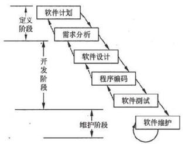

让客户参与评审并签字确认

（4） 和客户重新确认需求及项目范围，合理划分工作及阶段， 并取得干系人对需求及范围的一致 理解及成果的承诺；

（5）进行有效的范围管理和需求管理，变更必须纳入正式的变更流程进行严格管理， 防止范围蔓延。 （6）做好进度管理， 条件允许的情况， 替换更有效的资源，适当赶工以加快进度。

（答案包括但不限于以上内容，列举出其中 5 个小点即可，每小点 1 分，答案类似即可）

#### 【问题 5】（5 分）

变更管理工作程序： ①提出变更申请；②变更影响分析③CCB 审查批准； ④实施变更； ⑤监控变更 实施；⑥结束变更

（答案包括但不限于以上内容，列举出其中 5 个小点即可，每小点 1 分，答案类似即可）

#### 【试题十三】 ---中级 2009 年上半年案例分析试题

#### 【说明】

小赵是一位优秀的软件设计师， 负责过多项系统集成项目的应用开发， 现在公司因人手紧张， 让他作为项目经理独自管理一个类似的项目， 他使用瀑布模型来管理该项目的全生命周期，如下 所示：

项目进行到实施阶段，小赵发现在系统定义阶段所制订的项目计划估计不准，实施阶段有许 多原先没有估计到的任务现在都冒了出来。项目工期因而一再延期，成本也一直超出。

#### 【问题 1】（6 分）

根据项目存在的问题，请简要分析小赵在项目整体管理方面可能存在的问题。 【问题 2】（6 分）

（1）请简要叙速瀑布模型的优缺点。

（2）请简要叙述其他模型如何弥补瀑布模型的不足。

#### 【问题 3】（3 分）

针对本案例，请简要说明项目进入实施阶段时， 项目经理小赵应该完成的项目文档工作。

| 参考答案 |
|---|

#### 【问题 I】（6 分）

1.系统定义不够充分（需求分析和项目计划的结果不足以指导后续工作）； 2.过于关注各阶段内的具体技术工作，忽视了项目的整体监控和协调：

3.过于关注技术工作，而忽视了管理活动；

4.项目技术工作的生命周期未按时间顺序与管理工作的生命周期统一协调起来。

（每个点 2 分，总分不超过 6 分）

#### 【问题 2】（6 分）

1.瀑布模型的优点：阶段划分次序清晰，各阶段人员的职责规范、明确， 便于前后活动的衔接， 有利于活动重用和管理。

瀑布模型的缺点；是一种理想的线性开发模式， 缺乏灵活性（或风险分析），无法解决需求不 明确或不准确的问题。

（每个点 3 分，总分不超过 6 分）

#### 【问题 3】（3 分）

（每个点 0.5 分，总分不超过 3 分）

#### 【试题十四】 ---中级 2010 年上半年案例分析试题

#### 【说明】

（2） 本项目各小组组长各自监督其团队成员在整个项目建设过程中子计划的执行情况；  	（3） 项目组成员坚决执行子计划，且原则上不允许修改。

在执行了三个月以后，项目经常出现各子项目间无法顺利衔接，需要大量工时进行返工等问 题，目前项目进度已经远远滞后于预定计划。

#### 【问题 1】（4 分）

请简要分析造成项目目前状况的原因。

#### 【问题 2】（6 分）

请简要叙述项目整体管理计划中应包含哪些内容。

#### 【问题 3】（5 分）

为了完成该项目，请从整体管理的角度，说明老陆和公司可采取哪些补救措施。

| 参考答案 |
|---|

#### 【问题 1】（4 分）

1.项目缺少整体计划。本案例中的做法只完成了项目管理计划中的子计划，并没有形成真正 的项目整体管理计划，即确定、综合与协调所有子计划所需要的活动，并形成文件。

2.项目缺少整体的报告和监控机制，各项目小组各自为政。

3.项目缺少整体变更控制流程和机制。管理计划本身是通过变更控制过程进行不断更新和修 订的，不允许修改是不切合实际的。

（每个点 2 分，总分不超过 4 分）

#### 【问题 2】（6 分）

1.所使用的项目管理过程。

2.每个特定项目管理过程的实施程度。

3.完成这些项目的工具和技术的描述。

4.选择的项目的生命周期和相关的项目阶段。

5.如何用选定的过程来管理具体的项目。包括过程之间的依赖与交互关系和基本的输入输出等。 6.如何执行流程来完成项目目标。

7.如何监督和控制变更。

8.如何实施配置管理。

9.如何维护项目绩效基线的完整性。

10.与项目干系人进行沟通的要求和技术。

11.为项目选择的生命周期模型。对于多阶段项目，要包括所定义阶段是如何划分的。

12.为了解决某些遗留问题和未定的决策，对于其内容、严重程度和紧迫程度进行的关键管理评审。

（每个点 1 分，总分不超过 6 分）

#### 【问题 3】（5 分）

1.建立整体管理机制。老陆应分配更多的精力来进行项目管理，或由其他合适的人员来承担 整体管理的工作。

2.理清各子项目组目前的工作状态。例如其工作进度、成本、资源配置等。

3.重新定义项目的整体管理计划， 并与各子项目计划建立明确关联。

4.按照计划要求，重新进行资源平衡。

5.建立或加强项目的沟通、报告和监控机制。

6.加强项目的整体变更控制。

（每个点 1 分，总分不超过 5 分）

#### 【试题十五】 ---中级 2012 年下半年案例分析试题

#### 【说明】

某系统集成 A 公司中标了一个地铁综合监控系统项目，该项目是地铁运营公司公开招标的地

铁 S 号线建设项目中的一个信息系统子项目，涉及信号系统、电气控制系统、广播系统、视频监 控系统、通信网络系统的信息互通和集中控制， 需要集成多种厂商的设备。

接到任务后，项目经理小王开始着手编制项目管理计划，根据招标文件，小王列出了一个初 步的进度计划，进度计划中的各里程碑点正好是甲方招标文件中规定的各时间节点。随后，小王 估计了项目的各项开销，确定了项目预算。项目团队已由公司指派，小王召开了项目启动会，将 各项任务分配给项目组成员。

项目进行了一段时间后，由于天气原因，导致地铁土建工作的延误，因此影响到各厂商设备 进场，整个项目进度滞后，监理方与建设方发布了延期通知。 项目经理小王马上召开项目会议，

口头通知项目组成员所以工作均推迟开展。

#### 【问题 1】（6 分）

（1）请结合案例指出小王制定的初步进度计划中存在的最主要问题。

（2）请结合案例简要叙述在制定进度计划时通常应考虑哪些主要制约问题。

#### 【问题 2】（8 分）

请结合案例分析小王在项目管理过程中存在的问题。

#### 【问题 3】（6 分）

请简要叙述项目管理计划编制工作流程。

| 参考答案 |
|---|

#### 【问题 1】（6 分）

（1）存在的问题：

里程碑完全对应招标文件要求，进度计划没有余地。（2 分）

（2）应该考虑的问题：

①应考虑进行本子项目的进度网络分析，对应各里程碑事件的任务完成时间留有余地。 ②虑集成的设备的到货及进场受客观因素影响， 即外部依赖关系。

③考虑项目内部主要资源（人力资源、环境）约束情况，即内部依赖关系。 ④应考虑本子项目与主项目之间的协调和制约关系。

（每项 2 分，最多 4 分）

#### 【问题 2】（8 分）

存在的问题：

1、项目管理计划不应由一人制定，应有顶目组参与。

2、项目计划缺少相关分计划， 如质量计划、沟通计划等。

3、制定进度计划的方法不合理，没有预留一定的缓冲时时间。

4、项目计划缺少评审和审批环节。

5、没有处理好外部因素（天气）和内部因素（团队）带来的风险，缺乏有效的应对措施口 6、项目发生变更时没有及时更新项目计划。

7、应识别设备到场所影响的活动，对于不受影响的活动不应推迟进行。

（每项 2 分，最多 8 分）

#### 【问题 3】（6 分）

见教程 P215  项目管理计划编制工作流程：

1、明确项目目标和阶段目标（1 分）

2、成立初步的项目团队（1 分）

3、工作准备与信息收集（1 分）

4、依据标准、模版等编写初步的概要的项目计划（0.5 分）

5、编写范围管理、质量管理、进度、预算等分计划（0.5 分）

6、将上述分计划纳入项目计划，然后对项目计划进行综合平衡、优化（0.5 分）

7、项目经理负责组织编写项目计划（0.5 分）

8、评审与批准项目计划（0.5 分）

9、顶目获批，形成了项目的基准计划（0.5 分）

#### 【试题十六】 ---中级 2013 年下半年案例分析试题

#### 【说明】

S  公司是某市一家从事电子政务应用系统研发的系统集成公司，公司总经理原为该市政府信 息中心总工程师。 S 公司最近承接了该市政府 X 部门的一个软件项目， 而 X 部门一直是 S 公司的 老客户。 因为当时公司总经理急于出差， 所以在系统范围界定和验收标准尚不十分明确的情况下， 就和客户签订了合同，并任命李工为该项目的项目经理。

项目启动后，李工和项目技术负责人陈工， 以及 X 部门的副处长胡某共同组成了变更控制委 员会。随着项目的逐步开展，客户方不断提出一些变更请求，项目组起初严格按照变更管理流程 进行处理， 但是由于 S 公司与 X 部门比较熟悉，且胡某强调这些变更都是必须的业务要求， 故此 几乎所有变更都被批准和接受。项目组先后多次修改设计方案，模块代码，甚至返工了部分功能 模块以应对这些变更。

由于客户方属于机关单位，审批程序严格，即使很小的意见分歧也需要开会讨论，按照程序 办理， 项目进度比预期要慢。李工要求项目组天天加班以保证进度， 但需求变更却似乎没完没了， 为了节省时间，客户的业务人员不再正式提交变更申请，而是直接和程序员商量，程序员也往往 直接修改代码而来不及做相关文档记录，对此李工也很无奈。

有一次，客户方的两个负责人对软件界面风格的看法发生了分歧，李工认为自己不便于发表 意见，于是保持了沉默，最终客户决定调整所有界面，李工动员大家加班修改，项目进度因此延 误了 10 天，这时客户方的这两个业务负责人却同时来质问李工：“为什么你不早点告诉我们会造

成进度延期！早知道这样，当初就不要修改了！”李工感到非常苦恼。

#### 【问题 1】（7 分）

请将下面（1）~（3）处的答案填写在答题纸的对应栏内。

从本质上说，整体变更控制过程就是对（1）的变更进行（2）、（3）、批准和拒绝，并进行控 制的过程。

#### 【问题 2】（6 分）

在本案例中，李工在变更控制方面存在哪些问题？

#### 【问题 3】（4 分）

针对本案例，请指出李工在该项目的后续管理中可采取哪些措施？

| 参考答案 |
|---|

#### 【问题 1】

整体变更控制程实际上是对项目基准的变更进行标识、文档化、批准或拒绝， 并控制的过程。 依据包括： 项目管理计划、申请的变更、工作绩效信息、已完成的可交付物。

（列举出其中 3 个小点即可，每小点 2 分）

#### 【问题 2】

（1）变更控制委员会组成成员不合理，应该包括客户代表，最好是高级管理人员，并明确组织分工。 （2）几乎所有变更都被批准和接受，没有严格控制项目变更申请的提交。

（3）没有进行变更后的评审， 对变更造成的影响没有进行分析。

（4） 没有将变更可能造成的影响告诉变更提出方。应该对变更提出方施加影响， 确认变更的必要 性，确保变更是有价值的。

（5）没有严格按照变更控制流程进行变更管理。

（6）没有对变更实施进行监控，没有对变更作记录并形成文档，造成变更内容无法追溯。

（答案包括但不限于以上内容，列举出其中 6 个小点即可，每小点 1 分，答案类似即可）

#### 【问题 3】

（1）邀请客户的决策人员、高级业务人员加入变更控制委员会。

（2）对变更提出方施加影响， 确认变更的必要性， 确保变更是有价值的。

（3）对变更进行评审论证，确定变更的信息完整， 实际可行。

（4）分析变更造成的进度、成本、质量等方面的影响，并告知相关人员。

（5）要对变更的实施进行监控跟踪，记录变更信息并形成文档，以便于追溯。 （6）要对变更的效果进行评估。

（7）严格按照变更控制流程进行变更管理，驳回不必要的变更申请，确保批准的变更都是有效的。

（答案包括但不限于以上内容，列举出其中 4 个小点即可，每小点 1 分，答案类似即可）

二、范围（需求）管理、变更

#### 【试题一】---高级 2009 年上半年案例分析试题

#### 【说明】

2007 年 3 月系统集成商 BXT 公司承担了某市电子政务三期工程，合同额为 5000 万元，全部工 期预计 6 个月。

该项目由 BXT 公司执行总裁涂总主管，小刘作为项目经理具体负责项目的管理， BXT 公司总工 程师老方负责项目的技术工作， 新毕业的大学生小吕负责项目的质量保证。 项目团队的其他 12 个 成员分别来自公司的软件产品研发部、网络工程部。来自研发部的人员负责项目的办公自动化软 件平台的开发，来自网络工程部的人员负责机房、综合布线和网络集成。

总工程师老方把原来类似项目的解决方案直接拿来交给了小刘，而 WBS 则由小刘自己依据以 往的经验进行分解。 小刘依据公司的计划模版，填写了项目计划。因为项目的验收日期是合同里 规定的，人员是公司配备的， 所以进度里程碑计划是从验收日期倒推到启动日期分阶段制定的。  在该项目计划的评审会上， 大家是第一次看到该计划，在改了若干错别字后，就匆忙通过了该计 划。 该项目计划交到负责质量保证的小吕那里，小吕看到计划的内容， 该填的都填了，格式也符 合要求，就签了字。

在需求分析时，他们制作的需求分析报告的内容比合同的技术规格要求更为具体和细致。 小 刘把需求文档提交给了甲方联系人审阅，该联系人也没提什么意见。

在项目启动后的第二个月月底，甲方高层领导来到开发现场听取项目团队的汇报并观看系统 演示，看完后甲方领导很不满意，具体意见如下：

.  系统演示出的功能与合同的技术规格要求不一致，最后的验收应以合同的技术规格要求 为准。

.  进度比要求落后 2 周，应加快进度赶上计划。 . ……

#### 【问题 1】（8 分）

你认为造成该项目的上面所述问题的原因是什么？

#### 【问题 2】（7 分）

项目经理小刘应该如何科学地制订该项目的 WBS（说明 WBS  的制订过程） ？如何在项目的 执行过程中监控项目的范围（说明 WBS 的监理过程）？

#### 【问题 3】（10 分）

项目经理小刘应该如何科学地检查及控制项目的进度执行情况？

| 参考答案 |
|---|

#### 【问题 1】（8 分）

可能原因如下:

1、项目经理小刘和负责质量保证的小吕的问题：无论需求确认、对项目计划的评审还是质量 保证人员的把关，都存在走过场问题， 没有深入地评审。

2、BXT 公司的问题：项目管理流程形同虚设，没有深入切实的检查。

3、BXT 公司的问题：用人不当，不应选新毕业生做质量保证。

4、项目经理小刘的问题：需求分析闭门造车、项目计划一手包办。

5、项目经理小刘的问题：没有进行干系人分析，没有请对确认需求分析说明书的项目干系人。

（答案包括但不限于以上内容，列举出其中 4 个小点即可，每小点 2 分，答案类似即可）

#### 【问题 2】（7 分）

WBS 的制订过程如下:

（1）需求分析结果需要关键干系人认可。

（2）依据需求分析结果和《技术规格要求》分解 WBS，而且要关键干系人认可。

（答案包括但不限于以上内容，列举出其中 2 个小点即可，每小点 1.5 分，答案类似即可）

WBS 的监控过程如下:

在项目的执行过程中，定时收集项目实际完成的工作，这些工作应得到关键干系人认可，再 与 WBS 进行比较。如果一致，则说明项目范围在可控范围内；如果不一致，则分析原因，然后采取 相应的措施，例如变更项目的范围。

（答案包括但不限于以上内容，答案类似即可）

#### 【问题 3】（10 分）

1.科学地制订进度计划，设置恰当监控点。 2.进行恰当的工作记录。 3.绩效测量和报告。 4.偏差 分析。 5.制定相应的进度控制手段，比如资源调配、赶工等。

（答案包括但不限于以上内容，列举出其中 5 个小点即可，每小点 2 分，答案类似即可）

#### 【试题二】 ---高级 2009 年下半年案例分析试题

#### 【说明】

某系统集成商 A 公司承担了某科研机构的信息系统集成项目，建设内容包括应用软件开发、 软硬件系统的集成等工作。

在项目建设过程中，由于项目建设单位欲申报科技先进单位，需将此项目成果作为申报的重 要内容之一，在合同签订后 30 天内，建设单位向 A 公司要求总工期由 10 个月压缩到 6 个月， 同 时增加部分功能点。

由于此客户为 A 公司的重要客户，为维护客户关系， A 公司同意了建设单位的要求。为了完 成项目建设任务，A  公司将应用软件分成了多个子系统， 并分别组织开发团队突击开发，为提高 效率，尽量采用并行的工作方式，在没有全面完成初步设计的情况下，有些开发组同时开始详细 设计与部分编码工作；同时新招聘了 6 名应届毕业生加入开发团队。

在项目建设过程中， 由于客户面对多个开发小组，觉得沟通很麻烦，产生了很多抱怨，虽然 A  公司采取了多种措施来满足项目工期和新增功能的要求，但项目还是频繁出现设计的调整和编 码工作的返工，导致项目建设没有在约定的 6 个月工期内完成， 同时在试运行期间系统出现运行 不稳定情况和数据不一致的情况，直接影响到建设单位科技先进单位的申报工作；并且项目建设 单位对 A 公司按合同规定提出的阶段验收申请不予回应。

#### 【问题 1】（10 分）

请简要分析 A 公司没有按期保质保量完成本项目的原因。

#### 【问题 2】（5 分）

结合本试题所述项目工期的调整， 请简述 A 公司应按照何种程序进行变更管理。

#### 【问题 3】（10 分）

公司重新任命王工为该项目的项目经理，负责项目的后续工作。请指出王工应采取哪些措施 使项目能够进入验收阶段。

| 参考答案 |
|---|

#### 【问题 1】（10 分）

（1）没有对变更进行充分地论证和评估，没有采取合适的方案。

（2）缺乏与客户清晰的、统一的接口， 与客户沟通不是很有效。

（3）变更的实施过程缺少有效的监控。

（4）在压缩工期的情况下，没有考虑新增加开发人员的可用性。

（5）项目没有完成整体设计的同时就开始详细设计和编码，没有考虑到并行工作带来的风险。 （6）子系统的划分不恰当，或者缺少有效的（数据）整合，或者缺少有效数据规划设计。

（答案包括但不限于以上内容，列举出其中 5 个小点即可，每小点 2 分，答案类似即可）

#### 【问题 2】（5 分）

变更流程：（1）受理变更申请（2）对变更进行审核（3）变更方案论证（4）提交上级部门（变 更管理委员会）审查批准（5） 实施变更（6）对变更的实施进行监控（7） 对变更效果评估。

（答案包括但不限于以上内容，列举出其中 5 个小点即可，每小点 1 分，答案类似即可）

#### 【问题 3】（10 分）

（1）召集应用软件各个子系统的负责人，了解项目存在的问题，并提出解决问题的技术方案。

（2） 安排公司管理层、项目负责人与客户的管理层、项目负责人进行交流，就项目的后续进度等 事宜达成一致，妥善处理前期项目变更措施不当对用户产生的影响。

（3）根据新的进度要求，按照变更程序实施变更。

（4） 加强文档管理， 妥善保存变更产生的相关文档， 确保其完整、及时、准确的清晰， 适当的时 候可以引入配置管理工具。

（5）对变更过程进行有效的监控。

（6）加强与客户的沟通，确保各个子系统对用户的需求理解一致。

（7）加强各个子系统的项目负责人之间的沟通，确保子系统的同步。

（答案包括但不限于以上内容，列举出其中 5 个小点即可，每小点 2 分，答案类似即可）

#### 【试题三】 ---高级 2009 年上半年案例分析试题

#### 【说明】

A 公司是从事粮仓自动通风系统开发和集成的企业，公司内的项目管理部作为研发与外部的接 口，在销售人员的协助下完成与客户的需求沟通。

某日， 销售人员小王给项目管理部提交了一条信息，说客户甲要求对“JK 型产品的 P1 组件更 换为另外型号的组件”的可行性进行技术评估。项目经理接到此信息后，发出正式通知让研发部 门修改 JK 型产品并进行了测试，再把修改后的产品给客户试用。但客户甲对此非常不满，因为他 们的意图并不是要单一改变 JK 产品的这个 P1 组件， 而还要求把 JK 产品的 P1 组件放到其他型号 产品的外壳中， 上述技术评估只是他们需求的一个方面。

经项目管理部了解，销售部其实知道客户的目的， 只是认为 P1 组件的评估是最关键的， 所以 只向项目经理提到这个要求， 而未向项目经理说明详细情况。

#### 【问题 1】（8 分）

请分析上案例中 A 公司在管理中主要存在哪些问题导致客户非常不满。

#### 【问题 2】（5 分）

请简要叙述需求管理流程的主要内容。

#### 【问题 3】（12 分）

请简要叙述上述案例中，项目经理在接到销售部的信息后应如何处理。

| 参考答案 |
|---|

#### 【问题 1】（8 分）

存在的问题：

（1）未获得用户确认就实施了需求变更;

（2）分工不明确或者虽有分工但没有落实;

（3）项目管理部没有履行自己的全部职责;

（4）销售部门未能将正确的客户需求传递给研发部门;

（5）没有建立完善的需求管理的相关流程。

（答案包括但不限于以上内容，列举出其中 4 个小点即可，每小点 2 分，答案类似即可）

#### 【问题 2】（5 分）

#### 【问题 3】（12 分）

项目经理的处理方法如下:

（1）需要和销售部门作清晰的确认;

（5）管理产品的需求变更;

#### 【试题四】 ---高级 2010 年下半年案例分析试题

#### 【说明】

#### 【问题 1】（10 分）

请说明此项目在进行需求变更的过程中存在的问题。

#### 【问题 2】（10 分）

请分析该项目中的做法可能对后续工作造成什么样的影响？

#### 【问题 3】（5 分）

请简要说明整体变更控制流程。

| 参考答案 |
|---|

#### 【问题 1】（10 分）

1、没有按照严谨的变更控制流程对整个需求变更做完整的记录和跟踪（对于需求变更请求没 有记录、没有对变更进行正式的评审和批准、对于变更的结果没有验证）。（3 分）

2、对需求变更可能造成的影响没有进行全面的评估和分析（只分析了需求变更对于工期的影 响）。（2 分）

3、没有修改项目管理计划并重新评审（项目经理不应口头布置任务，同时里程碑的调整没有 通知相应的管理层）。（3 分）

4、配置管理工作没有做好（没有对需求文件和设计文件进行修改，并升级相应版本；相应的 模块编码的修改也没有进行版本控制）。（1 分）

5、变更结果没有跟客户沟通（需求变更实施完成后，没有让客户对最终结果进行确认）。（1 分）

（答案包括但不限于以上内容，列举出其中 5 个小点即可，每小点 2 分，答案类似即可）

#### 【问题 2】（10 分）

1、没有遵循正式的变更控制流程可能导致需求变更的过程失控和不可追溯。

2、没有对变更的影响进行完整的分析可能导致无法全面了解这次变更对项目的进度、范围、 成本、质量等造成多大的影响。

3、没有修改项目管理计划可能导致实际工作内容与计划有较大的偏差， 使项目管理计划无法 指导项目实施。

4、没有对相应技术文档进行修改可能导致需求、设计与编码无法对应，不利于后期的测试和 以后的维护工作。版本管理和配置管理没有做好可能导致在变更失败后无法将项目恢复到变更前 的状态。

5、没有让用户对最终结果进行确认可能导致双方对变更结果的意见不一致， 不利于项目验收 和最终交付。

（答案包括但不限于以上内容，列举出其中 5 个小点即可，每小点 2 分，答案类似即可）

#### 【问题 3】（5 分）

变更控制流程:1、提出书面的变更申请;2、对变更可能造成的影响进行评估:3、提交 CCB 进 行审批;4、获得批准后，安排相关人员实施变更;5、对变更的结果进行验证。

（答案包括但不限于以上内容，列举出其中 5 个小点即可，每小点 1 分，答案类似即可）

#### 【试题五】 ---高级 2011 年上半年案例分析试题

#### 【说明】

某高校计划建设校园一卡通项目，选择了具有自主一卡通产品的 A 公司作为系统集成商。项 目的主要内容是对学校的 3 个学生食堂、1 个图书馆、 1 个体育馆实现统一管理，并与学校的后勤

保障和财务部门的主要业务系统联通。为保证项目的实施，学校聘请了监理公司对此项目进行监 理。

经双方协定，合同规定工期为 6 个月， A 公司指定了项目经理小李负责该项目。项目组经需 求调研后制定了项目计划，将项目的主要活动划分为需求、设计、卡机具生产、应用系统开发、 综合布线及硬件安装调试、软硬件系统联调、现场测试、验收等活动。

项目进入编码阶段后，校方领导指示，要求把另外一个教职工食堂也纳入一卡通管理， 并对学 校重点教研室和实验室进行门禁管理。因此，校方代表直接找到 A 公司领导提出增加项目内容，	 并答应会支付相应的费用、延长项目工期，由于该高校是公司重要的客户， A  公司领导口头答应 了客户的要求。

#### 【问题 1】（6 分）

将空白处需要填写的恰当内容写入答题纸对应栏内。

（1）根据项目管理知识域相关理论，学校提出的增加内容的要求造成了项目的变更。

（2）在此项目中，为了控制项目的变更过程， 小李应首先向         方提出书面的         。 【问题 2】（13 分）

（1）项目组对变更产生的原因进行了分析，请说明此变更会对项目管理的哪些方面造成影响。（4 分）

（2）项目的 CCB（变更控制委员会）对变更进行了审批。请说明此项目，CCB  的组成应包括哪 些人员。（2 分）

（3）请简要叙述变更批准后小李应该安排哪些工作。（2 分）

（4）对变更产生的结果可采取一定的方法进行验证。其中， 对于需求、设计等文档类变更是否正 确可采用什么方法进行验证？ 对于软硬件系统变更是否正确可采用什么方法进行验

证？（2分）

（5）请简要叙述在这次变更过程中监理方应参与的工作环节。（3 分）

#### 【问题 3】（6 分）

在客户提出新需求时，该项目产品基线中哪些项目会发生变化？

| 参考答案 |
|---|

#### 【问题 1】（6 分）

（1）范围或需求。    （2）监理；变更申请。

（答案包括但不限于以上内容，列举出其中 3 个小点即可，每小点 2 分，答案类似即可）

#### 【问题 2】（13 分）

（1）范围、进度、成本、质量、人力资源、合同。

（2）项目经理、公司领导、监理方、校方代表。

（3）更新项目管理计划，更新 WBS 和 WBS 字典，安排相应人员去实施新的项目活动。 （4）评审； 测试。

（5） 接受变更申请、对变更进行评估、参与 CCB 评审、对变更申请进行审批、对变更结果进行验证。

（答案包括但不限于以上内容，列举出其中 5 个小点即可，每小点 2.5 分，答案类似即可）

#### 【问题 3】（6 分）

需求文件、设计文件、应用系统程序代码、硬件配置记录。

（答案包括但不限于以上内容，列举出其中 3 个小点即可，每小点 2 分，答案类似即可）

#### 【试题六】 ---高级 2012 年上半年案例分析试题

#### 【说明】

某单位甲建设数据中心管理系统， 与乙公司签订了单价建设合同，与丙公司签订了监理合同。 建设合同规定：系统提供的网络带宽不低于 2Mb/s，操作相应时间不超过 5 秒，可支持的最大并 发用户数不少于 5000 个。

乙公司项目经理张某张某根据要求编写了范围说明书，将 Web  服务器和数据库服务器部署在 一个小型机上， 并编制了 WBS 字典， 其中规定服务器按照在 10 月 5  日前完成，主要性能指标为 相应时间不抽过 5 秒，可支持最大并发用户数不少于 5000 个。

在现场设备按照调试前，建设方技术总监与张某沟通，要求提高系统可支持最大的并发用户 至 10000 个并说明原因。张某为此邀请乙公司技术总监和相关技术人员进行了商讨并制定了新的 技术方案， 该方案中建议用两台小型机分布担当 WEB 服务器和数据库服务器。

乙公司技术总监批准了该方案，随后报建设方领导出具意见，建设方领导也批准了新方案。 张某按照批准的新方案重新采购、按照和调试了设备。项目完成后，建设方代表对系统的性能指 标满意，但不同意追加投资，乙公司为此请丙公司出面协调，然而丙公司总监对新技术方案不了 解为由拒绝在项目验收报告上签字。

#### 【问题 1】（5 分）

结合本案例，判断下列选项的正误。（天蝎座答题纸的对应栏内，正确选项填写“V”，错误 的选项填写“X”）

（1）技术方案调整属于设计变更，应由建设方和承建方和承建方技术负责人最终审批() （2）张某编制的 WBS 字典不符合项目管理文件规范()

（3）甲、乙双方可对所签订的合同的效力约定生效和解除条件()

（4）对于单价建设合同， 建设方案的调整不涉及合同变更()

（5）签订监理合同后，建设方不能再提出技术指标变更要求，应由监理方提出() 【问题 2】（8 分）

请指出案例中的技术方案调整可能涉及哪些类型的项目变更。

#### 【问题 3】（12 分）

请简要分析案例中技术方案变更过程中存在的问题并提出改正建议。

| 参考答案 |
|---|

#### 【问题 2】（8 分）

可能涉及的项目变更有：需求变更、范围变更、成本变更、合同变更、进度变更和质量变更； 【问题 3】（8 分）

（1）存在的问题：

1）变更的提出没有正式的申请文件；2）变更缺少监理方参与；3）变更缺少评审流程 4）缺 少详细、审批过的变更方案；5）变更的执行缺少监控。

（2）改正建议：

1）制定三方任何的项目变更流程；

2）出现变更时，由变更发起者提出正式变更申请并附变更原因及变更方案； 3）监理方审核变更申请并给出监理意见；

4）三方对变更方案进行审批并就审批结果进行签字；

5）按照批准的变更方案进行变更，监理要对变更过程进行监督；

6）对变更结果进行评估；

7）注意保持变更过程设计的有关文件；

#### 【试题七】 ---高级 2014 年下半年案例分析试题

#### 【说明】

某信息系统集成公司的项目经理李工承接了一家大型国有企业（甲方） 的内部网络建设项目， 接到该任务后李工组织项目组的相关人员对该项目工作进行了仔细分析，李工根据分析结果并结 合自身的项目管理经验， 得出该项目的总工作量为 60 人月， 计划工期 6 个月。这样的成本估算和 进度计划也正好能够满足甲方的合同要求，项目的相关计划也得到了公司内部和甲方的认可。

项目开始一个月之后， 李工的直接领导， 公司的项目总监找到李工说， 由于公司其他项目出现 了问题，因此要求李工要在 5 个月内完成项目，同时作为补偿， 可以为项目增添两名开发人员。 李工很为难，他没有当时就答应项目总监的要求，而是说考虑几天再给项目总监答复。

李工在之后的几天中， 一方面在团队内部召开了几次会议，广泛听取大家的意见，同时也与 公司出现问题项目的项目经理进行了沟通，基本明白了另外一个项目存在 的问题和当前的状况， 李工提出了自己的解决方案， 将项目分为两部分来完成，第一部分任务是基本花费 4 个半月的时 间，开发客户当前最重要和急需的系统；第二部分是计划历时 2 个月，开发客户需求的另外的功 能。同时，李工还分别编写了相关的文档，描述了新的项目计划中各部分的主要工作、相关的验 收标准和可能存在的项目风险等方面的问题。

为谨慎起见，李工在向项目总监汇报前， 在项目团队内部对该计划进行了讨论，并通过甲方的 项目经理进行了侧面了解，得知甲方应该有 70%的可能性同意此计 划。李工就找到公司项目总监， 向其汇报了自己新的项目计划，项目总监觉得，如果按照新的项目计划实施，尽管项目工期可能 会延长半个月，但是不需要再增添开发人员，同时还能够满足另外一个问题项目对资源的要求。  大概能够为项目节约成本 6 万余元。项目总监在与甲方领导沟通和确认后， 同意了新的项目计划。

最终项目按计划在没有增加人员的情况下顺利完成，客户对项目最终交付的系统也非常满意， 项目组成员在项目过程中也非常愉快，没有感觉到太大的压力，而公司的问题项目，也由于获得

了资源方面的及时支持，终于步入到了正常的轨道， 并顺序结项。

#### 【问题 1】（4 分）

结合案例，请分析案例中的项目取得成功的主要原因有哪些？

#### 【问题 2】（6 分）

结合对项目范围控制和范围基准的理解，说明在本案例的变更中，与原来项目的范围基准相

比，新的项目的范围是否发生了实质性的变化？

#### 【问题 3】（5 分）

按照你的理解， 请简要叙述在项目变更中项目经理的作用。

#### 【问题 4】（10 分）

在本案例中，项目经理在没有取得项目总监意见的情况下，与公司其他项目经理进行沟通， 并与甲方项目负责人初步沟通，是否恰当？请说明理由。

| 参考答案 |
|---|

#### 【问题 1】

该项目成功的主要原因如下：

（1）李工项目管理经验丰富，大局观强；

（2）李工的估算与计划做得合符实际情况；

（3）李工能充分听取团队成员的意见， 集思广益；

（4）李工敢于积极主动地与公司同事、高层及甲方人员进行有效的沟通；

（5）李工熟练掌握进度压缩的方法与技巧（特别是灵活运用分期交付）；

（6）李工的冲突管理方法纯熟；

（7）该项目的文档工作做得充分、合理，有说服力。

#### 【问题 2】

范围基准包括范围说明书、 WBS 与 WBS 词典三大部分。（1 分）

新的项目的范围与原先相比，并没有发生本质的变化，原计划要做的工作仍然要完成，原来计划 中不需要做的工作， 将来也仍然不需要做。（3 分）

只是在创建 WBS 时， 需要按时间将工作分为两大板块，第一板块是前四个半月要完成的重要功能。 第二板块是后两个月要完成的其他功能。这样便于后续工作的安排。（2 分）

#### 【问题 3】

项目经理在项目变更中的主要作用：

（1）建立规范的整体变更控制流程，并确保流程的执行。

（2）响应变更提出者的要求。

（3）评估变更对项目的影响及应对方案。

（4）将要求由技术要求转化为资源要求，供授权人决策。

（5）根据评审结果实施即调整项目基准，确保项目基准反映项目实施情况。

（6）做好变更控制中的沟通工作，指导做好相关存档工作。

#### 【问题 4】

恰当。  因为项目经理有权利和义务与项目的相关干系人进行正式与非正式的沟通， 而不是被动地 等待上级指示。而且非正式沟通往往能使得气氛更融洽，解决问题更顺利。

#### 【试题八】 ---高级 2015 年下半年案例分析试题

阅读下列说明，回答问题 1 至问题 4，将解答填入答题纸的对应栏内。

#### 【说明】

无忧考培教育学院 2014 年初承接了一个周期为一年的 。A 信息系统项目，并指派项目经理 小张负责。该项目属于定制型项目， 涉及的用户方较多， 小张根据自己的经验预测到项目可能会 涉及频繁的需求变更，因此小张在将项目组分成了业务组、实施组、开发组后， 定义了如下需求 管理及控制流程：

（1）指派专门的业务组进行需求分析， 分析完成后马上与用户进行需求确认，确认后填写需 求状态表（包括需求提交日期、需求状态、是否属于变更等）；

（2）实施组获得需求分析文档后， 一周内进行技术方案设计；

（3）技术方案完成后，业务组视情况与用户进行二次沟通确认， 确认后填写需求状态表（包 括需求技术方案提交日期、需求技术方案状态）；

（4）需求分析、技术方案完成后，开发组每周对已确定需求进行工作量评估，形成月度开发 计划；

（5）开发组根据开发计划进行定制开发工作；

（6）每周开发组根据需求状态库的需求、方案进行工作量重新评估， 更新开发计划。  项目进行过程中，发生了如下事件，导致项目延期半年才完成：

#### 【事件 1】根据 20 14 年初的计划开发完成了 。A 信息系统项目并上线，但用户没有真正使用。 2014 年底推广使用的时候发现， 业务流程有缺失， 程序有 BUG，于是项目组重新按照以上流程梳 理了需求， 并重新开发上线。

#### 【事件 2】2014 年底，开发组提出需求分析在深度、广度上不够，导致开发返工任务多。

#### 【问题 1】（12 分）

结合案例及你的工作经验，请说明项目经理小张在需求管理及控制过程中存在哪些不足？ 【问题 2】（4 分）

结合案例， 围绕需求管理，请将下面（1）~（2）处的答案填写在答题纸的对应栏内。

案例中， 2014 年底推广使用的时候发现，业务流程有缺失，这一现象是由于缺乏（1）中的（2） 【问题 3】（5 分）

结合案例和个人经验，简要叙述项目中需求可能存在的几种状态。

#### 【问题 4】（4 分）

如果你是小张的经理，请帮助小张改进需求管理及控制过程中的不足。

#### 【问题 1  参考答案】（12 分）

（1）项目整体范围定义不充分。

（2）只有业务组与用户进行需求确认（需要实施组、开发组共同参与）。

（3）没有定义需求变更控制过程。

（4）对于需求变更， 只进行了记录，没有走需求变更流程。

（5）没有对需求变更影响进行评估。

（6） 技术方案设计不充分， 没有进行质量评审（需要业务组、实施组、开发组共同确认技术方案

的详细程度，来验证需求的深度与广度。）

（7）没有进行需求跟踪，导致有些需求缺失情况。

（8）质量控制不够好，导致程序有 BUG 返工。

（备注：每项 2 分。最多 12 分）

#### 【问题 2  参考答案】（4 分）

（1）需求跟踪（需求双向跟踪）（2）需求追溯（备注：更多详情请参阅  高项教程 P385 页）

#### 【问题 3  参考答案】（5 分）

已建议、已批准、待批准、已实现、已验证、已删除、已交付、被拒绝、已设计。 （备注：每个 1 分， 最多 5 分，只需要填写 5 个以上）

#### 【问题 4  参考答案】（4 分）

（1）项目全体成员做好范围定义，并进行评审。

（2）项目全体成员做好需求确认（需要业务组、实施组、开发组、用户一起确认）。 （3）定义需求变更控制过程（变更申请、评估、批准、实施、确认、发布）。

（4）每一项需求，严格遵守需求变更流程。

（5）做好需求技术方案设计质量评审。

（6）进行需求跟踪。

（7）做好范围控制。

#### 【试题九】 ---高级 2017 年上半年案例分析试题

项目经理小李负责了一个新的项目，该项目的内容是为某市开发一套智慧城市公共综合信息 服务平台。项目启动阶段，甲方仔细查看了小李提交的项目实施方案，提出由于该项目的投资方 构成复杂，项目需求不清晰， 希望项目组能想办法解决这个问题。

小李向公司申请了几名经验丰富的系统分析师，加强需求分析阶段的工作。经过较为充分的 需求调研，形成了初步的需求说明书。小李认为需求分析工作较为详细，按照公司常用的软件开 发生命周期模型，选择了瀑布模型进行开发。

在编写概要设计和详细设计说明书的过程中，客户方提供了几处需求的修改要求。由于其工 作量不大，小李直接安排系统分析师按客户的要求进行了修改。在编码阶段后期，由于客户的投 资方发生了变化，新的投资方采用了新的运营模式， 导致需求发生较大变化，由于前期甲方已经 强调过项目需求特点和要求，小李只能接受客户新的变更要求。在执行变更的过程中，项目组发

现新的需求将导致系统架构的更改，经过评估该变更将使项目延期。

#### 【问题 1】（5 分）

请分析该项目在整个过程中存在哪些主要问题？

#### 【问题 2】（7 分）

请说明项目范围（需求）变更控制流程。

#### 【问题 3】（6 分）

请将下面（1）~（6）处的答案填写在答题纸的对应栏内。

每项记录在册的变更请求都必须由（1）批准或否决。

变更结束后，形成新的项目极限并纳入到配置库的（2）库中，这时配置管理员应向项目组成员提 交一份（3）报告。

（4）、（5）、（6）构成了项目的范围基准。

#### 【问题 4】（3 分）

小李选择瀑布模型作为生命周期模型是否合适？如合适，请说明理由；如不合适，请说明理由， 并给出合适的生命周期模型。

#### 【参考答案】

#### 【问题 1】（5 分）

（1）没有制定项目的整体管理计划

（2）没有制定有效的范围和需求管理子计划；

（3）没有制定合理的整体变更流程及需求变更控制流程

（4）对客户的需求获取不充分；

（5） 需求分析工作不充分，缺乏需求定义环节，仅有初步的需求说明书，没有定义出详细的需求

规格说明书；

（6）缺乏需求验证环节，没有请客户代表一起进行需求评审；

（7）没有求得干系人对需求的一致理解；

（8）没有求得干系人对需求的承诺；

（9）没有有效地管理需求变更控制

（10）范围没有管好，导致不断的范围蔓延；

（11）未能做好进度管理，范围变更时没有充分评估对进度等其他方面的影响，导致进度延误。 （12）此项目需求不清晰，选择瀑布模型不合适。

#### 【问题 2】（7 分）

（1）受理变更申请（2）变更的整体影响分析（3） CCB 接受或拒绝变更（4）执行变更

（5）变更确认（6） 变更通知

#### 【问题 3】（6 分）

（1） CCB （或变更控制委员会）（2）受控库（3）配置状态报告

（4）批准的项目范围说明书   （5）WBS   （6）WBS 字典

#### 【问题 4】（3 分）

不合适。因为甲方已说明由于该项目的投资方构成复杂， 项目需求不清晰， 瀑布模型适用 于需求 确定， 可严格按阶段开发的项目，不适用于前项需求不清晰、风险较大的项目。对于需求不 清晰 的， 可选的合适的生命周期模型有：选代模型（分版本开发）、原型化模型（中级教材第二版 P210， 有助于明确需求）及螺旋模型（强调风险分析）

#### 【试题十】 ---高级 2017 年下半年案例分析试题

A 公司承接了一个为某政府客户开发 ERP 软件的项津，任命小张担任项目经理。由于该客 户与 A 公司每年有上千万元的项目合作， A 公司管理层对该客户非常重视，并一再嘱咐小张要保 证项目的客户满意度。为此， 小张从各部门抽调了经验丰富的工程师组成了项目， 团队。

在项目初期，小张制定了变更和配置管理规则：客户需求发生变化时，应首先由工程师对需 求变化造成的影响做评估，如果影响不大，工程师可以直接进行修改并更新版本，不需要上报项 目经理； 当工程师不能判断需求变化对项目的影响时，应上报给项目经理， 由项目经理作出评估， 并安排相关人员进行修改。

在项目实施过程中， 用户针对软件的功能模块提出一些修改需求， 工程师针对需求做了评估， 发现修改工作量不大，对项目进度没有影响，因此， 出于客户满意度的考虑，工程师直接接受了 客户的要求，对软件进行修改。在软件测试联调阶段，测试人员发现部分功能模块与原先设计不 符，造成很多接口问题。经调查发现，主要原因是客户针对这些功能模块提出过修改要求，项目 经理要求查验，没有发现相关变更文件。

#### 【问题 1】（10 分）

请分析项目实施过程中存在哪些主要问题？

#### 【问题 2】（10 分）

结合案例， 请描述项目变更管理的主要工作程序。

#### 【问题 3】（6 分）

请将下面（1）-（6）处的答案填写在答题纸的对应栏内。

1、根据变更的迫切性，变更可分为（1）和（2）

2、变更管理过程涉及到的角色主要包括项目经理、（3）、（4）、（5）、（6）。

#### 【参考答案】

#### 【问题 1】（10 分）

（1）小张制定的变更和配置管理规则存在问题，没有按照变更控制流程制定变更管理规则。

（2） 客户需求发生变化时，首先由工程师对需求变化造成的影响做评估存在问题，应该由项目经 理对影响进行评估。

（3） 项目经理作出评估， 并安排相关人员进行修改存在问题， 没有成立变更控制委员会（CCB）, 项目变更决策需要由 CCB 做出并分派实施。

（4） 工程师直接接受了客户的要求，对软件进行修改存在问题，应该由项目经理接受申请， 并由 CCB 作出是否变更的决策

（5）项目变更后投有通知相关干系人存在问题。导致测试人员发现接口问题。 （6）变更没有产生相关的变更文档。

（答案包括但不限于以上内容，列举出其中 5 个小点即可，每小点 2 分，答案类似即可）

#### 【问题 2】（10 分） （答案包括以上内容，列举出其中 8 个小点即可）

（1）提出与接受变更申请

（2）对变更的初审

（3）变更方案论证

（4）项目管理委员会审查

（5）发出变更通知并组织实施

（6）变更实施的监控

（7）变更效果的评估

（8）判断发生变更后的项目是否已纳入正常轨道

#### 【问题 3】

（1）紧急变更    （2）非紧急变更   （3）变更申请人 （4）CCB     （5）变更实施人   （6）配

置管理员 （每个空 1 分）

#### 【试题十一】---高级 2018 年下半年案例分析试题

试题一（25 分）

2018 年 1 月，某系统集成公司中标本市某地铁线路的列车乘客信息系统项目，内容包括地铁 公司运营中心节目播放控制软件、地铁列车节目接收软件以及服务器、播放终端等硬件设施的搭 建工作。

公司任命小陈为项目经理，并从各部门抽调了经验丰富的工程师组成了项目团队。小陈依据 过去多年从事会议场所多媒体播控系统的经验， 自己编写了项目范围说明书， 并依此创建了 WBS  和 WBS 词典， 形成项目范围基准。在项目实施过程中，由于与供应解码设备的厂商发生合同纠纷， 项目组不得不断新寻找新的合作厂商，并针对新的解码设备，全新开发接口软件，致使项目工期 拖延。客户针对播放控制软件，要求增加断点续传的功能，开发人员认为工作量不大就自行增加 了该功能。项目测试时，小陈发现与之前做的项目不同，地铁运行时数据是通过车地无线网络传 输，带宽优先，网络丢包现象严重，导致视频节目播放时,经常卡顿，马赛克现象严重， 究其原因 发现 WBS 中解决该问题的软件模块没有开发。验收时， 客户对项目执行情况不满意， 小陈觉得客 户吹毛求疲与客户客户发生了争执，导致客户向公司高层投诉。

#### 【问题 1】（10 分）

结合案例， 请分析该项目在范围管理方面存在哪些问題？

#### 【问题 2】（6 分）

结合案例， 请分析该项目在范围管理之外，还存在哪些问题？

#### 【问题 3】（5 分）

分解是一种将项目可交付成果和项目分解成较小的、更易于管理的组件的技术，请指出要将整个

项目分解为工作包， 需要开展哪些主要活动？

#### 【问题 4】（4 分）

从候选答案中选择四个正确选项，将该选项编号填入答题纸对应栏内（所选答案多于四个该题得 0

分）。

规划范围管理过程的输入是（）。 A.需求管理计划  B.项目章程

E.项目管理计划  F.工作绩效数据

参考答案

C.项目范围说明书 G.人事管理制度

D.经验教训知识库

#### 【问题 1】（10 分）

1.没有制定符合项目实际的项目范围管理计划。

2.前期需求调研存在问題，需求调研不充分或没有与客户进行需求确认。

3.小陈没有意识到车载节目播放软件与会议场所播放软件的区别和功能不同。

4.小陈自己编写了项目范围说明书，应该与相关干系人一起完咸。

5.创建 WBS 应该由项目团队的成员参与，不应由小陈自己完

6.没有与客户进行范围确认。

7.项目团队成员（开发人员） 对项目范围变更流程认识不足，培训不够

8.小陈对范围控制存在问题

9.小陈对需求跟踪存在问题， 遗漏了重要的需求

#### 【问题 2】（6 分）

1.小陈项目管理能力不强，经验缺乏， 不适合项目经理岗位

2.小陈对项目进度管理、控制存在问题

3.小陈与客户沟通存在问题

4 小陈处理冲突的能力和解决问题的方法存在问题。

5.公司高层对项目经理小陈的监控和指导存在问题。

或者：

1、沟通管理存在问题，客户与小陈发生争议，进而客户投诉。

2、整体管理存在问题，没有制订整体变更流程， 也没有执行。

3、进度管理存在问题，该项目工期拖延。

#### 【问题 3】（5 分）

1.识别和分析可交付成果及相关工作

2.确定工作分解结构的结构和编排

3.自上而下逐层细化分解

4.为 WBS 组件制定和分配标识编码

#### 【问题 4】（4 分） BDEG

#### 【试题十二】 ---中级 2009 年下半年案例分析试题

#### 【说明】

C 公司是一家从事电子商务的外国公司， 为了在中国开展业务， 派出 S 主管和 W 翻译来中国 寻找合适的系统集成商，试图在中国建设一套业务系统。 S  主管精通软件开发，但是不懂汉语， 而 W 翻译对计算机相关技术知之甚少。

W 翻译通过中国朋友介绍， 找到了从事系统集成的 H 公司。 H 公司指派杨工为该业务系统建 设项目经理，与 C 公司进行交流。经过需求调研，杨工认为， C 公司要建设一个视频聊天网站， 并据此完成了系统方案。在 W 的翻译下， S 审阅并认可了 H 公司的系统方案。 经过进一步的谈判， C 公司和 H 公司签订了合同， 并把该系统方案作为合同附件，作为将来项目验收的标准。

合同签订后，杨工迅速组织人力投入系统开发。由于杨工系统集成经验丰富，开发过程进展 顺利，对项目如期完工很有把握。 系统开发期间，S 主管和 W 翻译忙于在全国各地开拓市场， 与 H 公司没有再进行接触。就在系统开发行将结束之际，S 主管和 W 翻译来到 H 公司查看开发进度。

当看到杨工演示的即将完工的业务系统时， S  主管却表示，视频聊天只是系统的一个基本功能，	 系统的核心功能则是通过视频聊天实现网上交易的电子商务活动，要求 H 公司完善系统功能并如 期交付。杨工拿出系统方案作为证据， 据理力争。

W 翻译承认此前他的工作有误，导致双方对项目范围的认识产生了偏差，并说服 S 主管将交 付日期延后 2 个月。为了完成合同， 杨工同意对系统动能进行扩充完善，并重新修订了系统方案。 但是，此后 C 公司又多次提出范围变更要求。杨工发现，不断修订的系统方案已经严重偏离了原 始方案，系统如期交付已经是不可能的任务了。

#### 【问题 1】（6 分）

请结合案例简要说明， 详细的项目范围说明书应包含哪些内容， 并指出 C 公司和 H 公司对哪 些方面的理解出现了重大偏差。

#### 【问题 2】（6 分）

请指出 S 主管的要求是否恰当？ 为什么？ 并请结合本案例简要分析导致 C 公司多次提出范围

变更的可能原因。

#### 【问题 3】（3 分）

作为项目管理者，杨工此时应关注的范围变更控制的要点有哪些？

| 参考答案 |
|---|

#### 【问题 1】（6 分）

（1）详细的项目范围说明书应包含项目的目标、产品范围描述、项目的可交付物、项目边界、 产品验收标准、项目的约束条件、项目的假定。 （每个点 0.5 分，总分不超过 3 分）

（2）双方对项目目标、产品范围描述和项目可交付物的理解出现重大偏差。 （每个 1 分，总 分 3 分）

#### 【问题 2】（6 分）

（1）S 主管的要求不恰当，因为双方已签订了合同，H 公司按照合同进行开发， 并无不妥。（2 分） （2）c 公司多次提出范围变更的可能原因：

①甲方对项目、项目产品或服务的要求发生变化；

② 乙方没有正确理解甲方的需求；

③项目范围计划的编制不周密详细，有一定的错误或遗漏；

④双方沟通存在问题；

⑤市场上出现了或是设计人员提出了新技术、新手段或新方案；

⑥项目外部环境发生变化。 （每个 1 分，总分不超过 4 分）

#### 【问题 3】（3 分）

（1）确定范围变更是否已经发生；

（2）对造成范围变更的因素施加影响， 以确保这些变更得到一致的认可；

（3）当范围变更发生时，对实际的变更进行管理。

（每个 1 分，总分不超过 3 分）

#### 【试题十三】 ---中级 2010 年下半年案例分析试题

某公司为当地一家书店开发图书资料垂直搜索引擎产品，双方详细约定了合同条款，包括合 同金额、产品验收标准等。此项目是该公司独立承担的一个小型项目， 项目经理小张兼任项目技 术负责人。项目进行到设计阶段后，由于小张从未参与过垂直搜索引擎的产品开发，产品设计方 案经过两次评审后仍未能通过。公司决定将小张从该项目组调离，由小李接任该项目的项目经理 兼技术负责人。

小李仔细查阅了小张组织撰写的项目范围说明书和产品设计方案后，进行了修改。小李将原 定从头开发的方案，修改为通过学习和重用开源代码来实现的方案。小李还相应地修改了小张组 织编写的项目范围说明书，将其中按照项目生命周期分解得到的大型分级目录列表形式的 WBS 改为按照主要可交付物分解的树形结构图形式，减少了 WBS  的层次。小李提出的设计方案和项 目范围说明书，得到了项目干系人的认可，通过了评审。

#### 【问题 1】（5  分）

结合本案例， 判断下列选项的正误（填写在答题纸的对应栏内， 正确的选项填写“小”，错误的选 项填写“X”）

（1）项目范围控制需要按照项目整体变更控制过程来处理。             (    )

（2）项目范围说明书通过了评审，标志着完成了项目范围确认工作。(   )

（3）小李修改了项目范围说明书，但原有的项目范围管理计划不需要变更。(  )

（4）小李编写的项目范围说明书中应该包括产品验收标准等重要合同条款。(  )

（5）通过评审后，新项目范围说明书将成为该项目的范围基准。        (   )

#### 【问题 2】（4  分）

请简述小李组织编写的项目范围说明书中 WBS  的表示形式与小张组织编写的范围说明书中 WBS  的表示形式各自的优缺点及适用场合。

#### 【问题 3】（6  分）

结合项目现状，请简述在项目后续工作中小李应如何做好范围控制工作。

（1）项目范围控制需要按照项目整体变更控制过程来处理。         （d）

（2）项目范围说明书通过了评审，标志着完成了项目范围确认工作。（x）

项目范围确认工作每阶段都应进行。如果是“项目范围说明书通过了评审，标志着完成了本阶段 项目范围确认工作”，这样的陈述是正确的。

（3）小李修改了项目范围说明书，但原有的项目范围管理计划不需要变更。（x） （4）小李编写的项目范围说明书中应该包括产品验收标准等重要合同条款（d）  （5）通过评审后，新项目范围说明书将成为该项目的范围基准。    （d）

（每选对 1 个得 1 分，总分 5 分）

#### 【问题 2】（4 分）

1. 小张使用的大型分级目录列表形式的 WBS：（2 分）

优点：表示的分类较多，容量较大，易于修改。    缺点：不直观

适用场合： 表示大型项目的 WBS，易于装订成册，适合在项目管理软件中表示 WBS

2. 小李使用的树形结构图形式的 WBS：（2 分）

优点：直观，结构清晰   缺点：不能用来表示大型项目的 WBS，不易修改

适用场合： 中小型项目

#### 【问题 3】（6 分）

在项目后续工作中小李应该做好如下范围控制工作：

1、及时沟通，邀请客户阶段验收，对阶段成果及时确认，文档及时归档（3 分）  2、及时进行范围变更控制，如：（3 分）

a） 确认范围变更是否已经发生

b） 对造成范围变更的因素施加影响， 以确保这些变更得到一致的认可

c） 当范围发生变更时，对实际的变更进行管理

#### 【试题十四】 ---中级 2011 年上半年案例分析试题

#### 【说明】

M公司承担了某大学图书馆存储及管理系统的开发任务，项目周期4  个月。小陈是M  公司的 员工，半年前入职。在校期间，小陈跟随导师做过两年的软件开发，具有很好的软件开发基础。	 领导对小陈很信任， 任命小陈担任该项目的项目经理。项目立项前，小陈参与了用户前期沟通会 议，并承担了需求分析工作。会议后， 相关部门按照要求整理会议所形成的决议和共识，并发给 客户等待确认。 为了节约时间，小陈根据自己在沟通会议上记录的结果， 当晚组织相关人员撰写 了软件需求规格说明。次日便要求设计人员开始进行系统设计， 并指出项目组成员必须严格按照 进度计划执行，以不辜负领导的期望与嘱托。

项目进行了2  个月后，校方主管此业务的新领导到任，并提出了新的信息化管理要求。小陈 进行变更代价分析， 认为成本超支严重，于是小陈准备不进行范围变更， 并将结果通知客户，引  起客户不满。 项目进入测试阶段后， M  公司开展内部管理审查活动。此项目作为在建项目接受了 抽查，项目审查员给该项目提出了多个问题，范围管理方面的问题尤为突出。

#### 【问题 1】（5分）

结合本案例，分析小陈在此项目中项目范围管理方面可能存在的不足。

#### 【问题 2】（6分）

小陈组织人员撰写的项目 WBS  如下：

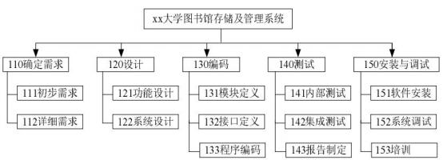

（1）请说明上述WBS 结构是将 作为第一层进行分解的。除了上述方法， 还可以采用哪些方 式进行分解。

（2）从上图来看，完整的WBS 中除了实现最终产品或服务所必须进行的技术工作外，还需

要包括   。

一一一

（3） 创建WBS 时要遵循哪些原则？ 供选择答案（将正确选项对应的字母填入答题纸对应栏内） ： A.在各层次上保持项目的完整性，避免遗漏必要的组成部分

B.一个工作单元可从属于某些上层单元

C.相同层次的工作单元可以具有不同性质

D.工作单元应能分开不同责任者和不同工作内容

E.便于项目管理进行计划和控制的管理需要

F.最低层工作应该具有可比性，是可管理的，可定量检查的

G.分解到统一颗粒度的工作包

H. WBS 不包括分包出去的工作

#### 【问题 ；】（4分）

（1）请指出案例中引起范围变更的原因。

（2）一般情况下，造成项目范围变更还有哪些主要原因。

| 参考答案 |
|---|

#### 【问题 1】（5 分）

（1）没有制定项目管理计划（或范围管理计划）；

（2） 没有进行项目范围定义（或软件需求规格说明书只是项目范围定义输出的一个组成部分， 或没有形成项目范围说明书）；

（3）在与干系人形成统一意见之前，就开始设计工作（或范围没有确认）； （4）项目范围是否变更，应遵循正式变更流程，不由项目经理单独决定；

（5）项目范围管理过程中与干系人的沟通存在问题（或范围变更没有与客户取得统一意见）； （6）软件需求规格说明没有经过评审就付诸实行。

（每个点 1 分，总分不超过 6 分）

#### 【问题 2】（6 分）

（1）项目生命周期， 把项目重要的可交付物作为分解的第一层、把子项目安排在第一层。（1 分） （2）项目的管理工作。（1 分）

（3）A，D， E，F （每选对 1 个得 1 分）

#### 【问题 3】（4 分）

（1）客户对项目、项目产品或服务的要求发生变化；

（2）①项目外部环境发生变化，例如政府政策发生变化；

②项目范围计划编制有错误或遗漏；

（3）市场上出现了或设计人员提出了新技术、新手段或新方案；

④项目实施组织本身发生变化。

（每个点 1 分，总分不超过 4 分）

#### 【试题十四】 ---中级 2011 年下半年案例分析试题

#### 【说明】

项目经理张某率领项目组为某银行开发了一套“银证通”管理系统，这是一套典型的已购环 境下的分布式电子交易系统。该系统在实际工作环境下运行状况良好，客户方也非常满意。在系 统正式运行的第三个月末， 由于银行业务的调整，客户方提出需要修改一下该系统的功能。为此 该系统需要在原有数据库中增加一项新的业务代码， 并在另一项原本仅由数字构成的业务代码前 增加由 3 个英文字母组成的前缀码。张某认为这算不上什么特别大的功能调整，就非常有把握地 对负责该项目的客服人员说：“小意思， 估计一个人一天时间就能完成修改。为了稳妥起见， 你可 以向客户承诺三天内解决问题，五天内新版本正式上线。”

项目经理张某要求经验丰富的程序员甲在一天内独自完成所有相关代码的改动和系统测试。第 二天一早，他吃惊地发现，程序员甲一夜未眠，还在埋头查找和修改代码。不得已，他又将程序 员乙、丙加入到代码修改者的行列中。但是一周时间飞逝而过，修改工作认为完成，客户方对此 非常不满。

#### 【问题 1】（6 分）（将相应选项填入答题纸对应栏内）

在本案例中，这次系统功能变更属于一种（1）维护工作，导致这次变更发生的原因是（2） 从技术角度看， 造成项目修改工作如此困难最可能的原因是系统（3）方面的问题；从管理角度来 看，造成项目修改工作迟迟不能结束主要是因为在（4）过程中存在问题。

备选项：

（1）A.适应性   B.预防性   C.完善性    D.更正性

（2）A.项目执行与项目基准不一致导致的被动调整   B.项目范围定义存在忽 C.实现项目的价值提升                  D.外部环境发生了变化

（3）A.需求分析  B.设计    C.编码      D.测试

（4）A.进度管理   B.沟通管理   C.变更管理  D.风险管理

#### 【问题 2】（9 分）

针对题干中客户提出的要求和有关后续工作，如果你是该项目的项目经理，请简述你将如何实施 变更。

| 参考答案 |
|---|

#### 【问题 1】

（1） A   （2） D   （3）B   （4）C （每选对一个得 1.5 分，总分 6 分）

#### 【问题 2】

1、提出项目变更申请，对变更影响进行分析   2、对变更的初审   3、变更方案论证  4、项目变更控制委员会审查   5、发出变更通知并开始实施  6、变更实施过程的监控 7、对变更的实施效果进行评估，判断发生变更后的项目是否已纳入正常轨道

8、归档保存变更产生的相关文档，确保其完整、准确、清晰， 并适当的时候可以引入配置 管理工具。

（每个步骤得 1 分，总共 9 分）

#### 【试题十五】 ---中级 2012 年上半年案例分析试题

#### 【说明】

某电力系统公司拟通过信息化来提高生产管理水平，决定开发一个生产过程的管理信息系统， 经过招投标，与信息系统集成企业 A 公司签订了生产过程管理信息系统开发合同。 公司委派小张 担任这个项目经理，公司项目办公室和小张一起根据合同制定了项目章程。 小张很快组建了项目 团队并安排李工负责项目的需求分析，赵工负责项目是设计、开发与实施。李工带领需求分析小 组经过实地调查，认真编写了需求分析说明书，并与电力系统公司的有关人员一起对需求进行了 评审。 但是由于电力系统公司的业务十分繁忙， 双方并没有在需求说明书中进行签字确认。

A 公司同时进行的信息系统开发项目比较多，李工在完成生产过程管理信息系统的需求分析 说明书后， 转到了另外的项目开发组。

在赵工带领的开发小张进行设计与编码的过程中，客户经常提出一些小的改动。赵工认为满 足客户的需求很重要，所以， 能改的就改了，没有与 A 公司的其他人进行协商。

在系统交付的时候， 电力系统公司的业务代表认为已经提出的需求很多没有实现， 实现的需 求也有很多不能满足业务的要求，与原来预期的需求差别很大，必须重新确定与实现这些需求后 才能验收，此时由于李工已经不在项目组，没有人能够清晰地解释需求说明书。最终项目延期超 过 50%，电力系统公司对系统的延期表示了强烈的不满。

#### 【问题 1】（5 分）

结合本案例，判断下列选项的正误（填写在答题纸对应栏内，正确选项写“Y”，错误选项项写“X”）: （1） 项目范围确认可以针对一个项目整体的范围进行确认，也可以针对某一个过程进行阶段的

范围进行确认。  对

（2）项目范围是指为了成功地实现项目目标所必须完成的最少的工作。 对

（3）变更是不可避免的，因而不必强制实施某种形式的变更控制过程。 错

（4）影响项目范围的变更请求批准后， 项目范围管理计划不必修改。 错

（5）项目变更控制应当与任何综合项目管理信息系统结合为整体，共同控制项目范围。 对 【问题 2】（6 分）

简要分析本案例中的范围变更控制存在哪些问题？

#### 【问题 3】（4 分）

你认为是否不管项目大小，都应该成立变更控制委员会？如果需要，变更控制委员会由哪些人组 成，如果不需要，请说明理由。

| 参考答案 |
|---|

#### 【问题 1】（5 分）   YYXXY

#### 【问题 2】（6 分）

（1） 制定项目章程和批准项目是由项目外的更高一级组织， 或大型项目管理， 或项目组合管理部 门负责的

（2）没有进行合理的人力资源计划，小张很快组建了项目团队，导致李工撤离后无人负责需求 （3）没有制定明确的项目管理计划、范围管理计划

（4）需求没有经过评审，确认就形成需求说明书， 并开始了后续的设计工作

（5）项目范围是否变更，应遵循规范的变更控制流程

（6）范围变更没有与客户取得一致意见

（7）缺乏沟通和周期监控

#### 【问题 3】（4 分）

解析： 是

CCB 可以使 1 人也可以使多人， CCB 由项目所涉及的多方人员共同组成， 通常包括用户和实施方的 决策人员， 不管项目大小都需要 CCB； CCB 可以使 1 人也可以使多人，主要是负责技术、产品质 量、以及其他相关的人员

书上原话： CCB 的成员通常包括项目经理，用户代表，软件质量控制人员， 配置控制人员。这个组 织不必是常设机构， 完全可以根据工作的需要组成。例如，按变更内容和变更请求的不同， 组成 不同的 CCB。小的软件项目 CCB 可以只有 1 人甚至只是兼职人员， 个人理解，这里虽说不必是常设 机构。但是下面说只有 1 人甚至只是兼职，觉得还是应该有，只是形式不同。常设机构：有固定 名称、地址、人员编制及工作程序规则的相对较长时期存在的机构，可能这里的不是常设机构只 的是，人员编制是可以随时改变的，不需要固定。但是 CCB 可能是要有的。

#### 【试题十六】 ---中级 2016 年上半年案例分析试题

项目经理小王目前正在负责一个小型的软件开发项目， 一开始他觉得项目比较小，变更应该 不多，流程也不需要太复杂，因此就没有制定项目变更计划，而是强调团队成员间的及时沟通来 保证项目按照计划进行。根据项目经理小王的理解， 所谓变更管理的主要目标就是保证项目能够 按照计划进行，如果能够保证不发生超越项目进度计划、成本计划等控制范围外的偏差，就可以 不用指定项目变更管理计划，以减少项目的工作量。而项目执行过程中对计划的微调根本不需要 记录和管理，也不需要走变更管理流程。而且他认为如果所有项目变更都必须向相关领导请示汇 报，过程太复杂和麻烦，还不如有执行人员提出变更的方案，彼此讨论一致后，来的更方便和便 捷。

但是在项目进入到集成测试阶段的时候，突然很多莫名其妙的问题出现，如在调试过程中， 由于相关设计和记录的简化和不规范，造成了调试的困难，很难定位各个问题模板的错误，由于 项目执行过程中，人员的调配替换，造成了文档记录不一致，导致后期人员阅读和理解方面的障 碍。并且由于缺乏对开发过程的配置管理和控制，导致版本混乱，很难形成有效支持各模板集成 的文档。另外，项目中很多细小的改动，由于没有准确的记录，或者是根本没有记录，导致集成 测试发现问题时，根本没有办法更改。小王对此也没有办法，不知道是因为什么导致目前状态， 项目面临返工的危险。

#### 【问题 1】（4 分）

结合案例，请说明项目经理小王对项目变更管理的认识哪些是正确的？哪些是不正确的？

#### 【问题 2】（10 分）

根据你的理解， 请说明项目变更管理在软件项目管理中的主要活动内容。

#### 【问题 3】（6 分）

针对项目的当前状态，小王应该采取什么补救措施？

试题四（17 分）

阅读下列说明，回答问题 1 至问题 3，将解答填入答题纸的对应栏内。

#### 【参考答案】

#### 【间题 1】（4 分）

认识正确的：（每项 1 分，总共 2 分）

（1）变更管理的目的是保证项目按计划继续

（2）项目变更需要获得相关干系人认可，讨论一致

认识不正确的：（每项 1 分，总共 2 分）

（1）不用指定项目的变更管理计划

（2）对计划的微调根本不需要记录和管理

（3）不需要走变更管理流程

#### 【问题 2】（10 分）

主要活动：

（1）识别可能发生的变更。

（2）管理每个已识别的变更。

（3）维持所有基线的完整性。

（4）根据已批准的变更，更新范围、成本、预算、进度和质量要求，协调整体项目内的变更。 （5）基于质量报告， 控制项目质量使其符合标准。

（6）维护一个及时、精确的关于项目产品及其相关文档的信息库，直至项目结束。 （每项 2 分，最多得 10 分）

#### 【问题 3】（6 为）

（1）建立有效的项目变更个配置管理系统

（2）让项目执行者补齐项目文档，说明项目的变更情况

（3）根据测算结果排查问题， 实施变更项目

（4）可能需要返工

（5）加强对各阶段文档和存档与记录， 加强版本的变更管理

（6）加强对配置基线的管理， 并进行配置审核

（7）制订测试计划， 在每个测试阶段的文档加强管理

（每项 2 分，最多得 6 分）

#### 【试题十七】 ---中级 2018 年下半年案例分析试题

#### 【说明】

无忧考培公司中标一个城市的智能交通建设项目， 总投资 350  万元， 建设周期 1 年。在项目 管理计划发布之后， 柳工作为本项目的项目经理，领导项目团队按照计划与任务分工开始实施。

在项目初期，项目团队在确定了项目范围后，项目经理制定了项目变更流程：

1、提出变更申请； 2、针对影响不大的变更，可以直接修改；  3、针对影响较大的变更， 必 须上报项目经理，由项目经理审批之后才能修改； 4、修改后由项目经理确认，确认 无误后更新 配置库，完成变更。

在一次项目进度协调会上，项目经理柳工与项目成员李工发生了争执，原因如下：李工对于

客户提出的需求， 无论大小都给予解决， 客户对此非常满意。但是，项目组 其他成员并不知晓李 工修改的内容，导致开发任务多次返工。目前， 项目已经延期。

#### 【问题 1】（8  分）

结合上述案例，请指出项目经理柳工制定的变更管理流程存在哪些问题。

#### 【问题 2】（3  分）

基于以上案例，请指出项目成员李工在变更过程中的不恰当之处。

#### 【问题 3】（3  分）

基于以上案例，请阐述变更过程中包含的配置管理活动。

#### 【问题 4】（6 分）

请阐述变更管理的工作流程。

#### 【参考答案】

#### 【问题 1】

（1）没有设置变更影响分析环节

（2）没有建立变更控制委员会来审核变更

（3）所有变更都必须走变更流程，而不是影响不大的就直接修改

（4）由变更控制委员会审核变更请求， 而不是项目经理

（5）对变更没有进行记录

（6）缺少对变更实施过程的有效监控

（7）变更结束后要通知相关受影响人员，而不仅仅只项目经理确认

（8）没有做好配置管理和版本管理

（答案包括但不限于以上内容，列举出其中 8 个小点即可，每小点 1 分，答案类似即可）

#### 【问题 2】

（1）李工对于客户提出的变更不能直接修改， 而要走变更流程

（2）变更实施过程中要做好配置和版本管理

（3）变更结束后要通知相关受影响人员

（答案包括但不限于以上内容，列举出其中 3 个小点即可，每小点 1 分，答案类似即可）

#### 【问题 3】（每小点 1 分）

（1）配置项识别（2）配置状态记录（3）配置确认与审计

#### 【问题 4】（每小点 1 分）

（1）提出变更申请（2）变更影响分析（3） CCB 审查批准（4）实施变更（5）监控变更实施（6） 结束变更

#### 【试题十八】 ---中级 2018 年上半年案例分析试题

#### 【说明】

某信息系统集成公司承接了一项信息系统集成项目，任命小王为项目经理。

项目之初，根据合同中的相关条款，小王在计划阶段简单地描绘了项目的大致范围，列出了 项目应当完成的工作。甲方的项目经理是该公司的信息中心主任，但该信息中心对其他部门的影 响较弱。由于此项目涉及到甲方公司的很多业务部门，因此在项目的实施过程中，甲方的销售部 门、人力资源部门、财务部门等都直接向小王提出了很多新的要求，而且很多要求彼此都存在一 定的矛盾。

小王尝试地做了大量的解释工作，但是甲方的相关部门总是能够在合同的相关条款中找到变 更的依据。小王明白是由于合同条款不明确导致了现在的困境，但他也不知道该怎样解决当前所 面临的问题。

#### 【问题 1】（8 分）

在本案例中，除了因合同条款不明确导致的频繁变更外，还有哪些因素造成了小王目前的困 境?

#### 【问题 2】（4 分）

结合案例， 列举该项目的主要干系人。

#### 【问题 3】（4 分）

简要说明变更控制的主要步骤。

#### 【问题 4】（4 分）

基于案例， 请判断以下描述是否正确（填写在答题纸的对应栏内，正确的选项填写“V” ，不 正确的选项填写“x” ）:

（1）变更控制委员会是项目的决策机构，不是作业机构。()

（2）甲方的组织结构属于项目型。()

（3）需求变更申请可以由甲方多个部门分别提出。()

（4）信息中心主任对项目变更的实施负主要责任。()

#### 【参考答案】

#### 【问题 1】

1、小王对项目的范围没有做细致的分析及调研，确定的范围过粗，没有进行有效的范围确认。 2、没有建立整体的变更控制流程，变更发生时也没有按照变更流程进行处理。

3、没有制定相应的项目管理计划，相关干系人也没有确认签字，导致变更不断发生。 4、甲方信息中心相对弱势，对其他部门影响较弱。

5、小王在沟通管理方面存在问题，没有进行有效沟通。

6、没有制定相关的风险管理计划等。

#### 【问题 2】

甲方的项目经理、甲方的销售部门、甲方的人力资源部门、财务部门

其他答案也可以参考：

1、项目经理小王及项目团队成员。

2、甲乙公司高层管理人员。

3、甲方信息中心工作人员及中心主任。

4、甲方相关业务部门参与人员。

#### 【问题 3】

1、提出变更申请。2、变更影响分析。3、 CCB 审查批准。4、实施变更。5、监控变更实施。6、结 束变更。

#### 【问题 4】

（1）d（2）x（3） d（4） x

三、质量管理

#### 【试题一】---高级 2008 年下半年案例分析试题

#### 【说明】

某信息技术有限公司中标了某大型餐饮连锁企业集团的信息系统项目， 该项目包含单店管理、 物流系统和集团 ERP 等若干子项目。由该信息技术有限公司的高级项目经理张工全面负责项目实 施。 张工认为此项目质量管理的关键在于系统地进行测试。

张工制订了详细的测试计划用来管理项目的质量。 在项目实施过程中，他通过定期发给客户 测试报告来证明项目质量是有保证的。 可是客户总觉得有什么地方不对劲， 对项目的质量还是没 有信心。

#### 【问题 1】（6 分）

客户对项目质量没有信心的原因可能是什么？

#### 【问题 2】（5 分）

一般地，项目质量管理计划应该包括哪些内容？

#### 【问题 3】（5 分）

张工应该如何实施项目的质量保证？

#### 【问题 4】（9 分）

项目的质量控制与质量保证有哪些区别与联系？

| 参考答案 |
|---|

#### 【问题 1】（6 分）

（1）张工没有为项目制定一个可行的质量管理计划并积极地实施之。

（2）仅向用户提交测试报告而没有提交全面质量管理进展情况的报告，沟通方式单一、容易 误导用户、容易导致客户/用户不必要的担心。

（答案包括但不限于以上内容，列举出其中 2 个小点即可，每小点 3 分，答案类似即可）

#### 【问题 2】（10 分）

（1） 质量责任与人员分工（2） 组织结构（3） 程序与过程（4） 质量控制的方法、工具与重点。 （5）质量管理所需的资源（6）验收标准。

（答案包括但不限于以上内容，列举出其中 5 个小点即可，每小点 2 分，答案类似即可）

#### 【问题 3】（9 分）

张工应该如何实施项目的质量保证：

（1）张工应该首先执行项目的质量管理计划。

（2）采用质量保证的工具和技术等。

（3）提出相应质量整改措施如建议的纠正措施、对项目计划可能的更新、对组织资产可能的 更新、变更请求等。

（答案包括但不限于以上内容，列举出其中 3 个小点即可，每小点 3 分，答案类似即可）

#### 【问题 4】（9 分）

质量控制与质量保证有哪些区别与联：

（1）质量计划是质量控制与质量保证的共同依据。

（2）达到质量要求是质量控制与质量保证的共同目的。

（3）质量保证的输出是下一阶段质量控制的输入。

（4） 一定时间内质量控制的结果也是质量保证的质量审计对象，质量保证的成果又可以指导 下一阶段的质量工作包括质量控制和质量改进。

（5）质量保证一般是每隔一定时间如阶段末进行的， 主要通过系统的质量审计来保证项目的质量。

（6）质量控制是实时监控项目的具体结果，以判断它们是否符合相关质量标准，制定有效方 案，以消除产生质量问题的原因。

（答案包括但不限于以上内容，列举出其中 6 个小点即可，每小点 1.5 分，答案类似即可）

#### 【试题二】 ---高级 2011 年上半年案例分析试题

#### 【说明】

某公司承接了一个银行业务系统的软件开发项目，质量要求非常高。项目经理小赵制定了项 目的整体计划， 将项目划分为需求、设计、编码和测试四个阶段，他将测试阶段预留了大量时间， 以便开展充分的测试工作。

需求分析完成后， 项目组编写了《需求分析报告》，项目经理小赵召集部分骨干人员召开评审 会。为了尽快进入下一阶段工作，评审会从早上 9 点一直开到晚上 9 点，终于把全部的文件都审 完了。评审组找到了几处小问题，并当场进行了修改，项目经理宣布可以进入设计阶段了。

设计人员根据需求文件编写了《设计说明书》，并提交给小赵。小赵对设计文件仔细审阅后， 便安排程序员开始编程。

编程结束后，进入了测试阶段。第一轮测试，发现了 70 个缺陷。项目组对发现的缺陷进行 了修改，又重新提交了测试。第二轮又发现了 100 多个缺陷，就这样反复修改和测试，直到第六 轮，发现了 33 个缺陷。各轮发现的缺陷数如下：

| 轮数 | 第一轮 | 第二轮 | 第三轮 | 第四轮 | 第五轮 | 第六轮 |
|---|---|---|---|---|---|---|
| 缺陷数 | 70 | 117 | 89 | 54 | 158 | 33 |

这时， 小赵终于松了一口气，由于第六轮只剩下 33 个缺陷， 他觉得测试工作应该很快就会结束了。 【问题 1】（10 分）

请分析此项目的质量管理过程中存在哪些问题。

#### 【问题 2】（9 分）

请在答题纸上标出纵坐标的刻度值，并画出测试缺陷的趋势图。根据趋势图分析“小赵觉得

测试工作很快就会结束了”是否有道理，并分析原因。

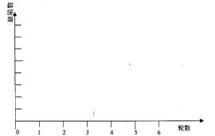

#### 【问题 3】（3 分）

请结合软件生命开发周期分析软件存在缺陷的可能原因。

#### 【问题 4】（3 分）

请结合实际经验说明软件项目的质量管理工作应重点完成哪些工作。

| 参考答案 |
|---|

#### 【问题 1】（10 分）

1、小赵没有制定单独的质量管理计划，也没有安排质量管理人员（没有分配质量管理职责）。

2、没有对项目过程进行质量检查工作（项目没有实施质量保证工作，只进行了质量控制工作）。 3、质量控制方面存在问题，包括:

（1）项目在重大里程碑处需由干系人对阶段成果进行评审，确保结果和预期目标一致。

（2）需求评审没有客户参与，可能导致最终对需求不能达成一致，设计文件未经过正式评审，

可能导致设计文件有较多的错误。

（3）技术评审会是为了发现问题的，而不是修改问题的， 评审会没有达到预期效果。

（4）需求评审控制不好。需求评审属于技术评审，评审会持续时间过长会导致效率低下（或 者说评审会召开时间过长，起不到质量控制的作用）。

4.测试工作中在测试用例、测试方法、测试人员及测试环境等方面存在问题。

（答案包括但不限于以上内容，列举出其中 5 个小点即可，每小点 2 分，答案类似即可）

#### 【问题 2】（9 分）

画出趋势图，如下图所示：

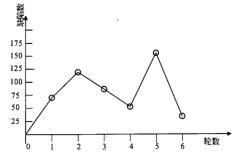

不能判断测试可以结束，因为 6 轮测试的缺陷数并没有呈整体下降并趋于稳定的趋势。

小赵分析得没有道理。因为趋势线上下波动很大，并没有呈整体下降且趋于稳定的趋势，所 以不能得出下一轮测试缺陷数必然减少的结论。最后一轮测试缺陷次数虽然减少，但是，还没有 经过回归测试，新的缺陷可能还会产生。系统也没有经过集成测试，也可能还有新的缺陷产生。

（答案包括但不限于以上内容，画图得 4 分，原因分析 5 分）

#### 【问题 3】（3 分）

产生的原因可能是需求缺陷、设计缺陷、编码错误、测试不充分。

（答案包括但不限于以上内容，列举出其中 3 个小点即可，每小点 1 分，答案类似即可）

#### 【问题 4】（3 分）

1.制定质量保证计划。

2.应安排独立于项目组的质量保证人员负责质量保证工作。

3.对软件开发的过程实施质量审计。

4.注重对需求和设计等开发过程文件的技术评审工作。

5.注重测试工作，应安排相对独立的测试人员。

6.对发现的缺陷进行统计分析，确保软件质量。

（答案包括但不限于以上内容，列举出其中 3 个小点即可，每小点 1 分，答案类似即可）

#### 【试题三】 ---高级 2012 年下半年案例分析试题

#### 【说明】

小赵被任命为某软件开发项目的专职质量管理人员， 他此前只有过三个月的软件开发经历。  项目经理李工要求他按照项目进度计划中的工作安排，按时做好检查，发现问题随时汇报。

项目启动后，由于进度紧张，项目组经常加班，小赵在质量检查中，总会遇到这样那样的问 题，例如，计划时间点已到，工作却没有按时完成， 因此，无法开展检查；相关人员工作太忙， 无法配合检查等。不久， 项目组成员对小赵的工作颇有怨言，说他不懂技术，还得浪费时间跟他 解释，有的还说进度已经这么紧张了，他不帮忙却来添乱。小赵很无奈，将这些情况汇报给项目 经理李工， 李工也觉得比较棘手，要求小赵尽量在不打扰大家工作的情况下执行检查。

项目组在超负荷运转中完成了编码任务，虽然天天加班，但进度还是延误了 20%，此时已经 不能按原计划开展测试工作，项目经理李工决定调整计划，不划分测试阶段，将所有模块一次集 成后统一开始测试。软件模块集成后，头一轮测试刚开始就出现了致命错误， 导致测试无法继续， 李工只好让开发人员先修复软件，之后再提交测试， 随后的测试过程更加混乱，由于模块由不同 人员开发， 需要不同的人来修改，常常是已修复的 BUG，在修复其他的 BUG 之后又再次出现，

开发人员不停修改， 项目交付时间临近，程序中还有大量 BUG 没有修复。

#### 【问题 1】（14 分）

请结合本题案例分析该项目质量管理中出现的问题。

#### 【问题 2】（5 分）

请结合本题案例简要阐述在项目中应如何进行质量管理。

#### 【问题 3】（6 分）

对于本题案例中的软件项目， 请指出其测试过程至少应分为哪几个阶段？

| 参考答案 |
|---|

#### 【问题 1】（14 分）

（1）质量保证人员经验不足 ；

（2）没有制定和实施合理的、可操作性的质量管理计划（或进度计划代替了整个项目的质量 管理计划） ；

（3）项目经理在项目质量管理方面的经验欠缺 ；

（4）进度计划制定的不合理（或进度计划安排过于紧张） ；

（5）测试过程的阶段安排不合理，软件系统的测试时间不足 ；

（6）需求分析、系统设计阶段的质量控制可能不到位、缺少评审环节 ；

（7）测试过程中配置管理工作未到位 ；

（8）项目缺乏质量标准和质量规范 ；

（9）没有建立项目的质量保证体系 ；

（10）在质量管理中，没有采用合适的工具、技术和方法；

（答案包含但不限于以上内容，列出 7 点就可以，每小点 2 分，最多 14 分，类似即可）

#### 【问题 2】（5 分）

（1）应使用有相关行业经验、项目经验和质量管理经验的质量保证人员 ；

（2）应该科学制定和实施质量管理计划 ；

（3）重视软件项目的测试环节，安排必要的时间， 采用合理的方法进行充分测试 ； （4）应加强需求和设计方案的评审和质量控制工作 ；

（5）应重视软件开发过程中的质量保证工作，采用相应的工具和技术，避免将检查、测试作 为项目质量保证的唯一方法 ；

（6）应加强项目实施过程中的配置管理工作 ；

（7）应建立项目的质量管理体系，包括制定可行的过程规范和质量目标、质量标准 ； （8）对发现的缺陷进行统计分析，确保软件质量 ；

（9）提出合理有效的质量整改措施（如建议的纠正措施、对项目计划可能的更新等） ；

（10）为项目组成员提供质量管理要求方面的培训（或指导） ；

（11） 加强与客户在质量管理方面的沟通和交流等；

（答案包含但不限于以上内容，列出 5 点就可以，每小点 1 分，最多 5 分，类似即可）

#### 【问题 3】（6 分）

单元测试、集成测试、系统测试、验收测试等；

（答案包含但不限于以上内容，每小点 1.5 分，最多 6 分，类似即可）

#### 【试题四】 ---高级 2013 年上半年案例分析试题

#### 【说明】

A 公司是国内一家大型系统集成企业，已建立基于 SJ/T 11234、SJ/T 11235 的涵盖公司所有部 门和人员的质量管理体系。在公司建立质量管理体系之初，质量部要求各业务部门都参加体系建 设，编写程序文件和作业指导，但这些部门都说忙， 难以抽出人力。质量部便借鉴了其它公司的 体系文件， 对其简单修改后形成了 A 公司的质量管理体系文件。

质量管理体系运行一年后，公司承担了一个大型软件集成项目。公司领导对此项目非常重视，任 命高级项目经理陈工管理此项目， 并强调一定要保质保量完成。同时，公司要求销售部、采购部、 质量部各派一个人参与该项目，配合项目组开展工作。

根据公司的质量管理体系要求，项目的每个里程碑节点都要召开评审会，主要开发文档（包 括要求规格说明书、总体设计和详细设计等）都需要通过评审。事实上，在以往的项目中，这些 评审会都是项目组内讨论，讨论出结果后让相关部门负责人签字，质量部只要看到有签字的评审 记录就不干预项目的实施。由于本项目关系重大，各部门都怕出了问题而承担责任，因此所有部 门都参加了该项目的评审会。

几个评审会开完，项目组成员开始抱怨。说以前的项目评审都是我们自己讨论，其它部门根 本没人仔细看。可是现在这个项目，各个部门都有人参与，评审会上每个人都提意见，并且意见 经常不一致，没有人负责最后拍板；对于有些技术文件的评审，评审人员明明不懂还提出很多问 题，还要费很大力气给他们解释。

在以往的项目中，虽然公司的程序文件中规定评审没通过就不能进入下一环节，但如果进度 要求紧张的话， 一般也不管什么流程了，抢进度要紧。但是在这个项目中，设计方案经过几次讨 论都没有结果。项目经理陈工为了保证进度，向采购部提出提前采购设备，采购部以设计方案没 有定稿为理由拒绝处理。无奈陈工找了好几次公司领导，最终领导拍板可以提前采购。项目就这 样在不断的争执过程中进行，每次争执不下时陈工就去找公司领导。如此多次争执后，陈工发现 质量管理体系文件中规定那么多评审纯粹是浪费时间，希望修改。

按照计划， 现在项目应该进行到测试阶段，但实际上项目的详细设计还未通过评审。 【问题 1】12 分

请简要叙述 A 公司的质量管理体系在建立和运行中存在的主要问题。

#### 【问题 2】8 分

如果你是 A 公司质量负责人，请简要叙述实施 A 公司质量管理体系的改进步骤。 【问题 3】5 分

项目质量管理包括（1）、（2）和（3）过程。A 公司在建立质量管理体系后，应定期对质量管 理体系的运行进行内部审核和（4）。质量体系内部审核属于质量管理中（5）过程。

请将上面（1）到（5）处和答案填写在答题纸的对应栏内。

| 参考答案 |
|---|

#### 【问题 1】（12 分）

（1）体系建设应全员参与，不应由质量部门单独负责体系文件编制

（2）体系应结合企业自身特点设计，不能照搬其它公司的文件或经验

（3）体系建设后应及时运行

（4）体系运行后应及时发现问题并改进

（5）质量部门全全程参与项目的质量管理和体系运行，不能只检查结果

（6）高层领导不能过多干预体系运行的细节， 导致体系的作用被弱化

（7）项目应按照体系规定的流程进行， 不应按照个人意志进行

#### 【问题 2】（8 分）

质量管理体系的改进步骤：

（1）找出目前质量体系不合适项目实际情况的问题

（2）制定改进计划， 对项目实施流程进行改进

（3）将改进工作分配给各部门

（4）修改体系文件并会同各部门进行评审

（5）在部分项目中试运行改进后的体系，找出问题，改进

（6）正式发布改进后的体系并持续改进

#### 【问题 3】（5 分）

质量计划、质量保证、质量控制、外部审核、质量保证

#### 【试题五】 ---高级 2014 年上半年案例分析试题

#### 【说明】

某系统集成企业承接了一个环保监测系统项目，为某市的环保局建设水污染自动监测系统。 该企业以往的主要业务领域为视频监控及信号分析处理，对自动控制系统也有较强的技术能力， 但从未在环保领域开发应用。该企业的老李被任命为此项目的项目经理。

该企业已按照 ISO9001 的要求建立了一套质量管理体系，对于项目管理、软件开发等的流程 均有明确的书面规定。但公司中很多人认为这套管理体系的要求对于项目来说是多余的，条条框 框的约束太多，大部分项目经理都是在项目结项前才把质量体系要求的文档补齐以便能通过结项 审批。公司的质量管理员也习以为常， 只要在项目结束前能把文档补齐， 就不会干涉项目建设。

老李组织了技术骨干对客户的需求进行了调研，通过对用户需求的分析和整理，项目组直接 制定了一个总体的技术方案，然后老李制定了一个较粗略的项目计划： 1.对市场上的采集设备进行 调研，选择一款进行采购； 2.利用公司已有的控制软件平台直接进行修改开发； 3.待设备选定后， 将软件与采集设备进行联调实验， 实现软件与设备的控制功能； 4.联调成功后， 按技术方案开展整 个项目的实施工作。

在软件与采集设备的联调过程中，老李请环保局的客户代表来检查工作。客户代表发现由于 项目组不了解环保领域的一些参数指标，完成的系统达不到客户方的要求。由于项目从一开始就 没有完整的项目文档，老张为了避免再出现重大问题，只好重新进行需求调研。客户方很不满意，

既担心项目不能按时上线又担心项目质量无法保证。

#### 【问题 1】（6 分）

请指出该项目的需求活动存在哪些问题

#### 【问题 2】（7 分）

请简要分析该项目的项目管理方面存在哪些问题

#### 【问题 3】（12 分）

该企业的质量管理体系可能存在哪些问题？应该如何改进?

| 参考答案 |
|---|

#### 【问题 1】（6 分）

答：该项目的需求活动存在以下主要问题：

（1）没有按照规范的需求开发与需求管理的流程及内容开展需求工作；

（2 对客户（或用户）的需求获取不充分；

（3）需求分析工作不充分；

（4）缺乏需求定义环节，没有定义出需求规格说明书；

（5）缺乏需求验证环节，没有请客户代表一起进行需求评审；

（6）没有制定需求管理计划；

（7）没有求得干系人对需求的一致理解；

（8）没有求得干系人（特别是客户代表对需求的承诺；

（9）没有有效地管理需求变更；

（10）没有有效维护对需求的双向跟踪性；

（11）没有及时识别项目工作与需求之间的不一致性。

#### 【问题 2】（7 分）

答：该项目在项目管理方面存在以主要问题：

（1）没有按公司的质量管理体系要求来进行项目的质量管理， 团队成员没有质量意识；

（2）没有制定规范的质量管理计划和流程，项目经理仅依据经验来替代规范的质量管理； （3）没有安排专职的项目质量管理人员；

（4）没有开展有效的质量保证及质量控制工作；

（5）没有开展有效的配置管理与系统测试工作；

（6 项目计划过于简单、粗略，而且计划没有经过评审；

（7）团队成员没有充分参与， 仅仅是由项目经理一人来制订项目计划；

（8 在实施过程中没有建立有效的阶段评审机制（技术方案等均未经过评审）； （9）对项目的实施工作没有进行及时有效的监控， 未能及时发现问题；

（10）轻视文档编制工作，项目文档几乎一片空白；

（11 项目部缺乏对环保领域较为熟悉的专业人才，也未进行相关培训；

（12）与客户的沟通工作没有做好。

#### 【问题 3】（12 分）

答：该企业的质量管理体系主要存在以下问题：

（1）目标工作与实际工作和原有管理割裂开来， 认为目标归目标， 实际工作中没沿用原来的管理模式；

（2）未能结合企业的实际情况，照搬照抄，其后果导致旧的方法弃之不用，新的方法不知如何使用； （3）实际运行中缺乏指导性、操作性。

（4） 在体系建立和实施过程， 个别领导和富有管理职能的人员， 对体系理解不透、不准确， 而其 又要具体指导目标工作，以致于体系无法在本单位得到有效的贯彻；

（5） 把目标工作看成是额外安排的一件事， 被动应付， 不推不动，实施不用心， 满足于上级下达 的目标任务；

（6）个别单位对体系的宣传力度不够， 使一些部门领导和员工对体系的认识存在偏差；

（7）在体系的建立和实施过程中的各种工作较为肤浅，缺乏深入的研究及遇到问题主动的解决。

改进之策：

（1）加强领导的组织和协调作用；

（2）统一认识，牢固树立目标的长久思想；

（3）加强培训和教育；

（4 以质量管理体系为中心， 整合各种管理制度间的关系；

（5）强化内审和管理评审工作；

（6）重视持续改进；

（7）重视质量管理制度化建设，加强考核，强化监督保障机制的作用。

#### 【试题六】 ---高级 2017 年上半年案例分析试题

#### 【说明】

某系统集成公司 A 中标某信息中心 IT 运维平台开发项目， 公司 A 任命小李为项目经理。小 李在项目启动阶段确定了项目团队和项目组织架构， 项目团队氛围三个小组：研发组、测试组和 产品组。各组成员分别来自研发部、测试部以及产品管理部。

小李制定了项目整体进度计划，将项目分为需求分析、设计、编码、试运行和验收五个阶段。 为保证项目质量，小李请有着多年的编码、测试工作经历的测试组组长张工兼任项目的质量保证 人员。

在项目启动会上，小李对张工进行了口头授权， 并要求张工在项目的重要阶段（如完成需求 分析、完成总体设计、完成单元编码和测试等）必须对项目交付物进行质量检查。在检查时，张 工可以根据自己的经验提出要求，对于不满足要求的工作，必须立即进行返工。

项目在实施过程中， 遇到一些问题，具体如下：

在项目组完成编码与单元测试工作，准备进行系统集成前，张工按照项目经理小李的要求进 行了质量检查。在检查过程中，张工凭借多年开发经验，认为某位开发人员负责的一个模块代码 存在响应时间长的问题，并对其开具了不符合项报告。但这位开发人员认为自己是严格按照公司 编码规范编写的，响应时间长不是自己的问题。经过争吵，张工未能说服该开发人员，同时考虑 到该模块对整体项目影响不大，张工没有再追究此事，该代码也没有修改。

在项目上线前，信息中心领导组织技术专家到项目现场进行调研和考察。专家组对已完成的 编码进行了审查，发现很多模块不能满足甲方的质量要求。

#### 【问题 1】（10 分）

请指出该项目在质量管理方面可能存在哪些问题？

#### 【问题 2】（8 分）

请指出张工在质量检查中可能存在的问题。

#### 【问题 3】（6 分）

针对上述问题，如果你是项目经理，你会采取哪些措施？

#### 【问题 4】（5 分）

在（1）~（5）中填写恰当内容（从候选答案中选择一个正确选项， 将该选项编号填入答题纸对应 栏内）。

在质量控制中，可以使用的工具和技术有（1）、（2）、（3）、（4）、（5）。

候选答案：

A.趋势分析    B.试验设计    C. 因果图    D.统计抽样

E、帕累托图   F、质量成本   G、成本/效益分析    H、控制图

#### 【参考答案】

#### 【问题 1】（10 分）

（1）没有制定质量管理计划；

（2）没有建立质量的保证体系；

（3）质量职责分配不合理， QA 为测试人员来兼任， 不独立于项目组， 没有全程参与质量活动 （4）质量保证活动做的不到位，或未实施质保证工作，仅是事后做检查；

（5）质量控制缺少必要的环节（评审、测试）；

（6）没有按照变更流程的要求处理质量标准或验收标准的变更；

（7） QA 张工在质量管理方面经验不足

（8）在质量管理中， 没有采用适合的工具、技术和方法；

（9）测试过程中配置管理工作未到位；

（10）项目在重大里程碑处没有设置阶段成果评审， 无法确保结果和预期目标一致； （11）技术评审会没有达到预期的目标；

（12）需求评审没有客户参与或没做好，可能导致最终需求不一致及质量的问题；

（13）项目团队成员缺乏质量意识；

（14）缺乏有效沟通。

#### 【问题 2】（8 分）

（1）没有制定相应的质量管理和检查计划；

（2）缺乏质量检查的标准和质量规范；

（3）未做好质量保证活动，仅依赖于事后的检查；

（4）仅凭经验来做检查工作， 没有充分利用好适合的质量工具、技术和方法

（5）张工虽有编码、测试经验，但在质量管理和质量检查方面的经验不足

（6）没有设置规范的质量检查和控制流程，检查太过随意

（7）发现问题后没有进一步追究和解决，为产品质量埋下隐患

（8）张工在检查过程中，与开发人员沟通存在问题

#### 【问题 3】（6 分）

（1）应科学制定和实施质量管理计划；

（2）应建立项目的质量管理体系，包括制定可行的过程规范和质量目标、质量标准； （3）重视软件项目的测试环节，安排必要的时间， 采用合理方法进行充分测试；

（4） 应重视软件开发过程中的质量保证工作，采用相应的工具和技术， 避免将检查、测试作为项 目质量保证的唯一方法；

（5）应加强需求和设计方案的评审和质量控制工作；

（6）应加强项目实施过程中的配置管理；

（7）对发现的缺陷进行统计分析，确保软件质量； 提出合理有效的质量整改措施；

（8）为项目组成员提供质量管理要求方面的培训；

（9）加强与客户在质量管理方面的沟通和交流

#### 【问题 4】（5 分） ACDEH

#### 【试题七】 ---高级 2018 年上半年案例分析试题

#### 【说明】

A 公司承接了某银行大型信息系统建设项自，任命张伟担任项目经理。该项目于 2017 年年初 启动，预计 2018 年年底结束。

项目启动初朗， 张伟任命项目成员李明担任项目的质量管理员， 专职负责质量管权， 考虑到李 明是团队中最资深的工程师，有车富的实践经检，张伟给予李明充分授权，让他全权负责项目的 质量管理。得到授权后，李明制定了质量营理计划， 内容包括每月进行质量抽查、每月进行质量 指标分析、每半年进行一次内部审核等工作。

2017 年 7 月份， 在向客户进行半年度工作汇报时， 客户表示对项目的不满， 一是项目进度比预 期滞后:二是项目的阶段交付物不能满足合同中的质量要求。

由于质量管理工作由李明全权负责， 张伟并不清楚究竟发生了什么问题，因此， 他找李明进行 了沟通，得到两点反绩：

1.在每月进行质量检查时，李明总能发现些不符合项。每次都口头通知了当事人，但当事人并 没有当回事，同样的错误不断重复出现：

2.李明认为质量管理工作太得罪人， 自己不想继续负责这项工作。接着，张伟与项目组其他成 员也进行了沟通，也得到两点反绩：

1.李明月度检查工作的颗粒度不一致。针对他熟悉的领域，会检查得很仔细： 针对对不熟悉的 领域，则一带而过：

2.项目组成员普遍认为:在项目重要里程碑节点进行检查印可，没必要每月进行检查。 【问题 1】（6 分）

结合案例， 请分析该项目质量管理过程中有哪些做得好的地方？

#### 【问题 2】（10 分

结合案例， 请分析该项目质量管理过程中存在哪些问题？

#### 【问题 3】（6 分）

请简述 ISO9000 质量管理的原则。

#### 【问题 4】（5 分）

请将下面（1）~（5）处的答案填写在答题纸的对应栏内：

国家标准（GB/T19000-2008）对质量的定义为:一组（1）满足要求的程度，质量管理是指 确定（2）、目标和职责， 并通过质量体系中的质量管理过程来使其实现所有管理职能的全部活动。

在质量管理的技术和工具中，（3）用来显示在一个或多个输入转化成一个或多个输出的过 程中，所需要的步骤顺序和可能分支：（4）用于识别造成大多数问题的少数重要原因：（5）可以

显示两个变量之间是否有关系，一条斜线上的数据点距离越近， 两个变量之间的相关性越密切。

参考答案：

#### 【问题 1】（每个 2 分）

1、指派专人担任项目的质量管理员，负责质量管理。

2、制定了质量管理计划，为质量管理提供指导

3、在项目过程中进行了质量检查等工作。

#### 【问题 2】

1、没有制定合理的、可操作性的质量管理计划。

2、缺少质量标准和质量规范。

3、质量管理人员李明经验、能力不足。

4、没有建立质量保证体系。

5、质量保证做得不好，比如没有进行评审等

6、质量控制做得不到位，检查工作颗粒度不一。

7、在质量管理中，没有采用合适的工具、技术和方法。

8、张明缺少对项目质量管理工作和监督指导。

9、对团队成员质量意识和质量管理方面的培训不足。

（答对 5 条即可，每个 2 分）

#### 【问题 3】（答对 6 条即可，每个 1 分）

领导作用、过程方法、管理的系统方法、与供方互利的关系、基于事实的决策方法、持续改进、

全员参与、以顾客为关注焦点

#### 【问题 4】（每个 1 分）

（1）固有特性（2） 质量方针（3）流程图（4） 帕累托图（排列图） （5）散点图

#### 【试题八】 ---高级 2019 年下半年案例分析试题

阅读下列说明，回答问题 1 至问题 3，将解答填入答题纸的对应栏内。

#### 【说明】

2019 年 3 月，某公司中标当地轨道交通的车载广播系统项目， 主要为地铁列车提供车载广播、 报警对讲及电子地图系统。公司任命具有丰富经验的老王担任项目经理。老王从各部门抽调人员 成立了项目组，安排质量部的老杨负责质量工作。

根据甲方提出的技术要求，结合公司质量管理手册、程序文件和作业文件，老杨编制了《项 目质量计划书》、《项目验收规范》等质量文件，组织人员对《项目管理计划书》等文件进行了评 审， 并对项目组成员进行了质量管理培训。项目实施过程中， 按照《项目质量计划书》，老杨组织 相关人员定期对项目进行检查并跟踪改进情况。

系统调试过程中， 调试人员发现某电路板货导致系统运行出现严重的错误， 立即向项目经理 进行汇报。老王找到负责该电路设计的人员，要求对系统出现的 bug 进行原因分析， 找到问题根 源，若需要修改设计，对电路的缺陷设计进行更正， 填写设计更改单，并进行评审。

经过分析并评审通过后，相关人员实施更改并升级了电路图版本，经验证。系统运行正常。 工程样机生产出来后，根据项目技术条件，对产品进行型式试验和例行试验，在产品进行电磁兼 容试验时， 某指标不符合要求，项目人员分析原因后进行了整改，重新试验并顺利通过。

验收前， 老杨对照《项目验收规范》，对系统功能及性能进行确认，并由质量部门开具了合格 证，系统最终上线， 经过一个月的试运行，客户反绩以下问题：

| 序号 | 故障时间 | 位置 | 客户反绩问题 | 故障定位 |
|---|---|---|---|---|
| 1 | 2019.6.13 | 1 客室 | 接通司机室没声音 | 报警器 |
| 2 | 2019.6.16 | 3 客室 | 接通司机室没声音 | 报警器 |
| 3 | 2019.6.18 | 6 客室 | 呼不通 | 报警器 |
| 4 | 2019.6.20 | 5 客室 | 黑屏 | 电子地图 |
| 5 | 2019.6.24 | 5 客室 | 呼叫灯不亮 | 报警器 |
| 6 | 2019.6.25 | 司机室 | 监听声音小 | 监听扬声器 |
| 7 | 2019.6.25 | 2 客室 | 接通客室时没声音 | 报警器 |
| 8 | 2019.6.27 | 司机室 | 监听声音小 | 监听扬声器 |
| 9 | 2019.6.28 | 4 客室 | 接通客室时没声音 | 报警器 |
| 10 | 2019.7.2 | 司机室 | 对讲机无声音 | 对讲装置 |
| 11 | 2019.7.4 | 司机室 | 监听声音小 | 监听扬声器 |
| 12 | 2019.7.4 | 2 客室 | 接通司机室没声音 | 报警器 |
| 13 | 2019.7.6 | 1 客室 | 广播声音小 | 广播主机 |
| 14 | 2019.7.10 | 2 客室 | 黑屏 | 电子地图 |
| 15 | 2019.7.13 | 6 客室 | 呼不通 | 报警器 |

项目组针对试运行出现的问题进行了更改。

#### 【问题 1】（8 分）

将案例中实际应用的质量管理措施分类填入答题纸对应表格。

#### 【问题 2】（8 分）

（1）请简述帕累托分析原理。

（2）根据试运行期间用户反绩的问题记录， 请应用帕累托原理分析造成系统故障的主要原因，并 指出解决系统故障的优先级。

#### 【问题 3】（11 分）

（1）写出一致性成本和非一致性成本的定义

（2）请分析案例中发生的成本哪些属于一致性成本，哪些属于非一致性成本。

江山老师参考答案：

#### 【问题 1】（8 分）

| 质量规划 | 编制《项目质量计划书》《项目验收规范》等质量文件，使用质量成本，对文件进行 评审、对项目组成员进行质量管理培训、编制质量管理计划 |
|---|---|
| 质量保证 | 过程分析， 根本原因分析， 评审， 检查， 组织相关人员定期对项目进行检查并跟踪改 进情况 |
| 质量控制 | 测试检查、进行型式试验和例行试验、电磁兼容性试验、分析原因、变更 |

#### 【江山老师说明】写出 8 个合理的方法即可，主要写过程的定义、工具和技术列举即可，每个过程写 2-3 个

#### 【问题 2】（8 分）

（1） 是一种特殊的垂直条形图， 用于识别造成大多数问题的少数重要原因。相对来说数量较小的 原因往往造成绝大多数的问题或者缺陷。二八原理， 即 80%的问题是 20%的原因所造成的；（2 分）

或者：写出 80/20 法则， 在任何特定群体中， 重要的因素通常占少数，而不重要的因素则站多数， 因此只要能控制关键性的少数因素即能控制全局！

言之成理即可

（2）造成系统故障的主要原因是：报警器故障（1 分）

解决系统故障优先级分别是报警器、监听扬声器、电子地图、对讲装置、广播主机；（5 分）

#### 【问题 3】（11 分）

（1） 一致性成本：为预防不符合要求、评价产品或服务是否符合要求付出的成本，是预防失败的 费用。（1 分）

非一致性成本： 因为产品、可交付成果或服务于需求不一致，未达到要求而导致的相关成本。 是项目期间和项目完成后用于处理失败的费用， 包括内部失败成本和外部失败成本。（1 分）

（2） 一致性成本包括：流程文档化、培训、破坏测试导致的损失、测试、检查（5 分） 非一致性成本：返工、废品、责任、保修（4 分）

细化来说也可以：

一致性成本包括：流程文档化（实施过程中，按照《项目质量计划书》）、培训（项目组成员进行 了质量管理培训）、破坏测试导致的损失（找到问题进行修改）、测试（调试出现问题）、检查（对 项目进行检查）

非一致性成本： 返工（重新进行整改）、废品（指标不合格）、责任（有问题，进行原因分析， 重新测试）、保修（客户发现问题修改）

江山老师解析：

此题比较简单，常规考题， 也是考前需要大家重点复习的！出题比较灵活，需要我们结合实际情 况进行分析，结合理论解决实际出现的问题；

#### 【问题 1】此题就是考的 3 个过程的定义以及工具和技术，把这个搞清楚了，然后结合题目背景 写一些合理的措施即可！其实措施=工具和技术=方法，所以这个题其实还是考的工具和技术、定 义等等，比较简单

#### 【问题 2】帕累托图之前讲过和大家讲过 2/8 法则， 排序， 找出问题的最主要原因， 这个是定义， 自己写一些合理的话就有分，故障优先级排序需要结合题目的表格故障定位的问题累加重新排序 下，也是及其简单的！统计表：

| 故障定位 | 反绩问题 | 出现次数 |
|---|---|---|
| 报警器 | 没声音、呼不通、灯不亮 | 8 |
| 监听扬声器 | 监听声音小 | 3 |
| 电子地图 | 黑屏 | 2 |
| 广播主机 | 广播声音小 | 1 |
| 对讲装置 | 对讲无声音 | 1 |

#### 【问题 3】这个其实 2019 年 5 月中项案例分析就考过，考前还把那个题目重点列出叫大家看了， 而且在我们的考前资料和平时讲课都是重点叫大家看了的，如果看了应该能写对吧

#### 【试题九】 ---中级 2009 年上半年案例分析试题

#### 【说明】

某系统集成公司在 2007 年 6 月通过招投标得到了某市滨海新区电子政务一期工程项目， 该项 目由小李负责， 一期工程的任务包括政府网站以及政务网网络系统的建设，工期为 6 个月。

因滨海新区政务网的网络系统架构复杂，为了赶工期项目组省掉了一些环节和工作，虽然最 后通过验收，但却给后续的售后服务带来很大的麻烦：为了解决项目网络出现的问题，售后服务 部的技术人员要到现场逐个环节查遍网络，绘出网络的实际连接图才能找到问题的所在。售后服 势部感到对系统进行支持有帮助的资料就只有政府网站的网页 HTML 文档及其内嵌代码。

#### 【问题 1】（5 分）

请简要分析造成该项目售后存在问题的主要原因。

#### 【问题 2】（6 分）

针对该项目， 请简要说明在项目建设时可能采取的质量控制方法或工具。 【问题 3】（4 分）

请指出，为了保障小李顺利实施项目质量管理，公司管理层应提供哪些方面的支持。

| 参考答案 |
|---|

#### 【问题 1】（5 分）

1、没有遵循项目管理的标准和流程；

2、没有按照要求生成项目中间交付物， 文档不齐、太简单（或文档管理不善）； 3、项目中间的控制环节缺失， 没有进行必要的测试或评审；

4、设计环节不完善， 缺少施工图和连线图，或竣工图与谁工图不符且没有提交存档； 5、对项目售后的需求考虑不周。

（每个点 1 分，总分不超过 5 分）

#### 【问题 2】（6 分）

1、检查：  2、测试： 3、评审 4、因果图，或鱼刺图、石川图、 NASHIKAWA 图；

5、流程图：   6、帕累托图， 或 PARETO 图。（每个点 1 分，总分不超过 6 分）  【问题 3】（4 分）

1、制定公司质量管理方针；

2、选择质量标准或制定质量要求；

### 3、制定质量控制流程：

4、提出质量保证所采取的方法和技术（或工具）：

5、提供相应的资源。

（每个点 1 分，总分不超过 4 分）

#### 【试题十】 ---中级 2009 年下半年案例分析试题

#### 【说明】

系统集成 A 公司承担了某企业的业务管理系统的开发建设工作，A 公司任命张工为项目经理。 	张工在担任此新项目的项目经理同时，所负责的原项目尚处在收尾阶段。张工在进行了认真 分析后，认为新项目刚刚开始，处于需求分析阶段， 而原项目尚有某些重要工作需要完成，因此

张工将新项目需求分析阶段的质量控制工作全权委托给了软件质量保证（SQA）人员李工。李工 制定了本项目的质量计划，包括收集资料、编制分质量计划、并通过相应的工具和技术，形成了 项目质量计划书，并按照质量计划书开展相关需求调研和分析阶段的质量控制工作。

在需求评审时，由于需求规格说明书不能完全覆盖该企业的业务需求，且部分需求理解与实 际存在较大偏差，导致需求评审没有通过。

#### 【问题 1】（4 分）

请指出 A 公司在项目管理过程中的不妥之处。

#### 【问题 2】（6 分）

请简述项目质量控制过程的基本步骤。

#### 【问题 3】（5 分）

请简述制定项目质量计划可采用的方法、技术和工具。

| 参考答案 |
|---|

#### 【问题 1】（4 分）

#### 【问题 2】（6 分）

（每个 1 分，总分不超过 6 分）

#### 【问题 3】（5 分）

#### 【试题十一】---中级 2010 年上半年案例分析试题

#### 【说明】

王某是某管理平台开发项目的项目经理。 王某在项目启动阶段确定了项目组的成员，并任命 程序员李工兼任质量保证人员。李工认为项目工期较长，因此将项目的质量检查时间定为每月 1 次。项目在实施过程中不断遇到一些问题，具体如下：

事件 1：项目进入编码阶段，在编码工作进行了 1  个月的时候， 李工按时进行了一次质量检 查，发现某位开发人员负责的一个模块代码未按公司要求的编码规范编写，但是此时这个模块已 基本开发完毕，如果重新修改势必影响下一阶段的测试工作。

事件 2：李工对这个开发人员开具了不符合项报告， 但开发人员认为并不是自己的问题， 而且 修改代码会影响项目进度，双方一直未达成一致，因此代码也没有修改。

事件 3：在对此模块的代码走查过程中， 由于可读性较差， 不但耗费了很多的时间， 还发现了 大量的错误。开发人员不得不对此模块重新修改，并按公司要求的编码规范进行修正，结果导致

开发阶段的进度延误。

#### 【问题 1】（5  分）

请指出这个项目在质量管理方面可能存在哪些问题？

#### 【问题 2】（6  分）

质量控制的工具和技术包括哪六项？（从以下候选项中选择，将相应的编号写入答题纸的对 应栏内）

A.  同行评审    B.  挣值分析    C.  测试     D.  控制图      E.   因果图

F.  流程图      G.  成本效益分析 H.  甘特图

I.  帕累托图（排列图）       J.  决策树分析             K.  波士顿矩阵图

#### 【问题 3】（4  分）

作为此项目的质量保证人员， 在整个项目中应该完成哪些工作?

| 参考答案 |
|---|

#### 【问题 1】（5 分） （每个点 1 分，总分不超过 5 分）

1.项目经理用人错误，李工没有质量保证经验。

2.没有制定合理的质量管理计划， 检查频率的设定有问题。

3.应加强项目过程中的质量控制或检查，不能等到工作产品完成后才检查。

4.李工发现问题的处理方式不对。 QA 发现问题应与当事人协商，如果无法达成一致要向项目 经理或更高级别的领导汇报， 而不能自作主张。

5.在质量管理中，没有与合适的技术手段相结合。

6.对程序员在质量意识和质量管理方面的培训不足。

#### 【问题 2】（6 分）

A，C，  D，E，E， I （每选对 1 分得 1 分）

#### 【问题 3】（4 分）

1.计划阶段制定质量管理计划和相应的质量标准。

2.按计划实施质量检查，检查是否按标准过程实施项目工作。注意项目过程中的质量检查， 在每次进行检查之前准备检查清单（checklist ），并将质量管理相关情况予以记录。

3.依据检查的情况和记录，分析问题，发现问题，与当事人协商进行解决。问题解决后要进 行验证；如果无法与当事人达成一致，应报告项目经理或更高层领导，直至问题解决。

4.定期给项目干系人发质量报告。

5.为项目组成员提供质量管理要求方面的培训或指导。 （每个点 1 分，总分不超过 4 分）

#### 【试题十二】 ---中级 2011 年上半年案例分析试题

#### 【说明】

某系统集成商A  两年前通过了IS09000  认证， 并能够按照要求持续改进， 不断提高质量管理 水平。 近期，该公司承担了某自然灾害预警系统项目。由于项目时间紧张，上线任务迫切， 经过 管理层讨论，决定临时简化流程，在开发阶段集中对质量进行把关。由于以前做过类似的项目，	 为了节约时间，项目经理带领团队套用原有成功项目的需求和设计思路， 对历史上类似项目的相

关文档进行修改后， 立即进入编码阶段。编码完成后，为争取系统提前交付，匆忙进行测试，并 上线试运行。系统试运行中， 各种错误不断涌现。到目前为止， 延期半年还没有交付，严重影响 了用户满意度。

#### 【问题 1】（5 分）

结合本案例，分析该项目在质量管理方面可能存在的不足，并简述项目质量管理的流程。 【问题 2】（8 分）

1）面对该项目现状， 你作为该项目的项目经理，请提出下一步的应对措施。

2）软件的质量保证与控制涉及一系列术语，其中， 确定软件开发周期中的一个给定阶段的产 品是否达到在上一阶段确立的需求的过程是（A）；在软件开发过程结束时对软件进行评价以确定 它是否和软件需求相一致的过程是（B）；通过执行程序来有意识地发现程序中的设计错误和编码 错误的过程是（C）。

#### 【问题 3】（2 分）

请说明项目质量控制包括哪些活动？

不足：  （每个点1分，总分不超过3分）

①公司未按照质量保证的标准体系进行质量管理（有法不依）；

②质量保证部门或人员没有对项目全过程的实施进行指导与监控（全程参与）； ③需求设计相关文件没有经过评审（概要设计、详细设计文件没有经过评审）；

④前期测试工作不充分（有可能忽视了单元测试、代码走查、系统测试、集成测试等环节） 。 质量管理流程：  （每个点0.5分，总分不超过2分）

①立质量标准体系； ②对项目实施进行质量监控③将实际与标准对照；④纠偏纠错。 【问题 2】

（1） ①必要的时候建议修改该项目的质量基线（和客户沟通， 重新讨论项目需求， 力求主要、关 键部分能让客户满意， 达到上线条件）；②向公司高层要求调拨资源（如成本、时间、人力） ③质 量监控；④加强测试；⑤加强交付后的客服与维护； ⑥加强沟通 （每个点1分，总分不超过5分）	 （2） A 验证，B 确认，C 测试 （每对一个得1分）

#### 【问题 3】

1.保证由内部或外部机构进行检测管理的一致性；

2.发现与质量标准（客户需求、质量需求）的差异；

3.消除产品与服务过程中性能不能被满足的原因（分析原因并解决）：

4.审查质量标准以决定可以达到的目标、成本；

5.确定是否可以修订项目的质量标准或项目的具体目标。

（每个点1分，总分不超过2分）

#### 【试题十三】 ---中级 2011 年下半年案例分析试题

#### 【说明】

B 系统集成公司拟承建某大型国有企业 A 单位的一个信息系统项目。该项目有 A 单位信息

中心负责。信息中心主任赵某任甲方经理，B  公司委派项目经历杨某负责跟进该项目。经初步调 研，杨某发现该项目进度紧， 任务中， 用户需求模糊，可能存在较大风险。单 B 公司领导认为应 该先签下该项目，其他问题在项目实施中再想办法解决。 A.B  双方很快签订了一份总价合同。在 合同中，根据赵某提供的初步需求说明，简单列出了系统应完成的各项功能的性能指标。杨某根 据合同制定了项目的范围说明书。

可是随着需求调研的深入，杨某发现从 A 单位一些业务部门活动的用户需求大大超出了赵某 所提出的需求范围。杨某就此和赵某进行了沟通。杨某认为需求变化太大，如果继续按合同中所 规定的进度和验收标准实施将非常困难，要求 A 单位追加预算并延长项目工期。而赵某认为这些 需求应经包含在所欠合同条款中，并且这是一个固定预算项目，不可能在增加预算。双方对照合 同条款逐条分析，结果杨某发现这些条款要么太粗， 不够明确，要么就是双方在需求理解上存在 巨大差异。

杨某将上述情况汇报给了 B 公司主管领导，主管领导认为 A 单位为公司大客户， 非常重要，  要求杨某利用合同条款的模糊性，简化部分条款的功能实现，以保持成本和进度不变。

#### 【问题 1】（6 分）

在本案例中，B 公司在合同管理方面存在哪些问题？

#### 【问题 2】（5 分）

结合本案例， 判断下列选项的正误（填写在答题纸的对应栏内， 正确的选项填写“小”，错误

的选项填写“X”）

（1）合同确定了信息系统实施的管理的主要目标，是签约双方在工程中各种经济活动的依据。     ()

（2）合同开始生效以后， 对于某些未约定或者约定不明确的内容，合同双方可以通过合同附

件进行补充。    (  )

（3）如果承建方交付的工作成果经过了建设方得验收单实际不符合质量要求， 则应该由建设 方承担采取补救措施所产生的全部费用。    (   )

（4）承包人通常愿意签订总价合同以便能够通过节约成本来提高利润。     (  )

（5）合同变更的基本处理原则是“公平合理”。   (  )

#### 【问题 3】（4 分）

题干说明中的最后一段中，B  公司主管领导对项目实施的要求是否妥当？你认为杨某应如何 处理才能吧合同管理的后续工作做好。

| 参考答案 |
|---|

#### 【问题 1】

合同管理方面可能存在的问题如下：

1、没有做好签订合同之前的调查工作， 合同签订过程过于草率

2、合同没有制定好， 缺乏明确清晰的工作说明或更细化的合同条款

3、没有采取措施，确保合同签约双发对合同条款的一致理解

### 4、合同中缺乏相应的纠纷处理条款

### 5、对于签订总价合同的风险认识不足

（每个要点得 1 分，不超过 6 分）

#### 【问题 2】对 对 错 错 对 （每选对一个得 1 分，总分 5 分）

#### 【问题 3】不妥当（1 分）

杨某应采取的处理措施有：

1、召集项目干系人对 A 单位的需求变化，以及引起的相应的合同变更事宜进行评估 2、与 B 公司管理层沟通，要求实施合同变更

3、建议 A， B 公司的高层领导沟通协商，就合同的变更及项目的继续执行达成原则一致

（每个要点得 1 分，不超过 3 分）

#### 【试题十四】 ---中级 2012 年上半年案例分析试题

#### 【说明】

A 公司近期成功中标当地政府机构某信息中心的信息安全系统开发项目。公司人民小李为项 目经理，配备了信息安全专家张工，负责项目的质量保证和关键技术。

小李为项目制定了整体进度计划， 将项目分为需求、设计、实施和上线试运行四个阶段，项 目开始后， 张工凭借其丰富的经验使开发过程得到了很好的质量保证，需求和设计顺利通过了张 工的把关。小李认为后续阶段不会有什么太大的问题。开发阶段过半时，公司领导通知小李发生 两件事情，第一是公司承揽新项目，需要张工调离； 第二是信息中心进行了人事调整，更换了责 任人。小李向公司领导承诺， 一定做好配合工作，保质保量完成项目。

张工调离后，小李亲自负责质量保证和技术把关。 项目实施完成后， 信息中心的新领导对该 系统相当重视，委派信息中心技术专家现场调研和考察。 小李为此专门组织技术人员与信息中心 专家讨论软件开发技术，查看部分关键代码，并考察了部分程序的运行结果。现场考察后，信息 中心专家认为 A 公司编写的代码不规范，安全性存在隐患， 关键部分执行效率无法满足设备要求， 不具备上线试运行的条件。

信息中心领导获悉上述情况后，决定邀请上级领导、业界有关专家并会同 A 公司主要负责人 组织召开项目正式评审会。

#### 【问题 1】（5 分）

结合案例， 分析小李在质量管理方面存在的问题。

#### 【问题 2】（6 分）

（1） 简要分析信息中心组织的正式评审会可能产生的几种结论。

（2）如经评审和协商后 A 公司同意实施返工，简要叙述小李在质量管理方面的后续措施。 【问题 3】（4 分）

项目经理组织技术人员与信息中心专家讨论软件开发技术，查看部分关键代码，这种质量控制的 方法称为（1）；信息中心专家实际运行程序， 考察其执行效果和效率， 这种质量控制方法是（2）。 请将上面的叙述补充完成（将空白处填写恰当内容写在答题纸的对应栏内）

| 参考答案 |
|---|

#### 【问题 1】（5 分）

①没有制订单独的质量管理计划

②对项目开发周期各阶段的质量意识和质量管理的认识+足

③身兼数职，导致工作精力不够，顾此失彼

④在质量管理中，没有采用合适的工具、技术和方法

⑤质量管理的检查周期太长

（答案包括但不限于以上内容， 列举出其中 3 个小点即 可每小点 2 分，最多得 5 分，答案类似即可）

#### 【问题 2】（6 分）

（1）可能产生的结论有（但不限于）

①承建方返工修改相关缺陷， 待具备条件后项目再上线试运行

②项目边上线试运行，边修改相关缺陷

（3）鉴于项目质量存在严重的问题，项目终止

（每小点 1 分，最多得 3 分答案类似即可）

（2）可能采取的后续措施有（但不限于）

①科学制定项目后续的质量管理计划， 合理设置质量检查周期

②积极与公司高层领导沟通协商， 争取调回.张工来负责该项目的质量保证和关键技术， 或者增派 具有信息安全行业相关项目质量保证经验的人员加入项目团队

③在质量管理中，采用合适的质量保证和质量控制工具、技术、方法

④加强自身在项目质量管理方面的知识学习，并灵活应用于项目实践中

⑤为项目组成员提供质量管理要求方面的培训或指导

⑥向公司申请更多的质量管理方面的优质资源

⑦加强与客户在质量管理方面的沟通和交流

（列举出其中 3 个小点即可，每小点 1 分， 最多得 3 分，答案类似即可）

#### 【问题 3】（4 分）

（1）走查或检查或评审或同行评审（2）测试（每空 2 分）

#### 【试题十五】 ---中级 2012 年下半年案例分析试题

#### 【说明】

某企业 A 承接了某一中心城市数字城管工程建设项目，委派小刘负责该项目的质量保证工作。 在项目的执行过程中，由于数字城管建设涉及到该市的很多职能部门，互相之间的协调和沟通费 时、费力， 且在不同单位之间存在需求方面的不一致，导致项目质量管理活动很难开展。

#### 【事件 1】鉴于沟通协调的困难， 项目团队建议小刘暂时弱化对项目的质量管理工作， 由项目 开发团队先开展工作， 然后等合适的时机再补充相关质量手续。小刘也考虑到目前项目成本超支、 进度滞后的现状，默许了项目组这样的做法。

#### 【事件 2】由于项目进度滞后， 为了节约招标时间， 项目经理决定对部分产品的采购实行竞争 性谈判，通过邀请招标的方式与两家企业谈判， 并确定了最终供应方。

#### 【事件 3】企业 A 另委派小王负责该项目的质量管理工作，小王认为目前项目在管理方面存 在很多问题，特别是团队沟通方面的问题对项目的影响不容忽视，虽然小王认为改善团队沟通不

应该是他的职责，但还是提出了自己的建议。

#### 【问题 1】（6 分）

在事件 1 中，项目组的做法是否恰当？ 小刘作为质量保证人员， 应做好哪些工作？ 【问题 2】（5 分）

结合事件 2  中的相关内容，请说明项目组的做法是否合适；并简要指出小刘作为质量保证人

员在项目采购中应具体负责哪些工作。

#### 【问题 3】（4 分）

结合事件 3，请简要叙述小王就项目团队沟通状况可提出哪些改善建议。

| 参考答案 |
|---|

#### 【问题 1】（6 分）不恰当（2 分）

小刘应做好如下工作：

1、协助项目团队积极与该项目涉及的该市相关职能部门之间做好沟通协调工作， 在此基础上 就质量保证工作达成共识；

2、协助项目经理做好相关内外部质量保证工作， 甚至将相关情况报告高层，谋求解决办法。

（每项 2 分，共 4 分）

#### 【问题 2】（5 分）

不合适（1 分）

原因：1、首先项目目前情况不符合竟争性谈判的条件

2、项目的竟争性谈判组织存在问题， 如两家企业不可以进行竞争性谈判

（只要答出一项就给 1 分，共 1 分）

小刘作为质量保证人员在项目采购中应该负责

### 1、考察潜在供货方是否符合竟争性谈

### 2、参与竟争性谈判的厂商是否具有相应的资质

### 3、拟采购的设备指标是否符合质量要求

4、拟签订的采购合同主要条款是否适用于本项目实际情况及可能的风险防范。

（每项 1 分，最多 3 分）

#### 【问题 3】（4 分）  （每项 1 分，最多 4 分）

改进意见：1、对团队成员进行沟通方面的培训

2、改善团队工作环境，创造有利于沟通的团队气氛

3、必要时更换某些项目团队成员，甚至包括项目经理

### 4、制定更清晰的组织目标和工作流程

### 5、制定和实施各种惩罚措施

#### 【试题十六】 ---中级 2012 年下半年案例分析试题

#### 【说明】

公司承接了一个信息系统开发项目，按照能力成熟度模型 CMMI 制订了软件开发的流程与规 范，委派小赵为这个项目的项目经理。 小赵具有 3 年的软件项目开发与管理经验。公司认为这个 项目的技术难度比较低，把两个月前刚从大学招聘来的 9 个计算机科学与技术转移的应届毕业生 分配到这个项目组，这样，项目开发团队顺利建立了。项目的开发按照所制定的流程规范进行。 在需求分析、概要设计、数据库设计等阶段都按照要求进行了评审，编写了需求分析说明书、概 要设计说明书、数据库设计说明书等文档。 但在项目即将交付时，发现了很多没有预计到的缺陷 与 BUG。这说明许多质量问题并没有像原来预计的那样在检查与评审中发现并予以改正。由于项

目的交付期已经临近，为了节省时间，小赵让程序员将每个模块编码完成后仅由程序员自己测试 一下， 就进行集成测试和系统测试。在集成测试和系统测试的过程中， 由于模块的 BUG 太多， 集 成测试越来越难，该项目没有能够按照客户的质量要求如期完成。 为了查找原因，公司的质量部 门调查了这一项目的进展情况，会治疗下面的图形（如图 1 所示）：

过程

| ^ |
|---|

检查过程不具体

检查没有达到预期的效果

目标不明确       没有可用的历史信息

缺质量改进目标    不知道或不理解成本/利益信息

输入              工具

图 1

#### 【问题 1】（4 分）

图 1 是一种质量控制所采用的工具， 叫做（1）图。根据上述描述，图中的 A 应该是（2）。 请讲上面（1）、（2）处的答案填写在答题纸的对应栏内。

#### 【问题 2】（7 分）

质量控制中所依据的一个最重要的模型是计划、执行、检查、行动。请根据这一模型， 给出 质量控制的基本步骤。

#### 【问题 3】（7 分）

分析本案例中产生质量问题的原因。

#### 【问题 4】（6 分）

针对案例中项目的现状，假设项目无重大设计缺陷， 为完成该项目， 从质量管理的角度，给 出改进措施。

| 参考答案 |
|---|

#### 【问题 1】（4 分）

（1）因果（或鱼骨或石川）（2）人员

（每个 2 分，共 4 分）

#### 【问题 2】（7 分）

（1）确定控制对象， 如：工序、设计过程、制造过程。

（2）规定控制标准， 即详细说明控制对象应达到的质量要求。

（3）制定具体的控制方法，如工艺规程。

（4）明确所采用的检验方法， 包括检验手段。

（5）实际进行检验。

（6）说明实际与标准之间有差异的原因。

（7）为解决差异而采取的行动。

（每条 1 分，共 7 分）

#### 【问题 3】（7 分）

（1）项目团队成员能力不足（2）设计质量不高（3）测试不充分（4）审查过程没有按照规范进 行（5） 项目评审环节没有达到预期效果（6） 没有组织过程资产（7） 没有制定好的质量管理计划

（每条 1 分，共 7 分）

#### 【问题 4】（6 分）

（1）聘请经验丰富的技术人员（测试人员）

（2）重新对每个模块进行测试，修改缺陷和 BUG，直至满足质量要求。

（3）按规范进行充分的集成测试和系统测试。

（4）加强项目评审工作。

（每条 2 分，共 6 分）

#### 【试题十七】 ---中级 2016 年下半年案例分析试题

#### 【说明】

A 公司属于创业型公司， 随着公司业务规模的扩大， 公司领导决定成立专门的质量管理部门， 全面负责公司所有项目的质量，并降低产品的缺陷率。公司还聘任了具有多年质量管理经验的张 工担任公司质量管理部门的经理。

张经理上任后， 从每个项目组中抽调了一名 QA ，QA 隶属于公司质量部， 工作地点在各个项 目所在地点，与项目组一起工作，负责所在项目的质量管理。小王是 X 项目的 QA，当前 X 项目 正在研发阶段。张经理要求小王按照项目进度提交一份项目质量管理计划，并提供了常规质量管 理计划的模板，主要包括质量检查点、检查人、检查内容、检查时间、检查方式等。小王于是按 照张经理的要求编写并提交了《项目质量管理计划-X 项目》。

过了 2 个月， 张经理根据质量管理计划的某一个时间点， 询问小王某一个设计评审的会议情况 时，小王没有找到有关的会议记录。张经理又电话询问 X 项目的项目经理有关质量管理的情况， 该项目经理认为质量管理是由小王根据质量管理部门的要求进行的，自己会大力配合。

#### 【问题 1】（8 分）

结合以上案例，请指出该质量管理计划制定和实施过程中存在的问题。

#### 【问题 2】（5 分）

结合以上案例，请指出 QA 的主要工作内容。

#### 【问题 3】（5 分）

结合以上案例，你认为设计评审会议应该由谁组织？ 为什么？

#### 【问题 1】（8 分）

存在的问题：

（1）张经理制定小王一个人来制定项目质重管理计划，不够， 应该和项目组成员共同制定。

（2） 小王制定的质重管理计划内容不全面， 质重管理计划是项目管理计划的组成部分， 描述如何 实施组织的质量政策，以及项目管理团队准备如何达到项目的质量要求。

（3） 在规划质量管理的时候应该同步制定过程改进计划、质量测量指标、质量核对单， 并同步更 新项目文件，这些小王都没有做到。

（4） 仅仅只是依据常规质量管理计划的模板来做具体项目计划是不够的。应该有些其它的成本分 析，基准比较等分析方法和技术来辅助制定质最管理计划。

（5）质量管理计划没有征求项目经理意见，并取得项目经理的认同与确认。

（6）没有对质量管理计划的模板进行符合项目的裁剪就提交

（7）实施过程有评审却没有记录，应该记录所有的评审会议记录。

（8）项目经理认为质重管理中他是配合的角色，认识错误。

（9）在进行质量管理时检查周期不合理，太长

（10）项目经理对 QA 的支持力度不够

（答案包括但不限于以上内容，列举出其中 8 个小点即可，每小点 1 分，答案类似即可）

#### 【问题 2】（5 分）

质重保证人员是高级经理的耳目。QA 的作用不仅限于发现和报告项目的间题。一个合格的 QA 在项 目中会充当三种角色：

（1） 导师：具备学习和培训能力。在项目前期， QA 辅助项目经理制定项目计划， 包括根据质重体 系和标准过程裁剪得到的项目过程，帮助项目进行估算，设置质量目标等；对项目成员进行过程 和规范的培训以及在过程中进行指导等。

（2） 医生： 通过度重数据对项目过程进行诊断，帮助分析原因，开处方。在项目过程中， QA 可以 承担收集、统计、分析度量数据工作， 用于支持管理决策。

（3） 警察： 以企业流程为依据，但要告诉大家流程背后的原因；如果和项目组针对某些间题意见 相左，可以直接汇报高层。在项目过程中， QA 有选择性地参加项目的技术评审，定期对项目的工 作产品和过程进行 审计和评审。

典型的 QA 的职责包括：过程指导、过程评审、产品审计、过程改进、过程度量

或者：（1） 建立质量指标与标准（2）参与项目规划的评审（3） 编制 QA 汁划（4） 过程审计（5） 阶段交付物审计（6）产品质量状态评估（7）进行质量纠偏工作（8）对成员进行质量培训（9） 进行质量检查，发现质量中存在的偏差

（答案包括但不限于以上内容，列举出其中 5 个小点即可，每小点 1 分，答案类似即可）

#### 【问题 3】（5 分）

本案例中，“张经理又电话询问 x 项目的项目经理有关质重管理的情况， 该项目经理认为质量管理 是由小王根据质重管理部门的要求进行的， 自己会大力配合。”该项目经理的理解是错误的，项目 经理是项目的总负责人，项目经理在项目管理中担任整合者的角色，而设计评审会议涉及到多个 部门， 所以建议由项目经理来组织设计评审会议。但是会议的把关人员应为 QA 部门，项目经理只 负责召集和主导会议，并完成会议纪要。具体评审的质重要求以及评审点是否通过应该最终由 QA 部门负责决策。

或者：设计评审会议应由 QA 组织。

理由：1） QA 确立质量标准体系，对项目实施质量检查与监控

2）对项目的实际表现与质量衡量标准进行比较， 通过评审分析差异， 采取合理的纠正措施。以确

定是否可以进入下一阶段。

（答案包括但不限于以上内容，言之成理即可）

#### 【试题十八】 ---中级 2018 年下半年案例分析试题

#### 【说明】

某公司规模较小，公司总经理认为工作开展应围绕研发和市场进行，在项目研发过程中，编写 相关文档会严重耽误项目执行的进度，应该能省就省。2018 年 1 月，公司中标一个公共广播系统建 设项目，主要包括广播主机、控制器等设备及平台软件的研发工作。公司任命小陈担任项目经理。 为保证项目质量，小陈指定一直从事软件研发工作的小张兼职负责项目的质量管理。

小张参加完项目需求和设计方案评审后，便全身心投入到自己负责的研发工作中.

在项目即将交付前，小张按照项目组制定的验收大纲进行了检查，并按照项目组拟定的文件列 表，检查文件是否齐全，然后签字通过。客户验收时， 发现系统存在严重的质量问题，不符合客户的

验收标准，项目交付时间推延。

#### 【问题 1】（10 分）

结合案例，分析该项目中质量问题产生的原因。

#### 【问题 2】（5 分）

请简述质量控制过程的输入。

#### 【问题 3】（4 分）

基于案例，请判断以下描述是否正确（填写在答题纸的对应栏内，正确的选项填写“d”,不正确的 选项填写“X”）:

（1）项目质量管理包括确定质量政策、目标与职责的各过程和活动，从而使项目满足其预定的需 求。

（2）帕累托图是一种特殊形式的条形图，用于描述集中趋势、分散程度和统计分布形状()

（3）通过持续过程改进，可以减少浪费，消除非增值活动，使各过程在更高的效率与效果水平上运 行。()

（4）从项目作为一项最终产品来看，项目质量体现在其性能或者使用价值上，即项目的过程质量()

参考答案：

#### 【问题 1】（10 分）

（1）质量管理规划没有做好， 没有制定质量管理计划;

（2）没有建立质量管理体系， 质量管理随意;

（3）项目缺乏质量标准和质量规范;

（4）质量职责分配不合理，不能让从事研发工作的小张来兼职质量管理，应有专职人员 （5）质量保证活动做的不到位，或未实施质保证;

（6）质量控制没有做好，没有做好成果的检查

（7）项目经理在质量管理方面经验不足或质量保证人员经验不足;

（8）在质量管理中， 没有采用适合的工具、技术和方法;

（9）研发的技术文档工作没有做好，如需求规格说明书等这些重要文档是不能省的 （10）需求、设计等文件评审不到位， 没有经过客户等干系人的正式确认;

（11）测试过程中配置管理工作未到位，没有做好相应的配置和变更工作

（12）项目在重大里程碑处没有设置阶段成果评审， 无法确保结果和预期目标一致; （13）项目团队成员缺乏质量意识;

（14）与客户沟通存在问题， 没有及时汇报，导致在验收时才发严重质量问题。

#### 【问题 2】（5 分）

1）项目管理计划 2）质量测量指标 3）质量核对单 4）工作绩效数据 5）批准的变更请求 6）可交 付成果 7）项目文件 8）组织过程资产

#### 【问题 3】（4 分）

（1）正确。中级教材第二版 P358:项目质量管理由过程组成，是项目管理的重要组成部分， 包括 确定质量政策、目标与职责的各过程和活动，从而使项目满足其预定的需求。

（2） 错误。中级教材第二版 P361，用于描述集中趋势、分散程度和统计分布形状的是直方图。不 是帕累托图。

（3）正确。中级教材第二版 P361 最后一行。

（4）错误。中级教材第二版 P356:最终产品即是项目的产品质量，不是过程质量。

#### 【试题十九】 ---中级 2019 年上半年案例分析试题

#### 【背景资料】（20 分）

某公司开发一个新闻客户端后台大数据平台，该平台可以实现基于用户行为、社交关系、内 容、标准、热度、地理位置的内容推荐。公司指派张工负责项目的质量管理，由于刚开始从事质 量管理工作，张工进行充分的学习、并梳理了如下内容：

1.质量规划的目的是确定项目应当采取哪些质量标准以及如何达到这些标准，进行制定质量管 理规划；

2.质量与等级类似，质量优于等级，项目中应重点关注质量。可以不必考虑等级问题； 3.质量规划阶段需要考虑质量成本的因素， 质量成本是项目总成本的一个组成部分。

因此张工建立了如下表格，以区分一致性成本和非一致性成本。

| 一致性成本 | 非一致性成本 |
|---|---|
| 1.预防成本 | 5.保修 |
| 2.评价成本 | 6.破坏性测试导致的损失 |
| 3.项目内部发现的内部失败成本 | 7.客户发现的外部失败成本 |
| 4.培训 | 8.检查 |

#### 【问题 1】（5 分）

在本案例中，张工完成质量管理规划后,应该输出哪些内容?

#### 【问题 2】（3 分）

结合案例， 请指出张工对质量与等级的看法是否正确?请简述你对质量与等级的认识？ 【问题 3】（8 分）

请对张工设计的成本分类表格的内容进行判断（正确打d,错误打x）

#### 【问题 4】（4 分）

①( )是将实际或计划的项目实践与可行项目实践进行对照, 以便识别最佳实践， 形成改进意见， 并为绩效考核提供依据。

A.实验设计    B.标杆对照    C.头脑风暴    D.统计抽样

②戴明出了质量改进的观点，在休哈特之后系统和科学的提出用（ ）的方法进行质量和生产力的 持续改进。

A.零缺陷    B.六西格玛    C.精益    D.统计

③实施质量保证的方法有很多。（ ）属于实施质量保证的常用方法。

A.过程分析    B.实验设计    C.帕累托图    D.质量成本

④七种工具包括因果图、流程图、检查表、帕累托图、直方图、控制图和（ ）。

A.运行图    B.统计图    C.散点图    D.鱼骨图

#### 【参考答案】

#### 【问题 1】（5 分）

输出：（1）质量管理计划；（2）过程改进计划；（3） 质量测量指标；（4）质量核对单；（5）项目 文件更新。

#### 【问题 2】（3 分）

#### 【问题 3】（8 分）

#### 【问题 4】（4 分）

（1）B；（2）D；（3） A；（4） C

四、人力资源管理

#### 【试题一】---高级 2005 年上半年案例分析试题

#### 【说明】

（1）d（2）d（3） x（4） d（5）d（6）x（7）d（8） x

不正确。质量与等级是两个不同的概念，质量和等级都应该要考虑。

（1）质量作为实现的性能或成果，是一系列内在的特性满足要求的程度；

（2）等级作为设计意图，是对用途相同但技术特性不同的可交付成果的级别分类。

M 是负责某行业一个大型信息系统集成项目的高级项目经理，因人手比较紧张，M 从正在从 事编程工作的高手中选择了小张作为负责软件子项目的项目经理， 小张同时兼任模块的编程工作， 这种安排导致了软件子项目失控。

#### 【问题 1】（4 分）

请用 150 字以内的文字， 分析导致软件子项目失控的可能原因。

#### 【问题 2】（9 分）

请用 200 字以内的文字， 说明你认为 M 事先应该怎么做才能让小张作为子项目的项目经理， 并避免软件子项目失控？

#### 【问题 3】（12 分）

请用 400 字以内的文字，概述典型的系统集成项目团队的角色构成？叙述在组建项目团队、 建设项目团队和管理项目团队方面所需的活动， 结合实例说明。

#### 【问题 1】（4 分）

（1）小张缺乏足够的项目管理能力和经验。

（2）小张身兼二职，精力和时间不够用，顾此失彼。

（3）小张没有进入管理角色，只关注于编程工作，疏于对项目的管理。

（4）高级项目经理对小张的工作缺乏事先培训和全程的跟踪和监控。

#### 【问题 2】（9 分）

（1）事先要制订岗位的要求、职责和选人的标准，并选择合适的人选。

（2） 高级项目经理应对小张的工作进行全面估算， 如果小张的负荷确实过重， 需要找人代替 小张当时正在从事的技术工作，解决负载平衡问题。

（3）要事前沟通、对小张明确要求、明确角色的轻重缓急，促使小张尽快转换角色。 （4）上级应该注意平时对人员的培养和监控。

（答案包括但不限于以上内容，列举出其中 4 个小点即可，每小点 2 分，答案类似即可）

#### 【问题 3】（12 分）

（1）针对选定的项目，根据项目的特点，需要的角色如下:

管理类岗位，如项目经理;

> 工程类，如系统分析师（架构师）、软件设计师、程序员、测试工程师、美工、 网络工程师、主机人员、实施人员;

> 行业专家;

> 辅助类，如文档管理员、秘书等。

（2）结合实际项目， 叙述进行如下活动的经验:

组建项目团队，明确责任（制订责任分配矩阵）。

建设项目团队。

> 提高项目团队成员的个人绩效。

> .提高项目团队成员之间的信任感和凝聚力，以通过更好的团队合作提高效率。

（3）管理项目团队。

> 跟踪个人和团队的执行情况、提供反绩;

> 协调变更， 以提高项目的绩效、保证项目的进度;

> 项目管理团队还必须注意团队的行为、管理冲突、解决问题:

> 评估团队成员的绩效。

（答案包括但不限于以上内容，列举出其中 3 个小点即可，每小点 4 分，答案类似即可）

#### 【试题二】 ---高级 2007 年下半年案例分析试题

某电子政务项目涉及到保密信息。项目建设的资源尤其是人力资源必须从甲方单位内部获得， 因为如果把项目的部分任务交给分包商， 一方面要征得甲方的同意， 一方面要求分包商具有相应 的保密资质，而保密资质的审核需要很长时间，等待审核结果也需要一段时间，这将严重危及到 项目的交付日期。当项目团队内的工程师完成 90%的编程和测试任务时， 项目承建单位的一名副

总裁承揽了一个新项目，他把程序员、测试工程师从该项目上调走，去执行他新承揽的项目。

#### 【问题 1】（8 分）

请简要说明发生上述情况的可能原因。

#### 【问题 2】（8 分）

简要叙述如果项目经理希望继续推进该项目，应如何进行？

#### 【问题 3】（9 分）

请简要叙述如何处理多个项目之间的资源冲突。

#### 【问题 1】（8 分）

（1）可能是单位没有对项目进行统一管理，谁的权大谁的项目就获得优先支持。 （2）副总裁承揽了新的更重要的项目。

（3）项目经理忽视了单位内可能的竞争性项目的出现所带来的风险。

（4）可能是本项目的绩效不好，已失去了本单位有关方面的支持。

（5）可能是重要干系人如客户、公司高层管理者内定项目暂停或者下马。

（答案包括但不限于以上内容，列举出其中 4 个小点即可，每小点 2 分，答案类似即可）

#### 【问题 2】（8 分）

（1）如果经评估后，认为项目可为，就应写出充分准备反映项目现状与前景预测的报告，向 主管领导汇报、说服和沟通，陈述该项目的重要性和预期的利润、如果项目下马会造成的损失等， 以得到及时的和满足要求的资源支持。

（2）因本项目要保密，所以要用本单位可靠又能干的人员。如果单位人手不够， 尽量让本单 位的其他非涉密项目去社会招聘或外包。

（3）如果只剩下不到 10%的工作，应说服原来的团队加班赶工以期完成项目。

（答案包括但不限于以上内容，列举出其中 3 个小点即可，每小点 3 分，答案类似即可）

#### 【问题 3】（9 分）

（1）建议单位统一管理所有的项目和资源，制订资源在项目之间分配的原则。

（2）定期检查项目的执行情况，根据项目进展情况和企业整体绩效重新排定项目的优先顺序， 从资源上优先支持重要的和进展良好的项目。

（3）外包。

（4）必要时，增加资源。

（5）建立项目管理体系， 设立项目管理办公室，统一管理单位所有项目。

（答案包括但不限于以上内容，列举出其中 5 个小点即可，每小点 2 分，答案类似即可）

#### 【试题三】 ---高级 2008 年上半年案例分析试题

#### 【说明】

D 公司是一家系统集成商，章某是 D 公司的一名高级项目经理， 现正在负责某市开发区的办 公网络项目的管理工作，该项目划分为综合布线、网络工程和软件开发三个子项目，需要 3 个项 目经理分别负责。 章某很快找到了负责综合布线、网络工程的项目经理，而负责软件开发的项目

经理一直没有合适的人选。原来由于 D 公司近年业务快速发展， 承揽的项目逐年增多，现有的项 目经理人手不够。章某建议从在公司工作 2 年以上业务骨干中选拔项目经理。结果李某被章某选 中负责该项目的软件开发子项目。 在项目初期，依照公司的管理规定，李某带领几名项目团队成 员刻苦工作，项目进展顺利。

随着项目的进一步展开，项目成员的逐步增加，李某在项目团队管理方面遇到很多困难。他 领导的团队因经常返工而效率低下、团队成员对发生的错误互相推透、开会时人员从来没有到齐 过，甚至李某因忙于自己负责的模块开会时都迟到过。大家向李某汇报项目的实际进度、成本时 往往言过其实，直到李某对自己负责的模块进行接口调试时才发现这些问题。

#### 【问题 1】（10 分）

请分析项目中出现这些情况的可能原因（200字以内） 。

#### 【问题 2】（10 分）

你认为高级项目经理章某应该如何指导和帮助李某（300字以内） 。

#### 【问题 3】（5 分）

请说明李某作为项目经理要承担哪些角色?要成为一名合格的项目经理要具备哪些知识与技 能？（300字以内）

| 参考答案 |
|---|

#### 【问题 1】（10 分）

（1）李某缺乏担任项目经理所需的足够的能力和经验。

（2）公司对项目经理的培养不重视、对项目经理的选拔任命不规范。

（3）章某对李某的“传帮带”做得不够或不到位。

（4）公司对项目经理的工作缺乏指导和监督。

（5）项目工作中的沟通没有建立有效的机制和方式方法。

（6）缺乏有效的项目绩效管理机制。

（答案包括但不限于以上内容，列举出其中 5 个小点即可，每小点 2 分，答案类似即可）

#### 【问题 2】（10 分）

（1）章某应明确李某的工作职责，帮助其实现向项目经理角色的转变。

（2）参加小李组织的周例会， 以及时发现问题，并予以指导。

（3）对李某提供相关工作的指导或培训，尤其是在项目管理方面。

（4）从整体层面对各子项目进行计划和协调， 对子项目提出具体的工作要求。 （5）加强对子项目的日常监管，要项目经理以身作则。

（6）针对子项目中出现的问题，及时提出纠正和预防措施。

（答案包括但不限于以上内容，列举出其中 5 个小点即可，每小点 2 分，答案类似即可）

#### 【问题 3】（5 分）

（1）作为一名项目经理，要同时承担项目管理者和项目领导者的角色，这些角色的工作包括

了项目的计划、组织、协调、领导和控制。

（2）项目经理应同时具备管理能力和一定的专业技能，包括广博的知识，如项目管理知识、

IT 知识、客户行业知识；丰富的经历与经验；良好的协调能力； 良好的职业道德； 良好的沟通与 表达能力； 良好的领导能力。

（答案包括但不限于以上内容，列举出其中 2 个小点即可，每小点 2.5 分，答案类似即可）

#### 【试题四】 ---高级 2009 年上半年案例分析试题

#### 【说明】

A 公司组织结构属于弱矩阵结构，该公司的项目经理小刘正在接手公司售后部门转来的一个项 目，要为某客户的企业管理软件实施重大升级。小刘的项目组由 5 个人组成，项目组中只有资深 技术人员 M 参加过该软件的开发，主要负责研发该软件最难的核心模块。 根据公司与客户达成的 协议，需要在一个月之内升级完成 M 原来开发过的核心模块。

M 隶属于研发部， 由于他在日常工作中经常迟到早退，经研发部经理口头批评后仍没有改善， 研发部经理萌生了解雇此人的想法。但是 M 的离职会严重影响项目的工期，因此小刘提醒 M 要遵 守公司的有关规定， 并与研发部经理协商，希望给 M 一个机会， 但 M 仍然我行我素。 项目开始不 久， 研发部经理口头告诉小刘要解雇 M，为此， 小刘感到很为难。

#### 【问题 1】（6 分）

从项目管理的角度， 请简要分析造成小刘为难的主要原因。

#### 【问题 2】（9 分）

请简要叙述面对上述困境应如何妥善处理。

#### 【问题 3】（10 分）

请简要说明该公司和项目经理应采取哪些措施以避免类似情况的发生。

| 参考答案 |
|---|

#### 【问题 1】（6 分）

1.弱矩阵型组织内项目经理对资源的影响力弱于部门经理，多头领导，项目经理对员工难以 监测、管理、考核 ;

2.  M 本身的问题， 迟到早退且我行我素。

（答案包括但不限于以上内容，列举出其中 2 个小点即可，每小点 3 分，答案类似即可）

#### 【问题 2】（9 分）

1.与 M 沟通以改善 M 的劳动纪律;

2.与研发部部门经理协商如何保障项目顺利进行;

3.制定应对此人流失的风险应对措施， 如引进与 M 技术相当的人员与 M 协同工作、加强文档 和过程管理、改进技术方案、外包、与客户协商等。

（答案包括但不限于以上内容，列举出其中 3 个小点即可，每小点 3 分，答案类似即可）

#### 【问题 3】（10 分）

1.应注意资源和知识的积累，保障资源的可用性，如通过培训、设置 A 角 B 角等办法，解决 关键技术人员的后备问题，以应对关键人员流失的风险:

2.针对组织现状制定有效的项目考核和奖惩制度;

### 3、与职能部门明确关键资源的保障机制;

4、及早发现问题的苗头，并及时与公司管理层沟通和协商;

5、加强团队建设，创建一个分工协作， 能够互相补位的团队。

（答案包括但不限于以上内容，列举出其中 5 个小点即可，每小点 2 分，答案类似即可）

#### 【试题五】 ---高级 2009 年下半年案例分析试题

M 公司是由 3 个大学同学共同出资创建的一家信息系统开发公司，经过近 2 年时间的磨丽， 公司的业务逐步达到了一定规模。公司成员也从最初的 3 人发展为近 30 人， 公司的组织机构也逐 渐完善。

为了适应业务发展需要，逐渐摆脱作坊式开发状态，公司决定实施项目管理制度。随后公司 成立了项目管理部，并聘请了计算机专业博士生小王作为项目管理部经理。小王上任后，首先用 了半天的时间对公司成员介绍项目管理相关理念， 然后参考项目管理教材和国外一些大型项目管 理经验制定了一系列相关规定以及奖惩措施，针对正在开发的项目分别指定了技术骨干作为项目 的项目经理。

但是由于公司承担的业务大多是时间紧任务重的项目，每个人可能同时承担着多个项目，开 发人员对项目管理不是很热心， 认为“ 公司规模小没有必要进行项目管理” ，与其花费了大量时间 开会、写文档，不如几个人碰碰头说说就可以了。 实际开发工作中总是以开发任务重等原因不按 照规定履行项目管理程序。

小王根据自己制定的规定，对公司一些员工进行了处罚。公司员工对此有不满情绪，使得某 些项目没有按期完成，公司也因此受到了一定的损失。

#### 【问题 1】（10 分）

请用 200 字以内的文字指出 M 公司在实行项目管理制度的过程中存在的问题。

#### 【问题 2】（6 分）

针对“ 公司规模小没有必要进行项目管理” 的说法，请用 200 字以内的文字谈谈你的看法。

#### 【问题 3】（9 分）

请用 300 字以内的文字说明小王应该采取哪些措施来摆脱目前面临的困境。 4 / 12

| 参考答案 |
|---|

#### 【问题 1】（10 分）

（1）聘任的项目管理部经理小王照搬国外大型项目管理理论或经验。

（2）技术骨干担任项目经理不一定合适。

（3）没有根据小企业的具体情况制定相应的管理措施。

（4）制定的奖惩制度可能不够合理。

（5）小王与企业员工缺乏灵活和有效的沟通。

（6）公司领导层的重视不够。

（7）公司其他职能部门支持或协作不够。

（8）小王缺少项目管理实践经验。

（答案包括但不限于以上内容，列举出其中 5 个小点即可，每小点 2 分，答案类似即可）

#### 【问题 2】（6 分）

（1） 小规模企业也需要实施项目管理， 项目管理有助于企业正规化、规模化发展，长期来看有助 于企业降低生产和维护成本。

（2） 实施项目管理，不可能也没必要全盘照搬其他企业的经验，需要根据自身企业的具体情况和 环境，灵活运用项目管理的方法和技术。

（答案包括但不限于以上内容，列举出其中 2 个小点即可，每小点 3 分，答案类似即可）

#### 【问题 3】（9 分）

（1） 根据企业的具体环境，设计一套适用于本企业的项目管理流程（规定哪些步骤， 产生哪些文 档，设置哪些控制点等）。由于多数项目比较小，那么项目管理方面的流程也可以设计得简单一些， 抓住主要矛盾。

（2）落实项目管理部的职责。

（3）多与企业员工进行正式与非正式的沟通， 适当激励项目团队，以赢得大家的信任。

（4） 采用灵活的工作方式。对项目进行中出现的问题，通过各种方式处理， 而不是一味的按照规 章制度进行相应的奖惩

（5）寻求公司领导层支持。

（答案包括但不限于以上内容，列举出其中 5 个小点即可，每小点 2 分，答案类似即可）

#### 【试题六】 ---高级 2010 年上半年案例分析试题

M 公司 2009 午 5 月中标某单位（甲方） 的电子政务系统开发项目，该单位要求电子政务系统 必须在 2009 年 12 月之前投入使用。王某是公司的项目经理，并且刚成功地领导一个 6 人的项目 团队完成了一个类似项目，因此公司指派王某带领原来的团队负责该项目。

王某带领原项目团队结合以往经验顺利完成了需求分析、项目范围说明书等前期工作，并通 过了审查， 得到了甲方的确认。由于进度紧张， 王某又申请从公司调来了 2 个开发人员进入项目 团队。

项目开始实施后， 项目团队原成员和新加入成员之间经常发生争执， 对发生的错误相互推透。 项目团队原成员认为新加入成员效率低下，延误项目进度；新加入成员则为项目团队原成员不好 相处，不能有效沟通。 王某认为这是正常的项目团队磨合过程，没有过多干预。同时，批评新加 入成员效率低下，认为项目团队原成员更有经验，要求新加入成员要多向原成员虚心请教。

项目实施两个月后，王某发现大家汇报项目的进度言过其实，进度没有达到计划目标。

#### 【问题 1】（8 分）

请简要分析造成该项目上述问题的可能原因。

#### 【问题 2】（9 分）

（1）写出项目团队建设所要经历的主要阶段。

（2）结合你的实际经验， 概述成功团队的特征。

#### 【问题 3】（8 分）

针对项目目前的状况，在项目人力资源管理方面王某可以采取哪些补救措施？

| 参考答案 |
|---|

#### 【问题 1】（8 分）

问题产生的可能原因有：

1.王某对新员工的工作能力和团队合作素质没有进行考察。

2.王某没有进行有效的团队建设和团队管理。

3.王某对于冲突的处理方式过于简单。

4.王某对人员的绩效评估缺乏有效的考核手段。

5.王某没有对进度进行有效控制。

（答案包括但不限于以上内容，列举出其中 4 个小点即可，每小点 2 分，答案类似即可）

#### 【问题 2】（9 分）

1.团队建设将经历形成阶段、震荡阶段、正规阶段、发挥阶段和结束阶段。（3 分） 2.成功的项目团队的特征：

①团队的目标明确，成员清楚自己工作对目标的贡献。

②团队的组织结构清晰， 岗位明确。

③有成文或习惯的工作流程和方法，而且流程简明有效。

④项目经理对团队咸员有明确的考核和评价标准。

⑤组织纪律性强。

6 相互信任，善于总结和学习。

（答案包括但不限于以上内容，列举出其中 6 个小点即可，每小点 1 分，答案类似即可）

#### 【问题 3】（8 分）

1.采用合适的团队建设手段，消除团队成员间的隔阅：

2.明确项目团队的目标， 及项目组各成员的分工。

3.建立清晰的工作流程和沟通机制。

4.建立明确的考核评价标准。

5.鼓励团队成员之间建立参与和分享的氛围。

6.制定有效的激励措施。

（答案包括但不限于以上内容，列举出其中 4 个小点即可，每小点 2 分，答案类似即可）

#### 【试题七】 ---高级 2010 年上半年案例分析试题

#### 【说明】

某系统集成商因公司业务发展过快，项目经理人员缺口较大，因此决定从公司工作 3 年以上 的业务骨干中选拔一批项目经理。 张某原是公司的一名技术骨干，编程水平很高，在同事中有一 定威信， 因此被选中直接担当了某系统集成项目的项目经理。张某很珍惜这个机会，决心无论自 己多么辛苦也要把这个项目做好。

随着项目的逐步展开，张某遇到很多困难。 他领导的小组有 2 个新招聘的高校毕业生，技术 和经验十分欠缺， 一遇到技术难题，就请张某进行技术指导。有时张某干脆亲自动手编码来解决 问题，因为教这些新手如何解决问题反而更费时间。由于有些组员是张某之前的老同事，在他们

没能按计划完成工作时， 张某为了维护同事关系，不好意思当面指出，只好亲自将他们未做完的 工作做完或将不合格的地方修改好。该项目的客户方是某政府行政管理部门，客户代表是该部门 的主任，和公司老总的关系很好。因此对于客户方提出的各种要求，张某和组内的技术人员基本 全盘接受，生怕得罪了客户，进而影响公司老总对自己能力的看法。张某在项目中遇到的各种问 题和团惑，也感觉无处倾诉。项目的进度已经严重滞后，而客户的新需求不断增加，各种问题纷 至省来，张某觉得项目上的各种压力都集中在他一个人身上，而项目组的其他成员没有一个人能 帮上忙。

#### 【问题 1】（9 分）

请问该公司在项目经理选拔与管理方面的制度是否规范？为什么？

#### 【问题 2】（10 分）

请结合本案例， 分析张某在工作中存在的问题。

#### 【问题 3】（6 分）

请结合本案例， 你作为项目经理可以向张某提出哪些建议？

| 参考答案 |
|---|

#### 【问题 1】（9 分）

1.不规范。（1 分）

2.原因是：

（1）公司仅从技术能力方面考察和选拔项目经理， 而没有或较少考虑其管理方面的经验、能力。 （2）公司对项目经理缺乏必要的管理知识与技能方面的培训。

（3）公司对项目经理的工作缺乏指导和监督。

（4）公司和项目经理之间缺乏完善的沟通渠道。

（答案包括但不限于以上内容，列举出其中 4 个小点即可，每小点 2 分，答案类似即可）

#### 【问题 2】（10 分）

1.项目管理经验不足，未能完成从技术骨干到项目经理的角色转变。

2.计划不周、分工不明， 责权不清。

3.缺乏团队领导经验，事必躬亲的做法不正确。

4.缺乏良好的沟通能力和沟通技巧。

5.没有控制好项目范围， 导致需求蔓延。

6.缺乏团队合作精神，没有做好团队建设工作， 不能充分发挥团队的整体效用。

（答案包括但不限于以上内容，列举出其中 5 个小点即可，每小点 2 分，答案类似即可）

#### 【试题八】 ---高级 2011 年上半年案例分析试题

F 公司拥有 800 多名员工， 近两年因业务快速发展人员急剧增加， 人力资源部总监潘某越来 越觉得需要一套人力资源管理系统。潘某向 F 公司总经理反映了这种需求，F 公司总经理主持相 关部门的联席会议，专门讨论此问题。该会议最终决定满足人力资源部的要求，并估算了大致的 资金需求，其所需资金由总经理基金支持，由人力资源部提出业务需求，由信息中心提出解决方

案。

信息中心主任乐某接到这个任务后，认为 F 公司的信息中心为公司开发部门级系统如市场营 销管理系统，并把该系统集成到了公司的 MRPⅡ系统，有较强的开发能力，同时认为信息中心比 较了解公司的人力资源需求。尽管在开发市场营销管理系统过程中， 整个信息中心全年没有休息 过节假日，但毕竟该系统已投入使用，所以他仍颇有成就感并对自己和自己的团队充满信心， 因 此他决定采用自主开发人力资源管理系统的实施方案，并亲自担任该项目的项目经理。

信息中心的日常工作除维护现有系统外，还正在开发公司的办公自动化系统。 随着人力资源 管理系统项目的开展，信息中心的员工纷纷抱怨工作量太大、压力过高，因而士气低落，进度拖 延；最后信息中心的其他业务也受到了该项目的拖累。无奈乐某只得申请暂停人力资源项目。

#### 【问题 1】（6 分）

请从项目管理角度指出造成人力资源管理系统项目暂停的主要原因是什么。 【问题 2】（15 分）

为了继续完成人力资源管理系统， 需要对项目实施整体变更， 而实施方案的调整是变更的重 要内容。针对案例中 F 公司人力资源部关于建立人力资源管理系统的需求，为获得这种系统，有 哪几种项目实施方案可供选择？结合 F 公司现状，简要分析每种方案分别有哪些优缺点。

#### 【问题 3】（4 分）

针对本案例，请你推荐一种项目实施方案并给出相应理由。

| 参考答案 |
|---|

#### 【问题 1】（6 分）

（1）F 公司领导层没有进行合理的自制或外购分析， 也没有进行详细的可行性分析； （2）乐某没有调查项目的需求，没有估算项目所需资源；

（3）人力资源管理系统与 MRPⅡ系统的差异较大，先前的经验与技术累积复用度较低； （4）乐某制定的实施方案缺乏其他项目干系人参与，且自行决定实施；

（5）领导层与开发人员之间缺乏有效的交流与沟通；

（6）项目团队建设工作做得不好，缺乏有效的激励机制，导致士气低落；

（7）项目没有足够的资源；

（8）没有很好进行资源平衡；

（9）没有有效地进行风险管理；

（10）乐某没有在确定项目范围的基础上，分析并确定项目团队的工作量。

（答案包括但不限于以上内容，列举出其中 6 个小点即可，每小点 1 分，答案类似即可）

#### 【问题 2】（15 分）

（1）方案一：由信息中心自行开发。这种方案的优点在于以后升级或完善功能比较方便、及时； 缺点在于成本高，耗时长，影响信息中心现有工作。

（2） 方案二： 直接购买成熟产品。这种方案的优点在于产品成熟， 成本较低， 质量有保证； 缺点 在于可能无法满足 F 公司的个性化需求，后期维护困难。

（3） 方案三： 外包开发。这种方案的优点在于能满足 F 公司的个性化需求， 可以解决 F 公司人手

不够、技术不够专业的问题； 缺点在于成本高， 以后修改和维护困难（修改功能还需要花成本）， 质量难以保证。

（4） 方案四： 雇用开发人员。这种开发方案的优点在于能满足 F 公司的个性化需求，同时比外包 开发成本要低；缺点在于这些人员临时性来到开发项目，责任心没有保证，而且需要由信息中心 安排项目管理人员， 可能会影响信息中心的现有工作。

（答案包括但不限于以上内容，列举出其中 3 个小点即可，每小点 5 分，答案类似即可）

#### 【问题 3】（4 分）

针对 F 公司现状， 建议 F 公司直接购买成熟的产品。因为目前市场上有关此类软件产品较多， 也比较成熟，基本能满足所有类型公司的人力资源管理需求。购买成熟的产品比自己重新开发要 更专业，成本更低， 质量也会有保证。

（答案包括但不限于以上内容，答案类似即可）

#### 【试题九】 ---高级 2017 年下半年案例分析试题

甲公司中标一个城市轨道交通监控系统开发项目，公司领导决定启用新的技术骨干作为项目 经理，任命研发部软件开发骨干小王为该项目的项目经理。

小王技术能力强，自己承担了该项目核心模块开发任务，自从项目管理计划发布以后， 一直 投身于自己的研发任务当中。除了项目阶段验收会之外，没有召开过任何项目例会，只是项目出 现问题时才召开项目临时会议。经过项目团队共同努力，该项目进展到系统测试阶段。

在系统测试前，发现该项目有一个指示灯显示模块开发进度严重滞后，小王立刻会同该模块 负责人小李熬夜加班赶工，完成了该模块；

小王在项目绩效考核时， 认为小李的 工作态度不认真，给予较差评价并在项目团队内部公布 考核结果。小李认为自己连续熬夜加班，任务也完成了，觉得考核结果不公平，两人就此问题发

生了严重冲突，小李因此消极怠工，甚至影响到了项目验收。

#### 【问题 1】（11 分）

（1）基于以上案例， 请指出小王在项目团队管理和沟通过程中的不恰当之处。 （2）针对小李在项目中的问题，请说明小王该如何预防和改进。

#### 【问题 2】（4 分）

结合案例， 说明项目经理小王应当重点学习哪些项目团队管理的方法？

#### 【问题 3】（2 分）

结合案例中小王和小李的冲突，请指出他们之间的冲突属于（）（从候选答案中选择一个正确选顶， 将编号填入答题纸对应栏内）。

A、项目优先级冲突 B、资源冲突 C、个人冲突 D、技术冲突

#### 【问题 4】（6 分）

请简要描述项目冲突管理的方法；

#### 【参考答案】

#### 【问题 1】（11 分）

（1）存在的问题：

（1）小王缺乏项目管理理论和经验，项目管理能力不足。

（2）小王工作重点一直在自己的研发任务中存在问题，项目经理应该以项目管理为主要工作。 （3）小王投有按计划召开项目例会存在问題， 应该按项目管理计划进行例会。

（4）小王对进度检查测试前才发现指示灯模块进度严重滞后。

（5） 小王在沟通与小李的沟通过程中存在问题，没有及时把自己的想法与小李沟通，没有给小李 解释的机会；

（6）小王处理冲突的方法存在问题，导致小李消极怠工。

（7）小王在沟通方面应读先和小李进行非正式的沟通，了解进度延误的原因。

（8） 如果进度延误的原因是因为小李的工作态度问题导致的，应该明确指出，并要求改正。如果 是其它非小李可控原因，应该和小李一起寻求解决办法。而不是直接公布考核结果。

（答案包括但不限于以上内容，列举出其中 7 个小点即可，每小点 1 分，答案类似即可）

②改进措施

（1）小李应该及时关注项目进度情况， 发现问题及时了解问题原因，并解决。 （2）小李应该通过非正式沟通方式了解进度延误的真实原因， 并设法解决。

（3）如果确实为小李态度不认真导致进度延误， 应该采用正式沟通方式明确向小李提出并要求改 正。

（4）如果小李拒不改正，再才有考核不合格方式给予惩罚

（答案包括但不限于以上内容，列举出其中 4 个小点即可，每小点 1 分，答案类似即可）

（1）观察和沟通技巧（2）冲突处理技能（3）人际关系技能（4）项目绩效评估

（列举出其中 4 个小点即可，每小点 1 分， 答案类似即可）

#### 【问题 2】（4 分）

1、撤退徊避 2、缓和/包容 3、妥协/调解 4、强迫/命令 5、合作/解决问题

（列举出其中 5 个小点即可，每小点 1 分， 答案类似即可）

#### 【问题 3】（2 分） C

#### 【问题 4】（6 分）

#### 【试题十】 ---高级 2018 年上半年案例分析试题

#### 【说明】

项目刚进入设计阶段，开发团队在 APP 的测试部署方式和时间上与 lisa 发生了争执，南京开 发团队没有跟项目经理范工沟通就直接将问题 。K 给了当地的执行总经理王总。王总批评了范工， 范工虽然觉得非常委屈，但还是立即召集了包括架构师在内的相关人员召开紧急电话会议。会上 多方言辞激烈，终于确定了一套开发团队和测试团队都觉得可行的部署方案。

A 公司是一家为快消行业提供 APP 开发一个开发解决方案的软件企业。项目经理范工承接 了一个开发鲜花配送 APP 的项目， 项目需求常明确， 此前 A 公司承接过一个类似的项目， 做得很 成功，项目结束后人员已经分派到其他嗅目组，经过认真考虑反复论证后范工决定采用虚拟团队 方式搭建项目组，项目架构师由一位裸脚骨折正在家修养的资深工程师担任，开发团队依据项目 摸块的技术特点分别选择了西安和南京的两个有经验的项目小组，测试交给了美国旧企山分部的 印度籍测试员 Lisa,其他成员均在北京总部的公司内部选拔。项目经理范工编制了人力资源管理计 划并下发给每个成员以便他们了解自己的工作任务和进度安排。

#### 【问题 1】（6 分）

结合案例， 请从项目团队营理的角度说明本项目采用虚拟团队形式的利与弊。 【问题 2】（5 分）

请简述项目人力资源管理计划的内容和主要的输入输出。

#### 【问题 3】（2 分）

请将下面（1）~（2）处的答案填写在答题纸的对应栏内。

结合案例， A 公司范工带领的项目团队已经度过了项目团队建设的（1）阶段， 正在经历震荡阶段 的考验，即将步入（2）阶段。

#### 【问题 4】（8 分）

请简述项目冲突的特点和解决的方法。结合案例，你认为项目经理范工采用了哪种方法？

参考答案：

#### 【问题 1】

虚拟团队的利：

.在组织内部地处不同地理位置的员工之间组建团队。

.为项目团队增加特殊技能，即使相应的专家不在同一地理区域。

.将在家办公的员工纳入团队。

.在工作班次、工作小时或工作日不同的员工之间组建团队。

.将行动不便者或残疾人纳入团队。

.执行那些原本会因差旅费用过高而被否决的项目。

虚拟团队的弊：

可能产生误解，有孤立感，团队成员之间难以分享知识和经验.采用通信技术的成本。

#### 【问题 2】

人力资源计划的内容：1、角色和职责的分配 2、项目的组织结构图 3、人员配备管理计划 编制人力资源计划的输入，项目管理计划、活动资源需求、事业环境因素、组织过程资产 编制人力资源计划的输出：项目人力资源计划

#### 【问题 3】 【问题 4】

（1）形成阶段（2）规范阶段

冲突的特点：

①冲突是自然的，而且要找出一个解决办法。

②冲突是一个团队问题，而不是某人的个人问题。

③应公开地处理冲突。

④冲突的解决应聚焦在问题， 而不是人身攻击。

⑤冲突的解决应聚焦在现在， 而不是过去。

冲突的解决方法：①撤退/回避②缓和/包容③妥协/调解(④强迫/命令⑤合作/解决问题 范工采用的方法：合作/解决问题

#### 【试题十一】---高级 2019 年上半年案例分析试题

阅读下列说明，回答问题 1 至问题 4，将解答填入答题纸的对应栏内

2018 年 7 月某信息系统公司中标当地司法部门语音转写项目，任命小陈为项目经理。小陈组 建了项目组，制定了项目范围说明书，并获得了客户确认。为了激励成员，小陈向公司申请了项 目奖金，项目进行过程中，小陈发现人员紧张，请来在读研究生小张协助软件研发工作，并对其 进行了培训。项目组成员如下：

| 序号 | 姓名 | 职责 | 备注 |
|---|---|---|---|
| 1 | 小陈 | 项目经理 | 技术能力强,具有多年研发经验 |
| 2 | 小胡 | 软件架构设计 | 多年软件研发工作经验,责任心强,工作积极热情,希望承 担更多工作 |
| 3 | 小万 | 软件工程师 | 多年软件研发经验,单身,需要更多的认同感 |
| 4 | 小张 | 软件工程师 | 在读研究生,勤工俭学 |
| 5 | 小李 | 算法工程师 | 业内专家,收入高,喜欢享受生活 |
| 6 | 小王 | 界面美工设计 | 刚毕业大学生,希望多从项目中学习到一些东西,并在公司 立足 |

软件开发完成后，小陈找到公司办公室职员小侯帮助进行软件测试。小侯普通话不标准，测 试发现语音识别率不高。小李认为原因是程序架构不合理，小胡则认为是算法存在问题，双方争 论不体，小陈认为这是正常的工作状态，未做干预。项目组成员间气氛日趋紧张， 士气低落。

#### 【问题 1】（6 分）

请结合项目范围管理和人力资源管理知识，总结项目经理在该项目中做得恰当与不恰当的地方。 【问题 2】（10 分）

如果你是项目经理，请分析表中的其他项目成员处于马斯洛需求层次理论的哪一层，并给出相应 的激励措施.

#### 【问题 3】（5 分）

请简述团队成员发生冲突后， 有哪些冲突解决办法?

#### 【问题 4】（4 分）

在人力资源管理工具中，属于 X 理论的有（将选项编号填入答题纸对应栏内） A.人们天生反对改革

B.在适当的条件下， 人们愿意主动承担责任

C.工作动机就是为了获得经济报酬

D.人生来就以自我为中心

E.人们能够自我确定目标、自我指挥、自我控制

F.注重满足员工的生理需求和安全需求

G.大多数人具有一定的想象力和创造力

#### 【参考答案】

#### 【问题 1】（6 分）

恰当的地方:

（1）对新人进行培训

（2）项目范围说经过了确认

（3）项目经理有激励意识

不恰当等等地方:

（1）范围不清晰

（2）冲突管理方法不当

（3）激励方式比较简单，没有达到激励效果

（每个 1 分，写 6 个即可得满分）

#### 【问题 2】（10 分）

| 姓名  层次 | 激励措施 |
|---|---|
| 小胡  4 层（受尊重） | 荣誉性奖励，作为导师培训别人 |
| 小万  3 层（社会交往） | 社会团建等 |
| 小张  1 层（生理） | 工资、奖金、员工宿舍、班车等 |
| 小李  5 层（自我实现） | 给空间让他负责、参与高层会议决策等 |
| 小王  2 层（安全） | 长期的劳动合同、失业保障等。 |

（每个人层次写对得 1 分，激励措施 1 分，）

#### 【问题 3】（5 分）

①撤退/回避②缓和/包容③妥协/调解④强迫/命令⑤合作/解决问题

（每个 1 分，写 5 个即可得满分）

#### 【问题 4】（4 分）

ACDF

（每个 1 分，写 4 个即可得满分，如果选了 5 个，对了 4 个则。分，选 3 个对 3 个得 3 分）

#### 【江山老师点评】

本题比较简单，也要求大家重点看了， 马斯诺 5 层在上午考了，我个人根据经验感觉下午可能也 会考，居然不小心说中了，冲突的 5 个方法在 17 年和 18 年都连续 2 次考了的，这次继续考，比 较重要啊，X 理论和 Y 理论以前中级考过案例默写题，也是要求大家认真准备的，如果按照我要 求准备的，此题应该至少在 23 分以上

第一问应该得至少 5 分，第二问应该至少得 8 分，第三问应该至少得 4 分，第四问应该至少得 4 分，此题建议至少得 21 分以上比较好

#### 【相关知识点解析】

#### 【问题 1】第三版教材 P427-428

#### 【问题 2】第三版教材 P353

马斯洛的需要层次理论

①生理需求：对衣食住行等需求，常见的激励措施：员工宿舍、工作餐、工作服、班车、工资、补 贴、奖金等。

②安全需求：包括对人身安全、生活稳定、不致失业以及免遭痛苦、威胁或疾病等的需求。常见的 激励措施： 养老保险、医疗保障、长期劳动合同、意外保险、失业保险等。

③社会交往的需求：包括对友谊、爱情以及隶属关系的需求。常见的激励措施：定期员工活动、聚 会、比赛、俱乐部等。

④受尊重的需求：自尊心和荣誉感。常见的激励措施：荣誉性的奖励， 形象、地位的提升， 颁发奖 章，作为导师培训别人等。

⑤自我实现的需求：实现自己的潜力， 发挥个人能力到最大程度， 使自己越来越成为自己所期望的 人物。常见的激励措施：给他更多的空间让他负责、让他成为智囊团、参与决策、参与公司的管 理会议等。

#### 【问题 3】第三版教材 P349-350

#### 【问题 4】第三版教材 P427-428

X 理论：

（1）人天性好逸恶劳，只要有可能就会逃避工作。

（2）人生来就以自我为中心， 漠视组织的要求。

（3）人缺乏进取心， 逃避责任，甘愿听从指挥，安于现状，没有创造性。

（4）人们通常容易受骗，易受人偏动。

（5）人们天生反对改革。

（6）人的工作动机就是为了获得经济报酬。

Y 理论

（1）人天生并不是好逸恶劳， 他们热爱工作， 从工作得到满足感和成就感。

（2）外来的控制和处罚对人们实现组织的目标不是一个有效的办法，下属能够自我 确定目标， 自我指挥和自我控制。

（3）在适当的条件下，人们愿意主动承担责任。

（4）大多数人具有一定的想象力和创造力。

（5） 在现代社会中， 人们的智慧和潜能只是部分地得到了发挥，如果给予机会，人 们喜欢工作， 并渴望发挥其才能。

#### 【试题十二】 ---高级 2019 年下半年案例分析试题

#### 【说明】

A  公司中标某系统集成项目，正式任命王伟担任项目经理。王伟是资深的技术专家，在公司 各部门具有较高的声望。

接到任命后，王伟组建了项目团队。除服务器工程师小张是新招聘的外，其余项目组成员都 是各个团队的老员工。项目中王伟经常身先士卒，亲自参与解决复杂问题，深受团队成员好评。

项目中期，服务器厂商供货比计划延迟了一周。为了保证项目进度，王伟与其他项目经理协 商，借调了两名资深人员。随后召开项目会议，动员大家加班赶工。会议上王伟向大家承诺会向 公司申请额外项目奖金。大家均同意加班，只有小张以家中有事、朋友聚餐等理由拒绝加班。由 于小张负责服务器基础平台，他的工作进度会影响整体进度，所以大家纷纷指责小张没有团队意 识。

王伟认为好的项目团队中绝对不能出现冲突现象，这次冲突与小张的个人素养有直接关系。 为了避免冲突对团队产生不良影响，王伟宣布立即终止会议并请小张留下来单独谈话。

在沟通中，王伟批评小张缺乏团队合作意识。小张表示他对加班费、项目奖金等不在意，而 且他技术经验丰富，很容易找到份收入不错的工作。他不加班的原因是最近家人、朋友等各种圈

子应酬太多。王伟表明如果因为小张的原因导致项目工期延误， 会影响小张在团队中的个人声誉， 同时更会影响整个项目团队在客户和公司内部的声誉，小张虽不情愿，但最终选择了加班。

#### 【问题 1】（8 分）

管理者的权利来源有 5 种， 请指出这 5 种权利在王伟身上的具体体现（请将（1）~（4）处的答案 及具体表现填写在答题纸的对应表格内）。

#### 【问题 2】（6 分）

结合马斯洛需求理论，指出案例中小张已经满足的需求层次，并指出具体表现。如果要想有效激 励小张，应该在哪些层次上采取措施？

#### 【问题 3】（8 分）

（1）结合本案例，请指出王伟针对冲突的认识和做法有哪些不妥？

（2）解决冲突的方式有哪些？ 王伟最终采用了哪种冲突解决方式？

#### 【问题 4】（3 分）

结合案例中项目团队的人员构成，请指出该项目采用了哪些组建项目团队的方法？

江山老师参考答案：

#### 【问题 1】（8 分）

| 权利来源 | 具体体现 |
|---|---|
| 职位权利（1 分） | A 公司中标某系统集成项目， 正式任命王伟担任项目经理（1 分） |
| 惩罚权利 | 在沟通中， 王伟批评小张缺乏团队合作意识 |
| 奖励权利（1 分） | 会议上王伟向大家承诺会向公司申请额外的项目奖金（1 分） |
| 专家权利（1 分） | 王伟是资深的技术专家，在公司各部门具有较高的声望（1 分） |
| 参照权利（1 分） | 王伟经常身先士卒， 亲自参与解决复杂技术问题， 深受团队成员好评（1 分） |

#### 【问题 2】（6 分）

小张满足了马斯诺需求层次理论的：生理、安全、社会交往（1 分）

1.生理需求已经满足；具体体现：他对加班费、项目奖金等不在意；（1 分）

2.安全需求己经满足；具体体现：他技术经验丰富， 很容易找到份收入不错的工作；（1 分） 3.社交需求已经满足：具体体现：家人、朋友等各种圈子应酬多（1 分）

小张的尊重需求和自我实现需求未满足，应在这两个层次给予更多澈励，措施可包括：荣誉性的 奖励，形象、地位的提升，颁发奖章，作为导师培训别人；给他更多的空间让他负责、让他成为 智囊团、参与决策、参与公司的管理会议等。（2 分）

#### 【问题 3】（8 分）

（1）

1.王伟认为好的项目团队中绝对不能出现冲突现象， 这种认识不妥。冲突是无法避免的，要找出

一个解决办法，  良好的冲突管理可以促进绩效。

2.王伟认为这次冲突与小张的个人素养有直接关系也不妥。冲突是一个团队问題， 而不是 某人的 个人问趣。

3.王伟宣布立即终止会议不妥， 首先这样影响了团队的正常会议和工作， 其次这样会把矛盾 的焦 点全部转移到了项目经理王伟和小张的身上。应先公开处理， 让小张和其他团队成员充 分表达和 讨论，项目经理进行引导，或再根据相应的情况采取其他冲突解决的办法。

4.沟通中王伟批评小张缺乏团队合作意识， 这个做法欠妥。冲突的解决应聚焦在问题， 而不 是人 身攻击，

5.王伟只是采用了强制的方式，小张是不情愿的选择了加班， 这种方式效果可能并不长久， 或可 能导致其他的问题（如小张消极怠工或离职）（2 分）

（2）冲突解决方法： ①撤退/回避②缓和/包容③妥协/调解④强迫/命令⑤合作/解决问题（5 分） 王伟最终采用了强迫/命令的冲突解决方式（1 分）

#### 【问题 4】（3 分）

事先分派（1 分）、谈判（1 分）、招募（1 分）

江山老师解析：

此题比较简单，常规考题， 人力资源是最近考试的重点，我们考前就讲过需要大家重点复习，我 们之前讲过就说过出题人最近疯掉了， 在 19 年上半年之前的考试 4 次考了 3 次人力的案例， 也就 是说从 17 年下半年到 19 年下半年 5 次考试，考了 4 次人力资源的案例！出题人对这块情有独钟 啊！

#### 【问题 1】讲课强调过 5 种权利，之前选择题考过几次，认真听课的都应该会！这个题目出得很 好， 这种场景在实际项目中也可能经常会碰到，  有些还是比较棘手的， 这个也是比较考验项目经 理的实际管理水平和能力的。上述回答思路 是用我们在基础课里给大家补充的冲突管理的特点这 个知识点来考虑的。所以 理论知识可以为我们解决史际问题提供比较好的思路框架和方向。当然 在实际中， 就像德鲁克说的：“ 管理是实践出来的”：我们可以在好的理论指导的基础上，再不断 去实践、摸索、对比和总结，就能不断提升自己的管理经验和水平。

#### 【问题 2】19 年上半年刚考过啊，下半年继续考！所以历年真题重要啊，也是我强调的，考过的 东西需要背啊！

#### 【问题 3】19 年上半年刚考过啊，下半年继续考！也是最近考了 3 次默写题了！所以历年真题重 要啊，也是我强调的，考过的东西需要背啊！

#### 【问题 4】我们之前要大家背过组建、建设、管理项目团队的工具和技术，说选择题经常考，其 中团队建设的工具和技术考过案例分析默写题，听我的话背过的，送分那！该项目采用了预分派 （除小张外其他团队是预先分派的）、招募（小张是招聘的）、谈判（找其他项目借调了两个人） 等三种组建项目团队的方法。

#### 【试题十三】 ---中级 2018 年上半年案例分析试题

#### 【说明】

系统集成商甲公司承接了一项信息管理系统建设项目，甲公司任命具有多年类似项目研发经 验的张工为项目经理。

张工上任后，立刻组建了项目团队，人员确定后，张工综合了工作任务、团队人员的经验和 喜好，将项目组划分为了三个小组，每个小组负责一个工作任务。团队进入了开发阶段，张工发 现，项目管理原来没有研发编程那么简单；其中 1 个项目小组的重要开发人员因病请假，导致该 小组任务比其他两个小组滞后 2 周。另外，每个小组内部工作总出现相互推透情况，而且小组和 小组成员矛盾也接连不断，项目任务一度停滞不前。

此时，正赶上人事部推出新的项目绩效考核方案，经过对项目进度和质量方面的考评结果， 项目绩效成绩较低，直接影响了每个项目团队成员的绩效奖金。项目组成员负面情绪较重，有的 成员在加班劳累和无法获得绩效奖金的双重压力下准备辞职，张工得知后，与项目组成员私下进

行了逐一面谈。

#### 【问题 1】（8 分）

结合案例， 请指出本项目在人力资源管理方面存在的问题。

#### 【问题 2】（6 分）

基于以上案例:

（1）判断当前项目团队处于哪个阶段?

（2）简述 x 理论和 y 理论的主要观点。如果从 x 理论和 y 理论的观点来看,项目经理张工在该阶段 应该采取哪一理论来进行团队激励?为什么?

#### 【问题 3】（4 分）

结合案例， 从候选答案中选择一个正确答案，将该选项的编号填入答题纸对应栏内。

（1）项目经理根据工作任务和团队人员的经验和喜好进行分组， 这采用了影响员工的方法中的

———

方法。

a.权力   b.任务分配    c.工作挑战    d.友谊

（2）项目经理张工针对成员负面情绪较重的问题,采取了   方法进行团队建设。

———

a.人际关系技能    b.冲突管理    c.绩效评估    d.观察和交谈

#### 【参考答案】

#### 【问题 1】

1、项目经理在项目管理方面经验不足， 人选方面存在问题。

2、没有制定详细的人力资源管理计划。

3、组建的项目团队不是一个最优化的配置。

4、人力资源管理存在问题，出现人员缺勤后， 没有相应的处理措施。

5、项目管理规章制度制定不健全，岗位职责不明确，推诱扯皮时有发生。

6、团队建设存在问题，没有有效的团队建设活动。

7、团队管理存在问题，冲突发生时不能有效的进行冲突管理， 矛盾不断升级。 8、项目绩效方面存在问题，加班员工没有激励措施。

#### 【问题 2】

（1）项目团队处于震荡阶段。

（2）

x 理论主要体现了独裁型管理者对人性的基本判断， 这种假设认为：

1、 一般人天性好逸恶劳，只要有可能就会逃避工作。

2、人生来就以自我为中心，漠视组织的要求。

3、人缺乏进取心，逃避责任， 甘愿听从指挥， 安于现状，没有创造性。

4、人们通常容易受骗，易受人编动。

5、人们天生反对改革。

崇尚 x 理论的领导者认为，在领导工作中必须对员工采取强制、惩罚和解雇等手段，强迫员工努 力工作，对员工应当严格监督、控制和管理。在领导行为上应当实行高度控制和集中管理，在领 导风格上采用独裁式的领导方式。

y 理论对人性的假设与 x 理论完全相反，其主要观点为：

1、 一般人天生并不是好逸恶劳，他们热爱工作，从工作得到满足感和成就感。

2、外来的控制和处罚对人们实现组织的目标不是一个有效的办法， 下属能够自我确定目标， 自我 指挥和自我控制。

3、在适当的条件下， 人们愿意主动承担责任。

4、大多数人具有一定的想象力和创造力。

应该采取 y 理论进行团队激励。

#### 【问题 3】

（1）C（2） B

#### 【试题十四】 ---中级 2019 年下半年案例分析试题

#### 【说明】

一个月以来，团队一直在紧张的赶工，还是没能按计划完成第一个选代周期的任务。对于延 迟的原因， 团队成员指责项目经理没有制定好计划、任务分配不合理、对个人的考核规则不明确、 工位分散沟通不顺畅。项目经理指责项目成员能力不足、工作习惯不好、对任务的理解不一致。

团队出现了超出预想的困难， 这很可能导致无法按时交付。

#### 【问题 1】（6 分）

（1）请简述一般项目团队建设的五个阶段及其特点。

（2）请说明案例中项目团队当前所处的阶段。

#### 【问题 2】（4 分）

（1）请指出常用的冲突解决方法。

（2）针对案例中发生的冲突， 请指出项目经理采用了哪种冲突管理方法，并说明其特点。 【问题 3】（10 分）

（1）请简述成功的项目团队的特点。

（2）对照成功项目团队的特点，指出案例中存在的问题，并写出改进措施。

江山老师参考答案：

#### 【问题 1】（6 分）

（1）

1）形成阶段： 一个个的个体成员转变为团队成员，开始形成共同目标； 对未来团队往往有美好的 期待。

2）震荡阶段：团队成员开始执行分配的任务， 一般会遇到超出预想的困难，希望被现实打破。个 体之间开始争执，互相指责，并且开始怀疑项目经理的能力。

3）规范阶段：经过一定时间的磨合，团从成员之间相互熟悉和了解，矛盾基本解决，项目经理能 够得到团队的认可。

4）发挥阶段：随着相互之间的配合默契和对项目经理的信任，成员积极工作，努力实现目标。这 时集体荣誉感非常强，常将团队换成第一称谓，如“我们那个组”、“我们部门”等，并会努力捍 卫团队声誉。

5）结束阶段：随着项目的结束，团队也被遣散了。

（2）处于震荡阶段。

#### 【问题 2】（4 分）

（1）

（1）问题解决（2）合作（3）强制（4）妥协（5）求同存异（6）撤退

（2）

项目经理采用了强制的冲突管理方法；

强制就是以牺牲其他各方的观点为代价，强制采纳一方的观点。 一般只适用于赢一输这样的 零和游戏情景里。

#### 【问题 3】（10 分）

（1）

成功的项目团队的特点：

（1）团队的目标明确，成员清楚自己的工作对目标的贡献。

（2）团队的组织结构清晰，岗位明确。

（3）有成文或习惯的工作流程和方法， 而且流程简明有效。

（4）项目经理对团队成员有明确的考核和评价标准，工作结果公正公开、赏罚分明。 （5）共同制订并遵守的组织纪律。

（6）协同工作，也就是一个成员工作需要依赖于另一个成员的结果，善于总结和学习。

（2）

（1）冲突管理存在问题，对团队成员没有明确的考核和评价标准，而只是按照自己的意志行事。 解决措施就是加强冲突管理学习

（2）存在没有制定好计划的问题，解决措施就是制定成文的流程和方法

（3）存在任务分配不合理的问题，解决措施就是明确岗位职责

（4）存在对个人的考核规则不明确的问题，解决措施就是制定明确的考核和评价标准。 （5）存在工位分散沟通不顺畅的问题， 解决措施就是工作设置在一起，让大家协同工作 （6）存在团队成员工作习惯不好等纪律问题，解决措施就是共同制定并遵守的组织纪律

五、沟通管理

#### 【试题一】---高级 2005 年下半年案例分析试题

#### 【说明】

老张是某个系统集成公司的项目经理。 他身边的员工始终在抱怨公司的工作氛围不好，沟通 不足。 老张非常希望能够通过自己的努力还改善这一状况，因此他要求项目组成员无论如何每周 必须按时参加例会并发言，但对例会具体应如何进行，老张却不知如何规定。很快项目组成员就 开始抱怨例会目的不明，时间太长，效率太低，缺乏效果等等， 而且由于在例会上意见相左， 很 多组员开始相互争吵，甚至影响到了人际关系的融洽。为此，老张非常苦恼。

#### 【问题 1】（5 分）

针对上述情况， 请分析问题产生的可能原因。

#### 【问题 2】（15 分）

针对上述情况， 你认为应该怎样提高项目例会的效率。

#### 【问题 3】（5 分）

针对上述情况，你认为除了项目例会之外，老张还可以采取哪些措施来促进有效沟通？

| 参考答案 |
|---|

#### 【问题 1】（5 分）

（1）缺乏对项目组成员的沟通需求和沟通风格的分析。

（2） 缺乏完整的会议规程，会议目的、议程、职责不清， 缺乏控制，导致会议效率低下， 缺 乏效果（3）会议没有产生记录（4）会议没有引发相应的行动（5）沟通方式单一（6）没有进行 冲突管理。

（答案包含但不限于以上内容，列出 5 点就好，每小点 1 分，答案类似即可）

#### 【问题 2】（15 分）

（1）事先制定一个例会制度。在项目沟通计划里， 确定例会的时间，参加人员范围及一般议程等。

（2）放弃可开可不开的会议。在决定召开一个会议之前， 首先要明确会议是否必须举行， 还 是可以通过其他方式进行沟通。

（3）明确会议的目的和期望结果。明确要开的会议的目的，是集体讨论一些想法、彼此互通 信息，还是解决一个面临的问题。并确定会议的效果是以信息同步为结束还是必须要讨论出一个 确定的解决方案。

（4）发布会议通知。在会议通知中要明确：会议目的、时间、地点、参加人员、会议议程和 议题。有一种被广泛采用的决策方法是：广泛征求意见， 少数人讨论，核心人员决策。许多会议不 需要项目全体人员参加，因此需要根据会议的目的来确定参会人员的范围。事先应明确会议议程 和讨论的问题，可以让参会人员提前做准备。

（5） 在会议之前将会议资料发到参会人员。对于需要有背景资料支持的会议，应事先将资料 发给参会人员，以提前阅读， 直接在会上讨论， 可以有效地节约会议时间。

（6） 可以借助视频设备。对于有异地成员参加或者需要演示的场合，可以借用一些必要的视 频设备，可以使会议达到更好效果。

（7） 明确会议规则。指定主持人， 明确主持人的职责， 主持人要对会议进行有效控制， 并营 建一个活跃的会议气氛。

（答案包含但不限于以上内容，列出 5 点就好，每小点 3 分，答案类似即可）

#### 【问题 3】（5 分）

（1）首先应对项目组成员进行沟通需求和沟通风格的分析。

（2）对于具有不同沟通需求和沟通风格的人员组合设置不同的沟通方式。

（3） 除了项目例会之外，可以通过电话、电子邮件、项目管理软件、OA 软件等工具进行沟通。 （4）正式沟通的结果应形成记录，对于其中的决定应有人负责落实。

（5）可以引入一些标准的沟通模板。

（6）在项目组内培养团结的氛围并注意冲突管理。

（答案包含但不限于以上内容，列出 5 点就好，每小点 1 分，答案类似即可）

#### 【试题二】 ---高级 2007 年下半年案例分析试题

#### 【说明】

某系统集成商 B 负责某大学城 A 的 3 个校园网的建设， 是某弱电总承包商的分包商。田某是 系统集成商 B 的高级项目经理，对三个校园网的建设负总责。关某、夏某和宋某是系统集成商 B 的项目经理，各负责其中的一个校园网建设项目。项目建设方聘请了监理公司对项目进行监理。

系统集成商 B 承揽的大学城 A 校园网建设项目，计划从 2002 年 5 月 8  日启动，至 2004 年 8 月 1  日完工。期间因项目建设方的资金问题，整个大学城的建设延后 5 个月，其校园网项目的完 工日期也顺延到 2005 年 1 月 1 日，期间田某因故离职，其工作由系统集成商 B 的另一位高级项目 经理飽某接替。飽某第一次拜访客户时，客户对项目状况非常不满。和飽某一起拜访客户的有系 统集成商 B 的主管副总、销售部总监、销售经理和关某、夏某和宋某 3 个项目经理。客户的意见 如下：

你们负责的校园网项目进度一再滞后， 你们不停地保证，又不停地延误。

你们在实施自己的项目过程中，不能与其他承包商配合，影响了他们的进度。

你们在项目现场，不遵守现场的管理规定，造成了现场的混乱。

你们的技术人员水平太差，对我方的询问，总不能提供及时的答复。

听到客户的意见，飽某很生气，而关某、夏某和宋某也向飽某反映项目现场的确很乱，他们 已完成的工作经常被其他承包商搅乱，但责任不在他们。至于客户的其他指控，关某、夏某和宋 某则显得无辜，他们管理的项目不至于那么糟糕， 他们项目的进展和成绩客户一概不知，而问题

却被扩大甚至扭曲。

#### 【问题 1】（12 分）

请简要叙述发生上述情况的可能原因有哪些？

#### 【问题 2】（8 分）

针对监理的作用，承建方如何与监理协同？

#### 【问题 3】（5 分）

简要指出如何制定有多个承包商参与的项目的沟通管理计划？

| 参考答案 |
|---|

#### 【问题 1】（12 分）

（1）自己内部管理有问题、至少监管缺位或不得力。

（2）系统集成商 B 没有或极少与客户进行直接沟通。

（3）没建立现场管理制度，或者现场管理制度不严密不明确，或现场管理制度执行不力。 （4）总承包商与分包商责任不是十分清楚。

（5） 客户从总承包商或其他承包商那里获得的信息有失真。总承包商报告谊染了问题， 推卸了责任。 （6）客户自己本身的原因如资金、管理水平。

（7）可能本项目的监理工作没有到位。

（答案包括但不限于以上内容，列举出其中 6 个小点即可，每小点 2 分，答案类似即可）

#### 【问题 2】（8 分）

（1）承建方要认识到位， 承建方和监理方不是对立关系， 他们有共同的目标：把项目搞好。 （2）双方都采用项目管理的方法， 承建方协助和配合监理方对项目的“四控三管一协调”。 （3）中间成果的评审 （4）周期性的沟通（5） 突发事件的协调。

（答案包括但不限于以上内容，列举出其中 4 个小点即可，每小点 2 分，答案类似即可）

#### 【问题 3】（5 分）

（1）做好干系人分析，调研各集成商的沟通需求。

（2）发挥总承包商的牵头作用和监理方的协调作用。

（3）对共用资源的可用性进行分析，引入资源日历。

（4）解决冲突，包括干系人对项目期望之间的冲突、资源冲突等。

（5）建立健全的项目管理制度并监管其执行。

（6）采用项目管理信息系统。

（答案包括但不限于以上内容，列举出其中 5 个小点即可，每小点 1 分，答案类似即可）

#### 【试题三】 ---高级 2008 年下半年案例分析试题

#### 【说明】

钱某新接手一个信息系统集成项目的管理工作，根据用户的业务要求，该项目要采用一种新 的技术架构，项目团队没有应用这种架构的经验。钱某的管理风格是 Y 型的，在项目启动之初， 为了调动大家的积极性， 宣布了多项激励政策，如“按期用该新技术架构搭建出系统原型有奖，  按时保质保量完成任务者有奖”，并分别公布了具体的奖励数额;在项目实施期间， 为了激励士气， 经常请大家聚餐。 由于单位领导属于 X 型管理风格，很多餐票都不予报销。而在项目实施现场，  因施工人员技术不过关导致一台电源烧坏，钱某也悄悄地在项目中给予报销。负责新技术架构的 架构师经历多次失败之后，总算凭自己的经验和探索搭建出了系统原型。 最后，虽然项目实际的 进度、成本和质量等目标大体达到了要求，钱某自我感觉尚可，项目好歹也通过了验收， 但他当 初关于奖励的承诺并没有兑现，有人甚至认为他跟领导一唱一和，钱某有苦难言。

#### 【问题 1】（6 分）

请概括出钱某在人力资源管理方面存在的问题。

#### 【问题 2】（12 分）

针对本案例， 项目经理钱某应该用哪些措施进行团队建设？如何运用自己的 Y  型管理风格有 效地管理项目？

#### 【问题 3】（7 分）

请用 200  字以内文字叙述钱某的单位及钱某应该如何处理新技术开发与项目管理之间的关系。

| 参考答案 |
|---|

#### 【问题 1】（6 分）

（1）奖励政策没有得到领导的同意。

（2） Y 型的管理风格没有与切实可行的规章制度相结合。

（3）钱某的管理风格没有与领导的管理风格相协调。

（4）没有对员工进行培训。

（5）没有配置有经验的人员。

（答案包括但不限于以上内容，列举出其中 4 个小点即可，每小点 1.5 分，答案类似即可）

#### 【问题 2】（12 分）

进行团队建设的措施：（1） 一般管理技能（2）培训（3）团队建设活动（4）共同的行为准则 （5）尽量集中办公（6）认可奖励。

（答案包括但不限于以上内容，列举出其中 6 个小点即可，每小点 1 分）

怎样运用自己的 Y 型管理风格有效地管理项目？ 参考如下：

（1） Y 型的管理风格，要与切实可行的规章制度相结合，与领导风格相一致。 （2）加强对项目团队成员的培训。

（3）强调激励与约束并重，进化自己的管理风格。

（答案包括但不限于以上内容，列举出其中 3 个小点即可，每小点 2 分，答案类似即可）

#### 【问题 3】（7 分）

（1）培训。（2）自制-外购分析（3）招聘掌握该新技术的人员。（4）风险分析与防范。

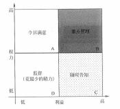

（答案包括但不限于以上内容，列举出其中 4 个小点即可，每小点 2 分，答案类似即可）

#### 【试题四】 ---中级 2018 年下半年案例分析试题

#### 【说明】

A  公司中标某客户数据中心建设项目， 该项目涉及数据中心基础设施、网络、  硬件、软件、 信息安全建设等方面工作。经高层批准，任命小李担任项目经理。小李从 相应的技术服务部门（网 络服务部、硬件服务部、软件服务部、信息安全服务部）分别抽调了技术人员加入该项目。这些 技术人员大部分时间投入本项目，小部分时间参与公司的其它项目。由于公司没有基础设施方面 的技术能力，因此将本项目的基础设 施建设工作外包给了 B  公司。

小李认为，该项目工作内容复杂，涉及人员较多，人员沟通很关键，作为项目经理，自己应投入 较大精力在人员沟通管理上。

首先， 小李经过分析， 建立了干系人名册，主要人员包括客户方的 4  名技术人员、3  名中层 管理人员、  2  名高管和项目团队人员以及 A  公司的 2  名高管。

接着， 小李制定了沟通管理计划。在选择沟通渠道时，考虑到干系人较多， 召开会议不方便， 小李决定采用电子邮件方式：在沟通频率方面， 为了让干系人能及时、 全面地了解项目进展，小 李决定采用项目日报的方式每日沟通：在沟通内容方面，小李制作了项目日报的模板，主要内容 包括三部分 一是项目成员每日主要工作内容汇总： 二是项目的进度、成本、质量等方面的情况、 汇总：三是每日发现的主要问题、工作建议等。

项目实施过程中， 项目成员严格按照要求，每天下班前发送日报给小李。第二天上午 9  点前，小 李汇总所有成员的日报内容， 发送给所有干系人。

随着项目的实施，小李发现 B  公司的技术人员的工作质量经常不能满足要求，工作进度也 有所延迟， 当问及 B  公司的相关负责人时，他们表示对此并不知情。同时， A  公司各技术服务 部门的负责人也抱怨说，他们抽调了大量技术人员参与该项目， 但却 无法掌控他们的工作安排， 也不知道他们的工作绩效。另外， A  公司高层领导也向小李表示，客户管理层对该项目也有些不 满，他们认为每天浪费了大量时间看了一些无用的信息，他们希望小李能当面汇报。

#### 【问题 1】（4 分）

下图为该项目干系人的权力/利益方格示意图：

结合案例中小李制定的干系人名册，请指出该项目需要"重点管理" 的干系人有哪些？ 【问题 2】（4 分）

请指出小李在项目沟通管理和干系人管理方面做的好的地方。

#### 【问题 3】（8  分）

在项目沟通管理和干系人管理方面：

（1）小李的做法还存在哪些问题？

（2）针对存在的问题，请给出你的具体改进建议。

#### 【问题 4】（4 分）

判断下列选项的正误（填写在答题纸的对应栏内，正确的选项填写 "+"，错误的选项填写 "会" ）： 一般沟通过程所采用的方式分为四类：  推销方式（又称说明方式）、叙述方式、讨论方式、征询 方式。

（1）从控制程度来看，讨论方式的控制力最弱。( )

（2）从参与程度来看，推销方式参与程度最弱。( )

（3）沟通渠道的选择可以从即时性和表达方式两个维度进行考虑。表达方式可以 分为文字、语 言、混合三种。与文字方式相比，语言方式更节约时间，因为语言速度。   ( )

（4） 常用的沟通方法有交互式沟通、推式沟通、拉式沟通等。当信息量很大或受众很多时，应 采用拉式沟通方式。   ( )

#### 【参考答案】

#### 【问题 1】

需要重点管理的干系人包括： 客户方的 4 名技术人员、3 名中层管理人员和 A 公司的 2 名高管。

（答案包括但不限于以上内容，列举出其中 4 个小点即可，每小点 1 分）

#### 【问题 2】

（1）小李根据实际情况选择了相应的沟通渠道

（2）制定了相应的沟通模板

（3）严格沟通管理， 保证每天将相关工作内容分发给各干系人

（答案包括但不限于以上内容，列举出其中 3 个小点即可，每小点 1.5 分）

#### 【问题 3】

存在的问题：

（1）沟通管理计划不能只小李一人制定

（2）小李制定的干系人名册没有涉及到 B 公司人员

（3）没有针对不同的干系人提交相应的项目信息

（4）缺乏对项目干系人沟通需求和沟通风格的分析

（5）没有对沟通情况进行记录

（6）控制沟通工作做得不好， 没有对存在的沟通问题及时进行解决

（答案包括但不限于以上内容，列举出其中 5 个小点即可，每小点 1 分）

改进措施：

（1）组织相关干系人一起制定一个详细适合的沟通管理计划

（2）将所有项目干系人都纳入干系人登记册

（3）进行干系人沟通需求和沟通风格的分析， 对不同的干系人要提交不同的项目信息 （4）进行沟通控制工作，通过项目例会等形式对沟通存在的问题及时进行解决。

（答案包括但不限于以上内容，列举出其中 3 个小点即可，每小点 1 分）

#### 【问题 4】（每个 1 分）

（1）V（2） X（3）x（4） V

#### 【江山老师点评】此题很简单，考察的沟通和干系人管理，虽然考的不多，但是此题考的非常简 单，非常灵活，问题 1 可以根据题目找出答案，权利利益方格之前选择题考过好多次，应该比较 简单，问题 2 和问题 3 都可以根据背景找出相应的答案，问题 4 属于选择题考察的重点，在案例 考了，此题如果平时认真学了的，应该至少得 15 分以上

六、风险管理

#### 【试题一】---高级 2009 年下半年案例分析试题

#### 【说明】

某市电力公司准备在其市区及各县实施远程无线抄表系统，代替人工抄表。经过考察，电力 公司指定了国外的 S 公司作为远程无线抄表系统的无线模块提供商，并选定本市 F 智能电气公司 作为项目总包单位，负责购买相应的无线模块，开发与目前电力运营系统的接口，进行全面的项 目管理和系统集成工作。 F 公司的杨经理是该项目的项目经理。

在初步了解用户的需求后，F 公司立即着手系统的开发与集成工作。 5 个月后，整套系统安装 完成，通过初步调试后就交付用户使用。 但从系统运行之日起， 不断有问题暴露， 电力公司要求 F 公司负责解决。可其中很多问题， 比如数据实时采集时间过长、无线传输时数据丢失，甚至有关 技术指标不符合国家电表标准等等， 均涉及到无线模块。于是杨经理同 S 公司联系并要求解决相 关技术问题，而此时 S 公司因内部原因退出中国大陆市场。因此，系统不得不面临改造。

#### 【问题 1】（6 分）

请用 300 字以内文字指出 F 公司在项目执行过程中有何不妥。

#### 【问题 2】（9 分）

风险识别是风险管理的重要活动。请简要说明风险识别的主要内容并指出选用 S 公司无线模 块产品存在哪些风险？

#### 【问题 3】（10 分）

请用 400 字以内文字说明项目经理应采取哪些办法解决上述案例中的问题。

| 参考答案 |
|---|

#### 【问题 1】（6 分）

主要不妥是：

（1） F 公司没有对 S 公司无线模块产品进行充分调研和熟悉， 没有在用户环境中对无线模块进行 充分测试。

（2）没有充分了解用户需求。

（3） F 公司没有实施有效的风险管理。

（答案包括但不限于以上内容，列举出其中 3 个小点即可，每小点 2 分，答案类似即可）

#### 【问题 2】（9 分）

风险识别的主要内容：

（1）识别并确定项目有哪些潜在的风险。

（2）识别引起这些风险的主要因素。

（3）识别项目风险可能引起的后果。

（答案包括但不限于以上内容，列举出其中 3 个小点即可，每小点 1 分，答案类似即可）

存在的风险：

（1） 技术风险。无线模块提供商 S 公司的产品和技术是否满足用户的需求， 能否提供相应的技术 支持以解决出现的问题。

（2）运行风险。 S 公司退出中国大陆市场，甚至可能会倒闭。

（答案包括但不限于以上内容，列举出其中 2 个小点即可，每小点 3 分，答案类似即可）

#### 【问题 3】（10 分）

（1）对原有方案进行充分评估，进行系统改造的可行性分析。

（2）对新采用的无线模块提供商从技术、政策、运行等多方面进行调研和评估。

（3） 与客户充分沟通， 详细了解用户的需求， 特别是重要的技术指标， 对于不能满足的需求或者 技术指标， 向客户详细说明。

（4）在项目进行过程中，将风险管理纳入日常工作，建立风险预警机制。

（答案包括但不限于以上内容，列举出其中 4 个小点即可，每小点 2.5 分，答案类似即可）

#### 【试题二】 ---中级 2010 年下半年案例分析试题

#### 【说明】

某市石油销售公司计划实施全市的加油卡联网收费系统项目。 该石油销售公司选择了系统集 成商 M  作为项目的承包方， M  公司经石油销售公司同意，将系统中加油机具改造控制模块的设 计和生产分包给专业从事自动控制设备生产的 H  公司。 同时， M  公司任命了有过项目管理经验 的小刘作为此项目的项目经理。

小刘经过详细的需求调研，开始着手制定项目计划， 在此过程中，他仔细考虑了项目中可能 遇到的风险，整理出一张风险列表。 经过分析整理， 得到排在前三位的风险如下：

1、项目进度要求严格，现有人员的技能可能无法实现进度要求；

2、现有项目人员中有人员流动的风险；

3、分包商可能不能按期交付机具控制模块，从而造成项目进度延误。

针对发现的风险，小刘在做进度计划的时候特意留出了 20%的提前量， 以防上述风险发生，  并且将风险管理作为一项内容写进了项目管理计划。项目管理计划制定完成后，小刘通知了项目 组成员，召开了第一次项目会议，将任务布置给大家。随后，大家按分配给自己的任务开展了工 作。

第四个月底， 项目经理小刘发现 H  公司尚未生产出联调所需要的机具样品。H  公司于 10  天 后提交了样品， 但在联调测试过程中发现了较多的问题， H  公司不得不多次返工。项目还没有进 入大规模的安装实施阶段， 20%的进度提前量就已经被用掉了，此时，项目一旦发生任何问题就 可能直接影响最终交工日期。

#### 【问题 1】（4  分）

请从整体管理和风险管理的角度指出该项目的管理存在哪些问题。

#### 【问题 2】（3  分）

项目经理小刘为了防范风险发生，预留了 20%的进度提前量，在风险管理中这叫做（1）。

在风险管理的各项活动中， 头脑风暴法可以用来进行（2），风险概率及影响矩阵可用来进行（3）。

#### 【问题 3】（2  分）

针对“项目进度要求严格， 现有人员的技能可能无法实现进度要求”这条风险，请提出你的应对措施。

#### 【问题 4】（6  分）

针对“分包商可能不能按期交付机具控制模块，从而造成项目进度延误”这条风险，结合案 例，分别按避免、转移、减轻和应急响应四种策略提出具体应对措施。

| 参考答案 |
|---|

#### 【问题 1】（4 分）

整体管理方面可能存在的问题：

1、M 公司选择的分包商 H 公司不合适， 或签订的合同有问题。

2、在制定项目计划时，小刘不应独自制定项目计划，而应让大家参与制定。

3、没有进行合同管理，缺乏对分包商合同执行过程的监控，缺乏阶段验收。

风险管理方面可能存在的问题：

1、小刘不能独自识别风险， 应采取访谈、专家判断、头脑风暴、SWOT 分析、检查表、图表技术等 方法，在这个过程让组员参与。

2、20%的预留没有确切的根据， 或者仅预留 20%的提前量来防范进度落后的风险是不够的， 应对已 识别的风险制定可行的应对计划。

3、没有进行风险监控。

（每个点得 1 分，总分不超过 4 分）

#### 【问题 2】（3 分）

1）储备金、或叫预留、或叫应急储备 2）风险识别 3）风险定性分析

（每个空得 1 分，总分 3 分）

#### 【问题 3】（2 分）

一般的风险应对措施有回避、接受、转移和减轻。针对上述风险， 应采取如制定应急计划（如 增加合格人员）主动接受、把部分工作外包给专业公司等风险转移措施、加强对现有人员的培训 等减轻措施。 （2 分）

#### 【问题 4】（6 分）

1、避免。经石油销售公司同意，选用比 H 公司更有实力的分包商；或经石油销售公司同意， 改变原设计方案，不再改造加油机具。

2、转移。请监理，或与 H 公司签订固定总价合同、或让 H 公司签订履约保证书等。

3、减轻。加强对分包商的过程监控、让分包商事先快速制作原型等方法。

4、应急响应。M 公司/分包商请行业高手紧急救火。

（每个点得 2 分，总分不超过 6 分）

#### 【试题三】 ---中级 2018 年上半年案例分析试题

#### 【说明】

某系统集成公司 B 承建了 A 公司的办公自动化系统建设项目， 任命张伟担任项目经理。该项 目所使用的硬件设备（服务器、存储、网络等）和基础软件（操作系统、数据库、中间件等）均 从外部厂商采购，办公自动化应用软件采用公司自主研发的软件产品。采购的设备安装、部署、 调试工作分别由公司硬件服务部、软件服务部、网络服务部完成。由于该项目工期紧，系统相对 比较复杂， 且涉及实施人员较多，张伟认为自己应投入较大精力在风险管理上。

首先， 张伟凭借自身的项目管理经验，对项目可能存在的风险进行了分析，并对风险发生的 可能性进行了排序。排名前三的风险是:

（1）硬件到货延迟；

（2）客户人员不配合；

（3）公司办公自动化软件可能存在较多 bug。

针对上述三项主要风险，张伟制定了相应的应对措施，并且计划每月底对这些措施的实施情 况进行回顾。

项目开始 2 个月后， 张伟对项目进度进行回顾时，发现项目进度延迟，主要原因有两点:

（1）购买的数据库软件与操作系统的版本出现兼容性问题， 团队成员由于技术技能不足无法

解决，后通过协调厂商工程师得以解决，造成项目周期比计划延误一周。

（2）服务器工程师、网络工程师被自己所在的部门经理临时调走支持其他项目， 造成项目周

期延误一周。客户对于项目进度的延误很不满意。

#### 【问题 1】（4 分）

请指出张伟在项目风险管理方面做的好的地方。

#### 【问题 2】（8 分）

张伟在项目风险管理方面还有哪些待改进之处?

#### 【问题 3】（4 分）

如果你是项目经理， 针对本案例已发生的人员方面的风险，给出应对措施。

#### 【问题 4】（4 分）

关于风险管理，判断下列描述是否正确（填写在答题纸的对应栏内，正确的选项填写“V”， 错误的选项填写“x”）:

（1）按照风险性质划分，买卖股票属于纯粹风险。()

（2）按风险产生原因划分，核辐射、空气污染和噪音属于社会风险。()

（3）风险性质会因时空各种因素变化而有所变化， 这反映了风险的偶然性。()

（4）本案例中,针对硬件到货延迟的风险， b 公司与供应商在采购合同中需明确因到货延迟产生的 经济损失由供应商承担,这属于风险转移措施。()

#### 【参考答案】

#### 【问题 1】

1、项目经理风险意识较强，认识到了风险管理的重要性。

2、项目经理对风险进行了识别及排序。

3、制定相应的风险应对措施。

4、对风险实施情况进行了风险控制。

#### 【问题 2】

1、没有制定详细的风险管理计划。

2、风险识别不能仅凭个人经验完成，需与项目组成员一起沟通参与。

3、没有对风险进行相应的量化分析。

4、分析识别颗粒度不够，没有识别出所有风险。

5、风险监控频率过低，发现风险时影响已经非常大。

6、风险应对措施不合理，不全面。

### 7、没有进行风险再识别

#### 【问题 3】

1、与公司高层协商人员安排， 采用加班或赶工形式加快进度。

2、外聘有经验和相关能力的专业技术人员。

3、申请外包部分模块或者借助外力，如采用虚拟团队方式，提升工作效率。

4、调整工作计划，安排现有人员完成相关工作。

#### 【问题 4】

（1）x（2）x（3） x（4） d

#### 【试题四】 ---中级 2019 年上半年案例分析试题

#### 【背景资料】（20 分）

A 公司中标某客户业务系统的运行维护服务项目,服务期从 2018 年 1 月 1 日至 2018 年 12 月 31 日。在服务合同中，A 公司向客户承诺该系统全年的非计划中断时间不超过 20 小时。

1 月初项目经理小贾组织项目相关人员召开项目风险管理会议，从人员、资源、技术、管理、 客户、设备厂商等多方面对项目风险进行识别， 并制定了包含 50 多条风险的《风险清单》小贾按  照风险造成的负面影响程度以高到低对这些风险进行了优先级排序。在讨论风险应对措施时,工程  师小王建议:针对来自项目团队内部的风险,可以制定应对措施;针对来自外部（如客户、设备厂商） 的风险由于超出团队成员的控制范围,不用制定应对措施。小贾接受了建议，针对《风险清单》中  的内部风险制定了应对措施,并将措施的实施责任到人，要求所有的应对措施在 3 月底前实施完毕。

3 月底，小贾通过电话会议的方式了解风险应对措施的执行情况， 相关负责人均表示应对措施 都已实施完成。小贾对大家的工作表示感谢,将<风险清单冲所有风险进行了关闭，并宣布风险管 理正作结束。

5  月初， 客户想用国外某厂商研发的新型网络设备替换原有的国产网络设备,并征询小贾的建 议。小贾认为新产品一般会采用最先进的技术,设备的稳定性和性能相比原来设备应该会有较大提 升，强烈建议客户尽快替换。

6 月初， 由于产品 bug  以及与主机、存储设备兼容性问题,新上线网络设备接连发生了五次故 障。每次发生故障时,小贾第一时间安排人员维修,但故障复杂， 加上工程师对新设备操作不熟练， 每次维修花费时间较长， 5 次维修造成的系统中断时间超过了 20 小时，客户对此非常不满意。

#### 【问题 1】（10 分）

结合以上案例，请指出 A 公司在项目风险管理中存在的问题?

#### 【问题 2】（4 分）

如果你是该项目的项目经理,针对新设备上线的风险， 你有什么应对措施?

#### 【问题 3】（6 分）

结合本案例，判断选项的正误（正确的填写“小”错误的填写“X”）

1.定量风险分析是评估并综合分析风险的概率和影响，对风险进行优先排序,从而为后续分析或行 动提供基础的过程。()

2.在没有足够的数据建立模型的时候， 定量风险分析可能无法实施.  ()

3.风险再评估指的是检查并记录风险应对措施在处理已识别风险及其根源方面的有效性, 以及风险 管理过程的有效性。()

4.在股票市场买卖股票属于纯粹风险。()

5.如果风险管理所花费的成本超过所管理的风险事件的预期货币价值， 则可以考虑任其发生，不进 行管理。()

6.风险的后果会因时空变化而有所变化，这反映了风险的偶然性。()

#### 【参考答案】

#### 【问题 1】（10 分）

A 公司在项目风险管理中存在的问题：

（1）未做好规划风险管理工作，没有编制风险管理计划。

（2） 识别风险工作不全面，风险识别工作包括识别负面的威胁和积极的机会， 如采用先进技术可 能就是机会。

（3） 实施风险定性分析存在问题， 应按概率和影响两个方面来评估风险的优先级，而不是仅凭影 响程度。

（4）未考虑定量风险分析过程，可根据要求对重要并可量化的风险进行量化分析。

（5）规划风险应对时，仅对内部风险进行了应对， 未对外部风险制定应对措施。

（6）风险的管理和控制应贯穿项目整个过程， 而不是项目还没完成就宣布风险管理工作结束。

（7） 控制风险管理未做好，应定期反复进行风险再评估、再识别和分析，查看风险应对措施是否 有效，是否产生新的风险。

（8）应进行风险审计工作，检查并记录风险应对措施在处理已识别风险及其根源方面的有效性， 以及风险管理过程的有效性。

（9） 替换原有国产网络设备时， 应充分评估各方面的机会和威胁，并邀请各相关方进行技术等方 面的综合论证，  而不是小贾一人来决定或建议。

（10）控制风险中没有做好技术绩效测量工作， 及时进行评审和绩效对比，及时纠偏。

（11）未制定好风险应急应对策略，对突发事项等未提前制定相应的应急计划及弹回计划。

#### 【问题 2】（4 分）

针对新设备上线的风险，项目经理的应对措施：

（1）充分论证新设备上线的可行性，邀请相关方专家进行论证和评估；

（2）将新设备在实验环境进行测试，确保兼容性、稳定性等没有问题；

（3）聘请熟悉该新设备的人员，以及对相关人员进行培训；

（4）制定新老设备转换策略， 比如可以并行运行一段时间；

（5）制定应急策略， 新设备出现问题后及时调整为老设备。

#### 【问题 3】（6 分）

（1）x（2）小（3） x（4） x（5）小（6） x

#### 【试题五】 ---中级 2019 年下半年案例分析试题

#### 【说明】（17 分）

系统集成 A 公司中标某市智能交通系统建设项目。李总负责此项目的启动工作，任命小王为 项目经理。小王制定并发布了项目章程，其中明确建设周期为 1 年，于 2018 年 6 月开始。

项目启动后，小王将团队分为了开发实施组与质量控制组，分工制定了范围管理计划、进度 管理计划与质量管理计划。

为了与客户保持良好沟通，并保证项目按要求尽快完成，小王带领开发团队进驻甲方现场开 发。小王与客户经过几次会议沟通后，根据自己的经验形成一份需求文件。然后安排开发人员先 按照这份文档来展开工作，具体需求细节后续再完善。

开发过程中，客户不断提出新的需求，小王一遍修改需求文件一遍安排开发人员进行修改， 开发工作多次反复。 2019 年 2 月， 开发工作只完成了计划的 50%，此时小王安排项目质量工程师 进驻现场，发现很多质量问题。小王随即组织开发人员加班修改。由于项目组及格同事还承担其 他项目的工作，工作时间没法得到保障，项目实施进度严重滞后。

小王将项目进展情况向李总进行了汇报，李总对项目现状不满意，抽调公司两名有多年项目 实施经验的员工到现场支援。经过努力项目最终还是延期四个月才完成。小王认为项目延期与客

户有一定关系，与客户发生了争执，导致项目至今无法验收。

#### 【问题 1】（7 分）

结合案例， 从项目管理角度， 简要分析项目所存在的问题。

#### 【问题 2】（6 分）

结合案例， 判断下列选项的正误（填写在答题纸对应栏内， 正确的选项填写“V”，错误的选项填写 “根”）

（1）制定项目管理计划采用从上到下的方法， 先制定总体项目管理计划，再分析形成其他质量、 进度等分项计划。()

（2）项目启动阶段不需要进行风险识别。()

（3）整体变更控制的依据有项目管理计划、工作绩效报告、变更请求和组织过程资产。() （4）项目收尾的成果包括最终产品、服务或成果移交。()

（5）项目管理计划随着项目进展而逐渐明细。()

（6）项目执行过程中，先执行范围、进度、成本等其他过程管理， 然后项目整体管理汇总其他知 识领域的执行情况再进行整体协调管理。

#### 【问题 3】（4 分）

请简要叙述项目整体管理中监控项目工作的输出。

江山老师参考答案：

#### 【问题 1】（7 分）

（1）项目章程应该公司管理层组织制定发布，而不是小王制定发布

（2）项目计划制定不完善，缺少成本管理计划等

（3）计划没有经过评审

（4） 范围管理存在问题， 需求文件只是根据自己的经验形成， 而没有与各干系人讨论并经过评审 （5）对客户提出新的需求没有按变更流程处理

（6） 质量管理存在问题， 在完成计划的 50%才安排项目质量工程师进驻现场， 导致前期质量问题 没有发现

（7）进度管理存在问题，导致进度滞后

（8）沟通管理存在问题，导致与客户发生了争执

（9）进度管理存在问题，进度滞后，管理失控；

#### 【问题 2】（6 分）

（1）x（2）x（3）d（4）x（5）d（6） x

#### 【问题 3】（4 分）

（1）变更请求（2）工作绩效报告（3）项目管理计划更新（4）项目文件更新

七、合同管理

#### 【试题一】---高级 2005 年上半年案例分析试题

阅读以下叙述， 从合同管理、过程控制、项目沟通管理的角度，回答问题 1 至问题 3。

#### 【说明】

假设某项目的主要工作已经基本完成，经核对项目的“未完成任务清单”后，终于可以提交 客户方代表老刘验收了。在验收过程中，老刘提出了一些小问题。项目经理张減带领团队很快妥 善解决了这些问题。但是随着时间的推移，客户的问题似乎不断。时间已经超过了系统试用期，	 但是客户仍然提出一些小问题， 而有些问题都是客户方曾经提出过， 并实际上已经解决了的问题。 时间一天一天的过去，张減不知道什么时候项目才能验收，才能结项，才能得到最后一批款项。

#### 【问题 1】（9 分）

请用 200 字左右的文字， 分析发生这件事情可能的原因？

#### 【问题 2】（7 分）

请用 200 字以内的文字， 说明现在张減应该怎么办？

#### 【问题 3】（9 分）

请用 200 字以内的文字，说明应当吸取的经验和教训？

| 参考答案 |
|---|

#### 【问题 1】（9 分）

（1）合同中缺乏以下内容:

> 项目目标中关于产品功能和交付物组成的清晰描述。

> 项目验收标准、验收步骤和方法（或流程）。

> 对客户的售后服务承诺。

（2）项目实施过程控制中出现的问题:

> 在项目实施过程中没有及时将项目绩效报告递交给客户，因此客户对项目进展和质 量状况不了解。

> 没有让客户及时对阶段成果签字确认。

（3）由于没有售后服务的承诺，客户担心没有后续服务保证。

（4）合作氛围不良，客户存在某种程度的抵触情绪， 双方缺乏信任感， 客户对项目质量信心 不足，怕承担责任， 因此不愿签字。

（答案包括但不限于以上内容，列举出其中 6 个小点即可，每小点 1.5 分，答案类似即可）

#### 【问题 2】（7 分）

根据项目现状， 需要采取补救措施，加强沟通以解决问题。

（1）就项目验收标准和客户达成共识，确定哪些主要工作完成即可通过验收。

（2）就项目验收步骤和方法与客户达成共识。

（3）就项目已经完成的程度让用户确认。例如出具系统试用报告， 请客户签字确认。 （4）向客户提出明确的服务承诺， 使客户没有后顾之忧。

（答案包括但不限于以上内容，列举出其中 4 个小点即可，每小点 2 分，答案类似即可）

#### 【问题 3】（9 分）

（1） 项目合同中要规定项目成果的正式验收标准、验收步骤、验收流程和运营维护服务承诺 等内容。

（2）加强项目执行过程中的控制。

> 加强变更控制。包括制定变更控制流程，按流程进行变更的评估、审核、实施、记录、 确认等工作。

> 加强项目沟通管理。包括及时向客户提供项目绩效报告， 让客户了解项目进展；设置对阶 段性成果的验收， 并让客户对阶段性成果进行签字确认；项目文档要齐全， 使项目进展有 据可查。

> 加强计划执行的控制。制订详尽的项目管理计划（包括进度管理计划、成本管理计划等 各分项计划），按计划实施和检查。

（3）项目经理还应注重跟客户相处的技巧，努力促成双方的良好合作氛围。

（答案包括但不限于以上内容，列举出其中 5 个小点即可，每小点 2 分，答案类似即可）

#### 【试题二】 ---中级 2009 年上半年案例分析试题

#### 【说明】

H 公司是一家专门从事 ERP 系统研发和实施的 IT 企业， 目前该公司正在进行的一个项目是为 某大型生产单位（甲方）研发 ERP 系统。

H  公司同甲方关系比较密切，但也正因为如此。合同签得较为简单，项目执行较为随意。同 时甲方组织架构较为复杂，项目需求来源多样而且经常发生变化，项目范围和进度经常要进行临 时调整。

经过项目组的艰苦努力，系统总算能够进入试运行阶段，但是由于各种因素，甲方并不太愿

意进行正式验收，至今项目也未能结项。

#### 【问题 1】（6 分）

请从项目管理角度，简要分析该项目“未能结项”的可能原因。

#### 【问题 2】（5 分）

针对该项目现状，请简要说明为了促使该项目进行验收，可采取哪些措施。 【问题 3】（4 分）

为了避免以后出现类似情况， 请简要叙述公司应采取哪些有效的管理手段。

#### 【问题 1】（6 分）

1.对项目的风险认识不足：

2.合同中可能未对工期、质量和项目目标等关键问题进行约束；

3.未能进行有效的需求调研或需求分析不全面；

4.未能进行有效的项目（整体）变更控制：

5.项目执行过程中未能进行及时有效的沟通（或建立有效的沟通机制）。

（每个点 2 分，总分不超过 6 分）

#### 【问题 2】（5 分）

1.请求公司的管理层出面去与甲方协调；

2.重新确认需求并获得各方认可：

3.和甲方明确合同以及双方确认的补充协议等，包括修改后的范围、进度和质量方面的文件 等，作为验收标准；

4.准备好相应的项。目结项文档，向甲方提交。

（每个点 2 分，总分不超过 5 分）

#### 【问题 3】（4 分）

1.要在合同评审阶段参与评审，在合同中明确相应的项目目标和进度：

2.需求调查和需求变更要有清楚的文档和会议纪要；

3.及时与甲方进行沟通， 必要时请求公司管理层的支援；

4.阶段验收前， 文档要齐全，阶段目标要保证实现，后期目标调整要有承诺； 5.引入监理机制；

6.做好有效的变更控制。

（每个点 1 分，总分不超过 4 分）

#### 【试题三】 ---中级 2009 年下半年案例分析试题

#### 【说明】

系统集成公司 A 于 2009 年 1 月中标某市政府 B 部门的信息系统集成项目。 经过合同谈判，  双方签订了建设合同， 合同总金额 1150 万元， 建设内容包括搭建政府办公网络平台， 改造中心机

房’并采购所需的软硬件设备。

A 公司为了把项目做好’将中心机房的电力改造工程分包给专业施工单位 C 公司’并与其签 订分包合同。

在项目实施了 2 个星期后’由于政府 B 部门为了更好满足业务需求’决定将一个机房分拆为 两个’因此需要增加部分网络交换设备。B 参照原合同’委托 A 公司采购相同型号的网络交换设 备’金额为 127 万元’双方签订了补充协议。

在机房电力改造施工过程中’由于 C 公司工作人员的失误’造成部分电力设备损毁’导致政 府 B 部门两天无法正常办公’严重损害了政府 B 部门的社会形象’因此 B 部门就此施工事故向 A

公司提出索赔。

#### 【问题 1】（4 分）

请指出 A 公司与政府 B 部门签订的补充协议有何不妥之处’并说明理由。 【问题 2】（6 分）

请简要叙述合同的索赔流程。

#### 【问题 3】（5 分）

请简要说明针对政府 B 部门向 A 公司提出的索赔’A 公司虚如何处理。

| 参考答案 |
|---|

#### 【问题 1】（4 分）

不妥之处为补充协议的合同金额超过了原合同总金额的 10%。（1 分）

根据 《中华人民共和国政府采购法》，（1 分）政府采购合同履行中， 采购人需追加与合同标的 相同的货物、工程或者服务的（1 分），在不改变合同其他条款的前提下， 可以与供应商协商签订

补充合同， 但所有补充合同的采购金额不得超过原合同采购金额的 10%。（1 分）  【问题 2】（6 分）

（1） 提出索赔要求；（2）提交索赔资料（3） 索赔答复；（4）索赔认可；（5）捉交索赔报告。 或：（4）索赔分歧；   （5）提请仲裁， 或者提起诉讼。

（每个点 1 分，总分不超过 6 分）

#### 【问题 3】（5 分）

A 公司在接到政府 B 部门的索赔要求及索赔材料后，应根据 A 公司与政府 B 部门签订的合同， 进行认真分析和评估，给出索赔答复。（2 分）

在双方对索赔认可达成一致的基础上，向政府 B 部门进行赔付；如双方不能协商一致， 按照 合同约定进行仲裁或诉讼。（2 分）

同时 A 公司依据与 C 公司签订的合同， 向 C 公司提出索赔要求。（2 分）

#### 【试题四】 ---中级 2010 年上半年案例分析试题

#### 【说明】

某网络建设项目在商务谈判阶段’建设方和承建方鉴于以前有过合作经历’并且在合同谈判 阶段双方都认为理解了对方的意图’因此签订的合同只简单规定了项目建设内容、项目金额、付 款方式和交工时间。

在实施过程中，建设方提出一些新需求，对原有需求也做了一定的更改。承建方项目组经评 估认为新需求可能会导致工期延迟和项目成本大幅增加，因此拒绝了建设方的要求，并让此项目 的销售人员通知建设方。当销售人员告知建设方不能变更时，建设方对此非常不满意，认为承建 方没有认真履行合同。

在初步验收时，建设方提出了很多问题，甚至将曾被拒绝的需求变更重新提出，双方交涉陷 入僵局。建设方一直没有在验收清单上签字，最终导致项目进度延误，而建设方以未按时交工为 由，要求承建方进行赔偿。

#### 【问题 1】（7 分）

将以下空白处填写的恰当的内容，写入答题纸的对应栏内。

（1）在该项目实施过程中        、       与       工作没有做好。

①沟通管理    ②配置管理  ③质量管理④范围管理  ⑤绩效管理    ⑥风险管理

（2）从合同管理角度分析可能导致不能验收的原因是：        、-    、    的相关内容。

（3）对于建设方提出的新需求，项目组应     ，以便双方更好地履行合同。 【问题 2】（4 分）

将以下空白处应填写恰当的内容，写入答题纸的对应栏内。

从合同变更管理的角度来看， 项目经理应当遵循的原则和方法如下：

（1）合同变更的处理原则是        。

（2）变更合同价款应按下列方法进行：

①首先确定       ，然后确定变更合同价款。

②若合同中已有适用于项目变更的价格，则按合同已有的价格变更合同价款。

（3）若合同中只有类似于项目的变更价格，则可以参照类似价格变更合同价款。

④若合同中没有适用或类似项目变更的价格， 则由     提出适当的变更价格，经    确认后执 行。

#### 【问题 3】（4 分）

为了使项目通过验收，请简要叙述作为承建方的项目经理，应该如何处理。

| 参考答案 |
|---|

#### 【问题 1】（7 分）

（1）①沟通管理④范围管理⑥风险管理（回答编号或术语都可以，顺序不限）

（2） 项目范围（或需求）、验收标准（或验收步骤、或验收方法）、违约责任及判定（顺序不限） （3）与建设方正式协商（或沟通） 后， 就项目的后续执行达成一致（只要答出沟通和协商即可得分）

（每空 1 分，总分 7 分）

#### 【问题 2】（4 分）

（1）公平合理

（2）①合同变更量清单（或合同变更范围、合同变更内容）

④承包人（或承建单位）、监理工程师（或业主，或建设单位）

（每空 1 分，总分 4 分）

#### 【问题 3】（4 分）

1.对双方的需求（项目范围）做一次全面的沟通和说明，达成一致，并记录下来，请建设方签字确认。 2.就完成的工作与建设方沟通确认，并请建设方签字。

3.就待完成的工作列出清单，以便完成时请建设方确认。

4.就合同中的验收标准、步骤和方法与建设方协商一致。

5.必要时可签署一份售后服务承诺书，将此项目周期内无法完成的任务做一个备忘，承诺在 后续的服务期内完成，先保证项目能按时验收。

6.对于建设方提出的新需求，可与建设方协商进行合同变更，或签订补充合同。

（每空 1 分，总分不超过 4 分）

#### 【试题五】 ---中级 2012 年上半年案例分析试题

#### 【说明】

某信息系统集成企业随着规模的扩大，决定委派小王专门对合同进行管理，其职责主要是分 析和审核各项目合同，以防止潜在的合同风险。 小王上任后，根据一般原则梳理了合同管理的主 要内容，在此基础上制定了公司的合同管理制度，并将该制度分发给各项目组和职能部门。同时 将自己的职责主要确定为对所有项目合同进行分析和审核，降低项目的合同风险。

#### 【问题 1】（3 分）

请简要说明小王制定的合同管理制度主要应涉及哪些方面的管理。

#### 【问题 2】（6 分）

任何合同都不可能穷尽合同规范中的所有细节， 因此合同分析就成了合同管理的一个重要环 节。请指出小王进行合同分析时应重点关注的内容。

#### 【问题 3】（6 分）

结合本案例，判断下列选项的正误（填写在答题纸对应栏内，正确选项写“Y”，错误选项项 写“X”）:

（1）合同索赔的内容包括：根据权利提出的要求；索赔款项；根据权利而提出法律上的要求。（Y    ） （2）合同档案的管理，也即合同文件管理，是整个合同管理的基础。（ Y   ）

（3）合同监督就是对合同条款经常与实际实施情况进行比对， 以便根据合同来掌握项目的进展， 以保证设计、开发、实施的精确性，并符合合同要求。X

（4）对项目质量、数量、内容等方面做出的微小变动，由于对项目影响不大，因此不需要报建设 单位批准， 只需要现场监理师审核通过即可。 X

解析：变更必须根据合同的相关条款适当地加以处理

“不需要报建设单位批准 ” 是错的

（5）项目的合同控制指为保证合同所规定的各项义务的全面完成，以及合同分析的结果为基准， 对整个合同实施过程进行全面监控、检查、对比、引导及纠正的管理活动。合同所规定的各项权 利不包括在其中。 X

解析：前半句是对的

合同管理中的合同履行管理的方式—---合同控制

指企业的合同管理组织为保证合同所约定的各项义务的全面完成及各项权利的实现，以及合同分

析的结果为基准，对整个合同实施过程进行全面监控、检查、对比、引导及纠正的管理活动。 合同所规定的各项权利不包括在其中----应该包括在其中！！！

（6）反索赔是指承建单位向建设单位提出的索赔。 X

解析： 教材 378 建设单位对于属于承建单位应承担责任造成的， 且实际发生了的损失，向承建 单位要求赔偿，称为反索赔

| 参考答案 |
|---|

#### 【问题 1】（3 分）

参考教材（373~374）合同管理主要包括:1.合同签订管理、 2.合同履行管理（广义合同没有此项） 3.合同变更管理 4.合同档案管理

此题目 3 分，应该是签订管理、变更管理、档案管理

#### 【问题 2】（6 分）

合同分析首先应该保证合同的内容----此部分参考教材（367~368）

合同内容包括：

①合同的法律基础

②当事人各自权利、义务（或承建方的任务、建设方的责任）

③项目费用（或合同价格）及工程款的支付方式

④项目工期（包括建设提交有关基础资料的期限，承建方提交阶段性及最终成果的期限等） ⑤项目质量要求

⑥验收标准、验收时间、移交及保修条款

⑦项目变更约定

⑧违约责任

⑨索赔程序和争议解决

⑩当事人之间的其他协作条件等

（答案包括但不限于以上内容，列举出其中 6 个小点即可，每小点 1 分，答案类似即可）

#### 【问题 3】（6 分）

（1）V  ② V  （3）V  ④ X  （5）X  （6）X  （每空 1 分）

#### 【试题六】 ---中级 2012 年下半年案例分析试题

#### 【说明】

系统集成商 A 与生产型企业 B 签订了一份企业 MIS（管理信息系统） 开发合同，合同已执行 到设计和开发阶段， 由于企业 B 内部组织结构调整， 可能会影响核心业务的流程。集成商 A 提出 建议，合同暂停执行至新的组织机构确定之后，双方经过会议协商和沟通，同意上述建议，后续 工作再另行协商确定。

6 各月后，企业 B 组织结构基本确定，要求继续执行合同， 并表示可将工期延后 6 个月。但 集成商 A 原来参与项目的部分人员离职， 新的项目组成员对该项目部熟悉，通过仔细阅读原来的 需求文件还是无法理解 MIS 系统的需求。同时， 由于企业 B 组织结构的调整导致原需求发生了较 大变化，因此不得不重新进所有的需求调研。

项目继续开展了 1 个月后， 集成商 A 提出需要增加合同费用，理由是新的需求导致工作量增 加， 软件系统需要重新开发。但企业 B 认为需求变更是正常的， 集成商 A 之所以工作量增加也是 由于原来的项目文档保留不完整，并且人员更换等原因造成的。双方未就合同变更达成一致，陷 入僵局。随后，企业 B 考虑是否使用法律手段来解决纠纷，但发现整个合同执行过程的备忘录和 会议记录都没有，无法提出直接的证据材料。

#### 【问题 1】（4）分

请结合案例分析在合同管理和文档管理过程中集成商 S 和企业 B 共同存在的问题。 【问题 2】（8 分）

请结合案例分析集成商 A 在项目管理方面存在的问题。

#### 【问题 3】（4 分）

结合案例简要叙述为使项目继续执行双方应该做的工作。

#### 【问题 4】（4 分）

从候选答案中选择 2 各正确选项（多选该提得 0 分），将选项编号填入答题纸对应栏内。 合同法规定的违约责任承担方式不包括（）。

A.不予承认  B.继续履行  C.采取补救措施   D.赔偿  E.支付违约金   F.终止

| 参考答案 |
|---|

#### 【问题 1】（4）分

存在的问题：

### 1、合同中缺少必要的项目需求描述及违约责任约定

2、合同执行过程中没有做好记录保存工作（或合同档案管理不规范）

3、缺少事先约定的合同变更流程。

（每项 2 分，最多 4 分）

#### 【问题 2】（8 分）

存在的问题：

1、为项目制定的原需求文件不够清晰或完整（或范围管理没有做好）

2、对人员流动给项目带来的风险，缺乏充分的分析和合理有效的应对措施

3、没有充分估计项目变更带来的影响（或变更管理没有做好）

### 4、与企业 B 的沟通管理没有做好或存在问题

（每项 2 分，共 8 分）

#### 【问题 3】（4 分）

要做的工作：

1、确定一个变更控制委员会， 确定合同变更流程

2、对于需求变更带来的影响进行合理的评估， 形成新的需求文件

### 3、双方协商对合同内容进行变更提交变更控制委员会批准

4、加强沟通， 双方各自作出一定的让步（或考虑再延长一定时间的工期，或补偿合理的项目费用

### 5、集成商 A 要加强人员组织管理和团队建设

（每项 1 分，最多 4 分）

#### 【问题 4】（4 分）

A  F （每选对一个得 2 分，多选该题得。分）

#### 【试题七】 ---中级 2013 年下半年案例分析试题

阅读下列说明，回答问题 1 到问题 3，将解答填入答题纸的对应栏内。

信息系统集成项目合同书的截取部分， 合同书部分条款如下：

一、合同书

### 1、项目概况

该项目主要任务是数据中心建设，其中包括整栋大楼的综合布线和数据中心使用支撑平台开 发部分内容。

### 2、项目范围

合同中约定全部内容

### 3、合同工期

2012 年 2 月 21  日~2012 年 9 月 30  日

### 4、合同价款和付款方式

本项目采用总价合同，合同总价为贰伯万元人民币；并按照工程量逐段验收付款；工程竣工 时支付全部合同价款。

### 5、质量标准

由于本工作的质量标准不好衡量， 因此质量标准要求达到承建方最优质标准。  	6、维护和保修

承建方在该项目设计规定的使用年限内承担全部保修责任。

### 7、变更条款

项目所涉及的变更由双方协商解决。

二、其它补充条款

1 、承建方在施工前不允许将工程分包，只可以转包。

2、建设方不负责提供大楼布线工程的相关资料。

3、承建方应该按照项目经理批准的施工内容组织设计和施工。

4、设计质量标准的变更由承建方自行确定。

5、合同变更时， 按有关程序确定变更工程价款。

#### 【问题 1】（10 分）

该工程的“合同书”中有哪些不妥之处，请支出并修改。

#### 【问题 2】（6 分）

该工程的“其它补充条款”中有哪些不妥之处， 请指出并修改。

#### 【问题 3】（4 分）

该工程按照 WBS 进行进度估算， 所需工期为 212 天，你认为该工期的合同的实际工期为多少天？

| 参考答案 |
|---|

#### 【问题 1】

答：该工程的合同书不妥之处如下：

（1）项目的范围没有明确的约定，应当明确约定项目范围。

（2）甲方乙方对工程验收标准（工程质量）没有统一的标准， 应当明确相关验收标准。

（3） 合同中对项目的维护和保养责任约定不明确， 应当明确约定项目的维护责任、期限及相关费 用的支付方式。

（4）合同中对于违约责任和处罚约定不明确， 应当明确约定违约责任和处罚方式。 （5）合同中对合同履行地没有详细的约定，应当明确约定合同履行地。

（6）合同中对付款方式没有明确的约定，应当明确付款方式。

（7）合同中关于变更和索赔条款约定不明确， 应当明确给定变更方式和索赔条款。

（答案包括但不限于以上内容，列举出其中 5 个小点即可，每小点 2 分，答案类似即可）

【问题 2

#### 【试题八】 ---中级 2014 年上半年案例分析试题

#### 【说明】

#### 【问题 1】（5  分）

该项目集成商是否可向业主提出补偿关税的要求？如果补偿，是否受合同规定的索赔有效期 的限制？在此过程中，项目集成商是否违约？

#### 【问题 2】（10  分）

简述合同管理的主要内容。并分析说明案例中是哪些环节出现了问题。

#### 【问题 3】（2  分）

根据本案例，项目集成商在合同管理中没有利用好哪些工具和技术。

| 参考答案 |
|---|

#### 【问题 1】

该项目集成商是否可向业主提出补偿关税的要求？如果补偿，是否受合同规定的索赔有效期 的限制？在这些过程中，项目集成商是否违约？

答：1、可以向业主提出补偿关税；

2、分 2 种情况：①.承包商在 30 天内先垫支了关税，应补偿；

②.如果业主拖延海关放行手续超过 30 天，造成现场待料停工， 属于 业主违约，并造成承包商工期或费用损失，则承包商可将它作为索赔依据，在合同规定的索赔有 效期内提出工期和费用索赔， 此时的索赔受合同规定有效期限制；

3、集成商不违约，虽然集成商预先支付了关税，但还是做了自己不该做的事， 但还是有 义务和责任降低项目损失。

#### 【问题 2】

出现的问题有：1、合同条款不详尽，签订草率；

2、缺少违约责任相关条款；

3、缺少变更处理及索赔相关条款；

实施变更；

#### 【问你 3】

#### 【试题九】 ---中级 2015 年上半年案例分析试题

#### 【说明】

2013 年 3 月，A 公司已经完成了数据库系统软件的开发， 并且将这些功能部署在了 5 个网点， 但是比原计划滞后了差不多二个月。在项目执行的过程中， A  公司发现该市银行各网点所用的系 统并不完全相同， 而且对数据库的个性化需求也有区别， 如郊区网点的业务需求与市区网点不同。 在签订合同时由于对这些因素估计不足，迫使原定的项目计划不断进行调整，项目预算也已经超 支。

2013 年 4 月银行方面以 A 公司项目进度缓慢， 质量不能满足要求， 并且对 5 个已上线网点的 运维服务支持不足为由，另外找到了一个信息系统集成公司 B（以下简称 B 公司） 接替 A 公司继

续做剩余工作。此时 A 公司也感觉前期准备不足， 很难按照合同要求做好项目，因此同意将项目 整体移交给 B 公司但是要求银行必须支付前期建设的费用。由于合同中对相关的工作量缺乏定量 的描述条款，合同的价格很难确定，双方陷入僵持之中。尤其是有一批 A 公司为了项目购买了服 务器已经经过了银行的验收，银行希望 A 公司先移交服务器， 然后再谈应付款项，但是 A 公司坚 持要银行先付款，然后再移交服务器。银行甚至准备重新购买一批服务器，放弃已经经过验收的 A 公司服务器，让 B 公司重新进行该项目。

#### 【问题 1】（10 分）

A 公司在合同签订过程中应约定哪些内容，以避免提干描述问题或类似问题的出现？ 【问题 2】（5 分）

在 A 公司同意的情况下，项目是否可以转交给 B 公司？为什么？

#### 【问题 3】（2 分）

请问 A 公司先要银行付款再交付服务器是否恰当？

#### 【问题 4】（3 分）

银行放弃已经通过验收的服务器，让 B 公司重新开始该项目的活动是否合适？应该怎么处理？

#### 【问题 1-参考答案】：

合同应约定内容：

1.项目范围，功能需求，性能需求（软件）。

2.产品型号，技术指标，性能要求（硬件）。

3.项目工期。

4.支付工程进度款的方式、数额及时间。

5.超出约定内容、范围的调整方法，调整因素、程序及支付时间。

6.工程质量保证金的数额，扣留方式及时间。

7.产品质量要求及验收流程、验收标准。

8.售后服务承诺及服务期满的收费标准。

9.违约责任以及发生争执的解决方式、受理法院。

#### 【问题 2-参考答案】：

可以。这是合同法规定的。当事一方经对方同意可以将自己在合同中的权利和义务一并转让给第 三方。在处理好前期遗留问题的前提下，A 公司同意，可以转交给 B 公司。因为，在合同双方协调 一致的前提下，合同可以提前终止。

#### 【问题 3-参考答案】：

不恰当。A 公司应当先将服务器移交给银行，再要求银行支付价款。

#### 【问题 4-参考答案】：

不合适。应该先通知 A 公司寻求解决方案、如果没有好的方案， 可以申请仲裁。因为银行已经对 该批服务器进行验收，表示已经认可， 应该与 A 协商移交及付款问题，接受该批服务器，让 B 公 司继续将服务器用于该项目。

#### 【试题十】 ---中级 2015 年下半年案例分析试题

阅读下列说明，回答问题 1 至问题 4，将解答填入答题纸的对应栏内。

#### 【说明】

在某市的政府采购中，无忧考培系统集成公司甲中标了市政府部门乙的信息化项目。经过合 同谈判， 双方签订了建设合同，合同总金额为 1150 万元， 建设内容包括： 搭建政府办公网络平台， 改造中心机房，并采购所需的软硬件设备。

甲公司为了更好地履行合同要求，将中心机房的电力改造工程分包给专业施工单位丙公司， 并与其签订分包合同。

在项目实施了 2 个星期后， 由于政府部门乙提出了新的业务需求，决定将一个机房分拆为两 个， 因此需要增加部分网络交换设备。乙参照原合同，委托甲公司采购相同型号的网络交换设备， 金额为 127 万元，双方签订了补充协议。

在机房电力改造施工过程中，由于丙公司工作人员的失误，造成部分电力设备损毁，导致政 府部门乙两天无法正常办公，严重损害了政府部门乙的社会形象，因此部门乙就此施工事故向甲 公司提出索赔。

#### 【问题 1】（2 分）

案例中，政府部门乙向甲公司提出索赔。索赔是合同管理的重要环节，按照我国建设部、财政部 下达的通用条款，以下哪项不属于索赔事件处理的原则？（从修行答案中选择一个正确选顶，将 该选项编号填入答题纸对应栏内）

候选答案： A.索赔必须以合同为依据     B.索赔必须以双方协商为基础

C.及时、合理地处理索赔     D.加强索赔的前瞻性

#### 【问题 2】（8 分）

请指出甲公司与政府部门乙签订的补充协议是否有不妥之处？如有，请指出并说明依据。 【问题 3】（5 分）

请简要叙述合同索赔流程。

#### 【问题 4】（5 分）

案例中，甲公司将中心机房的电力改造分包给专业施工单位丙公司，并与其签证分包台同，请问 甲公司与丙公司签订分包合同是否合理？为什么？

#### 【问题 1  参考答案】（2 分） B

分析：处理索赔实践中依据以下原则：1、索赔必须以合同为依据。2、必须注意资料的积累。3、 及时、合理地处理索赔。4、加强索赔的前瞻性，有效地避免过多索赔事件的发生。

#### 【问题 2  参考答案】（8 分）

有不妥之处（2 分）。

增加的设备以甲乙双方参加原合同签订补充协议的形式采购不妥。（2 分）

依据：《中华人民共和国政府采购法》第三十一条规定，为保证原有采购项目一致性或者服务配套 的要求， 需要继续从原供应商处添购，明确添购资金总额不超过原合同采购金额 10%的可以按照本 法采用单一源方式采购。而 127 大于 115（1150*10%），

因此已部门依法需要对增补的设备必须重新招标采购。（4 分）

#### 【问题 3  参考答案】（5 分）

索赔的基本程序及其规定

1、索赔事件发生后在合同规定想期限内，向工程师发出索赔要求。

2、发生索赔意向通知后在合同规定的期限内，向监理工程师提出补偿经济损失和（或）延工期的 索赔报告及有关资料。

3、监理工程师在收到承包商送交的索赔报告和有关资料后，于合同规定的期限内给予审核。 4、监理工程师答复或者逾期未答复。

5、索赔认可。6、持续索赔。7、仲裁与诉讼。8、提交最终索赔报告。

（备注：每项 1 分， 最多 5 分）

#### 【问题 4   参考答案】（5 分）

合理（2 分）

因为中心机房电力改造不属于主体业务，可以分包。同时分包给专业施工单位，可以提高效率， 节约成本， 提高质量。（3 分）

#### 【试题十一】---中级 2016 年上半年案例分析试题

某信息系统集成企业承担了甲方的信息系统集成项目，在项目的采购过程中，某项采购合同 是在甲方的授意下签订的。然而在项目进展过程中， 项目经理发现该采购产品高于市场价格，而 且有些性能指标也没有能够完全满足合同规定的要求。当项目经理发现此类问题进行调查时，发 现该供应商的资质和声誉都存在问题，并且就在不久前已经被其他公司并购，最麻烦的是合同的 付款条件是提前支付相关款项，合同的大部分采购款已经支付。

在项目的中期验收中，甲方发现了部分采购产品存在的问题，并要求项目组进行返工和更换 相关产品。项目经理财以采购供应商是由甲方推荐为由，拒绝进行返工和更换。而甲方则认为， 项目合同里面并没有规定甲方承担采购的责任，甲方只是为项目组推荐了部分供应商，采购与否 还是由项目组最终决定。于是，项目经理联系供应商要求更换产品，而供应商以公司被收购、原 先的公司已经不存在，原先的负责人已经离职为由， 拒绝根据合同相关条款更换产品，项目经理 对此束手无策。项目经理和甲方就该问题相持不下， 项目处于停滞状态。

#### 【问题 1】（6 分）

结合案例，请指出项目组在采购合同管理中存在什么问题？

#### 【问题 2】（6 分）

在采购合同中，支付方式的规定一般包括哪些方面的内容？甲方的做法是否妥当。是否该为 此承担主要责任？

#### 【问题 3】（6 分）

供应商是否可以以公司变更、负责人离职为由， 拒绝履行公司变更前签订的协议？为什么？ 对此项目经理该如何处理？

#### 【参考答案】

#### 【问题 1】（6 分）

1、合同签订前没有进行充分的调查，尤其是没有调研采购产品的市场价格，以及潜在供应商的资 信情况。（2 分）

2、合同条款不严谨， 没有就产品的型号、质量等进行严格的约定，合同中的付款条件没有产品质 量验收的约束，缺少对合同交付物必要的质量检验和付款条件的把控。（2 分）

3、在项目执行过程中，项目经理发现了问题， 没有及时采取措施， 对合同进行变更， 将可能的影 响降到最低。（1 分）

4、在项目采购过程中，项目经理片面相信甲方的推荐，没有真正发挥自身在合同管理中的职责， 而在被检查出问题后，又没有能够积极主动地采取措施，而是推卸责任。（1 分）

#### 【问题 2】（6 分）

支付方式明确以下三部分的内容。（P367）

（1）支付货款的条件。（2）结算支付的方式③拒付货款。发包方有权部分或全部拒付货款。

甲方不应该影响项目的采购， 做法不妥当（1 分），但也不应该承担主要责任（2 分）

#### 【间题 3】（6 分）

（1）不可以（2 分）

（2）我国《民法通则》第 44 条第 2 款“企业法人分立、合并， 它的权利和义务由变更后的法人 享有和承担。”并购后的公司应继承之前公司权利义务， 之前签订的合同是有效的。合同是与企业 签订的，和负责人的尚职、变更没有关系。

项目经理应该与供应商积极沟通协调，必要时可以借助甲方进行。实在不行，可以走司法途径。 比如可以采取仲裁、诉讼等方式维护自身的权益；（2 分）

#### 【试题十二】 ---中级 2016 年上半年案例分析试题

某创业型公司乙在 2015 年 1 月， 凭借着报价低的优势中标承接了一个信息系统工程项目。项 目建设内容主要包括建设方甲公司的北京总公司 ERP 信息系统建设， 以及甲公司成都分公司的机 房改造工程。甲乙两公司经协商签订了工程额为 100 万元的总价合同，工期为一年。

乙公司指派有过 ERP 项目经验的张工担任项目经理。因公司还处于创业期间，所以公司管理 层非常注重成本的控制，要求项目经理严格控制成本，每周汇报项目的实际花费。为了满足低成  本的要求，考虑到北京、成都两地的材料、差旅费用等问题，在征得甲公司与管理层的同意后，  张工将机房改造工程外包给成都当地的丙公司，并在合同中要求丙公司必须在2015 年底之前完工。

项目执行期间， 张工指派了一名成本控制专员，负责每周统计该项目 ERP 部分所发生的费用， 同时向管理层提交费用统计报告。项目进展到 6 月份，项目 ERP 部分实际发生的总费用为 30 万 元。成都赶上了梅雨季节，丙公司反绩，因机房地处某大厦的一层，太潮湿，机房改造工程被迫暂停，待梅雨季节过后继续施工。

项目执行到 2015 年底，机房改造项目已确定无法在 2016 年 1 月如期完工， ERP 部分虽然基本到了后期的测试阶段，但其总费用也已经达到了 60 万元。

#### 【问题 1】（3 分）

根据案例， 2016 年 1 月机房改造工程无法如期完工，请指出乙公司是否可以向丙公司索赔？ 如可以，请说明可以申请什么索赔？如不可以， 请说明理由。

#### 【问题 2】（10 分）

结合以上案例， 请帮助张工提出成本管理及成本控制方面的改进措施。

#### 【问题 3】（4 分）

结合以上案例，在项目后期， 请帮助项目经理张工提出一些可以弥补工期延误的方法。

#### 【试题四参考答案】

#### 【问题 1】（3 分）

可以向丙公司进行索赔（1 为）。可以进行工期索赔， 以及合同规定的违约金。（2 为）

理由：

1）合同中要求丙公司必实际确定无法在 2016 年 1 月如期完

2）不可抗力是指不能预见、不可避免并不能克服的客观情况， 异常不利的气候条件是没有造成自 然灾害的自然气候现象，比如梅雨季节、高温 40 摄氏度、低温零下 10 摄氏度，或连续三天暴雨 等情况，而不可抗力中的气候条件是指形成了自然灾害，比如台风、地震等。梅雨应是本地区的常见天气，丙公司在签订合同时应考虑到，不属于不可抗力。

#### 【问题 2】（10 分）

1、项目初期根据项目工作量、 WBS，进行每一活动的成本估算；

2、项目初期根据成本估算，进行成本预算，生成每周成本基准；

3、在当前费用统计基础上，每周进行成本偏差分析；

4、对发现的成本偏差采取措施；

5、对外包出去的部分进行成本控制；

（每项 2 分，最多得 10 分）。

#### 【问题 3】（4 分）

以下方法也可以参考：

八、配置管理

#### 【试题一】---高级 2005 年上半年案例分析试题

#### 【说明】

在一个正在实施的系统集成项目中出现了下述情况： 一个系统的用户向他所认识的一个项目 开发人员抱怨系统软件中的一项功能问题，并且表示希望能够进行修改。于是，该开发人员就直 接对系统软件进行了修改，解决了该项功能问题。针对这样一种情况，请分析如下问题：

#### 【问题 1】（5 分）

请用 150 字以内的文字， 说明上述情况中存在着哪些问题？

#### 【问题 2】（10 分）

请用 300 字以内的文字， 说明上述情况可能会导致什么样的后果？

#### 【问题 3】（10 分）

请用 300 字以内的文字，说明配置管理中完整的变更处置流程。

| 参考答案 |
|---|

#### 【问题 1】（5 分）

上述情景中存在的主要问题有:

（1）对用户的要求未进行记录:

（2）对变更请求未进行足够的分析，也没有获得批准;

（3）在修改过程中没有注意进行版本管理;

（4）修改完成后未进行验证;

（5）修改的内容未和项目干系人进行沟通。

（答案包括但不限于以上内容，列举出其中 5 个小点即可，每小点 1 分，答案类似即可）

#### 【问题 2】（10 分）

由于上述问题的存在可能导致如下后果:

（1） 缺乏对变更请求的记录可能会导致对产品的变更历史无法追溯， 并会导致对工作产物的 整体变化情况失去把握。

（2） 缺乏对变更请求的分析可能会导致后期的变更工作出现工作缺失、与其他工作不一致等 问题，对项目的进度、成本、质量方面也会产生一定影响。

（3） 在修改过程中不注意版本管理， 一方面可能会导致当变更失败时无法进行复原， 造成成 本损耗和进度拖延；另一方面， 对于组织财富和经验的积累也是不利的。

（4）修改完成后不进行验证则难以确认变更是否正确实现， 为变更付出的工作量也无法得到承认。

（5） 未与项目干系人进行沟通可能会导致项目干系人的工作之间出现不一致之处， 进而影响 项目的整体质量。

（答案包括但不限于以上内容，列举出其中 5 个小点即可，每小点 2 分，答案类似即可）

#### 【问题 3】（10 分）

变更管理的基本流程是:

（1）变更申请。应记录变更的提出人、日期、申请变更的内容等信息。

（2）变更评估。对变更的影响范围、严重程度、经济和技术可行性进行系统分析。 （3）变更决策。由具有相应权限的人员或机构决定是否实施变更。

（4）变更实施。由管理者指定的工作人员在受控状态下实施变更。

（5） 变更验证。由配置管理人员或受到变更影响的人对变更结果进行评价， 确定变更结果和 预期是否相符、相关内容是否进行了更新、工作产物是否符合版本管理的要求。

（6）沟通存档。将变更后的内容通知可能会受到影响的人员，并将变更记录汇总归档。如提 出的变更在决策时被否决，其初始记录也应予以保存。

（答案包括但不限于以上内容，列举出其中 6 个小点即可，每小点 2 分）

#### 【试题二】 ---高级 2013 年下半年案例分析试题

#### 【说明】

某市信息资源管理中心经过公开招标， 将该市的政务信息资源整合系统项目委托某公司开发， 并准备将该系统推广应用到全市二十个委办局。由于每个委办局框架构成、业务功能、界面要求、 资源类别等均有所不同，该软件公司经过讨论，决定对一家信息资源建设比较完备的委办局的需 求进行开发和试用， 然后再在些基础上进行修改，为其他委办局定制系统。

该项目的负责人是软件公司的刘经理，项目采用瀑布模型开发，项目组成员按分析、设计、 编码、测试进行分工，历经三个月，进入试运行阶段。为了赶工，就对项目开发人员再发工，将 试运行的系统版本作为原始版本，在些基础上开始并行为其他委办局定制开发各自的政务信息资 源整合系统。

试运行的版本在运行中根据用户的要求，产生了一些功能的变动，开发人员改动代码，这些 改动后的代码有的适合其他委办局，有的不适合；而在为其他委办局开发中，也在根据用户的要 求进行各自代码的修改。项目进展得很顺利，期间， 主要开发人员小王和小李因故提出辞职，刘 经理向公司申请补充开发人员接替小王和小李的工作，然而由于之前的变更没有相关文档的记录， 开发版本与设计和需求的版本对应不上，两各新的开发人员用了很长的时间才编码，结果导致工 期的延误， 而且在交付时出现文档与代码对应不上的情况。

#### 【问题 1】（12 分）

请指出在该项目的开发过程中，配置管理方面存在的主要问题。

#### 【问题 2】（8 分）

结合本案例，请列举配置项的内容？

#### 【问题 3】（5 分）

经与客户协商，为确保系统推广应用顺利，刘经理决定加强项目的配置管理，简要回答刘经 理在配置管理方面的主要活动应有哪些。

| 参考答案 |
|---|

#### 【问题 1】

（1）有遵循配晉管理变更控制流程（或没有进行有效的变更管理）；

（2）没有及时建立各子系统各版本的基线；

（3）可能没有制定配置项的标识规则；

（4）缺乏对配置项进行版本管理和发行管理；

（5）没有及时建立配置状态报告；

（6）没有建立较完善的配置管理系统；

（7）没有配备 CMO（配置管理员）或有 CMO 但未及时控制相关的配置权限；

（8）没有做好文档的交接、更新、变更管理等工作；

（9）没有进行配置审计或有但流于形式；

（10）没有及时对新开发人员进行本项目配置管理方面的培训；

（11）没有制定配置管理计划；

（12）没有选用有效的项目配置管理工具

（答案包括但不限于以上内容，列举出其中 6 个小点即可，每小点 2 分，答案类似 即可）

#### 【问题 2】

典型配置项包括项目计划书、需求文档、设计文档、源代码、可执行代码、测试用例、运行软件 所需的各种数据，它们经评审和检查通过后进入软件配置管理；

（答案包括但不限于以上内容，列举出其中 8 个小点即可，每小点 1 分，答案类似 即可）

#### 【问题 3】

（1）结合项目实际情况制定好配置管理计划；

（2）配备 CMO 或要求已有的 CMO 尽职尽责及时开展好相关工作：

（3）带领 CMO 分门别类地与项目组成员共同制定相关配置项的标识规则

（4）通过各种方式及时建立起各子系统各版本的基线，并及时请关键干系人签字确认； （5）结合项目实际需要，建立相应的配置管理系统；

（6）补缺补漏做好现有以及及时做好未来配置项的版本管理和发行管理

（7）结合项目实际， 提出一个高效的配置管理变更控制流程， 并以书面形式提交给 CCB 审批； （8）及时开展好配置状态报告工作；

（9）及时做好配置审计工作； .

（10）项目经费等条件许可的情况下， 选用一些有效的项目配置管工具等

（答案包括但不限于以上内容，列举出其中 5 个小点即可，每小点 1 分，答案类似即可）

#### 【试题三】 ---中级 2010 年上半年案例分析试题

#### 【说明】

有多年开发经验的赵工被任命为某应用软件开发项目的项目经理， 客户要求 10 个月完成项目。

项目组包括开发、测试人员共 10  人，赵工兼任配置管理员的工作。按照客户的初步需求，赵工估算了工作量，发现工期很紧。因此，赵工在了解客户的部分需求之后，就开始对这部分需求进 行设计和开发工作。

在编码阶段，赵工发现需求文件还在不断修改，形成了多个版本，设计文件不知道该与哪一 版本的需求文件对应，而代码更不知道对应哪一版本的需求和设计文件。同时，客户仍在不断提出新的需求，有些很细微的修改，开发人员随手就改掉了。 到了集成调试的时候，发现错误非常多。由于需求、设计和代码的版本对应不上，甚至搞不清楚是需求、设计还是编码的错误。眼看进度无法保证，项目团队成员失去了信心。 【问题 1】（s  分）

请从项目管理和配置管理的角度分析造成项目失控的原因。

#### 【问题 2】（s  分）

以下左侧表格中是配置管理的基本概念， 右侧表格是有关这些概念的论述， 请在答题纸上用直 线将左侧表格与右侧表格里的对应项连接起来。

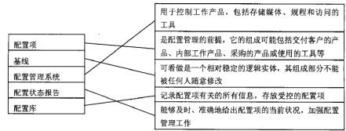

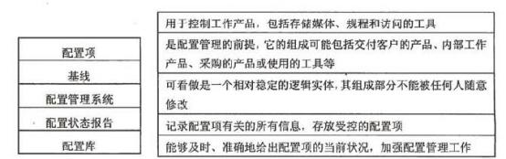

#### 【问题 3】（s  分）

请说明正常的配置管理工作包括哪些活动？

| 参考答案 |
|---|

#### 【问题 1】（5 分）

1.赵工没有项目管理经验，不适合任项目经理的职位。

2.项目经理兼任配置管理员， 精力不够，无法完成配置管理工作。

3.赵工的项目范围管理有问题。

4.版本管理没有做好。

5.项目中没有建立基线，导致需求、设计、编码无法对应。

6.没有做好变更管理。

（每个点 1 分，总分不超过 5 分）

#### 【问题 2】（5 分）

（每条线 1 分，总分不超过 5 分）

#### 【问题 3】（5 分）

制定配置管理计划，配置项识别，报告配置状态，进行配置审核，版本管理和发行管理，实 施配置变更控制。

（每个点 1 分，总分不超过 5 分）

#### 【试题四】 ---中级 2010 年下半年案例分析试题

#### 【说明】

某公司的质量管理体系中的配置管理程序文件中有如下规定：

1、由变更控制委员会（CCB）制定项目的配置管理计划；

2、由配置管理员（CMO）创建配置管理环境；

3、由 CCB  审核变更计划；

4、项目中配置基线的变更经过变更申请、变更评估、变更实施后便可发布；  5 、CCB  组成人员不少于一人，主席由项目经理担任。

公司的项目均严格按照程序文件的规定执行。在项目经理的一次例行检查中， 发现项目软件 产品的一个基线版本（版本号 V1.3）的两个相关联的源代码文件仍有遗留错误， 便向 CMO  提出 变更申请。CMO  批准后，项目经理指定上述源代码文件的开发人员甲、乙修改错误。甲修改第一 个文件后将版本号定为 V1.4，直接在项目组内发布。次日， 乙修改第二个文件后将版本号定为 V2.3，也在项目组内发布。

#### 【问题 1】（6  分）

#### 【问题 2】（3  分）

| 工作负责人 | 编制配置管理计划 | 创建配置管理环境 | 审核变更计划 | 变更申请 | 变更实施 | 变更发布 |
|---|---|---|---|---|---|---|
| CCB |  |  |  |  |  |  |
| CMO |  |  |  |  |  |  |
| 项目经理 |  |  |  |  |  |  |
| 开发人员 |  |  |  |  |  |  |

#### 【问题 3】（6  分）

（4）动态配置库用于管理基线和控制基线的变更。                    ( )

（5）版本管理是对项目中配置项基线的变更控制。                      ( )

（6）配置项审计包括功能配置审计和物理配置审计。               ( )

| 参考答案 |
|---|

#### 【问题 1】（6 分）

规定中存在的问题:

（1）配置管理计划不应由 CCB 制定;

（2）基线变更流程缺少变更验证（或确认）环节:

（3） CCB 成员的要求不应以人数作为规定， 而是以能否代表项目干系人利益为原则。 实际中存在的问题:

（1）甲乙修改完后应该由其他人完成单元测试和代码走查;

（2）该公司可能没有版本管理规定或甲乙没有统一执行版本规定;

（3）变更审查应该提交 CCg 审核：（4）变更发布应交由 CMO 完成;

（5） 甲乙两人不能同时修改错误，这样会导致 vz.3 只包含了乙的修改内容而没有甲的修改内容。

（每个点得 1 分，总分不超过 6 分）

#### 【问题 2】（3 分）

请为案例中的每项工作职责指派一个你认为最合适的负责角色。（在答题纸相应的单元格中画 “d”，每一列最多只能有一个单元格画“d”，多画、错画“d”不得分）

| 工作 负责人 | 编制配置 管理计划 | 创建配置 管理环境 | 审核变更 计划 | 变更申请 | 变更实施 | 变更发布 |
|---|---|---|---|---|---|---|
| CCB |  |  | d |  |  |  |
| CMO | d | d |  |  |  | d |
| 项目经理 |  |  |  | d |  |  |
| 开发人员 |  |  |  |  | d |  |

（注：变更申请可以由 CMO,项目经理或开发人员提出，只要不选 CCB 即算正确，对于表格中 的其他列，多选或错选均不得分）

（每个点得 0.5 分，总分不超过 3 分）

#### 【问题 3】（6 分）

正确答案为：（1） d （2）x（3）x（4）x（5）x（6）d

选项（1） 正确。 “配置管理”中的相关内容。配置管理包括 4 个主要活动：配置识别、变更 控制、状态报告和配置审计。

选项（2）错误。 CCB 是由企业或项目组的主要成员组成的， 根据实际需要的不同，既可以设 置组织的变更控制委员会，也可以设置项目的变更控制委员会，还可以设置其他形式的变更控制 委员会，某些情况下不需要常设。

选项（3） 错误。 一组拥有唯一标识号的需求、设计、源代码文卷及相应的可执行代码、构造 问卷和用户文档等构成一条基线。在建立基线之前， 工作产品的所有者能快速、非正式地对工作 产品作出变更。但基线建立之后，变更要通过评价和验证变更的正式程序来控制。因此，基线不 一定是软件生存期各个开发阶段末尾的特定点。基线主要用于控制变更，里程碑主要用于控制时 间进度，两者并非一个概念。

选项（4） 错误。配置库可以分为动态库、受控库、静态库和备份库 4 种类型。动态库也称为 开发库、程序库或工作库，用于保存开发人员当前正在开发的配置实体。动态库是软件工程师的  工作区， 由工程师控制。受控库也称为主库或系统库，是用于管理当前基线和控制对基线的变更。

选项（5）错误。版本管理包括配置项状态变迁规则、配置项版本号标识和配置项版本控制， 并非等同于对项目中配置项基线的变更控制。

选项（6）正确。参见《系统集成项目管理工程师教程》第 15.2.8 节“配置审计”中的 相关内容。

#### 【试题五】 ---中级 2011 年下半年案例分析试题

阅读以下说明 ，请回答问题 1 至问题 3，将解答填入答题纸的对应栏内。

#### 【说明】

A 信息系统集成公司有员工 50 多名， 其中技术部开发人员有 30 多人。公司采用矩阵式的组 织结构。 公司的主营业务是开发企业信息化建设方面的项目，业务较为繁忙， 一般有十多个项目 在同时进行。由于技术人员有限，为保证各个项目的进展，人员在项目间的兼职与交叉很严重。	 一个技术开发人员在 M 项目上工作两天后，很可能转入 Y 项目工作， 过了三天，又再回到 M 项 目工作。项目的文档一般采用各自的命名方式进行管理，客户提出的修改也是各自负责，在技术 开发人员的本地机上进行开发。当技术开发人员重新回到原项目时，他不复不花大量的时间去熟 悉原来的工作，找出原来的文档与程序等，还要了解项目组其他人的工作进展，向相关人员索求 需要的开发成果。当一个项目进行到提交期限时，不得不花费大量的时间找出相匹配版本的相应 成果，集成为符合客户要求的可交付的系统。

#### 【问题 1】（4 分）

针对本题案例中的情况，从软件配置管理的角度，分析出现这种情况的原因。

#### 【问题 2】（6 分）

请指出配置管理包括哪几方面的活动。

#### 【问题 3】（5 分）

针对文档管理与软件配置管理的要求在（1）~（5）中填写恰当内容（从候选答案中选择正确选项， 将选项编号填入答题纸对应栏内）。

软件项目文档从项目周期角度可分为： 开发文档、（1）、管理文档。

（1） 候选答案：

A.   非正式文档  B.  产品文档   C.  正式文档  D.  设计文档

在软件开发流程中，把所有需要加以控制的配置项分为基线配置项和非基线配置项两类。基线配 置项可能包括所有的（2A ）等。

（2） 候选答案：

A.   设计文档和源程序

B.   各类计划

C.   设计文档、源程序、各类计划

D.   各类计划与被告

所有配置项的操作权限应由（3 A.    CMO（配置管理员））严格管理：作为配置项的操作权限管理 的基本原则，基线配置项向（4    D.    软件开发人员）开放读取的权限，非基线配置项向（5 G.     PM、 CCB 及相关人员）开放。

（3）、（4）、（5）候选答案：

A.    CMO（配置管理员）  B.    PM（项目经理）  C.    技术总监

D.    软件开发人员   E.  项目关系人   F.     CCB 及相关人员  G.    PM 、CCB 及相关人员

#### 【问题 1】（4 分）

①开发人员兼任配置管理任务，精力不够，顾此失彼

②项目的版本管理和发行管理没有做好

③项目中没有建立基线

④项目没有做好变更控制管理

⑤没有制订项目的配置管理计划

⑥项目中可能没有制定配置项的标识规则

⑦该公司没有一个规范的项目配置管理的流程

⑧该公司没有选用有效的项目配置管理工具..

⑨该公司及其员工都没有意识到项目配置管理的重要性

（答案包含但不限于以上要点，答出其中 4 个小点即可，每小点 1 分，答案类似即可）

#### 【问题 2】（6 分）

制定配置管理计划、配置项识别、报告配置状态、进行配置审核、版本管理和发行管理、实施配 置变更控制。 （答案包含但不限于以上要点，每个小点 1 分，答案类似即可）

#### 【问题 3】（5 分）

（1）B 或产品文档 （2）A 或设计文档和源程序（3）A 或 CMO 或配置管理员 （4）D 或软件开发 人员（5） G （或 PM、CCB 及相关人员， 或项目经理、变更管理委员会及相关人员）

（每 空 1 分）

#### 【试题六】 ---中级 2012 年下半年案例分析试题

#### 【说明】

小李担任了 A 公司的项目经理，他认识到项目配置管理的重要性， 指派小王负责项目的配置 管理，公司以前的项目很少采用配置管理，在这方面没有可以借鉴的经验。小王刚到公司上班不 到一年， 他从网上下载了开源的配置管理软件 CVS，进行了认真的准备。 项目组成员有 12 人，小 王为每个成员安装了 CVS 的客户端，但并没有为每位成员仔细讲解 CVS 的使用规则与方法。项 目组制订了一个初步的开发规范，并据此识别了配置项，但在文档的类型与管理的权限方面大家 并没有十分在意。小王在项目开发会议上，特别强调了要求大家使用配置管理系统，却没有书写 并发布有效的配置管理计划文件。

#### 【问题 1】（5 分）

结合本题案例判断下列选项的正误（填写在答题纸的对应栏内，正确的选项填写“小”，错误的选 项填写“X”）：

（1）在文档计划正式批准后， 文档管理者不一定要控制文档计划和它的发布。     (   )

（2）文档的评审应由需方组织和实施。                              ()

（3）需方同意文档计划意味着同意在计划中定义的用户文档的所有可交付的特征。()

（4）软件配置管理的目的是建立和维护整个生存期中软件项目产品的完整性和可追溯性。  ()

（5）在进行配置管理过程中， 一定要采用高档的配置管理工具。(  )

#### 【问题 2】（6 分）

请简要叙述本案例在建立配置管理系统方面存在哪些问题。

#### 【问题 3】（5 分）

结合项目实践，给出本项目中在配置管理方面的改进建议。

| 参考答案 |
|---|

#### 【问题 1】（5 分）（1）x（2） x（3） 小（4） 小（5）x

#### 【问题 2】

（1）配置管理方案设计小组只有小王一人。

（2）对目标机构了解不够。

（3）对配置管理工具没有进行有效评估。

（4）没有制定实施计划。

（5）没有定义好配置管理流程。

（6）没有实验项目的实施经验可以借鉴。

（6 分，每项 1.5 分，最多 6 分）

#### 【问题 3】（5 分）

（1）组建配置管理方案设计小组。（0.5 分）

（4）制定实施计划。（0.5 分）

（5）定义配置管理流程。（0.5 分）

#### 【试题七】 ---中级 2014 年上半年案例分析试题

#### 【说明】

a ）开发文档：可行性研究报告、需求规格说明书、概要设计说明书、数据设计说明书、数据字典。

b）管理文档： 开发计划、配置管理计划、测试用例、测试计划、质量保证计划、开发进度报 告，项目开发总结报告。

c ）产品文档：用户手册、操作手册

（2）建立公司级配置管理系统， 将配置库划分为开发库与受控库。并规定开发库用于存放在开发 过程中的阶段成果， 受控库作为基线库存放评审后的正式成果。

（3）建立配置库权限机制，允许公司人员按照不同级别查看并管理公司文档， 考虑到公司总经理 权限最大、项目经理要查看并了解相关项目资料等额外因素，对受控库进行了下表的权限分配，（J

表示允许， X表示不允许）；

| 角色 | 读取 | 修改 | 删除 |
|---|---|---|---|
| 总经理 | + | + | + |
| 项目经理 | + | + | X |
| 开发人员 | + | + | X |
| 测试人员 | + | X | X |
| 质量保证人员 | + | X | X |
| 配置管理员 | + | + | + |

进行了如上配置管理工作后， 此时有一个项目 A 的项目经理告知小张，发现基线库中有一个 重要功能缺陷要修改，项目经理组织配置控制委员会进行了分析讨论后，同意修改，并指派了程 序员小王进行修改，于是小张按照项目经理的要求在受控库中增加了小王的修改权限，以便小王 可以在受控库中直接修改该功能。

#### 【问题 1】（6 分）

（1）依据 16680-1996《软件文档管理指南》，小张对公司项目文档的归类是否正确？

（2）从候选答案中选择 8 个正确选项（多选该题得 0 分），将选项编号填入答题纸纸对应栏内。 应 归入“开发文档”类的文档有：

候选答案：

A.可行性研究报告 B.需求规格说明书 C.用户手册 D.数据字典 E.操作手册 F.开发计划

G.配置管理计划 H.测试用例 I.测试计划 J.质量保证计划 K.项目开发总结报告 【问题 2】（8 分）

小张在建立配置管理系统时，不清楚如何组织配置库，请帮助小张组织配置库（至少写出两

种配置库组织形式， 并说明优缺点

#### 【问题 3】（5 分）

本案例中当发现基线库中有一个重要的功能缺点需要修改时.你认为小张的做法存在哪些问题. 并说明正确的做法.

#### 【问题 4】（6 分）

结合案例.请指出小张在整个受控库的权限分配方面存在哪些问题？

| 参考答案 |
|---|

#### 【问题 1】（6 分）

（1）答：不正确（2）A B D F G H I J.

#### 【问题 2】（8 分）

答： 1.按配置项类型分类建库，适用于通用软件开发组织。

优点：便于对配置项的统一管理和控制，提高编译和发布效率。

缺点：针对性不强， 可能造成开发人员的工作目录结构过于复杂。

2.按任务建立相应的配置库， 适用于专业软件的研发组织。

优点：设置策略灵活。缺点：不易于配置项统一管理和控制。

#### 【问题 3】（5 分）

本案例中当发现基线库中有一个重要的功能缺点需要修改时.你认为小张的做法存在哪些问题.并 说明正确的做法？

存在问题：

（1）没有提出变更申请就组织配置控制委员讨论同意修改，并指派程序员修改。

（2）小张直接在受控库中增加小王的修改权限。

（3）由小张直接修改权限。

（4）小王可以直接修改受控库的功能。

正确做法：

（1）由项目 A 项目经理就存在的缺陷修改提出书面变更申请;

（2）组织变更初审和变更方案论证;

（3）在变更获批后， 将变更决定通知影响到的各有关干系人;

（4） 变更实施中， 在开发库开辟工作空间， 从受控库取出相关的配置项， 放于该工作空间， 分配 权限给程序员小王进行修改；

（5） 变更实施完成， 进行变更结果评估与确认，更新受控库中的相关配置项， 并发布给各相关干 系人。

#### 【问题 4】（6 分）

结合案例.请指出小张在整个受控库的权限分配方面存在哪些问题.

答：（1）受控库应对项目经理开放;

（2）受控库对开发人员只应开放读取权限;

（3）受控库对总经理只应开放读取权限;

（4）还应添加 CCB 和 PMO 角色，并开放读取权限。

#### 【试题八】 ---中级 2014 年下半年案例分析试题

阅读下列说明，针对项目的进度管理， 回答问题 1 至问题 3。将解答填入答题纸的对应栏内。 【说明】

某信息系统开发公司承担了某企业的 ERP 系统开发项目，由项目经理老杨带领着一支 6 人的 技术团队负责开发。由于工期短、任务重，老杨向公司申请增加人员，公司招聘了 2 名应届大学 毕业生小陈和小王补充到该团队中。老杨安排编程能力强的小陈与技术骨干老张共同开发某些程 序模块，而安排编程技术弱的小王负责版本控制工作。在项目开发初期，小陈由于不熟悉企业的 业务需求，需要经常更改他和老张共同编写的源代码文件，但是他不知道哪个是最新版本，也不 知道老张最近改动了哪些地方。 一次由于小王的计算机中了病毒，造成部分程序和文档丢失，项 目组不得不连续一周加班进行重新返工。此后，老杨吸取教训， 要求小王每天下 班前把所有最新 版本程序和文档备份到 2  台不同的服务器上。 一段时间后，项目组在模块联调时发现一个基础功 能模块存在重大 BUG，需要调取之前的备份进行重新开发。可是小王发现， 这样一来， 这个备份 版本之后的所有备份版本要么失去意义，要么就必须全部进行相应的修改。项目工期过半，团队 中的小李突然离职，老杨在他走后发现找不到小李所负责模块的最新版本源代码了.只好安排其他 人员对该模块进行重新开发。

整个项目在经历了重重困难，进度延误了 2 个月后终于勉强上线试运行。可是很快用户就反 应系统无法正常工作。老杨带领所有团队成员在现场花费 1  天时间终于找出问题所在， 原来是 2

台备份服务器上的版本号出现混乱，将测试版本中的程序打包到了发布版中。

#### 【问题 1】（5 分）

在（1）~（5）中填写恰当内容（从候选答案中选择一个正确选项，将该选项编号填入答题 纸对应栏内）。

为了控制变更， 软件配置管理中引入了（1）这一概念。根据这个定义， 在软件的开发流程中  把所有需加以控制的配置项分为两类，其 中，（2）配置项包括项目的各类计划和报告等。配置项  应该按照一定的目录结构保存到（3）中。所有配置项的操作权限由（4）进行 严格管理， 其中（5） 配置项向软件开发人员开放读取的权限。

（1）~（5）供选择的答案：

A.版本  B.基线   C.配置项   D.非基线   E.受控库

F.静态库  G.配置库   H.CMO      I.PM      J.CCB

#### 【问题 2】（4 分）

结合案例，请分析为什么要进行配置项的版本控制？

#### 【问题 3】（5 分）

简述配置项的版本控制流程。

#### 【问题 4】（8 分）

针对该项目在配置管理方面存在的问题，结合你的项目管理经验， 为老杨提出一些改进措施。

| 参考答案 |
|---|

#### 【问题 1】

BDGHB （每选对 1 个得 1 分，选错没有分）

#### 【问题 2】

为什么要进行配置项的版本控制

（1）版本控制有利于版本的统一管理， 避免发生版本丢失或混淆，减少返工

（2）版本控制有利于历史版本的追溯， 能够快速准确地查找到配置项的任何版本

（3） 版本控制有利于开发工作的协同化，案例中小陈和老张因为没有做好版本控制导致了协作的困难 （4）版本控制使配置项处于受控状态， 能更好的进行变更管理

（5）管理版本冲突， 在多个版本冲突的情况下，有效的进行版本合并

（答案包含但不限于以上内容， 列出 4 点就可以， 每小点 1 分，最多 4 分，类似即可）

#### 【问题 3】

配置项的版本控制流程如下：

（1）识别配置项，并为配置项建立椎一标识（2）建立配置管理系统（3）创建或发行基线（4） 跟踪变更（5）控制变更（6） 建立配置管理记录（7）执行配置审核

（答案包含但不限于以上内容， 列出 5 点就可以， 每小点 1 分，最多 5 分，类似即可）

#### 【问题 4】

案例中配置管理存在的问题有：

（1）没有做配置管理规划，缺少完整的配置管理方案

（2）没有统一的版本管理机制，各版本不可追溯， 导致重要版本丢失

（3）没有建立配置基线，项目中的变更不可控

（4）缺少配置管理及变更管理流程，没有配置管理委员会

（答案包含但不限于以上内容， 列出 4 点就可以， 每小点 1 分，最多 4 分，类似即可）   改进措施：

（1）从项目整体出发，做好配置管理规划

（2）定义合理的配置管理流程，规定项目中出现变更的处理办法

（3）与各方干系人达成共识， 组建配置管理委员会

（4）识别配置项，并为配置项建立椎一标识， 保证其可追溯

（5）建立配置基线， 使重要配置项处于受控状态

（6）定期提效配置状态报告， 改进配置管理方法

（答案包含但不限于以上内容， 列出 4 点就可以， 每小点 1 分，最多 4 分，类似即可）

#### 【试题九】 ---中级 2016 年下半年案例分析试题

#### 【说明】

鉴于配置管理在信息系统集成和 IT 运维项目中的重要作用， 某企业计划在企业层面统一建立 配置库，以规范公司的配置管理，并责成公司的商务经理杨工兼任公司的配置经理，全面组织和 协调公司的配置管理事项。杨工接到任务后，按照公司目前系统集成和运维的架构，将配置库分 为系统集成项目配置库和运维项目配置库，不过这种配置库管理只是从名称方面进行了区分，实 际上只有一个配置库。由于公司大部分运维项目来自于公司的系统集成部，所以底层数据是共享 的，没有分割开来， 运维人员和系统集成人员经常针对同一个配置项进行修改。

在配置库运行 4 个月之后， 公司组织了一次对配置库的审计，发现配置库存在大量的问题， 杨工面对这样的局面，对自己在配置管理中的角色也感到非常迷茫。他收集了目前公司配置库管 理方面存在的问题， 这些问题比较突出地体系在以下几个方面：

（1）有的项目组将配置项细化到了软件产品的模块，而有的项目组以项目简单为由，根本没 有进行配置管理，并且各项目组内部对配置管理的需求也不统一，随时间变化波动较大。

（2）很多开发人员和运维人员不知道在不同的库里应该放置什么内容，而且各种配置项的配 置格式也不同意，导致配置库难以达到预期的效果。

（3） 配置库增删比较混乱， 很多配置项还找不到最后的版本，而且很多配置内容也放置混乱， 各种哭的分隔管理起不到预期的效果。

#### 【问题 1】（6 分）

请结合以上案例，简要说明配置管理的目标和主要活动。

#### 【问题 2】（8 分）

请说明杨工在配置管理中存在的问题。

#### 【问题 3】（3 分）

根据你的理解，请指出配置审计的功能是什么？

参考答案

#### 【问题 1】(6 分）

配置管理的目标是为了系统的控制配置变更，在系统的整个生命周期中维持配置的完整性和可跟 踪性，标示系统在不同时间点上的配置。(2 分）

配置管理包括 6  个主要活动:制定配置管理子计划、配置标识、配置控制、配置状态报告、配置 审计、发布管理、发布管理和交付。(4 分）

#### 【问题 2】(8 分）

杨工在配置管理中存在的间题有

(1）没有制定配置管理计划

(2）没有对配置库进行很好的分类管理，

(3）版本管控不到位，造成版本丢失

(4）没有成立配置控制委员会 CCB

(5）变更管理没有走流程或者没有规范的变更流程。

(6）没有任命专职的配置管理员

(7）没有很好的配置管理系统

(答案包括但不限于以上内容，列举出其中 4 个小点即可，每小点 2 分，答案类似即可）

#### 【问题 3】(3 分）

配置审计也称为配置审计或配置评价，包括功能配置审计和物理配置审计，分别用以验当前配置 项的一致性和完整性。

配置审计的实施是为了确保项目配置管理的有效性，   体现了配置管理的最根本要求，不允许出现

任何混乱的现象，例如:

(1）防止向用户提交不合适的产品，如交付了用户手册的不确定版本；

(2）发现不完善的实现，  如开发出不符合初始规格说明或未按变更请求实施变更； (3）找出各配置项间不匹配或不相容的现象；

(4）确认配置项已在所要求的质重控制审核之后纳入基线并入库保存；

(5）确认记录和文档保持着可追溯性

(答案包括但不限于以上内容，列举出其中 3 个小点即可，每小点 1 分，答案类似即可）

九、收尾管理

#### 【试题一】---高级 2013 年上半年案例分析试题

阅读下列说明，回答问题 1 至问题 3，将解答填入答题纸的对应栏目内。

#### 【说明】

项目经理李工和近五十人的项目团队经过 9 个月的辛苦努力，在某信息系统项目约定的最后 期限内完成了信息系统的开发工作，并通过了系统试运行。尽管这是李工负责的第一个项目，但 还是算圆满地结束了。李工感觉很有成就感，也对团队成员充满了感激。由于项目工期几度耽搁， 在项目最后阶段， 项目团队成员加班加点工作了近 3 个月，团队成员不仅精神疲惫而且因此耽误 了其他项目的很多工作。鉴于项目已经完成了试运行，李工就组织大家召开了项目总结会。在总 结会上李工表示了对大家的感谢，然后就宣布项目已经结束，项目团队成员可以各自按照原先的

人力资源计划进入新的项目。

项目总结会后的第二天，建设方的项目负责人就打来了电话， 说是建设方总经理发现该信息 系统还有一项功能需要添加，尽管该功能在原先的合同中没有体现，但是总经理还是希望添加该 项目功能。而且建设方的项目负责人还指出，试运行之后相关部门发觉还有一些相关的操作手册 没有提供， 希望建设方补充提供相关文档。

刚接完建设方项目负责人的电话，公司财务审计部门和项目管理办公室的人员也敲门进来，	 首先问李工该项目是否已经完成，如果已经完成就需要走公司的相关项目收尾流程。接着就要求 李工和他的项目团队成员配合组织项目审计和项目收尾方面的工作， 并告诉李工， 该项目的尾款， 20%的合同金额对方还没有付，请李工催促对方尽快付款。

#### 【问题 1】（10 分）

结合本案例，简要回答项目收尾的主要工作包括哪几个部分并分别说明其主要内容。 【问题 2】（10 分）

请简要说明项目团队成员转移进入新项目的前提条件。

#### 【问题 3】（10 分）

请指出项目收尾阶段需要完成哪些文档？

| 参考答案 |
|---|

#### 【问题 1】（10 分）

项目收尾的具体内容主要是项目验收、项目总结和项目评估审计。

项目的正式验收包括验收项目产品、文档及已经完成的交付成果。

项目总结属于项目收尾的管理收尾，而管理收尾有时候又被称为行政收尾，就是检查项目团 队成员及相关干系人是否按规定履行了所有责任。实施行政收尾过程还包括收集项目记录、分析 项目成败、收集应吸取的教训，以及将项目信息存档供本组织将来使用等活动统一为一个整体。

项目评估的意义是将项目的所有工作加以客观的评价，从而对项目全体成员的成果形成绩效 结论。好的项目评估会引导后续项目的开展，并对项目过程的改进起到很重要的作用。项目审计 应由项目管理部门与财务部门共同进行，相关的审计项目应在项目成本管理中列出，在项目收尾 的时候，对已经列出的支出和收入进行财务审计，对不合理的支出和收入加以分析，为改进项目 的管理服务。

（答案包含但不限于以上内容，列出 5 点就可以，每小点 2 分，最多 10 分，类似即可）

#### 【问题 2】（10 分）

一般的项目人员的转移流程是：

（1）项目团队成员的管理计划， 也就是项目人力资源管理计划中所描述所说的人员转移件已经触发。 （2）项目团队成员所承担的任务已经完成，提交了经过确认的可交付物并已完成工作交换

（3）项目经理与项目团队成员确认该成员的工作衔接已经告一段落或已完成。

（4）项目经理签发项目团队成员转移确认文件

（5）项目经理签发项目团队成员的绩效考核文件

（6）项目经理通知所有相关的干系人

（7）若是项目收尾全体项目成员结束项目工作，应召开项目总结表彰大会，肯定项目的成绩、

团队成员的业绩，同时总结项目的经验教训。

（答案包含但不限于以上内容，列出 5 点就可以，每小点 2 分，最多 10 分，类似即可）

#### 【问题 3】（5 分）

项目验收的文档主要包括：

（1）系统集成项目介绍（2）系统集成项目最终报告（3）信息系统说明手册（4）信息系统维护 手册（5）软硬件产品说明书、质量保证书等

（答案包含但不限于以上内容，列出 5 点就可以，每小点 1 分，最多 5 分，类似即可）

#### 【试题二】 ---高级 2014 年上半年案例分析试题

#### 【说明】

某系统集成公司承接了一个政府部门的系统集成大项目，任命张工为大项目项目经理。 张工 按照项目内容， 将项目分成子项目 1、子项目 2 和子项目 3，分别任命李工、王工和麽工负责。三 个项目在张工的领导及协调下进展顺利。在整个项目进行到 80%时， 出资人提出子项目 1 由于政 策原因需要终止， 子项目 2、子项目 3 继续按照原计划进行。因此张工通知李工将子项目 1 资料归 档并提交给公司管理资产的人员。随后为了保证子项目 2、子项目 3 的顺利进行，张工将子项目 1 的项目团队解散，有关员工加入到子项目 2、子项目 3 中。

子项目 2、子项目 3 在张工引入新的资源后， 进展顺利， 因此张工觉得不需要再加强阶段审查， 等 项目全部完成后再统一进行验收。

在项目结束后， 张工组织客户对子项目 2、子项目 3 分别进行验收， 结果客户对子项目 2 的成 果很不满意。因子项目 3 需要的一个关键部件是子项目 2 提供的， 最后影响了二者的总体验收，

项目因此没有按时交工。

#### 【问题 1】（10 分）

结合案例， 说明在子项目 1  终止时张工的做法是否存在不足？如何从管理收尾及合同收尾两

个方面进行弥补？

#### 【问题 2】（5 分）

结合案例， 请说明张工在随后的子项目 2、子项目 3 的执行和验收工作中分别存在哪些问题？ 【问题 3】（10 分）

结合案例， 简要回答正确执行此大项目验收工作的步骤

#### 【问题 1】（10 分）

张工做法存在以下不足：

（1） 张工没有针对子项目1开展有效的管理收尾工作。张工和李工应该针对子项目 1 进行管理收 尾，组织子项目成员开会进行工作总结；

（2） 张工没有针对子项目1开展有效的合同收尾工作。张工应针对子项目上进行合同收尾， 应组 织用户进行验收，确定已经完成的工作。

一、在管理收尾方面进行弥补：

（1）应确认项目或阶段已满足所有重要项目干系人需求的行动和活动；

（2 确认已满足项目阶段（或者整个项目）的完成标准或退出标准的行动和活动；

（3）收集项目或者项目阶段记录、收集教训、归档项目信息， 以方便组织未来的项目管理。 二、在合同管理收尾方面进行弥补：

（1）应进行产品验证，验证所有工作已正确和令人满意的完成；

（2）应进行合同管理收尾，更新反映最终成果的合同记录并存档将来会用的信息。

#### 【问题 2】（5 分）

答：执行中存在的主要问题：

（1）没有进行阶段性审查；（2）没有进行及时的监督和控制；

（3 在子项目之间非常缺乏沟通与协调；（4） 没有进行有效的需求管理；（5） 与客户的沟通不良。 验收中存在的主要问题：

（1）没有进行有效的系统测试；（2）没有准备好相应的文档；

（3）没有按照规范的流程进行验收；（4）与客户的沟通不良。

#### 【问题 3】（10 分）

答：正确的步骤：

（1）首先要对各个子项目的成果进行分别测试与确认，并得到客户的肯定；

（2 将各个子项目的成果联系起来，展开全面的系统测试，并测试通过；

（3）整个系统进行试运行；

#### 【试题三】 ---高级 2016 年下半年案例分析试题

#### 【说明】

某公司承接了某银行的信息系统集成项目， 并任命王工为项目经理， 这也是王工第一次担任 项目经理。王工带领近 20 人的团队， 历经近 11 个月的时间，终于完成了系统建设工作，并通过 了试运行测试。王工在与甲方项目负责人简单地对接了项目交付清单之后，就报告公司项目已经 结束，部分项目人员可以进行转移。王工组织剩下的项目团队成员召开了项目总结会议。随后公 司的财务要求王工根据合同催甲方支付剩余 30%的项目款。

当王工打电话催促甲方支付项目尾款时， 甲方的项目经理告诉他项目还没有结束， 甲方还没 有在验收报告上签字确认，项目的很多常规性文件还没有提交，而且需要在试运行的基础上，进 一步修改程序和功能设置，现在根本没有达到项目收尾的条件。

#### 【问题 1】（4 分）

项目收尾包括哪些具体工作？

#### 【问题 2】（8 分）

项目经理王工收尾管理方面主要存在哪些问题？

#### 【问题 3】（5 分）

对于软件和信息系统集成项目来说，项目收尾时一般提交的文件包括哪些类？

#### 【问题 4】（8 分）

（1）王工组织的项目总结会议是否恰当？请说明理由。

（2）请简要叙述项目总结会议上一般讨论的内容色括哪些？

参考答案

#### 【问题 1】(4 分）

项目收尾管理工作包括：①项目验收工作；②项目总结工作③系统维护工作；④项目后评价工作

（答案包括但不限于以上内容，列举出其中 4 个小点即可，每小点 1 分，答案类似即可）

#### 【问题 2】(8 分）

存在的问题：

(1）没有充分做好验收前的准备,没有准备好相应的文档并且提交给甲方

(2）没有按规范的流程进行验收

(3）验收文挡未经双方签字认可

(4）项目验收未正式完成,未签署验收报告便进行了项目总结

(5）项目总结会议没有让全部项目人员参与

(6）总结报告未能反映项目的实际情况

(7）缺少项目评估和审计环节

(8）沟通方面存在问题

(9）催收剩余款项没有正式和必要的依据

(10）项目在产品和项目工作上都还不满足收尾条件

（答案包括但不限于以上内容，列举出其中 8 个小点即可，每小点 1 分，答案类似即可）

#### 【问题 3】(5 分）

要提交的文档：开发文档、产品文档、培训手册、参考手册和用户指南、软件支持手册、外购或 外包合同、标书、全部合同变更文件、项目质量记录、会议记录、备忘录、项目测试报告、项目  质量验收报告、项目后评价资料等    (答对 5 个即可）

（答案包括但不限于以上内容，列举出其中 5 个小点即可，每小点 1 分，答案类似即可）

#### 【问题 4】(8 分）

(1）不恰当,未邀请项目所有干系人参与项目总结会,同时并未达到项目总结条件。

(2） 项目总结讨论的内容： ①项目绩效；  ②技术绩效③成本绩效；  ④进度计划绩效； ⑤项目的沟 通；⑥识别问题和解决问题；  ⑦意见和建议

（答案包括但不限于以上内容，列举出其中 6 个小点即可，每小点 1 分，答案类似即可）

#### 【试题四】 ---中级 2011 年上半年案例分析试题

#### 【说明】

在系统集成项目收尾的时候， 项目经理小张和他的团队完成了以下工作。

工作一：系统测试。项目组准备了详尽的测试用例， 会同业主共同进行系统测试。测试过程 中为了节约时间，小张指派项目开发人员小李从测试用例中挑选了部分数据进行测试，保证系统 正常运行。

工作二： 试运行。项目组将业主的数据和设置加载到系统中进行正常操作，完成了试运行工作。

工作三：文档移交。小张准备了项目最终报告、项目介绍、说明手册、维护手册、软硬件说 明书、质量保证书等文档资料发送给业主。

工作四：项目验收。经过业主验收后， 小张派小李撰写了项目验收报告， 并提请双方工作主

管认可。

工作五：准备总结会。小张整理了项目过程文档以及项目组各技术人员的经验，并列出了项 目执行过程中的若干优点。

工作六：召开总结会。小张召集全体参与项目的人员参加了总结会，并就相关内容进行了讨 论，形成了总结报告。

#### 【问题 1】（5 分）

请指出案例中的六项工作中哪些工作存在问题并具体说明。

#### 【问题 2】（6 分）

工作六中， 项目组召开了总结会，那么总结会讨论的内容可以包含          、        、

、          、        、         。

----------   ---------   --------   ----------

#### 【问题 3】（4 分）

项目总结会召开之前，核心技术人员小王产生了抵触心理，他认为更多的时间应该放在技术 研发上而不是浪费时间召开会议。请简要阐述项目经理小张应该如何从召开总结会意义的角度说 服小王参加项目总结会。

| 参考答案 |
|---|

#### 【问题 1】

工作一：一般不建议项目开发人员承担系统测试； 只选择了部分数据进行测试， 测试不充分。 工作二：系统试运行操作应该有业主参与，数据加载应该由业主进行。

工作三：文档移交时应验收合格并经双方签字认可。

工作四：项目验收报告应该是由双方共同撰写， 而不是承建方单独撰写。

工作五：经验总结中不仅要列出优点还应该列出若干缺点。

（每个点1分，总分不超过5分）

#### 【问题 2】

项目绩效、技术绩效、成本绩效、进度计划绩效、项目的沟通、识别问题、解决问题、意见 和建议。  （每对一个得1分，总分不超过6分）

#### 【问题 3】

应告知小王参加总结会的意义：

1.了解项目全过程情况及相关成员的绩效；

2.了解出现的问题并总结改进措施；

3.了解值得吸取的教训并总结；

4.对总结后的文档进行归档， 并存入公司的知识库， 从而纳入企业的过程资产。

（每个点1分，总分不超过4分）

#### 【试题五】 ---中级 2012 年下半年案例分析试题

#### 【说明】

某工业企业的生产管理系统项目委托系统集成商 A 公司进行开发和实施， 由 A 公司的高级项

目经理李某全权负责。按照双方制定的项目计划，目前时间已经到达最后的交付阶段，李某对整 体进度情况进行了检查。检查结果是：生产管理系统软件基本开发完成，目前处于系统测试阶段， 仍然不断发现缺陷，正在一边测试一边修复；硬件系统已经在客户现场安装完毕，设备正常运行。 未来不延误进度，李某决定将目前发现的缺陷再集中修改 2 天，然后所有开发人员一同去现场进 行整体安装联调。2 天后， 项目组进入现场， 对软件系统进行了部署。 李某与客户代表确定了参加 验收测试的工作人员，然后开始进行项目验收。 在验收过程中，客户认为软件的部分功能不能满 足实际工作需要，要求项目组修改。项目组经过讨论后认为对软件进行适当的修改便能够满足客 户的需求，便在现场对软件进行了修改。验收测试过程中发现了部分小缺陷。客户方认为这些小 缺陷不影响系统的正常使用。为此双方签署了备忘录，约定系统交付使用后再修复这些缺陷。 按 照双方的约定，项目组应在试运行前将系统安装手册、使用和维护说明等全套文档移交给客户，  但是由于刚刚对软件进行了现场修改， 一些文档还未及时更新，因此客户未接受这些文档。 由于 客户最关心的是试运行，因此李某组织所有力量开展试运行工作。 系统上线后，客户发现了一些 新问题，同时还有以前遗留的问题未解决。经双方协商，这些问题解决之后再签署验收报告和付 款。

回到公司后，公司领导高度重视该项目。项目经理第一时间撰写了项目总结报告，对整个项 目实施过程进行了认真的总结和分析。 该报告的结论是项目整体进展状况良好， 未出现明显问题， 本项目可以正常结项。

#### 【问题 1】（6 分）

请简要叙述该项目在收尾环节存在的主要问题。

#### 【问题 2】（6 分）

请简要叙述项目经理的总结报告中应包含的主要内容。

#### 【问题 3】（5 分）

请指出项目组在该系统集成项目收尾后应该向客户移交那些文档？

参考答案

#### 【问题 1】（6 分）

（1） 没有充分做好验收前的准备， 或软件系统没有达到验收前的标准， 或软件还存在计划修复的 缺陷。这些缺陷未经修复和确认便进入正式验收环节。

（2）在验收过程中未根据变更控制流程对软件进行修改，导致文档与软件不一致。

（3）软件更新后没有对文档进行更新便交付给客户。

（4）项目验收未正式完成，未签署验收报告便进行了项目总结。

（5）项目收尾过程不完整，缺少正式的项目总结环节，不能只编写总结报告。

（6）项目总结报告未能反映项目的实际情况。

（7）缺少项目评估或审计环节。

（每条 1 分，共 6 分）

#### 【问题 2】（6 分）

项目绩效（整体情况）、技术绩效（技术方案的实施情况）、成本绩效、进度绩效、项目沟通 情况、识别问题和解决问题情况、意见和建议（经验教训和知识总结）

（每条 1 分，共 6 分）

#### 【问题 3】（5 分）

（1）系统集成项目介绍（2）系统集成项目最终报告（3）信息系统说明手册（4）信息系统维护 手册（5）软硬件产品说明书、质量保证书等

（每条 1 分，共 5 分。可以回答文档类， 只要与上述文档对应便给相应分数）

#### 【试题六】 ---中级 2015 年下半年案例分析试题

#### 【说明】

在某系统集成项目收尾的时候，项目经理小张和他的团队完成了以下工作：

工作一：系统测试。项目组准备了详尽的测试用例， 会同业主共同进行系统测试。测试过程 中为了节约时间，小张指派项目开发人员小李从测试用例中挑选了部分数据进行测试，保证系统 正常运行。

工作二： 试运行。项目组将业主的数据和设置加载到系统中进行正常操作，完成了试运行工作。

工作三：文档移交。小张准备了项目最终报告、项目介绍、说明手册、维护手册、软硬件说 明书、质量保证书等文档资料直接发送给业主。

工作四： 项目验收。经过业主验收后， 小张派小李撰写了项目验收报告，并发送给双方工作主管。

工作五：准备总结会。小张总结了项目过程文档以及项目组各技术人员的经验，并列出了项 目执行过程中的若干优点。

工作六：召开总结会。小张召集参与项目的一些人员参加了总结会，并就相关内容进行了讨 论，形成了总结报告。

#### 【问题 1】（3 分）

工作六中， 项目组召开了总结会， 以下哪一项不是项目总结会讨论的内容？ （从候选答案中选择

一个正确选项，将该选预编号填入答题纸对应栏内）

候选答案： A.项目绩效   B.项目审计   C.经验总结     D.进度计划绩效

#### 【问题 2】（3 分）

项目经理小张在验收活动完成后，还需要针对系统集成项目进行后续的支持工作，以下哪一项不 属于系统集成项目的后续工作？（从候选答案中选择一个正确选项，将该选项编号填入答题纸对 应栏内）

候选答案： A.信息系统日常维护工作       B.硬件产品的更新

C.业主针对新员工的培训需求   D.信息系统的新需求

#### 【问题 3】（12 分）

请指出本案例的六项工作中哪些工作存在问题并具体说明。

#### 【问题 1  参考答案】（3 分）  B

解析： 总结会讨论的内容包括项目绩效、进度绩效、成本绩效、团队绩效、技术绩效、沟通情况、 存在的问题及解决方法、总体经验、意见与建议。

#### 【问题 2  参考答案】（3 分）   C

#### 【问题 3  参考答案】（12 分）

存在问题如下：

（1）工作一中，应根据双方合同约定的系统环境， 进行全面测试。

（2）工作二中，试运行应当包括用户日常操作的问题跟踪维护。

（3）工作三中，系统所有文档都应当验收合格并经双方签字确认。

（4）工作四中，应该有双方的项目给撰写验收报告提请双方工作主管认可。

（5）工作五中，应该进行全面总结，不仅需要“列出了项目执行过程中的若干优点”，也需要列 出缺点和经验教训。

（6）工作六中总结报告必须由参与项目的全体成员一起讨论确认。

（备注：每项 2 分最多 12 分）

#### 【试题七】 ---中级 2018 年下半年案例分析试题

#### 【说明】

A  公司是为保险行业提供全面的信息系统集成解决方案的系统集成企业。齐工是 A  公司的 项目经理， 目前正在负责某保险公司 P 公司的客户管理系统开发项目， 当前该项目己经通过验收。

齐工将项目所涉及的文档都移交给了 P  公司，认为项目收尾工作已经基本完成，  所以解散 了项目团队，并组织剩下的项目团队成员召开了项目总结会议。项目组成员 小王提出"项目组有 人没有参加总结会议， 是否要求所有人员都要参加？"，齐工解释 说"项目总结会议不需要全体人

员参加，没有实质性的工作内容。

#### 【问题 1】（5  分）

结合案例，项目经理齐工对小王提出的问题的解释是否恰当？请从项目总结会的规范要求角度， 说明理由。

#### 【问题 2】（5  分）

结合案例， 请简述项目总结会议一般讨论的内容。

#### 【问题 3】（2  分）

请将下面（1）-（2）处的答案填写在答题纸的对应栏内

结合案例，你认为系统集成项目收尾管理工作通常包含（1）项目工作总结，（2）、项目后评价工作。

#### 【问题 4】（5  分）

结合案例， 请简述系统文档验收所涉及的文档都有哪些。

#### 【参考答案】

#### 【问题 1】

不恰当（2 分）

项目总结会需要全体参与项目的成员都参加，并由全体讨论形成文件，同时项目总结会需要讨论 项目绩效、项目经验教训等实质性内容，具有非常重要的意义。（3 分）

#### 【问题 2】

（1）项目绩效（2） 技术绩效（3）成本绩效（4）进度计划绩效（5）项目的沟通 （6）识别问题和解决问题    （7）意见和建议

#### 【问题 3】

（1）项目验收工作（1 分）    （2）系统维护工作（1 分）

#### 【问题 4】

（1）系统集成项目介绍。

（2）系统集成项目最终报告。

（3）信息系统说明手册。

（4）信息系统维护手册。

（5）软硬件产品说明书、质量保证书等。

（答案包括但不限于以上内容，列举出其中 5 个小点即可，每小点 1 分）

十、可研、招投标、采购管理、信息安全

#### 【试题一】---高级 2008 年下半年案例分析试题

#### 【说明】

去年底某大型企业集团的财务处经过分析发现，员工手机通话量的 80%是在企业内部员工之 间进行的， 而 90%的企业内部通话者之间的距离不到 1000 米。如果能引入一项新技术降低或者免 掉内部员工通话费，这对集团来说将能节省很大一笔费用，对集团的发展意义相当大。财务处将 这个分析报告给了集团的总经理，总经理又把这个报告转给了集团信息中心主任李某， 责成他拿 出一个方案来实现财务处的建议。

李某找到了集团局域网的原集成商 A  公司， 反映了集团的需求。 A  公司管理层开会研究后 命令项目经理章某积极跟进，与李某密切联系。 章某经过调研，选中了一种基于无线局域网 IEEE802.11n 改进的新技术“无线通”手机通信系统，也了解到有一家山寨机厂家在生产这种新技 术手机。 这种手机能自动识别“无线通”、移动和联通， 其中“无线通”为优先接入。经过初步试 验，发现通话效果很好，因为是构建在集团现有的局域网之上，除去购买专用无线路由器和这种 廉价手机之外， 内部通话不用缴费。而附近其他单位听说后， 也纷纷要求接入“无线通”，于是章 某准备放号并准备收取这些单位适当的话费。

但等到“无线通”在集团内部推广时，发现信号覆盖有空白、噪声太大、高峰时段很难打进 打出，更麻烦的是当地政府的主管部门要他们暂停并要对他们罚款。此时章某骑虎难下，欲罢不 能。

#### 【问题 1】（10 分）

造成这样局面的可能原因是什么？章某在实施“无线通”时可能遇到的风险有哪些？

#### 【问题 2】（7 分）

针对本案例，章某应该在前期进行可行性分析， 请问可行性分析的基本内容有哪些？

#### 【问题 3】（8 分）

请用 200 字以内文字简要叙述章某为走出这样的局面，可能采取的措施。

参考答案

#### 【问题 1】（9 分）

可能原因如下：

（1）没有进行系统的可行性分析。

（2）调研不充分，不了解改技术是否成熟。

（3）没有调研国家政策是否允许。

（答案包括但不限于以上内容，列举出其中 3 个小点即可，每小点 1.5 分，答案类似即可）

李某在实施“无线通”时可能遇到的风险如下：

（1）技术风险，李某采用的这种新技术目前还没有成为行业标准。

（2）政策风险，李某涉嫌无照运营，这是目前的政策所不允许的。

（3）市场风险，系统运行也有风险，因设备供应商可能倒闭而产生。

（答案包括但不限于以上内容，列举出其中 3 个小点即可，每小点 1.5 分，答案类似即可）

#### 【问题 2】（7 分）

信息系统项目可行性研究的内容， 一般可以归纳如下

（1） 技术可行性分析：通过调研确定项目的总体和详细目标、范围， 总体的结构和组成， 确定技 术方案，核心技术和关键问题，确定产品的功能与性能。

（2）经济可行性分析。

（3）运行环境可行性分析。

（4）其他方面的可行性分析， 如法律可行性， 社会可行性等方面的可行性分析。

#### 【问题 3】（9 分）

（1）停止放号，系统的运行只局限在本公司办公场所。

（2）同时咨询是否有政策限制。

（3）改进技术方案。

（4）寻找替代方案。

#### 【试题二】 ---高级 2010 年下半年案例分析试题

#### 【说明】

某国有大型制造企业 H 计划建立适合其业务特点的 ERP 系统。为了保证 ERP 系统的成功实施， H 公司选择了一家较知名的监理单位，帮助选择供应商并协助策划 ERP 的方案。

在监理单位的协助下， H 公司编制了招标文件， 并于 5 月 6  日发出招标公告，规定投标截止时 间为 5 月 21  日 17 时。在截止时间前， H 公司共收到五家公司的投标书， 其中甲公司为一家外资 企业。 H  公司觉得该项目涉及公司的业务秘密， 不适合由外资企业来承担。因此，在随后制定评 标标准的时候，特意增加了关于企业性质的评分条件：国有企业可加 2 分， 民营企业可加 1 分，  外资企业不加分。

H 公司又组建了评标委员会， 其中包括 H 公司的领导一名， H 公司上级主管单位领导一名， 其 他 4 人为邀请的行业专家。在评标会议上，评标委员会认为丙公司的投标书能够满足招标文件中 规定的各项要求，但报价低于成本价，因此选择了同样投标书满足要求，但报价次低的乙公司作 为中标单位。

在发布中标公告后，H 公司与乙公司开始准备签订合同。但此时乙公司提出，虽然招标文件中 规定了合同格式并对付款条件进行了详细的要求，但这种付款方式只适用于硬件占主体的系统集 成项目，对于 ERP 系统这种软件占主体的项目来说并不适用，因此要求 H 公司修改付款方式。 H 公司坚决不同意乙公司的要求， 乙公司多次沟通未达到目的只好做出妥协， 直到第 45 天， H 公司 才与乙公司最终签订了 ERP 项目合同。

#### 【问题 1】（10 分）

请指出在该项目的招投标过程中存在哪些问题？ 并说明原因。

#### 【问题 2】（8 分）

（1）评标委员会不选择丙公司的理由是否充分？依据是什么？

（2）乙公司要求 H 公司修改付款方式是否合理？为什么？为此，乙公司应如何应对？

#### 【问题 3】（7 分）

请说明投标流程中投标单位的主要活动有哪些

参考答案

#### 【问题 1】（10 分）

1.规定 5 月 21 日为投标截止时间是不正确的， 因为《招投标法》第二十四条规定：招标人应 当确定投标人编制投标文件所需要的合理时间，自招标文件开始发出之日起至投标人提交投标文件截止之日止，最短不得少于二十日。应设为 5 月 26 日之后。

2.收到企业的投标文件后，再编制评标标准是不正确的，因为（（招投标法））第十九条规定 招标文件中应包含评标标准。

3.在评标标准中加入不利于外资企业的标准是不正确的， 因为《招投标法》第十八条规定：招 标人不得以不合理的条件限制或者排斥潜在投标人， 不得对潜在投标人实行歧视待遇。

4.评标委员会人数设置不正确，人数应为超过 5 人的单数， 其中技术、经济等方面的专家不 得少于成员总数的三分之二。

5.在发布中标公告后第 45 天签订合同不正确，《招投标法》第四十六条规定：招标人和中标人应当 自中标通知书发出之日起三十日内， 按照招标文件和中标人的投标文件订立书面合同。

#### 【问题 2】（8 分）

（1）理由充分（1 分）

依据《中华人民共和国招投标法》（第三十三条或第四十一条，答出《招投标法》即得 1 分）。 （2）不合理（2 分）

因为招标文件中已经规定了付款方式，参加投标意味着已经接受招标文件的要求（2 分）。 如果乙公司对付款方式有异议， 应该在投标前与 H 公司沟通，协商成功后再参加投标。（4 分）

#### 【问题 3】（7 分）

1、收集招标信息 2、索购并填报资审文件 3、购买招标文件 4、提出问题或参加答疑会 5、编制投 标文件 6、提交投标文件 7、参加开标会议 8、讲解投标文件 9.回应招标方质疑或提交补充材料 10. 如果中标还需要签订合同

#### 【试题三】 ---高级 2019 年上半年案例分析试题

阅读下列说明，回答问题 1 至问题 4，将解答填入答题纸的对应栏内

#### 【说明】

A  公司中标某金融机构（甲方） 位于北京的数据中心运行维护项目并签署了运维合同。合同明确了运维对象包括服务器、存储及网络等设备，并约定:核心系统备件 4 小时到场;非核心系统备件 24 小时到场； 80%以上备件需满足上述时效承诺， 否则视为违约。

A 公司任命小张担任该项目的项目经理。为了确保满足服务承诺， 小张在北京建立了备件库， 招聘了专职备件管理员及库房管理员。考虑到备件成本较高，无法将服务器、存储和网络设备的 所有备件都进行储备，备件管理员选择了一些价格较低的备件列入《备件采购清单》，并经小张批 准后交给了采购部。随后，采购部通过网站搜索发现 B 公司能够提供项目所需全部备件且价格较 低，于是确定 B 公司作为备件供应商并签署了备件采购合同。项目实施三个月后， 甲方向公司投 诉:一是部分核心系统备件未能按时到场； 二是部分备件加电异常，虽然补发了备件，但是影响了 系统正常运行针对备件未能按时到场的问题，小张通过现场工程师了解到:一是部分核心系统备件 没有储备:二是部分备件在库存信息中显示有库存， 但调取时却找不到。为此需要临时从 B 公司采 购，延误了备件到场时间。

针对备件加电异常的问题，小张召集采购部、库房管理员、 B  公司召开沟通会议库房管理员 认为 B 公司提供的备件质量存在严重问题，但无法提供相应证据。B 公司则认为供货没有问题， 是库房环境问题导致备件异常，因为 B 公司人员送备件到库房时曾多次发现库房温度、湿度超标， 采购部人员观点与库房管理员一致，原因是采购部通过查询政府采购网等多家网站发现， B  公司

去年存在多项失信行为记录大家各执一词，会议无法达成共识。

#### 【问题 1】（5 分）

请说明采购管理的主要步骤

#### 【问题 2】（12 分）

结合案例， 请指出该项目采购管理中存在的问题

#### 【问题 3】（3 分）

请简述采购货物入库的三个条件

#### 【问题 4】（7 分）

请将下面（1）~（7）处的答案填写在答题纸的对应栏内。

供应商选择的三大主要因素是供应商的（1）、（2）和（3）

经进货验证确定为不合格的产品，应采取的处理包括退货、（4）和（5）

采购需求通常包括标的物的配置、性能、数量、服务等，其中（6）和（7）最为关键

#### 【参考答案】

#### 【问题 1】（5 分）

1.需求确定与采购计划的制订 2.供应商的搜寻与分析 3.定价 4.拟定并发出订单 5.订单的跟踪和跟催 6.验货和收货 7.开票和支付货款。

（每个 1 分，写 5 个即可得满分）

（江山老师说明：如果从采购管理 4 个子过程编制采购计划、实施采购、控制采购、结束采购可 能也会得一定分数）

#### 【问题 2】（12 分）

1.没有对多家供应商供货能力、信誉、业绩等进行调查和综合评比

2.定价和签订合同是，只考虑备件价格，没有考虑服务质量相关要求

3.没有根据备件实际消耗情况，提前进行补充采购

4.入库合格检测发生质量问题后无法明确责任

5.库房存放的环境有问题，温度湿度经常超标

6.备件的日常进入管理存在问题，库存信息不准

或者：

1.规划采购管理没做好。（如供应商的调查、供应商的评估等）

2.实施采购没做好。（与 B 公司的采购合同的签订、采购谈判等）

3.控制采购没做好。（采购的入库、存放等；缺乏监管）

4.结束采购没做好。（加以总结经验教训）

5.变更控制没有做好。（资金问题无法储备备件，没有协商）

6.沟通管理没有做好。（缺乏沟通协调）

（每个 2 分，写 6 个即可得满分）

#### 【问题 3】（3 分）

（1）对采购设备进行检验、验收合格的填写《进库检验记录》

（2）库存核对采购设备对应项目准确无误

（3）供应商提供的运货单或到货证明

（每个 1 分，写 3 个即可得满分）

#### 【问题 4】（7 分）（每个 1 分，写对才有分）

（1）产品价格（2） 质量（3） 服务（4）调换（5） 降级该做他用（6）配置（7） 性能

#### 【江山老师点评】

本题稍有难度， 往年很少考采购，这个也需要大家注意下， 我们之前和大家说过，3 个案例可能 2 个比较正常， 有 1 个比较偏， 比如 18 年 5 月的项目集和项目组合， 好在采购管理咱们要求大家重 点看了，第一问应该得至少 3 分，第二问应该至少得 8 分，第三问有难度，很少背到，第四问应 该至少得 4 分，此题建议至少得 15 分以上比较好

#### 【相关知识点解析】

#### 【问题 1】第三版教材 P427-428

#### 【问题 2】自己主观发挥

#### 【问题 3】第三版教材 P439

#### 【问题 4】第三版教材 P429/430/437

P429 在选择供应商时， 企业考虑的主要因素有：价格、质量、服务、位置、供应商的存货政策和 柔性。

P437 经进货验证确定为不合格的产品， 采购应及时处理：（1）退货（2）调换（3）降级改作他用   P430 采购需求包括标的物的配置、性能、数量、服务等，其中配置、性能等技术 性内容最为关键。

#### 【试题四】 ---中级 2011 年下半年案例分析试题

#### 【说明】

某大型企业集团拟在生产园区建立一套无线网络，覆盖半径大约 1.5 公里，要求能够支持高 速数据传输、无缝漫游以及多种类型数据业务等。集团总经理责成信息中心主任李某负责此事。 李某找到曾经承担集团内部网络系统工程的系统集成商 A 公司，提出了集团的需求。 A 公司管理 层开会研究后命令项目经理张某积极跟进，与李某密切联系。张某通过上网搜索， 发现外企 B 公 司最近推出的一种基于 wiMAX 技术的无线网络系统比较符合需求，国外也有类似的成功案例。 张某亲自到 B 公司的国内代理商 C 公司进行了实地考察， 并在 C 公司进行了产品演示实验， 感到 效果良好。随后，张某和李某沟通后， A 公司正式与 C 公司签订了采购合同， 并很快进行了系统 的安装部署。

可是当无线网络系统正式投入运行后不久，就出现了一系列问题，比如：无线网络覆盖存在 盲区，不支持某些类型的数据业务，用户较多时数据传输率急剧下降，偶尔发生莫名其妙的断网 现象，等等。更麻烦的是，当地无线电管理部门认为他们没有取得无线电频带使用执照，要求该 集团立即停止该无线网络， 并且要对他们进行处罚。此事 C 公司传来消息， 称 B 公司因内部原因 即将退出中国大陆市场，继续提供该系统的技术支持服务比较困难。

#### 【问题 1】（6 分）

在本案例中，张某未进行充分的项目可行性研究一直项目出现危机，请指出具体体现在哪些 方面（将正确选项对应的字母填入答题纸对应栏内， 多选扣分）：

A.投资必要性   D.  组织可行性   G.  风险因素分析及对策 B.技术可行性

E.  社会可行性    C.财务可行性   F.  经济可行性

#### 【问题 2】（3 分）

请简要列举进行项目可行性研究的主要步骤。

#### 【问题 3】（6 分）

如果你被 A 公司任命为该项目的项目经理，请用 300 以内的文字简要叙述你应如何应对目前 的困境。

| 参考答案 |
|---|

#### 【问题 1】

B E G （每选对 1 个得 2 分，总共 6 分）

#### 【问题 2】

进行可行性研究的主要步骤如下： 1）初步可行性研究； 2）详细可行性研究； 3）项目综合论 证；4）项目可行性评估；5） 项目可行性研究报告的编写、提交和获得批准。

（每个步骤得 0.5 分，不超过 3 分）

#### 【问题 3】

1、了解无线频带使用的有关政策，与政府有关部门沟通，商谈办理无线频带使用手续；

2、与 C.B 公司沟通， 寻求技术解决方案。针对题干中出现的技术问题（速率、多数据类型、 断网、覆盖盲区等），商议满足的方法和措施；

3、与 C 公司就系统后续的技术支持和服务沟通协商；

4、如果与 C.B 公司协商不能达成一致，根据合同让 C 公司承担相应责任；提出采用其他无线 网络替代方案的建议或终止该项目.

5、提出采用其他无线网络替代方案的建议或终止该项目。

（每个要点得 1 分，不超过 6 分）

#### 【试题五】 ---中级 2013 年下半年案例分析试题

#### 【说明】

某信息系统集成公司根据对客户需求的理解，决定开发一种主要是应用于客户单位内部的即 时通讯产品。根据公司内部销售人员的反绩，该公司的高层领导觉得该产品应该有很好的市场前 景，不仅可以满足公司现有客户的需要，而且可以作为独立的产品在市场上出售。 于是公司的总 经理徐某要求销售部门撰写出该产品的需求说明书， 然后又要求开发部门的项目经理李某在此基 础上进一步细化该产品的技术指标。 制定出该产品的项目范围说明， 并组织了 10 余人的团队开始 了该产品的开发。

鉴于项目规模较小，而且已经获得了总经理的支持，因此项目经理李某觉得没有必要进行项 目的可行性研究，只是组织业内的几个专家，根据他自己对项目的描述做了简单的评审，专家也 没有对该项目提供太多的异议；但是在项目的实施阶段，问题却层出不穷，首先是， 项目团队发 现有新的，更简单易行的技术方案可以实现项目的目标，其次是与销售部门会议后，销售部门的 人反映目前开发的产品不是他们需要的产品，更麻烦的是，相关政府部门出台政策，为了稳定市 场秩序，限制了该类产品的市场销售。

#### 【问题 1】（8 分）

项目立项前要对项目风险，以及项目的市场前景和相关的社会经济效益进行反复论证， 一般

来说，项目立项前大致包括哪几个过程，分别起到什么作用？

#### 【问题 2】（4 分）

项目在实施过程中，项目团队“发现了新的、更简单易行的技术方案”说明了目前的什么工 作没有做好，为什么？

#### 【问题 3】（4 分）

销售部门反映“目前开发的产品不是他们需要的产品”，请简要分析可能的原因。 【问题 4】（2 分）

在（1）~（2）中填入恰当内容（从候选答案中选择一个正确选项， 将该序号填入答题纸对应

栏内）。

可行性研究包括多方面的研究， 其中（1）主要是从资源配置的角度来衡量他的价值； 而（2） 包括法律可行性、即指在项目开发过程中可能涉及到的合同知识产权等法律方面的可行性问题。  （1）~（2）供选择的答案

A.系统可行性       B.经济可行性       C.组织可行性

D.执行可行性       E、社会可行性       F、操作可行性

#### 【问题 5】（2 分）

根据你的理解， 请指出该项目的主要风险。

| 参考答案 |
|---|

#### 【问题 1】

（1）机会研究（或项目识别）（1 分）：选择投资机会，鉴别投资方向，向上级主管单位提交项目 建议书（或立项申请书）等（1 分）

（2）初步可行性研究（1 分）：对该项目进行粗略的论证估计， 以决定是否应该继续深入调查研究， 并提交初步可行性研究报告等（1 分）

（3） 详细可行性研究（1 分）：对项目有关的技术、经济、法律和社会环境等方面的条件及情况进 行详尽、系统、全面的调查、研究和分析，对各种可能的技术方 案进行详细的论证和比较， 并对 项目建设完成后所可能产生的经济效益和社会效益进行预测和评价，提交详细可行性研究报告等 （1 分）

（4） 项目评估与决策（1 分）：审查项目可行性研究的可靠性、真实性和客观性，为行政主管部门 的审批决策（或银行的贷款决策）提供科学依据等（1 分）（答案类似即可）

#### 【问题 2】

详细可行性研究（或技术可行性分析、项目论证）工作没有做好（2 分）。

因为技术可行性分析主要是从项目实施的技术角度来比较、选择和评价相关的潜在技术方案（2 分，答案类似即可）

#### 【问题 3】

答：销售部门反映目前开发的产品不是们需要的产品，可能的原因如下：

（1）开发部门与销售部门之间对此项目的沟通不畅，可能各自为政

（2）需求调研工作没有做到位

（3）项目的范围定义可能不健全

（4）李某制定出的项目范围说明没有与销售部门的相关人员沟通并签字确认

（5）项目需求评审工作流程不完善，仅仅是专家根据自己对项目的描述进行简单的评审

（答案包括但不限于以上内容，列举出其中 4 个小点即可，每小点 1 分，答案类似即可）

#### 【问题 4】

（1）B 或经济可行性 （2）E 或社会可行性 （每空 1 分）

#### 【问题 5】（2 分）

项目的主要风险：①技术风险； ②市场风险（3）政策风险（或法律法规风险）

（列举出其中两个小点即可，每小点 1 分，答案 类似即可）

#### 【试题六】 ---中级 2014 年下半年案例分析试题

#### 【说明】

甲公司是一家通信技术运营公司。经公司战略规划部开会讨论，决定开发新一代通信管理支 持系统，以提升现有系统综合性能，满足未来几年通信业务高速发展需要。战略规划部按照以下 步骤启动该项目：

（1）起草立项申请，报公司总经理批准。

（2）总经理批准后，战略规划部开展了初步的项目可行性研究工作，主要从国家政策导向、 市场现状、成本估算等方面进行了粗略的调研。

（3）战略规划部依据初步的项目可行性研究报告，认为该项目符合国家政策导向，肯定要上 马。公司立即成立了建设方项目工作小组，计划以公开招标的方式选择承建方。

乙公司成立时间不足两年，研发队伍能力较强， 也有为其它通信技术公司开发过软件产品的 经验。乙公司得知甲公司的招标信息后，马上组织人员开始投标工作。该项目的投标工作由软件 研发部的郑工负责。 郑工是公司的软件工程师，具有丰富的软件代码编写经验。郑工从技术角度 分析认为项目可行，独立编制完成了投标文件。开标后，甲公司认为乙公司具有类似项目开发经 验， 选定乙公司中标， 但在后续合同谈判过程中， 甲、乙双方在项目进度延期违约金、项目边界， 交付质量 标准等方面存在较大分歧。甲公司代表认为项目范围在投标文件中有明确说明， 且乙公 司在投标文件中也已经默认；交付质量标准是他们公司专家给定的，不能更改。同时也发现战略 规划部当初做的初步的项目可行性研究报告内容不全面，缺少定量的描述，比如实施进度等。

乙公司代表认为，甲公司合同中要求的进度延期违约金数额太高，担心一旦项目交付延期，  损失将会非常大：该项目的质量标准明显高于行业标准，很难达到。此时，距中标通知时间超过 一个月，双方仍因为以上分歧未达成一致，合同也未签订，最终甲公司与另外一家投标公司签订 了系统集成技术合同。

#### 【问题 1】（6 分）

结合案例，试分析甲公司（建设方）在项目立项时存在哪些问题。

#### 【问题 2】（6 分）

结合案例，试分析乙公司（承建方）在项目立项时存在哪些问题。

#### 【问题 3】（6 分）

从候选答案中选择 6 个正确选项（每选对一个得 1 分， 选项超过 6 个该题得 0 分），将选项编 号填入答题纸对应栏内。

结合案例，属于系统集成类技术合同包含的内容有            。

一一一一一一一一一一一一

候选答案：

A.名词和术语的解释 B.范围和要求 C.成本率  D.技术情报和资料的保密要求 E.技术成果的归属和收益的分成办法  F.开发工具来源  G.验收标准和方法  H.项目经理的资格要求  I.项目名称

| 参考答案 |
|---|

#### 【问题 1】

甲方的立项管理中存在问题如下：

（1）立项申请应用甲方的上级主管单位，而非甲方总经理批

（2）初步可行性研究不全面

（3）未做详细可行性研究就生成可行性研究报告

（4）可行性研究报告未经评审

（5）仅根据项目符合国家政策就判断项目肯定要上马，判断依据过于单一

（6）以公开招标的方式选择承建方未必是最好的方式，有可能邀请招标更合适

（答案包含但不限于以上内容， 列出 6 点就可以， 每小点 1 分，最多 6 分，类似即可）

#### 【问题 2】

乙方的立项管理中存在问题如下：

（1）乙方未就将要投标的项目进行可行性研究

（2）投标由软件工程师郑工负责不合适，缺少相关经验

（5）投标书完成后， 没有进行综合性的论证与评估

#### 【问题 3】

#### 【试题七】 ---中级 2016 年下半年案例分析试题

#### 【说明】

老李组织编写了采购计划， 确定该项目要对外进行招标， 由于招标代理机构 B 已经与 A 企业 合作多次， 并列入了 A 企业的供应商名录，因此 A 企业直接委托 B 机构开始招标工作。

招标代理机构 B 协助 A 企业拟制了招标文件， 并在互联网上发布了招标公告。招标文件中要 求，潜在供方应具有信息系统集成二级（及其以上） 资质。集成商 C 公司想参加投标，但只具有 信息系统集成三级资质， C 公司联合了有信息系统集成二级资质的集成商 D 公司共同参加投标。 在投标截止时间前一周。 A  企业发现招标文件中有一处错误，他们对招标文件进行了修改并在网 上进行了公告，还电话通知了每一个已知的投标人。

代理机构 B 接收了多份标书， 与 A 企业共同对标书中涉及的技术方案、报价、资质证明材料 等文件进行了评审， 最终选择了一家报价最低的集成商 E 公司。

接下来， A 企业与集成商 E 公司签订了合同。在项目需求阶段， 双方对于需求的理解产生了 不一致。为消除需求的歧义，双方召开了多次会议进行沟通。同时，在项目实施过程中，由于集 成商 E 公司没有此类软件开发的经验，部分开发模块需要外购， 因此导致项目的进度延后。

#### 【问题 1】（3 分）

老李直接决定将项目外包的做法是否合适？为什么？

#### 【问题 2】（3 分）

判断下列选项的正误（填写在答题纸的对应栏内，正确的选项填写"V"，错误的选项填写"X"）; （1）编制采购计划计划前应首先做出自制/外购决定。()

（2）A 企业不应该直接委托 B 机构作为招标代理机构。()

（3）结束采购过程就是把合同和相关文件归档以备将来使用.  ()

#### 【问题 3】（8 分）

（1）该项目的合同应采用哪一种合同对于甲方比较有利？为什么？

（2）C 公司和 D 公司的联合体是否符合投标要求？为什么？

#### 【问题 4】（6 分）

请说明在该项目的采购过程中可能存在哪些问题？

参考答案

#### 【问题 1】(3 分）

不合适(1 分），老李应该进行全面的自制和外购分析，单纯从耗时长短来分析就做决策不够，还 要分析成本和是否为核心竞争力等多方面因素。(2 分）

外包决策通用因素从下列考虑:--可不写

(1）期望成本更低(2）有效利用供应商的技术和能力(3）较少的要求技术能力有限或匾乏(5）

增加现有人力(6）间接进行控制(8）多供应商

#### 【问题 2】(3 分）(1）v    (2）v(3）  X

#### 【问题 3】(8 分）

(1） 固定总价合同和固定总价加激励合同对甲方会比较有利，   因为此类合同的风险较小，  成本相 对可控。(4 分）

(2）不符合要求，因为 C 公司的资质不符合，联合投标应该以最低资质的企业为联合体的资质。 所以不符合要求。(4 分）

#### 【问题 4】(6 分）

此次采购过程中的问题有:

(1）未进行充分的自制或外购分析

(2）未审核招标代理机构的资格

(3）未审核投标方的资质

(4）招标过程中修改了招标文件，  却只进行了电话通知

(5）选择最低价的并不一定是最好的。可能缺乏完善的评标标准。

(6）采购过程缺乏有效的监控。

(答案包括但不限于以上内容，列举出其中 6 个小点即可，每小点 1 分，答案类似即可）

#### 【试题八】 ---中级 2017 年上半年案例分析试题

某大型国企 A 公司近几年业务发展迅速，陆续上线了很多信息系统，致使公司 IT 部门的运维 工作压力日益增大， A 公司决定采用公开招标的方式选择 IT 运维服务供应商。

A 公司选择了一家长期合作的，资质良好的招标代理机构， 并协助其编写了详细的招标文件， 在 6 月 1 日，招标代理机构在其官网发布了招标公告。招标公告规定， 投标人必须在 6 月 25 日如 10:00 前提交投标文件， 开标时间定为 6 月 25  日 14:00.

6 月 25 日 14:00，开标工作准时开始， 由招标代理机构主持，并要求了所有投标方参加。开标 时，招标代理机构工作人员检查了投标文件的密封情况。经确认无误后，当众拆封，宣读投标人 名称、投标价格和投标文件的其他内容。

为保证投标工作的公平。公证， A 公司邀请了 7 名来自本公司内部各部门（法律、财务、时 差、 IT、商务等）的专家或领导组成了评标委员会。评标委员会按照招标文件确定的评标标准和

方法，对投标文件进行了评审和比较。

#### 【问题 1】（6 分）

结合以上案例，请指出以上招标过程中的问题。

#### 【问题 2】（6 分）

假设你是 A 公司负责本次招标的人员，在招标过程中，假如发生以下情况，应该如何处理？ （1）开标前，某投标方人员向你打听其他投标单位的名词、报价等情况。

（2）某投标方 B 公司提交了投标文件之后， 在开标前发现投标文件报价有错误， 电话联系你希望 在评标时进行调整。

#### 【问题 3】（4 分）

结合本案例， 判断下列选项的正误（填写在答题纸的对应栏内， 正确的选项填写“V” ，错误的选项 填写“x”）

（1）招标方具有编制招标文件和组织评标能力的，可以自行办理招标事宜， 而不用委托代理机构。() （2）依法必须进行招标的项目， 自招标文件开始发出之日起至提交投标文件截止之日止， 最短不 得少于 15 日。()

（3）招标方和投标方应当自中标通知书发出之日起 30  日内，按照招标文件和中标方的投标文件 订立书面合同。

（4）在要求提交投标文件截止时间 10  日前，招标方可以以书面形式对已发出的招标文件进行必 要的澄清或修改。()

#### 【参考答案】

#### 【问题 1】

（1）开标时间不符要求。开标应在招标文件确定的截止时间的统一时间公开进行

（2）评标专家委员会成员缺少经济、技术类专家， 要求是 5 人以上单数，经济类专家占 2/3 （3）开标不应由代理机构主持，应是招标人主持

（4）投标文件的密封应有投标人或代表检查， 不应由代理机构检查

#### 【问题 2】

（1）根据招投标法的条款， 应明确拒绝对方的请求，因为这将可能会有损第三方参与人的利益。 （2）不同意该请求， 可以体现在评标会上由评标委员会决定是否需要澄清。

根据招投标法实施条例，投标文件中有含义不明确的内容、明显文字或者计算错误评标委员会认 为要澄清的，书面通知投标人，投标人以书面回复， 但不得超出范围或改变实质性要求。

#### 【问题 3】

（1）d（2）x（3） d（4） x

#### 【试题九】 ---中级 2018 年下半年案例分析试题

. 阅读下列说明，回答问题 1 至问题 3,将解答填入答题纸的对应栏内。

#### 【说明】

某大型央企 A 公司计划开展云数据中心建设目，并将公司主要业务应用逐步迁移到云平台上, 由于项目金额巨大,A 公司决委托当地某知名招标代理机构，通过公开招标方式选择系统集成商。

6 月 20 日，招标代理机构在网站上发布了该项目的招标公告， 招标公告要求投标人必须在 6 月 30 日上午 10:00 前提交投标文件，地点为黄河大厦 5 层第一会议室。

6 月 28 日,B 公司向招标代理机构发送了书面通知，称之前提交的投标材料有问题，希望用重新 制作的投标文件替换原有投标文件，招标代理机构拒绝了该投标人的要求。

6 月 30 日上午 9:30,5 家公司提交了投标材料。此时，招标代理机构接到 C 公司的电话，对方称 由于堵车原因，可能会迟到，希望开标时间能推迟半小时，招标代理机构与已递交材料的5家公司代 表沟通后，大家一致同意将开标时间推迟到上午 10:30。

6 月 30 日上午 10:30,C 公司到场提交投标材料后，开标工作开始。评标委员会对投标文件进行 了评审和比较，向 A 公司推荐了中标候选人 D 公司和 E 公司。经过慎重考虑,A 公司最终决定 D 公司 中标。

7 月 10 日,A 公司公布中标结果，并向 D 公司发出了中标通知书 7 月 11 日,B 公司向招标代理机 构询问中标结果，招标代理机构以保密为由拒绝告知。

8 月 20 日,A 公司与 D 公司签署了商务合同，并要求 D 公司尽快组织人员启动项目实施。

8 月 22 日,D 公司项目团队正式进场。A 公司发现 D 公司将项目的某重要工作分包给了另一家 公司。通过查阅商务合同以及 D 公司投标文件发现,D 公司未在这两份文件中提及任何分包事宜。 【问题 1】（12 分）

结合以上案例，请指出以上招投标及项目实施过程中存在的问题。

#### 【问题 2】（ 3 分）

采购文件为实施采购、控制采购和结束采购等过程提供了依据。请列举常见的采购文件 【问题 3】（2 分）

从候选答案中选择一个正确选项，将该选项编号填入答题纸对应栏内

（1）下的卖方 100%承担成本超支的风险

（2）允许根据条件变化（如通货膨胀、某些特殊商品的成本增加或降低），以事确定的方式对合 同价格进行最终调整。

候选答案：

（2） A.固定总价合同         B.成本补偿合同

C.总价加奖励费用合同    D.总价加经济价格调整合同

参考答案：

#### 【问题 1】（12 分）

（1）6 月 20 日发招标公告，要求 6 月 30 日上午 10:00 前提交投标文件存在问题， 最短不得少于

20 日。

（2） 招标代理机构拒绝了 B 公司用重新制作的投标文件的要求存在问题。投标人在投标文件要求提交 投标文件的截止时间前，可以补充、修改或者撤回已提交的投标文件， 并书面通知招标人。

（3）6 月 30 日上午 9:30 招标代理机构同意将开标时间推迟存在问题。开标应当在招标文件确定 的提交投标文件截止时间的同一时间公开进行。

（4）6 月 30 日上午 10:30,C 公司到场提交投标材料后开标工作开始存在问题。应当拒收 C 公司材 料。

（5）评标委员会向 A 公司推荐了中标候选人 D 公司和 E 公司存在问题。应根据评标情况予以排名。

（6）A 公司公布中标结果，并向 D 公司发出了中标通知书存在问题。中标人确定后，招标人应当 向中标人发出中标通知书，并同时将中标结果通知所有未中标的投标人。

（7）B 公司向招标代理机构询间中标结果，招标代理机构以保密为由拒绝告知存在问题。这个不 应保密，本应告诉 B 公司。

（8） 7 月 10 号中标， 而在 8 月 20 日 A 公司才与 D 公司签署了商务合同存在问题， 应在 30 天内签 署合同。

#### 【问题 2】（ 3 分）

列举三个就可以了。

#### 【问题 3】（2 分）

A,D

#### 【试题十】 ---中级 2019 年上半年案例分析试题（18 分）

#### 【背景资料】

#### 【问题 1】（4 分）

按项目管理过程。请将下面（1）~（4）处的各答案填写在答题纸的对应框内。 采购管理过程包括:（1）、（2）、（3）和（4）

#### 【问题 2】（8 分）

结和案例简要说明小张在采购过程中存在的问题。

#### 【问题 3】（6 分）

简要叙述供应商选择需要考虑的因素。

#### 【参考答案】

#### 【问题 1】（4 分）

采购管理过程包括：（1）编制采购计划；（2）实施采购；（3）控制采购；（4）结束采购。 【问题 2】（8 分）

小张在采购过程中存在的问题有：

（1）小张没有做好规划采购工作，未制定合理的采购管理计划、供方选择标准等；

（2）小张没有编写采购工作说明书，未提前列明采购货物的质量等级、标准要求等；

（3）在实施采购过程中，仅凭最低报价选择卖方，未综合评价卖方情况，采购流程制度不规范； （4）采购过程中，未签定合同，或合同条款不合理，未收到货就预付全部货款，采购风险极大； （5）可能未在合同中规定交付标准、要求和时限， 或规定不合理；

（6）未做好货物验收工作，产品进入现场才被客户发现大量残次品；

#### 【问题 3】（6 分）

#### 【试题十一】---中级 2019 年下半年案例分析试题（18 分）

#### 【说明】

（6）机房设置了避雷装置

（7）机房安装了防盗报警装置

（8）机房内配备了灭火器，但没有烟感报警装置

（9）机房门口设立门禁系统， 无人值守

（10）进入机房人员需要佩戴相应证件

（11）工作人员可以使用个人手机与外界联系

（12）所有来访人员需经过正式批准， 批准通过后可随意进入机房

（13）来访人员可以携带笔记本电脑进入机房

（14）机房内明确标示禁止吸烟和携带火种

#### 【问题 1】（8 分）

根据以上检查记录，请指出该机房在信息安全管理方面存在的问题，并说明原因（将错误编号及

原因填写在答题纸对应表格）。

#### 【问题 2】（4 分）

信息系统安全的属性包括保密性、完整性、可用性和不可抵赖性。请说明各属性的含义。 【问题 3】（6 分）

请列举机房防静电的方式。

江山老师参考答案：

#### 【问题 1】（8 分）

该机房在信息安全管理方面存在的问题：

（2） 机房中没有空调设备存在问题。机房中应有必要的空调设备， 使机房温度达到所需的温度和 湿度要求。

应该是设置在 23士1 度；

（3） 机房铺设普通地板， 配备普通办公家具存在问题。主机房宜铺设防静电活动地板； 办公家具 应选择防静电耐火的材料

（4）机房照明系统不能与机房设备统一供电存在问题，应分开供电；

（5）机房配备了 UPS,无稳压器。需采用线路稳压器，防止电压波动对计算机系统的影响；

（8） 机房内没有烟感报警装置存在问题。主机房内应采用烟感探测器， 设置火灾报警系统和灭火 系统；

（9）机房门口无人值守存在问题。应有专设警卫，通道和入口处应设置视频监控点， 24 小时值 班监视；

（12）工作人员可以使用个人手机与外界联系存在问题。禁止携带移动电话、电子记事本等具有 移动互联网功能的个人物品进入机房；

（13）所有来访人员经批准后可随意进入机房存在问题，即使获得批准，其活动范围应受限制， 并有接待人员陪同；

#### 【问题 2】（4 分）

保密性：信息不被泄漏给未授权的个人、实体和过程或不被其使用的特性。

完整性：未经授权不能进行改变的特性，保护资产的正确和完整的特性。

可用性：需要时，授权实体可以访问和使用的特性。

不可抵赖性：是指建立有效的责任机制，防止用户否认其行为

#### 【问题 3】（6 分）

（1）设备接地

（2）计算机房的相对湿度应符合 GB2887 中的规定

（3）使用静电消除剂和静电消除器

（4）采用具有稳定的抗静电性能的活动地板

（5）工作人员的服装， 最好由不产生静电的农料制成，工作人员的鞋， 最好由低阻值的材料制成， 以免产生静电

（6）计算机采用 RAS 功能

（7）采用带地线的静电控制衬垫。

十一、服务管理

中级考过，最近没考，考的概率低

十二、进度管理（主要是计算）

#### 【试题一】---高级 2005 年下半年案例分析试题

#### 【说明】

某系统集成公司现有员工 50 多人， 业务部门分为销售部、软件开发部、系统网络部等。

经过近半年的酝酿后，在今年一月份， 公司的销售部直接与某银行签订了一个银行前置机的 软件系统的项目。合同规定， 6 月 28  日之前系统必须投入试运行。在合同签订后， 销售部将此合 同移交给了软件开发部，进行项目的实施。

项目经理小丁做过 5 年的系统分析和设计工作，但这是他第一次担任项目经理。小丁兼任系 统分析工作，此外项目还有 2 名有 1 年工作经验的程序员， 1 名测试人员，2 名负责组网和布线的 系统工程师。项目组成的成员均全程参加项目。

在承担项目之后，小丁组织大家制定了项目的 WBS，并依照以外的经历制订了本项目的进度 计划，简单描述如下：

### 1、应用子系统

1）1 月 5 日~2 月 5  日需求分析

2）2 月 6 日~3 月 26  日系统设计和软件设计

3）3 月 27 日~5 月 10  日编码

4）5 月 11 日~5 月 30 日系统内部测试

### 2、综合布线

2 月 20 日~4 月 20 日完成调研和布线

### 3、网络子系统

4 月 21 日~5 月 21 日设备安装、联调

### 4、系统内部调试、验收

1）6 月 1 日~6 月 20  日试运行

2）6 月 28 日系统验收

春节后，在 2 月 17 日小丁发现系统设计刚刚开始， 由此推测 3 月 26 日很可能完不成系统设计。

#### 【问题 1】（4 分）

请用 150 字以内的文字， 分析问题发生的可能原因。

#### 【问题 2】（9 分）

请用 200 字以内的文字， 建议小丁应该如何做以保证项目整体进度不拖延。

#### 【问题 3】（12 分）

请用 400 字以内的文字，概述典型的信息系统集成项目的进度/时间管理的过程和方法以及 资源配置对进度的制约。

| 参考答案 |
|---|

#### 【问题 3】（4 分）

（1）销售部没有及时让软件开发部参与项目早期工作，需求分析耗时过长。 （2）项目经理经验不足，进度估算不准确。

（3）项目资源配置不足，缺乏专门的系统分析和设计人员。

（4）工作安排没有充分利用分配的项目资源， 资源有闲置。

（5）在安排进度时可能未考虑法定节假日的因素。

（答案包含但不限于以上内容，列出 4 点就好，每小点 1 分，最多 4 分，答案类似即可）

#### 【问题 2】（9 分）

（1）向职能经理申请增加特定资源，特别是要增加系统分析设计人员。

（2）临时加班、赶工，尽可能补救耽误的时间或提升资源的利用效率。

（3）将部分阶段的工作改为并行进行。

（4）对后续工作的工期重新进行估算，并考虑节假日问题，修订计划，尽量留有余地。

（5） 加强沟通， 争取客户能够对项目范围以及需求、设计、验收标准进行确认，避免后期频 繁出现变更。

（6）加强对阶段工作的检查和控制，避免后期出现返工。

此外，如有可能还可采取外包和缩减范围等办法，不过不建议在本案例中采用。

（答案包含但不限于以上内容，列出 6 点就好，每小点 1.5 分，答案类似即可）

#### 【问题 1】（12 分）

进度/时间管理的过程:

（1） 活动定义。活动定义把工作包进一步分解为活动， 以方便进度管理。活动定义的方法有 分解、模板、专家判断等，主要输出是项目活动清单。

（2） 活动排序。活动排序也称为工作排序， 即确定各活动之间的依赖关系， 并形成文档。项 目活动排序的工具和技术有前导图法、箭线图法、进度计划网络模板、确定依赖关系等，主要输 出是项目计划网络图。

（3） 活动资源估算。活动资源估算包括决定需要什么资源（人力、设备、原料） 和每一样资 源应该用多少，以及何时使用资源来有效地执行项目活动。它必须和成本估算相结合。项目活动 资源估算的工具和技术有专家判断法、替换方案确定、公开的估算数据、估算软件、自下而上的 估算等，主要输出是活动资源需求。

（4） 活动历时估算。活动历时估算直接关系到各事项、各工作网络时间的计算和完成整个项 目任务所需要的总时间。项目活动历时估算的工具和技术有专家判断、类比估算法、基于定额的 历时、历时的三点估算、预留时间、最大活动历时等，主要输出是定量的活动历时估算结果。

（5） 制定进度计划。制定进度计划就是决定项目活动的开始和完成的日期。制定进度计划的 工具和技术有关键路径法、进度压缩、仿真、资源平衡、关键链、项目管理软件、编码结构、所 采用的日历、超前和滞后、计划评审技术等，主要输出是项目进度计划。

（6） 进度控制。项目进度控制是依据项目进度计划对项目的实际进展情况进行控制， 使项目 能够按时完成。进度控制的工具和技术有进展报告、进度变更控制系统、绩效测量、项目管理软 件、偏差分析、计划比较甘特图等，主要输出是进度计划（更新）、变更需求、建议的纠正措施、

取得的教训。

资源对进度的影响:

在一般情况下，项目活动的历时与项目规模成正比，与投入的资源数量成反比。即投入的资 源数量越多，活动的历时越短。但是要注意任何活动都具有压缩点（crash Point），当活动的历 时已达到自身的压缩点之后， 增加再多的资源也无法进一步缩短活动历时。

在一个非关键活动的一个较大时间延误也许只对项目产生较小的影响或不产生影响，而在关 键活动的较小延误也许就需要马上采取纠正措施。因此每当缩短项目工期时，应当首先考虑在关 键活动上增加资源， 以加快进度缩短项目工期。

（答案包含但不限于以上内容，列出 6 点就好，每小点 2 分，答案类似即可）

#### 【试题二】 ---高级 2008 年上半年案例分析试题

#### 【说明】

J 公司 2008  年 3 月中标某市公安局的人口管理系统开发项目， 因该市要在 2008  年 11  月举 办某大型国际会议，因此公安局要求人口管理系统一定要在 2008 年 7 月 1  日之前投入使用。强某 是负责这个项目的项目经理， 虽然他进公司才不到 3 年，但他已成功地管理过 2  个类似的项目，	 被大家称之为“救火队长” ，而强某也对自己信心十足。但这次和以往不同的是强某还同时管理着 另外两个项目，而这个人口管理系统项目的工期要求紧、他能调用的人手少。

该人口管理系统项目属于升级项目。原来的系统为 J 公司开发，是 C/S 结构，只能管理本地 城区常住人口。新的人口管理系统要求是 B/S 结构，要既能管理城区常住人口又能管理郊区常住 人口、市辖县常住人口和流动人口，而公安局要求该新系统首先把流动人口管理起来。该项目从 技术角度可分为网络改造和软件开发，而软件又分界面、业务流程和数据库三个子系统。 他们团 队有 6 人，其中有人做过类似的 C/S 结构的项目， 而公司刚刚结束的一个网络项目与本次承担的 网络改造项目在技术架构方面几近相同，只是规模不同。公安局要求新系统能够支持移动接入，	 而项目团队中没有一人接触过移动接入技术。强某凭直觉知道依现有的人员在 2008  年 7  月 1   日 之前完成项目是不可能的。

#### 【问题 1】（10 分）

请说明强某可以用什么方法和技术来估算项目的工期（300 字以内）?

#### 【问题 1】（10 分）

请说明强某可以采取哪些方法来压缩工期， 以使项目能够在 2008  年 7  月 1   日之前交付（300 字以内）？

#### 【问题 1】（5 分）

请说明强某可以采用哪些方法来跟踪项目的进度，以确保项目能够按期交付（300 字以内）

| 参考答案 |
|---|

#### 【问题 1】（10 分）

（1）明确定义项目的工作分解结构

（2）由于是升级项目，所以部分工作的工期估计方法可以采用“类比估算法”。

（3）对于新增的移动接入模块，可以联系业界专家，采用“德尔菲法”进行估算。

（4）对于 WBS 进行足够细化后， 可依据历史数据采用“参数估算”或“三点估算”进行进一 步历时估算。

（答案包括但不限于以上内容，列举出其中 4 个小点即可，每小点 2.5 分，答案类似即可）

#### 【问题 2】（10 分）

（1）与客户进行沟通，梳理业务需求中的关键需求，与客户进行协商能否在期限前先完成关

键需求，其他部分分期交付。

（2）制定出合理可靠的技术方案，对其中不熟悉的部分，可以采用外包的方法。 （3）清晰定义各功能模块之间的接口， 然后可以加大并行工作的程度。

（4）明确目标、责任和奖惩机制，提供员工的工作绩效。

（5）必要时进行赶工。

（答案包括但不限于以上内容，列举出其中 5 个小点即可，每小点 2 分，答案类似即可）

#### 【问题 3】（5 分）

| 工作代号 | 紧前工作 | 计划工作历时 （天） | 最短工作历时 （天） | 每缩短一天所需增 加的费用（万元） |
|---|---|---|---|---|
| A | - | 5 | 4 | 5 |
| B | A | 2 | 2 |  |
| C | A | 8 | 7 | 3 |
| D | B.C | 10 | 9 | 2 |
| E | C | 5 | 4 | 1 |
| F | D | 10 | 8 | 2 |
| G | D.E | 11 | 8 | 5 |
| H | F、G | 10 | 9 | 8 |
| 每天的间接费用 1 万元 | 每天的间接费用 1 万元 | 每天的间接费用 1 万元 | 每天的间接费用 1 万元 | 每天的间接费用 1 万元 |

事件 1：为了表明各活动之间的逻辑关系，计算工期，张某将任务及有关属性用以下样图表 示，然后根据工作计划表，绘制单代号网络图。

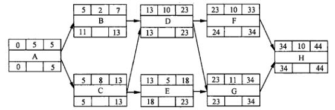

| ES | DU | EF |
|---|---|---|
| ID | ID | ID |
| LS |  | Lf |

其中， ES  表示最早开始时间； EF  表示最早结束时间；LS  表示最迟开始时间； LF  表示最迟结束时间； DU  表示工作历时； ID  表示工作代号。

事件 2：张某的工作计划得到了公司的认可，但是项目建设方（甲方）提出，因该项目涉及 融资，希望项目工期能够提前 2  天，并可额外支付 8  万元的项目款。

事件 3：张某将新的项目计划上报给了公司，公司请财务部估算项目的利润。

#### 【问题 1】（13  分）

（1）请按照事件 1  的要求， 帮助张某完成此项目的单代号网络图。

（2）指出项目的关键路径和工期。

#### 【问题 2】（6  分）

在事件 2  中，请简要分析张某应如何调整工作计划， 才能满足建设方的工期要求，又尽量节 省费用。

#### 【问题 3】（6  分）

请指出事件 3  中，财务部估算的项目利润因工期提前变化了多少，为什么？

| 参考答案 |
|---|

#### 【问题 1】（13 分）

画出单代号网络图 10 分。其中，每个结点数据填写正确 1 分（共 8 分），画出正确的结点间 连线 2 分。

关键路径:ACDGH （2 分），工期 44 天（1 分）。

#### 【问题 2】（6 分）

为使工期缩短 2 天， 且节约支出，应将 C 压缩 1 天（C3 分），D 压缩 1 天（3 分）。 【问题 3】（6 分）

利润增加 5 万元（C3 分）。

缩短 C, D 工期各 1 天会增加 5 万元的费用（2+3），但节约了间接费用 2 万元，而客户为此增 加 8 万元的项目款， 因此项目利润增加 5 万元（3 分）。

#### 【试题四】 ---高级 2012 年上半年案例分析试题

A 公司是一家从事系统集成和应用软件开发的公司， 目前有员工 100 多人，分属销售部、软 件开发部，系统网络部等业务部门。公司销售部主要负责服务和产品的销售工作，将公司现有的 产品推销给客户，同时也会根据客户的具体需要，承接信息系统集成项目，并将其中的应用软件 的研发任务交给软件开发部实施。

经过招投标，A 公司承担了某银行的系统集成项目， 合同规定， 5 月 1  日之前系统必须完成， 并且经过试运行。合同签订后，项目的软件开发任务由软件开发部负责，硬件与网络由系统网络 部负责设计与实施。王工担任这个项目的项目经理。王工根据项目需求，组建了项目团队，团队 分成软件开发小组和网络集成小组，其中软件开发小组组长是赵工，网络集成小组组长是刘工。  王工制定了项目进度计划，图 1 是该项目进度网络图

| 数据库设计 |
|---|

| 功能模块设计 |
|---|

| 界面设计 |
|---|
| 试运行 |

| 综合布线 |
|---|
| 验收 |

图 ,

图 , 中的各个活动中的工期在表 , 中列出：

表 ,

| 活动序号 | 活动名称 | 工期（天） |
|---|---|---|
| 1 | 需求分析 | 30 |
| 2 | 系统设计 | 20 |
| 3 | 界面设计 | 20 |
| 4 | 功能模块设计 | 25 |
| 5 | 数据库设计 | 20 |
| 6 | 编码 | 50 |
| 7 | 软件测试 | 20 |
| 8 | 综合布线 | 60 |
| 9 | 设备安装 | 20 |
| 10 | 硬件测试 | 10 |
| 11 | 试运行 | 20 |
| 12 | 验收 | 2 |

软件开发中，发现有两个需求定义得不够明确， 因此增加了一些功能，导致功能模块设计延 长了五天。网络集成过程中，由于涉及物联网等新技术，综合布线延长了五天。接着采购的一个 新设备没有按时到货，到货之后在调试过程中遇到了以前没有遇到的问题，使网络设备安装调试 延迟了七天。 两个小组分布通过电话向各自部门通报项目的进展，而网络集成工作是在用户现场 进行的，因此网络集成的进度状况在公司总部进行开发工作的软件开发小组并不了解。上述问题导致了项目整体进度的拖延， 绩效状况不佳。

#### 【问题 1】（10 分）

项目原计划工期是（1）天， 如不采取措施， 项目最后完工的工期的（2）天， 这是因为（3）、 （4）的等活动的工期变化，导致了关键路径的变化， 如果想尽量按照原来的预期完成工作，而使 增加成本最少，最常采用的措施是（5）。

请将上面叙述补充完成（将空白处填写的恰当内容写在答题纸的对应栏内）。

#### 【问题 2】（6 分）

分析案例中发生问题的可能原因。

#### 【问题 3】（6 分）

结合案例， 说明王工应如何实施进度控制？采用的工具和技术有哪些？

| 参考答案 |
|---|

#### 【问题 1】（10 分）

（1）将表 1 中的活动历时代入图 1 中， 画出该项目的进度计划网络图；可以得到关键路径为 30+20+25+50+20+20+2=167 天；

（2）由于活动改变， 导致关键路径发生了变化，所以最终关键路径为

30+20+（60+5）+（20+7）+10+20+2=174 天；

（3） 综合布线

（4） 设备安装

（5） 赶工

#### 【问题 2】（6 分）

1）需求管理不力（发现有两个需求定义得不够明确， 因此增加了一些功能， 导致功能模块设 计延长了五天）

2）风险分析和对应不力（采购的一个新设备没有按时到货， 到货之后在调试过程中遇到了以 前没有遇到的问题， 使网络设备安装调试延迟了七天）

3）项目团队间沟通存在问题（两个小组分布通过电话向各自部门通报项目的进展， 而网络集 成工作是在用户现场进行的，因此网络集成的进度状况在公司总部进行开发工作的软件开发小组 并不了解）

4）进度控制和项目整体管理没做好（项目整体进度的拖延，绩效状况不佳） 【问题 3】（9 分）

1）应该制定科学合理的进度计划 （做好活动资源估算、历时估算），可采用的技术有专家判断、自下而上的估算、类比估算、参数估算、三点估算等。

2） 做好风险管理 （风险识别、分析、应对、监控等），可采用的技术有专家判断、 SWOT、风险概率和影响评估、风险分类、建模、风险审计等。

3）做好沟通管理，可采用的技术有沟通建模、人际关系技能、绩效报告系统等。

4）进行进度控制，掌握项目实际进展，并与进度计划进行对比分析， 及时得到进度绩效， 可采用的技术有绩效审查，偏差分析、资源平衡，进度平衡等。

#### 【试题五】 ---高级 2013 年上半年案例分析试题

#### 【说明】

W 公司与所在城市电信运营商 Z 公司签订了该市的通信运营平台建设合同。 W 公司为此成立了 专门的项目团队，由李工担任项目经理，参加项目的还有监理单位和第三方测试机构。李工对项 目工作进行了分解，制作出如下表所示的任务清单。经过分析后李工认为进度风险主要来自需求 分析与确认环节，因此在活动清单定义的总工期基础上又预留了 4 周的应急储备时间。该时度计 划得到了 Z 公司和监理单位的认可。

| 代号 | 任务 | 紧前工作 | 持续时间（周） |
|---|---|---|---|
| A | 项目启动与人员、资源调配 | — | 8 |
| B | 需求分析与确认 | A | 4 |
| C | 总体设计 | B | 4 |
| D | 总体设计评审和修订 | B | 2 |
| E | 详细设计（包括软硬件） | C.D | 10 |
| F | 编码、单元测试、集成测试 | E | 15 |
| G | 硬件安装与调试 | B | 4 |
| H | 现场安装与软硬件联合调试 | F、G | 8 |
| I | 第三方测试 | H | 8 |
| J | 系统试运行与用户培训 | I | 2 |

在项目启动与人员、资源调配（任务 A）阶段，李工经过估算后发现编码、单元测试、集成测试（任务 F）的技术人员不足。经公司领导批准后，公司人力资源部开始招聘技术人员，项目 前期工作进展顺利， 进入详细设计（任务 E）后，负责任务 E  的骨干老杨提出，详细设计小组前 期没有参加需求调研和确认， 对需求文档的理解存在疑问。经过沟通后， 李工邀请 Z 公司用户代 表和项目团队相关人员召开了一次推进会议。会后老杨向李工提出，由于先前对部分用户需求的 理解有误， 须延迟 4 周才可完成详细设计。考虑到进度计划中已预留了 4 周的时间储备，李工批 准了老杨的请求，并按原进度计划继续执行。

任务 E 延迟 4 周完成后， 项目组织开始编码、单元测试和集成测试（任务 F）。此时人力资源 部招聘的新员工陆续到职，为避免进度延误，李工第一时间安排他们上岗。新招聘的员工大多是 应届毕业生， 即便有老员工带领， 工作效率仍然不高。与此同时， W 公司领导催促李工加快进度， 李工只得组织新老员工加班。虽然他们每天加班，可最终还是用了 20 周才完成原来计划用 15 周 完成的任务 F。此时已临近春节假期，在李工的提议下， W 公司决定让项目组在假期结束前提前 1  周入驻 Z 公司进行现场安装与软硬件联合调试。由于 Z 公司和监理单位春节期间只有值班人员，  无法很好地配合项目组工作，导致联合调试工作进展不顺利。为了把延误的进度赶回来，经公司 同意，春节后一上班，李工继续组织项目团队加班。此时许多成员都感到身心疲惫，工作效率下 降，对项目经理的安排充满了抱怨。

#### 【问题 1】

根据任务清单， 将前导图填充完整， 并指出项目的关键路径、计算计划总工期、活动 C  和 G 的总 时差（总浮动时间）。

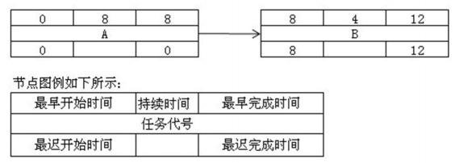

#### 【问题 2】（6 分）

结合本案例简要叙述项目经理在进度管理中存在的主要问题。

#### 【问题 3】（6 分）

如果你是项目经理， 请结合本案例简要叙述后续可采取哪些应对措施。

#### 【问题 4】（5 分）

除了采取进度网络分析，关键路径法和进度压缩技术外，请指出李工在制定进度计划时还可 以采用那些方法或工具。

| 参考答案 |
|---|

#### 【问题 1】（8 分）

首先根据题目画出单代号网络图如下：

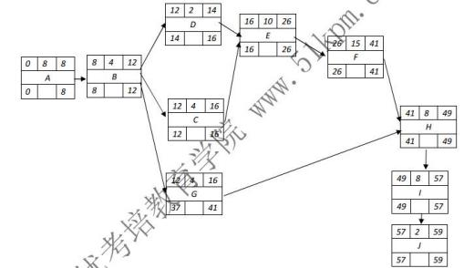

由上图可知：关键路径为 A—B—C—E—F—H—I—J；总工期为 8+4+4+10+15+8+8+2=59 天；

活动 C 的总时差为 0，G 的总时差为 25

#### 【问题 2】（6 分）

（1）没有先期资源调配工作；

（2）没有对新员工进行上岗培训；

（3）老员工除了赶工还要分心来帮助应届毕业生， 降低了工作效率；

（4）没有内部测试就进入了现场环境测试

（5）与 Z 公司和监理单位没有做好沟通工作；

（6）没有解决好冲突管理；

（7）项目经理对关键路径上的任务经常采用加班的方法来赶进度，造成成本增加；

（8）当进度有问题时，没有进行变更控制和修正计划，而是直接使用应急时间储备。

（答案包含但不限于以上内容，列出 6 点就可以，每小点 1 分，最多 6 分，类似即可）

#### 【问题 3】（6 分）

（4）招聘经验丰富的优质资源

#### 【问题 4】（5 分）

#### 【试题六】 ---高级 2016 年上半年案例分析试题

#### 【说明】

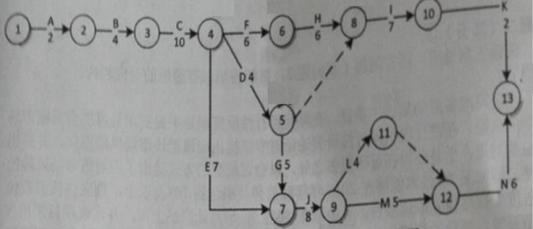

下表给出了该项目各项作业正常工作与赶工工作的时间和费用。

| 活动 | 正常工作 | 正常工作 | 赶工工作 | 赶工工作 |
|---|---|---|---|---|
| 活动 | 时间,天 | 费用,元 | 时间,天 | 费用,元 |
| A | 2 | 1200 | 1 | 1500 |
| B | 4 | 2500 | 3 | 2700 |
| C | 10 | 5500 | 7 | 6400 |
| D | 4 | 3400 | 2 | 4100 |
| E | 7 | 1400 | 5 | 1600 |
| F | 6 | 1900 | 4 | 2200 |
| G | 5 | 1100 | 3 | 1400 |
| H | 6 | 9300 | 4 | 9900 |
| I | 7 | 1300 | 5 | 1700 |
| J | 8 | 4600 | 6 | 4800 |
| K | 2 | 300 | 1 | 400 |
| L | 4 | 900 | 3 | 1000 |
| M | 5 | 1800 | 3 | 2100 |
| N | 6 | 2600 | 3 | 2960 |

#### 【问题 1】（3 分）

请给出项目关键路径。

#### 【问题 2】（3 分）

请计算项目总工期。

#### 【问题 3】（19 分）

（1）请计算关键路径上各活动的可缩短时间、每缩短 1 天增加的费用和增加的总费用，

将关键路径上各活动的名称以及对应的计算结果填入答题纸相应的表格中。

（2）项目工期要求缩短到 38 天，请给出具体的工期压缩方案并计算需要增加的最少费用。

#### 【参考答案】

#### 【问题 1】 （3 分）

关键路径为：ABCDGJMN

分析： ABCFHIK=2+4+10+6+6+7+2=37 ABCDGLN=2+4+10+4+5+8+4+6=43

ABCEJLN=2+4+10+7+8+4+6=41

ABCDIK=2+4+10+4+7+2=29

ABCDGJMN=2+4+10+4+5+8+5+6=44

ABCEJMN=2+4+10+7+8+5+6=42

#### 【问题 2】 （3 分）

总工期为 44

#### 【问题 3】 （19 分） 1、画图（每行 1 个，共 8 分）

| 活动 | 可缩短时间 | 可缩短 1 天增加费用 | 增加的总费用 |
|---|---|---|---|
| A | 1 | 300 | 300 |
| B | 1 | 200 | 200 |
| C | 3 | 300 | 900 |
| D | 2 | 350 | 700 |
| G | 2 | 150 | 300 |
| J | 2 | 100 | 200 |
| M | 2 | 150 | 300 |
| N | 3 | 120 | 260 |

2、将上表中每缩短 1 天的费用从大到小排序

#### 【试题七】 ---高级 2018 年上半年案例分析试题

#### 【说明】

#### 【问题 1】（14 分）

假设该项目团队有 SA 人员 1 人， SD 人员 2 人， SC 人员 3 人，请将下面（1）~（11〉处的答案 填写在答案纸对应栏内。

. A 结束后，先投入（1）个 SD 完成 C，需要（2）天。

. C 结束后，再投入（3）个 SD 完成 D,  需要（4）天。

. C 结束后，投入（5）个 SC 完成（6），需要（7）天。

. D 结束后，投入 SD 完成 B

. C 、D 结束后，投入（8）个 SC 完成 G,需要（9）天。

. G 结束后， 投入（10）个 SC 完成 E，需要 1 天。

. E 、F 、G 完成后，投入 1 个 SA 完成 H，需要 2 天。

. 项目总工朗为（11）天。 【问题 2】（7 分）

假设现在市场上一名 SA 每天的成本为 500 元， 一名 SD 每天的成本为 500 元，一名 SC 每天的成

本为 600 元，项目要压缩至 10 天完成。

（1）则应增加什么类型的资源？增加多少？

（2）项目成本增加还是减少？ 增加或減少多少？（请给出简要计算步骤）

#### 【问题 3】（6 分）

请判断以下描述是否真确（填写在答题纸的对应栏内，正确的选项填写不正确的选项填写“X”）: （1）活动资源估算过程同费用估算过程紧密相关， 外地施工团队聘用熟悉本地相关法规的资讯人 员的成本不熟于活动资源估算的范畴， 只属于项目的成本部分。()

（2）制定综合资源日历属于活动资源估算过程的一部分， 一般只包括资源的有无， 而不包括人力 资源的能力和技能。()

（3）项目变更造成项目延期， 应在变更确认时发布，而非在交付前发布。()

参考答案：

#### 【问题 1】

#### 【问题 2】

（1）需要增加 SA,增加一名。

（2）项目成本减少了，减少了 4900 元。

原成本： 500*13+2*500*13+3*600*13二42900 元

增加人员后成本： 2*500*10+2*500*10+3*600*10二38000 元

所以费用减少了 4900 元。

#### 【问题 3】

（1） X  （2）X     （3）d

分析过程：

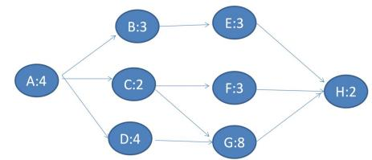

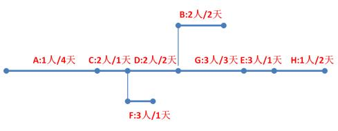

#### 【江山老师分析】此题容易做错，要注意审题，下面 3 个说明一定要多读几遍，把题意搞清楚， 才不容易做错

1.假设不同类型的工作人员之间不能互换，但是同一类型的人员都可以从事与其相关的所有工作。

2.所有参与该项目的工作人员，从项目一开始就进入项目团队，并直到项目结束时才能离开，在

项目过程中不能承担其他活动。

3. （所有的工作都按照整天计算）

#### 【试题八】 ---高级 2018 年下半年案例分析试题

（27 分）

某信息系统项目包含如下十个活动。各活动的历时、活动逻辑关系如下表所示：

| 活动名称 | 活动历时（天） | 紧前活动 |
|---|---|---|
| A | 2 | -- |
| B | 5 | A |
| C | 2 | B 、D |
| D | 6 | A |
| E | 3 | C 、G |
| F | 3 | A |
| G | 4 | F |
| H | 4 | E |
| I | 5 | E |
| J | 3 | H 、I |

#### 【问题 1】（9 分）

（1）请给出该项目的关键路径和总工期。

（2）请给出活动 E、G 的总浮动时间和自由浮动时间。

#### 【问题 2】（5 分）

在项目开始前， 客户希望项目工期压缩为 19 天，并愿意承担所发生的所有额外费用。经过对各项 活动的测算发现，只有活动 B 、D、I 有可能缩短工期，其余活动均无法缩短工期。活动 B 、D 、I 最多可以缩短的天数以及额外费用如下：

| 活动名称 | 最多可以缩短的天数 | 每缩短一天需要增加的额外费用（元） |
|---|---|---|
| B | 2 | 2000 |
| D | 3 | 2500 |
| I | 3 | 3000 |

在此要求下，请给出费用最少的工期压缩方案及其额外增加的费用。

#### 【问题 3】（4 分）

暖将下而①一细处的答案填写在答题纸的对应性内.

项目活动之间的依赖关系分为四种：

（1）是法律或合同要求的或工作的內在性质決定的依赖关系.

（2）是基于具体应用领域的最佳实践或者基于项目的某种特殊性质而设定， 即便还有其他顺序可 以选用，但项目仍缺省按照此种特殊的顺序安排活动

（3）是项目活动与非项目活动之间的依赖关系

（4）是项目活动之间的紧前关系，通常在项目团队的控制之中.

#### 【间题 4】（9 分）

假设该项目的总预算为 20 万元。其中包含 2 万元管理储备和 2 万元应急储备， 当项目进行到某一 天时，项目实际完成的工作量仅为应完成工作的 60%，此时的 PV 为 12 万元，实际花费为 10 万 元。

（1）请计算该项目的 BAC

（2）请计算当前时点的 EV、CV 、SV

（3）在当前绩效情况下，请计算该项目的完工尚需沽算 ETC.

参考答案

#### 【问题 1】（9 分）

1）首先草稿纸上画图

关 键

路径： A-D-C-E-I-J（1.5 分）

总工期 2+6+2+3+5+3=21 天（1.5 分）

2）活动 E 在关键路径上；总浮动时间是。天（1.5 分），自由浮动时间是。天（1.5 分）； 活动 G 的总时间是 1 天（1.5 分），自由浮动时间是 1 天（1.5 分）

#### 【问题 2】（5 分）

压缩方案 1：D 压缩 1 天，工期缩短 1 天，费用 2500 元。（2 分）

2、I 压缩 1 天，工期缩短 1 天，费用 3000 元。（2 分） 需额外增加费用 5500 元。（1 分）

#### 【江山老师说明】D 压缩之后需要注意关键路径会不会发生变化， 有人压缩 B2 天， 要注意啊， 关 键路径变了，还要继续压缩，所以这个不是最佳方案

#### 【问题 3】（4 分）

（1）强制性依赖关系（2）选择性依赖关系（3）外部依赖关系（4）内部依赖关系

#### 【间题 4】（9 分）

1）BAC=20-18=18 万元（管理储备不包括在 BAC 中）

2） EV=12*60%=7.2 万元

CV=EV-AC=7.2-10=-2.8 万元

SV=EV-PV=7.2-12=-4.8 万元

3） CPI=EV/AC=7.2/10=0.72

ETC=（BAC-EV）/CPI=（18-7.2）/0.72=15 万元

#### 【江山老师说明】项目实际完成的工作量仅为应完成工作的 60%,这句话比较难以理解， 应完成工 作是计划的，还是整个项目的呢？我个人倾向于前者，但是后者也有一定道理，出题坑啊！具体 是什么答案，不确定了

#### 【试题九】 ---中级 2009 年上半年案例分析试题

#### 【说明】

B 市是北方的一个超大型城市，最近市政府有关部门提出需要加强对全市交通的管理与控制。

2008 年 9 月 19  日 B 市政府决定实施智能交通管理系统项目， 对路面人流和车流实现实时的、 量化的监控和管理。项目要求于 2009 年 2 月 1 日完成。

该项目由 C 公司承建，小李作为 C 公司项目经理，在 2008 年 10 月 20  日接到项目任务后，  立即以曾经管理过的道路监控项目为参考，估算出项目历时大致为 100 天， 并把该项目分成五大 模块分别分配给各项目小组， 同时要求：项目小组在 2009 年 1 月 20  日前完成任务， 1 月 21  日至 28  日各模块联调， 1 月 29  日至 31  日机动。小李随后在原道路监控项目解决方案的基础上组织制 定了智能交通管理系统项目的技术方案。

可是到了 2009 年 1 月 20  日，小李发现有两个模块的进度落后于计划，而且即使这五个模块 全部按时完成，在预定的 1 月 21  日至 28  日期间因春节假期也无法组织人员安排模块联调， 项目

进度拖后已成定局。

#### 【问题 1】（8 分）

请简要分析项目进度拖后的可能原因。

#### 【问题 2】（4 分）

请简要叙述进度计划包括的种类和用途。

#### 【问题 3】（3 分）

请简要叙述“滚动波浪式计划”方法的特点和确定滚动周期的依据。针对本试题说明中所述 项目，说明采用多长的滚动周期比较恰当。

| 参考答案 |
|---|

#### 【问题 1】（8 分）

1.仅依靠一个道路监控项目来估算项目历时，根据不充分：

2.制定进度计划时， 不仅考虑到活动的历时还要考虑到节假日：

3.没有对项目的技术方案、管理计划进行详细的评审；

4.监控粒度过粗 （或监控周期过长）；

5.对项目进度风险控制考虑不周。

（每个点 2 分，总分不超过 8 分）

#### 【问题 2】（4 分）

1.里程碑计划（1 分），由项目的各个里程碑组成。里程碑是项目生命周期中的一个时刻，在 这一时刻， 通常有重大交付物完成。此计划用于甲乙丙等相关菩方高层对项目的监控：（1 分）

2.阶段计划，或叫概括性进度表（1 分），该计划标明了各阶段的起止日期和交付物，用于  相 关部门的协调（或协同）：（1 分）

3.详细甘特图计划， 或详细横道图计划，或称时标进度网络图（1 分），该计划标明了每个活 动的起止日期，用于项目组成员的 日常工作安排和项目经理的跟踪。（1 分）

#### 【问题 3】（3 分）

1、“滚动波浪式计划”方法的特点是近期的工作计划得较细，远期的工作计划得较粗。（1 分）

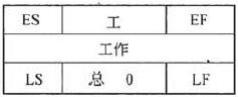

2.根据项目的规模、复杂度以及项目生命周期的长短来确定滚动波浪式计划中的滚动周期。（1 分） 3.滚动周期：1~2 周之间的时间周期都正确。（1 分）

#### 【试题十】 ---中级 2009 年上半年案例分析试题

#### 【说明】

下图为某项目主要工作的单代号网络图。工期以工作日为单位。

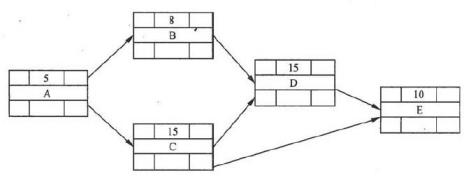

工作节点图例如下：

#### 【问题 1】（5 分）

请在图中填写各活动的最早开始时间（ES）、虽早结束时间（EF）、最晚开始时间（LS）、最 晚结束时间（LF），从第 0 天开始计算。

#### 【问题 2】（6 分）

请找出该网络图的关键路径， 分别计算工作 B.工作 C  的总时差和自由时差，说明此网络工 程的关键部分能否在 40 个工作日内完成，并说明具体原因。

#### 【问题 3】（4 分）

请说明通常情况下， 若想缩短工期可采取哪些措施。

网络图中粗箭头标明了项目的关键路径，按活动的最早开始时间、最早结束时间、最晚开 始时间和最晚结束时间的定义，把它们计算出来后， 直接标在了网络图上。（  图中每个节点写对给 1 分）

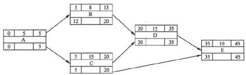

#### 【问题 2】（6 分）

1.关键路径为 A-C-D-E:（2 分）

2.总工期=5+15+15+10=45 个工作日（1 分），因此网络工程不能在 40 个工作日内完成；（1 分） 工作 B:总时差=7  （0.5 分）   自由时差=7  （0.5 分）

工作 C：总时差=0（0.5 分）    自由时差=0  （0.5 分）

#### 【问题 3】（4 分）

1.赶工，缩短关键路径上的工作历时；

2.或采用并行施工方法以压缩工期（或快速跟进）：

3.追加资源；

4.改进方法和技术；

5.缩减活动范围：

6.使用高素质的资源或经验更丰富人员。

（每个点 1 分，总分不超过 4 分）

#### 【试题十一】---中级 2009 年下半年案例分析试题

#### 【说明】

F 公司成功中标 S 市的电子政务工程。F 公司的项目经理李工组织相关人员对该项目的工作进 行了分解，并参考以前曾经成功实施的 W 市电子政务工程项目，估算该项目的工作量为 120 人月， 计划工期为 6 个月。 项目开始不久，为便于应对突发事件，经业主与 F 公司协商，同意该电子政 务工程必须在当年年底之前完成，而且还要保质保量。这意味着，项目工期要缩短为 4 个月， 而 项目工作量不变。

李工按照 4 个月的工期重新制定了项目计划， 向公司申请尽量多增派开发人员，并要求所有 的开发人员加班加点工作以便向前赶进度。由于公司有多个项目并行实施，给李工增派的开发人 员都是刚招进公司的新人。为节省时间， 李工还决定项目组取消每日例会，改为每周例会。同时， 李工还允许需求调研和方案设计部分重叠进行， 允许需求未经确认即可进行方案设计。

屍后， 该项目不但没能 4 个月完成， 反而一再延期，迟迟不能交付。最终导致 8 市政府严重 不满，项目组人员也多有抱怨。

#### 【问题 1】（6 分）

请简要分析该项目一再拖期的主要原因。

#### 【问题 2】（6 分）

请简要说明项目进度控制可以采用的技术和工其。

#### 【问题 3】（3 分）

请简要说明李工可以提出哪些措施以有效缩短项目工期。

| 参考答案 |
|---|

#### 【问题 1】（6 分）

（1）原来估计的 120 人月的工作量可能不准确：

（2） 简单地增加人力资源不一定能如期缩短工期，而且人员的增加意味着更多的沟通成本和 管理成本， 使得项目赶工的难度增大；

（3）增派的人员各方面经验不足；

（4） 项目组的沟通存在问题，每周例会不能使问题及时暴露和解决， 可能会导致更严重的问题出现；

（5）需求没经确认即开始方案设计，一旦客户需求变化， 将导致项目返工；

（6）连续的加班工作使开发人员心理压力增大，工作效率降低， 可能导致开发过程出现问题较多。

（每个 1.5 分，总分不超过 6 分）

#### 【问题 2】（6 分）

（每个 1 分，总分不超过 6 分）

#### 【问题 3】（3 分）

#### 【试题十二】 ---中级 2010 年下半年案例分析试题

#### 【说明】

| 任务 | 计划工期（天） | 计划成本 （元/天） | 已发生费用 | 已完成工作量 |
|---|---|---|---|---|
| 甲 | 10 | 2000 | 16000 | 20% |
| 乙 | 9 | 3000 | 13000 | 30% |
| 丙 | 12 | 4000 | 27000 | 30% |
| 丁 | 13 | 2000 | 19000 | 80% |
| 成 | 7 | 1800 | 10000 | 50% |
| 合计 |  |  |  |  |

#### 【问题 1】（6  分）

请计算该项目在第 5 天末的 PV 、EV 值,并写出计算过程。

#### 【问题 2】（5  分）

请从进度和成本两方面评价此项目的执行绩效如何,并说明依据。

#### 【问题 3】（2  分）

为了解决目前出现的问题,项目经理可以采取哪些措施？

#### 【问题 4】（2  分）

如果要求任务成按期完成,项目经理采取赶工措施,那么任务成的剩余日平均工作量是原计 划日平均工作量的多少倍？

| 参考答案 |
|---|

#### 【问题 1】（6 分）

PV=2000 *5+3000 * 5+4000 * 5+2000 * 5+1800 * 5=64000   （3 分）

EV=2000 *10 *20%+3000 * 9 *30%+4000 * 12 * 30%+2000 * 13 *80%+1800 * 7 *50%=64400 	（ 3 分）

#### 【问题 2】（5 分）

进度超前， 成本超支。（1 分）

原因:SV=EV-PV=64400 一 64000 =400> 0 或 SPI=EV/PV=64400/64000=1.006> 1  （2 分）  CV=EV-AC=64400 一 73000 =86000< 0 或 CPI= EV/Ac=64400/73000= 0.882<1  （2 分）

#### 【问题 3】（2 分）

整个项目需要抽出部分人员以放慢工作进度;

整个项目存在成本超支现象， 需要采取控制成本措施;

项目中区分不同的任务，采取不同的成本及进度措施;

必要时调整成本基准。

答对一条给 1 分，最高 2 分。

#### 【问题 4】（2 分）

任务戈计划的平均日工作量为 1/7=14.3% （0.5 分）

现在的平均日工作量为 50%/2=25% （0.5 分）

所以平均日工作量增加值为 25%/14.3%=1.75 （ 1 分）

#### 【试题十三】 ---中级 2010 年下半年案例分析试题

#### 【说明】

某信息系统集成公司（承建方）成功中标当地政府某部门（建设方）办公场所的一项信息系 统软件升级改造项目。项目自 2 月初开始,工期 1 年。承建方项目经理制定了相应的进度计划, 将项目工期分为四个阶段：需求分析阶段计划 8 月底结束；设计阶段计划 9 月底结束；编码阶段 计划 11 月底结束； 安装、测试、调试和运行阶段计划次年 2 月初结束。当年 2 月底,建设方通知

承建方， 6 月至 8 月这 3 个月期间因某种原因，无法配合项目实施。经双方沟通后达成一致，项目 仍按原合同约定的工期执行。

由于该项目的按时完成对承建方非常重要，在双方就合同达成一致后，承建方领导立刻对项 目经理做出指示：（1）招聘新人，加快需求分析的进度， 赶在 6 月之前完成需求分析；（2）6 月至 8 月期间在本单位内部完成系统设计工作。

项目经理虽有不同意见，但还是根据领导的指示立即修改了进度管理计划并招募了新人，要 求项目组按新计划执行，但项目进展缓慢。直到 11 月底项目组才刚刚完成需求分析和初步设计。

#### 【问题 1】（3  分）

除案例中描写的具体事项外， 承建方项目经理在进度管理方面可以采取哪些措施?

A.开发抛弃型原型         B.绩效评估             C.偏差分析

D.编写项目进度报告       E、确认项目范围         F、发布新版项目章程

#### 【问题 2】（6  分）

（1）基于你的经验，请指出承建方领导的指示中可能存在的风险，并简要叙述进行变更的主 要步骤。

（2）请简述承建方项目经理得到领导指示之后，如何控制相关变更。

#### 【问题 3】（6  分）

针对项目现状，请简述项目经理可以采用的进度压缩技术，并分析利弊。

| 参考答案 |
|---|

#### 【问题 1】（3 分）

正确选项为:B. C 和 D。

A 选项不适合案例所述的信息系统软件升级改造项目，通常新信息系统项目才考虑开发抛弃型 原型。

E 选项不适合案例的背景。范围确认是客户等干系人正式验收并接受已完成的项目可交付物的 过程。本案例中，建设方和承建方经过沟通后达成一致，项目仍按原合同约定的工期执行，未明 确涉及项目范围的变化和客户验收交付物的相关问题。

F 选项不适合案例的背景。项目章程通常是由项目发起人发布， 而不是由项目经理发布。此外， 制定和发布项目章程不属于进度管理的主要工作。

（每选对 1 个的 1 分，总分 3 分）

#### 【问题 2】（6 分）

（1）解答要点:

a）盲目增加人力未必可以加快项目进度， 尤其是增加没有经验的员工，反而可能会拖延进度。（1 分） b）项目的风险是否能够规避，需要按照风险管理的方法进行风险识别、风险分析和风险监控。（1 分）

（2）解答要点:

a）根据领导指示的内容，向变更控制委员会提出相关变更申请;

b）推动变更控制委员会对变更进行评估， 分析变更造成的影响及风险;

C）根据变更决策推动变更的实施， 包括更新进度计划、招聘新人和相关活动;

d）执行或推动变更的确认，开展变更后的项目活动。

（每个点得 1 分，总分不超过 4 分）

#### 【问题 3】（6 分）

进度压缩的技术有以下两种:

（1） 赶进度：对费用和进度进行权衡， 确定如何在尽量减少费用的前提下缩短项目所需时间。 利：有可能在尽量减少费用的前提下缩短项目所需的时间;

弊：赶进度并非总能产生可行的方案，有可能反而使费用增加;

（2）快速跟进：同时进行按先后顺序的阶段或活动。

利：适当增加费用，可以缩短项目所需的时间;

弊：以增加费用为代价换取时间，并因缩短项目进度时间而增加风险;

（每个点得 3 分，总分不超过 6 分）

#### 【试题十四】 ---中级 2011 年下半年案例分析试题

#### 【说明】

某系统集成项目的建设方要求必须按合同规定的期限交付系统， 承建方项目经理李某决定严 格执行项目进度管理，以保证项目按期完成。他决定使用关键路径法来编制项目进度网络图。在 对工作分解结构进行认真分析后，李某得到一张包含了活动先后关系和每项活动初步历时估计的 工作列表， 如下所示：

| 活动代号 | 前序活动 |  |
|---|---|---|
| A | - |  |
| B | A |  |
| C |  | 6 |
| D |  | 4 |
| E |  | 8 |
| F |  | 5 |
| G |  | 6 |
| H |  | 9 |

#### 【问题 1】（5 分）

如果活动 B 拖延了 4 天，则该项目的工期会拖延几天？请说明理由。

#### 【问题 3】（6 分）

按照题干所述，李某实际完成了项目进度管理的什么过程？如果要进行有效地项目进度管理， 还要完成哪些过程？

| 参考答案 |
|---|

#### 【问题 1】

双代号网络图如下：

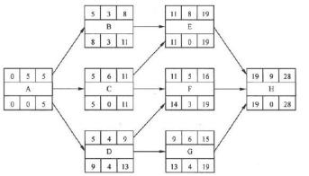

（1） B.C.F 的自由浮动时间分别为 3 天（1 分），0 天（1 分），3 天（1 分）

（2 ）D、G 的最迟开始时间分别为 5 天（1 分），13 天（1 分）

#### 【问题 2】

结果拖延了 1 天（1 分）

#### 【问题 3】

#### 【试题十五】 ---中级 2012 年上半年案例分析试题

#### 【说明】

|  |  |  | 程序员 | 测试工程师 |
|---|---|---|---|---|
| 日均成本（元） |  |  | 400 | 300 |

项目经理根据项目的总体要求制定了某项目的网络资源计划图（图 1 所示， 单位为日，为简化起 见，不考虑节假日），并向公司申请了 2 名系统分析师负责需求分析， 3 名设计师负责系统设计， 10 名程序员负责子系统的开发和集成， 2  名测试工程师负责系统测试和发布。项目经理估算总人 力成本为 27400 元。

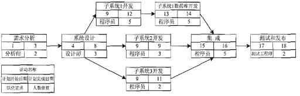

#### 【问题 1】（4 分）

请指出项目经理在人力成本的估算中使用了哪些成本估算方法。

#### 【问题 2】（7 分）

第 9 日的工作结束时，项目组已完成需求分析、系统设计工作、子系统 1 的开发完成了四分之一、 子系统 3 的开发完成了三分之一，其余工作尚未开展，此时人力部门统计应支付总人力成本 9400  元。请评价项目当前的进度绩效和成本绩效， 给出调整措施， 并预测原计划继续执行所需要的 ETC  （完工尚需成本）。

#### 【问题 3】（4 分）

假设每名项目组成员均可胜任分析、设计、开发、集成、测试和发布工作，在不影响工期的前提 下， 可重新安排有关活动的顺序以减少项目所需人数，此种情况下， 该项目最少需要（7）人，子 系统 3 的开发最晚应在第（12） 日开始。

请你将上面的叙述补充完整（将空白处应填写的恰当内容写在答题纸的对应栏内）。

本题为资源平衡的题目！！详见专家关于资源平衡的相关讲课和资料！！！

要会求最少人员、活动的 6 时标！！！

| 参考答案 |
|---|

#### 【问题 1】（4 分）

①,  定资源费率 ②参数估算法（3）自下而上估算法

（每小点 1 分，全对得 4 分）

#### 【问题 2】（7 分）

首先画网络图， 注意题目给的是第一个活动从。开始，如果变成 1，则每个活动左边加 1 即可， 其 余不动，红色的为关键路径

首先根据题目得知 BAC=27400

第 9 日，预计活动的预计成本

PV=需求分析+系统设计工作+子系统 1 的 1/4+ 子系统 2 + 子系统 3 的 1/3

=350 元*2 人*3 天+300 元*3 人*5 天+400 元*5 人*1 天+400 元*3 人*1 天+400 元*2 人*1 天=10600

实际活动的实际成本 AC= 9400

实际活动的预计成本

EV=需求分析+系统设计工作+子系统 1 的 1/4   +  子系统 3 的 1/3

=350 元*2 人*3 天+300 元*3 人*5 天+400 元*5 人*1 天+400 元*2 人*1 天=9400

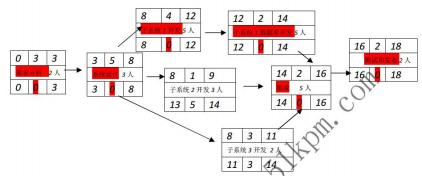

CPI=EV/AC=9400/9400=1 成本刚好预算平衡。不需要调整

SPI=EV/PV=9400/10600=0.89 进度落后。

方法：用高效人员替换低效率人员（1 分），

加班（或赶工）（1 分） 或在防范风险的前提下并行施工（1 分）

ETC=（BAC-EV）/CPI=（27400-9400）/1=18000（元）

#### 【问题 3】（4 分）

（1）8  （2）12  （每空 2 分）

本题为资源平衡的题目！！详见专家关于资源平衡的相关讲课和资料！！！

要会求最少人员、活动的 6 时标！！！

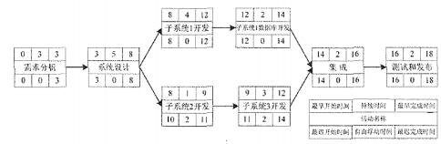

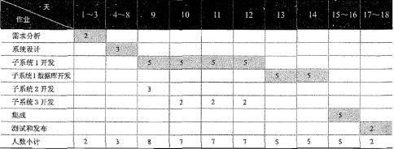

#### 【试题十六】 ---中级 2012 年下半年案例分析试题

某项目 6 个月的预算如下表所示。表中按照月份和活动给出了相应的 PV 值， 当项目进行到 3 月底时，项目经理组织相关人员对项目进行了绩效考评，考评结果是完成计划进度的 90%。

单位：元

| 活动 | 1 月 | 2 月 | 3 月 | 4 月 | 5 月 | 6 月 | 活动 PV | 活动 EV |
|---|---|---|---|---|---|---|---|---|
| 编制计划 | 4000 | 4000 |  |  |  |  | 8000 | ① |
| 需求调研 |  | 6000 | 6000 |  |  |  | 12000 |  |
| 概要设计 |  |  | 4000 | 4000 |  |  | 8000 | ② |
| 数据库设计 |  |  |  | 8000 | 4000 |  | 12000 |  |

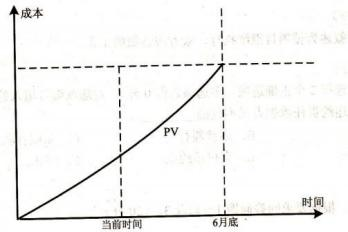

| 详细设计 |  |  |  |  | 8000 | 2000 | 10000 |  |
|---|---|---|---|---|---|---|---|---|
| 。。。。。。。。。 |  |  |  |  |  |  |  |  |
| 。。。。。。。。。 |  |  |  |  |  |  |  |  |
| 月度 PV | 4000 | 10000 | 10000 | 12000 | 12000 | 2000 |  |  |
| 月度 AC | 4000 | 11000 | 11000 |  |  |  |  |  |

注：（表中活动之间的关系为 F-S 关系，即前一个活动结束，后一个活动才能开始）

#### 【问题 1】（7 分）

请计算 3 月底时项目的 SPI、、CPI、CV 、SV、值，以及表中 1、2 处的值（注：表中 1 处代

表“编制计划”活动的 EV 的值，表中 2 处代表“概要设计“活动的 EV 值）。

#### 【问题 2】（7 分）

（1）如果项目按照当前的绩效继续进行， 请预测项目的 ETC（完成时尚需估算） 和 EAC（完 成时估算）。

（2）请评价项目前 3 月的进度和成本绩效并提出调整措施。

#### 【问题 3】（6 分）

假设项目按照当前的绩效进行直至项目结束，请在下图中画出从项目开始直到结束时的 EV 和 AC 的曲线，并在图中用相应的线段表明项目完成时间与计划时间的差（用“t”标注）、计划成本 与实际成本的差（用“c”标注）。

| 参考答案 |
|---|

#### 【问题 1】（7 分）

3 月底时， PV=4000+10000+10000=24000    AC=4000+11000+11000=26000

SPI=90%（1 分）

SPI=EV/PV

EV=SPI*PV=0.9*24000=21600（1 分）    CPI=EV/AC=21600/26000=83%（1 分）

CV=EV-AC=21600-26000=-4400（1 分）    SV=EV-PC=21600-24000=-2400（1 分）

① =4000+4000=8000（1 分）    ② 21600-8000-12000=16001 分）

说明： 当某活动完成后，就是 EV=PV

说明：3 月底总 EV 减去编制计划和调研的 EV

#### 【问题 2】（7 分）

（1） ETC=（BAC-EV）/CPI=（50000-21600）/0.83=32417（2 分， 公式对给 1 分）  EAC=AC+ETC=21600+34217=60217（2 分，公式对给 1 分）

（2）进度绩效：进度落后（1 分）

成本绩效：成本超支（1 分）

调整措施：用效率高的人员更换效率低的人员，或提前开展数据库设计或详细设计工作（1 分） 【问题 3】（6 分）

AC 与 EV 曲线可以是直线、曲线、折线（2 分），只要与 PV 相对位置画对就给分，t，c 每标对一个 给 1 分。

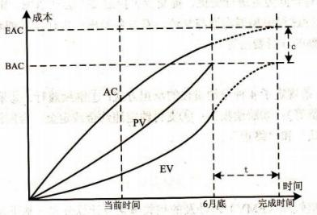

| A 2 天 |
|---|

| 活动代号 活动持续天数 |
|---|

#### 【问题 1】（6 分）

请指出该网络图的关键路径并计算出项目的计划总工期。

#### 【问题 2】（8 分）

根据上面的前导图， 活动 C 的总时差为（1）天，自由时差为（2）天。

杨工是该项目的关键技术人员， 他同一时间只能主持并参加一个活动。若杨工要主持并参与 E、 C.I 三个活动那么项目工期将比原计划至少推迟（3）天。在这种情况下杨工所涉及的活动序列（含 紧前和紧后活动）为（4）。

请将上面（1）到（4）处的答案填写在答题纸的对应栏内。

#### 【问题 3】（4 分）

针对问题 2 所述的情形，如仍让杨工主持并参与 E 、C.I 三个活动，为避免项目延期，请结合 网络图的具体活动顺序叙述项目经理可采取哪些措施。

| 参考答案 |
|---|

#### 【问题 1】（6 分）

根据题意以及活动之间的依赖关系，可以画出如下的单代号网络图：

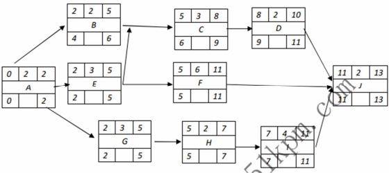

关键路径： AEFJ（2 分）和 AGH IJ（2 分）

计划总工期：13 天（2 分）

#### 【问题 2】（8 分）

（2） 1 （2）0 （3）1 （4）AEC IJ

（每条 2 分，共 8 分）

#### 【问题 3】（4 分）

在活动 A 或 E 或 C 或 l 或 J 处赶工（2 分），包括加班、改进技术、增加资源等措施

（回答出一个措施即给 2 分，最多得 2 分）

#### 【试题十八】 ---中级 2014 年上半年案例分析试题

#### 【说明】

M 公司是从事了多年铁路领域系统集成业务的企业，刚刚中标了一个项目，该项目是开发新 建铁路的动车控制系统，而公司已有多款较成熟的列车控制系统产品。 M 公司与客户签订的合同 中规定：自签订合同之日起， 项目周期为 9 个月。在项目开始后不久，客户方接到上级的通知， 要求该铁路提前开始，因此， 客户要求 M 公司提前 2 个月交付项目。

项目经理将此事汇报给公司高层领导，高层领导详细询问了项目情况，项目经理认为，公司 的控制系统软件是比较成熟的产品，虽然需要按项目需求进行二次开发，但应该能够提前完成，  但列车控制设备需要协调外包生产，比原计划提前 2 个月没有把握，公司领导认为，从铁路行业 的项目特点来考虑，提前开始铁路是必须完成的任务，因此客户的要求不能拒绝。于是他要求项

目经理进行讨论无论如何也要想办法满足客户提出的提前交付的需求。

#### 【问题 1】 （5  分）

结合案例， 如果你是项目经理，请分析进度提前对项目管理可能造成哪些方面的变更。 【问题 2】 （4  分）

为了满足客户提出的进度方面“提前 2  个月交付”的要求，项目经理可以采取的措施有哪些？ 【问题 3】 （6  分）

在采取了上述措施之后，项目在执行过程中还可能面对哪些问题？

| 参考答案 |
|---|

#### 【问题 1】

结合案例， 如果你是项目经理，请分析进度提前对项目管理可能造成哪些方面的变更。 答：可能的变更如下：

1、 重新安排活动计划带来的进度计划或项目管理计划变更；

### 2、 工期变化势必带来合同变更

3、 投入更多的资源引起的成本变更；

4、 投入更有效的人员带来的团队变更；

5、 为了使外包生产提前完成，可能重新便于采购计划（不限于更换外包商）； 6、 种种措施引入新的风险带来的变更。

#### 【问题 2】

为了满足客户提出的进度方面“提前 2 个月交付”的要求，项目经理可以采取的措施有哪些？ 答：可采取如下措施：

1、 赶工加班（或者缩小范围）；

2、 快速跟进， 并行处理，管理好风险；

3、 投入更多的资源；

4、 选派经验丰富高效的人员加入；

5、 加强外包生产进度的监控，及时处理变更。

#### 【问题 3】

在采取的上述措施后，项目在执行过程中还可能面对哪些问题？

答：采取了上述措施可能面对的问题如下：

1、 赶工带来的恒本增加，人员加班效率下降，团队负荷加大；

2、 快速更进带来反攻等风险；

3、 选派经验丰富的人员和投入更多的资源带来成本超支的风险；

4、 如果该井技术方法， 也可能引入新技术带来的风险；

5、 公司领导对项目的高压易引起团队的焦虑和冲突；

6、 为了提前进度，容易忽视变更管理、质量控制等环节；

7、 外包生产可能不能按时交付。

#### 【试题十九】 ---中级 2014 年下半年案例分析试题

#### 【说明】

下表是某项目的工程数据， 根据各个问题中给出的要求和说明， 完成问题 1 和问题 3，将解答 填入答题纸的对应栏内。

| 活动 | 紧后活动 |  |
|---|---|---|
| A | C 、E |  |
| B | C 、F |  |
| C | D |  |
| D | G、H |  |
| E | G |  |
| F | H | 2 |
| G |  | 3 |
| H |  | 5 |

#### 【问题 1】（4 分）

#### 【问题 2】（5 分）

#### 【问题 3】（6 分）

假设项目预算为 280 万元，项目的所有活动经费按照活动每周平均分布， 并与具体的项目无 关，则项目的第一周预算是多少？项目按照约束条件执行到第 10 周结束时， 项目共花费 200 万元， 共完成了 A 、B 、C 、E 、F 5 项活动， 请计算此时项目的 PV 、EV 、CPI 和 SPI。

解析的要点和思路

### 1、注意审题

要回答【问题 1】，得先根据上面的表格画网络图，要注意的是表格中提到的是： （1）“紧后活动”，不是通常的“紧前活动”；

（2）根据【问题 1】，要画网络图，最好画时标网络图和单代号网络图，以互相印证，避免答错。

根据这个表格画的时标网络图如下：

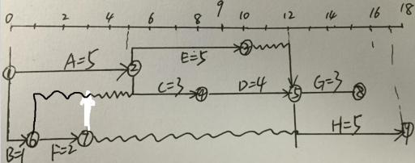

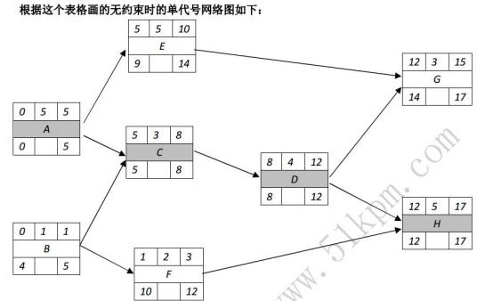

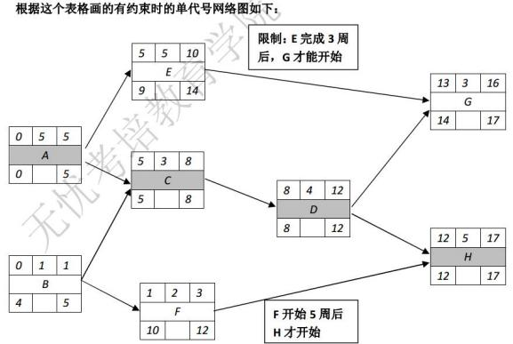

看我手工画的前 2 个图中，最早开始时间和最迟开始时间相同的活动， 一般在关键路径上，【问题 1】 该项目的关键路径为 A-C-D-H，项目工期=17 周，因此完成该项目至少需要 17 周。

假设的 2 个限制条件后，完成该项目还是需要 17 周。

#### 【问题 2】

没有约束条件下，

活动 B：总时差=4-0=4，自由时差=1-1=0

活动 G：总时差=14-12=2，自由时差=17-15=2

有约束条件下，

活动 B：总时差=4-0=4，自由时差=1-1=0  活动 G： 总时差=14-13=1，自由时差=17-16=1

#### 【问题 3】

把所有 8 个活动的工期相加： 5+1+3+4+5+2+3+8=28 周，

项目总预算为 280 万元，

平均： 10 万元/周/活动。

第 1 周，要进行 A、B 两个活动，因此计划完成的预算是： 2*10 万元 = 20 万元。  即使加了约束，因为问的是 10 周结束时，因此这 2 个约束不影响前 10 周的计划：

根据我手工画的第 3 个图， 10 周结束时， 计划要完成 ABCEF 活动，D 活动计划要完成前 2 周任务，

则项目 PV=18 周活动*10 万元/周/活动=180 万元

项目 AC = 200 万元

实际完成 ABCEF 活动的预算有 16 周活动*10 万元/周/活动=160 万元，即 EV=160 万元。 CPI=EV/AC=160/200=0.80    SPI=EV/PV=160/180=0.89

#### 【试题二十】 ---中级 2015 年上半年案例分析试题

#### 【说明】

项目经理小桶把编号为 1401 的工作包分配给张工负责实施，要求他必须 25 天内完成。任务 开始时间是 3 月 1 日早 8 点， 每天工作时间为 8 小时。

张工对该工作包进行了活动分解和活动历时估算，并绘制了如下的活动网络图。

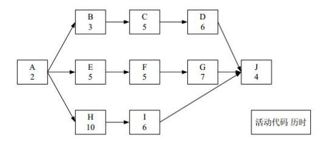

1401 工作包的直接成本由人力成本（每人每天的成本是 1000 元）构成，每个活动需要 2 人完成。 【问题 1】（9 分）

请将下面（1）~（6）处的答案赶写在答题纸的对应栏内。

张工按照《1401 工作包活动网络图》制订了工作计划， 预计总工期为（1）天。按此计划， 预 留的时间储备是（2）天。该网络目的关键路径是（3）。按照《1401 工作包活动网络图》所示， 计 算活动 C 的总时差是（4）天，自由时差是（5）天。正常情况下，张工下达给活动 C 的开工时间

是 3 月（6）日。

#### 【问题 2】（6 分）

假如活动 C 和活动 G 都需要张工主持施工（张工不能同时对 C 和 G 进行施工），请进行如下 分析：

（1）由于各种原固，活动 C 在 3 月 9 日才开工，按照张工下达的进度计划，该工作包的进度是否 会延迟？并说明理由。

（2）基于（1）所讲的情况， 在不影响整体项目工期的前提下， 请分析张工宜采取哪些措施 【问题 3】（10 分）

张工按照《1401 工作包活动网络图》编制了进度计划和工作包预算， 经批准后发布。在第 12 天的 工作结束后，活动 C.F、H 都刚刚完成，实际花费为 7 万元。请做如下计算和分析：

（1）当前时点的 SPI 和 CPI。

（2）在此情况下，张工制订的进度计划是否会受到影响，并说明理由。

#### 【问题 1-参考答案】

具体网络图如下：

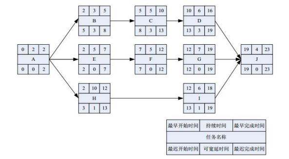

首先找出关键路径为：AEFGJ，2+5+5+7+4=23

（1）总工期 23 天

（2）时间储备 2 天（预计总工期 25-关键路径工期 23=2）

（3）关键路径：AYEYFYGYJ

（4）C 的总时差 3 天（C 活动最早开始时间是第 10 天，最晚开始时间是 13，总时差=最晚开始时 间-最早开始）

（5）C 的自由时差 0 天（活动 D 最早开始时间-活动 C 最早结束时间=10-10=0；）

（6）C 的开工时间为 3 月 6 日。（3 月 1 日开工，活动 C 最早在第 5 天开始，也即 3 月 6 日） 【问题 2-参考答案】

（1）工作包进度不会延迟。

因为 C 活动 9 日开始，13 日末才能结束。而关键路径上的 G 活动，开始时间是 13 日上午 8 点。题 目要求张工不能同时对 C 和 G 进行施工。所以会导致关键活动 G 延期 1 天，总工期延迟 1 天， 但 工作包有 2 天的储备时间，所以进度延期 1 天， 但工作包整体进度还会在 25 天要求内完成。

（2）在不影响整体项目工期的前提下， 建议张工可采取如下措施：

（1）提高活动 G、J 的工作效率，

（2）增加资源， 加快 G、J 进度

（3）赶工，加班

（4）指派经验更丰富的人去完成工作

#### 【问题 3-参考答案】

（1）依题意可得：

根据题意 12 天 A、B、C、E、F、H 刚好完工知道，A、E、F 分别在第 0、2、7 天开始 AC=7（万）

EV=（EVA+EVB+EVE+EVH+EVC+EVF）=（2+3+5+5+5+10）*2*1000=6（万）；

PV=（PVA+PVB+PVE+PVH+PVC+PVF+PVD 前 2 天）=（2+3+5+5+5+10+2）*2*1000=6.4（万） 所以， SPI=EV/PV=0.94，CPI=EV/AC=0.86

（2）由（1）可知会受到影响，因为目前情况下，进度落后。

#### 【试题二十一】---中级 2015 年上半年案例分析试题

#### 【说明】

某市承办国际服装节， 需要开发网站进行宣传。系统集成企业 M 公司中标了该网站开发项目。 该项目既要考虑一般网站建设的共性，又要考虑融入人的艺术创意和构思，以便能够将网站办的 耳目一新， 不但具有宣传价值，还能利于大数据的积累。

网站的主要内容包括大型活动宣传、名师名模服装展示、服装服饰交易、服装文化传播等。

双方协定项目合同工期为 5 个月。 M 公司任命项目经理小曹负责该项目。项目组经过需求调 研后制定了项目计划，并按计划完成了网站系统分析、系统设计（包括艺术风格与主页设计）、数 据库设计等活动。

项目进入编码阶段后，承办单位为了扩大影响力，要求在项目中增加全国服装模特海选的宣传、 选拔、评奖与管理。固此，建设方代表直接找到小曹提出增加项目内容，并答应会支付相应的费 用，但要确保项目工期不能拖延。

针对上述情况，小曹及其领导进行了如下处理：

（1）小曹见到其领导时转述了建设方的要求，

（2）领导考虑了一会儿，对小曹说“答应客户要求”，

（3）小曹通知商务人员与建设方签订补充协议，

（4）因建设单位要求工期不能拖延，故小曹决定项目进度计划不变，

（5）小曹找来设计工程师小麽，把新增部分全权委托给了他， 让他加班加点确保进度。交付 期至时，项目集成测试中发现的问题还未得到及时解决。

#### 【问题 1】（10 分）

面对用户的要求，小曹及其领导的做法有何不妥之处？

#### 【问题 2】（7 分）

为确保进度不受拖延，小曹应该如何执行领导的决定？

#### 【问题 1-参考答案】：

不妥之处有：

1、项目没有制定明确的变更流程。小曹没有要求客户提出具体变更申请及方案。

2、没有变更影响评估。小曹缺乏对变更的影响进行全面分析（应从成本、进度、质量、风险、范 围等多方面进行分析）。

3、领导做出同意变更的决定太草率，缺乏变更影响评估等依据。

4、变更决策后没有通知所有项目干系人，变更后缺少计划。变更批准后，小曹没有对项目管理计 划（不只是进度计划）进行相应的调整。

5、没有监控变更后的项目计划，没有落实进度资源管理， 没有做好相关衔接工作：小曹缺乏对变 更的实施进行跟踪、监控。

6、缺少沟通：小曹与客户沟通不够及时、全面。

#### 【问题 2-参考答案】：

为确保进度不受拖延，建议小曹可以采取如下措施：

1、加强沟通： 在接受客户的变更申请后增强与客户等干系人的沟通， 达成共识，明确增加内容的 具体要求；

2、监控变更后的项目计划，做好相关衔接工作。更新项目范围说明书和需求说明书，与客户进行 书面确认；

3、根据新的需求进行进度计划和成本计划， 与用户签订补充协议（明确项目范围、进度、成本等）； 4、因保证工期，可考虑外包；

5、增加资源，适当增加相应人员完成新增项目工作；

6、加强团队建设，提高团队的整体绩效水平；

7、进行有效激励手段，提高个人的工作积极性和主观能动性， 提高工作效率。

#### 【试题二十二】 ---中级 2016 年上半年案例分析试题

#### 【说明】

已知某信息工程项目由 A 至 1 共 9 个活动构成，项目组根据项目目标，特别是工期要求，经 过分析、定义及评审，给出了该项目的活动历时、活动所需资源及活动逻辑关系列表，如下表所 示：

| 活动 | 历时（天） | 资源（人） | 紧前活动 |
|---|---|---|---|
| A | 10 | 2 | -- |
| B | 20 | 8 | A |
| C | 10 | 4 | A |
| D | 10 | 5 | B |
| E | 10 | 4 | C |
| F | 20 | 4 | D |
| G | 10 | 3 | D |
| H | 20 | 7 | E 、F |
| I | 15 | 8 | G、H |

#### 【问题 1】（2 分）

#### 【问题 2】（6 分）

请给出活动 C 、E 、G 的总时差及自由时差。

#### 【问题 3】（6 分）

项目经理以工期紧、项目难度高为由， 向高层领导汇报申请组建 12 人的项目团队， 但领导没 批准。

（1）领导为什么没有同意该项目经理的要求？若不考虑人员能力差异，该项目所需人数最少 是多少个人？

（2）由于资源有限， 利用总时差、自由时差， 调整项目人员安排而不改变项目关键路径和工 期的技术是什么？

（3）活动 C 、E 、G 各自最迟从第几天开始执行才能满足（1）中项目所需人数最少值？

#### 【问题 4】（6 分）

在（1）~（6）中填写恰当内容（从候选答案中选择一个正确选项，将该选项编号填入答题 纸对应栏内）。

为了配合甲方公司成立庆典， 甲方要求该项目提前 10 天完工，并同意支付额外费用。承建单 位经过论证，同意了甲方要求并按规范执行了审批流程。为了保质保量按期完工，后续结合项目 进度控制及项目人力资源管理方面的措施可以包括：

①向（1）要时间，向（2）要资源；  ②压缩（3）上的工期；

（3）加强项目人员的质量意识，及时（4），避免后期返工；

④采取压缩工期的方法： 尽量（5）安排项目活动，组织大家加班加点进行（6）。 （1）~（6）供选择的答案：

A.评审 B.激励 C.关键路径 D.非关键路径

E.赶工 F.并行 G.关键任务 H.串行

#### 【试题一参考答案】

#### 【问题 1】（2 分）

关键路径为 ABDFHI（1 分），工期为 95 天（1 分）

#### 【问题 2】（6 分）

C 总时差=30（1 分），C 自由时差=0（1 分）

E 总时差=30（1 分），E 自由时差=30（1 分）

G 总时差=30（1 分），G 自由时差=30（1 分）

#### 【问题 3】（6 分）

（2）资源平衡（1 分）

#### 【试题二十三】 ---中级 2017 年上半年案例分析试题

| 活动代码 | 紧前活动 | 活动持续时间 |
|---|---|---|
| A | --- | 5 |
| B | A | 3 |
| C | A | 6 |
| D | A | 4 |
| E | B 、C | 8 |
| F | C 、D | 5 |
| G | D | 6 |
| H | E 、F、G | 9 |

#### 【问题 1】（4 分）

计算该活动的关键路径和项目的总工期

#### 【问题 2】（8 分）

（1）计算活动 B 、C 、D 的总体时差

（2）计算活动 B 、C 、D 的自由时差

（3）计算活动 D 、G 的最迟开始时间

#### 【问题 3】（5 分）

如果活动 G 今早开始，但工期拖延了 5 天，则该项目的工期会拖延多少天？请说明理由。 【问题 4】（5 分）

请简要说明什么是接驳缓冲和项目缓冲。如果采取关键链法对该项目进行进度管理，则接驳缓冲 应该设置在哪里？

#### 【参考答案】

#### 【问题 1】

关键路径： A-C-E-H，总工期 28 天
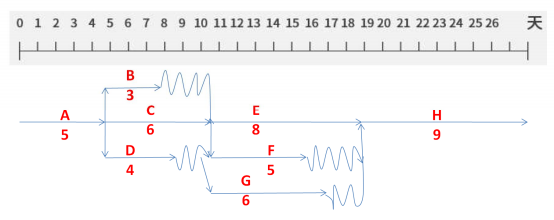

#### 【问题 2】

（1）B 的总时差为 3，C 的总时差为 0， D 的总时差为 4

（2）B 的自由时差为 3，C 的自由时差为 0，D 的自由时差为 0

（3）活动 D 的最迟开始时间为 28-9-6-4+1=10，第 10 天早上必须开始。

活动 G 的最迟开始时间为 28-9-6+1=14，即第 14 天早上必须开始。

#### 【问题 3】

工期会延误一天

理由是：G 的总时差为 4，延误了 5 天， 所以， 工期会延误 1 天

#### 【问题 4】

项目缓冲是用来保证项目不因关键链的延误而影响项目完成。

接驳缓冲是用来保证非关键活动影响关键活动的进行。

项目缓冲放在最后一个活动后，项目完成前。

接驳缓冲放在非关键链与关键链的接合点。

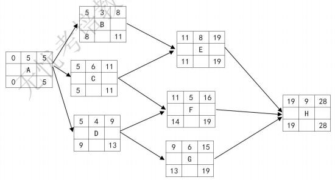

#### 【试题二十四】 ---中级 2017 年下半年案例分析试题

#### 【说明】

某信息系统项目包含如下 A 、B 、C 、D 、E ,F ,G、H  八个活动。各活动的历时估算和活动 间的逻辑关系如下表所示（其中活动 E  的历时空缺）：

| 活动名称 | 活动历时（天） | 紧前活动 |
|---|---|---|
| A | 2 | - |
| B | 4 | A |
| C | 5 | A |
| D | 3 | A |
| E |  | B |
| F | 4 | C 、D |
| G | 3 | E 、F |
| H | 3 | G |

#### 【问题 1】（3  分）

假设活动 E  的最乐观时间为 1  天,最可能时间为 4  天,最悲观时间为 7  天,请用三点估算法 计算活动 E  的持续时间。

#### 【问题 2】（6  分）

下图给出了该项目网络图的一部分（该图仅为方便考生答题,空缺部分不需要在试卷或者答题纸 上回答）。

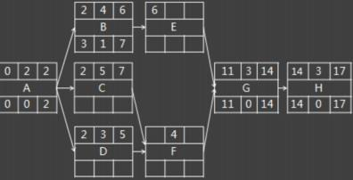

根据上图并结合基于问题 1 的计算结果，请计算活动 C 、D 、E  的总浮动时间和自由浮动时间。 【问题 3】（4  分）

基于问题 2  的计算结果，请计算：

（1）该项目的关键路径：

（2）该项目的总工期。

#### 【问题 4】（5  分）

#### 【参考答案】

#### 【问题 1】

E 的三点估算结果=（1+4M+7）/6=4 天（3 分）

#### 【问题 2】

C 活动在关键路径上，总浮动时间和自由浮动时间都是 0（2 分）

D 的总浮动时间和自由浮动时间都是 2（2 分）

E 的总浮动时间和自由浮动时间都是 1（2 分）

#### 【问题 3】

（1）关键路径为 ACFGH（2 分）

（2）总工期为 17 天（2 分）

#### 【试题十二五】 ---中级 2018 年上半年案例分析试题

#### 【说明】

某项目由 P1、P2、P3、P4、P5 五个活动组成，五个活动全部完成之后项目才能够完成， 每个 活动都需要用到 R1 、R2 、R3 三种互斥资源，三种资源都必须达到活动的资源需求量，活动才能 开始。已分配资源只有在完成本活动后才能被其他活动所用。目前项目经理能够调配的资源有限， R1、R2、R3 的可用资源数分别为 9、8 、5 活动对资源的需求量、已分配资源数和各活动历时如下 表所示（假设各活动之间没有依赖关系）:

| 资源 活动 | 资源需求量 | 资源需求量 | 资源需求量 | 已分配资源数 | 已分配资源数 | 已分配资源数 | 历时（周） |
|---|---|---|---|---|---|---|---|
| 资源 活动 | R1 | R2 | R3 | R1 | R2 | R3 | 历时（周） |
| P1 | 6 | 4 | 1 | 1 | 2 | 1 | 1 |
| P2 | 2 | 3 | 1 | 2 | 1 | 1 | 3 |
| P3 | 8 | 0 | 1 | 2 | 0 | 0 | 3 |
| P4 | 3 | 2 | 0 | 1 | 2 | 0 | 2 |
| P5 | 1 | 4 | 4 | 1 | 1 | 3 | 4 |

#### 【问题 1】（6 分）

基于以上案例，简要叙述最优的活动步骤安排。

#### 【问题 2】（7 分）

基于以上案例，请计算项目的完工时间（详细写出每个活动开始时间、占用资源和完成时间 以及项目经理分配资源的过程）。

#### 【问题 3】（4 分）

在制订项目计划的过程中，往往受到资源条件的限制，经常采用资源平衡和资源平滑方法， 请简要描述二者的区别。

#### 【参考答案】

参考答案版本 1：

#### 【问题 1】

此题在资源受限的情况下，解决如何通过最优化的活动安排，达到最短时间完成项目的目的。 经分析最有活动步骤安排如下：

（1） P2P4 并行，活动总共历时三周。

（2） P1P5 并行，历时一周后 P1 释放资源。

（3） P5P3 并行，历时三周后活动完成，项目结束。

#### 【问题 2】

| 活动 名称 | 开始 时间 | 占用资源 | 占用资源 | 占用资源 | 完成 时间 | 分配资源过程 | 分配资源过程 | 分配资源过程 |
|---|---|---|---|---|---|---|---|---|
| 活动 名称 | 开始 时间 | R1 | R2 | R2 | 完成 时间 | R1 | R2 | R3 |
| P2 | 0 | 2 | 3 | 1 | 3 | 0 | 2 | 0 |
| P4 | 0 | 3 | 2 | 0 | 2 | 2 | 0 | 0 |
| P1 | 3 | 6 | 4 | 1 | 4 | 5 | 2 | 0 |
| P5 | 3 | 1 | 4 | 4 | 7 | 0 | 3 | 1 |
| P3 | 4 | 8 | 0 | 1 | 7 | 6 | 0 | 1 |

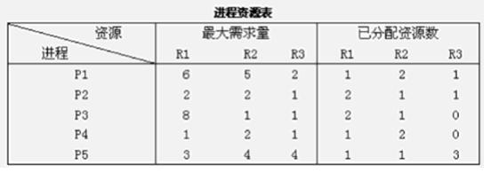

#### 【问题 3】

资源平衡是为了在资源需求与资源供给之间取得平衡，根据资源制约对开始日期和结束日期进行 调整的一种技术。如果共享资源或关键资源只在特定时间可用， 数量有限，或被过度分配。

资源平滑是对进行模型只能够的活动进行调整，从而使项目资源需求不超过预定的资源限制的一 种技术。相对于资源平衡而言，资源平滑不会改变项目关键路径，完工日子也不会延迟。也就是 说，活动旨在其自由浮动时间和总浮动时间内延迟。因此，资源平衡技术可能无法实现所有资源 的优化。

例题：假设系统中有三类互斥资源 R1 、R2 、R3,可用资源数分别是 9 、8 、5。在 T0 时刻,系统  中有 P1、P2、P3、P4 和 P5 五个进程,这些进程对资源的最大需求量和已分配的资源数如下所示, 如果进程按照      序列执行,那么系统状态是安全的。

解答过程：

从题目给出的进程资源表可以看出,对于资源 R1、R2、R3,它们已经提前各自分配了一部分,现 在我们看一下,是否还有剩余。

R1=9-（1+2+2++1）=2

R2=8-（2+1+1+2+1）=1

R3=5-（1+1+3）=0

同时,对于五个进程,系统分配给了他们各自一部分资源,这一部分资源是否能够满足他们,根 据还需资源=最大需求量— 已分配资源数来求,结果如下：

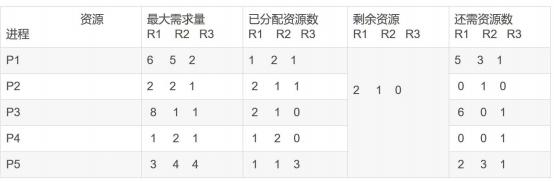

很明显,“剩余资源” 只能满足进程 P2 的要求

那么就先开始运行进程 P2。当 P2 运行之后， 已“分配的资源”要释放出来， 此时剩余资源=上一个 进程的剩余资源+“ 已分配资源” （下图中 P2 已经执行完毕了）

根据比较可以看出“剩余资源”完全满足进程 P4，以此类推，可以得到最后的结果表

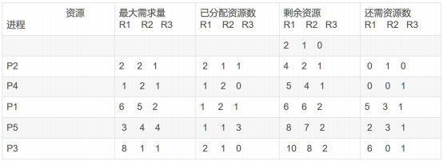

银行家是计算并不难，主要就是有些繁琐，在计算的时候需要耐心。

这里需要强调的是， 无论题目中给出何种条件， 我们只要找到以下信息便可从容应对各种变化：

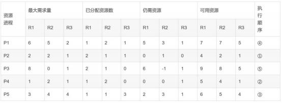

十三、成本管理（主要是计算）

#### 【试题一】---高级 2005 年下半年案例分析试题

一个预算 100 万的项目，为期 12 周，现在工作进行到第八周。已知成本预算是 64 万，实际 成本支出是 68 万，挣值为 54 万。

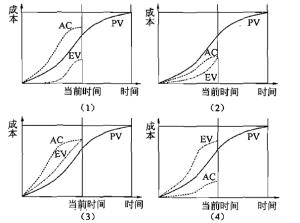

#### 【问题 1】（8 分）

请计算成本偏差（CV）、进度偏差（SV）、成本绩效指数 CPI、进度绩效指数 SPI。

#### 【问题 2】（5 分）

根据给定数据， 近似画出该项目的预算成本、实际成本和挣值图。

#### 【问题 3】（12 分）

对以下四幅图表，分别分析其所代表的效率、进度和成本等情况，针对每幅图表所反映的问 题，可采取哪些调整措施？

| 参考答案 |
|---|

#### 【问题 1】（8 分）

CV=EV-AC=54-68= 14 万元；      SV=EV-PV=54-64= 10 万元

CPI=EV/AC=54/68=0.794；      SPI=EV/PV=54/64=0.843

（每个公式 2 分，4 个，总分 8 分）

#### 【问题 2】（5 分）

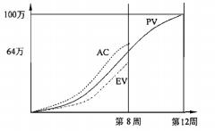

#### 【问题 3】（12 分）

| 任务名称 |  | 实际成本（万元） | 完成百分比 |
|---|---|---|---|
| A |  | 9 | 80% |
| B |  | 6.5 | 100% |
| C | 8 | 7.5 | 90% |
| D | 9 | 8.5 | 90% |
| E | 5 | 5 | 100% |
| F | 2 | 2 | 90% |

#### 【问题 1】（10 分）

请分别计算该项目在第四个月底的 PV, EV, AC 值， 并写出计算过程。请从进度和成本两方面 评价此项目的执行绩效如何， 并说明依据。

#### 【问题 1】（5 分）

有人认为：项目某一阶段实际花费的成本（AC）如果小于计划支出成本（PV），说明此时项 目成本是节约的，你认为这种说法对吗？请结合本题说明为什么。

#### 【问题 1】（10 分）

（1）如果从第五月开始，项目不再出现成本偏差， 则此项目的预计完工成本（EAC）是多少？

（2）如果项目仍按目前状况继续发展， 则此项目的预计完工成本（EAC）是多少？ （3）针对项目目前的状况，项目经理可以采取什么措施？

#### 【问题 1】（10 分）

PV=10+7+8+9+5+2 =41 （ 2 分）

EV=10 X 80%+7+8 X 90%+9 X 90%+5+2 X 90%=8 +7+7.2+8.1+5+1.8=37.1 （2 分）

AC =9+6.5+7.5+8.5+5+2=38.5 （2 分）

进度落后， 成本超支（（2 分）

原因：（2 分）

SV=EV-PV=37.1-41=-6.9<0 ；

或 SPI=EV/PV=37.1/41=0.904<1；

CV=EV-AC=37.1-38.5 二-1.4<0

CPI= EV/AV=37.1/38.5=0.963<1

#### 【问题 2】（5 分）

#### 【问题 3】（10 分）

（1） ETC=BAC-EV=41- 37.1=3.9 （2 分）

EAC= AC+ETC=3.9+38.5=42.4（2 分）

或者：EAC=BAC-CV =41-（-1.4）=42.4 （4 分）

（3）（满分 2 分，每条 1 分）

#### 【试题三】 ---高级 2012 年上半年案例分析试题

#### 【说明】

| 模块 1 开发 |
|---|

| 模块 2 修复 |
|---|

项目经理对网络图中的各活动进行了成本估算， 估算每人每天耗费的成本为 1000 元，安排了各活 动的人员数量并统计了模块 1 和模块 2 的开发和测试活动的工作量（如图 2 所示，其中阶段评审 活动不计入项目组的实际和人力成本预算，如图 2 所示）

表 2：

| 活动 | 安排人数 | 预计完成工作量（人.天） |
|---|---|---|
| 模块 1 开发 | 8 | 48 |
| 模块 1 测试 | 1 | 3 |
| 模块 1 修复 | 8 | 8 |
| 模块 1 测试 | 1 | 2 |
| 模块 2 开发 | 10 | 80 |
| 模块 2 测试 | 1 | 3 |
| 模块 2 修复 | 10 | 10 |
| 模块 2 测试 | 1 | 2 |

#### 【问题 1】（3 分）

请计算该项目自模块开发起至模块测试全部结束的计划工期。

#### 【问题 2】（3 分）

详细设计完成后， 项目组用了 11 天才进入阶段评审。在阶段评审中发现： 模块 1 开发已完成， 测试尚未开始；模块 2 的开发和测试均已完成， 修复工作尚未开始，模块 2 的实际工作量比计划 多用了 3 人.天；

（1）请计算自详细设计完成至阶段评审期间模块 1 的 PV 、EV 、AC，并评价其进度和成本绩效。

（1）请计算自详细设计完成至阶段评审期间模块 2 的 PV 、EV 、AC，并评价其进度和成本绩 效。

#### 【问题 3】（3 分）

（1）如果阶段评审未给出任何调整措施， 项目仍然按当前状况进行， 请预测从阶段评审结束到 软件集成开始这一期间模块 1、模块 2 的 ETC（完工尚需成本）（给出公式并计算结果）

（2）如果阶段评审后采取了有效措施，项目仍然按计划进行， 请预测从阶段评审结束到软件集 成开始这一期间模块 1、模块 2 的 ETC（完工尚需成本）（给出公式并计算结果）

#### 【问题 4】（4 分）

请结合软件开发和测试的一般过程，指出项目经理制定的网络计划和人力成本预算中存在的 问题。

#### 【问题 1】（3 分）

模块 1 工期=48/8+3/1+8/8+2/1=6+3+1+2=12

模块 1 工期=80/10+3/1+10/10+2/1=8+3+1+2=14

总工期为关键路径时间最长， 所以总工期为 14 天。

#### 【问题 2】（10 分）

（1）详细设计完成至阶段评审期间，模块 1 应完成开发、测试工作（在第 9 天末），所以：

模块 1 的 PV=模块 1 的开发+模块 1 的测试=48*1000+3*1000=51000（元）

在阶段评审中发现： 模块 1 开发已完成，测试尚未开始，所以：

模块 1 的 EV=模块 1 的开发=48*1000=48000（元）

根据题干所有已知条件：

模块 1 的 AC=模块 1 的开发=48*1000=48000（元）

SV=EV-PV=48000-51000=-3000<0,进度落后

CV=EV-AC=48000-48000=0，成本持平

（2）详细设计完成至阶段评审期间，模块 2 应完成开发、测试工作（在第 11 天末），所以：

模块 2 的 PV=模块 2 的开发+模块 2 的测试=80*1000+3*1000=83000（元）

在阶段评审中发现： 模块 1 开发已完成，测试尚未开始，所以：

模块 2 的 EV=模块 2 的开发+模块 2 的测试=80*1000+3*1000=83000（元）

根据题干所有已知条件：

模块 2 的 AC=模块 2 的 EV+3 人天的成本=83*1000+3*1000=86000（元）

SV=EV-PV=83000-83000=0，进度持平

CV=EV-AC=83000-86000=-300，成本超支

#### 【问题 3】（8 分）

先解决（2）的问题：

（2）如果阶段评审后采取了有效的措施，项目仍然按当前状况进行，则此情况为非典型；计 算公式：

ETC = BAC - 截止到目前的累加 EV

则模块 1 的 ETC=模块 1 的测试+模块 1 的修复+模块 1 的测试

=3*1000+8*1000+2*1000=13000（元）

则模块 2 的 ETC=模块 2 的修复+模块 2 的测试=10*1000+2*1000=12000（元）

（1）如果阶段评审未给出任何调整措施， 项目仍然按当前状况进行，则此情况为典型；计算公式

ETC =（BAC - 截止到目前的累加 EV）/ 累加 CPI

则模块 1 的 ETC=13000/（EV/AC）=13000/1=13000

则模块 2 的 ETC=12000/（EV/AC）=13000/（83000/86000）=12434

#### 【问题 4】（4 分）

存在问题：安排到模块 1 开发与安排到模块 2 开发的人力和对应的工作量相除后不匹配（模 块 1 开发 6 天完成、模块 2 开发 8 天完成），使得模块 1 与模块 2 不能同时达到里程碑（模块 1 第 一次测试后将等 2 天时间进入阶段评审），这就会造成资源和时间的浪费。所以里程碑设置的不合理的、人员安排不当!

#### 【试题四】 ---高级 2013 年下半年案例分析试题

#### 【说明】

一个信息系统集成项目有 A.B.C.D.E 、F 共 6 个活动，目前是第 12 周末， 活动信息如下：

活动 A：持续时间 5 周，预算 30 万元，没有前置活动，实际成本 35.5 万元，已完成 100%。

活动 B：持续时间 5 周， 预算 70 万元，前置活动为 A，实际成本 83 万元， 已完成 100%。

活动 C：持续时间 8 周， 预算 60 万元，前置活动为 B，实际成本 17.5 万元，已完成 20% 。  活动 D：持续时间 7 周，预算 135 万元，前置活动为 A，实际成本 159 万元，已完成 100%。 活动 E：持续时间 3 周，预算 30 万元，前置活动为 D，实际成本 0 万元， 已完成 0%。

活动 F：持续时间 7 周， 预算 70 万元，前置活动为 C 和 E，实际成本 0 万元，已完成 0%。

项目在开始投入资金为 220 万元，第 10 周获得投入资金 75 万元，第 15 周获得投入资金 105

万元，第 20 周获得投入资金 35 万元。

#### 【问题 1】（12 分）

请计算当前的成本偏差（CV）和进度偏差（SV），以及进度绩效指数（SPI）和成本绩效指数

（CPI），并分析项目的进展情况

#### 【问题 2】

分别按照非典型偏差和典型偏差的计算方式，计算项目在第 13 周末的完工尚需成本（ETC） 和完工估算成本（EAC）

#### 【问题 3】

在不影响项目完工时间的前提下， 同时考虑资金平衡的要求， 在第 13 周开始应该如何调整项 目进度计划？

#### 【问题 1 答案】

PV=30+70+60 X 2/8+135=250 万元；

EV=30+70+60 X 20%+135=247 万元；

AC=35.5+83+17.5+159=295 万元；

CV = EV - AC = 247 - 295 = - 48 万元；（2 分）

SV = EV - PV = 247 - 250= - 3 万元；（2 分）

CPI = EV/AC = 247/295=83.73%；（2 分）

SPI = EV/PV = 247/250 =98.8%；（2 分）

当前项目的进展情况：成本超支，资金使用效率较低（2 分）；进度滞后，进度效率较低（2 分）

#### 【问题 2 答案】

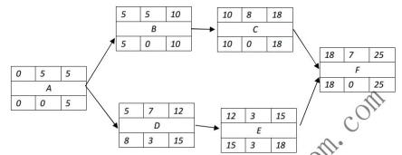

项目在第 13 周末的 BAC=30+70+60X 3/8+135+30X1/3=267.5 万元：

非典型偏差：项目在第 13 周末的 ETC=BAC-EV=267.5 - 247=20.5 万元；（2 分）

EAC = AC+ETC= 295+20.5=315.5 万元（或 EAC = AC+ETC=AC- BAC - EV =BAC -CV=267.5 -（-48） =315.5 万元）；（2 分）

典型偏差：项目在第 13 周末的 ETC=（BAC- EV）/CPI=（267.5 -247）/83.73%=24.48 万元（2 分）； EAC = AC+ETC=295+24.48=319.48 万元（或 EAC = BAC/CPI = 267.5/83.73% = 319.48 万元）（2 分） 【问题 3 答案】

可以采取的活动：

（1）时不启动活动 E 的工作， 等待至第 15 周才开工；

（2）采取适度的加班或赶工、请有类似项目经验的人员做适当的培训提高当前工作效率等措施， 将活动 C 所拖延的进度补救回来；

（3） 积极向公司高层领导或项目关键干系人申请资金资源和人力资源等， 以保证活动 C 在适当加 快进度的状态下展开工作

（答案包括但不限于以上内容，每小点 1 分，答案类似即可）

#### 【试题五】 ---高级 2013 年下半年案例分析试题

#### 【说明】

项目组成员小张根据项目经理的要求绘制了项目 A 的 WBS 图（图 1），并根据工作量对项目 的成本进行了分配， 见表 1

图 1 项目 A 的 WBS 图

表 ,：成本分配表                 单位：万元

| 项目 |  | 子项目 |  | 工作包 |  |
|---|---|---|---|---|---|
| 名称 | 估算值 | 名称 | 估算值 | 名称 | 估算值 |
| A |  | A1 |  | A1.1 | 12 |
| A |  | A1 |  | A1.2 | 14 |
| A |  | A2 |  | A2.1 | 18 |
| A |  | A2 |  | A2.2 | 16 |

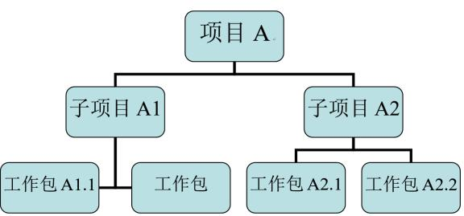

#### 【问题 1】（3 分）

如果小张采取自下而上的估算方法。请计算 A1、A2、A 的估算值分别是多少？ 【问题 2】（10 分）

在进行项目预算审批时， 财务总监之处在 2012 年初公司实施过一个类似项目， 当时的决算金 额是 50 万元，考虑到物价因素增加 10%也是可接受的， 财务总监要求据此更改预算，请根据财务

总监的建议列出 A1、A2 、A1.1 、A2.1 的估算值以及项目的总预算

#### 【问题 3】（3 分）

项目经理认为该项目与公司 2012 年初实施的一个类似项目还是有一定区别的，为稳妥起见，

就项目预算事宜 1，项目经理可以向公司财务总监提出何种建议

#### 【问题 4】（9 分）

除了自下而上的估算方法，本案例还应用了哪些成本估算方法？成本估算的工具和技术还有 那些？

A1 的估算值=12+14=26 万元； A2 的估算值=18+16=34 万元；A 的估算值=26+34=60 万元

（每个计算结果 1 分）

#### 【问题 2】

A1 的估算值=55X26/60=23.833 万元； A2 的估算值=55X34/60=31.167 万元；

A1.1 的估算值=55X12/60=11 万元； A2.1 的估算值=55 X18/60=16.5 万元；

项目的总预算=50X（1 + 10%）=55 万元

（每个计算结果 2 分）

#### 【问题 3】项目预算建议：

（1）要留有弹性，综合考虑每个活动应急储备、每个工作包应急储备和整个项目的管理储备等因素； （2）要以项目需求为基础；

（3）要与项目目标相联系，必须同时考虑项目质量目标和进度目标

（答案包括但不限于以上内容，每小点 1 分，答案类似即可）

#### 【问题 4】

还应用了资源费率法、成本参数估算法、成本类比估算法等方法（每个 2 分）

估算项目成本的工具和技术还有：①准备金分析（储备分析）：②质量成本（COQ）; ③成本三点化算；④专家判断；⑤项目管理软件；⑥群体决策技术（如头脑风暴、德尔菲技术）等

（答案包括但不限于以上内容，列举出其中 3 个小点即可，每小点 1 分，答案类似即可）

本案例中还采用了类比估算、参数估计，成本估算的工具和技术还有确定资源费率、项目管理软件、供应商投标分析、准备金分析、质量成本；

#### 【试题六】 ---高级 2014 年上半年案例分析试题

#### 【说明】

一个信息系统集成项目有 A.B.C.D.E 、F、G 共 7 个活动。各个活动的顺序关系、计划进度和 成本预算如下图所示，大写字母为活动名称，其后面括号中的第一个数字是该活动计划进度持续 的周数，第二个数字是该活动的成本预算，单位是万元。该项目资金分三次投入， 分别在第 1 周 初、第 10 周初和第 15 周初投入资金。

| D（2,30） |
|---|

| A（6,90） |
|---|

| E（3,20） |
|---|
| C（5,30） |

项目进行的前 9 周，由于第 3 周时因公司有个临时活动停工 1 周。为赶进度。从其他项目组 中临时抽调 4 名开发人员到本项目组。第 9 周末时， 活动 A 、B 和 C 的信息如下，其他活动均未 进行。

活动 A：实际用时 8 周，实际成本 100 万元， 已完成 100%

活动 B：实际用时 4 周， 实际成本 55 万元，已完成 100%

活动 C：实际用时 5 周， 实际成本 35 万元，已完成 100%

从第 10 周开始， 抽调的 4 名开发人员离开本项目组， 这样项目进行到第 14 周末的情况如下， 其中由于对活动 F 的难度估计不足，导致了进度和成本的偏差。

活动 D：实际用时 2 周，实际成本 30 万元，已完成 100%；

活动 E：实际用时 0 周，实际成本 0 万元，已完成 0%

活动 F：实际用时 3 周， 实际成本 40 万元， 已完成 20%

活动 G：实际用时 0 周，实际成本 0 万元，已完成 0%

#### 【问题 1】（10 分）

在不影响项目总体工期的前提下，制定能使资金成本最优化的资金投入计划。请计算三个资 金投入点分别要投入的资金量并写出在此投入计划下项目各个活动的执行顺序。

#### 【问题 2】（5 分）

请计算项目进行到第 9 周末时的成本偏差（CV）和进度偏差（SV）,并分析项目的进展情况？ 【问题 3】（5 分）

请计算项目进行到第 15 周时的成本偏差（CV）和进度偏差（SV），并分析项目的进展情况？ 【问题 4】（5 分）

若需要项目第 15  周计算完工尚需成本（ETC）和完工估算成本（EAC），采用哪种方式计算更适 合？写出计算公式？

#### 【问题 1】

第一周初投入资金为： 90+50+30=170 万元。

执行顺序：  第 1-4 周执行 B 活动，第 1-6 周执行 A 活动，第 5-9 周执行 C 活动。 第十周初投入资金为： 30+60*（3/9） =50 万元。

执行顺序：  第 10-11 周执行 D 活动，第 12-14 周执行 F 活动。

第十五周初投入资金为： 20+40+60*（6/9） =100 万元。

执行顺序：  第 15-20 周执行 F 活动，第 15-18 周执行 E 活动，第 18-20 周执行 G 活动。

#### 【问题 2】

CV =EV-AC=（90+50+30） -（100+55+35）=170 — 190 =-20  万元。

SV =EV-PV=（90+50+30） ℴ（90+50+30）=170-170=0。

项目在第 9 周末时，  实际进度与计划吻合，但成本超支了  20  万元。

#### 【问题 3】

根据图示，   第  15  周初（14  周末）时的  PV:

PV =90+50+30+30+20+60x （3/9） +40x （2/3） =266.67  万元。

EV =90+50+30+30+60x20% =212  万元。

AC =100+55+35+30+40 =260  万元。

CV =EV-AC =212-260 =-48  万元。

SV =EV-PV =212-266.67 =—54.67  万元。

项目在第  15  周初（14  周末）  时，实际进度比计划进度滞后，  成本超支了  48  万元。

#### 【问题 4】

因为发生偏差的原因没找到或者找到了也难以解决， 所以宜采用典型偏差的公式来计算： ETC=（BAC-EV） /CPI；

EAC=（AC+ETC） ； --后面不需要写计算结果也可以，公式写出来即可那全分 BAC =90+50+30+30+20+60+40 =320  万元；

EV =90+50+30+30+60*20% =212  万元；

AC =100+55+35+30+40 =260  万元；

ETC=（BAC-EV） /CPI=（320 —212）/（212/260） =131.71  万元；

EAC=（AC+ETC）=260+131.71 =391  万元。

#### 【试题七】 ---高级 2014 年下半年案例分析试题

阅读下列说明，回答问题 1 至问题 3，将解答填入答题纸的对应栏内。

#### 【说明】

某项目由 A 、B、C 、D、E 、F、G 、H 、I、J 共 10 个工作包组成，项目计划执行时间为 5 个月。 在项目执行到第 3 个月末的时候，公司对项目进行了检查，检查结果如下表所示（假设项目工作量在 计划期内均匀分布）。

| 工作包 | 预算   （万元） | 预算按月分配（万元） | 预算按月分配（万元） | 预算按月分配（万元） | 预算按月分配（万元） | 预算按月分配（万元） | 实际完成 （*） |
|---|---|---|---|---|---|---|---|
| 工作包 | 预算   （万元） | 第一个月 | 第二个月 | 第三个月 | 第四个月 | 第五个月 | 实际完成 （*） |
| A | 12 | 6 | 6 |  |  |  | 100 |
| B | 8 | 2 | 3 | 3 |  |  | 100 |
| C | 20 |  | 6 | 10 | 4 |  | 100 |
| D | 10 |  | 6 |  | 4 |  | 75 |
| E | 3 | 2 | 1 |  |  |  | 75 |
| F | 40 |  |  | 20 | 15 | 5 | 50 |
| G | 3 |  |  |  |  | 3 | 50 |
| H | 3 |  |  |  | 2 | 1 | 50 |
| I | 2 |  |  |  | 1 | 1 | 25 |
| J | 4 |  |  |  | 2 | 2 | 25 |

#### 【问题 1】（4 分）

计算到目前为止，项目的 PV 、EV 分别为多少？

#### 【问题 2】（11 分）

假设该项目到目前为止已支付 80 万元， 请计算项目的 CPI 和 SPI，并指出项目整体的成本和进度 执行情况以及项目中哪些工作包落后于计划进度， 哪些工作包超前于计划进度。

#### 【问题 3】（10 分）

如果项目的当前状态代表了项目未来的执行情况， 预测项目未来的结束时间和总成本。并针对项 目目前的状况， 提出相应的应对措施。

像这样的题，如果你的想象力差一些，建议你最好画个时标网络图，这样思路会清晰一些。

上面图中的“实际完成（%）”指的是：完成工作包总预算的百分比，例如工作包 A 完成了 100%， 意思是指，工作包 A 的 12 万预算 100%都完成了。

#### 【问题 1】解析

到第 3 个月末， 项目应该完成的预算 PV 为：

PV=12（工作包 A， 在第 3 个月应该完成的的 12 万预算）+8（工作包 B， 在第 3 个月应该完成的的 8 万预算） +16（工作包 C，在第 3 个月应该完成的 16 万预算） +6（工作包 D， 在第 3 个月应该完成的 6 万预算） +3（工作包 E，在第 3 个月应该完成的 3 万预算） +20（工作包 F，在第 3 个月应该完成的 20 万预算） =65 万元。

到第 3 个月末， 项目已完成的预算 PV 为 EV：

EV=12*100%（工作包 A 的 12 万 100%完成了） +8*100%（工作包 B 的 8 万 100%完成了， 余下的工作

包余此类推） +20+10x75%+3x75%+40x50%+3x50%+3x50%+2x25%+4x25%=74.25 万元。

#### 【问题 2】解析

假设该项目到目前为止已支付 80 万元，指的是第 3 个月末的项目 AC=80。

此时项目的 CPI=EV/AC=74.25/80=0.93。

此时项目的 SPI=EV/PV=74.25/65=1.14。

结论：

在第 3 月末时， 项目的 CPI<1，项目本处于“超支”状态

项目的 SPI>1，项目进度处于“提前”状态

工作包 A、B 按进度计划 100%完成了， 其进度的执行“正常”；

工作包 C 计划完成 16 万、实际完成 20 万（其 SPI=EV/PV=1.25>1），其进度“提前了”； 余此类推，工作包 D、G、H、l、J 的进度也都“提前”了。

所以：

落后于计划进度的工作包有： E

超前于计划进度的工作包有：C、D、G、H、l、 J

#### 【问题 3】

题干中“如果项目的当前状态代表了项目未来的执行情况”暗示未来项目的 CPI、SPI 会保持不变， 此时预测项目完成时的总成本和预计完成时间，应该用典型偏差公式。

算法 1：

项目完成时的总成本 EAC 计算公式如下： EAC=AC+ETC

BAC=12+8+20+10+3+40+3+3+2+4=105 万元

ETC=（项目总预算 BAC-EV）/CPI=（105-74.25）/（74.25/80）=33.13

EAC=AC+ETC=80+33.13=113.13

项目到第 3 个月底所挣得的成本 EV=3xSPI=3x1.1423=3.43 个月。

算法 2： ---比较简单

EAC=BAC/CPI=105/（74.25/80）=113.13

再预测项目完成的时间：

由于 SPI=EV/PV=1.14 保持不变，也就是说本来计划 1 天完成的工作量 1 万（PV），实际 1 天完成 了 1.14 万的工作量（EV）。

反过来说，本来计划 1 天完成的工作量 1 万，按 SPI>1 时的执行效率， 实际上（1/1.14）即可完成。

因此，项目的预计完成时间为： 5/SPI=5/1.14=4.38 月。

由于 CPI<1，项目成本“超支”；SPI>1，项目进度“提前”，应采取的应对措施如下（仅供参考）： 1.优化施工方案、提高效率、加强质量管理减少返工、加强沟通，以降低成本；

2.在确保进度按期完成的基础上，可以降低进度以节约成本；

3.总结项目进度“提前”的经验，并记录下来，把这经验传播到项目的其他班组，甚至其他项目 或未来的项目；

#### 【试题八】 ---高级 2015 年上半年案例分析试题

某信息系统工程项目由 ABCDEFG 七个任务构成，项目组根据不同任务的特点，人员情况等， 对各项任务进行了历时估算并排序，并给出了进度计划，如下图：

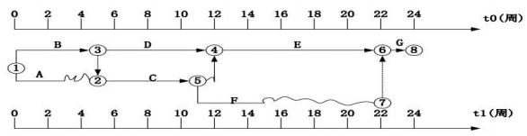

项目中各项任务的预算（方框中，单位是万元）、从财务部获取的监控点处各项目任务的实际 费用（括号中，单位为万元），及各项任务在监控点时的完成情况如下图：

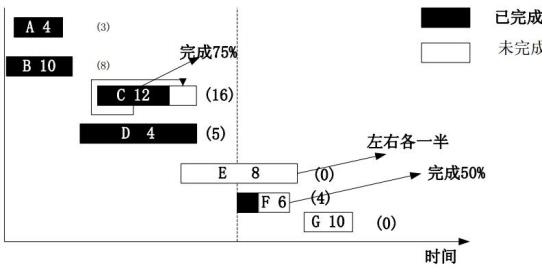

#### 【问题 1】（10 分）

（1）请指出该项目的关键路径、工期。

（2）本例给出的进度计划图叫什么图？ 还有哪几种图可以表示进度计划？

（3）请计算任务 A.D 和 F 的总时差和自由时差

（4）若任务 C 拖延 1 周，对项目的进度有无影响？ 为什么？

#### 【问题 2】（7 分）

请计算监控点时刻对应的 PV 、EV 、AC.CV 、SV 、CPI 和 SPI.

#### 【问题 3】（4 分）

请分析监控点时刻对应的项目绩效，并指出绩效改进的措施。

#### 【问题 4】（4 分）

（1）请计算该项目的总预算。

（2）若在监控点时对项目进行了绩效评估后，找到了影响绩效的原因并予以纠正，请预测此种情 况下项目的 ETC.EAC.

#### 【问题 1】参考答案：

（1）关键路径为 BYDYEYG，工期为 24 周。

（2）本例的进度图为双代号时标网络图，表示进度的图还有单代号网络图、甘特图、前导图等。 （3）A 的自由时差=ESC-EFA=5-3=2（周），A 的总时差=LFA-EFA=6-3=3（周）。

D 为关键工作，其自由时差为 0 和总时差均为 0。

F 的自由时差=ESG-EFF=22-15=7（周），F 的总时差=LFF-EFF=22-15=7（周）。

（4）因为任务 C 在非关键路径上，且有 1 周总时差，所以推迟 1 周对项目进度没有影响。

#### 【问题 2】参考答案：

在监控点时，

AC=3+8+16+5+4=36（万）

PV=4+10+12+4+8/2=34（万）

EV=4+10+12*0.75+4+6*0.5=30（万）

CV=EV-AC=30-36=-6（万） SV=EV-PV=30-34=-4（万）

CPI=EV/AC=30/36=5/6=0.833SPI=EV/PV=30/34=15/17=0.882

#### 【问题 3】参考答案：

项目在监控点时因 CPI<1,SPI<1,所以当前进度落后， 成本超支。

可以采取的措施：

（1）用高效人员代替低效人员；

（2）加班或赶工在预防风险的情况下并行施工；

（3）提高资源利用率；

（4）加强、改进沟通，提高效率；

（5）尽可能一次性把事情做对，减少返工。

#### 【问题 4】参考答案：

（1）总预算 BAC=4+10+12+4+8+6+10=54（万）

（2）找到了影响绩效的原因并加以纠正，因此按非典型偏差来进行项目预测。所以： ETC=BAC-EV=54-30=24 元

EAC=AC+ETC=36+24=60 万元

#### 【试题九】 ---高级 2015 年下半年案例分析试题

阅读下列说明，回答问题 1 至问题 4，将解答填入答题纸的对应栏内。

#### 【说明】

已知无忧考培教育学院信息工程项目由 ABCDEGHI 八个活动构成， 项目工期要求为 100 天。项目 组根据初步历时估算、各活动间逻辑关系得出的初步进度计划网络图如下图所示（箭线下方为活 动历时）。

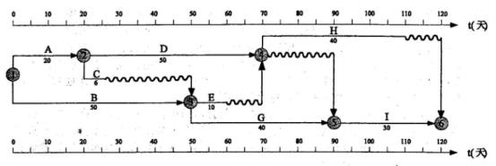

#### 【问题 1】（7 分）

（1）请给出该项目初步进度计划的关键路径和工期。

（2）该项目进度计划需要压缩多少天才能满足工期要求？可能需要压缩的活动都有哪些？

（3）若项目组将 B 和 H 均压缩至 30 天，是否可满足工期要求？压缩后项目的关键路径有多少条？ 关键路径上的活动是什么？

#### 【问题 2】（9 分）

项目组根据工期要求，资源情况及预算进行了工期优化，即将活动 B 压缩至 30 天、 D 压缩至 40 天，并形成了最终进度计划网络图；给出的项目所需资源数量与资源费率如下：

| 活动 | 资源 | 费率（元/人天） | 活动 | 资源 | 费率（元/人天） |
|---|---|---|---|---|---|
| A | 1 人 | 180 | E | 1 人 | 180 |
| B | 2 人 | 220 | G | 2 人 | 200 |
| C | 1 人 | 150 | H | 2 人 | 100 |
| D | 2 人 | 240 | I | 2 人 | 150 |

按最终进度计划执行到第 40 天晚对项目进行监测时发现，活动 D 完成一半，活动 E 准备第二天 开始， 活动 G 完成了 1/4；此时累计支付的实际成本为 40000 元，请在下表中填写此时该项目的绩

效信息。

| 活动 | PV | EV |
|---|---|---|
| A |  |  |
| B |  |  |
| C |  |  |
| D |  |  |
| E |  |  |
| G |  |  |
| H |  |  |
| I |  |  |
| 合计 |  |  |

#### 【问题 3】（6 分）

请计算第 40 天晚时项目的 CV、SV 、CPI、SPI（给出计算公式和计算结果，结果保留 2 位小数）， 评价当前项目绩效， 并给出改进措施。

#### 【问题 4】（3 分）

项目组发现问题后及时进行了纠正，对项目的后续执行没有影响，请预测项目完工尚需成本 ETC 和完工估算 EAC（给出计算公式和计算结果）

#### 【问题 1  参考答案】（7 分）

1、关键路径 BG I（1 分） 工期 120 天（1 分）

2、进度需要压缩 20 天（1 分）才可以满足工期，可能压缩的活动有 BG IADH 活动（2 分）。 3、若项目组将 B 和 H 均压缩至 30 天， 可以满足。（1 分）

压缩后项目的关键路径有 2 条，两条关键路径上的活动分别是 BG I 与 ADH（1 分）

#### 【问题 2  参考答案】（9 分）    （每空 0.5  共 9 分）

| 活动 | PV | EV |
|---|---|---|
| A | 20*80*1=3600 | 3600 |
| B | 30*220*2=13200 | 13200 |
| C | 6*150*1=900 | 900 |
| D | 20*240*2=9600 | 9600 |
| E | 10*180*1=1800 | 0 |
| G | 10*20*2=4000 | 4000 |
| H | 0 | 0 |
| I | 0 | 0 |
| 合计 | 33100 | 31300 |

#### 【问题 3  参考答案】（6 分）

CV=EV-AC=31300-40000=-8700<0 SV=EV-PV=31300-33100=-1800<0 CPI=EV/AC=31300/40000=0.78<1 SPI=EV/PV=31300/33100=0.95<1

（1 分）

（1 分）

（1 分）

（1 分）

当前项目绩效：成本超支，进度落后。

采取措施：赶工; 快速跟进、加强沟通; 增强优质资源; 提高资源利用率; 外包和缩小项目范围 （备注：写公式可以得 0.5 分喷）

#### 【问题 4  参考答案】（3 分）（备注：写公式可以得 1 分喷，直接写结果 1 分）

发现问题后进行了纠正，因此采用非典型偏差。

ETC=（D*50%+E+G*75%+H+I）费用

=200*2*240+10*180*1+30*200*2+40*2*100+30*2*150=40400 （1 分）

EAC=ETC+AC=40400+40000=80400 元   （2 分）

#### 【试题十】 ---高级 2016 年下半年案例分析试题

#### 【说明】

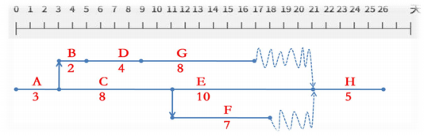

已知某信息工程由 A 、B 、C 、D 、E、F、G、H  八个活动构成。项目的活动历时、活动所需 人数、费用及活动逻辑关系如下表所示：

| 活动 | 历时（单位：天） | 所需人数 | 费用（单位：元 /人天） | 紧前活动 |
|---|---|---|---|---|
| A | 3 | 3 | 100 | --- |
| B | 2 | 1 | 200 | A |
| C | 8 | 4 | 400 | A |
| D | 4 | 3 | 100 | B |
| E | 10 | 2 | 200 | C |
| F | 7 | 1 | 200 | C |
| G | 8 | 3 | 300 | D |
| H | 5 | 4 | 200 | EFG |

#### 【问题 1】（4 分）

请给出该项目的关键路径和工期。

#### 【问题 2】（12 分）

第 14 天晚的监控数据显示活动 E 、G 均完成了一半， F 尚未开始，项目实际成本支出为 12000 元。 （1）请计算此时项目的计划值（PV）和挣值（EV）。

（2）请判断此时项目的成本偏差（CV）和进度偏差（SV），以及成本和进度执行情况。 【问题 3】（3 分）

若后续不作调整，项目工期是否有影响？为什么？

#### 【问题 4】（6 分）

（1）请给出总预算（BAC）、完工尚需估算（ETC）和完工估算（EAC）的值； （2）请预测是否会超出总预算（BAC）?完工偏差（VAC）是多少？

参考答案

#### 【问题 1】（4 分）

根据上表画图（单代号和时标图均可，建议画时标网络图。另注：考试时题目未要求则不需在答 题纸上画图）。得关键路径为 A-C-E-H（2 分），工期为 26 天（2 分）

#### 【问题 2】（12 分）

（1） PV=A+B+C+D+G*5/8+E*3/10+F*3/7=3*3*100+2*200+12800+4*3*100+8*3*300*5/8 +10*2*200*3/10+7*l*200*3/7=900+400+12800+1200+4500+1200+600=21600（2 分）

EV=A+B+C+D+G/2+E/2=900+400+12800+1200+3600+2000=20900（2 分）

（2） CV=EV-AC=20900-12000=8900 （2 分）     SV=EV-PV=20900-21600=-700（2 分）

成本和进度执行情况：成本节约（2 分）、进度落后（2 分）

#### 【问题 3】（3 分）

或后续不作调整，项目工期会有所延误。（1 分）

因为目前进度偏差指数为：EV/PV=20900/21600=0.9676,若后续不调整，则项目预估完工工期 为:26/0.9676=约为 27 天。所以会有所延误，会影响工期；（2 分）

#### 【问题 4】（6 分）

（1） BAC=A+B+C+D+E+F+G=900+400+12800+1200+4000+1400+7200+4000=31900（1 分）

（注：因本小题题目未给出是典型还是非典型情况， 以下按两种情况分别计算）

（朱老师批注：可能第四问是延续第三问的，如果只写一种结果，建议写典型的情况）

情况一：按典型情况计算为：

ETC=（BAC-EV）/CPI=（31900-20900）/（20900/12000）=6315.79（1 分）

EAC=AC+ETC=12000+6315.79=18315.79（1 分）

情况二：按非典型情况计算为：

ETC=BAC-EV=31900-20900=11000

EAC=AC+ETC=12000+11000=23000

（2）因为 CPI 大于 1，所以不管是典型还是非典型情况根据预测都不会超出总预算； 完工偏差， 典型情况：VAC=BAC-EAC=31900-18315.79=13584.21（1 分）

完工偏差， 非典型情况： VAC=BAC-EAC=31900-23000=8900（1 分）

#### 【说明】

某项目工期为 6 个月， 该项目的项目经理在第 3 个月末对项目进行了中期检查，检查结果表明完 成了计划进度的 90%，相关情况见下表（单位：万元），表中活动之间存在 F-S 关系。

| 序号 | 活动 | 第 1 月 | 第 2 月 | 第 3 月 | 第 4 月 | 第 5 月 | 第 6 月 | PV 值 |
|---|---|---|---|---|---|---|---|---|
| 1 | 编制计划 | 4 | 4 |  |  |  |  | 8 |
| 2 | 需求调研 |  | 6 | 6 |  |  |  | 12 |
| 3 | 概要设计 |  |  | 4 | 4 |  |  | 8 |
| 4 | 数据设计 |  |  |  | 8 | 4 |  | 12 |
| 5 | 详细设计 |  |  |  |  | 8 | 2 | 10 |
|  | 月度 PV | 4 | 10 | 10 | 12 | 12 | 2 |  |
|  | 月度 AC | 4 | 11 | 11 |  |  |  |  |

#### 【问题 1】（8 分）

计算中期检查时项目的 CPI、CV 和 SV，以及“概要设计”活动的 EV 和 SPI。

#### 【问题 2】（4 分）

如果按照当前的绩效，计算项目的 ETC 和 EAC。

#### 【问题 3】（8 分）

请对该项目目前的进展情况作出评价。如果公司规定，在项目中期评审中，项目的进度绩效指标 和成本绩效指标在计划值的正负 10%即为正常，则该项目是否需要采取纠正措施？ 如需要， 请说 明可采取哪些纠正措施进行成本控制； 如不需要，请说明理由。

#### 【问题 4】（5 分）

结合本案例， 判断下列选项的正误（填写在答题纸的对应栏内， 正确的选项填写“V” ，错误的选项 填写“X”）：

（1）应急储备是包含在成本基准内的一部分预算， 用来应对已经接受的已识别风险，并已经制定 应急或减轻措施的已识别风险。()

（2）管理储备主要应对项目的“ 已知—未知”风险， 是为了管理控制的目的而特别留出的项目预算。() （3）管理储备是项目成本基准的有机组成部分，不需要高层管理者审批就可以使用。()

（4）成本基准就是项目的总预算，不需要按照项目工作分解结构和项目生命周期进行分解。()  （5）成本管理过程及其使用的工具和技术会因应用领域的不同而变化， 一般在项目生命期定义过 程中对此进行选择。()

#### 【问题 1】（8 分）

SPI=0.9      PV=4+10+10=24 万

EV=SPI*PV=0.9*（4+10+10）=21.6 万    AC=4+11+11=26 万

CPI=EV/AC=21.6/26=0.83

CV=EV-AC=21.6-26=-4.4 万     SV=EV-PV=21.6-24=-2.4 万

EV（概要设计） =21.6-（4+4+6+6）=1.6 万   SPI（概要设计） =EV/PV=1.6/4=0.4 万

#### 【问题 2】（4 分）

EAC=BAC/CPI=50/0.83=60.2 万

ETC=EAC-AC=60.217-26=34.217 万

或者： ETC=（BAC-EV）/CPI=（50-21.6）/0.83=34.217

EAC=AC+ETC=26+34.217=60.217 【如果按 2 位小数算，位数有差别，不影响得分，把过程写出来】 【问题 3】（8 分）

CPI=0.83  CPI =EV/PV=21.6/24=0.9 项目成本超支 项目进度在正常可控范围（未超出 10%） 纠正措施：

（1）用高效人员代替低效人员

（2）缩小活动范围或者降低活动要求

（3）通过改变方法或技术提高生产效率

（4）对造成成本基准变更的因素施加影响，做好成本偏差的控制工作

（5）分析成本超支的原因，提出改进策略比如改进方法，优化方案，提高效率等 （6）严格实行成本审批制度， 确保成本支出不超过批准的资金限额

#### 【问题 4】（5 分）

对 错（未知 已知-未知是应急储备金的概念） 错（不是成本基线一部分） 错 对

#### 【江山老师温聲提示】此题与 2012 年下半年中级系统集成项目管理工程师基本一样，所以历年中 高级真题大家务必重视

【问题 1 解析---参考中级教材 P328】应急储备是包含在成本基准内的一部分预算，用来应对己经

接受的已识别风险， 以及已经制订应急 或减轻措施的已识别风险。应急储备通常是预算的一部分， 用来应对那些会影响项目的“己知一未 知”风险。

【问题 2 解析---参考中级教材 P328】应对项目范围中不可预见的工作。管理储备用来应对会影响 项目的“未知一未知”风险。管理储备 不包括在成本基准中， 但属于项目总预算和资金需求的一 部分，使用前需要得到高层管理者审批。

#### 【问题 4 解析】项目总预算包括成本基准和管理储备。

#### 【试题十二】 ---高级 2017 年下半年案例分析试题

某信息系统项目包含 A 、B 、C、D 、E、F、G、H 、I、J 十个活动，各活动的历时、成本估 算值。活动逻辑关系如下表所示：

| 活动名称 | 活动历时（天） | 成本估算值（元） | 紧前活动 |
|---|---|---|---|
| A | 2 | 2000 | -- |
| B | 4 | 3000 | A |
| C | 6 | 5000 | B |
| D | 4 | 3000 | A |
| E | 3 | 2000 | D |
| F | 2 | 2000 | A |
| G | 2 | 2000 | F |
| H | 3 | 3000 | E 、G |
| I | 2 | 2000 | C 、H |
| J | 3 | 3000 | I |

#### 【问题 1】（10 分）

（1）计算活动 H 、G 的总浮动时间和自由浮动时间

（2）指出该项目的关键路径

（3）计算该项目的总工期

#### 【问题 2】（3 分）

项目经理在第 9 天结束时对项目进度进行统计，发现活动 C 完成了 50%，活动 E 完成了 50%，活 动 G 完成看 100%，请判断该项目工期是否受到影响？为什么？

#### 【问题 3】（10 分）

结合问题 2，项目经理在第 9 天结束对项目成本进行了估算，发现活动 B 的实际花费比预计估多 了 1000 元，活动 D 的实际花费比预估少了 500 元， 活动 C 的实际花费为 2000 元， 活动 E 的实际 花费为 1000 元，其他活动的实际花费与预估一致；

（1）请计算该项目的完工预算 BAC；

（2）请计算该时点计划值 PV、挣值 EV、成本绩效指数 CPI、进度绩效指数 SPI;

#### 【问题 4】（3 分）

项目经理对进度、成本与计划不一致的原因进行了详细分析，并制定了改进措施，假设该改进措 施是有效的，能确保项目后续过程中不会再发生类似问题，请计算该项目的完工估算 EAC；

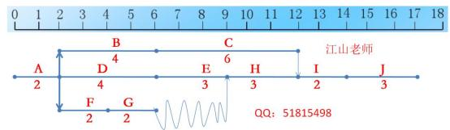

#### 【参考答案】

#### 【问题 1】（10 分）

根据表格关系画出以下网络图：（草稿纸画图， 不用在试卷上画）

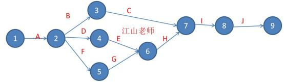

然后可以转换成双代号时标网络图帮助理解：（草稿纸画图，不用在试卷上画）

（1）H 的总时差为 0（1 分）， 自由时差为 0（1 分）

G 的总时差为 3（1 分），自由时差为 3（1 分）

（2）关键路径为 ADEHIJ（2 分）和 ABC IJ（2 分）

（3）总工期为 17 天（2 分）

#### 【问题 2】（3 分）

项目工期会受到影响（1 分）

因为按计划 E 要完成 100%，而现在只完成了 50%（1 分），而 E 活动又是关键活动，延期了将影 响工期（1 分）。

#### 【问题 3】（10 分）

（1） BAC=2000+3000+5000+3000+2000+2000+2000+3000+2000+3000=27000 元（2 分）

（2） PV=A+B+C*50%+D+E+F+G=2000+3000+2500+3000+2000+2000+2000=16500 元（2 分）

EV=A+B+ C*50%+D+E*50%+F+G=2000+3000+2500+3000+1000+2000+2000=15500 元；（2 分）

AC=2000+4000+2000+2500+1000+2000+2000=15500 元（2 分）

CPI=EV/AC= 15500/15500=1（2 分）

SPI=EV/PV= 15500/16500=0.94（2 分）

#### 【问题 4】（3 分）

采用非典型偏差公式计算（1 分）

EAC=AC+ETC=15500+（27000-15500）=27000 元（2 分）

#### 【试题十三】 ---高级 2018 年下半年案例分析试题

试题二（27 分）

某信息系统项目包含如下十个活动。各活动的历时、活动逻辑关系如下表所示：

| 活动名称 | 活动历时（天） | 紧前活动 |
|---|---|---|
| A | 2 | -- |
| B | 5 | A |
| C | 2 | B 、D |
| D | 6 | A |
| E | 3 | C 、G |
| F | 3 | A |
| G | 4 | F |
| H | 4 | E |
| I | 5 | E |
| J | 3 | H 、I |

#### 【问题 1】（9 分）

（1）请给出该项目的关键路径和总工期。

（2）请给出活动 E、G 的总浮动时间和自由浮动时间。

#### 【问题 2】（5 分）

在项目开始前， 客户希望项目工期压缩为 19 天，并愿意承担所发生的所有额外费用。经过对各项 活动的测算发现，只有活动 B 、D、I 有可能缩短工期，其余活动均无法缩短工期。活动 B 、D 、I 最多可以缩短的天数以及额外费用如下：

| 活动名称 | 最多可以缩短的天数 | 每缩短一天需要增加的额外费用（元） |
|---|---|---|
| B | 2 | 2000 |
| D | 3 | 2500 |
| I | 3 | 3000 |

在此要求下，请给出费用最少的工期压缩方案及其额外增加的费用。

#### 【问题 3】（4 分）

暖将下而①一细处的答案填写在答题纸的对应性内.

项目活动之间的依赖关系分为四种：

（1）是法律或合同要求的或工作的內在性质決定的依赖关系.

（2）是基于具体应用领域的最佳实践或者基于项目的某种特殊性质而设定，即便还有其他顺序可 以选用，但项目仍缺省按照此种特殊的顺序安排活动

（3）是项目活动与非项目活动之间的依赖关系

（4）是项目活动之间的紧前关系，通常在项目团队的控制之中.

#### 【间题 4】（9 分）

假设该项目的总预算为 20 万元。其中包含 2 万元管理储备和 2 万元应急储备， 当项目进行到某一天时，项目实际完成的工作量仅为应完成工作的 60%，此时的 PV 为 12 万元，实际花费为 10 万 元。

（1）请计算该项目的 BAC

（2）请计算当前时点的 EV、CV 、SV

（3）在当前绩效情况下，请计算该项目的完工尚需沽算 ETC.

参考答案

#### 【问题 1】（9 分）

1）首先草稿纸上画图

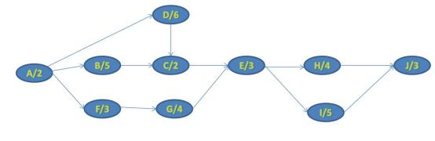

关 键

路径： A-D-C-E-I-J（1.5 分）

总工期 2+6+2+3+5+3=21 天（1.5 分）

2）

活动 E 在关键路径上；总浮动时间是。天（1.5 分）， 自由浮动时间是。天（1.5 分）； 活动 G 的总时间是 1 天（1.5 分），自由浮动时间是 1 天（1.5 分）

#### 【问题 2】（5 分）

压缩方案 1：D 压缩 1 天，工期缩短 1 天，费用 2500 元。（2 分）

2、I 压缩 1 天，工期缩短 1 天，费用 3000 元。（2 分） 需额外增加费用 5500 元。（1 分）

#### 【江山老师说明】D 压缩之后需要注意关键路径会不会发生变化， 有人压缩 B2 天， 要注意啊， 关 键路径变了，还要继续压缩，所以这个不是最佳方案

#### 【问题 3】（4 分）

（1）强制性依赖关系（2）选择性依赖关系（3）外部依赖关系（4）内部依赖关系

#### 【间题 4】（9 分）

1）BAC=20-18=18 万元（管理储备不包括在 BAC 中）

2） EV=12*60%=7.2 万元

CV=EV-AC=7.2-10=-2.8 万元

SV=EV-PV=7.2-12=-4.8 万元

3） CPI=EV/AC=7.2/10=0.72

ETC=（BAC-EV）/CPI=（18-7.2）/0.72=15 万元

#### 【江山老师说明】项目实际完成的工作量仅为应完成工作的 60%,这句话比较难以理解， 应完成工 作是计划的，还是整个项目的呢？我个人倾向于前者，但是后者也有一定道理，出题坑啊！具体 是什么答案，不确定了

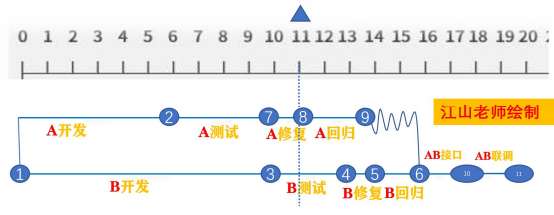

#### 【试题十四】 ---高级 2019 年上半年案例分析试题（23 分）

#### 【说明】

某公司承接了一个软件外包项目，项目内容包括 A、B 两个模块的开发测试项目经理创建了 项目的 WBS（见下表），估算了资源期项目人力资源成本是 1000 元人.天

| 活动 | 人数安排 | 预计完成工作量（人.天） |
|---|---|---|
| 模块 A 开发 | 8 | 48 |
| 模块 A 单元测试 | 1 | 4 |
| 模块 A 修复 | 8 | 8 |
| 模块 A 回归测试 | 1 | 3 |
| 模块 B 开发 | 8 | 80 |
| 模块 B 单元测试 | 1 | 3 |
| 模块 B 修复 | 10 | 10 |
| 模块 B 回归测试 | 1 | 2 |
| A/B 接口测试 | 1 | 2 |
| A/B 联调 | 2 | 4 |

#### 【问题 1】（7 分）

根据目前 WBS 安排，请计算项目的最短工期，并绘制对应的时标网络图

#### 【问题 2】（10 分）

项目开展 11 天后，阶段评审发现:模块 A 的修复工作完成了一半，回归测试工作还没有开始:模块 B 开发工作已经结束，准备进入单元测试，此时， 项目已经花费了 18 万的人力资源成本

（1）请计算项目当前的 PV 、EV 、AC、CV 、SV，并评价项目目前的进度和成本绩效

（2）按照当前绩效继续进行， 请预测项目的 ETC（写出计算过程，计算结果精确到个位）

#### 【问题 3】（6 分）

基于问题 2，针对项目目前的绩效，项目经理应采哪些措施保证项目按时完工?

#### 【参考答案】

#### 【问题 1】（7 分）

最短工期为 20 天（2 分），绘制的双代号时标网络图如下：（5 分）

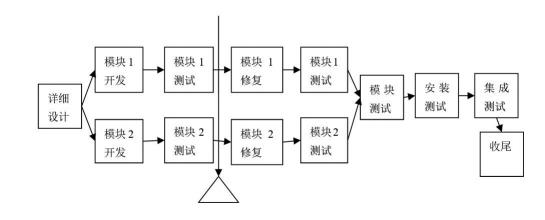

#### 【问题 2】（10 分）

（1）

PV=A 开发+A 测试+A 修复+B 开发+1/3*B 测试=（48+4+8）*1000+（80+1）*1000=141000（1 分） EV=A 开发+A 测试+1/2*A 修复+B 开发=（48+4+4）*1000+80*1000=136000（1 分）

AC=180000（1 分）

CV=EV-AC=136000-180000=-44000（1 分）

SV=EV-PV=136000-141000=-5000（1 分）

所以成本超支，进度落后（2 分）

（2）为典型偏差

BAC=（48+4+8+3+80+3+10+2+2+4）*1000=164000（1 分）

CPI=EV/AC=136000/18000=0.76（1 分）

ETC=（BAC-EV）/CPI=（164000-136000）/0.76=37059（1 分）

#### 【问题 3】（6 分）

①赶工，投入更多的资源或增加工作时间，以缩短关键活动的工期。

②快速跟进，并行施工，以缩短关键路径的长度。

③使用高素质的资源或经验更丰富的人员。

④减小活动范围或降低活动要求。

⑤改进方法或技术， 以提高生产效率。

⑥加强质量管理，及时发现问题，减少返工，从而缩短工期。

（每个 1 分，写 6 个即可得满分）

#### 【江山老师点评】

本题比较简单， 此题和 2012 年上半年真题类似， 给出题目的形式基本都是一样的， 咱们也重点讲 过，如果听课的应该都会写，所以真题必须吃透啊，而且双代号时标网络图我们的计算专题讲课 不止讲过一次，很方便快捷去算人和天的资源平衡的计算，而且要求大家会画的， 居然考了，我 觉得我们的学员应该没有问题！此题我觉得应该大家得满分，如果没有理解出题人的意图那可能 失分比较严重，下图是 2012 年上半年真题的图形:

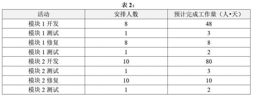

#### 【相关知识点解析】

#### 【问题 1】第三版教材 P265

#### 【问题 2】第三版教材 P306-309

#### 【问题 3】第三版教材 P267

#### 【试题十五】 ---高级 2019 年下半年案例分析试题

阅读下列说明，回答问题 1 至问题 3，将解答填入答题纸的对应栏内。

#### 【说明】

某公司完成一个工期 10 周的系统集成项目，该项目包含 ABCDEF 五项任务。项目经理制定 了成本预算表（如表 1）执行过程中记录了每个时段项目的执行情况（如表 2、表 3）。

表 1 成本预算表（单位：万元）

| 任务 | 1 周 | 2 周 | 3 周 | 4 周 | 5 周 | 6 周 | 7 周 | 8 周 | 9 周 | 10 周 |
|---|---|---|---|---|---|---|---|---|---|---|
| A | 10 | 15 | 5 |  |  |  |  |  |  |  |
| B |  | 10 | 20 | 20 |  |  |  |  |  |  |
| C |  |  |  | 5 | 5 | 25 | 5 |  |  |  |
| D |  |  |  |  | 5 | 15 | 10 | 10 |  |  |
| E |  |  |  |  |  |  |  | 5 | 20 | 25 |
| 合计 | 10 | 25 | 25 | 25 | 10 | 40 | 15 | 15 | 20 | 25 |

表 2 成本预算表（单位：万元）

| 任务 | 1 周 | 2 周 | 3 周 | 4 周 | 5 周 | 6 周 | 7 周 | 8 周 | 9 周 | 10 周 |
|---|---|---|---|---|---|---|---|---|---|---|
| A | 10 | 14 | 10 |  |  |  |  |  |  |  |
| B |  | 10 | 14 | 20 |  |  |  |  |  |  |
| C |  |  |  | 5 | 5 | 10 |  |  |  |  |
| D |  |  |  |  | 5 | 8 |  |  |  |  |
| E |  |  |  |  |  |  |  |  |  |  |
| 合计 | 10 | 24 | 24 | 25 | 10 | 18 | 0 | 0 | 0 | 0 |

表；任务完成百分比

| 任务 | 1 周 | 2 周 | 3 周 | 4 周 | 5 周 | 6 周 | 7 周 | 8 周 | 9 周 | 10 周 |
|---|---|---|---|---|---|---|---|---|---|---|
| A | 30% | 50% | 100% |  |  |  |  |  |  |  |
| B |  | 20% | 50% | 100% |  |  |  |  |  |  |
| C |  |  |  | 5% | 10% | 40% |  |  |  |  |
| D |  |  |  |  | 10% | 20% |  |  |  |  |
| E |  |  |  |  |  |  |  |  |  |  |
| 合计 |  |  |  |  |  |  |  |  |  |  |

#### 【问题 1】（5 分）

项目执行到了第 6 周，请填写如下的项目 EV 表，将答案填写在答题纸对应栏内。

#### 【问题 2】（14 分）

（1）经分析任务 C 的成本偏差是非典型的，而 D 的偏差是典型的。针对每期的情况，请计算项 目完工时的成本估算值（EAC）。

（2）判断项目前的绩效情况。

#### 【问题 3】（6 分）

江山老师参考答案：

#### 【问题 1】（5 分）

（下面数字代表累计的 EV）

| 任务 | 1 周 | 2 周 | 3 周 | 4 周 | 5 周 | 6 周 | 7 周 | 8 周 | 9 周 | 10 周 |
|---|---|---|---|---|---|---|---|---|---|---|
| A |  |  |  |  |  |  |  |  |  |  |
| B |  |  |  |  |  |  |  |  |  |  |
| C |  |  |  |  |  |  |  |  |  |  |
| D |  |  |  |  |  |  |  |  |  |  |
| E |  |  |  |  |  |  |  |  |  |  |
| 合计 |  |  |  |  |  |  |  |  |  |  |

#### 【问题 2】（14 分）

BAC=10+25+25+25+10+40+15+15+20+25=210 万（1 分）

（1）任务 C 的 EAC=AC+BAC-EV=20+40-40*40%=44 万（2 分）

任务 D 的 EAC=BAC/CPI=40/（8/13）=65 万（2 分）

项目完工时的 EAC=34+44+44+65+50=237 万（2 分）

（2）

前 6 周总的 EV=9+16+30+27+6+16=104

前 6 周总的 AC=10+24+24+25+10+18=111

前 6 周总的 PV=10+25+25+25+10+40=135

成本绩效指数 CPI=EV/AC=104/111=0.94（1 分）

进度绩效指数 SPI= EV/PV =104/135=0.77（1 分）

CPI <1,说明成本超支; （2 分）

SP I<1,说明进度落后; （2 分）

#### 【问题 3】（6 分）

①赶工，投入更多的资源或增加工作时间，以缩短关键活动的工期；

②快速跟进，并行施工，以缩短关键路径的长度；

③使用高素质的资源或经验更丰富的人员；

④减小活动范围或降低活动要求；

⑤改进方法或技术， 以提高生产效率；

⑥加强质量管理，及时发现问题：减少返工，从而缩短工期；

江山老师解析：

此题稍微有点新意，很多考生反应有点难度，其实把题目多读几遍，出题人意图搞清楚了，

#### 【问题 1】

题目是第 6 周，是算 5 周还是 6 周呢，因为题目说了表 2 和 3 都是算了 6 周的，如果算 5 周 就没有意义这样给了，所以要算 6 周，部分地方也说第六周是 5 周完成，题目不大严谨，当然这 边的第六周是包含当周的！

之前我们讲过 EV=PV*百分比， 这个需要注意题目给出的 3 个表格， 第 1 个表格是 PV，第二个 表格是 AC，第三个表格是算 EV（注意这个表格给出的百分比是累计百分比）

注意预算是按实际分段的， 所以计算 EV 是按最后的总的百分比与总的计划值相乘， 注意不是 每个格子的数去乘以相应的百分比，比如 A 活动，到第三周完成了 100%，说明这个活动已经完成， 所以 EV=（10+15+5）*100%=30

预算是按时间分段投入的， 所以计算 EV 时是用在检测点第 6 周的累计完成百分比与整个计划 相乘。例如 A 活动，到第 3 周结束时已完成 100%，说明这个活动已经全部完成，所以 EV=（10+15+5） *100%=30。

各活动 EV 计算如下：

A 活动 EV=（10+15+5）*100%=30 ；B 活动 EV=（10+20+20） *100%=50

C 活动 EV=（5+5+25+5）*40%=16 ；D 活动 EV=（5+15+10+10）*20%=8

然后填入表格。

可能部分考生理解成了是算每周 EV，如下表：（下面数字代表前几周每周的 EV），

个人觉得

算单个活动（结合表 1 和表 2 意思去写）的或者累计的（结合表 3 去答）都有一定道理，具体按

照哪一种答案可能需要看出题人的意图吧，个人感觉 2 种答案都对，如果是每周的可以看下表的 参考答案：

（下面数字代表每周的 EV，不是累计的）

| 任务 | 1 周 | 2 周 | 3 周 | 4 周 | 5 周 | 6 周 | 7 周 | 8 周 | 9 周 | 10 周 |
|---|---|---|---|---|---|---|---|---|---|---|
| A | 9 | 6 | 15 |  |  |  |  |  |  |  |
| B |  | 10 | 15 | 25 |  |  |  |  |  |  |
| C |  |  |  | 2 | 2 | 12 |  |  |  |  |
| D |  |  |  |  | 4 | 4 |  |  |  |  |
| E |  |  |  |  |  |  |  |  |  |  |
| 合计 | 9 | 16 | 30 | 27 | 6 | 16 |  |  |  |  |

#### 【问题 2】公式要写出来也是有分的，当然算 CV 和 SV 然后判断绩效也是有分的！

#### 【问题 3】就是默写题了，多次考了，这种题型每次必考的，而且 2019 年上半年刚考过

#### 【试题十六】 ---中级 2009 年下半年案例分析试题

#### 【说明】

某信息系统开发项目由系统集成商 A 公司承建，工期 1 年，项目总预算 20 万元。目前项目实 施已进行到第 8 个月末。在项目例会上， 项目经理就当前的项目进展情况进行了分析和汇报。截 止第 8 个月末项目执行情况分析表如下：

#### 【问题 1】（8 分）

请计算截止到第 8 个月末该项目的成本偏差（CV）、进度偏差（SV）、成本执行指数（CPI） 和进度执行指数（SPI），判断项目当前在成本和进度方面的执行情况。

#### 【问题 2】（7 分）

请简要叙述成本控制的主要工作内容。

| 参考答案 |
|---|

#### 【问题 1】（8 分）

PV=（2000+5000+10 000+75 000+65 000+20 000）元=177 000 元

AC=（2100+4500+12 000+86 000+60 000+15 000）元=179 600 元

EV=（2000x100%+5000x100%+10 000x100%+75 000x90%+65 000x70%+20 000x35%）元=137 000 元 CV=EV-AC=（137000-1796000）元=-42600 元（1 分）

SV=EV-PV=（137000-177000）元=-40000 元（1 分）

CPI=EV/AC=（137000/179600）元=0.76（1 分）

SPI=EV/PV=（137000/177000）元=0.77（1 分）

项目当前执行情况： 成本超支（2 分），进度滞后（2 分）。

#### 【问题 2】（7 分）

（1）对造成成本基准变更的因素施加影响；

（2）确保变更请求获得同意；

（3）当变更发生时，管理这些实际的变更；

（4）保证潜在的成本超支不超过授权的项目阶段资金和总体资金；

（5）监督成本执行，找出与成本基准的偏差；

（6）准确记录所有与成本基准的偏差；

（7）防止错误的、不恰当的或未获批准的变更纳入成本或资源使用报告中； （8）就审定的变更，通知项目干系人；

（9）采取措施，将预期的成本超支控制在可接受的范围内。

（每个 1 分，总分不超过 7 分）

#### 【试题十七】 ---中级 2010 年上半年案例分析试题

#### 【说明】

| 序号 | 工作活动 | 预 算 费 用  （pv）（万元） | 序号 | 工作活动 | 预 算 费 用  （pv）（万元） |
|---|---|---|---|---|---|
| 1 | 任务 1 | 3 | 3.5 | 任务 6 | 4 |
| 2 | 任务 2 | 3.5 | 5 | 任务 7 | 6.4 |
| 3 | 任务 3 | 2.4 | 6 | 任务 8 | 3 |
| 4 | 任务 4 | 5 | 8 | 任务 9 | 2.5 |
| 5 | 任务 5 | 4.5 | 10 | 任务 10 | 1 |

#### 【问题 1】（6  分）

请计算此时项目的绩效指数 CPI  和 SPI（需写出公式）。

#### 【问题 3】（5  分）

请分析该项目的成本、进度情况，并指出可以在哪些方面采取措施以保障项目的顺利进行。

| 参考答案 |
|---|

到了第四个月月底的时候， 按计划应该完成的任务是 1、2、3、4、6、7、8， 根据 10 个任务的单

项预算表可知，此时

#### 【问题 1】（6 分）

① PV 应等于计划完成的任务 1、2、3、4、6、7、8 的 PV 之和。

PV = 3 + 3.5 + 2.4 + 5 + 4 + 6.4 + 3 = 27.3（2 分）

② AC = 25（2 分）

③EV 应等于已完成的任务 1、2、3、4、6、7 的 PV 之和

EV = 3 + 3.5 + 2.4 + 5 + 4 + 6.4= 24.3（2 分）

#### 【问题 2】（4 分）

① CPI = EV/AC= 0.972（2 分）

② SPI = EV/PV= 0.89（2 分）

#### 【问题 3】（5 分）

进度落后（1 分），成本超支（1 分）。

措施；用高效人员替换低效率人员（1 分），加班（或赶工）  （1 分），或在防范风险的前提下 并行施工（快速跟进）。（1 分）

#### 【试题十八】 ---中级 2011 年上半年案例分析试题

#### 【说明】

某大楼布线工程基本情况为：一层到四层， 必须在低层完成后才能进行高层布线。每层工作量 完全相同。项目经理根据现有人员和工作任务， 预计每层布线需要一天完成。项目经理编制了该 项目的进度计划，并在 3  月18  号工作时间结束后对工作进展情况进行了评估，如下表所示：

#### 【问题 1】（5 分）

请计算2011  年3  月18   日时对应的PV 、EV 、AC.CPI  和SPI。

#### 【问题 2】（4分）

(1)  根据当前绩效，在下图中划出AC  和EV   曲线。（2  分）

（2）分析当前的绩效，并指出绩效改进的具体措施。

#### 【问题 3】（6分）

（1）如果在2011年3月18日绩效评估后，找到了影响绩效的原因并予以纠正，请预测此种情

况下的ETC, EAC和完工日期。

（2）如果在2011年3月18日绩效评估后，未进行原因分析和采取相关措施，仍按目前状态开 展工作，请预测此种情况下的ETC,EAC和完工日期。

PV= 20000; EV=10000; AC=8000; CPI=EV/AC=10000/8000=125%; SPI=EV/PV=50%

（每算对一个得 1 分，总分 5 分）

#### 【问题 2】（4 分）

（1）

（2）目前的绩效：成本节省； 进度滞后。（1 分）

#### 【试题十九】 ---中级 2013 年下半年案例分析试题

#### 【说明】

| SYSTEM |
|---|

| 可交付物 2.1 |
|---|

#### 【问题 1】（2  分）

假如估算出子项目 1  的开发成本为 200  万元，  子项目 2   的开发成本为 150  万元，  则该

项目的全生命周期成本为多少万元？

#### 【问题 2】（7  分）

假设交付物 1.1  和 1.2  之间的成本权重比分别为 40%和 60%，交付物的工作包成本可以平 均分配。根据以上项目的总体估算。如果你是项目的项目经理，综合安全所述，请写出成本预算 的步骤并计算各工作包成本。

#### 【问题 3】（3  分）

请说明成本估算和成本预算之间的区别与联系。

#### 【问题 4】（6  分）

该项目的项目经理在完成以上成本预算后， 制订了全新的成本管理计划， 安排了新来的小王 负责监控项目成本，  小王认为成本控制关键在于跟踪各项工作的实际成本， 于是他严格记录了各 项工作所花费的实际成本。  当子项目 1  快要完成时，项目经理突然发现工作包 1.2.2  的成本有 些超支。项目经理于对成本管理人员进行了批评。同时启动了管理储备金来解决问题。依据案例， 你认为项目在进行成本控制时存在哪些问题？

| 参考答案 |
|---|

#### 【问题 1】（1） 5+200+150+50+50=455（万元）（2 分）

#### 【问题 2】答：

（1） 成本预算的步骤： 首先要得到项目的总体估算；将项目总成本分摊到项目工作分解结构的各 个工作包上；  将各个工作包成本再分配到该工作包把包含的各项活动上；  确定各项成本预算支 出的时间计划及此项目成本预算计划。（3 分）

（2）工作包 1.1.1 成本： 200*40%=80 万元（1 分）

交付物 1.2 成本： 200*60%*=120 万元（1 分）

工作包 1.2.1 成本=1.2.2 成本=120*0.5=60 万元（1 分）

工作包 2.1.1 成本=交付物 2.1 成本=150 万元（1 分）

#### 【问题 3】

（1） 成本估算和预算的联系：运用类比估算、参数模型、自下而上等工具和技术；都是以 WBS 为基础的。

（2） 成本估算和预算的区别：估算成本是对完成项目活动所需资金进行近似估算的程； 估算成本 其输出是成本估算，  这种估算并未得到管理层的批准；  成本估算的精确程序以工作包为基础；

制定预算是汇总所有单个活动或工作包的估算成本， 建立一个经批准的成本基准的程；成本 预算将基于工作包的成本估算分配到每项活动及相应时间段； 成本预算输出的是成本基准计划即 经过批准的成本预算。

（答案包括但不限于以上内容，列举出其中 3 个小点即可，每小点 1 分，答案类似即可）

#### 【问题 4】

（1）管理储备项目经理没有权限单独使用，需要经过评审审批才可以。

（2）成本超支应该马上分析超支原因， 对引起超支的因素施加影响，而不是指责团队成员。

（3） 成本控制不仅要跟踪每项工作的实际成本，还将实际成本与预算成本进行对比分析， 找出成 本基准的偏差。

（4） 项目经理应该定期、不定期进行项目成本控制检查， 而不是偶尔的检查； 要在开始时， 实施 中，结束后都要进行检查。

（5）不应该将监控项目成本的工作交给新来的小王，应该交由有经验的人员负责。

（答案包括但不限于以上内容，列举出其中 3 个小点即可，每小点 2 分，答案类似即可）

#### 【试题二十】 ---中级 2014 年上半年案例分析试题

#### 【说明】某系统集成公司项目经理老王在其负责的一个信息系统集成项目中采用绩效衡量分析技 术进行成本控制，该项目计划历时 10 个月，总预算 50 万元。目前项目已经实施到第 6 个月末。 为了让公司管理层了解项目进展情况，老王根据项目实施过程中的绩效测量数据编制了一份成本 执行绩效统计报告， 截止第 6 个月末， 项目成本绩效统计数据如下表所示。

| 序号 | 工作任务单元代号 | 完成百分比（*） | 计划成本值（万元） | 实际成本值（万元） |
|---|---|---|---|---|
| 1 | W01 | 100% | 3 | 2.5 |
| 2 | W02 | 100% | 5 | 4.5 |
| 3 | W03 | 90% | 6 | 6.5 |
| 4 | W04 | 80% | 8.5 | 6 |
| 5 | W05 | 40% | 6.5 | 1.5 |
| 6 | W06 | 30% | 1 | 1.5 |
| 7 | W07 | 10% | 7 | 0.5 |

#### 【问题 1】（5 分）

请计算该项目截止到第 6 个月末的计划成本（PV）、实际成本（AC）、挣值（EV）、成本偏差

（SV）、进度偏差（SV）。

#### 【问题 2】（4 分）

请计算该项目截止到第 6 个月末的成本执行指数（CPI）和进度执行指数（SPI），并根据计算 结果分析项目的成本执行情况和进度执行情况。

#### 【问题 3】（3 分）

根据所给数据资料说明该项目表现出来的问题和可能的原因。

#### 【问题 4】（6 分）

假设该项目现在解决了导致偏差的各种问题，后续工作可以按原计划继续实施，项目的最终 完工成本是多少？

| 参考答案 |
|---|

#### 【问题 1】（5 分）

请计算该项目截至： 到第 6 个月末的计划成本（PV）、实际成本（AC）、挣值（EV）、成本偏差（SV）、 进度偏差（SV）.

PV=3+5+6+8.5+6.5+1+7=37 万元。

AC=2.5+4.5+6.5+6+1.5+1.5+0.5=23 万元。

EV=3*100%+5*100%+6*90%+8.5*80%+6.5*40%+1*30%+7*10%=23.8 万元。

CV=EV-AC=23.8-23=0.8 万元。

SV=EV-PV=23.8-37=-13.2 万元。

#### 【问题 2】（4 分）

请计算该项目截止到第 6 个月末的成本执行指数（CPI）和进度指数（SPI）。并根据计算结果分析 项目的成本执行情况和进度情况。

CPI=EV/AC=23.8/23=103.5%

SPI=EV/PV=23.8/37=64.3%

CPI>1，故： 成本节省。SPI<1，故：进度落后。

根据计算结果得出： 成本节省，进度滞后

#### 【问题 3】（3 分）

根据所给的资料说明该项目表现出来的问题和可能的原因。

1.进度滞后的问题， 可能原因：

（1）进度计划不周。

（2）资源分配问题， 导致某些工作因缺少资源展开缓慢。

（3）历时估算不准。

（4）进度执行的监控不力，未及时发现变更或发现后未及时管理纠偏。

2.成本节省可能带来质量风险。

（1）成本的节省可能带来工作或产品质量下降。

（2）工作范围可能未得到确认，部分工作遗漏从而形成的成本节省。

#### 【问题 4】（6 分）

假设该项目现在解决了导致偏差的各种问题，后续工作可以按照原计划继续实施，项目的最终完 工成本是多少？

由于解决了导致偏差的问题， 后续工作按原计划执行，所以采用非典型偏差公式计算： BAC=50 万元。

ETC=BAC-EV=50-23.8=26.2 万元。

EAC=AC+ETC=23+26.2=49.2 万元。

#### 【试题二十一】---中级 2015 年下半年案例分析试题

#### 【说明】

某项目由 A 、B 、C 、D 、E、F、G、H  活动模块组成，下表给出了各活动之间的依赖关系， 以及它们在正常情况和赶工情况下的工期及成本数据。假设每周的项目管理成本为 10 万元， 而且 项目管理成本与当周所开展的活动多少无关。

#### 【问题 1】（6 分）

找出项目正常情况下的关键路径，并计算此时的项目最短工期和项目总体成本。 【问题 2】 （4 分）

假设项目必须在 9 周内（包括第 9 周）完成，请列出此时项目中的关键路径，并计算此时项目的 最低成本。

#### 【问题 3】（7 分）

在计划 9 周完成的情况下， 项目执行完第 4 周时， 项目实际支出 280 万，此时活动 D 还需要一周 才能够结束，计算此时项目的 PV、EV、CPI 和 SPI（假设各活动的成本按时间均匀分配）。

#### 【问题 1  参考答案】（6 分）

正常情况下的关键路径 ADFH。（2 分）  正常情况下的最短工期 14 周。（2 分）

正常情况下的最低总成本 560 万元。（2 分）

解析：（4*10）+（20*3）+（2*5）+（3*10）

+（4*15）+（4*25）+（2*30）+（3*20）+（14*10）=560 万元

#### 【问题 2  参考答案】（4 分）

如果项目必须在 9 周内完成， 则 A、B、D、E、F 赶工。

此时关键路径为 ADGH（1 分） 或者 ACGH（1 分），项目此时最低成本为 585 万（2 分）。 【问题 3  参考答案】（7 分）

此时项目的 AC=280 万元， PV=295 万元（1 分）。EV=275 万元（2 分），则

CPI=EV/AC=0.98（2 分）  SPI=EV/PV=0.93（2 分）

解析：在计划 9 周内完成的情况下，到第四周末

计划活动成本为： 2*30+1*65+2*5+2*20+1*80=255（万元）

管理成本： 4*10=40（万元）

PV=活动成本+管理成本=255+40=295（万元）

AC=280（万元）

EV=2*30+1*65+2*5+1*20+1*80+40=275（万元）

CPI=EV/EC=275/280=0.98    SPI=EV/PV=275/295=0.93

#### 【试题二十二】 ---中级 2016 年下半年案例分析试题

下图给出了一个信息系统项目的进度计划网络图（含活动历时）

下表给出了该项目各项活动的历时和成本估算值

| 活动名称 | 活动历时（单位：天） | 成本估算值（单位： 元） |
|---|---|---|
| A | 2 | 1000 |
| B | 2 | 2000 |
| C | 8 | 4000 |
| D | 5 | 3000 |
| E | 3 | 3000 |
| F | 7 | 4000 |
| G | 5 | 5000 |
| H | 4 | 2000 |
| I | 4 | 3000 |
| J | 2 | 2000 |
| K | 1 | 1000 |

#### 【问题 1】（5 分）

（1）请指出该项目的关键路径。

（2）请计算该项目的总工期。

（3）请计算活动 C 的总浮动时间和自由浮动时间。

#### 【问题 2】（3 分）

假设该项目无应急储备，管理储备为 10000 元， 计算该项目的完工预算 BAC 和总预算。 【问题 3】（6 分）

按照项目进度计划，第 12 天结束时应完成活动 C 、F、J，实际情况为： C 完成了 75%;  F 完成了 100%; J 完成了 50%;实际花费 25000 元。请计算该时点的计划值 PV、挣值 EV、成本绩效指数 CPI 和进度绩效指数 SPI。

#### 【问题 4】（6 分）

在项目第 12 天结束时，项目经理对项目滞后的原因进行了分析，找出了滞后原因 M（由于 M 造 成的偏差是非典型的）

（1）假设 M 在以后的项目实施过程中不会再发生，请计算完工估算 EAC。

（2）假设 M 在以后的项目实施过程中一直存在， 请计算完工估算 EAC。

参考答案

#### 【问题 1】（5 分）

#### 【做题的时候在草稿纸上画出大概的图形】

（1）关键路径为： ABCDK 和 AEFGK 两条（2 分）

（2）总工期：18 天（1 分）

（3）C 在关键路径上，所以 C 的总浮动时间为 0（1 分），自由浮动时间为 0（1 分）。

#### 【问题 2】（3 分）

BAC 为各个活动求和， BAC=30000 元（1 分），总预算需要加管理储备， 总预算=BAC+管理储备=40000 元（2 分）

#### 【问题 3】（6 分）

把所有 ABCEFHIJ 的估算值相加得到 PV.

PV=PV（A+B+C+E+F+H+I+J）=1000+2000+4000+3000+4000+2000+3000+2000=21000（2 分） EV=PV（A+B+C*75%+E+F+H+I+J*50%）=

1000+2000+4000*75%+3000+4000+2000+3000+2000*50%=19000（2 分）

AC=25000

CPI=EV/AC=19000/25000=0.76（1 分）

SPI=EV/PV=19000/20000=0.95（1 分）

该项目目前成本超支，进度落后

#### 【问题 4】

（1）非典型偏差： EAC=AC+ETC=25000+（30000-19000） =36000（3 分）

(2）典型偏差:EAC二AC+ETC二AC+  (BAC-EV）/Cpl二39473.6(3 分）

#### 【试题二十三】 ---中级 2018 年下半年案例分析试题

. 阅读下列说明，回答问题 1 至问题 4,将解答填入答题纸的对应栏内。

#### 【说明】

下表给出了某信息系统建设项目的所有活动截止到 2018 年 6 月 1 日的成本绩效数据，项目完 工预算 BAC 为 3000 元。

| 活动名称 | 完成百分比（%） | PV（元） | AC（元） |
|---|---|---|---|
| 1 | 100 | 1000 | 1000 |
| 2 | 100 | 1500 | 1600 |
| 3 | 100 | 3500 | 3000 |
| 4 | 100 | 800 | 1000 |
| 5 | 100 | 2300 | 2000 |
| 6 | 80 | 4500 | 4000 |
| 7 | 100 | 2200 | 2000 |
| 8 | 60 | 2500 | 1500 |
| 9 | 50 | 4200 | 2000 |
| 10 | 50 | 3000 | 1600 |

#### 【问题 1】（10 分）

请计算项目当前的成本偏差 CV、进度偏差 SV 成本绩效指数 CPI、进度绩效指数 SPI,并指出该项目 的成本和进度执行情况（CP 和 SPI 结果保留两位小数）。

#### 【问题 2】（3 分）

项目经理对项目偏差产生的原因进行了详细分析，预期未来还会发生类似偏差如果项目要按期完 成，请估算项目的 ETC（结果保留一位小数）

#### 【问题 3】（2 分）

假如此时项目增加 100 元的管理储备，项目完工预算 BAC 如何变化?

#### 【问题 4】（6 分）

以下成本中，直接成本有哪三项?间接成本有哪三项?（从候选答案中选择正确项，将该选项编号填 入答题纸对应栏内，所选答案多于三项不得分）

（3） A.销售费用

B.项目成员的工资.

C.办公室电费

D.项目成员的差旅费

E.项目所需的物料费

F.公司为员工缴纳的商业保险费用

参考答案：

#### 【问题 1】（10 分）

根据题干， 得:BAC=30000;PV=25500;AC=19700;

EV=1000+1500+3500+800+2300+80%*4500+2200+60%*2500+50%*4200+50%*3000=20000， 所以:

CV=EV-AC=20000-19700=300 元;

SV=EV-PV=20000-25500=-5500 元;

CPI=EV/AC=20000/19700=1.02

SPI=EV/PV=20000/25500=0.78

目前成本节约，进度落后。

#### 【问题 2】（3 分）

未来还会， 则是典型情况， 同时题干说明“项目要按期完成”，而目前进度是落后的，所以可能成 本和进度对 ETC 都有影响。

得 ETC=（BAC-EV）/（CPI*SPI）=（30000-20000）/（1.02*0.78）=12569.1 元。

上面是推荐的答案。不过这个算是疑问题，主要看出题人的意思了。题目并没有特定明确说明是 双重影响，因为要按期完成也可以后期提高生产率、改进方法等方式追回进度，不一定会增加成 本。

#### 【问题 3】（2 分）

BAC 不包括管理储备，所以增加 10000 元管理储备， BAC 不变化。

#### 【问题 4】（6 分）直接成本： BDE   间接成本： ACF

#### 【试题二十四】 ---中级 2019 年上半年案例分析试题（17 分）

项目经理根据甲方要求评估了项目的工期和成本。项目进行到 20 天的时候， 项目经理对项目 开展情况进行了评估。得到了活动实际花费成本（如下图），此时 A 、B 、C 、D、F  已经完工， E 仅完成了 1/2,G 仅完成了 2/3 。H 尚未开工。

| 工作代号 | 紧前工作 | 估算工期 | 赶工一天增加的成本 | 计划成本（万元） | 实际成本（万元） |
|---|---|---|---|---|---|
| A | -- | 5 | 2100 | 5 | 3 |
| B | A | 6 | 1000 | 4 | 7 |
| C | A | 8 | 2000 | 7 | 5 |
| D | B/C | 7 | 1800 | 8 | 3 |
| E | C | 2 | 1000 | 2 | 3 |
| F | C | 2 | 1200 | 1 | 1 |
| G | F | 3 | 1300 | 3 | 1 |
| H | D/E/G | 3 | 1600 | 4 | 0 |
| I | H | 5 | 1500 | 5 | 0 |

#### 【问题 1】（6 分）

基于以上案例，项目经理得到了单代号网络图， 请将以下图补充完整。

#### 【问题 2】（5 分）

基于补充后的网络图，

（1）请推出项目的工期、关键路径和活动 E 的总时差

（2）项目经理现在想通过赶工的方式提前一天完成项目，应该压缩哪个活动最合适?为什么? 【问题 3】（6 分）

请计算项目当前的 PV 、EV 、AC.CV 、SV 为并评价项目进度和成本绩效。

#### 【问题 1】（6 分）

#### 【问题 2】（5 分）

（1）项目工期 28 天，关键路径 ACDHI，活动 E 的总时差为 5 天。

（2）应该压缩活动 I，活动 I 在关键路径上，且压缩成本最小。

#### 【问题 3】（6 分）

建议画一个时标网络图，看的比较清楚。

从进度网络图中可以看出，当项目计划到第 20 天时，ABCDEFG 应当已经完工；

此时 PV=PV（A） +PV（B）+PV（C）+PV（D） +PV（E）+PV（F） +PV（G）=5+4+7+8+2+1+3=30（万元）； 而实际到第 20 天时， ABCDF 已经完工， E 仅完成了二分之一，G 仅完成了三分之二，

此时 EV= PV（A）+PV（B）+PV（C）+PV（D）+PV（E）/2+PV（F）+PV（G）x（2/3）=5+4+7+8+2/2+1+3X （2/3）=28（万元）；

AC=3+7+5+3+3+1+1=23（万元）。

则 SV=EV-PV=28-30=-2（万元）；CV=EV-AC=28-23=5（万元）。

因此，当前项目进度滞后，成本节约。

#### 【试题二十五】 ---中级 2019 年下半年案例分析试题

#### 【说明】（20 分）

某公司中标了一个软件开发项目，项目经理根据以往的经验估算了开发过程中各项任务需要 的工期及预算成本， 如下表所示。

到第 13 天晚上，项目经理检查了项目的进展情况和经费使用情况，发现 A、B 、C 三项活动 均已完工， D 任务明天可以开工， E 任务完成了一半，F 尚未开工。

| 任务 | 紧前任务 | 工期 | 工期 | 工期 | PV | AC |
|---|---|---|---|---|---|---|
| 任务 | 紧前任务 | 乐观 | 可能 | 悲观 | PV | AC |
| A | -- | 2 | 5 | 8 | 500 | 400 |
| B | A | 3 | 5 | 13 | 600 | 650 |
| C | A | 3 | 3 | 3 | 300 | 200 |
| D | B 、C | 1 | 1 | 7 | 200 |  |
| E | C | 1 | 2 | 3 | 200 | 180 |
| F | D 、E | 1 | 3 | 5 | 300 |  |

#### 【问题 1】（5 分）

请采用合适的方法估算各个任务的工期，并计算项目的总工期和关键路径。

#### 【问题 2】（3 分）

分别给出 CDE 三项活动的总时差。

#### 【问题 3】（7 分）

请计算并分析该项目第 13 天晚上时的执行绩效情况。

#### 【问题 4】（5 分）

针对项目目前的绩效情况，项目经理应该采取哪些措施。

江山老师参考答案：

#### 【问题 1】（5 分）

采用三点估算法估算各个活动工期：

A 的工期：（2+4*5+8）/6=5 天；      B 的工期：（3+4*5+13）/6=6 天

C 的工期：（3+4*3+3）/6 =3 天；     D 的工期：（1+4*1+7）/6 =2 天

F 的工期：（1+4*3+5）/6=3

根据题干给出的表格，画出单代号网络图，在图上标注估算出的工期。

找出关键路为： A-B-D-F，总工期为 5+6+2+3=16 天。

#### 【问题 2】（3 分）

C 的总时差是 3；D 的总时差是 0；E 的总时差是 3；

分析：

题干只要求 C、D、E 三个活动的总时差，根据总时差的定义，可以用关键路径的长度减去该活动 所在的最长路径。

C 活动所在的路径为 A-C-D-F 和 A-C-E-F，长度都是 12，所以 C 的总时差是 3； D 在关键路径上，总时差为 0；

E 所在的路径为 A-C-E-F，长度为 12，所以 E 的总时差为 3。

还可以画出如下时标网络图，直接看图，C 总时差为 3，D 总时差 0，E 总时差 3。

#### 【问题 3】（7 分）

检测点前的活动是第 13 天晚上按计划需要完成的活动： A,B,C,D,E 活动。

所以 PV=500+600+300+200+200=1800 元

AC=400+650+200+180=1430 元

实际情况是 A、B、C 三项活动均已完工，D 任务明天可以开工，E 任务完成了一半，F 尚未开工， 所以挣值 EV=500+600+300+200*50%=1500 元。

CPl=EV/AC=1500/1430~1.05

SPI=EV/PV=1500/1800~0.83

CPI> 1 成本节约， SPI<1 进度落后

#### 【问题 4】（5 分）

（1）使用高素质、高效率的资源或经验更丰富的人员；

（2）赶工，投入更多资源和增加工作时间，以缩短关键路径的工期；

（3）快速跟进，并行施工，以缩短关键路径长度；

（4）改进方法或技术以提高效率；

（5）与甲方协商后，减少活动范围或降低活动要求；

（6）加强质量管理，及时发现问题，减少返工从而缩短工期。
