# 04-历年真题题库_按章分类

全国计算机技术与软件专业技术资格（水平）考试

2020 年最新版 V6.0

系统集成项目管理工程师

中项历年真题分类汇总、练习测试查缺补漏、针对错题突破瓶颈

## 第一章、前言（本书说明）

## 第二章、信息化基础知识

### 1、国家信息化体系要素

#### 【试题 1】---2009 上真题 2

,、（1）是国家信息化体系的六大要素。

（1）    A.数据库’国家信息网络’信息技术应用’信息技术教育和培训’信息化人才’信息化政策、法规和标准

B.信息资源’国家信息网络’信息技术应用’信息技术和产业’信息化人才’信息化政策、 法规和标准

C.地理信息系统’国家信息网络’工业与信息化’软件技术与服务’信息化人才’信息化 政策、法规和标准

D.信息资源’国家信息网络’工业与信息化’信息产业与服务业’信息化人才’信息化政 策、法规和标准

#### 【试题 2】---2009 下真题 1

2、国家信息化体系包括 6 个要素’这 6 个要素的关系如下图所示’其中①的位置应该是（2）。
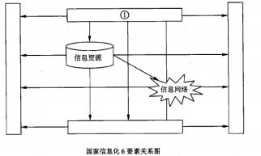

（2）A.信息化人才          B.信息技术应用 C.信息技术和产业      D.信息化政策法规和标准规范

#### 【试题 3】---2011 下真题 1

3、以下对国家信息化体系要素的描述中’不正确的是（3）。

A.信息技术应用是信息化体系要素中的龙头

B.信息技术和产业是我国进行信息化建设的基础

C.信息资源的开发利用是国家信息化的核心任务

D.信息化政策法规和标准规范属于国家法规范畴’不属于信息化建设范畴

#### 【试题 4】 ---2015 下真题 2

4、国家信息化体系包括信息技术应用’信息资源等六要素’其中（ ）是国家信息化成功之本’ 对其他各要素的发展速度和质量有着决定性的影响’是信息化建设的关键。

（4）A.信息资源  B.信息化法规和标准规范   C.信息化人才     D.信息化技术和产业

#### 【试题 5】---2017 上真题 5

5、在国家信息化体系六要素中，（）是进行信息化建设的基础。

A.信息技术和产业

B.信息化政策法规和标准规范

C.信息资源的开发和利用

D.信息人才

#### 【试题 6】---2017 下真题 3

6、国家信息化体系要素中，（）是国家信息化的主阵地，集中体现了国家信息化建设的需求和效益。

A.信息技术应用    B.信息网络    C.信息资源    D.信息化人才

#### 【试题 7】---2018 上真题 3

7、开展区域链技术的商业试探性应用， 属于国家信息化体系中的（）要素。

A.信息技术应用    B.信息网络    C.信息资源    D.信息技术和产业

### 2、电子政务

#### 【试题 1】---2012 下真题 4

1、政府机构利用Intranet建立有效的行政办公和员工管理体系， 以提高政府工作效率服务和公务 员管理水平，这种电子政务的模式是（1）。

A.G2G    B.G2C    C.G2E    D.G2B

#### 【试题 2】---2014 上真题 4

2、电子政务根据其服务的对象不同，基本上可以分为四种模式。某市政府在互联网上提供的“机 动车违章查询”服务，属于（2）模式

（2）A.G2B     B.G2C        C.G2E           D.G2G

#### 【试题 3】---2014 下真题 7

3、“十二五”期间，电子政务促进行政体制改革和服务型政府建设的作用更加显著，其发展目标 不包括（）。

（3）A.电子政务统筹协调发展不断深化            B.应用发展取得重大进展

C.初步形成电子政务网络与信息安全保障体系   D.政府公共服务和管理应用成效明显

#### 【试题 4】 ---2014 下真题 8

4、从电子政务的实施对象和应用范畴角度，、可将电子政务分为四种类型。其中，电子工商审批 及证照办理属于（）。

（4）A.政府对政府的电子政务（G2G）    B.政府对企业的电子政务（G2B）

C.政府对公众的电子政务（G2C）     D.政府对公务员的电子政务（G2E）

#### 【试题 5】---2015 上真题 6

5、“十二五”期间，电子政务全面支撑政务部门履行职责，满足公共服务、社会管理、市场监管 和宏观调控各项政务目标的需要，促进行政体制改革和服务型政策，建设的作用更加显著。其发 展目标不包括（）。

A.逐步完善与电子政务相关的法规和标准     B. 电子政务信息安全保障能力持续提升

C. 电子政务技术服务能力明显加强          D. 电子政务信息共享和业务协同取得重大突破

#### 【试题 6】---2015 上真题 7

6、《国家信息化领导小组关于我国电子政务建设指导意见》中明确指出政务内网主要是（）以上 政务部门的办公网， 与其下属政务部门的办公网物理隔离。

A.省级     B.副省级      C.市级      D.副市级

#### 【试题 7】---2016 上真题 7

7、某法院将罚没的物品通过某拍卖网站对社会公开拍卖， 成交后买方通过网络支付将款项直接支 付当地财政系统，该活动属于（7）的范畴。

A.电子政务   B.行政管理   C.电子商务    D.电子交易

#### 【试题 8】---2016 下真题 5

8、以下关于我国现阶段电子政务建设的叙述中，不正确的是（）。

A.我国我国电子政务建设一直坚持统一规划， 加强领导， 需求主导，突出重点的原则 B.我国电子政务建设一直坚持整合资源，拉动产业，统一标准，保障安全的原则

C.我国电子政务建设把建设独立互不干扰的电子政务网络、引进和完善重点业务系统作为主 要任务之一

D.我国电子政务建设把基本建立电子政务网络与信息安全保障体系和加强公务员信息化培训 和考核作为主要任务之一

#### 【试题 9】 ---2017 上真题 4

9、电子政务是我国国民经济和社会信息化的重要组成部分。（） 一般不属于电子政务的内容。 A.公务员考勤打卡系统

B.政府大院为保证办公环境的门禁系统

C.某商务网站的可为政府提供采购服务的系统

D.政府办公大楼门前的电子公告显示屏

#### 【试题 10】---2017 下真题 5

10、电子政务的内容非常广泛，我们常见的中国政府采购网属于（）。

A.G2G        B.G2C        C.G2E        D.G2B

#### 【试题 11】---2018 上真题 4

11、我国陆续建成了“两网、 一站、四库、十二金”工程为代表的国家级信息系统，其中的“一 站”属于（）电子政务模式。

A.G2G        B.G2C        C.G2E        D.B2C

#### 【试题 12】---2019 上真题 4

12、电子政务类型中，属于政府对公众的是（）。

A.G2B        B.G2E        C.G2G        D.G2C

3、企业资源规划（ERP）

#### 【试题 1】---2012 下真题 4

1、在 ERP 系统中，不属于物流管理模块功能的是（1）  。

（1）A.库存控制      B.销售管理    C.物料需求计划管理    D.采购管理

#### 【试题 2】---2010 上真题 5

2、与制造资源计划 MRPⅡ相比，企业资源计划 ERP  最大的特点是在制定计划时将（2）考虑在 一起，延伸管理范围。

（2）A.经销商   B.整个供应链  C.终端用户   D.竞争对手

#### 【试题 3】---2010 下真题 24

3、企业资源规划是由 MRP  逐步演变并结合计算机技术的快速发展而来的， 大致经历了 MRP、闭 环 MRP、MRPⅡ和 ERP 这四个阶段，以下关于企业资源规划论述不正确的是（3）。

（3）A.MRP 指的是物料需求计划， 根据生产计划、物料清单、库存信息制定出相关的物资需求 B.MRPⅡ指的是制造资源计划，侧重于对本企业内部人、财、物等资源的管理

C.闭环 MRP  充分考虑现有生产能力约束， 要求根据物料需求计划扩充生产能力

D.ERP  系统在 MRPⅡ的基础上扩展了管理范围，把客户需求与企业内部的制造活动以及 供应商的制造资源整合在一起，形成一个完整的供应链管理

#### 【试题 4】 ---2013 上真题 4

4.  某软件公司希望采购一套自用的管理信息系统，覆盖公司生产经营管理的各个方面， 并可以根 据自身情况灵活地组合不同的功能模块进行集成和使用，该公司应采购  4   系统

A.CDS        B.ERP        C.CRM        D.IDS

#### 【试题 5】---2013 下真题 4

5、ERP 系统作为整个企业的信息系统， 具有物流管理功能， 用于对企业的销售、库存及采购进行 管理控制。关于物流管理的叙述中（5）是不恰当的。

（5）A.为所有的物料建立库存信息，作为采购部门采购、生产部门编制生产计划的依据 B.收到订购物料，经过质量检验入库；生产的产品也需要经过检验入库

C.建立供应商档案，用最新的成本信息来调整库存的成本

D.收发料的日常业务处理工作

#### 【试题 1】---2009 下真题 4

1 、CRM  系统是基于方法学、软件和互联网的， 以有组织的方式帮助企业管理客户关系的信息系 统。（1）一准确地说明了 CRM 的定位。

（1）A.CRM 在注重提高客户的满意度的同时，一定要把帮助企业提高获取利润的能力作为重要指标

B.CRM 有一个统一的以客户为中心的数据库， 以方便对客户信息进行全方位的统一管理

C.CRM 能够提供销售、客户股务和营销三个业务的自动化工具，具有整合各种客户联系渠 道的能力

D.CRM 系统应该具有良好的可扩展性和可复用性，并把客户数据可以分为描述性、促销性 和交易性数据三大类

#### 【试题 2】---2010 下真题 25

2、客户关系管理系统（CRM）的基本功能应包括（2）。

（2）A.自动化的销售、客户服务和市场营销    B.电子商务和自动化的客户信息管理

C.电子商务、自动化的销售和市场营销    D.自动化的市场营销和售后服务

#### 【试题 3】---2012 上真题 6

3、在 CRM 中，体现企业曾经为客户提供的产品和服务的历史数据，如用户产品使用情况调查的 数据、客服人员的建议数据和广告数据等，属于（3）。

（3）A.描述性数据  B.交易性数据  C.促销性数据  D.关系性数据

#### 【试题 4】 ---2013 上真题 5

4.  在利用电子信息技术进行客户关系管理活动中，数据采信和存储是其中非常重要的环节。 4 不

是其中重点关注的数据。

A.描述性数据    B.促销性数据    C.交易性数据    D.关系性数据

#### 【试题 5】---2014 上真题 5

5、在客户关系管理（CRM）系统将市场营销的科学管理理念通过信息技术的手段集成在软件上， 能够帮助企业构建良好的客户关系。以下关于 CRM 系统的叙述中，错误的是（5）。

（5）A.销售自动化是 CRM 系统中最基本的模块

B.营销自动化作为销售自动化的扩充，包括营销计划的编制和执行、计划结果分析

C.CRM 系统能够与 ERP 系统在财务、制造、库存等环节进行连接， 但两者关系相对松散， 一般不会形成闭环结构

D.客户服务与支持是 CRM 系统的重要功能。目前，客户服务与支持的主要手段是通过呼 叫中心和互联网来实现

#### 【试题 6】---2015 下真题 6

6、任何企业都是依赖于客户生存的。某电子商务公司为提升客户满意度与忠诚度， 决定引入（） 系统

（6）A.ERP           B.CRM         C.SCM               D.MRPII

#### 【试题 7】---2018 上真题 7

7、客户关系管理（CRM）系统是以客户为中心设计的一套集成化信息管理系统， 系统中记录 的客户购买记录属于（）客户数据。

A.交易性    B.描述性    C.促销性    D.维护性

#### 【试题 8】---2019 上真题 7

8、（）不属于客户关系管理（CRM）系统的基本功能。

A. 自动化销售    B. 自动化项目管理    C. 自动化市场营销    D. 自动化客户服务

#### 【试题 1】---2009 上真题 65

1、目前企业信息化系统所使用的数据库管理系统的结构，大多数为（1）。

（1）A.层次结构        B.关系结构         C.网状结构         D.链表结构

#### 【试题 2】---2009 下真题 2

2、（2）不属于供应链系统设计的原则。

（2）A.分析市场需求和竞争环境 B.自顶向下和自底向上相结合  C.简洁 D.取长补短

#### 【试题 3】---2013 上真题 6

3、供应链管理是一种将正确数量的商品在正确的时间配送到正确地点的集成的管理思想和方法， 评价供应链管理的最重要的指标是： 3

A. .供应链的成本     B.客户满意度    C.供应链的响应速度    D.供应链的吞吐量

#### 【试题 4】 ---2015 上真题 2

4、供应链管理是把正确数量的商品在正确的时间配送到正确的地点的一套管理方法。它控制和管 理的各种“流”不包括（）。

A.物流   B.资金流   C.信息流       D.控制流

### 6、电子商务

#### 【试题 1】---2009 上真题 63

,、电子商务系统所涉及的四种“流” 中，（1）是最基本的、必不可少的。

（1）A.资金流    B.信息流     C.商流      D.物流

#### 【试题 2】---2009 下真题 24

2、电子商务安全要求的 4 个方面是  （2）  。

——

（2）A.传输的高效性、数据的完整性、交易各方的身份认证和交易的不可抵赖性 B.存储的安全性、传输的高效性、数据的完整性和交易各方的身份认证

C.传输的安全性、数据的完整性、交易各方的身份认证和交易的不可抵赖性 D.存储的安全性、传输的高效性、数据的完整性和交易的不可抵赖性

#### 【试题 3】---2010 上真题 6

3、小张在某电子商务网站建立一家经营手工艺品的个人网络商铺， 向网民提供自己手工制作的工 艺品。这种电子商务模式为（3）。

（3）A.B2B        B.B2C          C.C2C      D.G2C

#### 【试题 4】 ---2010 下真题 26

4、某体育设备厂商已经建立覆盖全国的分销体系。为进一步拓展产品销售渠道， 压缩销售各环节 的成本，拟建立电子商务网站接受体育爱好者的直接订单，这种电子商务属于（4）模式。

（4）A.B2B           B.B2C               C.C2C               D.B2G

#### 【试题 5】---2010 下真题 27

5、2005  年,我国发布《国务院办公厅关于加快电子商务发展的若干意见》（国办发〔2005〕2 号）, 提出我国促进电子商务发展的系列举措。其中,提出的加快建立我国电子商务支撑体系的五方面 内容指的是（5）。

（5）A.电子商务网站、信用、共享交换、支付、现代物流

B.信用、认证、支付、现代物流、标准

C.电子商务网站、信用、认证、现代物流、标准

D.信用、支付、共享交换、现代物流、标准

#### 【试题 6】---2012 下真题 3

6、 C2C电子商务模式中,常用的在线支付方式为（6）。

A.电子钱包    B.第二方支付    C.第三方支付    D.支付网关

#### 【试题 7】---2013 下真题 5

7、网上订票系统为每一位订票者提供了方便快捷的购票业务,这种电子商务的类型属于（7）。

（7）A.B2C          B.B2B            C.C2C          D.C2B

#### 【试题 8】---2014 上真题 6

8、以下关于电子商务及其相关技术的叙述,正确的是（8）。

（8）A.利用电子商务系统向消费者在线销售产品,己经超越了传统的零售方式

B.产品的存储、打包、运送和跟踪等,对组织的成功非常重要,几乎没有制造商或零售商 将这些行为外包

C.SSL 通信协议用于保护电子商务交易中的敏感数据

D.购物车功能是由 WWW 服务器软件来实现的

#### 【试题 9】 ---2014 上真题 3

9、在电子商务中,除了网银、电子信用卡等支付方式以外,第三方支付可以相对降低网络支付的 风险。下面不属于第三方支付的优点的是()

（9）A.比较安全   B.支付成本较低   C.使用方便    D.预防虚假交易

#### 【试题 10】---2014 下真题 4

10、（）不属于电子商务基础设施。

（10）A.智能交通监控平台          B.TCP/IP 互联网协议

C.WEB 服务器                D. 中国银联网络支付平台

#### 【试题 11】---2014 下真题 5

11、目前,在电子商务交易过程中支付方式很多,按照支付的流程不同,主要存在四种电子商务 支付模式： 支付网关模式、网上银行模式、第三方支付模式和手机支付模式。（） 不属于第三方支 付模式。

（11）A.拉卡拉    B.支付宝    C.余额宝   D.财付通

#### 【试题 12】---2014 下真题 6

12、电子商务物流又称网上物流，是基于互联网技术，创造性推动物流行业发展的新商业模式。 通过互联网，物流公司能够被更大范围内的货主客户主动找到，能够在全国乃至世界范围内拓展 业务。（）不是当前电子商务的常用物流模式。

（12）A.联合物流模式    B.第三方物流模式    C.第二方物流模式  D.物流一体化模式

#### 【试题 13】---2015 上真题 3

13、在构建电子商务基础环境时。我们常常使用 VPN 来实现数据的安全传输。以下关于 VPN 的 叙述中（） 是不正确的。

A.VPN 通过压缩技术使传输速率大大超过线路的最大吞吐量

B.常用的 VPN 包括 IPSecVPN 和 SSLVPN

C.VPN 的全称是虚拟专用网络

D.VPN 支持加密技术，使窃取 VPN 传输信息的难度加大

#### 【试题 14】---2015 上真题 4

14、在电子商务的发展过程中，安全电子交易协议（SET：SecureElectronicTransaction）标准作为 北美民间组织推行的电子支付安全协议，其针对的主要交易类型是基于（）的网络交易。

A.专用电子货币      B.不记名账号     C.虚拟货币       D.信用卡

#### 【试题 15】---2015 上真题 5

15、我国 O2O 的常见应用不包括（）。

A. 电子政务政府集采   B.餐饮服务网上团购  C.APP 手机的约车服务  D.旅游服务网上团购

#### 【试题 16】---2015 下真题 4

16、（ ）不利于推动电子商务基础设施建设。

（16）A.制定并实施（“宽带中国”战略及实施方案）

B.充分利用现有物流资源， 完善全国物流体系建设

C.取消电子商务税收优惠政策

D.大力发展智慧货运， 提升物流运输效率

#### 【试题 17】---2015 下真题 5

17、安全电子交易协议（SET: Secure Electronic Transaction）标准是一种应用于因特网环境下，以 信用卡为基础的链电子交付协议，它给出了一套店子交易过程规范，其支付系统主要由持卡人 （Card Holder）商家（Merchant）、发卡行（Issuing Bank）、收单行（Acquiring Bank）、支付网关 （Payment Gateway）和（ ）等六个部分组成

（17）A.安全中心   B.认证中心    C.支付中心   D.信用中心

#### 【试题 18】---2016 上真题 4

18、物流对电子商务的发展影响重大。通常认为选择物流供应商的主要因素包括（18）。 A.价格、运输时间、灭失与损坏        B.价格、运输时间、运输质量

C.运输包装、运输质量、灭失与损坏    D.运输质量、运输时间、运输工具

#### 【试题 19】---2016 上真题 23

19 、SSL（SecureSocketsLayer 安全套接层）主要利用数据加密技术，以确保数据在网络传 输过程中不会被截取及窃听。该协议运行在网络的（19）。

A.数据链路层   B.传输层与应用层之间  C.传输层   D.应用层与会话层之间

#### 【试题 20】---2016 下真题 6

20、在电子商务系统架构中，基础设施包括四个。其中（）主要负责管理电子商务活动涉及的各 种信息，包括文字、语音、图像、视频等。

A.网络基础设施                       B.报文和信息传播的基础设施

C.多媒体内容和网络出版的基础设施     D.商业服努的基础设施

#### 【试题 21】---2016 下真题 7

21、某网站提供电影票购买业务，消费者可以在网页上选择影院、影片、观影时间、座位，并可 通过手机应用支付费用。该电子商务模式是()

A.B2C         B.B2B          C.O2O             D.O2C

#### 【试题 22】---2017 上真题 5

22、电子商务不仅包括信息技术，还应包括交易规则、法律法规和各种技术规范等内容，其中电 子商务的信用管理、收费及隐私保护等问题属于（） 方面的内容。

A.信息技术    B.交易规则    C.法律法规    D.技术规范

#### 【试题 22】---2017 上真题 5

22、电子商务不仅包括信息技术，还应包括交易规则、法律法规和各种技术规范等内容，其中电 子商务的信用管理、收费及隐私保护等问题属于（） 方面的内容。

A.信息技术    B.交易规则    C.法律法规    D.技术规范

#### 【试题 23】---2017 下真题 6

23、（）通过互联网进行商品销售、提供服务， 是以信息网络技术为手段的商务活动。 A. 电子政务    B. 电子商务    C. 电视购物    D. 电话购物

#### 【试题 24】---2018 上真题 5

24、在 A 公司面向传统家电制造业的网上商城技术解决方案中，重点阐述了身份认证、数字签名、 防入侵方面的内容， 体现了电子商务平台规范（）的基本特征。

A.可靠性    B.普遍性    C.便利性    D.安全性

#### 【试题 25】---2018 下真题 5

25、加快发展电子商务，是企业降低成本、提高效率、拓展市场和创新经营模式的有效手段，电子 商务与线下实体店有机结合向消费者提供商品和服务，称为（）模式

A.B2B    B.B2C    C.O2O    D.C2C

#### 【试题 26】---2019 上真题 5

26、关于电子商务的描述，正确的是（）。

A. 团购网站电话购物网上书店属于现代电子商务概念.

B.某网站通过推广最新影讯信息及团购折扣活动促进影票销售，这种方式属于 020 模式.

C.某农产品在线交易网站，为某地区农产品公司和本地销售商提供线上交易和信息咨询等服 务，这种方式属于 C2C 模式.

D.消费者之间通过个人二手物品在线交易平台进行交易，这种商务模式属于 B2C 模式.

#### 【试题 27】---2019 下真题 5

27、（）是连接原始电子商务和现代化电子商务的纽带。

A.EDI        B.web        C.HTTP       D.E-mail

### 7、商业智能 BI

#### 【试题 1】---2009 下真题 5

1、（1）是通过对商业信息的搜集、管理和分析， 使企业的各级决策者获得知识或洞察力， 促使他 们做出有利决策的一种技术。

（1）A.客户关系管理（CRM）      B.办公自动化（OA）

C.企业资源计划（ ERP）      D.商业智能（BI）

#### 【试题 2】---2014 上真题 7

2、商业智能是指利用数据挖掘、知识发现等技术分析和挖掘结构化的、面向特定领域的存储与数据仓 库的信息。它可以帮助用户认清发展趋势、获取决策支持并得出结论.（7）不属于商业智能范畴。

（2）A.大型企业通过对产品销售数据进行挖掘，分析客户购买偏好

B.某大型企业查询数据仓库中某种产品的总体销售数量

C.某大型购物网站通过分析用户的购买历史记录.为客户进行商品推荐

D.某银行通过分析大量股票交易的历史数据， 做出投资决策

#### 【试题 3】---2015 上真题 8

3、以下关于商业智能 BI 的叙述中，（） 是不正确的。

A.商业智能 BI 系统运作简单，计算量小，需要数据库技术的支持

B.商业智能通常被理解为将组织中现有的数据转化为知识的技术，有助于组织提出明智的业 务经营决策

C.商业智能的实现涉及到软件、硬件、咨询服务及应用，是对商业信息的搜集、管理和分析过程 D.数据分析处理是商业智能 BI 的重要组成部分

#### 【试题 4】 ---2015 下真题 7

4、某大型企业已建有 CRM 、ERP 和 OA 等信息系统，为将现有系统的数据转化为知识，帮助管 理层进行决策，可通过（ ）解决方案来实现。

（4）A.数据仓库  B.数据挖掘    C.商业智能   D.数据振表

#### 【试题 5】---2017 上真题 6

5、商业智能描述了一系列的概念和方法， 通过应用基于事实的支持系统来辅助制定商业决策。商 业智能的主要功能不包括（）。

A.数据使用培训（数据使用方法论的创建、宜贯和实施落地）

B.数据 ETL（数据的抽取、转换和加载）

C.数据统计输出（统计报表的设计及展示）

D.数据仓库功能（数据存储和访问）

#### 【试题 6】---2017 下真题 8

6、以下（） 不属于商业智能系统应具有的主要功能。

A.数据仓库    B.分析功能    C.数据 ETL       D.企业战略决策

#### 【试题 7】---2018 上真题 8

7、商业智能（BI）能够利用信息技术将数据转化为业务人员能够读懂的有用信息，辅助决策， 它的实现方式包括三个层次， 即（）。

A.数据统计、数据分析和数据挖掘    B.数据仓库、数据 ETL 和数据统计

C.数据分析、数据挖掘和人工智能    D.数据报表、多维数据分析和数据挖掘

#### 【试题 8】---2018 下真题 7

8、商业智能系统的主要功能包括数据仓库、数据 ETL、数据统计输出、分析（）不属于数据 ETL 的服务内容。

A.数据迁移   B.数据同步    C.数据挖掘    D.数据交换

#### 【试题 9】 ---2019 上真题 8

9、关于商业智能及其技术的描述，正确的是（）。

A.商业智能是数据仓库和 OLTP 技术的综合运用

B.ETL 仅支持单一平台的多数据格式处理

C.OLTP 支持复杂的分析操作，侧重决策支持

D.MOLAP 是产生多维数据报表的主要技术

#### 【试题 10】---2019 下真题 6

10、实施商业智能的步骤依次是：需求分析、（）、建立商业智能分析报表、用户培训和数据拟测 试、系统改进和完善。

A.数据仓库建模、数据抽取

B.数据仓库建模、规划系统应用架构

C.规划系统应用架构、数据仓库建模

D.数据抽取、数据仓库建模

### 8、信息和信息化相关考点

#### 【补充 1】---2013 下真题 4

1、我国企业信息化必须走两化融合的道路，以下说法不恰当的是（1）。

（1）A.工业化为信息化打基础      B.完成工业化后开始信息化

C.信息化促进工业化          D.信息化和工业化

#### 【补充 2】---2014 上真题 2

2、企业信息化是国民经济信息化的基础，企业信息化的结构不包括()

（2）A.产品（服务层）  B.作业层   C.管理层    D.检测层

#### 【补充 3】---2014 下真题 3

3、企业在信息化过程中，要形成高水平、稳定的信息化人才队伍，建立和完善信息化人才激励机 制。这一做法符合信息化发展过程中的（）。

（3）A.效益原则                       B.“一把手”原则

C. 中长期与短期建设相结合的原则   D. 以人为本的原则

#### 【补充 4】 ---2015 上真题 3

4、信息化是人类社会发展的一个高级进程，它的目标是（）。

A.建设基于现代信息技术的先进社会生产工具

B.创建信息时代的社会生产力

C.推动社会生产关系及社会上层建筑的改革

D.使国家综合实力、社会文明素质和人民生活质量全面达到现代化水平

#### 【补充 5】---2015 下真题 1

5、根据控制论创始人维纳及信息论的电机者香农对信息的定义，信息是( )

（5）A.一种物质               B.一种能量

C.事先预测可知的报道     D.事物的运动状态和状态变化的自我表述

#### 【补充 6】---2016 上真题 1

6、人通过获得、识别不同信息来区别不同事物，得以认识和改造世界。以下关于信息的叙述中， 不正确的是：（6）。

A.信息的载体是数据

B.信息是事物的运动状态和状态变化方式的自我表述

C.信息是按照特定方式组织在一起的数据的集合

D.信息通过载体进行传播

#### 【补充 7】---2016 上真题 6

7、企业信息化建设内容一般不包括（7）。

A.企业技术知识信息化        B.通用基础操作系统的研发

C.企业管理知识信息化       D.企业信息应用系统的采购

#### 【补充 8】---2016 下真题 1

8、信息的传输模型中包括信源、编码器、信道、解码器、信宿、躁声等要素。噪声主要对（8） 形成干扰或影响。

A.信源    B.编码器    C.信道     D.解码器

#### 【补充 9】 ---2016 下真题 2

9、以下关于信息化的叙述中， 不正确的是（9）。

A.信息化的主体是程序员、工程师、项目经理、质量管控人员

B.信息化是一个长期的过程

C.信息化的手段是基于现代信息技术的先进社会生产工具

D.信息化的目标是使国家的综合实力、社会的文明素质和人民的生活质量全面达到现代化水平

#### 【补充 10】---2016 下真题 3

10、我国现阶段信息化的主要任务不包括（10）。

A.新型工业化发展模式基本成熟

B.加强信息资源的开发利用及提高信息产业竞争力

C.提高国民信息技术应用能力，造就信息化人才队伍

D.建设先进网络文化及国家信息安全保障体系

#### 【补充 11】---2016 下真题 4

11、信息化可分为产品信息化、企业信息化、产业信息化、国民经济信息化、社会生活信息化等 不同层次。目前正在兴起的智慧城市、互联网金融等是（11）的体现和重要发展方向。

A.产品信息化    B.产业信息化    C.国民经济信息化   D.社会生活信息化

#### 【补充 12】---2017 上真题 1

12、以下关于信息的质量属性的叙述中，不正确的是:（）。

A.完整性，对事物状态描述的全面程度

B.可验证性，信息的来源、采集方法、传输过程是符合预期的

C.安全性， 在信息的生命周期中，信息可以被非授权访问的可能性

D.经济性，信息获取、传输带来的成本在可以接受的范围之内

#### 【补充 13】---2017 上真题 3

13、2013 年 9 月工业与信息化部合同国务院有关部门编制了《信息化发展规划》，作为指导今后一 个时期加快推动我国信息化发展的行动纲领。在《信息化发展规划》中，提出了我国未来信息化 发展的指导思想和基本原则。以下关于信息化发展的叙述中，不正确的是（）。

A.信息化发展的基本原则是：统筹发展，有序推进；需求牵引，市场导向；完善机制，创新 驱动；加强管理，保障安全

B.信息化发展的主要任务包括促进工业领域信息化深度应用，包括推进信息技术在工业领域 全面普及， 推动综合集成应用和业务协调创新等

C.信息化发展的主要任务包括协力推进农业农村信息化

D. 目前，我国的信息化建设处于展开阶段

#### 【补充 14】---2017 下真题 1

14、以下关于信息的表述，不正确的是：（）。

A.信息是对客观世界中各种事物的运动状态和变化的反映

B.信息是事物的运动状态和状态变化方式的自我表述

C.信息是事物普遍的联系方式，具有不确定性、不可量化等特点

D.信息是主体对于事物的运动状态以及状态变化方式的具体描述

#### 【补充 15】---2017 下真题 2

15、信息化建设是我国现代化建设的重要组成部分， 信息化的手段是（）。

A.创建信息时代的社会生产力， 推动社会生产关系及社会上层建筑改革

B.使国家的综合实力、社会文明素质和人民的生活质量全面提升

C.基于现代信息技术的先进社会生产工具

D.全体社会成员，包括政府、企业、事业、团体和个人的共同努力

#### 【补充 16】---2018 上真题 1

16、基于 TCP/IP 协议的网络属于信息传输模型中的（）。

A.信源    B.信道    C.信宿    D.编解码

#### 【补充 17】---2018 上真题 2

17、关于“信息化”的描述， 不正确的是：（）。

A.信息化的手段是基于现代信息技术的先进社会生产工具

B.信息化是综合利用各种信息技术改造.支撑人类各项活动的过程

C.互联网金融是社会生活信息化的一种体现和重要发展方向

D.信息化的主体是信息技术领域的从业者，包括开发和测试人员

#### 【补充 18】---2018 下真题 1

18、信息系统是一种以处理信息为目的的专门系统类型，组成部件包括软件、硬件、数据库、网络、 存储设备、规程等。其中（1） 是经过机构化范化组织后的事实和信息的集合。

A.软件    B.规程    C.网络   D.数据库

#### 【补充 19】---2018 下真题 3

19、工业和信息化部会同国务院有关部门编制的《信息化发展规划》提出了我国未采信息化发展 的指导思想和基本原则。其中，不包括（）原则。

A.统筹发展，有序推进    B.需求牵引，政府主导

C.完善机制，创新驱动     D.加强管理，保障安全

#### 【补充 20】---2018 下真题 6

20、关于我国工业化和信息化的深度融合，不正确的（）。

A.工业化是信息的基础，两者并举互动，共同发展

B.工业化为信息化的发展带来旺盛的市场需求

C.信息化是当务之急，可以减缓工业化，集中实现信息化、

D.要抓住网络革命的机遇，通过信息化促进工业化

#### 【补充 21】---2019 上真题 1

21 、在信息传输模型中，（）属于译码器。

A.压缩编码器    B.量化器    C.解调器    D.TCP/IP 网络

#### 【补充 22】---2019 上真题 2

22、（）不属于企业信息化应用系统。

A.供应链管理（SCM）      B.企业资源规划（ERP）

C.客户关系管理（CRM）    D.面向服务的架构（SOA）

#### 【补充 23】---2019 上真题 3

23、关于信息资源描述，不正确的是（）。

A.信息资源的利用具有同质性， 相同信息在不同用户中体现相同的价值.

B.信息资源具有广泛性，人们对其检索和利用，不受时间， 空间、语言、地域和行业的制的. C.信息资源具有流动性，通过信息网可以快速传输.

D.信息资源具有融合性特点，整合不同的信息资源，并分析和挖掘，可以得到比分散信息资 源更高的价值.

#### 【试题 24】---2019 下真题 1

24、信息系统的（）决定了系统可以被外部环境识别，外部环境或者其他系统可以按照预定的方 法便用系统的功能或者影响系统的行为。

A.可嵌套性    B.稳定性    C.开放性    D.健壮性

#### 【试题 25】---2019 下真题 2

25、在实际的生产环境，（） 能便底层物理硬件透明化，实现高性能物理硬件和老旧物理硬件的重 组使用。

A.通用技术    B.智能化技术    C.遥感和传感技术    D.虚拟化技术

#### 【试题 26】---2019 下真题 3

### 26、企业信息化结构不包括()

A.数据层    B.作业层    C.管理层    D.决策层

#### 【试题 27】---2019 下真题 4

27、在重点领域试点建设智能工厂、数字化车间、加快人工智能交互、工业机器人、智能物能管 理等技术在生产过程中的应用。属于制造工程()

A.信息化    B.智能化    C.标准化    D.工业化

## 第三章、信息系统服务管理

### 1、系统集成资质

### 2、监理

#### 【试题 1】---2009 上真题 4

1、信息系统工程监理活动的主要内容被概括为“四控、三管、一协调”，其中“三管”是指（1）。

（1）A.整体管理、范围管理和安全管理     B.范围管理、进度管理和合同管理

C.进度管理、合同管理和信息管理     D.合同管理、信息管理和安全管理

#### 【试题 2】---2009 上真题 55

2、监理机构应要求承建单位在事故发生后立即采取措施， 尽可能控制其影响范围，并及时签发停 工令，报（2）。

（2）A.监理单位技术负责人  B.项目总监理工程师 C.承建单位负责人 D.业主单位

#### 【试题 3】---2009 上真题 56

3、对于（3）应实行旁站监理。

（3）A.工程薄弱环节     B.首道工序   C.隐蔽工程  D.上、下道工序交接环节

#### 【试题 4】 ---2009 下真题 7

4、以质量为中心的信息系统工程控制管理工作是由 3 方分工合作实施的，这 3 方不包括（4）。

（4）A.主建方    B.承建方    C.评测单位    D.监理单位

#### 【试题 5】---2010 下真题 5

5、信息系统工程监理要遵循“四控， 三管， 一协调”进行项目监理， 下列（5）活动属于“三管 ” 范畴。

（5）A.监理单位对系统性能进行测试验证

B.监理单位定期检查、记录工程的实际进度情况

C.监理单位应妥善保存开工令、停工令

D.监理单位主持的有建设单位与承建单位参加的监理例会、专题会议

#### 【试题 6】---2010 下真题 6

6、信息系统工程监理活动被概括为“四控、三管、 一协调”， 其中三管是指（6）。 （6） A.合同管理、信息管理、安全管理    B.成本管理、进度管理、质量管理  C.整体管理、范围管理、沟通管理    D.采购管理、变更管理、风险管理

#### 【试题 7】---2012 下真题 6

7、信息系统工程监理活动被概括为“四控、三管、 一协调”， 其中三管是指（7）。 （7） A.合同管理、信息管理、安全管理    B.成本管理、进度管理、质量管理  C.整体管理、范围管理、沟通管理    D.采购管理、变更管理、风险管理

#### 【试题 8】---2013 上真题 9

8、信息系统工程监理单位在信息系统工程实施过程中的职责不包括 8  。

（8）A.审查和处理工程变理      B.审查分包单位的资质

C.审批工程延期            D.修订项目技术方案

#### 【试题 9】 ---2013 下真题 9

9、监理活动的主要内容可以概括为“四控、三管、 一协调”，其中四控包含（9）。 1.质量控制   2.风险控制   3.投资控 4.进度控制   5.范围控制   6.变更控制

（9）A.1234       B.1245         C.1345            D.1346

#### 【试题 10】---2014 上真题 8

10、信息系统工程监理活动的主要内容被概括为“四控、三管、 一协调”，以下选项中不属于“四 控”的是（10）

（10）A.信息系统工程质量控制    B.队信息系统工程进度控制

C.信息系统工程安全控制    D.信息系统工程变更控制

#### 【试题 11】---2014 上真题 9~10

11、监理实施细则是指导监理单位各项监理活动的技术、经济、组织和管理的综合性文件，信息 系统工程监理实施细则是在（9）的基础上, 由项目总监理工程师主持， 专业监理工程师参加，根据 监理委托合同规定范围和建设单位的具体要求， 以（10）为对象而编制。

（9）A.监理规划   B.监理大纲  C.建设舍同 D.监理合同

（10）A.被监理的承建单位  B.监理机构  C.被监理的信息系统项目 D.建设

#### 【试题 12】---2014 下真题 9

12、信息系统工程监理活动的主要内容被概括为“四控、三管、一协调”，其中“三管”是指（12）。

（12）A.整体管理、范围管理和安全管理     B.范围管理、进度管理和合同管理

C.进度管理、合同管理和信息管理     D.合同管理、信息管理和安全管理

### 3、服务管理知识

#### 【试题 1】---2015 下真题 8

1、信息技术服务业态有：技术咨询服务、设计开发服务、信息系服务、数据处理和运维服务等， 其管理核心可用 4 个要素来描述。按照 ITSS 定义， 信息技术服务的 4 个核心要素是( )  ;

（2）A.人员、过程、工具、技术    B.人员、资源、技术、过程

C.供应商、工具、过程、技术  D.供应商、服务人员、流程、工具

#### 【试题 2】---2015 下真题 9

2、所有以满足企业和机构业务发展而产生的信息化需求为目的，基于（ ）的专业信息技术咨询 服务、系统集成服务、技术支持服务等工作，都属于信息系统服务的范畴。

（2）A.互联网与信息技术       B.互联网与信息理念

C.信息技术与信息化理念   D.工业化和信息化

#### 【试题 3】---2016 上真题 8

3、根据 GB/T29264-2012《信息技术服务分类与代码》规定， 信息技术服务包括： 信息技术咨询； （3）；信息系统集成实施服务；运行维护；数据处理和存储；运营服务；数字内容服务；数字内 容服务；呼叫服务等其它信息技术服务。

A.设计与开发   B.信息系统工程监理  C.测试评估   D.信息系统设计

#### 【试题 4】 ---2016 上真题 9

4、某银行与某信息系统运维公司签订了机房的运维服务合同， 其中规定一年中服务器的宿机时间 不能超过 5 小时。该条款属于（4）中的内容。

A.付款条件   B.服务级别协议   C.合同备忘录   D.服务管理规范

#### 【试题 5】---2016 上真题 10

5、以下技术服务工作中，（5）不属于 IT 系统运行维护。

A.某大型国企中， 对于用户终端的软件及硬件管理和日常维护

B.对提供互联网服务的机房内各类服务器、网络设备、网络安全、网络性能等进行监控和故 障恢复

C.对某省税务局的税务稽查系统的使用情况进行监测、对其数据库定期检查、优化、备份 D.某工业企业由于业务流程变化， 对其使用的生产管理系统进行升级改造

#### 【试题 6】---2016 上真题 12

6、事件管理是信息系统运维中的一项重要内容，其主要职能是（6）。

A.类似于系统日志，用于发现系统问题   B.发现并处理系统中存在的各种问题

C.管理信息系统中的事件反映           D.迅速恢复系统的正常功能

#### 【试题 7】---2016 下真题 10

7、运维的主要工作是保证系统的可用性和稳定性。以下关于运行维护的叙述中， 不正确的是（）。 A.IS020000 及 GB/T24405 是运行维护工作可以参考的管理标准

B.ITSS 是国内自主知识产权的运行维护管理系统标准

C.运行维护业务不能被视为系统集成业务的以部分

D.基础设连的运维包括道路、水利设施、建筑物的维护，但其收入不能作为系统集成收入

#### 【试题 8】---2016 下真题 11

8 、ITSS 规定了 IT 服务生命周期由 5 个阶段组成。 “定期评审 IT 服务满足业务运营的情况，以及 IT 服务本身存在的缺陷”是在（8）阶段的工作内容。

A.部署实施    B.服务运营    C.持续改进     D.监督管理

#### 【试题 9】 ---2016 下真题 12

9、信息系统审计的目的是评估并提供反绩、保证和建议。其关注之处可分为 3 类，分别是（）。 A.保密性、及时性、完整性    B.可用性、及时性、准确性

C.保密性、准确性、完整性    D.可用性、保密性、完整性

#### 【试题 10】---2017 上真题 10

10、信息技术服务标准（ITSS）所定义的 IT 服务四个核心要素是:人员、流程、资源和（）。 A.技术    B.工具    C.合作伙伴    D.持续改进

#### 【试题 11】---2017 下真题 10

11、信息技术服务标准（ITSS）规定了 IT 服务的组成要素和生命周期， IT 服务生命周期由规划设 计、部署实施、服务运营、持续改进、（）五个阶段组成。

A.二次规划设计    B.客户满意度调查    C.项目验收    D.监督管理

#### 【试题 12】---2017 下真题 11

12、（）不属于信息系统审计的主要内容。

A.信息化战略                B.资产的保护

C.灾难恢复与业务持续计划    D.信息系统的管理、规划与组织

#### 【试题 13】---2018 上真题 10

13、信息技术服务标准（ITSS）定义了 IT 服务的核心要素由人员、过程、技术和资源组成。() 要素关注“正确做事”。

A.人员    B.过程    C.技术    D.资源

#### 【试题 14】---2018 上真题 11

14 、一般公认信息系统审计原则不包括（）。

A.ISACA 公告    B.ISACA 公告职业准则    C.ISACA 职业道德规范    D.COBIT 框架

#### 【试题 15】---2018 下真题 10

15、信息技术服务标准（ITSS）是套成体系和综合配套的标准库， 用于指导实施标准化和可信赖的 IT 服， ITSS 定义的服务生命周期不包括（）。

A.战略部署   B.规划设计    C.部署实施    D.服务运营

#### 【试题 16】---2018 下真题 11

16、针对信息系统审计流程，在了解内部控制结构、评价控制风险、传输内部控制后，下一步应当 进行（）。

A.有限的实质性测试 B.外部控制测试   C.内部控制测试    D.扩大的实质性测试

#### 【试题 17】---2019 上真题 10

17、信息技术服务标准（ITSS）的 IT 服务生命周期模型中（） 是在规划设计基础上依据 ITSS 建 立管理体系、提供服务解决方案。

A.服务战略    B.部署实施    C.服务运营    D.监督管理

#### 【试题 18】---2019 上真题 11

18、基于风险方法进行信息系统审计的步骤是（）。

①决定哪些系统影响关键功能和资产

②评估哪些风险影响这些系统及商业运作的冲击

③编制组织使用的信息系统清单并对其分类

④在评估的基础上对系统分级，决定审计优先值/资源/进度和频率

A.①②③④    B.①③②④    C.③①④    D.③①②④

#### 【试题 19】---2019 下真题 9

19、信息技术服务标准（ITSS）。

A.工具、技术、流程、服务    B.人员、过程、技术、资源

C.计划、执行、检查、纠正    D.质量、成本、进度、风险

## 第四章、信息系统集成专业技术知识

### 1、系统集成的特点

#### 【试题 1】---2009 上真题 1

,、所谓信息系统集成是指（1）。

（1）A.计算机网络系统的安装调试

B.计算机应用系统的部署和实施

C.计算机信息系统的设计、研发、实施和服务

D.计算机应用系统工程和网络系统工程的总体策划、设计、开发、实施、服务及保障

#### 【试题 2】---2009 下真题 14

2、有关信息系统集成的说法错误的是（2） 。

（2）A.信息系统集成项目要以满足客户和用户的需求为根本出发点

B.信息系统集成包括设备系统集成和管理系统集成

C.信息系统集成包括技术、管理和商务等各项工作，是一项综合性的系统工程

D.系统集成是指将计算机软件、硬件、网络通信等技术和产品集成为能够满足用户特定需 求的信息系统

#### 【试题 3】---2010 上真题 1

3、以下对信息系统集成的描述正确的是（3）。

（3）A.信息系统集成的根本出发点是实现各个分立子系统的整合

B.信息系统集成的最终交付物是若干分立的产品

C.信息系统集成的核心是软件

D.先进技术是信息系统集成项目成功实施的保障

#### 【试题 4】 ---2010 下真题 1

4、以下（4）不属于系统集成项目。

（4）A.不包含网络设备供货的局域网综合布线项目   B.某信息管理应用系统升级项目

C.某软件测试实验室为客户提供的测试服务项目 D.某省通信骨干网的优化设计项目

#### 【试题 5】---2011 上真题 1

5、以下对信息系统集成的描述不正确的是（5）。

（5）A.信息系统集成包括总体策划、设计、开发、实施、服务及保障

B.信息系统集成主要包括设备系统集成和应用系统集成

C.信息系统集成是具有高技术含量的工程过程，要面向用户需求提供全面解决方案

D.信息系统集成工作的核心是满足用户要求，管理和商务活动是系统集成项目实施成功的保证

#### 【试题 6】---2012 上真题 1

6、信息系统系统集成项目是从客户和用户的需求出技， 将硬件、系统软件、工具软件、网络、数 据库及相应韵应用软件集成为实用的信息系统的过程，其生命周期包括总体策划、设计、开发、 实施、服务保障等。它是一项综合性的系统工程，（6）是系统集成项目成功实施的保障。

①管理②商务③技术④软件⑤独立的应用软件

（6）A.①④    B.①②    C.③④⑤    D.④⑤

#### 【试题 7】---2012 上真题 3

7、关于信息系统集成项目的特点，下述说法中， （7）    是不正确的。

（7）A.信息系统集成项目是高技术与高技术的集成，要采用业界最先进的产品和技术 B.信息系统集成项目对企业管理技术水平和项目经理的领导艺术水平要求比较高 C.信息系统集成项目的需求常常不够明确，而加强需求变更管理以控制风险.

D. 信息系统集成项目经常面临人员流动率较高的情况

#### 【试题 8】---2013 上真题 8

8 、 8   是在组织内外的各种异构系统、应用、数据源之间实现信息交流， 共享或协作的途径， 方

法，标准和技术。

（8）A.企业应用集成

B.信息系统集成    C.信息系统运维     D.业务流程重组

#### 【试题 9】 ---2014 下真题 28

9、（9）不属于信息系统集成项目。

（9）A.OA 系统开发项目             B.ERP 系统施工项目

C.财务管理软件销售项目       D.校园一卡通工程设计项目

#### 【试题 10】---2015 上真题 9

10、系统集成是指计算机软件、硬件。网络通信等技术和产品集成为能够满足用户特定需求信息 系统的一系列过程，包括总体策划，设计，开发。实施、服务和保障。以下关于信息系统集成特 点的描述中（）是不正确的。

A.信息系统集成要以集成商利益最大化为根本出发点

B.信息系统集成不只是设备选择和供应，它是具有高技术含量的工程过程、要面向客户需求 提供全面解决方案， 其核心是软件

C.系统集成的最终交付物是一个完整的系统而不是一个个分立的产品

D.系统集成包括技术、管理和商务等各项工作，是一项综合性的系统工程，技术是系统集成 工作的核心，管理和商务活动是系统集成项目成功实施的保障

#### 【试题 11】---2015 下真题 10

11、将路由器、交换机、网关、集线器、终端接入设备、有关系统软件等实施集成服务称为( )

（11）A.网络集成实施服务      B.主机集成实施服务

C.只能建筑系统集成服务  D.应用系统集成服务

#### 【试题 12】---2016 下真题 9

12、以下关于信息系统集成特点的叙述中，不正确的是（）。

A.信息系统集成要以集成商利益最大化为根本出发点

B.信息系统集成不只是设备选择和供应， 它是具有高技术含量的工程过程， 要面向用户需求 提供全面解决方案

C.系统集成的最终交付物是一个完整的系统而不是一个个分立的产品

D.系统集成包括技术、管理和商务等工作， 是一项综合性的系统工程

### 2、信息系统的生命周期

#### 【试题 1】---2009 下真题 8

1、典型的信息系统项目开发的过程为：需求分析、概要设计、详细设计、程序设计、调试与测试、 系统安装与部署。（1）阶段拟定了系统的目标、范围和要求。

（1）A.概要设计    B.需求分析    C.详细设计    D.程序设计

#### 【试题 2】---2013 上真题 7

2、从信息系统开发的角度来看，信息系统的生命周期包括   2  。

（2）A.立项、开发、运维、消亡

B.启动、计划、执行、控制和收尾

C.总体规划、系统分析、系统设计、系统实验、系统验收

D.招标、投标、执行合同、合同收尾

#### 【试题 3】---2014 上真题 25

3、信息系统生命周期分为立项、开发、运维及消亡四个阶段。（）不属于开发阶段的工作成果。 （3）A.需求规格说明书 B.系统逻辑模型 C.系统架构设计 D.系统业务流程分析

#### 【试题 4】 ---2014 下真题 11

4、信息系统通过试运行，系统的各种问题都已经暴露在用户面前，这时通常可以考虑进入（4） 阶段。

（4）A.系统验收   B.系统维护   C.系统运营     D.系统试运行

#### 【试题 5】---2015 下真题 27

5、对于信息系统项目来说，确定信息系统必须完成的总目标， 确定工程的可行性，导出实现工程 目标应该采取的策略及系统必须完成的功能，估计完成该项目工程的资源和成本，并且制定工程 大致进度表的过程属于项目的（ ）阶段，

（5）A.系统分析  B.系统设计  C.需求分析  D.可行性研究

#### 【试题 6】---2016 下真题 13

6、信息系统的生命周期可以分为立项、开发、运维及消亡四个阶段。《需求规格说明书》在() 阶段形成。

A.立项    B.开发    C.运维     D.消亡

#### 【试题 7】---2017 上下真题 12

7、信息系统的生命周期可以分为立项、开发、运维及消亡四个阶段。以下对各阶段的叙述中,不正 确的是:（）。

A.立项阶段:依需业务发展和经营管理的需要,提出建设信息系统的初步构想,对企业信息系统 的需求进行深入调研和分析,形成《需求规格说明书》

B.开发阶段：通过系统分析,系统设计、系统实施、系统验收等工作实现并交付系统

C.运维阶段:信息系统通过验收，正式移交给用户后的阶段。系统的运行维护就是更正性维护 D.消亡阶段:信息系统不可避免地会遇到系统的更新改造甚至废弃重建等

#### 【试题 8】---2017 下真题 12

8、某公司准备将运行在本地局域网上的 CRM 系统迁移到集团云平台上并做适当的功能扩产，从 信息系统生命周期的角度看， 该 CRM 系统处于（） 阶段。

A.立项    B.开发    C.运维    D.消亡

#### 【试题 9】 ---2018 上真题 12

9、在信息系统的生命周期中，“对企业信息系统的需求进行深入调研和分析，形成《需求规格说 明书》”是在（）阶段进行的。

A.立项    B.可行性分析    C.运维阶段    D.消亡

#### 【试题 10】---2019 下真题 10

10、信息系统生命周期可以分为（）四个阶段。

A.需求、设计、开发、测试    B.启动、执行、监控、收尾

C.立项、开发、运维、消亡    D.启动、设计、立项、运维

### 3、信息系统的开发方法

#### 【试题 1】---2009 下真题 9

1、常用的信息系统开发方法中，不包括（1）。

（1）A.结构化方法  B.关系方法    C.原型法    D.面向对象方法

#### 【试题 2】---2011 上真题 11

2、软件开发项目规模度量 （sizemeasurement） 是估算软件项目工作量、编制成本预算、策划合 理项目进度的基础。在下列方法中，（2） 可用于软件的规模估算，帮助软件开发团队把握开发时 间、费用分布等。

（2）A.德尔菲法        B. V 模型方法        C.原型法       D.用例设计

#### 【试题 3】---2012 上真题 7

3、用户需求在项目开始时定义不清，开发过程密切依赖用户的良好配合，动态响应用户的需求， 通过反复修改来实现用户的最终系统需求，这是（3）的主要特点。

（3）A.蒙特卡洛法  B.原型法    C.面向对象方法  D.头脑风暴法

#### 【试题 4】 ---2013 上真题 10

4.  信息系统开发是一项艰巨的工作，为实现信息系统开发在效率， 质量，成本方面的要求，选择 合理的开发方法起着非常重要的作用，  4   的主要特点是：严格区分工作阶段，每个阶段都有明 确的任务和取的任务和取的成果，强调系统的整体性和系统开发过程顺序，开发过程工程化，文 档资料标准化。

（4）A.结构化方法    B.敏捷方法    C.瀑布模型     D.面向对象方法

#### 【试题 5】---2013 上真题 11

5、原型化开发方法强调开发系统的原型，关于原型的特点，下面说法不正确的是  5    。

（5）A.原型的开发应该是实际可行的

B.原型应具有最终系统的基本特征

C.原型应构造方便，快速，造价低

D.原型的功能和性能不能低于最终的目标系统

#### 【试题 6】---2014 上真题 11

6、某信息系统的生命周期棋型采用的是瀑布模型,并且用户要求要有详尽的文档说明，那么该系统 应该使用的开发方法是()

（6）A.结构化方法   B.原型法   C.面向对象方法    D.战略数据规划方法

#### 【试题 7】---2015 下真题 11

7、（ ）不属于瀑布式开发模型的特点

（7）A.严格区分工作阶段， 每个阶段有明确的任务和取得的成果

B.强调系统开发过程的整体性和局性

C.基于客户需求的演进，快速送代开发

D.系统开发过程工程化，文档资料标准化

#### 【试题 8】---2016 上真题 8

8、常用的需求分析方法有：面向数据流的结构化分析方法（SA）、面向对象的分析方法（OOA）。 （8）不是结构化分析方法的图形工具。

A.决策树   B.数据流图   C.数据字典     D.用例图

#### 【试题 9】 ---2017 上真题 14

9、常用的需求分析方法有:面向数据流的结构化分析方法（SA）,面向对象的分析方法（00A）。() 不是结构化分析方法的图形工具。

A.决策树    B.数据流图    C.数据字典    D.快速原型

#### 【试题 10】---2018 下真题 12

10、某企业信息化系统建设初期，无法全面准确获取需求，此时可以基于对已有需求的步理解，快速 开发一个初步系统模型，然后通过反复修改实现用户的最终需求。这种开发方法称为（10）

A.结构法    B.原型法    C.瀑布模型法    D.面向对象法

### 4、软件需求

#### 【试题 1】---2009 下真题 11

1 、在软件生命周期中，能准确地确定软件系统必须做什么和必须具备哪些功能的阶段是（）。 A.概要设计  B.详细设计    C.可行性分析  D.需求分析

#### 【试题 2】---2010 下真题 7

2、在软件需求规格说明书中，有一个需求项的描述为：“探针应以最快的速度响应气压值的变化”。 该需求项存在的主要问题是不具有（）。

A.可验证性   B.可信性    C.兼容性    D.一致性

#### 【试题 3】---2011 下真题 10

3、以下关于软件需求分析描述中，不正确的是（）。

A.软件需求除了所表达的行为特征外，还具有优先级等特性

B.架构设计的工作就是把满足需求的职责分配到组件上

C.软件需求分析的关键是开发反映真实世界问题的模型

D.可实现性是软件需求的基本特征

#### 【试题 4】 ---2012 上真题 10

4、软件需求可理解为： 为解决特定问题则由被开发或被修改的软件所展示出的特性。所有软件需 求的基本特性是      。

A.可验证性     B.与用户交互性      C.解决冲突       D.面向对象

#### 【试题 5】---2012 下真题 30

5 、一般情况下，（） 属于软件项目非功能性需求。

A.操作界面差异性   B.系统配置内容   C.系统稳定性    D.系统联机帮助

#### 【试题 6】---2013 下真题 8

6、软件需求规格说明书在软件开发中具有重要作用，但其不应作为（）。

A.软件设计的依据                B.生命周期估算的依据

C.软件验收的依据                D.数据库设计的依据

#### 【试题 7】---2014 上真题 13

7、需求分析是对各种需求信息进行分析并抽象描述。（）不属于需求分析的范畴。 A.检测和解决需求之间的冲突

B.发现软件的边界，以及软件及其环境如何交互

C.详细描述系统需求，以导出软件需求

D.将分配的需求在组件上实现

#### 【试题 8】---2015 下真题 14

8、项目经理在需求调研的过程中，应尽可能的多了解客户的需求进行分析，并对需求进行分析， 其做需求分析的目的一般不包括( )

A.检测和解决需求之间的冲突

B.定义潜在的风险

C.发现软件的边界，以及软件与其环境如何交互

D.翻描述需求分析， 以导出软件需求

#### 【试题 9】 ---2016 上真题 15

9、确认软件需求是软件项目成功的重要保证，其中反映本组织对系统、产品高层次目标的要求属 于（）。

A.业务需求   B.用户需求    C.功能需求    D.系统需求

#### 【试题 10】---2017 下真题 14

10、需求分析是软件生存周期中的重要工作，以下描述不正确的是（）。

A.软件需求是针对待解决问题的特征的描述

B.绝大部分软件需求可以被验证，验证手段包括评审和测试

C.需求分析可以检测和解决需求之间的冲突

D.在资源有限时，可以通过优先级对需求进行权衡

#### 【试题 11】---2018 下真题 31

11、常用的需求分析方法有（）。

A.结构化分析法与面问对象分析法

B.面向对象分析法与数握流

C.观察法与问卷调查法

D.结构化分析法与杆对照法

#### 【试题 12】---2019 下真题 11

12、（）定义了软件质量特性， 以及确认这些特性的方法和原则。

A.软件验收    B.软件需求    C.软件规划    D.软件设计

### 5、软件设计

#### 【试题 1】---2010 上真题 11

1 、 在软件生存周期中， 将某种形式表示的软件转换成更高抽象形式表示的软件的活动属于 （1）

（1）A.逆向工程        B.代码重构  C.程序结构重构       D.数据结构重构

#### 【试题 2】---2011 上真题 7

2、软件设计包括软件架构设计和软件详细设计。架构设计属于高层设计，主要描述软件的结构和 组织，标识各种不同的组件。由此可知，在信息系统开发中，（2）属于软件架构设计师要完成的 主要任务之一。

（2）A.软件复用        B.模式设计   C.需求获取   D.需求分配

#### 【试题 3】---2017 下真题 13

3、信息系统设计是开发阶段的重要内容，主要任务包括()

①明确组织对信息系统的实际需求，制定系统架构

②对系统进行经济、技术条件、运行环境和用户使用等方面的可行性研究

③选择计算机、操作系统、数据库、网络及技术等方案

④确定软件系统的模块结构

A.②③④    B.①②③    C.①②④    D.①③④

#### 【试题 4】 ---2018 上真题 13

4、关于信息系统设计的描述， 正确的是：（）。

A.人机界面设计是系统概要设计的任务之一

B.确定系统架构时， 要对整个系统进行“纵向”分解而不是“横向”分解

C.系统架构设计对设备选型起决定作用

D.设备选型与法律制度无关

#### 【试题 5】---2018 下真题 13

5、系统方案设计包括总体设计和详细设计，系统总体设计内容包括（）。

A.计算机和网络系统的方案设计    B.人机界面设计    C.处理过程设计    D.数据库设计

#### 【试题 6】---2019 上真题 13

6、系统方案设计包括总体设计与各部分的详细设计，（）属于总体设计。

A.数据库设计    B.代码设计    C. 网络系统的方案设计    D.处理过程设计

#### 【试题 7】---2019 上真题 14

7、追踪工具、版本管理工具和发布工具属于（）。

A.软件需求工具    B.软件测试工具    C.软件配置工具    D.软件构造工具

### 6、软件测试

#### 【试题 1】---2010 上真题 9

1 、 以下关于软件测试的描述，（1）是正确的。

（1）A.系统测试应尽可能在实际运行使用环境下进行

B.软件测试是在编码阶段完成之后进行的一项活动

C.专业测试人员通常采用白盒测试法检查程序的功能是否符合用户需求 D.软件测试工作的好坏，取决于测试发现错误的数量

#### 【试题 2】---2010 下真题 10

2、某程序由相互关联的模块组成， 测试人员按照测试需求对该程序进行了测试。出于修复缺陷的 目的，程序中的某个旧模块被变更为一个新模块。关于后续测试，（2）是不正确的。

（2）A.测试人员必须设计新的测试用例集， 用来测试新模块

B.测试人员必须设计新的测试用例集，用来测试模块的变更对程序其它部分的影响

C.测试人员必须运行模块变更前原有测试用例集中仍能运行的所有测试用例，用来测试程 序中没有受到变更影响的部分

D.测试人员必须从模块变更前的原有测试用例集中排除所有不再适用的测试用例， 增加新 设计的测试用例，构成模块变更后程序的测试用例集

#### 【试题 3】---2011 上真题 6

3、模糊测试（Fuzz testing）是一种通过向目标系统提供非预期的输入并监视异常结果来发现软件 漏洞的方法，是用于系统安全漏洞发掘的重要技术。模糊测试的测试用例通常是 （3）。

（3）A.预定数量的字符串  B.预定长度的字符串  C.模糊集的隶属度   D.随机数据

#### 【试题 4】 ---2011 上真题 8

4、下列测试方法中，（4）均属于白盒测试的方法。

（4）A.语句覆盖法和边界值分析法     B.条件覆盖法和基本路径测试法

C.边界值分析法和代码检查法     D.等价类划分和错误推测法

#### 【试题 5】---2011 上真题 12

5、在信息系统集成项目中，经常使用 （5） 对集成的系统进行性能测试。

（5）A.Bugzilla          B.TestManager     C.TrueCoverage     D.LoadRunner

#### 【试题 6】---2012 下真题 8

6、系统集成项目通过验收测试的主要标准为（6）。

（6）A.所有测试项均未残留各等级的错误

B.需求文档定义的功能全部实现，非功能指标达到目标要求

C.立项文档、需求文档、设计文档与系统的实现和编码达到一致

D.系统通过单元测试和集成测试

#### 【试题 7】---2014 下真题 10

7、以下关于软件测试的叙述中，（7）是不正确的。

（7）A.软件测试是为了改进产品质量、识别产品的缺陷和问题而进行的活动

B.测试不仅是检查预防措施是否有效的主要手段，而且是识别由于某种原因预防措施无效 而产生错误的主要手段

C.软件测试按照测试阶段划分，可分为单元测试、集成测试、系统测试

D.测试是在编码测试阶段完成后才开始的活动

#### 【试题 8】---2015 上真题 27

8、在一个信息系统项目的 V 型生命周期模型中，系统测试是针对（）阶段做出的。 A.需求分析     B.概要设计    C.详细设计      D.编码

#### 【试题 9】 ---2015 下真题 28

9、基于 V 模型来设定软件开发项目计划，项目组应该在概要设计阶段制定软件的（）计划 （9）A.单元测试  B.系统测试  C.集成测试  D.验收测试

#### 【试题 10】---2016 上真题 19

10、软件测试可以在概念上分为三个大的测试阶段： 单元测试、集成测试和系统测试。以下叙述 中，不正确的是（10）。

A.单元测试又称为模块测试，是针对软件测试的最小单位——程序模块进行正确性检验的测试工作

B.集成测试也叫做组装测试， 通常在编码完成的基础上，将所有的程序模块进行有序的、递 增的测试

C.集成测试是检验程序单元和部件的接口关系， 逐步集成为符合概要设计的程序部件或整个系统

D.系统测试是真实或模拟系统运行环境下，检查完整的程序系统能否和相关硬件、外设、网 络、系统软件和支持平台等正确配置与连接，并满足用户需求

#### 【试题 11】---2016 下真题 14

11 、以下关于软件需求分析、设计、测试与维护的叙述中，不正确的是（）。

A.软件需求分析可以检测和解决需求之间的冲突，发现系统的边界，并详细描述系统需求

B.软件设计可以划分为软件架构设计和软件详细设计两个阶段

C.软件测试是在编码阶段完成后才开始介入的

D.软件维护指的是软件产品交付前和交付后需要提供的支持活动

#### 【试题 12】---2017 上真题 15

12、以下关于软件需求分析和软件设计的叙述中,不正确的是:（）。

A.需求分析可以检测和解决需求之间的冲突,并发现系统的边界

B.软件设计是根据软件需求,产生一个软件内部结构的描述,并将其作为软件构造的基础 C.需求分析是为了评价和改进产品质量、识别产品的缺陷和问题而进行的活动

D.软件设计是为了描述出软件架构及相关组件之间的接口

#### 【试题 13】---2017 上真题 64

13、某软件项目进行到测试阶段时,发现概要设计说明书中存在一处错误, 因此要进行修改。以下配 置项中,不会受到影响的是（）。

A.需求规格说明书    B.详细设计说明书    C.程序代码    D.测试大纲和测试用例

### 7、软件维护

#### 【试题 1】---2010 下真题 11

1、在几种不同类型的软件维护中，通常情况下（1）所占的工作量最大。

（1）A.更正性维护  B.适应性维护  C.完善性维护  D.预防性维护

#### 【试题 2】---2011 上真题 10

2、为了改进应用软件的可靠性和可维护性， 并适应未来软硬件环境的变化，应主动增加新的功能 以使应用系统适应各类变化而不被淘汰。为了适应未来网络带宽的需要， 在满足现有带宽需求下， 修改网络软件从而使之支持更大的带宽，这种软件维护工作属于（2）。

（2）A.更正性维护  B.适应性维护   C.完善性维护  D.预防性维护

#### 【试题 3】---2015 下真题 15

3、某软件开发企业在软件交付给用户使用后，定期指派工程师小张去用户单位进行维护， 以保持 本企业软件产品能在变化后或变化中的环境中可以继续使用。小张以上的维护过程属于( )

（3）A.适应性维护  B.更正性维护  C.预防性维护   D.完善性维护

#### 【试题 4】 ---2016 上真题 11

4、某软件系统进行升级，将某字段的长度由原先的 32 位增加到 64 位，这属于软件系统的（4）。

#### 【试题 5】---2017 下真题 16

5、某央企的 ERP 系统已经稳定运行了 3 年，为了使用新业务发展的需要，运营团队近期接到数 据库系统升级服务的任务，它属于信息系统（） 类型的工作。

A.更正性维护    B.适应性维护    C.完善性维护    D.预防性维护

#### 【试题 6】---2019 上真题 12

6、某业务系统在送行中因应用程序错误导致业务受影响， 事后由维护工程师对该应用程序缺陷进 行修复，该维护活动属于（）。

A.更正性维护    B.适应性维护    C.完善性维护    D.预防性维护

### 8、软件复用

#### 【试题 1】---2009 下真题 10

1、应用已有软件的各种资产构造新的软件，以缩减软件开发和维护的费用，称为（1）。

（1）A.软件继承 B.软件利用    C.软件复用    D.软件复制

### 9、软件质量保证和质量评价

#### 【试题 1】---2009 上真题 6

,、（1）的目的是评价项目产品， 以确定其对使用意图的适合性， 表明产品是否满足规范说明并遵 从标准。

（1）A.IT 审计   B.技术评审     C.管理评审     D.走查

#### 【试题 2】---2010 上真题 10

2、软件的质量是指（2）。

（2）A.软件的功能性、可靠性、易用性、效率、可维护性、可移植性

B.软件的功能和性能

C.用户需求的满意度

D.软件特性的总和，以及满足规定和潜在用户需求的能力

#### 【试题 3】---2011 下真题 11

3、以下关于软件质量保证和质量评价的描述中，不正确的是（3）。

（3）A.  软件质量保证过程通过计划制定、实施和完成一组活动提供保证，这些活动保证项目生 命周期中的软件产品和过程符合其规定的需求

B.  验证和确认过程确定某一开发和维护活动的产品是否符合活动需求， 最终的产品是否满 足用户需求

C.  检查的目的是评价软件产品，以确定其对使用意图的适合性，目的是识别规范说明与标 准的差异， 并向管理提供证据

D.  软件审计的目的是提供软件产品和过程对于应用的规则、标准、指南、计划和流程的遵 从性的独立评价

#### 【试题 4】 ---2018 上真题 14

4、软件质量管理过程由许多活动组成，“确保活动的输出产品满足活动的规范说明”是() 活动的目标。

A.软件确认    B.软件验证    C.技术评审    D.软件审计

### 10、面向对象

#### 【试题 1】---2009 下真题 17~18

1、面向对象中的（17）机制是对现实世界中遗传现象的模拟。通过该机制， 基类的属性和方法被 遗传给派生类；（18）是指把数据以及操作数据的相关方法组合在同一单元中， 这样可以把类作为

软件复用中的基本单元，提高内聚度， 降低糯合度。

（17） A.复用    B.消息    C.继承    D.变异

（18） A.多态    B.封装    C.抽象    D.接口

#### 【试题 2】---2010 下真题 17

2、“容器是一个构件，构件不一定是容器； 一个容器可以包含一个或多个构件， 一个构件只能包 含在一个容器中”。根据上述描述，如果用 UML  类图对容器和构件之间的关系进行面向对象分析 和建模，则容器类和构件类之间存在（2）关系。

① 继承   ②扩展  ③聚集  ④ 包含

（2）A.① ②            B.② ④          C.① ④         D.① ③

#### 【试题 3】---2010 下真题 18

3、面向对象分析与设计技术中，（3）是类的一个实例。

（3）A.对象         B.接口           C.构件           D.设计模式

#### 【试题 4】 ---2012 上真题 17

4、关于图 1 的叙述 （4）是不正确的。

（4）A.Rectangle 类和 circle 类都有名为 area 的属性，这两个属性一定是相同的属性

B.Rectangle 类和 circle 类都有名为 getArea 的属性，这两个属性一定是相同的属性

c.Rectangle 中名为 length 的属性和 circle 类中名为 radius 的属性，这两个属性一定是不 同的属性

D.shape 类有一个属性，circle 类有两个属性，Rectangle 类有三个属性

#### 【试题 5】---2012 上真题 18

5、在面向对象分析中，其分析过程的第一步是（5）。

（5）A.发现角色/参与者    B.发现用例    c.进行领域分析   D .建立功能模型

#### 【试题 6】---2012 下真题 18

6、在面向对象的基本概念中，接口可以被理解为是类的一个特例。如果用可视化面向对象建模语 言（UML）来表示，则（6）图表示了类和接口之间的这种关系。

#### 【试题 7】---2016 下真题 15

7、以下关于对象、类和继承的叙述中， 不正确的是（）。

A.对象是系统中用来描述客观事物的一个模块，是构成系统的基本单位

B.类是现实世界中实体的形式化描述

C.对象是类的实例，类是对象的模板

D.继承表示对象之间的层次关系

#### 【试题 8】---2017 上真题 16

8、在面向对象的概念中,类是现实世界中实体的形式化描述,类将该实体的（）和操作封装在一起。 A.属性    B.需求    C.对象    D.抽象

#### 【试题 9】 ---2017 下真题 15

9、封装、继承和多态是面向对象编程的三大特征，在 Java 开发过程中有着广泛应用。以下关于它 们的描述不正确的是（）。

A.封装是将数据和基于数据的操作封装成一个整体对象，通过接口实现对数据的访问和修改

B.继承关系中共有的类属性特征均需在父类和子类中进行说明

C.多态使得一个类实例的相同方法在不同情形有不同表现形式

D.多态机制使具有不同内部结构的对象可以共享相同的外部接口

#### 【试题 10】---2018 上真题 15

10、关于对象、类、继承、多态的描述，不正确的是：（）。

A.对象包含对象表示、对象状态和对象行为三个基本要素

B.类是对象的实例， 对象是类的模板

C.继承是表示类之间的层次关系

D.多态使得同一个操作在不同类中有不同的实现方式

#### 【试题 11】---2018 下真题 15

11、进行面向对象系统分析和设计时，将相关的概念组成一个单元模块，并通过一个名称来引用它, 这种行为叫做()

A.继承    B.封装    C.抽象   D.复用

#### 【试题 12】---2019 上真题 15

12、关于面向对象概念的描述，正确的是（）。

A.对象包含两个基本要素，分別是对象状态和对象行为

B.如果把对象比作房屋设计图纸，那么类就是实际的房子

C.继承表示对象间的层次关系

D.多态在多个类中可以定义同一个操作或属性名，并在每个类中可以有不同的实现

#### 【试题 13】---2019 下真题 12

13、对象由一组属性和对这组属性进行的操作构成。例如，老师张三的个人信息包括:性别年龄、 职位等，日常工作包括授课等。则（） 就是封装后的一个典型对象。

A.张三    B.老师    C.授课    D.姓名

#### 【试题 1】---2009 上真题 11

, 、UML2 .0 支持 13 种图’它们可以分成两大类：结构图和行为图。（1）说法不正确。

（1）A.部署图是行为图        B.顺序图是行为图

C.用例图是行为图        D.构件图是结构图

#### 【试题 2】---2009 下真题 15

2、关于 UML’错误的说法是（2）。

（2）A.UML 是一种可视化的程序设计语言

B.UML 不是过程’也不是方法’但允许任何一种过程和方法使用

C.UML 简单且可扩展

D.UML 是面向对象分析与设计的一种标准表示

#### 【试题 3】---2009 下真题 16

3、在 UML 中’动态行为描述了系统随时间变化的行为’下面不属于动态行为视图的是（3）。

（3）A.状态机视图    B.实现视图    C.交互视图    D.活动视图

#### 【试题 4】 ---2010 下真题 8

4 、UML 中的用例和用例图的主要用途是描述系统的（4）。

（4）A.功能需求    B.详细设计    C.体系结构     D.内部接口

#### 【试题 5】---2011 上真题 17

5、在用例设计中’可以使用 UML  中的（5）来描述用户和系统之间的交互’说明系统功能行为。

（5）A.序列图      B.构件图      C.类图    D.部署图

#### 【试题 6】---2011 上真题 18

6、根据下面的 UML 类图’以下叙述中 （6） 是不正确的。

（6）A.容器是一个组件              B.GUI  组件就是一个容器

C.GUI  组件是一个对象          D.容器和 GUI  组件都是组件

#### 【试题 7】---2011 下真题 17

7、以下关于面向对象方法的描述中’不正确的是（7）。

（7）A.选择面向对象程序设计语言时需要考虑开发人员对其的熟悉程度

B.使用设计模式有助于在软件开发过程中应用对象技术

C.在软件生命周期的分析、设计、实现和测试过程中均可以应用面向对象技术 D.UML 是一种可视化建模语言’它需要与 RUP 开发过程同时使用

#### 【试题 8】---2012 下真题 13

8、用于显示运行的处理节点以及居于其上的构件、进程和对象的配置的图是（8）。

（8）A.用例图    B.部署图    C.类图       D.构件图

#### 【试题 9】 ---2014 上真题 9

9、在对一个系统进行需求分析后，通常会建立实体关系模型（E-R）图，在 E-R 图中，表示实体 的图形是（9）

（9）A.椭圆    B.圆形    C.矩形    D.菱形

### 12、软件架构

#### 【试题 1】---2009 上真题 5

,、与客户机/服务器（Client/Server ，C/S）架构相比，测览器/服务器（Browser/Server ，B/S）架构 的最大优点是（1）。

（1）A.具有强大的数据操作和事务处理能力    B.部署和维护方便、易于扩展

C.适用于分布式系统，支持多层应用架构  D.将应用一分为二， 允许网络分布操作

#### 【试题 2】---2010 上真题 7

2、与基于 C/S  架构的信息系统相比， 基于 B/S  架构的信息系统（2）。

（2）A.具备更强的事务处理能力， 易于实现复杂的业务流程

B.人机界面友好，具备更加快速的用户响应速度

C.更加容易部署和升级维护

D.具备更高的安全性

#### 【试题 3】---2010 上真题 17

3、为了解决 C/S  模式中客户机负荷过重的问题，软件架构发展形成了（3）模式。

（3）A.三层 C/S            B.分层      C.B/S        D.知识库

#### 【试题 4】 ---2012 上真题 21

4、网络协议和设备驱动软件经常采用分层架构模式，其主要原因是   （ 4）    。

（4）A.可以让软件获得更高的性能          B.支持软件复用

C.让功能划分容易，便于设计实现      D.为达到内聚、高糯合的设计目标

#### 【试题 5】---2014 下真题 12

5、在信息系统工程总体规划过程中，软件架构包括多种形式。在（5）中，数据和数据处理放在 服务器端， 而应用处理和表现层放在客户端。

（5）A.文件服务器架构         B.客户/服务器两层架构

C.客户/服务器 N 层架构     D.基于 web 的架构

#### 【试题 6】---2016 下真题 16

6、基于组件的软件开发架构模式一般在（）软件并发架构模式中使用。

A.管道—过滤器    B.面向对象   C.事件驱动    D.客户/服务器

#### 【试题 7】---2018 上真题 16

7、在典型的软件架构模式中，（）模式是基于资源不对等，为实现共享而提出的。 A.管道/过滤器    B.事件驱动    C.分层    D.客户/服务器

#### 【试题 8】---2019 下真题 13

8、关于软件架构分层模式描述，不正确的是（）。

A.允许将一个复杂问题分层实现

B.每一层最多只影响相邻两层

C.具有各功能模块高内聚，低糯合的“黑盒”特性

D.允许每层用不同的实验方法， 可以充分支持软件复用

### 13、软件中间件

#### 【试题 1】---2010 上真题 8

1 、 中间件是位于硬件、操作系统等平台和应用之间的通用服务。（1）位于客户和服务器之间， 负责负载均衡、失效恢复等任务，以提高系统的整体性能。

（1）A.数据库访问中间件     B.面向消息中间件

C.分布式对象中间件     D.事务中间件

#### 【试题 2】---2011 下真题 8

2、某供电企业在信息化过程中先后构建了多个部门级的信息系统应用。由于历史原因， 这些应用 大多采用不同的语言开发，并且运行在多种平台之上，现在该企业希望将这些系统集成起来，实 现在各个系统之间快速传递可定制格式的数据包。如果有新数据到达，接收系统能够自动获得通 知，当传输发生异常时能够支持数据重传。以下最能满足这种要求的集成方式是（2）。

（2）A.消息机制        B.文件共享    C.数据仓库    D.工作流

#### 【试题 3】---2012 上真题 8

3、关于中间件特点的描述，（3）是不正确的。

（3）A.中间件可运行于多种硬件和操作系统平台上

B.跨越网络、硬件、操作系统平台的应用或服务可通过中间件透明交互 C.中间件运行于客户机/服务器的操作系统内核中， 提高内核运行效率  D.中间件应支持标准的协议和接口

#### 【试题 4】 ---2012 下真题 5

4、在下列技术中，（4）提供了可靠消息传输、服务接入、协议转换、数据格式转换、基于内容 的路由器等功能，能够满足大型异构企业环境的集成要求。

（4） A.ESB         B.RUP         C.EJB             D.PERT

#### 【试题 5】---2018 下真题 16

5、软件三层架构中，（）是位于硬件、操作系统等平台和应用之间的通用服务，用于解决分布系统 的异构问题， 实现应用与平台的无关性。

A.服务器    B.中间件    C.数据库    D.过滤器

#### 【试题 6】---2019 上真题 16

6、中间件有多种类型,IBM 的 MQseries 属于（）中间件。

A.面向消息    B.分布式对象    C.数据库访问    D.事务

#### 【试题 7】---2019 下真题 15

7、中间件是一件独立的系统软件或服务程序,（）不属于中间件。

A.TomaT   B.websphere    C.。DBs    D.Python

### 14、数据库和数据仓库

#### 【试题 1】---2009 下真题 28

1、下面关于数据仓库的叙述,错误的是（1） 。

（1）A.在数据仓库的结构中,数据源是数据仓库系统的基础

B.数据的存储与管理是整个数据仓库系统的核心

C.数据仓库前端分析工具中包括报表工具

D.数据仓库中间层 。LAP 服务器只能采用关系型。LAP

#### 【试题 2】---2010 上真题 30

2、以下关于数据仓库与数据库的叙述中,（2）是正确的。

（2）A.数据仓库的数据高度结构化、复杂、适合操作计算；而数据库的数据结构比较简单,适合分析 B.数据仓库的数据是历史的、归档的、处理过的数据；数据库的数据反映当前的数据

C.数据仓库中的数据使用频率较高；数据库中的数据使用频率较低

D.数据仓库中的数据是动态变化的,可以直接更新；数据库中的数据是静态的,不能直接更新

#### 【试题 3】---2011 下真题 30

。、以下关于数据仓库描述中,正确的是（3）。

A.数据仓库中的数据主要提供企业决策分析之用。需要实施快速更新

B.数据仓库中的数据包含了企业从过去某一时刻到当前各个阶段的信息

C.数据仓库中的数据通常按业务应用进行组织

D.数据仓库中的数据往往来自异构数据库,发生数据不一致在所难免

#### 【试题 4】 ---2012 上真题 9

4、数据库管理系统是操纵和管理数据库的大型软件,用于建立、使用和维护数据库。以下关于数 据库管理系统的描述,（4）是不正确的。

（4）A.数据库管理系统可使多个应用程序和用户用不同的方法在需要的时候去建立、修改和询问 数据库

B.数据库管理系统提供数据定义语言与数据操作语言

C.数据库管理系统提供对数据的追加、删除等操作

D.数据库管理系统不具有与操作系统的联机处理、分时系统及远程作业输入的相关接口

#### 【试题 5】---2012 上真题 30

5 、一般情况下，（5）属于软件项目非功能性需求。

（5） A.操作界面差异性   B.系统配置内容   C.系统稳定性    D.系统联机帮助

#### 【试题 6】---2012 下真题 31

6、数据仓库是一个面向主题的、集成的、相对稳定的、反映历史变化的数据集合， 用于支持管理 决策。关于数据仓库，下面说法正确的是（6）。

（6）A.数据仓库指主要规律是事务处理。即对联机数据的增、删、改、查

B.数据仓库集成了异构数据源，且存放在数据仓库中的数据一般不再改变 C.我们把数据库通常称为数据集合， 它是数据仓库的主题

D.OLAP 服务器检索位于数据仓库的前端，用于管理人员有决策分析

#### 【试题 7】---2013 上真题 28

7、某关系数据库中有如下的员工表和部门表， 适合作为员工表的主键和外键的字段分别为   7 。

（7）A.员工编号和部门编号       B.部门编号和员工编号 C.部门编号和姓名           D.姓名和部门编号

#### 【试题 8】---2013 上真题 29

8.数据库管理系统 DBMS 和操作系统。S 之间的关系为  8  。

（8）A.相互调用      B.DBMS 调用 OS        C.OS 调用 DBMS            D.并发运行

#### 【试题 9】 ---2014 下真题 13

9、数据库管理系统（DatabaseManagementSystem）是一种操纵和管理数据库的大型软件。用示建 立、使用和维护数据库，简称 DBMS。其中供用户实现数据的追加、删除、更新、查询的功能属 于（9）。

（9）A.数据定义   B.数据操作   C.数据的组织、存储和管理   D.数据库的维护

#### 【试题 10】---2015 下真题 13

10 、DBMS 用于建立，使用和维护数据库，（ ）不是其选型的首要原则。

（10）A.稳定可靠   B.可扩性  C.经济性   D.安全性

#### 【试题 11】---2015 下真题 16

11、数据仓库是一个面向主题的、集成的、相对稳定的、反映历史变化得得数据集合，用于支持 管理决策， 其系统结构如下图所示：图中①应为( )

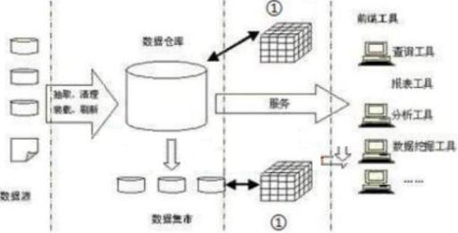

（11）A.中心数据服务器  B.OLTP 服务器  C.OLAP 服务器   D.决策应用服务器

#### 【试题 12】---2016 上真题 13

12、所谓设备选型，是从多种可以满足相同需要的不同型号、规格的设备中，经过技术经济的分 析评价，选择最佳方案以作出购买决策。在某设备选型的测试中，发现某防火墙功能满足条件、 性能适中，但是其图形控制终端只能安装在老版本的操作系统上，因不满足（13）原则，决定不 购买此防火墙。

A.安装便利   B.技术先进   C.扩展性强    D.质量可靠

#### 【试题 13】---2016 下真题 17

13、以下关于数据仓库的叙述申，不正确的是（）。

A.数据仓库是相对稳定的

B.数据仓库是反映历史变化的数据集合

C.数据仓库的数据源可能是异构的

D.数据仓库是动态的、实时的数据集合

#### 【试题 14】---2017 上真题 17

14、以下关于数据仓库的叙述中,正确的是（）。

A.数据仓库主要用于支持管理决策

B.数据仓库的数据源相对比较单一

C.存放在数据仓库中的数据一般是实时更新的

D.数据仓库为企业的特定应用服务,强调处理的响应时间、数据的安全性和完整性等

#### 【试题 15】---2017 下真题 17

15、（）是一种软件技术，在数据仓库中有广泛的应用，通过访问大量的数据实现数据处理分析要 求，实现方式是从数据仓库中抽取详细数据的一个子集并经过必要的聚集存储到该服务器中供前 端分析工具读取。

A.联机分析处理（OLAP）   B.联机事务处理（OLTP）

C.数据采集工具（ETL）     D.商业智能分析（BI）

#### 【试题 16】---2018 上真题 17

16、关于数据库和数据仓库技术的描述，不正确的是（）。

A.与数据仓库相比，数据库的数据源相对单一

B.与数据仓库相比， 数据库主要存放历史数据，相对稳定

C.数据仓库的目的是为了管理决策

D.数据仓库的结构包含数据源、数据集市、OLAP 服务器、前端工具等

#### 【试题 17】---2018 下真题 17

17、关于数据库和数据仓库技术的描述，不正确的是（17）。

A.数据库是面向主题的，数据仓库是面向事务的

B.数据仓库一般用于存放历史数据

C.数据库主要采用。LTP,数据仓库主要采用。LAP

D.数据仓库的数据源相对数据库来说比较复杂

#### 【试题 18】---2019 上真题 17

### 15、web service 技术

, 、Webservice 的各种核心技术包括 XML、Namespace 、XMLschemA.sOAP、WsDL 、UDDI、 Ws-Inspection 、Ws-securitY 、Ws-Routing 等，下列关于 Webservice 技术的叙述错误的是（1）。 （1）A.XMLschema 是用于对 XML 中的数据进行定义和约束

B.在一般情况下，Webservice 的本质就是用 HTTP 发送一组 WEB 上的 HTML 数据包

C.sOAP（简单对象访问协议），提供了标准的 RPC 方法来调用 Webservice，是传输数据的方式 D.sOAP 是一种轻量的、简单的、基于 XML 的协议， 它被设计成在 WEB 上交换结构化的

和固化的信息

#### 【试题 2】---2009 下真题 29

2、以下（2） 是 sOA 概念的一种实现。

（2）A.DCOM       B.J2EE       C.Web service        D.WWW

#### 【试题 3】---2010 上真题 28

3 、 web Service  技术适用于（3）应用。

①跨越防火墙 ②应用系统集成 ③单机应用程序 ④B2B  应用 ⑤软件重用 ⑥局域网上的同构 应用程序

（3）A.③④⑤⑥     B.②④⑤⑥      C.①③④⑥      D.①②④⑤

#### 【试题 4】 ---2010 下真题 28

4 、web  服务（web  Service）定义了一种松散的、粗粒度的分布式计算模式。 web 服务的提供者 利用①描述 web  服务， web  服务的使用者通过②来发现服务，两者之间的通信采用③协议。以 上①②③处依次应是（4）。

（4）A.①SOAP   ② UDDI   C.①wSDL  ② UDDI

③wSDL

③SOAP

B.①UML  D.①UML

② UDDI

② UDDI

③SMTP

③wSDL

#### 【试题 5】---2011 上真题 28

5 、web 服务（web service）的主要目标是跨平台的操作性，它有许多适用场合。但某些情况下， web 服务也会降低应用程序的性能。下列情况中，（5）不适合采用 web 服务作为主要的系统集成 技术。

（5）A.B2B 集成            B.集成不同语言编写的在不同平台上运行的应用程序

C.跨越防火墙         D.构建单机应用程序

#### 【试题 6】---2011 下真题 9

6、如果某些信息系统集成项目的客户、集成商、厂商等一系列合作伙伴全都已经把业务部署在各 自的 Internet 网站上，而现在某客户希望可以把自己的 IT 业务系统通过 Internet 与这些合作伙伴实 现 B2B 集成，那么该系统最适合采用的技术是（6）。

（6）A.DCOM            B.wEB Service           C.CORBA          D .JAVA RMI

#### 【试题 7】---2012 下真题 32

7 、wEB Services 技术正确（7）。

（7）A.将不同语言编写的程序进行集成

B.支持软件代码重用，但不支持数据重用

C.集成各种应用中的功能，为用户提供统一开源，不属于软件重用

D.支持 HTTP 协议， 不支持 XML 协议

#### 【试题 8】---2013 上真题 26

8.  在 WEB.SERVICE 中用于描述 WEB 服务的语言是  8 。

（8）A.wSDL       B.UML        C.XML         D.ETL

16、J2EE 和.NET 技术

#### 【试题 1】---2009 下真题 30

1、在.NET 架构中，（1）给开发人员提供了一个统一的、面向对象的、层次化的、可扩展的编程接口。

（1）A.通用语言规范    B.基础类库   C.通用语言运行环境    D.ADO.NET

#### 【试题 2】---2010 上真题 29

2、以下关于 J2EE  应用服务器运行环境的叙述中，（2）是正确的。

（2）A.容器是构件的运行环境            B.构件是应用服务器提供的各种功能接口

C.构件可以与系统资源进行交互     D.服务是表示应用逻辑的代码

#### 【试题 3】---2011 上真题 29

3、J2EE 的四层体系架构（客户层/表示层/业务逻辑层/数据层）中，可用来实现业务逻辑层的技术是（3）。 （3）A.Internet Explore    B.Database       C.Enterprise JavaBean      D .Servlet

#### 【试题 4】 ---2012 上真题 28

4、在.net  架构中，为开发人员提供统一的、面向对象的、层次化的、可扩展的编程接口，使开 发人员能够高效、快速地构建基于下一代互联网网络应用的是（4）。

（28）A.统一语言运行环境    B.基础类库   C.数据库访问技术    D.网络开发技术

#### 【试题 5】---2012 上真题 29

5 、J2EE 规范包含一系列技术规范， 其中（5）实现应用中关键的业务逻辑， 创建基于构件的企业 级应用程序，如进行事务管理、安全运行远程客户连接、生命周期管理和数据库连接缓冲等中间 层服务的应用程序。

（5）A.Servlet       B.JCAC         C.JSP         D .EJB

#### 【试题 6】---2013 上真题 13

6、项目开发组需要重用以往的 A.ctivex 控件， 利用一个集成的编程开发工具，研发 WINDOWS 应 用程序，且该工作应同时支持 VB,C++和 JSCRIPT 等编程语言， 该开发组应宜选择 6 作为编程工 发工具。

（6）A.VISUA.L STUDIO.NET          B.JDK 工具包    C.ECLIPSE          D.IBM WEBSPHERE

### 17、工作流技术

#### 【试题 1】---2009 上真题 70

,、工作流技术在流程管理应用中的三个阶段分别是（1）。

（1）A.流程的设计、流程的实现、流程的改进和维护

B.流程建模、流程仿真、流程改进或优化

C.流程的计划、流程的实施、流程的维护

D.流程的分析、流程的设计、流程的实施和改进

#### 【试题 2】---2010 下真题 30

2、工作流（workflow）需要依靠（2）来实现，其主要功能是定义、执行和管理工作流，协调工 作流执行过程中工作之间以及群体成员之间的信息交互。

（2）A.工作流管理系统  B.工作流引擎   C.任务管理工具   D.流程监控工具

### 18、构件

#### 【试题 1】---2011 上真题 30

1、某项目组需要在 windows 操作系统平台上用 C++语言编写应用构件， 该项目组宜选用（1）作 为构件标准。

（1）A.COM+            B.EJB          C.OMG       D.ODBC

#### 【试题 2】---2011 下真题 28

2、以下关于 COM+的描述中，不正确的是（2）。

（2）A.COM+是 COM  的新版本，它使 COM  升级为一个完整的组件架构

B.COM+的底层架构以 COM  为基础，几乎包含了 COM  所有内容

C.COM+更加注重分布式网络应用的设计和实现

D.COM+与操作系统紧密结合，通过系统服务为应用程序提供全面服务

#### 【试题 3】---2011 下真题 29

3、CORBA  是由 OMG  组织为解决分布式处理环境中软硬件系统互连而提出的一种解决方案， 已 经逐渐成为分布式计算技术的标准。CORBA 标准主要分为三个层次， 其中规定业务对象有效协作 所需的协议规则的层次是（3）。

（3）A.对象请求代理    B.公共对象服务    C.公共语言规范     D.公共设施

#### 【试题 4】 ---2015 上真题 26

4、组件是软件系统中可替换的、物理的组成部件，它封装了实现体。并提供了一组（）的实现方法。

A.所有的属性和操作   B.接口    C.实现体      D.一些协作的类的集

### 19、计算机网络

#### 【试题 1】---2009 上真题 10

1、（1）不是虚拟局域网 VLAN 的优点。

（1）A.有效地共享网络资源     B.简化网络管理

C.链路聚合              D.简化网络结构、保护网络投资、提高网络安全性

#### 【试题 2】---2009 上真题 12

2、以太网 100BASE-TX 标准规定的传输介质是（2）。

（2）A.3 类 UTP              B.5 类 UTP          C.单模光纤       D.多模光纤

#### 【试题 3】---2009 上真题 13~15

3、根据布线标准 ANSI/TIA/EIA-568A，综合布线系统分为如下图所示的 6 个子系统,其中的①为 （13）子系统、②为（14）子系统、③为（15）子系统。

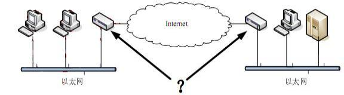

| （13）A.水平子系统 | B.建筑群子系统 | C.工作区子系统 | D.设备间子系统 |
|---|---|---|---|
| （14）A.水平子系统 | B.建筑群子系统 | C.工作区子系统 | D.设备间子系统 |
| （15）A.水平子系统 | B.建筑群子系统 | C.工作区子系统 | D.设备间子系统 |

#### 【试题 4】 ---2009 上真题 16

4、通过局域网接入因特网，图中箭头所指的两个设备是（4）。

（4）A.二层交换机     B.路由器     C.网桥      D.集线器

#### 【试题 5】---2009 上真题 17

5、在铺设活动地板的设备间内， 应对活动地板进行专门检查， 地板板块铺设严密坚固， 符合安装 要求，每平米水平误差应不大于（5）。

（5）A.1mm       B.2mm            C.3mm            D.4mm

#### 【试题 6】---2009 下真题 19

6、在进行网络规划时， 要遵循统一的通信协议标准。网络架构和通信协议应该选择广泛使用的国 际标准和事实上的工业标准， 这属于网络规划的（6）。

（6）A.实用性原则    B.开放性原则    C.先进性原则    D.可扩展性原则

#### 【试题 7】---2009 下真题 20

7 、DNS 服务器的功能是将域名转换为一（7）  。

（7）A. IP 地址    B.传输地址    C.子网地址    D.MAC 地址

#### 【试题 8】---2009 下真题 21

#### 【试题 9】 ---2009 下真题 22

9、以下关于接入 Intemet 的叙述，（9）是不正确的。

（9）A.以终端的方式入网，需要一个动态的 IP 地址

B.通过 PPP 拨号方式接入，可以有一个动态的 lP 地址

C.通过 LAN 接入，可以有固定的地址，也可以用动态分配的地址

D.通过代理服务器接口，多个主机可以共享 1 个 IP 地址

#### 【试题 10】---2009 下真题 23

10、（10）一是将存储设备与服务器直接连接的存储模式。

（10）A.DAS       B.NAS        C.SAN       D .SCSI

#### 【试题 11】---2010 上真题 19

11、（11）制定了无线局域网访问控制方法与物理层规范。

（11）A.IEEE 802 .3           B.IEEE 802 .11         C.IEEE 802 .15           D.IEEE 802 .16

#### 【试题 12】---2010 上真题 20

12、可以实现在 Internet  上任意两台计算机之间传输文件的协议是（12）。

（12）A.FTP           B.HTTP           C.SMTP             D.SNMP

#### 【试题 13】---2010 上真题 21

13、我国颁布的《大楼通信综合布线系统 YD/T926》标准的适用范围是跨度距离不超过（13）米， 办公总面积不超过 1,000,000  平方米的布线区域。

（13）A.500            B.1000            C.2000              D.3000

#### 【试题 14】---2010 上真题 22

14、根据《电子信息系统机房设计规范》，（14）的叙述是错误的。

（14）A.某机房内面积为 125  平方米，共设置了三个安全出口

B.机房内所有设备的金属外壳、各类金属管道、金属线槽、建筑物金属结构等必须进行等 电位联结并接地

C.机房内的照明线路宜穿钢管暗敷或在吊顶内穿钢管明敷

D.为了保证通风， A  级电子信息系统机房应设置外窗

#### 【试题 15】---2010 上真题 23

15 、 SAN  存储技术的特点包括（15）。

①高度的可扩展性 ②复杂但体系化的存储管理方式 ③优化的资源和服务共享 ④高度的可用性 （15）A.①③④  B.①②④   C.①②③  D.②③④

#### 【试题 16】---2010 下真题 19

16、在没有路由的本地局域网中，以 windows  操作系统为工作平台的主机可以同时安装（16）协 议，其中前者是至今应用最广的网络协议，后者有较快速的性能，适用于只有单个网络或桥接起 来的网络。

（16）A.TCP/IP 和 SAP                   B.TCP/IP  和 IPX/SPX

C.IPX/SPX 和 NETBEUI         D.TCP/IP 和 NETBEUI

#### 【试题 17】---2010 下真题 20

17、Internet 上的域名解析服务（DNS）完成域名与 IP 地址之间的翻译。执行域名服务的服务器被   称为 DNS  服务器。小张在 Internet 的某主机上用 nslookup 命令查询“中国计算机技术职业资格网 ” 的网站域名，所用的查询命令和得到的结果如下：

>nslookup www .rkb.gov.cn

Server: xd-cache-1 .bjtelecom.net

Address:219 .141 .136 .10

Non-authoritative answer:

Name: www .rkb.gov.cn

Address:59 .151.5 .241

根据上述查询结果， 以下叙述中不正确的是（17）。

（17）A.域名为“www .rkb.gov.cn ”的主机 IP 地址为 59 .151 .5 .241

B.域名为“xd-cache-1 .bjtelecom .net ”的服务器为上述查询提供域名服务

C.域名为“xd-cache-1 .bjtelecom .net ”的 DNS  服务器的 IP 地址为 219 .141 .136 .10 D.首选 DNS  服务器地址为 219.141.136.10，候选 DNS  服务器地址为 59.151.5.241

#### 【试题 18】---2010 下真题 21

18、关于单栋建筑中的综合布线，下列叙述中（18）是不正确的：

（18）A.单栋建筑中的综合布线系统工程范围是指在整栋建筑内敷设的通信线路

B.单栋建筑中的综合布线包括建筑物内敷设的管路、槽道系统、通信线缆、接续设备以及 其它辅助设施

C.终端设备及其连接软线和插头等在使用前随时可以连接安装，一般不需要设计和施工 D.综合布线系统的工程设计和安装施工是可以分别进行的

#### 【试题 19】---2010 下真题 22

19、某单位依据《电子信息系统机房设计规范 GB 50174-2008》设计该单位的机房， 在该单位采取 的下述方案中，（19）是不符合该规范的。

（19）A.整个机房由主机房、辅助区、支持区和行政管理区等四个功能区组成 B.主机房内计划放置 15  台设备，设计使用面积 65 平米

C.除主机房外，还设置了辅助区，辅助区面积是主机房面积的 10%

D.主机房设置了设备搬运通道、设备之间的出口通道、设备的测试和维修通道

#### 【试题 20】---2010 下真题 23

20、某工作站的使用者在工作时突然发现该工作站不能连接网络，为了诊断网络故障，最恰当的 做法是首先（20）。

（20）A.查看该工作站网络接口硬件工作指示是否正常，例如查看网卡指示灯是否正常 B.测试该工作站网络软件配置是否正常， 例如测试工作站到自身的网络连通性

C.测试本工作站到相邻网络设备的连通性，例如测试工作站到网关的连通性 D.查看操作系统和网络配置软件的工作状态

#### 【试题 21】---2011 上真题 19

21 、TCP/IP 协议族中的（21）协议支持离线邮件处理，电子邮件客户端可利用该协议下载所有未 阅读的电子邮件。

（21）A.FTP                B.POP3              C.Telnet              D .SNMP

#### 【试题 22】---2011 上真题 20

22、系统集成工程师小王为了查询其工作站的状态，在其工作站的命令行上运行“ping 127.0.0.1 ” 命令，得到如下结果：

正在 ping 127.0.0.1 具有 32 字节的数据：

来自 127.0.0.1 的回复：字节=32  时间< 1ms    TTL=64

来自 127.0.0.1 的回复：字节=32  时间< 1ms    TTL=64

来自 127.0.0.1 的回复：字节=32  时间< 1ms    TTL=64

关于以上查询结果， 下列说法中，正确的是 （22） 。

（22）A.小王的工作站正确安装了 TCP/IP 协议

B.小王的工作站访问了网关并收到响应

C.小王的工作站访问了 DNS  并收到响应

D.小王的工作站未正确安装网络硬件或驱动程序

#### 【试题 23】---2011 上真题 21

23、某综合办公大楼的楼高 20 层，其综合布线系统一般采用的拓扑结构是（23）。

（23）A.环型       B.分级星型            C.总线型          D.星环型

#### 【试题 24】---2011 上真题 22

24、依据《电子信息系统机房设计规范》（GB50174-2008），对于涉及国家秘密或企业对商业信息 有保密要求的电子信息系统机房， 应设置电磁屏蔽室。以下描述中，不符合该规范要求的是（24）。 （24）A.所有进入电磁屏蔽室的电源线缆应通过电源滤波器进行

B.进出电磁屏蔽室的网络线宜采用光缆或屏蔽线缆线，光缆应带有金属加强芯

C.非金属材料穿过屏蔽层时应采用波导管，波导管的截面尺寸和长度应满足电磁屏蔽的性能要求 D.截止波导通风窗内的波导管宜采用等边六角形， 通风窗的截面积应根据室内换气次数进行计算

#### 【试题 25】---2011 上真题 23

25、某公司有一台 Linux 文件服务器，多台 windows 客户端和 Linux 客户端。要求任意一个客户 端都可以共享服务器上的文件，并且能够直接存取服务器上的文件。客户端和服务器间应该使用 （25）协议。

（25）A.NFS              B.Samba             C.FTP         D .Iscsi

#### 【试题 26】---2011 上真题 24

26、根据《电子信息系统机房设计规范 GB50174-2008》，电子信息系统机房应对人流和出入口进 行安全考虑，以下叙述错误的是（26）。

（26）A.建筑的入口至主机房应设通道，通道净宽不应小于 1 .5m

B.电子信息系统机房宜设门厅、休息室、值班室和更衣间

C.电子信息系统机房应有设备搬入口

D.电子信息系统机房必须设置单独出入口

#### 【试题 27】---2011 下真题 19

27、某五星级酒店公开招标建设一套“无线网络”系统，以满足商务客人在酒店范围内随时随地 高速访问 Internet 的需要。该项目最适合采用的无线网络技术是（27）。

（27）A.wiFi             B.Bluetooth                C.BlueRay                  D.GPRS

#### 【试题 28】---2011 下真题 20

28 、一个使用普通集线器的 10Base-T 网络的拓扑结构可描述为（28）。

（28）A.物理连接是总线型拓扑， 逻辑连接是星型拓扑

B.物理连接和逻辑连接都是总线型拓扑

C.物理连接是星型拓扑，逻辑连接是总线型拓扑

D.物理连接和逻辑连接都是星型拓扑

#### 【试题 29】---2011 下真题 21

29、依照通信综合布线规范， 以下水平子系统布线距离的描述中正确的是（29）。

（29）A.水平电缆最大长度为 80 米，配线架跳接至交换机、信息插座跳接至计算机总长度不超 过 20 米，通信通道总长度不超过 100 米

B.水平电缆最大长度为 90 米， 配线架跳接至交换机、信息插座跳接至计算机总长度不超 过 10 米，通信通道总长度不超过 100 米

C.水平电缆最大长度为 80 米， 配线架跳接至交换机、信息插座跳接至计算机总长度不超 过 10 米，通信通道总长度不超过 90 米

D.水平电缆最大长度为 90 米， 配线架跳接至交换机、信息插座跳接至计算机总长度不超 过 20 米，通信通道总长度不超过 110 米

#### 【试题 30】---2011 下真题 22

30、依据《电子信息系统机房设计规范》（GB50174-2008），机房内通道的宽度及门的尺寸应满足 设备和材料的运输要求，建筑入口至主机房的通道净宽不应小于（30）。

（30）A.1.2 米   B.1.5 米   C.1.8 米    D.2.0 米

#### 【试题 31】---2011 下真题 23

31、为了实现高速共享存储以及块级数据访问，采用高速的光线通道作为传输介质，实现存储系 统网络化的网络存储模式是（31）。

（31）A.DAS         B.NAS         C.SAN            D.SNA

#### 【试题 32】---2012 上真题 19

32 、MPLS  是目前使用较为广泛的广域网技术，该技术利用数据标签引导数据包在开放的通信网 络中运行，通过在无连接的网络中引入连接模式， 减少了网络的复杂性。（32）不属于它的技术特 点。

（32）A.充分采用原有的 IP 路由

B.是一种与链路层无关的技术

C.MPLS 的标签合并机制不支持不同数据流的合并传输

D.具有良好的网络拓展性

#### 【试题 33】---2012 上真题 20

33、某系统集成工程师在其工作站的网络測览器地址栏中输入“http: //wvrw. rkb.gov, cn ”，发 现不能访问中 国计 算机技 术职业资格网， 而在其工 作站的 网络 測览器地址栏中输入

“http://59.108.35.160”，发现可正常访问中国计算机技术职业资格网，

这说明该工作站所处的网络中，可能存在  （33）   服务故障。

（33）A.FTP         B.Telnet            C.DNS         D.HTTP

#### 【试题 34】---2012 上真题 21

34、网络协议和设备驱动软件经常采用分层架构模式，其主要原因是    （34）    。

（34）A.可以让软件获得更高的性能          B.支持软件复用

C.让功能划分容易，便于设计实现      D.为达到内聚、高糯合的设计目标

#### 【试题 35】---2012 上真题 22

35 、 （35）不是光纤接口类型。

（35）A.SC          B.ST         C.LC         D.LH

#### 【试题 36】---2012 上真题 23

36 、zigBee 是 （36）  网络的标准之一。

（36）A.WLAN             B.  WMAN         C. WPAN       D.WWAN

#### 【试题 37】---2012 上真题 24

37、下列关于电子信息机房的设计中，（37）不符合《电子信息系统机房设计规范 GB50174-2008》 的要求。

（37）A.机房采用二级、三级耐火等级的建筑材料，重要部位采用一级耐火等级的材料

B.机房所有设备的金属外壳、各类金属管道、金属线糟、建筑物金属结构等结构等全部进 行电位连接并接地

C.在机房吊顶上和活动地板下都设置火灾探测器

D.主机房内绝缘体的静电电位不大于 1KV

#### 【试题 38】---2012 上真题 25

38、根据《EIA/TIA568A/B 商用建筑物电信布线标准-1995》，综合布线系统分为三个等级，其中 增强型综台布线等级要求每个工作区至少有（38）个以上信息插座。

（38）A.1          B.2        C.3        D.4

#### 【试题 39】---2012 下真题 19

39、主机 A 的 IP 地址是 192.168.4.23,子网掩码为 255.255.255.0（39）是与主机 A 处 于同一子网的主机 IP 地址。

（39）A.192 .168.4 .1             B.192 .168.255 .0

C.255 .255 .255 .255        D.192 .168 .4 .255

#### 【试题 40】---2012 下真题 20

40、项目经理要求杨工在项目经理的工作站上装一个 Internet 应用程序,该程序允许项目经理登录, 并且可以远程安全地控制服务器,杨工应安装的应用程序为（40）。

（40）A.Email                B.FTP           C.web Browser       D.SSH

#### 【试题 41】---2012 下真题 21

41、IEEE 制订了以太网的相关技术标准,其中 1000Base-X（光纤吉比特以太网）遵循的标准为（41）。

（41）A.802 .3          B.802.3u          C.802 .3z            D.802 .3ab

#### 【试题 42】---2012 下真题 22~23

42 、PPP  协议是用于拨号上网和路由器之间通信的点到点通信协议,是属于（22）协议,它不具 有（23）的功能。

22）A.物理层          B.传输层      C.数据链路层      D.网络层

23）A.错误检测         B.支持多种协议

C.允许身份验证     D. 自动将域名转换为 IP 地址

#### 【试题 43】---2012 下真题 24

43、蒋某采用下图所示的方式将其工作电脑接入 Internet,蒋某采用的 Internet 接入的方式为（43）。

（43）A.DSL              B.Cable Modem           C.3G             D.FTTM

#### 【试题 44】---2013 上真题 12

44 、 44 由电缆连接器和相关设备组成,把各种不同的公共系统和设备连接起来其中包括电信部 门的光缆,同轴电缆,程控交换机等。

（44）A.建筑群子系统    B.设备间子系统    C.垂直干线子系统     D.工作区子系统

#### 【试题 45】---2013 上真题 18

45、我国自主研发的 3G 技术标准 TD—SCDMA.采用的是   45    技术。

（45）A.时分双工    B.频分双工    C.成时频带    D.波分双工

#### 【试题 46】---2013 上真题 19

46 、 E —MA.IL 客户端程序要找到邮件服务器，FTP 客户端程序要找到 FTP 服务器，WEB 测览器要 找到 WEB 服务器，通常要用到   46 。

（46）A.FTP 服务器     B.DNS 服务器    C.E-MA.IL 服务器    D.TELNET 服务器

#### 【试题 47】---2013 上真题 21

47、传输控制 TCP 协议和用户数据报 UDP 协议是互联网传输层的主要协议。下面关于 TCP 和 UDP 的说法中，  47 是不正确的。

（47）A.TCP 是面向连接的协议， UDP 协议是无连接的协议

B.TCP 能够保证数据包到达目的地不错序， UDP 不保证数据的传输正确 C.TCP 协议传输数据包的速度一般比 UDP 协议传输速度快

D.TCP 保证数包传输的正确性， UDP 在传输过程中可能存在丢包现象

#### 【试题 48】---2013 下真题 18

48、关于无连接的通信，下面描述中正确的是（48）。

（48）A.无连接的通信较适合传送大量的多媒体数据

B.由于通信双方的通信线路都是预设的，所以在通信过程中无需任何有关接的操作 C.由于每一个分组独立地建立和释放逻辑连接，无连接的通信具有较高可性

D.无连接的通信协议 UDP 不能运行在电路交换或租用专线网络上

#### 【试题 49】---2013 下真题 19

49、以下（49）是因特网上负责接收邮件到客户端的协议。

（49）A.SMTP           B.POP             C.IMP                D .MIME

#### 【试题 50】---2013 下真题 20

50、以太网交换机的交换方式有三种， 这三种交换方式不包括（50） 。

（50）A.存储转发式交换   B.IP 交换   C.直通式交换    D.碎片过滤式交换

#### 【试题 51】---2013 下真题 21

51、Internet 中的每个主机都有一个 IP 地址和域名， 通过 DNS 服务器来完成 IP 域名的对应。关于 DNS 服务器的功能，（51）是不正确的。

（51）A.具有保存了“主机”对应“IP”地址的数据库

B.可接受 DNS 客户机提出的查询请求

C.若不在本 DNS 服务器中，则向 DNS 客户机返回结果

D.向 DNS 客户机提供查询结果

#### 【试题 52】---2013 下真题 22

52、使用 RAID 作为网络存储设备有许多好处，以下关于 RAID 的叙述中不正确的是（52）。 （52）A.RAID 使用多块廉价磁盘阵列构成，提高了性能价格比

B.RAID 采用交叉存取技术，提高了访问速度

C.RAID1 使用磁盘镜像技术，提高了可能性

D.RAID3 利用海明码校验完成容错功能，减少了冗余磁盘数量

#### 【试题 53】---2013 下真题 23

53、某数据存储设备的容量为 10TB，其含义指容量为（53）字节。

（53）A.10 根 220          B.10 根 230           C.10 根 240             D.10 根 250

#### 【试题 54】---2014 上真题 18~19

54、广域网覆盖的地理范围从几十公里到几千公里， 它的通信子网主要使用（1）技术。随着微型 计算机的广泛应用，大量的微型计算机是通过局域网连入广域网的，而局域网与广域网的互联一 般是通过（2）设备实现的。

#### 【试题 55】---2014 上真题 20

55、信息时代，除了传统的电子邮件、远程登录、新闻与公告等应用外， 新型的 Internet 应用有基 于 WEB 的网络应用和基于 P2P 的网络应用。（55）是属于基于 P2P 的网络应用.

（55）A.google     B.blog        C.网络共享课程     D.QQ

#### 【试题 56】---2014 上真题 21

56、在 TCP/IP 协议簇中，（56）协议属于应用层协议。

（56）A.IP     B.TCP     C.FTP         D.UDP

#### 【试题 57】---2014 上真题 22

57、（57）是第四代移动电话通信标准所采用的制式

（57）A.LTE       B.WCDMA      C.GSM         D.TD-SCDMA

#### 【试题 58】---2014 上真题 30

58、磁盘冗余陈列 RAID 利用冗余实现高可靠性，其中 RAID1 的磁盘利用率为（58）

（58）A.25%     B.50%      C.75%       D.100%

#### 【试题 59】---2014 下真题 18

59、（59）是以太网技术的典型特征。

（59）A.采用双绞线作为传输介质      B.使用以太网集线器

C.载波监听多路访问冲突检测    D.星型拓扑结构

#### 【试题 58】---2014 下真题 19

60 、IPV6 协议规定，一个 IP 地址的长度是（60）位。

（60）A.32              B.64        C.128              D.256

#### 【试题 61】---2014 下真题 20

61、微信是一种常用的单时通信工具， 主要采用了（61）。

（61）A.UDP 通信协议   B.非对等通信模式   D.对称中心结构  D.有中央节点的集中控制

#### 【试题 62】---2014 下真题 21

62 、Web2.0 指的是一个利用 Web 的平台， 由用户主导生成内容的互联网产品模式。（62）不属于 Web2.0 技术。

（62）A.微博   B.相册   C.百科全书（wiki）    D.论坛

#### 【试题 63】---2014 下真题 22

63、根据 EIA/TIA568A 标准，综合布线系统分为 6 个子系统，这 6 个子系统是（63）。

（63）A.建筑群子系统、建筑间子系统、设备间子系统、垂直干线子系统、水平子系统、管理子系统 B.建筑间子系统、设备间子系统、垂直干线子系统、水平子系统、管理子系统、工作区子系统

C.建筑群子系统、建筑间子系统、垂直干线子系统、水平子系统、管理子系统、工作区子系统 D.建筑群子系统、设备间子系统、垂直干线子系统、水平子系统、管理子系统、工作区子系统

#### 【试题 64】---2014 下真题 23

64、在网络服务器中，（64）组织成域层次结构的计算机和网络服务命名系统，负责 IP 地址和域 名之间的转换。

（23）A.DHCP 服务器   B.身份验证服务器   C. 邮件服务器   D.DNS 服务器

#### 【试题 65】---2014 下真题 24

65 、IIS 不支持（65）服务。

（24）A.WWW        B.FTP      C.E-mail        D.Gopher

#### 【试题 66】---2014 下真题 25

66、以下关于入侵检测设备的叙述中，（66）是不正确的。

（66）A.不产生网络流量                    B.使用在尽可能靠近攻击源的地方.

C.使用在尽可能接近受保护资源的地方   D.必须跨接在链路上

#### 【试题 67】---2014 下真题 26

67、代理服务器防火墙主要使用代理技术来阻断内部网络和外部网络之间的通信，达到隐蔽内部 网络的目的。以下关于代理服务器防火墙的叙述中，（67）是不正确的。

（67）A.仅“可以信赖的”代理服务才允许通过

B. 由于已经设立代理，因此任何外部服务都可以访问

C.允许内部主机使用代理服务器访问 Internet

D.不允许外部主机连接到内部安全网络

#### 【试题 68】---2015 上真题 11

68、以下关于网络设备选型原则的叙述中，（） 是不正确的。

A.尽可能选取同一厂家的产品，以提高设备的互联互通性

B.核心主干设备因其产品技术成熟，选择时不用考虑产品可扩展性指标

C.选择质保时间长，品牌信誉好的产品

D.选择性价比高、质量过硬的产品， 使资金投入产出达到最大值

#### 【试题 69】---2015 上真题 12

69、路由器是在（） 实现网络互连的设备

A.网络层   B.数据链路层  C.物理层     D.传输层

#### 【试题 70】---2015 上真题 18~19

70、目前的快速以太网（1000BASE-T）使用交换机来组网，这样做的目的不是为了（18）。此时 以太网的拓扑结构类似（19）。

（1）A.减少冲突    B.提高网络速度     C.提高网络使用效率     D.减少 IP 地址消耗

（2）A.星型        B.总线型           C.环型                D.网状型

#### 【试题 71】---2015 上真题 21

71、微信创造了移动互联网用户增长增速记录， 433 天之内完成用户数从零到一亿的增长， 千万数 量级的用户同时在线使用各种功能，其技术架构具有尽量利用后端处理而减少依赖客户端升级的 特点，该设计方法的好处不包括（）。

A.极大地提高了系统响应速度     B.减少了升级给客户带来的麻烦

C.实现新旧版本兼容              D.降低后台系统开销

#### 【试题 72】---2015 上真题 22

72、在 。SI 模型中， 数据链路层处理的数据单位是（）。

A.比特     B.恢    C.分组      D.报文

#### 【试题 73】---2015 下真题 12

73、选择路由器设备时，（ ）可不用重点考虑

（73）A.处理器主频    B.内存容量     C.硬盘存储容量  D.吞吐量

#### 【试题 74】---2015 下真题 18

74、以下关于高速以太网的叙述中，（ ）是正确的。

（74）A.高速以太网是指效率达到或超过 1000MB/S 的以太网

B.千兆以太网与 10/100M 以太网具有相同的恢格式

C.对于物理层与双绞线的千兆以太网，采用的编码为 8B/10B

D.千兆以太网采用的标准为 TEEE802.3U

#### 【试题 75】---2015 下真题 19

75、TCP/IP 协议是因特网的基础协议， 一般将其分成四层：数据链路层， 网络层。传输层和应用 层，（ ）属于网络层协议。

（75）A.TCP  B.SNMP  C.ICMP   D.ARP

#### 【试题 76】---2015 下真题 21

76、移动互联网技术体系主要涵盖六大技术产业领域：关键应用服务平台、网络平台技术、移动 智能终端软件平台技术、移动智能终端硬件平台技术、移动智能终端原材料元器件技术和( )

（76）A.移动云计算技术   B.综合业务技术   C.安全控制技术   D.综合系统技术

#### 【试题 77】---2016 上真题 18

77、快速以太网和传统以太网在（77）上的标准不同。

A.逻辑链路控制子层   B.网络层   C.介质访问控制子层   D.物理层

#### 【试题 78】---2016 上真题 20

78、数据链路层最基本的服务是将源自网络层的数据可靠地传输到相邻节点。数据链路层的主要 协议不包括（78）。

A.点对点协议   B.HDLC     C.802.3        D.异步传输模式

#### 【试题 79】---2016 上真题 22

79、堡垒主机是一台完全暴露给外网的主机，在维护内网安全方面发挥着非常大的作用。以下关 于堡垒主机的叙述中，不正确的是（79）。

A.堡垒主机具有输入输出审计功能     B.需要设置防火墙以保护堡垒主机

C.堡垒主机能配置网关服务           D .堡垒主机一般配置两块网卡

#### 【试题 80】---2016 上真题 26

80、以下关于虚拟专用网（VPN）的叙述中，不正确的是：（80）。

A.VPN 是指建立在私有网上的、由某一组织或某一群用户专用的通信网络

B.VPN 的虚拟性表现在任意一对 VPN 用户之间没有专用的物理连接， 而是通过 ISP 提供 的公用网络来实现通信

C.VPN 的专用性表现在 VPN 之外的用户无法访问 VPN 内部资源

D.隧道技术是实现 VPN 的关键技术之一

#### 【试题 81】---2016 下真题 18

81 、OSI（Open SystemInter connection）参考模型将网络体系结构划分为七层， 其中（） 的主要功 能是将网络地址翻译成对应的物理地址，并决定路由。

A.数据链路层    B.网络层    C.传输层      D.会话层

#### 【试题 82】---2016 下真题 19

82、无线网络技术已经成为当前的一种主流技术，并且呈现出快速演进的趋势。（） 属于 4G 无线 网络技术标准。

A.WPAN       B.FDD-LTE        C.TD-CDMA         D.WMAN

#### 【试题 83】---2016 下真题 20

83、以下关于当前主干网络的叙述中， 不正确的是（）。

A.主干网技术的选择需要考虑网络规模、传输信息的种类和费用等多种因素 B.主干网的可用性、可靠性要求很高

C.主干网一般采用同轴电缆作为传输介质

D.典型的主干网技术包括有 100Mbps-FX 以太网、 1000Mbps 以太网等

#### 【试题 84】---2016 下真题 21

84、随着互联网的发展，网络安全越来越受到人们的重视，其中能够鉴别什么样的数据包可以进 出组织内部网络的安全技术称为（）。

A.入侵检测  B.防病毒软件  C.安全审计系统   D.防火墙

#### 【试题 85】---2016 下真题 22

85、机房建设是系统集成工程中的重要内容之一（）。

A.楼宇自控   B.消防  C.网络设备安装调试   D.空调系统安装调试

#### 【试题 86】---2017 上真题 18

86、在 0SI 七层协议中, （）主要负责确保数据可靠、顺序、无错地从 A 点传输到 B 点。 A.数据链路层    B.网络层    C.传输层    D.会话层

#### 【试题 87】---2017 上真题 19

87、以下关于网络规划、设计与实施工作的叙述中， 不正确的是：（）。

A.在设计网络拓扑结构时,应考虑的主要因素有： 地理环境、传输介质与距离以及可靠性 B.在设计主干网时， 连接建筑群的主干网一般考虑以光缆作为传输介质

C.在没计广域网连接方式时,如果网络用户有 www、E-mai1 等具有 Internet 功能的服务器,建 议采用 ISDN 或 ADSL 等技术连接外网

D.在很难布线的地方或者经常需要变动布线结构的地方,应首先考虑使用无线网络接入

#### 【试题 88】---2017 上真题 20

88、（） 一般不属于机房建设的内容。

A.消防监控安装调试    B.三通一平    C.网络设备安装调试    D.空调系统安装调试

#### 【试题 89】---2017 上真题 22

89、以下关于计算机病毒与蠕虫的特点比较的叙述中，正确的是:（）。

A.在传染机制中，蠕虫是通过宿主程序运行的

B.为系统打补丁，能有效预防蠕虫， 但不能有效预防病毒

C.在触发机制中，蠕虫的触发者是计算机的使用者

D.蠕虫和病毒都是寄生模式存在

#### 【试题 90】---2017 下真题 18

90、在 。SI 七层协议中，（） 充当了翻译官的角色， 确保一个数据对象能在网络中的计算机间以双 方协商的格式进行准确的数据转换和加解密。

A.应用层    B.网络层   C.表示层    D.会话层

#### 【试题 91】---2017 下真题 19

91、在下列传输介质中，（）的传输速率最高。

A.双绞线    B.同轴电缆    C.光纤    D.无线介质

#### 【试题 92】---2017 下真题 20

92、某公司承接了某政府机关的办公网络改造项目’在进行网络总体设计时考虑使用汇聚交换机’ 从技术层面考虑’最直接的原因是：（）。

A.办公楼内的信息点较多’使用 3 台交换机采用级联方式扩充端口

B.两栋办公楼距离较远’使用了百兆光纤电缆

C.网络用户数量超过 10000 人

D.本项目采用了星型网络拓扑结构

#### 【试题 93】---2017 下真题 21

93、关于 WLAN 描述不正确的是：（）。

A.802.11n 是 IEEE 制定的一个无线局域网标准协议

B.无线网络与有限网络的用途类似’最大的不同在于传输媒介的不同

C.无线网络技术中不包括为近距离无线连接进行优化的红外线技术

D.现在主流应用的是第四代无线通信技术

#### 【试题 94】---2017 下真题 22

94、《中华人民共和国网络安全法》与 2017 年 6 月 1 日起开始施行’（）负责统筹协调网络安全工 作和相关监督管理工作。

A.国务院电信主管部门   B.工业和信息化部主管部门    C.公安部门    D.国家网信部门

#### 【试题 95】---2018 上真题 18

95、在 。SI 七层协议中’HTTP 是（） 协议。

A.网络层    B.传输层    C.会话层    D.应用层

#### 【试题 96】---2018 上真题 19

96、在网络存储结构中’（）通过 TCP/IP 协议访问数据。

A.直连式储存    B.网络储存设备    C.光纤通道交换机    D.SCSI 储存

#### 【试题 97】---2018 上真题 20

97、对 MAC 地址进行变更属于（）。

A.链路层交换    B.物理层交换    C.网络层交换    D.传输层交换

#### 【试题 98】---2018 上真题 21

98、只有得到允许的人才能修改数据’并且能够判别出数据是否已被篡改’这体现了信息安全的（）。 A.机密性    B.可用性    C.完整性    D.可控性

#### 【试题 99】---2018 下真题 18

99、windows 操作系统下的 ping 命令，使用的是（） 协议

A.UDP    B.ARP    C.ICMP    D.FTP

#### 【试题 100】---2018 下真题 19

100、在网络存储结构中，（）成本较高、技术较复杂，适用于数据量大、数据访问速度要求高的场 合。

A.直连式存储（DAS）    B.网络存储设备（NAS）

C.存储网络（SAN）       D.移动存储设备（MSD）

#### 【试题 101】---2018 下真题 20

101、关于网络交换技术的描述，不正确的是（）。

A.Internet 传输的最小数据单位是 Byte

B.ATM 交换的最小数据单位是码元

C.Internet 使用数据报网络

D.ATM 使用虚电路网络管

#### 【试题 102】---2018 下真题 21

102、在网络产品中，（）通常被比喻为网络安全的大门，用来鉴别什么样的数据包可以进出企业内 部网。

A.漏洞扫描工具    B.防火墙    C.防病毒软件    D.安全审计系统

#### 【试题 103】---2019 上真题 18

103、关于无线通信网络的描述，不正确的是（）。

A.2G 应用于 GSM、CDMA 等数字手机

B.3G 主流制式包括 CDMA200、WCDM   A.TD-LTE 和 FDD-LTE

C.4G 是 3G 与 WAN 于体理论下载速率达到 100Mbps

D.正在研发的 5G，理论上可达 1Gbps 以上的速度传送数据

#### 【试题 104】---2019 上真题 19

104、存储磁盘阵列按其连接方式的不同，可分为三类，即 DAS、NAS 和（）。 A.LAN    B.WAN    C.SAN    D.RAID

#### 【试题 105】---2019 上真题 20

105、IP 地址是在。SI 模型的（）定义

A.物理层    B.数据链路层    C.网络层    D.传输层

#### 【试题 106】---2019 上真题 21

106、DDos 拒绝服务攻击是以通过大量合法的请求占用大量网络资源，造成网络瘫痪。该网络攻 击破环了信息安全的（）属性。

A.可控性    B.可用性    C.完整性    D.保密性

#### 【试题 107】---2019 下真题 16

107、Internet 通过（）协议可以实现多个网络的无缝连接。

A.ISDN    B.IPv6   C.TCP/IP   D.DNS

#### 【试题 108】---2019 下真题 17

### 108、查内存使用结果如下:

|  | total | used | free | shared | buffers | cached |
|---|---|---|---|---|---|---|
| mem | 2026 | 1958 | 67 | 0 | 76 | 1556 |

下列结果分析错误的是（）。

A.该内存资源占用状态正常

B.该内存资源占用率状态异常

C.1958 表示系统使用的内存

D.67 表示系统剩余内存

#### 【试题 109】---2019 下真题 18

109、网结按照（）可划分为总线型结构、环型结构、星型结构、树型结构和网状结构。 A.覆盖的地理范围    B.链接传输控制技术    C.拓扑结构    D.应用传输层

#### 【试题 110】---2019 下真题 19

110、信息安全中的（）是指只有得到允许的人才能修改数据， 并且能够判别出数据是否已被篡改。 A.机密性    B.完整性    C.可用性    D.可控性

#### 【试题 111】---2019 下真题 20

110、网络和信息安全产品中，（） 无法发现正在进行的入侵行为，而且成为攻击者的工具。 A. 防火墙    B.扫描器    C.防毒软件    D.安全审计软件

## 第五章、新一代网络技术

#### 【试题 1】---中级 2011 上真题 5

1、以互联网为基础， 将数字化、智能化的物体接入其中， 实现自组织互联， 是互联网的延伸与扩 展； 通过嵌入到物体上的各种数字化标识、感应设备，如 RFID 标签、传感器、响应器等， 使物体 具有可识别、可感知、交互和响应的能力，并通过与 Internet  的集成实现物物相联，构成一个协 同的网络信息系统。以上描述的是（1）。

（1）A.智慧地球      B.三网融合      C.saas            D.物联网

#### 【试题 2】---中级 2011 下真题 3

2、物流信息技术是指用于物流各个环节中的信息技术， 它是物流现代化的重要标志， 也是物流技 术中发展最快的领域，主要包括条码技术、 RFID 技术、 EDI 技术、 GPs 技术和（2）。

（2）A.EOs 技术     B.POs 技术      C.BIs 技术      D.GIs 技术

#### 【试题 3】---高级 2011 上真题 5

3、2011 年 3 月全国两会召开期间发布的《中华人民共和国国民经济和社会发展第十二个五年规划 纲要》有如下内容：“推动物联网关键技术研发和重点领域的应用示范”。从技术架构上看，物联 网可分为三层：感知层、网络层和应用层。其中网络层可包括（3）。

（3）A.各种传感器以及传感器网关， 包括二氧化碳浓度传感器、温度传感器、湿度传感器、二维 码标签、 RFID 标签和读写器、摄像头、 GPs 等

B.互联网，有线、无线通信网，各种私有网络，网络管理系统和云计算平台等 C.用户（包过人、组织和其他系统）的接口

D. 网络应用程序

#### 【试题 4】 ---高级 2011 下真题 1

4、下列关于电子标签（RFID）与条形码（barcode）标签的叙述，正确的是（4）。 （4）A.电子标签建置成本低

B.条形码标签容量小，但难以被复制

C. 电子标签容量大， 可同时读取多个标签并且难以被复制

D. 电子标签通讯距离短，但对环境变化有较高的忍受能力

#### 【试题 5】---中级 2011 下真题 1

5、通过建立网络服务器集群，将大量通过网络连接的软件和硬件资源进行统一管理和调度，构成 一个计算资源池，从而使用户能够根据所需从中获得诸如在线软件服务、硬件租借、数据存储、 计算分析等各种不同类型服务，并按资源使用量进行付费。以上描述的是（5）。

（5）A.网络计算    B.云计算      C.效用计算      D.物联网

#### 【试题 6】---中级 2011 下真题 2

6、目前，云计算的服务模式不包括（6）

（6）A.Iaas            B.Paas            C.Taas            D.saas

#### 【试题 7】---高级 2011 上真题 6

7、在下列应用场景中，属于 saas（软件即服务）模式的是（7）。

（7）A.供应商通过 Internet 提供软件， 消费者从供应商处租用基于 web 的软件来管理企业经营活动 B.供应商开拓新的 IT 基础设施业务,消费者通过 Internet 从计算机基础设施获得服务

C.消费者从供应商处购买软件的 License

D.消费者从互联网下载和使用免费软件

#### 【试题 8】---高级 2010 下真题 5

8 、2002  年，《国家信息化领导小组关于我国电子政务建设指导意见》（中办发（2002）17 号）提 出我国电子政务建设的 12  项重点业务系统， 后来被称为“十二金工程”。以下（8）不属于“十二 金工程”的范畴。

（8）A.金关、金税     B.金宏、金财    C.金水、金土    D.金审、金农

#### 【试题 9】 ---高级 2013 上真题 4

9、根据国家电子政务“十二五”规划， 在建设完善电子政务公共平台方面， 将以效果为导向，推行 “（9）”优先模式， 制定电子政务公共平台建设和应用行动计划， 明确相关部门的职责和分工， 共 同推动电子政务公共平台运行和服务。

（9）A.  智慧城市    B.  物联网服务   C.  云计算服务    D.  面向服务的架构（sOA）

#### 【试题 10】---高级 2013 下真题 7

10、云计算通过提供动态易扩展且通常为（）的资源实现基于网络的相关服务

（10）A.分布式   B.虚拟化    C.共享式   D.公用的基础设施

#### 【试题 11】---中级 2015 上真题 20

11、云服务是基于互联网的相关服务的增加。使用和交付模式。我们经常使用的 Gmail，网上相册 等属于（）。

A.私有云服务   B.软件即服务（saas）   C.平台即服务（Paas）   D.基础设施即服务（Iaas）

#### 【试题 12】---高级 2015 上真题 2

12、自从第一台电子计算机问世以来，信息系统经历了由低级到高级，由单机到网络，由数据处 理到智能处理，由集中式计算到云计算的发展历程。以下关于云计算的叙述中，（） 是不正确的。

A.云计算凭借数量庞大的云服务器为用户提供远超单台服务器的处理能力

B.云计算支持用户在任意位置获取应用服务， 用户不必考虑应用的具体位置 C.云计算的扩展性低，一旦需要扩展，需要重新构件全部数据模型

D.云计算可以构造不同的应用，同一个“云”可以同时支撑不同的应用运行

#### 【试题 13】---高级 2015 上真题 3

13、以下关于移动互联网发展趋势的叙述中，（）是不正确的。

A.移动互联网与 PC 互联网协调发展，共同服务经济社会

B.移动互联网与传统行业融合，衍生新的应用模式

C.随着移动设备的普及，移动互联网将逐步替代 PC 互联网

D.移动互联网对用户的服务将更泛在，更智能， 更便捷

#### 【试题 14】---中级 2015 下真题 3

14、《国务院关于积极推进“互联网+ ”行动的知道意见》中提出的推动互联网与制造业融合，加 强产业链协作， 即基于互联网的协同制造新模式， 提升制造业数字化、网络化和（ ）水平， 是发 展“互联网+ ”的重点活动之一

（14）A.3D 化     B.重型化    C.定制化     D.智能化

#### 【试题 15】---中级 2015 下真题 17

15、以下关于云计算机叙述中，（ ）是不正确的。

（15）A.云计算通过互联网来提供动态易扩展且经常是虚拟化资源的计算模式 B.云计算可以脱离网络提供服务

C.云计算比本地计算具备更好的扩展性

D.云计算使得计算能力成为一种在互联网上流通的资源

#### 【试题 16】---中级 2015 下真题 20

16、云计算的服务类型有三种，其中不包括( )

（16）A.Iaas，即基础设施做为服务   B.paas，即平台作为服务

C.saas ， 即软件作为服务      D.Taas，即泛在服务

#### 【试题 17】---中级 2015 下真题 21

17、移动互联网技术体系主要涵盖六大技术产业领域：关键应用服务平台、网络平台技术、移动 智能终端软件平台技术、移动智能终端硬件平台技术、移动智能终端原材料元器件技术和( )

（17）A.移动云计算技术   B.综合业务技术   C.安全控制技术   D.综合系统技术

#### 【试题 18】---高级 2015 下真题 1

18、大数据对产品，企业和产业有着深刻的影响，把信息技术看作是辅助或服务性的工具已经变 成为过时的观念，管理者应该认识到信息技术的广泛影响，以及怎样利用信息技术来创造有力而 持久的竞争优势（ ）将是未来经济社会发展的一个重要特征。

（18）A.数据驱动     B.信息产业    C.大数据      D.成本驱动

#### 【试题 19】---高级 2015 下真题 3

19、“互联网+ ”协同制造中鼓励有实力的互联网企业构建网络化协同制造公共服务平台。以下叙 述中（ ）是不正确的

（19）A.此类协同制造公共服务平台多采用大集中系统

B.此类协同制造公共服务平台需要大数据技术的支持

C.此类协同制造公共服务平台通常需要宽带网络的支持

D.此类协同制造公共服务平台需要加强信息安全管理

#### 【试题 20】---高级 2015 下真题 21

20、射频识别（RFID）是物联网中常用的无线通信技术， 它通过（ ）识别特定目标并读写相关数 据。

（20）A.磁条  B.红外线  C.无线电信号  D.光束扫描

#### 【试题 21】---中级 2016 上真题 2

21、以下关于“互联网+ ”的理解中， 正确的是：（2）。

A. “互联网+"行动可以助推传统产业的转型升级

B. “互联网+ ”是指互联网与物联网的融合

C. “互联网+ ”是电子商务在移动互联网上的创新发展

D.Ipv6 的应用推广， 催生互联网转型升级到“互联网+ ”

#### 【试题 22】---中级 2016 上真题 3

22、《国务院关于积极推进“互联网+ ”行动的指导意见》中提出的推动互联网与制造业融合，加 强产业链协作， 发展基于互联网的协同制造新模式， 提升制造业数字化、网络化和（3）水平，是 “互联网+" 的重点行动之一。

A.3D 化   B.智能化   C.定制化   D.精细化

#### 【试题 23】---中级 2016 上真题 5

23、信息物理系统（Cps,Cyber-physicalsystems）是一个综合计算、网络和物理环境的多维复杂系 统， 通过 3C（Computing、Communication 、Control）技术的有机融合与深度协作， 实现大型工程 系统韵实时感知、动态控制和信息服务：该系统主要应用于（5）领域。

A.新一代网络控制   B.智能制造   C.智慧城市    D. 电子商务

#### 【试题 24】---中级 2016 上真题 17

24、构建电子商务平台是当前一种重要的商业模式， 任何希望从事电子商务的公司或个人可以通 过注册商铺的形式在该平台上从事电子商务活动。从技术角度来看， 该平台属于（24）服务模式。

A.Iaas      B.Daas      C.saas        D.paas

#### 【试题 25】---高级 2016 上真题 1

25、作为两化融合的升级版，（）将互联网与工业、商业、金融业等行业全面融合。

（25）A.互联网+        B.工业信息化   C.大数据    D.物联网

#### 【试题 26】---高级 2016 上真题 24

26、移动计算的特点不包括（）。

（26）A.移动性   B.网络通信的非对称性  C.频繁断接性   D.高可靠性

#### 【试题 27】---中级 2016 下真题 8

27、以下关于智慧城市的理解中，恰当的是（）。

A.智慧城市建设的关键是大量、有效地建设城市 IT 系统

B.社会治安防控体系不是智慧城市顶层设计主要考虑的内容

C. 电子政务系统是智慧城市的组成部分， 由于其特殊性，不鼓励电子政务系统向云计算模式迁移 D.通过传感器或信息采集设备全方位地获取城市系统数据是智慧城市的基础

#### 【试题 28】---中级 2016 下真题 23

28、在大数据的关键技术中， 数据抽取工具 ETL 是（）过程主要使用的技术。

A.数据采集    B.数据存储   C.数据清洗       D.数据分析

#### 【试题 29】---中级 2016 下真题 24~25

29、物联网是随着智能化技术的发展而发展起来的新的技术应用形式，从架构上来讲一般分为感 知层、网络层和应用层， 其中 RFID 技术一般应用于（24）。从物联网应用的角度来看，（25）不属 于物联网的应用领域。

（24）A.感知层         B. 网络层        C.应用层        D.展示层

（25）A.手机钱包       B.安全监控      C.智能家居      D.决策分析

#### 【试题 30】---中级 2016 下真题 26

30、移动互联网的迅速普及除了归功于网络带宽的增加之外，还与丰富的应用有密不可分的关系。() 技术使得 web 应用不仅丰富，而且能够实现高度的互动，极大地改善了移动互联网用户的体验。

A.HTML5      B.Android      C.sOA     D.HTTPs

#### 【试题 31】---中级 2017 上真题 7-8

31、物联网技术作为智慧城市建设的重要技术， 其架构一般可分为（），其中（）负责信息

（7）A.感知层、网络层和应用层    B.平台层、传输层和应用层

C.平台层、汇聚层和应用层    D.汇聚层、平台层和应用层

（8）A.感知层    B.网络层    C.应用层    D.汇聚层

#### 【试题 32】---中级 2017 上真题 9

32、智慧城市建设参考模型包括有依赖关系的 5 层结构和对建设有约束关系的 3 个支撑体系，5 层结构包括物联感知层、通信网络层、计算与存储层、数据及服务支撑层、智慧应用层;3  个支撑 体系除了建设和运营管理体系、安全保障体系之外还包括（）。

A.人员资源调配体系    B.数据管理体系    C.标准规范体系    D.技术研发体系

#### 【试题 33】---中级 2017 上真题 11

33、在移动互联网的关键技术中, （）是页面展示技术。

A.sOA       B.webservice        C.HTML5        D.Android

#### 【试题 34】---中级 2017 上真题 23

34、大数据存储技术首先需要解决的是数据海量化和快速增长需求，其次是处理格式多样化的数 据。谷歌文件系统（GFs）和 Hadoop 的（）奠定了大数据存储技术的基础。

A.分布式文件系统       B.分布式数据库系统

C.关系型数据库系统    D.非结构化数据分析系统

#### 【试题 35】---中级 2017 上真题 24

35、在云计算服务类型中，（） 向用户提供虚拟的操作系统、数据库管理系统、 web 应用等服务。 A.Iaas        B.Daas        C.Paas        D.saas

#### 【试题 36】---中级 2017 上真题 25

36、在物联网的关键技术中， 射频识别（RFID）是一种（）。

A.信息采集技术    B.无线传输技术    C. 自组织组网技术    D. 中间件技术

#### 【试题 37】---高级 2017 上真题 3

37、智能制造是制造技术发展的必然趋势，从理论上来讲，（）是智能制造的核心 A.制造机器人    B.CPS        C.互联网    D.3D 打印

#### 【试题 38】---高级 2017 上真题 24

38、在无线通信领域， 现在主流应用的是第四代（4G）通信技术， 其理论下载速率可达到（）Mbps （兆比特每秒）。

A.2.6        B.4        C.20        D.100

#### 【试题 39】---中级 2017 下真题 4

39、2017 年 7 月 8  日，《国务院关于印发新一代人工智能发展规划的通知》中涉及了人工智能的几 个基础理论， 其中，（） 研究统计学习基础理论、不确定性推理与决策、分布式学习与交互、隐私 保护学习等学习理论和高效模型。

A.大数据智能理论    B.跨媒体感知计算理论   C.高级机器学习理论    D.群体智能理论

#### 【试题 40】---中级 2017 下真题 7

40、《中国制造 2025》提出“推进信息化与工业化深度融合”的重点任务，加快推动新一代信息技 术与制造技术融合发展，把（）作为两化深度融合的主攻方向。

A.人工智能    B.智能制造    C.大数据    D.云计算

#### 【试题 41】---中级 2017 下真题 9

41 、智能挖掘分析是智慧城市建设参考模型（） 中的关键技术。

A.智慧应用层    B.计算与存储层    C.数据及服务支撑层    D.网络通信层

#### 【试题 42】---中级 2017 下真题 23

42、在将数据源经过分析挖掘到最终获得价值的大数据处理过程中， MapReduce  是在（）阶段应 用分布式并行处理关键技术的常用工具。

A.数据采集    B.数据管理    C.数据存储    D.数据分析与挖掘

#### 【试题 43】---中级 2017 下真题 24

43、某公司已有建企业云，近期遇到了网站服务器因带宽限制而突然崩溃的情况。为了避免以上 问题，该公司从某云服务供应商处购买了云服务，经过重新部署可以解决其网站使用量突然猛增 的情况。这种部署方式通常称为（）模式。

A.私有云    B.公有云    C.混合云    D.社区云

#### 【试题 44】---中级 2017 下真题 25

### 44、以下对物联网的描述不正确的是：()

A.物联网即“物物相联之网 ”

B.物联网是一种物理上独立存在的完整网络

C.物联网的“网”应和通讯介质、通信拓扑结构无关

D.物联网从架构上可以分为感知层、网络层和应用层

#### 【试题 45】---中级 2017 下真题 26

45、移动互联网是一种通过智能移动终端，采用移动无线通信方式获取业务和服务的新兴业务， 其主流操作系统开发平台不包括：()

A.Android       B.unix        C.ISO       D.windowsphone

#### 【试题 46】---中级 2017 下真题 27

46 、2015 年 5 月 19  日，国务院印发《中国制造 2025》，明确指出将以信息化与工业化深度融合为 主线，重点发展十大领域，其中“新一代信息通信技术产业”主要聚焦在（）类别的产品上。

①集成电路及专用装备

②信息通信设备

③先进轨道交通设备

④操作系统及工业软件

A.①②③    B.②③④    C.①②④    D.①③④

#### 【试题 47】---高级 2017 下真题 5

47、区块链是一种按照时间顺序将数按区块以顺序相连的方式组合成的一种链式数据结构，并以 密码学方式保证的不可复改和不可伪造的分布式账本。主要解决交易的信任和安全问题，最初是 作为（47）的底层技术出现。

A.电子商务    B.证券交易    C.比特币    D.物联网

#### 【试题 48】---高级 2017 下真题 6

48、人工智能（Artificial Intelligence，筒称 AI），是研究、开发用于模拟、延伸和扩展人的 智能的理论、方法、技术及应用系统的一门新的技术科学。近年在技术上取得了长足的进步，其 主要研究方向不包含（48）

A.人机对奕    B.人脸识别    C.自动驾驶    D.3D 打印

#### 【试题 49】---高级 2017 下真题 20

49、2015 年国务院发布的《关于积极推进“互联网+”行为的指导意见》提出：到（49）年， 网络 化、智能化、服务化、协同化的“互联网+”产亚生态体系基本芜善，“互联网+”称为经济社会创 新发展的重要驱动力量。

A.2018    B.2020    C.2025    D.2030

#### 【试题 50】---高级 2017 下真题 21

50、以下关于移动互联网的描述，不正确的是（50）。

A.移动互联网使得用户可以在移动状态下接入和使用互联网服务

B.移动互联网是桌面互联网的复制和移植

C.传感技术能极大地推动移动互联网的成长

D.在移动互联网领域，仍存在测览器竞争及“孤岛”问题

#### 【试题 51】---高级 2018 上真题 1

51、我国在“十三五”规划纲要中指出要加快信息网络新技术开发应用，以拓展新兴产业发展空 间，纲要中提出将培育的新一代信息技术产业创新重点中不包梧()

A.人工智能    B.移动智能终端    C.第四代移动通信    D.先进传感器

#### 【试题 52】---高级 2018 上真题 2

52、智能具有感知、记忆、自适应等特点，能擦存储感知到的外部信息及由思维产生的知说，同 时能够利用己有的知识对信息进行分析、计算、比较、判断、联想和决策属于智能的（）能力。

A.感知    B.记忆和思维    C.学习和自适应    D.行为决策

#### 【试题 53】---高级 2018 上真题 4

53、区块链 2.0 技术架构自上而下分力数据层、网络层、共识层、激励层、智能合约层，数据传播 机制、数据验证机制属于其中的()

A.数据层    B. 网络层    C.共识层    D.激励层

#### 【试题 54】---高级 2018 上真题 5

54、区块链是（）、点对点传输、共识机制、加密算法等计算机技术的新型应用模式。 A.数据仓库    B. 中心化数据库    C.非链式数据结构    D.分布式数据存储

#### 【试题 55】---高级 2018 上真题 6

55、某云计算服务商向电信运营商提供计算能力、存储空间及相应的运营管理服务，按照云计算 服务提供的资源层次，该服务类型属于()

A.laas        B.aas        C.paas        D.saas

#### 【试题 56】---中级 2018 上真题 9

56 、A 公司是一家云服务提供商，向用户提供老租户可定制的办公软件和客户关系管理软件， A 公司所提供的此项云服务属于（） 服务类型。

A.Iaas        B.paas        C.saas        D.Daas

#### 【试题 57】---中级 2018 上真题 22

57、在大数据关键技术中， Hadoop 的分布式文件系统 HDFs 属于大数据（）。 A.存储技术    B.分析技术    C.并行分析技术    D.挖掘技术

#### 【试题 58】---中级 2018 上真题 23

58、在云计算服务中，“向用户提供虚拟的操作系统”属于（）。

A.Iaas        B.paas        C.saas        D.Daas

#### 【试题 59】---中级 2018 上真题 24

59、在物联网的架构中,3G、4G 属于（） 技术。

A. 网络层    B.感知层    C.物理层    D.应用层

#### 【试题 60】---中级 2018 上真题 25

60、相对于 web1.0 来说,web2.0 具有多种优势,（）不属于 web2.0 的优势。

A.页面简洁、风格流畅    B.个性化、突出自我品牌

C.用户参与度高          D.更加追求功能性利益

#### 【试题 61】---中级 2018 上真题 26

61、2017 年 11 月 27 日,国务院正式印发《关于深化“互联网+先进制造业”发展工业互联网的指  导意见》以下简称“《意见》”）。该《意见》指出:工业互联网通过系统构建网络、平台、（） 三大功  能体系,打造人、机、物全面互联的新型网络基础设施,形成智能化发展的新兴业态和应用模式, 是推进制造强国和网络强国建设的重要基础,是全面建成小康社会和建设社会主义现代化强国的  有力支撑。

A.开放    B.融合    C.安全    D.流程

#### 【试题 62】---中级 2018 上真题 27

62、2017 年 7 月 8 日，国务院印发《新一代人工智能发展规划》该规划提出了“三步走”的战 略目标。第一步,到（）,人工智能总体技术和应用与世界先进水平同步,人工智能产业成为 新的重要经济增长点,人工智能技术应用成为改善民生的新途径,有力支撑进入创新型国家 行列和实现全面建成小康社会的奋斗目标。

A.2018 年   B.2020 年   C.2025 年  D.2030 年

#### 【试题 63】---中级 2018 下真题 2

63、根据我国“十三五”规划纲要，（） 不属于新一代信息技术产业创新发展的重点。 A.人工智能    B.移动智能终端    C.先进传感器    D.4G

#### 【试题 64】---中级 2018 下真题 4

64、建设完善电子政务公设以（）为基础的电子政务公共平台顶层设计、制定相关标准规范等内 容。

A.云计算    B.人工智能    C.物联网    D.区块链

#### 【试题 65】---中级 2018 下真题 8

65、到 2020 年，新一代信息技术与节能环保、生物、高端装备制造产业等将成为国民经济的支柱 产业，新一代信息技术中的（） 可以广泛应用于机器视视网膜识别自动规划、专家系统。

A.人工智能    B. 自动控制    C.地理信息    D.移动计算

#### 【试题 66】---中级 2018 下真题 9

66、智慧城市建设参考模型主要包括物联感知层、网络通信层、计算与存储层、数据及服务支撑 层、智慧应用层、（） 不属于物联感知层。

A.RFID 标签    B.SOA    C.摄像头    D.传感器片

#### 【试题 67】---中级 2018 下真题 22

### 67、大数据关键技术中, Hbase 主要被应用于()

A.数据采集    B.数据分析    C.数据存储    D.数娘挖掘

#### 【试题 68】---中级 2018 下真题 23

68、“云”是一个庞大的资源池，可以像自来水、电、煤气那样，根据用户的购买量进行计费，这体 现了“云”的（）特点：

A.高可扩展性   B.通用性   C.按需服务    D.高可靠性

#### 【试题 69】---中级 2018 下真题 24

69、物联网架构三层结构中不包括（）。

A.感知层    B.网络层    C.数据层    D.应用层

#### 【试题 70】---中级 2018 下真题 25

70、（）不属于移动互联网所使用的主流开发平台。

A.web2.0    B.Android    C.IOS    D.windows phone

#### 【试题 71】---高级 2018 下真题 5

### 71、物联网应用中的两项关键技术是()

A.传感器技术与遥感技术        B.传感器技术与嵌入式技术

C.虚拟计算技术与智能化技术    D.虚拟计算技术与嵌入式技术

#### 【试题 72】---高级 2018 下真题 6

72、某电商平台根据用户消卷记录分析用户消卷偏好，预测未来消费倾向，这是（）技术的典型 应用。

A.物联网    B. 区块网    C.云计算    D.大数据

#### 【试题 73】---高级 2018 下真题 20

73、（） 依托互联网信息技术实现互联网与传统产业的联合， 以优化主产要素、更新业务体系、重 构商业模式等途径来完成经济转型和升级.

A.云计算    B.物联网    C.虎拟化技术    D.互联网+

#### 【试题 74】---高级 2019 上真题 1

74 、RFID 射频技术多应用于物联网的（ ）。

A. 网络层    B.感知层    C.应用层    D.传输层

#### 【试题 75】---高级 2019 上真题 2

75、智慧城市建设参考模型的（ ）利用 SOA（面向服务的体系架构）、云计算、大数据等技术， 承载智慧应用层中的相关应用，提供应用所需的各种服务和共享资源。

A.通信网络层    B.计算与存储层    C.物联感知层    D.数据及服务支撑层

#### 【试题 76】---高级 2019 上真题 5

76、（） 向用户提供办公软件、工作流等服务，使软件提供商从软件产品的生产者转变成服务的运 营者。

A.IAAs        B.pAAs        C.saas        D.Daas

#### 【试题 77】---高级 2019 上真题 6

77、区块进的特征不包括（）。

A. 中心化    B.开放性    C.信息不可篡改    D.匿名性

#### 【试题 78】---高级 2019 上真题 20

78、（）不属于“互联网+ ”的应用。

A.滴滴打车    B.AIphaGo        C.百度外卖    D.共享单车

#### 【试题 79】---高级 2019 上真题 21

79、基于买方的购买历史及行为分析， 进行针对性的广告推送， 属于（） 的典型应用。 A.大数据    B.云计算    C.物联网    D.智慧城市

#### 【试题 80】---中级 2019 上真题 6

80、《中国制造 2025》在战略任务和重点中提出“推进信息化与工业化深度融合”，其中（） 的工 作内容包括在重点领城试点建说智能工厂数字化车间，加快人机智能交互、工业机器人，智能物 流管理等技术和装备在生产过程中的应用，促进制造工艺的仿真优化、数字化控制、状态信息实 时监测和自适应控制。

A.推进制造过程智能化

B.建立完善智能制造和两化融合管理标准体系

C.加强互联网基础设施建设

D.深化互联网在制造领域的应用

#### 【试题 81】---中级 2019 上真题 9

81、（）向用户提供虚拟的操作系统、数据库管理系等服务，满是户个性化的应用部署需求。 A.saas        B.paas        C.laas        D.Daas

#### 【试题 82】---中级 2019 上真题 22

82、关于大数据及应用的描述，不正确的是（）。

A.Flume 属于 Apache 的顶级项目，它是款高性能、高可用的分布式日志收集系统

B.MapReduce 模式的主要思想是自动将一个大的计算， 如程序，拆解成 Map（映射）和 Reduce （化简）

C.kaka 架构分为两层， 即生产者（producer）和消费者（Consumer），它们之间可以直接发送 消息

D.与 Hadoop 相比， spark 的中间数据存放在内存中对于选代运算而言，效率更高

#### 【试题 83】---中级 2019 上真题 23

83、云计算通过网络提供可动态伸缩的廉价计算能力（）不属于云计算的特点。 A.虚拟化    B.高可扩展性    C.按需服务    D.优化本地存储

#### 【试题 84】---中级 2019 上真题 24

84 、RFID 射频技术多应用于物联网的（）。

A.感知层    B. 网络层    C.应用层    D.传输层

#### 【试题 85】---中级 2019 上真题 25

85、关于移动互联网关键技术的描述正确的是（）。

A.web2.0 保留了 web1.0 用户体验的低参与度、被动接受的特征

B.HTM4 支持地理位置定位，更适合移动应用开发

C.Android 是种基于 Linux 的自由及开放源代码的操作系统主要应用于移动设备 D.ios 是一个开源操作系统，支持的应用开发语言包括 C.C#等

#### 【试题 86】---中级 2019 上真题 26

86 、2015  年国务院发布了《关于积极推进“互联网+ ”行动的指导意见》其总体思路是顺应世界 “互联网+ ”发展趋势，充分发挥我国互联网的规模优势和应用优势，推动互联网由（）拓展加速 提升产业发展水平， 增强各行业创新能力构筑经济社会发展新优势和新动能。

A.实体经济向虚拟经济    B.第二产业向第三产业

C.线上领域向线下领域    D.消费领域向生产领域

87、（）属于人工智能应用领域。

①自动驾驶②智能搜索引擎③人脸识别④3D 打印

A.①②④    B.①③④    C.②③④    D.①②③

#### 【试题 88】---高级 2019 下真题 4

88 、2013 年， 习近平主席在（） 发表《电扬人民友谊共创美好未来》的重要演讲， 首次提出“一 带一路”构想。

A.土耳其    B.哈萨克斯坦    C. 印度尼西亚    D.德国

#### 【试题 89】---高级 2019 下真题 5

89、智能音箱是（） 的典型应用。

A.人工智能    B.数据库    C.两化融合    D.区块链

#### 【试题 90】---高级 2019 下真题 6

90、2019 年 8 月，华为正式发布自有操作系统—（），可用于支付、人脸识别、指纹等高安全级别 场景。

A.鲤鹏    B.獻鱗    C.异腾    D.鸿蒙

#### 【试题 91】---高级 2019 下真题 14

91、（）不属于“互联网+ ”的特征

A.创新驱动    B.资源驱动    C.跨界融合    D.重塑结构

#### 【试题 92】---中级 2019 下真题 4

92、在重点领域试点建设智能工厂、数字化车间、加快人工智能交互、工业机器人、智能物能管 理等技术在生产过程中的应用。属于制造工程()

A.信息化    B.智能化    C.标准化    D.工业化

#### 【试题 93】---中级 2019 下真题 7

93、大数据具有的特点包括大量（volume）、高速（velocity）、（）。

①可验证性（verifiable）②真实性（velocity）③多样（vahcty）④价值（value） A.①③④    B.②③④    C.①②④    D.①②③

#### 【试题 94】---中级 2019 下真题 8

94、智慧城市建设参考模型包括物联感知层、通信网络层、计算与存储层、数据及服务支撑层、 智慧应用层。智慧医疗属于（）。

A.物联感知层    B.通信网络    C.数据及服务支撑层    D.智慧应用层

#### 【试题 95】---中级 2019 下真题 21

95、用户无需购买软件，而是租用基于 web 的软件来管理企业经营活动， 这种模式属于（）。

A.基础设施即服务IAAS       B.平台即服务paas        C.软件即服务Saas        D.数据即服务Daas

#### 【试题 96】---中级 2019 下真题 22

96、作为物联网架构的基础层面，感知层的技术主要包括:产品和传感器自动识别技术，（）和中间件。 A.无线传输技术、自组织组网技术    B.无线传输技、编码技术

C.编码技术、自组织组网技术       D.解析技术，自组织组网技术

#### 【试题 97】---中级 2019 下真题 23

97、在大数据相关技术中，（） 是个分布的、面向列的开源数据库， 是一个适合于非结构化数据存 储的数据库。

A.HBase        B.Map Reduce        C.Chukwa        D.HDFS

## 第六章、信息系统项目管理

一、项目管理一般知识

#### 【试题 1】---2009 上真题 18

1、在（1）中,项目经理的权力最小。

（1）A.强矩阵型组织    B.平衡矩阵组织    C.弱矩阵型组织    D.项目型组织

#### 【试题 2】---2009 上真题 19

2、矩阵型组织的缺点不包括（2）。

（2）A.管理成本增加       B.员工缺乏事业上的连续性和保障

C.多头领导           D .资源分配与项目优先的问题产生冲突

#### 【试题 3】---2009 上真题 20

3、定义清晰的项目目标将最有利于（3）。

（3）A.提供一个开放的工作环境          B.及时解决问题

C.提供项目数据以利决策            D.提供定义项目成功与否的标准

#### 【试题 4】 ---2009 上真题 22

4、（4）反映了信息系统集成项目的技术过程和管理过程的正确顺序。

（4）A.制定业务发展计划、实施项目、项目需求分析

B.制定业务发展计划、项目需求分析、制定项目管理计划

C.制定业务发展计划、制定项目管理计划、项目需求分析

D.制定项目管理计划、项目需求分析、制定业务发展计划

#### 【试题 5】---2009 下真题 6

5、某- MIS 泵统项目的实施过程如下：需求分析、概要设计、详细设计、编码、单元测试、集成 测试、系统测试、验收测试。那么该项目最有可能采用的是（5） 。

（5）A.瀑布模型    B.选代模型    C.V 模型    D.螺旋模型

#### 【试题 6】---2009 下真题 8

6、典型的信息系统项目开发的过程为：需求分析、概要设计、详细设计、程序设计、调试与测试、 系统安装与部署。（6）阶段拟定了系统的目标、范围和要求。

（6）A.概要设计    B.需求分析    C.详细设计    D.程序设计

#### 【试题 7】---2009 下真题 31

7、在（7）中,项目经理权限最大。

（7）A.职能型组织    B.弱矩阵型组织    C.强矩阵型组织    D.项目型组织

#### 【试题 8】---2010 下真题 1

8、以下（8）不属于系统集成项目。

（8）A.不包含网络设备供货的局域网综合布线项目   B.某信息管理应用系统升级项目

C.某软件测试实验室为客户提供的测试服务项目 D.某省通信骨干网的优化设计项目

#### 【试题 9】 ---2011 上真题 52

9、下列关于项目型组织优缺点的描述中，不正确的是（9）。

（9）A.项目型组织结构单一，责权分明，利于统一指挥

B.项目型组织管理成本较低，项目环境利于沟通和知识共享

C.项目型组织沟通简洁、方便， 目标明确单一，决策快

D.项目型组织的员工缺乏事业上的连续性和保障

#### 【试题 10】---2011 上真题 53

10、以下关于信息系统集成项目的特点描述不正确的是（10）。

（10）A.信息系统集成项目要以满足用户和客户的需求为根本出发点

B.信息系统集成项目更加强调了沟通的重要性，技术的集成需要以最前沿技术的合理应用 为基础

C.信息系统集成项目是高技术与高技术的集成，但同时也蕴藏着没有完全掌握新技术带来 的风险

D.信息系统集成项目团队年轻、流动率高，因此对于企业的管理技术水平和项目经理的领 导艺术水平要求较高

#### 【试题 11】---2012 上真题 3

11、关于信息系统集成项目的特点，下述说法中，  （11）  是不正确的。

（11）A.信息系统集成项目是高技术与高技术的集成，要采用业界最先进的产品和技术 B.信息系统集成项目对企业管理技术水平和项目经理的领导艺术水平要求比较高 C.信息系统集成项目的需求常常不够明确，而加强需求变更管理以控制风险.

D. 信息系统集成项目经常面临人员流动率较高的情况

#### 【试题 12】---2014 下真题 27

12、信息系统集成项目区别于其它项目的特点是（12）。

（12）A.每个项目都有始有终   B.每个项目都是不同的

C.渐进明细             D.需求复杂多变，需求变更控制复杂

#### 【试题 13】---2014 下真题 29

13、项目的临时性是指（13）。

（13）A.每一个项目都有一个明确的开始时间和结束时间，项目是一次性的

B.项目可能有不同的客户、不同的用户。不同的需求、不同的产品、不同的时间、不同的 成本和质量

C.系统集成商不仅向客户提供产品，更重要的是根据其要求提供不同的解决方案 D.项目的成果性目标是逐步完成的

#### 【试题 14】---2015 上真题 28

14、项目生命周期定义了从项目开始直至结束的项目阶段。以下关于项目阶段的叙述中，（）是不 正确的。

A.大多数项目生命周期定义的阶段顺序通常从技术上可以分为需求分析、系统设计、系统构 建、系统运行四个阶段。

B.按管理活动出现的先后，把项目的生命周期划分为启动、计划、执行和收尾四个典型阶段。

C.在条件许可或涉及的风险可接受时，下一个阶段可以在前一个阶段结束前开始。 D.根据实际需要， 项目的阶段中可能只包含管理工作或包含技术工作。

#### 【试题 15】---2015 上真题 29

15、项目管理知识体系包括了管理项目所需的管理知识。以下关于项目管理知识体系的叙述中，() 是不正确的。

A.项目管理的 9 大知识域是通用的， 是跨行业的。

B. 除了要掌握项目管理基本知识域的内容，项目团队还应该了解行业的基本流程和业务需求。

C.项目经理除了要掌握项目管理基本知识体系外，还应该学习通用管理域的技能以及人际关 系管理技能。

D.项目经理应该具有项目所需要的所有知识和技能。

#### 【试题 16】---2016 上真题 27

16 、—结构化分析与设计是信息系统开发时常用的方法。按其生命周期特征，它应属于（16）。 A.V 模型   B.原型化模型   C.螺旋模型   D .瀑布模型

#### 【试题 17】---2016 上真题 28~29

17、软件开发“螺旋模型”是经常使用的一种模型， 它是（28）的结合，强调软件开发过程中的 风险分析，特别适合于大型复杂的系统。螺旋模型沿着螺线进行若干次选代，每次选代中的活动 依次为（29）。

（1）A.瀑布模型和快速原型模型     B.瀑布模型和增量模型

C.选代模型和快速原型模型     D.敏捷模型和原型模型

（2）A.需求分析、风险分析、实施工程和客户评估

B.需求收集、制定计划、风险分析和实施工程

C.制定计划、风险分析、实施工程和软件运维

D.制定计划、风险分析、实施工程和客户评估

#### 【试题 18】---2016 下真题 27

18、与组织日常的、例行的运营工作不同， 项目具有一些非常明显的特点。 “没有完全一样的项目” 体现了项目的（）。

A.临时性    B.独特性    C.差异性    D.系统性

#### 【试题 19】---2016 下真题 28

19、组织文化和组织风格会对项目的执行产生深刻的影响， 但具体来说在一个组织中，（） 对项目 执行方式有很大的影响。

A.组织沟通    B.组织文化   C.组织管理     D.组织结构

#### 【试题 20】---2016 下真题 29

20 、V  模型是多种典型的信息系统项目的生命周期模型，它标明了测试阶段与开发过程各阶段的

对应关系，其中（） 的主要目的是针对详细设计中可能存在的问题， 尤其是检查各单元之间接口 上可能存在的问题。

A.单元测试    B.集成测试   C.系统测试    D.验收测试

#### 【试题 21】---2017 上真题 26

21、与例行工作相比，项目具有明显的特点。其中（）是指每一个项目都有一个明确的开始时间 与结束时间。

A.临时性    B.按时性    C.独特性    D.渐进明细

#### 【试题 22】---2017 上真题 27

22、项目目标包括成果性目标和（）目标，后者也叫管理性目标。

A.建设性    B.约束性    C.指导性    D.原则性

#### 【试题 23】---2017 上真题 28

23、在以下类型的组织结构中，项目经理权力相对较大的是（） 组织.

A.职能型    B.弱矩阵型    C.强矩阵型    D.项目型

#### 【试题 24】---2017 上真题 29

24、软件统一过程（RUP）是选代模型的一种。以下关于 RUP 的叙述中，不正确的是（）。

A.RUP 生命周期在时间上分为 4 个顺序阶段， 分别是： 初始阶段、细化阶段、构建阶段和交 付阶段

B.RUP 的每个阶段里面都要执行核心过程工作流“商业建模”、“需求”、“分析和设计”、“实 现”、“测试”、“部署”。每个阶段的内部仅完成一次选代即可。

C.软件产品交付给用户使用一段时间后如有新的需求则应该开始另外一个 RUP 开发周期 D.RUP 可以用户大型复杂软件项目开发

#### 【试题 25】---2017 上真题 30

25、小正是某软件开发项目的项目经理，在组内讨论项目所采用的开发方法时，项目组成员最后 采取了下图的模式。他们采取的是（）。

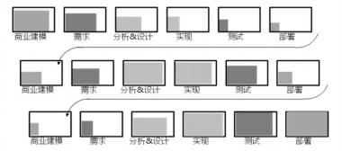

A.瀑布模型    B.原型化模型    C.选代模型    D.螺旋模型

#### 【试题 26】---2017 上真题 31-32

26、在 V 模型中’（）是对详细设计进行验证’（）与需求分析相对应。

（31）A.集成测试    B.系统测试    C.验收测试和确认测试    D.验证测试

（32）A.代码测试    B.集成测试    C.验收测试              D.单元测试

#### 【试题 27】---2017 下真题 28

### 27、以下关于项目与项目管理的描述不正确的是：()

A.项目临时性是指每一个项目都有一个明确的开始时间和结束时间

B.渐进明细是指项目的成果性目标是逐步完成的

C.项目的目标不存在优先级’项目目标具有层次性

D.项目整体管理属于项目管理核心知识域

#### 【试题 28】---2017 下真题 29

28、下图中的项目组织结构属于（）。

A.项目型组织    B.职能型组织    C.弱矩阵型组织    D.强矩阵型组织

#### 【试题 29】---2017 下真题 30

29、某公司承接一个互联网企业的开发项目’由于互联网业务变化较快’无法在项目初期准确确 定出项目需求’你作为项目经理应首先考虑的开发模型是（）。

A.瀑布模型    B.V 模型    C.螺旋模型    D.原型化模型

#### 【试题 30】---2017 下真题 31

### 30、以下关于项目管理过程组的描述不正确的是：()

A.所有项目都必须经历 5 个过程组

B.每个单独的过程都明确了如何使用输入来产生项目过程组的输出

C.制定项目管理计划所需要的过程都属于计划过程组

D.控制变更’推荐纠正措施属于执行过程组

#### 【试题 31】---2018 上真题 28

31、应用软件开发项目执行过程中允许对需求进行适当修改’并对这种变更进行严格控制’充分 体现了项目的（）特点。

A.临时性    B.独特性    C.渐进明细    D.无形性

#### 【试题 32】---2018 上真题 29

32、小王被安排担任 A 项目的兼职配置管理员，她发现所有项目组成员都跟她一样是兼职  的，项目经理没有任何决策权，所有事情都需要请示总经理做决策。这是一个典型的（）项 目组织结构。

A.职能型    B.项目型    C.弱矩阵型    D.强矩阵型

#### 【试题 33】---2018 上真题 30

33、信息系统项目生命周期模型中的（）适用于需求明确或团队具备行业经验，并开发过类似产 品的项目。

A.瀑布模型     B.V 模型     C.螺旋模型     D.选代模型

#### 【试题 34】---2018 下真题 26

34、每个项目都有一个明确的开始时间和结束时间，这体现了项目的（）。

A.紧迫性    B.独特性    C.渐进明细    D.临时性

#### 【试题 35】---2018 下真题 27

35、在（） 中，项目经理权力最小。

A.弱矩阵型组织    B.平衡矩阵型组织    C.强矩阵型组织    D.项目型组织

#### 【试题 36】---2018 下真题 28

36、（）清楚地描述了测试各阶段和开发各阶段的对应关系。

A.瀑布模型   B.送代模型    C.V 模型    D.螺旋模型

#### 【试题 37】---2018 下真题 29

37、识别干系人是项目（）的活动。

A.启动过程组    B.计划过程组    C.执行过程组    D.监督和控制过程组

#### 【试题 38】---2018 下真题 30

38、关于项目的过程组的描述，不正确的是:（）。

A.并非所有项目都会经历 5 个过程组

B.项目的过程组很少会是离散的或者只出现一次

C.项目的过程组经常会发生相互交选

D.项目的过程组具有明确的依存关系并在各个项目中按一定的次序执行

#### 【试题 39】---2019 上真题 28

39、项目具有临时性、独特性与渐进明细的特点其中临时性指（ ）。

A.项目的工期短

B.每个项目都有明确的开始与结束时间

C.项目的成果性目标是逐步完成的

D.项目经理可以随时取消项目

#### 【试题 40】---2019 上真题 29

40、在（）组织结构中，项目拥有独立的项目团队， 项目经理在调用与项目相关的资源时不需要 向部门经理汇报。

A.职能型    B.平衡矩阵型    C.强矩阵型    D.项目型

#### 【试题 41】---2019 上真题 30

41、公司计划开发一个新的信息系统，该系统需求不明确，事先不能定义需求，需要经过多期开 发完成该系统的生命周期模型宜采用（）。

A.瀑布模型    B.V 模型    C.测试驱动方法    D.选代模型

#### 【试题 42】---2019 上真题 31

42、项目管理过程中，（）不完全属于监控过程组。

A.范围确认、监督和控制项目主作、整体变更控制

B.进度控制、控制沟通风险监督与控制

C.成本控制、质量保证、范围控制

D.管理项目团队、范围控制、控制干系人参与

#### 【试题 43】---2019 下真题 24

43、关于项目的描述，不正确的是（）。

A.建设视频监控系统是一个项目，建成后的系统是项目产品

B.建设办公大楼是一个项目， 建设后的大楼是项目产品

C.商务谈判是一个项目，如果谈判成功，合同是项目产品

D.ERP 系统的运行维护是一个项目， ERP 系统是项目产品

#### 【试题 44】---2019 下真题 25

44、关于项目经理的相关描述，不正确的是（）。

A.项目经理需要足够的知识和经验

B.项目经理必须掌握项目所需的新技术

C.项目经理必须具有良好的职业道德

D.项目经理需要具有领导和管理的能力

#### 【试题 45】---2019 下真题 26

45、（）是 PMO 应具备的特征。

①负责制定项目管理方法，最佳实践和标准

②对所有项目进行集中的配置管理

③项目之间的沟通管理协调中心

④在项目约束条件下完成特定的项目成果性目标

⑤对项目之间的关系组织资源进行优化使用

A.①②③④    B.②③④⑤    C.①②③⑤    D.①②③④⑤

#### 【试题 46】---2019 下真题 27

46、在项目 5 个管理过程组中，计划过程组不包括（）。

A.成本估算    B.收集需求    C.风险分析    D.识别干系人

二、立项管理

#### 【试题 1】---2009 上真题 61

,、（） 是承建方项目立项的第一步，其目的在于选择投资机会、鉴别投资方向。 A.项目论证     B.项目评估     C.项目识别     D.项目可行性分析

#### 【试题 2】---2011 上真题 55

2、项目识别是承建方项目立项的第一步，其目的在于选择投资机会、鉴别投资方向。以下关于项 目识别的说法不正确的是（）。

A.可从政策导向中寻找项目机会， 主要依据包括国家、行业和地方的科技发展和经济社会发 展的长期规划与阶段性规划

B.市场需求是决定投资方向的主要依据， 投资者应从市场分析中选择项目机会 C.信息技术发展迅速、日新月易， 新技术也会给企业带来新的项目机会

D.对项目的市场风险、技术风险、经济及社会风险等因素进行分析， 为项目全过程的风险管 理提供依据

#### 【试题 3】---2011 上真题 56

3、项目承建方在立项管理过程中， 应从多个角度对项目进行论证，以下通常不属于承建方项目论 证内容的是（）。

A.技术可行性分析   B.财务可行性分析   C.风险分析   D.需求验证

#### 【试题 4】 ---2011 上真题 57

4、某地方政府策划开展一项大型电子政务建设项目， 项目建设方在可行性研究的基础上开展项目 评估，以下做法不正确的是（）。

A.项目建设方的相关领导和业界专家，根据国家颁布的政策、法规、方法、参数和条例等， 进行项目评估

B.从项目、国民经济、社会角度出发， 对拟建项目建设的必要性、建设条件、生产条件、产 品市场需求、工程技术、经济效益和社会效益等进行评价、分析和论证， 进而判断其是否可行

C.项目评估按照成立评估小组、制定评估计划、开展调查研究、分析与评估、编写评估报告 的程序开展

D.评估工作采用费用效益分析法，比较为项目所支出的社会费用和项目对社会所提供的效 益，评估项目建成后将对社会做出的贡献程度

#### 【试题 5】---2011 下真题 32

5、以下不属于项目可行性研究内容是（）。

A.项目的详细管理计划                B.项目的风险因素及其对策

C.项目的社会影响性分析              D.项目的财务盈利能力评价

#### 【试题 6】---2011 下真题 33

6、作为承建方，其项目立项的第一步工作是（6）。

A.编制立项申请书     B.项目论证     C.项目识别   D.投标

#### 【试题 7】---2012 上真题 31

7、某政府部门拟利用中央财政资金建设电子政务项目， 关于建设方的立项管理，下列做法中不符 合有关规定的是（）。

A.建设单位在编制项目建议书时专门组织项目需求分析， 形成需求分析报告， 报送项目审批部门

B.建设方在项目建议书获得批复后，招标选定有资格的第三方工程咨询机构编制可行性研究 报告，报送项目审批部门

C.建设方在可行性研究报告获得批复后， 向有关部门申请项目前期工作经费， 前期工作经费 计入项目总投资

D.建设方在可行性研究报告获得批复后，委托有资格的第三方工程咨询机构出具评估意见， 连同批复的项目建议书，作为项目建设的主要依据

#### 【试题 8】---2012 上真题 32

8、某企业信息化建设过程中， 决策层要对实施计划方案进行择优和取舍，为保证决策的科学性， 其主要决策依据是（）。

A.需求分析   B.项目建议书   C.可行性研究报告   D.项目评估报告

#### 【试题 9】 ---2012 下真题 33

9、项目建议书主要论证项目建设的必要性，建设方案和投资估算比较粗，投资误差最多为（）。 A.士30%   B.士50%   C.士10%    D.士20%

#### 【试题 10】---2012 下真题 34

10、根据《国家电子政务工程建设项目管理暂行办法》，项目设计方案和投资预算，报告的编制内 容与项目可行性研究报告批复内容不符合，且变更投资一旦超出已批复总投资额度（）的。应重 新撰写可行性研究报告。

A.5%     B.10%     C.15%       D.20%

#### 【试题 11】---2012 下真题 36~37

11、某单位为加强项目管理、计划在 2013 年建设一个项目管理系统， 但企业领导对该系统没有提 出具体要求。钱工是项目负责人，要对项目的技术、经济等进行深入研究和方案论证，应（36）。 如果钱工对比了自主开发和外购的成本、时间差异， 该行为属于（37）。

36）A.进行项目识别             B.编制项目建议书

C.编制可行性研究报告       D.聘请评估机构对项目进行评估

37）A.项目的财务评价           B.项目的总量评估

C.项目的技术方案评估       D.项目的国民经济评价

#### 【试题 12】---2013 上真题 22

12、一般是项目初步可行性研究关注的问题    。

A.合作方式    B.项目进度安排    C.技术合作计划    D.投资与成本估算

#### 【试题 13】---2013 上真题 33

13、某政府部门需要改造现有信息系统，目前正在开展项目立项工作，该项目经初步投资估算确 定的投资额为 950W，而项目可行性研究报告，的到批复确定为 890W。这种情况下建设单位恰当的 做法是（）。

A.重新报批项目建议书

B.重新报批项目可行性研究报告

C.重新报批项目可行性研究报告和项目建意书

D.在项初步设计和投资概算报告中进行定量补充说明

#### 【试题 14】---2013 下真题 31~32

14、已知某拟建项目财务净现金流量如下表所示，则该项目的静态投资回收期是（31）年。进行 该项目财务评价时， 如果动态投资回收期 pt 小于计算期 n ，则财务净现值（32）。

| 时间 | 1 | 2 | 3 | 4 | 5 | 6 | 7 | 8 | 9 | 10 |
|---|---|---|---|---|---|---|---|---|---|---|
| 净现金流  量（万元） | -1200 | -1100 | 300 | 300 | 400 | 500 | 500 | 500 | 500 | 700 |

（31）A.8、4            B.8 、6        C.7、4        D.7 、6

（32）A.<0、项目不可行           B.>0、项目可行

C.<0、项目可行             D.>0、项目不可行

#### 【试题 15】---2014 上真题 32

15、在进行项目详细可行性研究时，将有项目时的成本与无项目时的成本进行比较，求得差额， 这种分析方法被称为（）。

A.经济评价法   B.市场预测法   C.投资估算法    D.增量净效益法

#### 【试题 16】---2014 上真题 33~34

16、项目论证是确定项目是否实施的依据，（1）不属于项目建设方项目论证的原则。（2）不属于 项目建设方项目论证的内容。

（1）A.合规    B.实施便利  C.科学预测   D.重视数据资料

（2）A.招标文件的编制 B.项目组织设置的合理性 C.资金筹措的依据  D.项目的工艺技术

#### 【试题 17】---2014 下真题 30

17、某负责人在编制项目的《详细可行性研究报告》时，列出的提纲如下，按照详细可行性研究 报告内容要求，该报告中缺少的内容（）。

①项且概述②需求确定③现有资源、设施情况分析④设计（初步）技术方法⑤投资估算和资金筹 措计划⑥项目组织、人力资源、培训计划⑦合作方法

A.项目实施进度计划                          B.项目建设的必要性和依据 C.项目涉及的国内外技术发展状况、水平和趋势  D.项目的国民经济评价

#### 【试题 18】---2014 下真题 31

18、在项目可行性研究报告编写、提交和获得批准之前，首先要进行初步可行性研究。初步可行 性研究的目的是（）。

A.分析项目是否有前途，从而决定是否应该继续深入调查研究

B.确定项目是否实施的依据

C.编制计划、设计、采购、施工以及机构设置、资源配置的依据

D.对多个项目方案择优选择

#### 【试题 19】---2015 上真题 30

19、项目的可行性研究一般包括的内容有： 投资必要性、技术可行性、财务可行性、经济可行性、 组织可行性、社会可行性、风险因素及对策。以下关于项目可行性研究的叙述中（） 是不正确的。

A.投资必要性主要是根据市场调查及预测的结果，以及有关产业政策等因素，论证投资建设 的必要性。

B.技术可行性是从技术角度，合理设计技术方案， 并对有关内容进行比较、选择和评价。

C.财务可行性是指从项目及投资者的角度，设计合理的财务方案，并进行评价，做出投资决策。 D.经济可行性是分析项目对社会的影响，包括政治体制，方针政策，社会稳定性等。

#### 【试题 20】---2015 上真题 31

20、项目可行性研究的目的是对拟建设的项目从技术、经济、工程等会方面进行调查研究和分析 比较， 提出是否投资和如何建设的相关意见， 形成《可行性研究报告》。为项目决策提供依据。较 完整的项目可行性研究的步骤依次是（）。

A.立项申请、初步可行性研究、详细可行性研究、项目论证、项目评估。

B.立项申请、项目论证、项目评估、初步可行性研究、详细可行性研究。

C.项目建议书的编制、项目论证、项目评估、可行性研究。

D.项目建议书的编制、项目论证、项目评估、可行性研究报告的编制、提交及审批。

#### 【试题 21】---2015 下真题 30

21、在编写项目可行性研究报告时， 风险因素及对策主要是对项目的市场风险（ ）法律风险，经 济及社 会风险等因素进行评价，制定规避风险的对策，为项目的全过程的管理提供依据。

A.计算风险，财务防线，环境风险  B.技术风险，财务风险，组织风险

C.技术风险，组织风险，环境风险  D.财务风险，组织风险，环境风险

#### 【试题 22】---2015 下真题 31

22、在信息系统项目可行性研究报告中，项目实施进度计划和项目招标方案一般属于（ ）研究的内容。 A.政策可行性  B.经济可行性  C.市场可行性   D.技术可行性

#### 【试题 23】---2015 下真题 32

23、承建方的立项管理一般经过（ ）等四个阶段。

A.项目识别，项目论证，投标，签订合同

B.项目论证，投标，合同谈判，签订合同

C.项目识别，技术可行性分析，合同谈判， 合同签订

D.项目论证，项目识别，合同谈判，签订合同

#### 【试题 24】---2015 下真题 33

24、分析， 讨论和验证项目计划和方案， 并且给出明确的判断和意见， 是项目立项阶段的（ ）工 作中的内容。

A.项目论证  B.项目评估  C.项目建议  D.项目需求收集

#### 【试题 25】---2016 上真题 30

25、评估开发所需的成本和资源属于可行性研究中（）研究的主要内容。

A.社会可行性   B.经济可行性     C.技术可行性   D.实施可行性

#### 【试题 26】---2016 上真题 31

26、立项管理是项目管理中的一项重要内容。从项目管理的角度看，立项管理主要是解决项目的 ()问题。

A.技术可行性   B.组织战略符合性   C.高层偏好   D.需求收集和确认

#### 【试题 27】---2016 上真题 32

27、项目论证通过对实施方案的工艺技术、产品、原料、未来的市场需求与供应情况以及项目的 投资与收益情况的分析，从而得出各种方案的优劣以及在实施技术上是否可行，经济土是否合算 等信息供决策参考。项目论证的作用不包括（）。

A.确定项目是否实施的依据

B.编制计划设计、采购、施工及机构设置、资源配置的依据

C.有效避免风险的发生， 保证项目的效率

D.筹措资金、向银行贷款的依据

#### 【试题 28】---2016 上真题 33

28、承建方的立项管理与建设方的立项管理相比， 更加关注（），以保证在招投标过程中获得与竞 争对手的比较优势。

A.客户关系            B.项目采购管理过程

C.项目的市场需求      D.组织资源与项目的匹配程度

#### 【试题 29】---2016 下真题 30

29、项目建议书是项目建设单位进行项目申请时提交的文件， 其中“项目建设目标与主要建设内容” 一般出现在项目建议书的（） 部分。

A.项目建设单位概况    B.项目建设必要性    C.总体建设方案  D.业务分析

#### 【试题 30】---2016 下真题 31

30、项目立项包括项目建议、项目可行性分析、项目审批、项目招投标、项目合同谈判 5 个阶段， ()属于项目可行性分析阶段的内容

A.编制立项申请    B.编制项目建议书    C.项目评估   D.重新报批可研报告

#### 【试题 31】---2016 下真题 32~33

31、系统集成在承接项目之后， 一般会通过内部立项的方式将合同责任进行转移，并对这种责任 进行约束和规范。这种内部立项的目的一般不包括（32）。而在进行内部立项时，需要对项目的进

度、质量， 以及所面临的风险进行分析，这些内容一般包括在（33）文件之中。

（32）A.为项目进行资源分配     B.确定项目绩效目标

C.提升项目实施效率      D.选择合适的供应商

（33）A.项目资源估算  B.项目资源分配  C.项目工作说明书  D.项目经理职责

#### 【试题 32】---2016 下真题 34

32、以下关于开标与评标的叙述中，不正确的是（）。

A.评标委员会的数量为单数，其中技术、经济等方面专家人数不得少于成员总数的 1/2

B.招标人自收到评标报告之日起 3 日内公示中标候选人，公示期不得少于 3 日 C.依法必须进行招标的项目， 招标人应当确定排名第一的中标候选人为中标人 D.评标报告应当由评标委员会全体成员签字

#### 【试题 33】---2017 上真题 33

33、项目经理小张正在组织项目核心团队编写可行性研究报告。对多种技术方案进行比较、选择 和评价属于（）分析。

A.投资必要性    B.技术可行性    C.经济可行性    D.组织可行性

#### 【试题 34】---2017 上真题 34

34、某项目的立项负责人编制了一份某软件开发项目的详细可行性研究报告, 目录如下:①概述②需 求确定③现有资源④技术方案⑤进度计划⑥项目组织⑦效益分析⑧协作方式⑨结论。该报告中欠 缺的必要内容是（）。

A.应用方案    B.质量计划    C.投资估算    D.项目评估原则

#### 【试题 35】---2017 上真题 35

35、某系统集成商准备去投标一个政府网站开发项目，该系统集成商在项目招投标阶段的工作依 次是（）。

①组建评标小组②编制投标文件中③参写开标过程④研读招标公告⑤提交投标文件 A.①②③④⑤    B.⑤②④③    C.④②⑤③    D.①④⑤②③

#### 【试题 36】---2017 下真题 32

36、以下关于项目建议书的叙述中，不正确的是（）。

A.项目建议书一般由项目承建单位编写， 提交项目建设单位审批

B.项目建议书是选择项目的依据，也是可行性研究的依据

C.项目建议书包括项目建设的必要性、业务分析、总体建设方案、实施进度、效益与风险分 析等内容

D.某些情况下，项目建议书的编写、申报和审批工作可与项目可行性分析阶段的工作合并

#### 【试题 37】---2017 下真题 33

37、在项目可行性研究内容中，（） 包括制定合理的项目实施进度计划、设计合理的组织结构、选 择经验丰富的管理人员、建立良好的协作关系、制定合适的培训计划等内容。

A.技术可行性    B.财务可行性    C.组织可行性   D.流程可行性

#### 【试题 38】---2017 下真题 34

38、以下关于项目可行性研究的叙述中，不正确的是（）。

A.机会可行性研究的目的是激发投资者的兴趣， 寻找投资机会

B.在项目立项阶段， 即使是小型项目，详细可行性研究也是必须的

C.详细可行性研究是一项费时、费力且需一定资金支持的工作

D.项目可行性研究报告一般委托具有相关专业资质的工程咨询机构编制

#### 【试题 39】---2017 下真题 35

39、以下关于项目招投标的叙述中，正确的是（）。

A.资格预审文件或招标文件的发售期不得少于 15 日

B.投标保证金不得超过招标项目估算价的 5%

C.评标委员会的人员数量不得少于 5 人

D.书面合同具备法律效力，中标通知书不具有法律效力

#### 【试题 40】---2017 下真题 36

40、当与客户签署合同之后， 许多供应商会进行内部立项。内部立项的主要作用不包括（）。 A.通过内部立项方式为项目分配资源

B.通过内部立项方式确定合理的项目绩效目标

C.通过内部立项方式提升项目实施效率

D.通过内部立项方式降低成本

#### 【试题 41】---2018 上真题 32

41、在信息系统集成项目建议书中， “信息资源规划和数据库建设”属于（）部分。 A.业务分析               B.本期项目建设方案

C.项目建设的必要性       D.效益与风险分析

#### 【试题 42】---2018 上真题 33

42、在项目可行性研究内容中，（） 主要是从资源配置的角度衡量项目的价值， 评价项目在实现区 域经济发展目标、有效配置经济资源、增加供应、创造就业、改善环境、提高人民生活等方面的 效益。

A.经济可行性    B.技术可行性    C.财务可行性    D.组织可行性

#### 【试题 43】---2018 上真题 34

43、在（） 时。可以不进行招标。

A.需要采用不可替代的专利或者专有技术

B.项目全部或部分使用国有投资或国家融资

C.采购大型关系公共安全的基础设施

D.使用国际组织或外国政府贷款、援助资金

#### 【试题 44】---2018 上真题 35

44、关于项目招投标的说法， 不正确的是（）。

A. 中标人确定后，招标人应当视情况向中标人发出中标通知书，将中标结果通知所有未中标 的投标人

B.依法必须进行招标的项目。招标人应当自收到评标报告之日起 3 日内公示中标候选人

C.招标人在招标文件中要求投标人提交投标保证金的，投标保证金有效期应当与投标有效期 一致

D.投标人少于 3 个的， 不得开标；招标人应当重新招标

#### 【试题 45】---2018 上真题 36

45、针对新中标的某政务工程项目， 系统集成商在进行项目内部立项时， 立项内容一般不包括（）。 A.项目资源分配    B.任命项目经理    C.项目可行性研究    D.准备项目任务书

#### 【试题 46】---2018 下真题 32

46、关于项目建议书的描述，不正确的是（）。

A.项目建议书是针对拟建项目提出的总体性设想

B.项目建议书是项目建设单位向上级主管部门提交的项目申请文

C.项目建议书包含总体建设方案、效益和风险分析等内容

D.项目建议书是银行批准贷款或行政主管部门审批决策的依据

#### 【试题 47】---2018 下真题 33

47、可行性研究过程中，（）的内容是:从资源配置的角度量项目的价值，评价项目在实现区域经发 展目标、有效配照经济资源、增加供求、创造环境、提高人民生活等方面的效益。

A.技术可行性研究    B.经济可行性    C.社会可行性研究    D.市场可行性研究

#### 【试题 48】---2018 下真题 34

48、关于项目可行性研究阶段的描述，不正确的是（）。

A.详细可行性研究的内容与初步可行性研究内容大致相同

B.初步可行性研究是介于机会研究和详细可行性研究的一个中间阶段

C.初步可行性研究阶段需要从技术、经济等方面进行深入调查研究

D.机会研究的主要任务是对投资项目或投资方向提出建议

#### 【试题 49】---2018 下真题 35

49、关于项目招投标的描述，不正确的是（）。

A.招标人采用公开招标，应当发布招标公告

B.两个或两个以上法人或者其他组织可以组成一个联合体共同投标

C.招标人在招标文件中要求投标人提交投标保证金的，投标保证金有期应长于投标效期 D.评标委员会名单在中标结果确定前需保密

#### 【试题 50】---2018 下真题 36

50、供应商在进行项目内部项时，立项内容不包括（）。

A.项目资源估算    B.项目资源分配    C.任命项目经理    D.项目可行性研究

#### 【试题 51】---2019 上真题 32

51 、关于项目建议书的描述， 不正确的是（）。

A.项目建议书可作为可行性研究的依据

B.系统集成类项目建议书的内容可进行扩充和裁剪

C.项目建议书是建设单位向上级主管部门提交的文件

D.系统集成项目必须提供项目建议书

#### 【试题 52】---2019 上真题 33

52、项目可行性研究的内容中（）主要从资源配置的角度衡量项目的价值，项目在实现经济发展 目标、有效配置经济资源、增加供给、创造就业、改善环境、提高人民生活等方面的效益。

A.投资必要性    B.技术可行性    C.经济可行性    D.组织可行性

#### 【试题 53】---2019 上真题 34

53、关于项目可行性研究的描述中，不正确的是（）。

A.初步可行性研究可以形成初步可行性报告

B.项目初步可行性研究与详细可行性研究的内容大致相同

C.小项目一般只做详细可行性研究初步可行性研究可以省略

D.初步可行性研究的方法有投资估算法、增量效益法等

#### 【试题 54】---2019 上真题 35

54、依据《中华人民共和国招投标法》，不正确的是（）。

A.投标人少于 3 个的不得开标

B.招标人和中标人应当在中标通知发出之日起 30 日内订立面合同

C.招标人不可以自行选择招标代理机构

D. 中标通知书对招标人和中标人具有法律效力

#### 【试题 55】---2019 上真题 36

55、系统集成供应商在进行项目内部立项时的工作不包括（）。

A.项目资源估算    B.任命项目经理    C.组建项目 CCB        D.准备项目任命书

#### 【试题 56】---2019 下真题 28

56、关于项目建议书的描述， 不正确的是（）。

A.项目建议书是项目建设单位向上级主管部门提交的项目申请文件

B.集成类项目建议书的内容包含业务分析、建设方案、实施进度等

C.项目建议书是国家或上级主管选择项目的依据

D.项目建议书是必需的，是后续可行性研究的基础

#### 【试题 57】---2019 下真题 29

57、（）不属于项目可行性研究报告的内容。

A.项目建设必要性    B.项目建设方案    C.项目实施进度    D.变更管理计划

#### 【试题 58】---2019 下真题 30

58、对于不同规模和类别的项目，初步可行性研究可能出现的结果包括（）。

①肯定，对于比较小的项目甚至可以直接“上马”

②肯定，转入详细可行性研究

③展开专题研究，如建立原型系统，演示主要功能模块或者验证关键技术

④否定，项目应该“下马 ”

⑤否定，进行机会可行性研

A.①③④⑤    B.①②③④    C.①②④⑤    D.②③④⑤

#### 【试题 59】---2019 下真题 31

59、根据 2019 年修订的《中华人民共和国招投标法实施条例》招标文件要求中标人要提交履约保 证金的，属约保证金不得超过中标合同金额的（）。

A.2%        B.5%        C.10%        D.15%

#### 【试题 60】---2019 下真题 32

60、关于供应商项目内部立项的描述， 不正确的是（）。

A.任何规模和类型的项目均要求进行内部立项

B.通过项目立项方式可以确定合理的项目绩效目标

C.通过项目立项方式可以分为项目分配资源

D. 以项目型工作方式， 提升项目实施效率

三、项目整体管理

#### 【试题 1】---2009 上真题 23

1、制定项目计划时，首先应关注的是项目（1）。

（1）A.范围说明书   B.工作分解结构   C.风险管理计划   D.质量计划

#### 【试题 2】---2009 上真题 50

2、项目将要完成时，客户要求对工作范围进行较大的变更，项目经理应（2）。

（2）A.执行变更         B.将变更能造成的影响通知客户

C.拒绝变更         D.将变更作为新项目来执行

#### 【试题 3】---2009 下真题 57

3、（3） 是正式批准一个项目的文档， 或者是批准现行项目是否进入下一阶段的文档。

（3）A.项目章程    B.项目合同    C.项目启动文档    D.项目工作说明书

#### 【试题 4】 ---2009 下真题 58

4、经项目各有关干系人同意的（4）就是项目的基准，为项目的执行、监控和变更提供了基础。

（4）A.项目合同书    B.项目管理计划   C.项目章程    D.项目范围说明书

#### 【试题 5】---2010 上真题 31

5、发布项目章程，标志着项目的正式启动。以下围绕项目章程的叙述中，（5）是不正确的。 （5）A.制定项目章程的工具和技术包括专家判断

B.项目章程要为项目经理提供授权，方便其使用组织资源进行项目活动 C.项目章程应当由项目发起人发布

D.项目经理应在制定项目章程后再任命

#### 【试题 6】---2010 上真题 32

6、在编制项目管理计划时，项目经理应遵循编制原则和要求， 使项目计划符合项目实际管理的需 要。以下关于项目管理计划的叙述中，（6）是不正确的。

（6）A.应由项目经理独立进行编制          B.可以是概括的

C.项目管理计划可以逐步精确         D.让干系人参与项目计划的编制

#### 【试题 7】---2010 上真题 33

7、在项目实施过程中， 项目经理通过项目周报中的项目进度分析图表发现机房施工进度有延期风 险。项目经理立即组织相关人员进行分析，下达了关于改进措施的书面指令。该指令属于（7）。

（7）A.检查措施      B.缺陷补救措施 C.预防措施      D.纠正措施

#### 【试题 8】---2010 上真题 34

8、在项目管理中， 采取（8）方法， 对项目进度计划实施进行全过程监督和控制是经济和合理的。

（8）A.会议评审和 MONTE CARLO  分析     B.项目月报和旁站

C.进度报告和旁站                     D .挣值管理和会议评审

#### 【试题 9】 ---2010 上真题 35

9、一项新的国家标准出台， 某项目经理意识到新标准中的某些规定将导致其目前负责的一个项目 必须重新设定一项技术指标， 该项目经理首先应该（9）。

（9）A.撰写一份书面的变更请求

B.召开一次变更控制委员会会议，讨论所面临的问题

C.通知受到影响的项目干系人将采取新的项目计划

D.修改项目计划和 WBS，以保证该项目产品符合新标准

#### 【试题 10】---2011 上真题 31

10、项目经理在编制项目管理计划时， 应（10） 。

（10）A.越简单越好   B.越详细越好   C.逐步细化 D.按照公司的模板编制，不能变更

#### 【试题 11】---2011 上真题 32

11、在项目整体管理过程中监督和控制项目是一个关键环节，下列不属于监督和控制过程组的是 （11）。

（11）A.客户等项目干系人正式验收并接受已完成的项目可交付物的过程

B.企业质量管理体系审计

C.在管理项目团队时， 项目经理与组员就组员情况进行正式交谈

D.编制绩效报告

#### 【试题 12】---2011 下真题 50

12、某公司正在启动一个新的系统集成项目，任命张某为项目负责人，并从多个职能部门抽调人 员组成项目团队，采用矩阵式管理模式。张某认识到在这种情况下团队成员对职能经理的配合往 往要超过对自己配合，因此决定请求公司发布一份（12）。

（12）A.人力资源管理计划      B.项目管理计划   C.项目章程   D.沟通管理计划

#### 【试题 13】---2011 下真题 51

13、某项目经理正在为一个新产品开发项目制订项目管理计划，他应该遵循的基本原则中不包括 （13）。

（13）A.逐步精确细化           B.技术工作与管理工作相分离

C.各干系人参与           D.对相关人员与资源统一组织及管理

#### 【试题 14】---2011 下真题 52

14、某大型信息系统集成项目组建了一个变更控制委员会来负责项目变更请求的审查与处理工作， 并且确立了支配其运作的具体程序和规则。这个程序要求所有得到批准的变更都必须反映到（14） 中。

（14）A.业绩衡量基准   B.变更管理计划    C.项目管理计划 D.质量保证计划

#### 【试题 15】---2011 下真题 55

15、某系统集成公司据经验决定建立一套变更控制系统，为保证该系统行之有效，该系统中必须 包括的内容是（15）。

（15）A.对每个项目的各条功能和物理特征作出的具体描述

B.项目预期的、具体的变更要求，以及响应计划

C.定义项目文档如何变更的程序和规则

D.预测项目变更的绩效报告

#### 【试题 16】---2011 下真题 56

16、某大型系统集成项目由多个不同的承包商协作完成， 项目涉及了分别代表 7 家公司的 24 个主 要干系人、项目经理陈某直接管理的团队由 7 个项目小组长， 每个项目小组长负责一支约 15 人的 工作组。陈某意识到必须特别注意进行有效的整体变更控制，这表明他最应该关心的工作是（16）。

（16）A.整合从项目的不同专业职能部门交付来的工作成果

B.设立一个专门的变更控制部门来监控所有的项目变更

C.保持基准计划的完整性。整合产品和项目的范围，并且协调那些跨知识领域的变更 D.关注可能引发变更的因素，确定已经发生的变更并管理实际发生的变更

#### 【试题 17】---2012 上真题 34

17、项目管理计划应整合其他规划过程的所有子计划和基准， 一经确定即成为项目的基准。在项 目管理中通常将（17）合并为一个绩效测量基准，这些基准可应用于挣值测量从而判断项目的整

体绩效。

（17）A.范围基准、成本基准、进度基准 D.质量基准、进度基准、成本基准

B.质量基准、成本基准、范围基准

C.质量基准、进度基准、范围基准

#### 【试题 18】---2012 上真题 35

18、关于项目进度管理中的活动历时估算的叙述，（18）是正确的。

（18）A.活动历时估算应给出尽量准确的结果，不麻给出变化范围，例如： 2 周士2 天 B.多方案分析法是一种常用的活动历时估算方法

C.常用的活动历时估算方法包括类比估算、参数估算、三点估算法和后备 D.类比估算法也称为自下而上估算法，常用于项目早期的活动历时估算

#### 【试题 19】---2013 上真题 25

19、项目章程在项目管理中起着非常重要的作用，以下对项目章程的描述中  19  是错误的。 （19）A.项目章程应该由项目团队之外的人发布

B.项目章程使项目与执行组织的日常动营联系起来

C.项目章程不包括干系人的需求和期望

D.项目章程包括论证项目的业务方案

#### 【试题 20】---2013 下真题 35

20、项目章程是正式批准一个项目的文档，项目章程的内容不包括（20）。

（20）A.项目的目的或项目立项的理由       B.概要的里程碑进度计划

C.项目工作的分解方式              D.概要预算

#### 【试题 21】---2013 下真题 36

21、项目收尾是结束项目某一阶段中的所有活动的过程，包括管理收尾和合同，其中管理收尾不 包括（21）。

（21）A.收集项目纪录   B.分析项目成败   C.采购审计   D .收集应吸取的教训

#### 【试题 22】---2013 下真题 37

22、配置管理描述了应用技术和行政管理指示的监督的程序，（22）不属于配置中实施的任务。

（22）A.控制特征的变更         B.实施审计，以证实符合要求

C.允许自动批准变更       D.识别某事项或系统的性能和物理特征

#### 【试题 23】---2014 上真 61

23、（23）不属于项目章程的组成内容.

（23）A.工作说明书 B.指定项目经理并授权 C.项目概算 D.项目需求

#### 【试题 24】---2014 下真 35

24、某公司要开发一款电子行车记录仪，成立了产品研发项目团队，发布了项目章程，其中不应 包括（24）。

（24）A.开发电子行车记录仪的背景、目的及可行性   B.业务要求或产品需求

C.详细的开发计划和投资预算                 D.任命的项目经理和他的权限级别

#### 【试题 25】---2014 下真 36

25、项目计划的编制是一个逐步的过程。以下关于项目计划编制的叙述中，（25）是正确的。 （25）A.项目计划的编制过程是渐进明细、逐步细化的过程

B.一般进度计划应写在项目主计划中，而其他方面的计划，如范围、质量、成本等应单独 编制成子计划

C.项目计划只供项目组内部使用， 因此客户不必参与项目计划的编制

D.项目经理对项目计划有最高管理权限，可随时修改项目计划

#### 【试题 26】---2015 上真 35

26、以下关于项目章程的叙述中，（）是正确的。

A.项目章程应当由项目经理主持发布

B.项目章程中应明确客户的详细需求。不能直接引用合同或工作说明书中内容

C.项目章程中可以给出概要的里程碑进度计划，详细的进度计划可在项目计划阶段在进行制定 D.项目经理应当由公司专门发布文件进行任命，不应写入项目和章程

#### 【试题 27】---2015 下真 34

27、项目管理计划确定了项目执行，监控和结束项目的方式和方法，其中不包括（ ）。

（27）A.项目需要执行的过程  B.项目生命周期 C.里程碑的阶段的划分 D.项目过程改进

#### 【试题 28】---2015 下真 39

### 28、项目收尾管理的过程中的输入项不包括( )

（28）A.项目管理计划     B.合同文件   C.组织过程资产     D.验收标准

#### 【试题 29】---2016 上真 35~36

29、项目章程应在项目计划之前公布。以下关于项目章程的叙述中，不正确的是：（35）。通常项 目章程由（36）发布。

（35）A.项目章程不是正式批准的项目文档

B.项目章程包含产品需求和产品的商业需求

C.项目章程将项目与执行组织的日常运营联系起来

D.项目章程为项目经理使用组织资源进行项目活动提供授权

（36）A.项目经理   B.项目调研小组   C.项目发起人   D.项目监理

#### 【试题 30】---2016 下真 35

30、以下关于项目章程的叙述中，不正确的是（）。

A.项目章程描述了项目发起人或其他批准项目章程的人员姓名和职权

B.项目章程规定了项目的总体目标， 包括范围、时间、成本和质量等

C.项目章程由项目发起人签字

D.项目经理有权修改项目章

#### 【试题 31】---2016 下真 36

31、引导技术是指团队领导者诱发团队成员积极参与团队活动的方法，来帮助团队和个人完成相 关项目活动。（） 一般不作为引导技术在项目中的应用。

A.专家判断   B.头脑风暴   C.冲突处理      D.会议管理

#### 【试题 32】---2016 下真 37

32、以下关于项目管理计划的叙述中， 不正确的是（）。

A.项目管理计划最重要的用途是指导项目执行、监控和收尾

B.项目管理计划是自上而下制订出来的

C.项目管理计划集成了项目中其他规划过程的成果

D.制订项目管理计划过程会促进与项目干系入之间的沟通

#### 【试题 33】---2016 下真 38

33、在项目进行过程中，变更控制委员会要求项目必须采用市场上刚出现的一种新技术，并且要 求按时交付时项目经理应该更新的第一份文件是（）。

A.项目管理计划    B.质量管理计划    C.成本管理计划   D.项目进度表

#### 【试题 34】---2016 下真 39

34、项目整体变更控制管理的流程是变更请求y（）。

A.同意或否决变更y变更影响评估y执行

B.执行变更y变更影响评估y 同意或否决变更

C.变更影响评估y 同意或否决变更y执行

D.同意或否决变更y执行y变更影响评估

#### 【试题 35】---2016 下真 40

35、配置管理和变更管理是项目管理中非常重要的组成部分，两者相比， 配置管理重点关注（）。 A.项目可交付成果及各个过程技术之间的匹配

B.识别、记录对项目文件的更改

C.批准或否决对项目文件的改变

D.对项目可交付成果或基准变更的记录

#### 【试题 36】---2016 下真 41

36、以下关于整体变更控制的叙述中， 不正确的是（）。

A.一个未知风险发生影响到项目进度时，需要进行整体变更分析

B.未经批准的变更请求不需要在变更日志中记录

C.变更请求可以口头提出， 但要以书面形式记录

D.变更请求在 CCB 批准后，还可能需要得到客户或发起人的批准

#### 【试题 37】---2017 上真题 36

37、项目章程的作用中,不包括（）。

A.为项目人员绩效考核提供依据

B.确定项目经理,规定项目经理的权力

C.规定项目的总体目标

D.正式确认项目的存在

#### 【试题 38】---2017 上真题 37

38、（）不属于项目章程的内容。

A.项目工作说明书

B.项目的主要风险,如项目的主要风险类别

C.里程碑进度计划

D.可测量的项目目标和相关的成功标准

#### 【试题 39】---2017 上真题 38

39、为项目选择特定的生命周期模型-般是（）中的工作。

A.项目管理计划编制    B.项目章程        C.项目任务书    D.质量计划编制

#### 【试题 40】---2017 下真题 37

40、整合者是项目经理承担的重要角色之一，作为整合者，其主要工作不包括：（）。

A.通过与项目干系人主动、全面的沟通， 来了解他们对项目的需求

B.在相互竞争的众多干系人之间寻找平衡点

C.通过认真、细致的协调，来达到各种需求间的整合与平衡

D.将不同厂商的产品、技术进行整合

#### 【试题 41】---2017 下真题 38

41 、项目章程的主要内容包括（）。

①项目目的或批准项目的理由

②项目的主要风险

③项目的总体预算

④项目总体里程碑进度计划

⑤项目范围说明书

⑥项目成本基准

A.①②③⑥    B.①②③④    C.①③④⑤    D.①④⑤⑥

#### 【试题 42】---2017 下真题 39

42、项目管理计划是说明项目将如何执行、监督和控制的文件。以下选项中，（） 不属于项目管理 计划的内容。

A.干系人登记册

B.为项目选择的生命周期模型

C.如何监督和控制变更

D.所使用的项目管理过程

#### 【试题 43】---2017 下真题 40

43、（）指的是为确保项目工作的未来绩效符合项目管理计划而进行的有目的的活动。 A.纠正措施    B.预防措施    C.缺陷补救    D.功能完善

#### 【试题 44】---2017 下真题 41

44、以下关于项目整体变更控制过程的叙述中， 不正确的是：()

A.实施整体变更控制过程的目的是为了降低项目风险

B.实施整体变更控制过程贯穿项目始终，并且应用于项目的各个阶段

C.变更控制委员会对整体变更控制过程负最终责任

D.会议是实施整体变更控制的工具与技术之一

#### 【试题 45】---2017 下真题 42

45、以下关于项目变更管理的叙述中， 不正确的是（）。

A.项目的任何干系人都可以提出变更请求

B.所有的变更请求都必须以书面形式记录

C.所有的变更请求都必须交由变更控制委员会审批

D.客户也可以作为变更控制委员会成员

#### 【试题 46】---2018 上真题 37

46、（）没有体现项目经理作为整合者的作用。

A.与项目干系人全面沟通，来了解他们对项目的需求

B.充分发挥自身经验，制定尽可能详细的项目管理计划

C.在相互竞争的众多干系人之间寻找平衡点

D.通过沟通、协调达到各种需求的平衡

#### 【试题 47】---2018 上真题 38

47、项目章程的内容不包括（）。

A.项目的总体质量要求    B.项目的成功标准

C.项目范围管理计划     D.项目的审批要求

#### 【试题 48】---2018 上真题 39

48、项目管理计划的内容不包括（）。

A.范围基准    B.过程改进计划    C.干系人管理计划    D.资源日历

#### 【试题 49】---2018 上真题 40

49、（）是为了修正不一致的产品或产品组件而进行的有目的的活动。

A.纠正措施    B.预防措施    C.缺陷补救    D.产品更新

#### 【试题 50】---2018 上真题 41

50、关于项目整体变更的描述，不正确的是：（）。

A.整体变更控制过程贯穿项目始终

B.任何项目干系人都可以提出变更请求

C.所有变更都应纳入变更管理

D.所有变更请求都应由 CCB 来批准或否决

#### 【试题 51】---2018 上真题 42

51、关于变更控制委员会（CCB）的描述，不正确的是（）。

A.CCB 的成员可能包括客户或项目经理的上级领导

B.一般来说，项目经理会担任 CCB 的组长

C.针对某些变更，除了 CCB 批准以外，可能还需要客户批准

D.针对可能影响项目目标的变更，必须经过 CCB 批准

#### 【试题 52】---2018 下真题 37

52、在职能型组织中，关于项目经理的职责，不正确的是:（）。

A.通过与项目干系人主动、全面的沟通、来了解他们对项目的需求

B.在互相竞争的众多干系人之间寻求平衡点

C.通过认真、细致的协调，来达到各种需求间的整合与平衡

D.项目经理是项目的预算控制者

#### 【试题 53】---2018 下真题 38

53、（）不属于项目章程的作用。

A.明确项目的人员要求及考核指标

B.正式确认项目存在，给项目一个合法的地位

C.规定项目的总体目标，包括范围、时间、成本和质量等

D.确定项目经理，规定项目经的权力

#### 【试题 54】---2018 下真题 39

54、项目管理计划不包括（）。

A.变更管理计划    B.变更日志    C.配置管理计划    D.范围基准

#### 【试题 55】---2018 下真题 40

55、（）不属于项目管理信息系统的子系统。

A.工作授权系统          B.配置管理系统

C.IT 基础设施监控系统    D.信息收集与发布系统

#### 【试题 56】---2018 下真题 41

56、在项目执行的过程中，一名干系人确定了一个新需求，该需求对项目是否成功起到关键的作用, 项目经理接下来应该（）。

A.为该需求建立变更请求，提交给变更控制委员会审批

B.评估重要性，以确定是否执行变更流程

C.寻求项目发起人对变更的批准

D.考虑该需求比较关键，安排相关人员进行修改

#### 【试题 57】---2018 下真题 42

57、关于项目收尾的描述，不正确的是:（）。

A.项目收尾分为管理收尾和合同收尾

B.管理收尾和合同收尾都要进行产品核实，都要总结经验教训

C.每个项目阶段结束时都要进行相应的管理收尾

D.对于整个项目而言，管理收尾发生在合同收尾之前

#### 【试题 58】---2019 上真题 37

58、整合者是项目经理承担的重要角色之一，作为整合者，不正确的是（）。

A.整合者从技术角度审核项目

B.通过与项目干系人主动、全面沟通了解他们对项目的需求

C.在相互竞争的干系人之间寻找平衡点

D.通过协调工作，达到项目需求间平衡， 实现整合

#### 【试题 59】---2019 上真题 38

59、项目章程内容不包括（）。

A.任命项目经理    B.组建项目团队    C.项目总体要求    D.项目总体预算

#### 【试题 60】---2019 上真题 39

60、项目管理计划的内容不包括（）。

A.范围管理计划与项目范围说明书

B.干系人管理计划与沟通管理计划

C.进度管理计划与进度基准

D.成本管理计划与成本绩效

#### 【试题 61】---2019 上真题 40

61 、指导与管理项目工作过程的输出不包括（）。

A.工作绩效数据    B.批准的变更请求    C.项目管理计划更新    D.项目文件更新

#### 【试题 62】---2019 上真题 41

62、项目执行过程中，客户要求对项目范围进行修改，项目经理首先应该（）。 A. 向 CCB 提交正式的交更请求

B.通知客户在项目进展过程中不可以进行范围修改

C.重写项目计划添加新的需求并实施

D.听取高级管理层关于预算和资源计划的建议

#### 【试题 63】---2019 上真题 42

63、整体变更控制的工具技术不包括（）。

A.专家判断    B.实验设计    C.会议    D.配置管理工具

#### 【试题 64】---2019 下真题 33

64、项目整体管理是项目管理中一项综合性和全局性的管理工作，项目整体包括（）。 A.制定项目章程、识别干系人、制定项目管理计划、指导和管理项目工作

B.制定项目可行性研究报告、制定项目管理计划、指导和管理项目工作、监控项目工作、实 施整体变更控制

C.制定项目章程、制定项目管理计划、指导和管理项目工作、监控项目工作、实施整体变更控制。 D.制定项目可行性研究报告、识别干系人、监控项目工作、实施整体变更控制

#### 【试题 65】---2019 下真题 34

65、（）不是制定项目章程的输入。

A.项目工作说明书    B.商业论证    C.合同或谅解备忘录协议    D.项目成功标准

#### 【试题 66】---2019 下真题 35

66、关于项目管理计划的描述，不正确的是()

A.项目管理计划必须是自上而下制定出来的

B.项目管理计划必须得到主要项目干系人的执行批准

C.其他规划过程的成果是项目管理计划制定的依据

D.项目管理计划可以指导项目的收尾工作

#### 【试题 67】---2019 下真题 36

67、（）不属于指导与管理项目工作的输出。

A.批准的变更请求    B.工作绩效数据    C.可交付成果    D.项目管理计划更新

#### 【试题 68】---2019 下真题 37

68、（）优点是考虑时间序列发生趋势， 使预测结果能更好地符合实际。

A. 因果分析    B.挣值管理    C. 回归分析    D.趋势分析

#### 【试题 69】---2019 下真题 38

69、关于整体变更控制的描述，不正确的是（）。

A.项目的任何干系人都可以提出变更请求

B.项目经理可以是变更控制委员会（CCB）的成员

C.整体变更控制过程贯穿项目始终， CCB 对此负最终责任

D.整体变更控制的主要作用是降低因末考虑变更对整个项目计的影响而产生的风险

四、项目范围管理

#### 【试题 1】---2009 上真题 29

1、范围管理计划中一般不会描述（1）。

（1）A.如何定义项目范围                 B.制定详细的范围说明书

C.需求说明书的编制方法和要求        D.确认和控制范围

#### 【试题 2】---2009 上真题 30

2、以下关于工作包的描述，正确的是（2）。

（2）A.可以在此层面上对其成本和进度进行可靠的估算

B.工作包是项目范围管理计划关注的内容之一

C.工作包是 WBS 的中间层

D.不能支持未来的项目活动定义

#### 【试题 3】---2009 上真题 31

3、小王正在负责管理一个产品开发项目。开始时产品被定义为“最先进的个人数码产品”，后来被 描述为“先进个人通信工具” 。在市场人员的努力下该产品与某市交通局签订了采购意向书，随后 与用户、市场人员和研发工程师进行了充分的讨论后，被描述为“成本在 1000 元以下，能通话、 播放 MP3、能运行 WinCE 的个人掌上电脑” 。这表明产品的特征正在不断改进，但是小王还需将 （3）与其相协调。

（3）A.项目范围定义           B.项目干系人利益

C.范围变更控制系统       D.用户的战略计划

#### 【试题 4】 ---2009 上真题 52

4、某公司正在为某省公安部门开发一套边防出入境管理系统， 该系统包括 15 个业务模块，计划 开发周期为 9 个月，即在今年 10 月底之前交付。开发团队一共有 15 名工程师。今年 7 月份，中 央政府决定开放某省个人到香港旅游， 并在 8 月 15 日开始实施。为此客户要求公司在新系统中实 现新的业务功能， 该功能实现预计有 5 个模块，并要求在 8 月 15 日前交付实施。但公司无法立刻 为项目组提供新的人力资源。面对客户的变更需求， 以下（4）处理方法最合适。

（4）A.拒绝客户的变更需求，要求签订一个新合同，通过一个新项目来完成 B.接受客户的变更需求， 并争取如期交付， 建立公司的声誉

C.采用多次发布的策略， 将 20 个模块重新排定优先次序，并在 8 月 15  日之前发布一个包 含到香港旅游业务功能的版本，其余延后交付

D.在客户同意增加项目预算的条件下， 接受客户的变更需求，并如期交付项目成果。

#### 【试题 5】---2009 上真题 53

。、范围变更控制系统（5）。

（5）A.是用以确定正式修改项目文件所必须遵循步骤的正式存档程序

B.是用于在技术与管理方面监督指导有关报告内容，以及控制变更的确定与记录工作并确 保其符合要求的存档程序

C.是一套用于对项目范围做出变更的程序，包括文书工作，跟踪系统以及授权变更所需的 认可

D.可强制用于各项目工作以确保项目范围管理计划在未经事先审查与签字的情况下不得做 出变更

#### 【试题 6】---2009 下真题 42

6、下面关于 WBS 的描述，错误的是（6） 。

（6）A.WBS 是管理项目范围的基础， 详细描述了项目所要完成的工作

B.WBS 最底层的工作单元称为功能模块

C.树型结构图的 WBS 层次清晰、直观、结构性强

D.比较大的、复杂的项目一般采用列表形式的 WBS 表示

#### 【试题 7】---2009 下真题 43

7、（7）是客户等项目干系人正式验收并接收已完成的项目可交付物的过程。

（7）A.范围确认    B.范围控制    C.范围基准    D.范围过程

#### 【试题 8】---2010 上真题 41

8、某公司最近在一家大型企业 。A 项目招标中胜出，小张被指定为该项目的项目经理。公司发 布了项目章程，小张依据该章程等项目资料编制了由项目目标、可交付成果、项目边界及成本和 质量测量指标等内容组成的（8）。

（8）A.项目工作说明书     B.范围管理计划  C.范围说明书       D.WBS

#### 【试题 9】 ---2010 上真题 42

9、下面关于项目范围确认描述，（9）是正确的。

（9）A.范围确认是一项对项目范围说明书进行评审的活动

B.范围确认活动通常由项目组和质量管理员参与执行即可

C.范围确认过程中可能会产生变更申请

D.范围确认属于一项质量控制活动

#### 【试题 10】---2010 下真题 42

10、在项目验收时， 建设方代表要对项目范围进行确认。下列围绕范围确认的叙述正确的是（10）。

（10）A.范围确认是确定交付物是否齐全， 确认齐全后再进行质量验收

B.范围确认时，承建方要向建设方提交项目成果文件如竣工图纸等

C.范围确认只能在系统终验时进行

D.范围确认和检查不同，不会用到诸如审查、产品评审、审计和走查等方法

#### 【试题 11】---2010 下真题 43

11、在项目结项后的项目审计中， 审计人员要求项目经理提交（11）作为该项目的范围确认证据。

（11）A.系统的终验报告       B.该项目的第三方测试报告

C.项目的监理报告        D.该项目的项目总结报告

#### 【试题 12】---2011 上真题 39~40

12、在某信息化项目建设过程中，客户对于最终的交付物不认可，给出的原因是系统信号强度超 过用户设备能接受的上限。请问在项目执行过程中， 如果客户对于项目文件中的验收标准无异议， 则可能是（39）环节出了问题；如果客户对于项目文件中的验收标准有异议，而项目内所有工作 流程均无问题，则可能是（40）环节出了问题。

（39）A.质量控制   B.WBS  分解过程   C.变更控制        D.范围确认

（40）A.质量控制   B.WBS  分解过程   C.变更控制        D.范围确认

#### 【试题 13】---2011 上真题 41

13、在项目管理领域， 经常把不受控制的变更称为项目“范围蔓延”。为了防止出现这种现象，需 要控制变更。批准或拒绝变更申请的直接组织称为①, 定义范围变更的流程包括必要的书面文件、

②和授权变更的批准等级。

（13）A.①变更控制委员会； B.①项目管理办公室； C.①变更控制委员会； D.①项目管理办公室；

②纠正行动、跟踪系统

②偏差分析、配置管理

②偏差分析、变更管理计划

②纠正行动、配置管理

#### 【试题 14】---2011 下真题 41

14、通常把被批准的详细的项目范围说明书和与之相关的（14）作为项目的范围基准，并在整个 项目的生命期内对之进行监控、核实和确认。

（14）A.产品需求          B.项目管理计划    C.WBS 以及 WBS 字典    D.合同

#### 【试题 15】---2011 下真题 42

15、李某负责的一个信息系统项目，在与客户共同进行的质量审查中发现有一个功能模块与客户 需求不一致，经过追溯后并未发现相应的变更请求， 李某最终只好对该模块进行了重新设计和编 码。造成此次返工的具体原因可能是（15）。

（15）A.没有进行变更管理           B.没有进行范围确认

C.没有进行需求管理            D.没有进行回归测试

#### 【试题 16】---2011 下真题 43

16、某项目小组在定义项目的工作构成时设计一份材料清单来代替工作分解结构 WBS，客户在对 材料清单进行评审时发现其中缺少一项会导致范围变更的需求， 后来这一变更需求被补充了进去。 造成这一次单位变更的主要原因是（16）。

（16）A.设计人员提出了新手段       B.客户对项目要求发生变化

C.项目外部环境发生变化     D.定义项目范围过程中发生的错误和遗漏

#### 【试题 17】---2012 上真题 41

17、在对一项任务的检查中， 项目经理发现一个团队成员正在用与 WBS 词典规定不符的方法来完 成这项工作。项目经理应首先（17）。

（17）A.告诉这名团队成员采取纠正措施。

B.确定这种方法对职能经理而言是否尚可接受的

C.问这名团队成员，这种变化是否必要

D.确定这种变化是否改变了工作包的范围

#### 【试题 18】---2012 上真题 42

18、关于范围确认的叙述中，（18）是不正确的。

（18）A.范围确认是核实项目的可交付成果已经正确完成的过程

B.客户对可交付成果签字确认后，双方可展开质量控制活动， 如测试、评审等 C.可对照项目管理计划、相应的需求文件或 WBS 来核实项目范围的完成情况 D.范围确认的方法包括检查、测试、评审等

#### 【试题 19】---2012 上真题 43

19、在一个设计项目开始两个月后，客户要求对项目产品进行修改并在没有通知项目经理的前提 下就做了这项变更， 在最后测试阶段， 发现测试结果与当初计划不同。这种情况主要是由于（19）。

（19）A.测试计划定义不完善          B.没有做好范围变更控制

C.质量管理计划的开发不完善    D.没有坚持沟通计划

#### 【试题 20】---2012 下真题 41

20、（20）是定义项目批准、定义项目组织，设定项目产品质量和规格、估算和控制项目费用。

（20）A.WBS         B.详细范围说明书    C.WBS 字典    D.工作包

#### 【试题 21】---2012 下真题 42

21、用于项目范围确认的是（21）。

（21）A.项目范围说明书    B.工作包     C.范围基准     D.WBS

#### 【试题 22】---2012 下真题 43

22、某公司的项目审查委员会每个季度召开会议审查所有预算超过一千二百万元的项目。李工最 近被提升为该公司高级项目经理，并承担了最大的项目之一，即开发下一代计算机辅助生产流程 系统，审查委员会要求李工在下次会议上说明项目的目标、工作内容和成果，为此李工需要准备 的文件是（22）。

（22）A.项目章程    B.产品阐述    C.范围说明书     D.工作分解结构

#### 【试题 23】---2012 下真题 52

23、在没有现成的 WBS 模板情况下，为准备 WBS，项目经理首先应该（23）。

（23）A.确定每个项目阶段有估计成本和时间    B.确定主要的项目可交付成果

C.确定每个项目阶段有组成部分          D.确定要完成的关键工作

#### 【试题 24】---2013 上真题 41

24、项目范围的定义和管理过程将影响到整个项目是否成功。每个项目都必须慎重地权衡工具、 数据来源、方法论、过程和程序以及其他一些因素， 以确保在管理项目范围时所做的努力与项目 的规模、复杂性和重要性相符。因此， 项目经理应该重点关注  24   这个过程。

（24）A.  范围控制    B.范围变更   C.编制范围管理计划    D.范围确认

#### 【试题 25】---2013 上真题 42

25、王工是公司一个物联网网关开发项目的项目经理。他根据项目计划将其中的某个软件模块转 包给了一个分包商。小李是分包商的新项目经理。王工应建议小李首先 25  。

（25）A.  遵照王工为项目制定的 WBS

B.针对这个软件模块的开发工作编制一个分项目 WBS

C.建立类似的编码结构， 以便于应用公共项目管理信息系统

D.建立一个 WBS 词典来显示详细的人员分工

#### 【试题 26】---2013 上真题 55

26 、一个新软件产品的构建阶段即将完工。下一个阶段是测试和执行。这个进度计划提前了两周。 在进入最后阶段之前，项目经理最应该关注（26）

（26）A.范围确认     B.风险控制    C.绩效报告     D.成本控制

#### 【试题 27】---2013 下真题 42

27、对项目范围管理是通过五个管理过程来实现的， 第一步是（27）。

（27）A.编制范围管理计划     B.范围定义

C.创建工作分解结构     D.范围控制

#### 【试题 28】---2013 下真题 44

28、项目的工作分解结构（WBS）是管理项目范围的基础，在进行项目工作的时候， 一般要遵从 以下几个步骤：

1.识别和确认项目的阶段和主要可交付物；

2.确认项目主要交付成果的组成要素；

3.分解并确认每一组成部分是否分解得足够详细；

4.核实分解的正确性。

这几个步骤中正确的操作顺序应该是（28）。

（28）A.1234       B.1324       C.1342       D.1432

#### 【试题 29】---2014 上真题 66

29、项目范围管理过程包括： 范围计划、（29）、创建 WBS、范围确认、范围控制 5 个主要过程. （29）A.需求管理  B.范围定义  C.范围变更   D.编制范围说明书

#### 【试题 30】---2014 上真题 42

30、在“可交付物”层次上明确了要完成项目需要做的相应工作的文档是（30）

（30）A.项目范围说明书  B.工作分解结构  C.项目建议书   D.项目申请书

#### 【试题 31】---2014 上真题 43

31、在创建 WBS 时,（31）是不恰当的。

（31）A.把项目生命周期的各阶段作为分解的第一层，交付物安排在第二层

B.把项目的重要交付物作为分解的第一层

C.把子项目安排在第一层

D.把项目中的各类资源安排在第一层

#### 【试题 32】---2014 下真题 40

32、（32）一般不属于项目范围管理活动。

（32）A.制订初步的范围说明书   B.范围定义   C.创建 WBS        D.范围确认

#### 【试题 33】---2014 下真题 41

33、某项目经理在生成 WBS 时，按照（33）方法将项目分解为“需求分析、方案设计、实施准备、 测试和验收”等几个过程。

（33）A.子项目   B.工作任务   C.生命周期    D.可交付物

#### 【试题 34】---2014 下真题 42

34、以下关于项目范围确认的叙述中，（34）是正确的。

（34）A.范围确认工作只针对项目产品的接受和移交

B.范围确认的结果是接受或拒绝项目交付物

C.范围确认的目的是核实项目范围说明书及 WBS 和 WBS 字典是否正确 D.合同项目进行范围确认活动时应邀请客户参加

#### 【试题 35】---2015 上真题 40

35、详细的项目范围说明书是指导项目成功实施的关键文件。（） 不应该属于范围定义的输入。 A.项目章程    B.项目范围管理计划   C.批准的变更申请     D.项目合同文本

#### 【试题 36】---2015 上真题 41

36、围绕范围管理， 下列说法中（）是正确的。

A.为确保客户满意，交付物一定要比范围说明书规定的多。

B.为节省成本， 非关键交付物可根据情况决定是否交付。

C.要严格按照范围基准落实工作， 提供相关交付物。

D. 由于客户不一定关注 WBS 内容，可由工作包负责人自行决定交付内容。

#### 【试题 37】---2015 上真题 42

37、以下关于项目管理计划的叙述中，（）是不正确的。

A.项目范围管理计划是项目管理团队确认、记录、核实项目范围的指南。

B.项目管理技术可以是粗略的，非正式的文档。

C.项目管理计划是其他知识域中相关分计划的集合。

D.项目范围管理计划仅仅是项目经理确认、管理和控制项目范围的指南。

#### 【试题 38】---2015 上真题 43

38、项目经理在进行日常项目范围控制时，可不包括的工作是（）。

A.监控项目的工作范围  B.监控项目产品范围状态

C.控制范围变更       D.控制项目干系人范围变化

#### 【试题 39】---2015 下真题 40

39、（ ）不属于项目范围定义的输入

（39）A.项目范围管理计划         B.组织过程资产

C.项目工作分解结构 WBS         D.项目章程和初步的范围说明书

#### 【试题 40】---2015 下真题 41

40、制定准确，详细的项目范围说明书是保证项目成功实施的关键，（ ）一般不属于项目范围说 明书的主要内容。

（40）A.项目资源需求  B.项目目标  C.项目目的   D.项目交付成果清单

#### 【试题 41】---2015 下真题 42

41、某项目经理在生成 WBS 时， 按照（ ）将项目分解为“项目管理，需求分析， 方案设计，集 成准备，集成实施， 测试和验收”等几个过程

（41）A.项目章程   B.项目范围说明    C.生命周期的阶段  D.验收准则

#### 【试题 42】---2015 下真题 43

42、项目范围确实是项目管理过程中的重要工作，（ ）是其使用的工具和技术 （42）A.分解   B.专家判断   C.检查   D.偏差分析

#### 【试题 43】---2016 上真题 40

43、以下关于项目范围和产品范围的叙述中，不正确的是：（43）。

A.项目范围是为了获得具有规定特性和功能的产品、服务和结果，而必须完成的项目工作 B.产品范围是表示产品、服务和结果的特性和功能

C.项目范围是否完成以产品要求作为衡量标准

D.项目的目标是项目范围管理计划编制的一个基本依据

#### 【试题 44】---2016 上真题 41

44、项目的工作分解结构是管理项目范围的基础， 描述了项目需要完成的工作，（44）是实施工作 分解结构的依据。

A.项目活动估算          B.组织过程资产

C.详细的项目范围说明书  D.更新的项目管理计划

#### 【试题 45】---2016 上真题 42~43

45、项目经理在生成 WBS 时，一般将项目可交付物逐层分成更小的、更易管理的单元，以便于清 晰定义项目活动的工作包。分解的单元应易于管理， 分解原则一般不体现在（42）方面。（43）不 属于项目工作分解的活动。

（42）A.成本最低   B.易于质量控制   C.易于衡量    D.易于监督

（43）A.为 WBS 的工作单元分配代码     B.识别和分析项目可交付物

C.识别里程碑                    D.确认工作分解的程度

#### 【试题 46】---2017 上真题 43

46、在范围定义的工具和技术中,（）通过产品分解、系统分析、价值工程等技术厘清产品范围, 并把对产品的要求转化成项目的要求。

A.焦点小组    B.各选方案生成    C.产品分析    D. 引导式研讨会

#### 【试题 47】---2017 上真题 46

47、确认项目范围是验收项目可交付成果的过程，其中使用的方法是（）。

A.检查和群体决策技术    B.验证和决策    C.检查和群体创新技术    D.验证和审查

#### 【试题 48】---2017 上真题 47

48、进行范围确认是项日管理中一项非常重要的工作,制定和执行确认程序时,第一项工作一般是（）。

A.确定需要进行确认范围的时间

B.识别确认范围需要哪些投入

C.确定确认范围正式被接受的标准和要素

D.确定确认范围会议的组织步骤

#### 【试题 49】---2017 下真题 43

49、以下关于工作分解结构（WBS）的叙述中，不正确的是（）。

A.WBS 是制定进度计划， 成本计划的基础

B.项目的全部工作都必须包含在 WBS 中

C.WBS 的编制需要主要项目干系人的参与

D.WBS 应采用自下而上的方式，逐层确定

#### 【试题 50】---2017 下真题 44

50、在项目范围确认时，经常会使用群体决策技术，在以下群体决策技术中，（） 是根据群体中超 过 50%人员的意见作出决策。

A.一致同意原则    B.大多数原则    C.相对多数原则    D.独裁原则

#### 【试题 51】---2017 下真题 45

51、项目实施过程中，用户的需求可能会发生变化， 例如提出新的需求，针对此状况，项目经理 的正确做法是（）。

A.从客户满意度的角度考虑，应尽量满足用户的新需求

B.如果需要超出预先约定的范围，应拒绝用户的新需求

C.应根据经验判断用户的新需求是否会对项目的成本、质量、工期造成影响， 如果影响可控， 应满足用户的需求

D.应启动变更控制管理流程，对用户的新需求进行评估

#### 【试题 52】---2018 上真题 43

52、关于工作分解结构（WBS）的描述， 不正确的是：（）。

A.一般来说 WBS 的应控制在 3-6 层为宜

B.WBS 是项目时间、成本、人力等管理工作的基础

C.WBS 必须且只能包括整个项目 100%的工作内容

D.WBS 的制定由项目主要干系人完成

#### 【试题 53】---2018 上真题 44

53、项目经理组织所有团队成员对三个技术方案进行投票：团队成员中的 45%选择方案甲；

35%选择方案乙； 20%选择方案丙，因此，方案甲被采纳。该项目采用的群体决策方法是（）。

A.一致同意    B.大多数原则    C.相对多数原则    D.独裁

#### 【试题 54】---2018 上真题 45

54、在项目实施过程中，用户的环境（业务环境、组织架构等） 可能会发生变化， 对项目的 需求可能也会发生变化。针对项目范围变化的需求，（）是真正具备批准权力的人。

A.用户    B.项目经理    C.变更控制委员会（CCB）    D.项目投资人

#### 【试题 55】---2018 下真题 43

55、关于项目范围定义的描述，不正确的是:（）。

A.范围定义是制定目标和产品详细描述的过程

B.范围定义过程的输出包括范围管理计划、干系人登记册、需求文件

C.范围说明书是对项目范围、可交付成果、假设条件相同和制约因素等的描述 D.项目进行中，往往需要多次反复开展范围定义的活动

#### 【试题 56】---2018 下真题 44

56、某项目团队针对三个方案进行投票，支持 A 方案的人有 35%,支持 B 方案的人有 40%支持 C 方秦 的有 25%,根据以上投票结果选取了 B 方案，此决策依据的是群体决策中的（56）

A.一致性同意原则    B.相对多数原则    C.大多数原则    D.独裁原则

#### 【试题 57】---2018 下真题 45

57、当范围变更导致成本基线发生变化时，项目经理需要做的工作不包括:（57）。 A.重新确定新的需求基线    B.发布新的成本基准

C.调整项目管理计划          D.调整项目章程

#### 【试题 58】---2019 上真题 43

58、（）不属于项目范围说明书的内容。

A.项目的可交付成果    B.项目的假设条件    C.干系人清单    D.验收标准

#### 【试题 59】---2019 上真题 44

59、（）是在确认范围中使用的工具与技术。

A.群体决策    B. 网络图    C.控制图表    D.关键路径法

#### 【试题 60】---2019 上真题 45

60、关于范围控制的描述不正确的是（）。

A.范围控制是监督项目和产品的状态，管理范围基准变更的过程

B.必须以书面的形式记录各种变更

C.每次需求变更经过需求评审后，都要重新确定新的基准

D.项目成员可以提出范围变化的要求，并经客户批准后实施

#### 【试题 61】---2019 下真题 39

61、关于工作分解结构 WBS 和工作包的描述不正确的是（）。

A.工作分解结构必须且只能包括 100%的项目工作

B.分解结构中的各要素应相对独立， 尽量减少相互交叉

C.如果某个可交付成果规模小，可以在短时间（80 小时）完成就可以被当做工作包 D.每一个工作包只能属于一个控制账户， 每个控制账户只能包含一个工作包

#### 【试题 62】---2019 下真题 40

62、（）不属于项目范围说明书的内容。

A.批准的项目原因    B.项目验收标准    C.项目可交付成果    D.项目的制约因素

#### 【试题 63】---2019 下真题 41

63、范围确认的主要作用是（）。

A. 明确项目、服务或输出的边界

B.提高最终产品、服务或成果获得验收的可能性

C.对所要交付的内容提供一个结构化的视图

D.在整个项目期间保持对范围基准的维护

#### 【试题 64】---2019 下真题 42

64、在项目实施过程中，客户提出新的功能需求时， 正确的做法是（）。

A. 由项目经理发起变更管理流程来决定是否增加该功能

B. 由项目经理根据项目执行情况来决定是否增加该功能

C. 由实施人员根据经验判断来决定是否增加该功能

D. 由项目的投资人决定是否增加该功能

五、项目进度管理

#### 【试题 1】---2009 上真题 24

1、在项目某阶段的实施过程中’A 活动需要 2 天 2 人完成’B 活动需要 2 天 2 人完成’C 活动需 要 5 天 4 人完成’D 活动需要 3 天 2 人完成’E 活动需要 1 天 1 人完成’该阶段的时标网络图如 下。该项目组共有 8 人’且负责 A.E 活动的人因另有安排’无法帮助其他人完成相应工作’且 项目整个工期刻不容缓。以下（1）安排是恰当的’能够使实施任务顺利完成。

（1）A.B 活动提前两天开始         B.B 活动推迟两天开始

C.D 活动提前两天开始         D.D 活动推迟两天开始

#### 【试题 2】---2009 上真题 26

2、某项目计划 08 年 12 月 5 日开始进入首批交付的产品测试工作’估算工作量为 8（人）根10（天）’ 误差为 2 天’则以下（2）理解正确（天指工作日）。

（2）A.表示活动至少需要 8 人天’最多不超过 10 人天

B.表示活动至少需要 8 天’最多不超过 12 天

C.表示活动至少需要 64 人天’最多不超过 112 人天

D.表示活动至少需要 64 天’最多不超过 112 天

#### 【试题 3】---2009 上真题 27

3、某项目完成估计需要 12 个月。在进一步分析后认为最少将花 8 个月’最糟糕的情况下将花 28 个月。那么’这个估计的 PERT 值是（3）个月。

（3）A.9     B.11     C.13      D.14

#### 【试题 4】 ---2009 上真题 28

4、在项目进度控制中’（4）不适合用于缩短活动工期。

（4）A.准确确定项目进度的当前状态    B.投入更多的资源

C.改进技术                      D.缩减活动范围

#### 【试题 5】---2009 上真题 51

。、在项目实施中间的某次周例会上， 项目经理小王用下表向大家通报了目前的进度。根据这个表 格，目前项目的进度（5）。

| 活  动 | 计划值 | 完成百分比 | 实际成本 |
|---|---|---|---|
| 基础设计 | 20000 元 | 90% | 10000 元 |
| 详细设计 | 50 000 元 | 90% | 60000 元 |
| 测试 | 30 000 元 | 100% | 40 000 元 |

（5）A.提前于计划 7%                                B.落后于计划 18%

C.落后于计划 7%                               D.落后于计划 7 .5%

#### 【试题 6】---2009 下真题 34

6、某单位要对一个网络集成项目进行招标， 由于现场答辩环节没有一个定量的标准，相关负责人 在制定该项评分细则时规定本项满分为 10 介， 但是评委的打分不得低于 5 分。这一规定反映了制 定招标评分标准时（6）。

（6）A.以客观事实为依据       B.得分应能明显分出高低

C.严格控制自由裁量权     D.评分标准应便于评审

#### 【试题 7】---2009 下真题 35

7、不属于活动资源估算输出的是（7）。

（7）A.活动属性 B.资源分解结构    C.请求的变更  D.活动清单

#### 【试题 8】---2009 下真题 36

8、某项目中有两个活动单元： 活动一和活动二，其中活动一开始后活动二才能开始。能正确表示 这两个活动之间依赖关系的前导图是（8）  。

#### 【试题 9】 ---2009 下真题 37~38

9 、A 公司的某项目即将开始，项目经理估计该项目 10 天即可完成， 如果出现问题耽搁了也不会 超过 20 天完成，最快 6 天即可完成。根据项目历时估计中的 3 点估算法，你认为该项目的历时为 （37），该项目历时的估算方差为（38） 。

（37） A.10 天      B.11 天      C.12 天       D.13 天

（38） A.2 .1 天    B.2 .2 天    C.2 .3 天    D.2 .4 天

#### 【试题 10】---2009 下真题 56

10、对以下箭线图， 理解正确的是（10）。

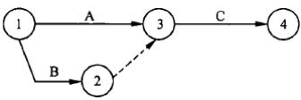

（10）A.活动 A 和 B 可以同时进行； 只有活动 A 和 B 都完成后， 活动 C 才开始 B.活动 A 先于活动 B 进行；只有活动 A 和 B 都完成后，活动 C 才开始

C.活动 A 和 B 可以同时进行； A 完成后 C 即可开始

D.活动 A 先于活动 B 进行； A 完成后 C 即可开始

#### 【试题 11】---2010 上真题 36

11、项目经理对某软件需求分析活动历时估算的结果是： 该活动用时 2  周（假定每周工作时间是 5  天）。随后对其进行后备分析，确定的增加时间是 2  天。以下针对该项目后备分析结果的叙述 中，（11）是不正确的。

（11）A.增加软件需求分析的应急时间是 2  天

B.增加软件需求分析的缓冲时间是该活动历时的 20%

C.增加软件需求分析的时间储备是 20%

D.增加软件需求分析的历时标准差是 2  天

#### 【试题 12】---2010 上真题 37

12、在工程网络计划中， 工作 M  的最早开始时间为第 16  天， 其持续时间为 5  天。该工作有三 项紧后工作，他们的最早开始时间分别为第 25  天、第 27  天和第 30  天，最迟开始时间分别为 第 28  天、第 29  天和第 30  天。则工作 M   的总时差为（12）天。

（12）A.5         B.6         C.7          D.9

#### 【试题 13】---2010 上真题 38

13、以下关于关键路径法的叙述，（13）是不正确的。

（13）A.如果关键路径中的一个活动延迟， 将会影响整个项目计划

B.关键路径包括所有项目进度控制点

C.如果有两个或两个以上的路径长度一样，就有可能存在多个关键路径 D.关键路径可随项目的进展而改变

#### 【试题 14】---2010 上真题 39

14、在软件开发项目实施过程中， 由于进度需要， 有时要采取快速跟进措施。（14）属于快速跟进 范畴。

（14）A.压缩需求分析工作周期

B.设计图纸全部完成前就开始现场施工准备工作

C.使用最好的工程师， 加班加点尽快完成需求分析说明书编制工作

D.同其他项目协调好关系以减少行政管理的磨擦

#### 【试题 15】---2010 上真题 40

15、某软件开发项目的实际进度已经大幅滞后于计划进度，（15）能够较为有效地缩短活动工期。

（15）A.请经验丰富的老程序员进行技术指导或协助完成工作

B.要求项目组成员每天加班 2~3  个小时进行赶工

C.招聘一批新的程序员到项目组中

D.购买最新版本的软件开发工具

#### 【试题 16】---2010 上真题 43

16、下列关于资源平衡的描述中，（16）是正确的。

（16）A.资源平衡通常用于已经利用关键链法分析过的进度模型之中

B.进行资源平衡的前提是不能改变原关键路线

C.使用按资源分配倒排进度法不一定能制定出最优项目进度表

D.资源平衡的结果通常是使项目的预计持续时间比项目初步进度表短

#### 【试题 17】---2010 下真题 35~36

17、某工程建设项目中各工序历时如下表所示，则本项目最快完成时间为（17）周。同时，通过 （36）可以缩短项目工期。

| 工序名称 | 紧前工序 | 持续时间（周） |
|---|---|---|
| A |  | 1 |
| B | A | 2 |
| C | A | 3 |
| D | B | 2 |
| E | B | 2 |
| F | C.D | 4 |
| G | E | 4 |
| H | B | 5 |
| I | G、H | 4 |
| J | F | 3 |

（35）A.7

①压缩 B 工序时间 ④压缩 F 工序时间 （3）A.①⑤

B.9                     C.12 ②压缩 H 工序时间  ⑤压缩 G 工序时间

B.①③       C.②⑤

D.13

③同时开展 H  工序与 A 工序

D.③④

#### 【试题 18】---2010 下真题 37

18、某项目有五个独立的子项目，小张和小李各自独立完成项目所需的时间如下表所示：

|  | 小张 | 小李 |
|---|---|---|
| 甲 | 6 | 5 |
| 乙 | 4 | 8 |
| 丙 | — | 7 |
| 丁 | 4 | 2 |
| 成 | 3 | 2 |

则如下四种安排中（18）的工期最短。

（18）A.小张做甲和乙，小李做丙、丁和成     B.小张做乙，小李做甲、丙、丁和成

C.小张做乙、丁和成， 小李做甲和丙     D.小张做甲、乙和丁，小李做丙和成

#### 【试题 19】---2010 下真题 38

19、某项目经理在对项目历时进行估算时，认为正常情况下完成项目需要 42  天， 同时也分析了影 响项目工期的因素， 认为最快可以在 35  天内完成工作， 而在最不利的条件下则需要 55  天完成任 务。采用三点估算得到的工期是（19）天。

（19）A.42                       B.43                 C.44                    D.55

#### 【试题 20】---2010 下真题 40

20、某公司接到一栋大楼的布线任务， 经过分析决定将大楼的四层布线任务分别交给甲、乙、丙、 丁四个项目经理，每人负责一层布线任务，每层面积为 10000 平米。布线任务由同一个施工队施 工，该工程队有 5  个施工组。甲经过测算， 预计每个施工组每天可以铺设完成 200 平米，于是估 计任务完成时间为 10  天，甲带领施工队最终经过 14 天完成任务；乙在施工前咨询了工程队中有 经验的成员，经过分析之后估算时间为 12 天，乙带领施工队最终经过 13 天完成； 丙参考了甲、  乙施工时的情况， 估算施工时间为 15  天， 丙最终用了 21  天完成任务； 丁将前三个施工队的工期 代入三点估算公式计算得到估计值为 15  天， 最终丁带领施工队用了 15  天完成任务。以下说法正 确的是（20）。

（20）A.甲采用的是参数估算法， 参数估计不准确导致实际工期与预期有较大偏差 B.乙采用的是专家判断法，实际工期偏差只有 1  天与专家的经验有很大关系 C.丙采用的是类比估算法，由于此类工程不适合采用该方法， 因此偏差最大 D.丁采用的是三点估算法， 工期零偏差是因为该方法是估算工期的最佳方法

#### 【试题 21】---2010 下真题 48

21、围绕三点估算技术在风险评估中的应用，以下论述（21）是正确的。

（21）A.三点估算用于活动历时估算，不能用于风险评估

B.三点估算用于活动历时估算， 不好判定能否用于风险评估

C.三点估算能评估时间与概率的关系，可以用于风险评估，不能用于活动历时估算 D.三点估算能评估时间与概率的关系，可以用于风险评估，属于定量分析

#### 【试题 22】---2011 上真题 34

zz、依据下面的项目活动网络图中，该项目历时为（22）天。

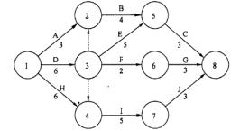

（22）A.10     B.11        C.13        D.14

#### 【试题 23】---2011 上真题 35

23、下列 （23） 做法不属于进度压缩。

（23）A.某项目经理发现项目工期延后,于是开始让项目组成员开始加班加点,提高加班工资, 以期待能在规定时间内完成项目

B.某项目经理发现项目组成员由于对技术的掌握不熟练,造成进展缓慢,延误工期,于是 指派了有经验的人员帮助完成

C.为了节省时间,在需求设计还没有完成时, 项目经理就通知组内编程人员开始编写代码 D.项目经理启用应急时间来增加一些项目时间

#### 【试题 24】---2011 上真题 36

24、出现“关键路径上的活动总时差是零和负数”情况下,下列分析正确的是 （24） 。

（24）A.关键路径上的活动总时差可能为零的原因是每个相邻活动都是紧前或紧后的,需要调整 以给活动留出时间余地

B.关键路径上的活动总时差可能为负的原因是由于安排调配不得当所造成的活动非合理性 交错现象,有必要调整活动持续时间、逻辑关系等使得活动总时差为零

C.关键路径上的活动总时差可能为负的原因是因为用最早时间减去最晚时间,不需要调整 以给活动留出余地

D.关键路径上的活动总时差可能为零的原因是由于安排活动进度没有余地,需要调整以给 活动留出余地

#### 【试题 25】---2011 上真题 37

25、下列做法无助于缩短活动工期的是 （25） 。

（25）A.投入更多的资源以加快活动进程      B.减小活动范围或降低活动要求

C.通过改进方法或者技术提高生产率    D.采用甘特图法

#### 【试题 26】---2011 下真题 35

26、某项目发生了进度延误,于是项目经理在项目关键路径上增加了资源,但是工期仍然未能有 效缩短,其可能的原因是（26）。

（26）A.关键活动的历时总是固定不变的

B.关键活动所配置的资源数量总是充足的

C.关键路径上的活动是不依赖于资源的

D.资源的增加可能会导致额外问题的产生从而降低效率

#### 【试题 27】---2011 下真题 36

27、以下关于项目进度网络图的描述中,正确的是（27）。

（27）A.它应该包含项目的全部细节活动

B.它是活动排序的输入和制定进度计划的输出

C.前导图法和箭线图法都是绘制项目进度网络图的具体方法

D.它仅以图形方式展示项目各计划活动及逻辑依赖关系,简单直观

#### 【试题 28】---2011 下真题 37

28、某项目经理正在进行活动资源估算，他可以采用的方法和技术中不包括（28）。

（28）A.已有案例的估算数据 B.项目管理软件   C.多方案分析   D.后备分析

#### 【试题 29】---2011 下真题 38

29、活动资源估算的输出不包括（29）。

（29）A.资源分解结构     B.请求的变更    C.项目进度网络图   D.资源日历

#### 【试题 30】---2011 下真题 38

30、进度控制的一个重要作用是（30）。

（30）A.判断为产生项目可交付成果所需的活动时间

B.判断是否需要对发生的进度偏差采取纠正措施

C.评价范围定义是否足以支持进度计划

D.保持团队的高昂士气，使团队成员能充分发挥潜力

#### 【试题 31】---2011 下真题 40

#### 【试题 32】---2012 上真题 35

32、某信息系统集成项目经理王某收到客户的最新变更要求，他带领其团队成员经过认真分析， 发现这次变更将导致项目范围增加近 70%，初步估计成本将增加 5 倍。王某必须要在已被批准的 项目计划中改变原定的开始和结束日期，那么他的第一步工作应该是（32）。

（32）A.修改合同                   B.增加人员和资源

C.重新制订基准计划           D.采用一个新的目标进度计划

#### 【试题 33】---2012 上真题 36

33、过去几年小李完成了大量网卡驱动模块的开发， 最快 6 天完成，最慢 36 天完成，平均 21 天 完成。如今小李开发一个新网卡驱动模块，在 21 天到 26 天内完成的概率是（33）。

（33）A.68 .3%        B.34.1%        C.58.2%     D.28 .1%

#### 【试题 34】---2012 上真题 37

34、图 2 右侧是单代号网络图（单位为工作日），左侧是图列。在确保安装集成活动尽早开始的前 提下，软件开发活动可以推迟（34）个工作日。

| 最早开始时间 | 持续时间 | 最早完成时间 |
|---|---|---|
| 活动名称 | 活动名称 | 活动名称 |
| 最迟开始时间 |  | 最迟完成时间 |

（34）A.0        B.1          C.2          D.4

#### 【试题 35】---2012 上真题 38

35、快速跟进是进度控制的手段之一。以下对快速跟进的理解，（35）是正确的。

（35）A.调整部分工作的顺序关系， 使用网络图和关键路径分析等进度计划工具， 尽可能将一些 工作并行进行

B.充分利用周六、周日或晚上等非工作时间段实施项目

C.充分发挥每一个成员的作用， 用积极的绩效考核方法， 提升每个成员的技能水平和绩效 D.加强项目干系人之间的交流和沟通，以加快项目的进度

#### 【试题 36】---2012 上真题 39

36、项目进度表至少包括每项计划活动的计划开始日期与计划完成日期，常见的做法是用一种或 多种格式的图形表示。在下面的图表中，常用于表示项目进度表的是（36）  。

（36）A.横道图    B.排列图    c .鱼骨图   D.趋势图

#### 【试题 37】---2012 上真题 40

37、进度网络分析技术中的一种方法是（37），它可以根据有限的资源对项目进度表进行调整。在 确定了关键路线之后，将资源的有无与多寡考虑进去，确定资源制约进度表，并增加了持续时间 缓冲段，这些持续时间缓冲段属于非工作计划活动。

（37）A.关键路径法  B.假设情景分析法  C.关键链法  D.资源平衡法

#### 【试题 38】---2012 下真题 39

38、某公司承接了城市道路信息系统建设项目。由于施工日期正好是 7 月份的雨季。项目团队为 了管理好项目的进度，最好采用（38）进行进度管理。

（38）A.进度比较横道图   B.资源平衡方法  C.假设情景分析方法   D.关键链法

#### 【试题 39】---2012 下真题 40

39、对成本和进度进行权衡，确定如何尽量少增加费用的前提下最大限度地缩短项目所需要的时 间，称为（39）。

（39）A.快速跟进    B.赶进度    C.资源平衡     D.资源日历

#### 【试题 40】---2012 下真题 65

40、下图中，如果核对完成活动 1 、2 和 3 概率都是 60%，活动 4 在第 6 天开始的概率是（40）。

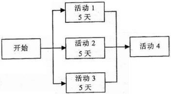

（40）A.30%            B.40%       C.22%       D.60%

#### 【试题 41】---2013 上真题 30

41、某施工单位在一个多雨季节开展户外施工，在做进度计划时项目经理将天气因素纳入项目活 动依赖关系之中，制订了项目活动计划，本项目中， 项目经理采用   41    技术，确定项目各活

动中的依赖关系。

（41）A.强制性依赖关系

B.可斟酌处理的依赖关系   C.外部依赖关系    D.网络图

#### 【试题 42】---2013 上真题 31~32

42、某活动的工期采用三点估算法进行估算，其中最悲观估算是 23 天，最乐观估算是 15 天， 最 可能的估算是 19 天， 则该活动的历时大致需要  31    天，该活动历是方差大概是 32  。

（31  ）A.19            B.23        C.15        D.20

（32） A.0.7          B.1.3        C.8          D.4

#### 【试题 43】---2013 上真题 36

43、关键路经法是利用进度计划网络图所进行的一种分析技术，下面关于关键路经的说法中 是正确的 43  。

（43）A.网络图中只有一条关键路经

B.关键路经上各活动的时间之和最少

C.非关键路经上某活动发生延误后项目总工期必然会发生延误

D.非关键路经上的活动延误时间如果不超过总时差， 项目总工期就不会发生延误

#### 【试题 44】---2013 上真题 40

44、在根据计划对项目进展情况进行跟踪时，项目经理发现最终可交付成果按照管理层规定的交 付日期完工。这时项目经理应  44  。

（44）A.驱动项目团队更加快速的工作，以便弥补丢失的时间

B.不要同意管理层要求的不合理的工期

C.通过消减最终可交付成果的规模或延长项目工期的某种结合重新洽谈 D.重新计算项目进度，并按照沟通计措进行分发。

#### 【试题 45】---2013 下真题 39

45、在进行项目活动历时估算时，（45）属于参数估算。

（45）A.从以前类似计划活动的实际持续时间为依据来估算

B.用需要完成工作的数量乘以完成单位工作所需时间为估算活动时间的依据 C.利用有可能的历时估算，最乐观的历时估算和最悲观的历时估算来计算

D.利用以历时信息为依据的专家判断估算

#### 【试题 46】---2013 下真题 40

46、某项活动的最早开始日期为本月 11  日，最晚开始日期是本月 19  日，该活动的持续时间为 4 天，如果不涉及非工作日，从上述信息可以判断，（46）是正确的。

（46）A.活动的总体时差为 9 天

B.活动的最早完成时间为本月 14 日

C.活动的最晚完成时间为本月 23 日

D.如果资源分配翻倍，则活动可以在 2 天完成

#### 【试题 47】---2013 下真题 41

47、在进度控制中使用假设情景分析的目的是（47）。

（47）A.评审各种情景，使进度与计划保持一致     B.记录请求的变更

C.针对何时应更新进度基准，提供额外详情   D.更新活动属性

#### 【试题 48】---2014 上真题 39

48、项目经理对某软件开发流程中的“概要设计”活动进行历时估算时，参考了以往相关项目活 动情况，他采用的是（48）方法

（48）A.专家判断   B.类比估算   C.参数估算   D.三点估算

#### 【试题 49】---2014 上真题 40

49、进度报告是实施项目进度控制的一个主要工具,在进度报告中可不包括（49）

（49）A.实际开始与完成日期             B.项目例会的时间

C.未完成计划活动的剩余持续时间     D.正在进行的计划活动的完成百分比

#### 【试题 50】---2014 上真题 41

50、已知网络计划中工作 M 有两项紧后工作，这两项紧后工作的最早开始时间分别为第 12 天和 第 15 天，工作 M 的最早开始时间和最迟开始时间分别为第 6 天和第 8 天，如果工作 M 的持续时 间为 4 天， 则工作 M 总时差为（50）天

（50）A.1     B.2     C.3          D.4

#### 【试题 51】---2014 下真题 38

51、在制订项目进度计划过程中，（51）可以根据有限的资源对项目进度进行调整，是一种结合了 确定性与随机性的一种方法。

（51）A.关键链方法   B.专家评估方法   C.假设情景方法   D.资源平衡方法

#### 【试题 52】---2014 下真题 39

52、某公司与客户签订了一个系统集成项目合同， 对于项目的范围和完成时间做出了明确的规定。 在制定进度计划时， 项目经理发现按照估算的活动时间和资源编制的进度计划无法满足合同工期， 为了达到合同要求， 项目经理不宜采用的方法是（52）。

（52）A.赶工    B.并行施工   C.增加资源投入   D.缩小项目范围

#### 【试题 53】---2015 上真题 38

53、项目经理小李对某活动工期进行估算时，发现人员的熟练程度和设备供应是否及时对工期至 关重要。如果形成最有利组合时，预计 17 天可以完成：如果形成最不利组合时， 预计 33 天可以 完成：按照公司的正常情况， 一般 22 天可以完成， 该项目的工期可以估算为（） 天。

A.22        B.23        C.24              D.25

#### 【试题 54】---2015 上真题 39

54、在制定进度计划时，已经完成了：

①绘制进度网络图： ②活动资源估算： ③活动历时估算。

此时为了确定各项活动的时差可进行（）。

A.资源平衡分析   B.进度压缩分析   C.关键路线分析     D.假设情景分析

#### 【试题 55】---2015 下真题 36

55、某研发项目由于很多技术细节不是特别清晰，所以在制定研发项目的进度计划时应该采用( ) 来制定进度计划

（55）A.关键链法    B.关键路径法    C.资源平衡法    D.资源日历

#### 【试题 56】---2015 下真题 55

56、活动排序是指识别与记载计划活动之间的逻辑关系， 项目经理对所管理的项目进行活动排序。 ( )是在活动排序过程中所需要的信息和资料。

（56）A.项目进度网络图  B.请求的变更  C.项目范围说明书  D.更新的活动清单

#### 【试题 57】---2015 下真题 56

57、公司刚承接了一个系统集成及运行维护的项目， 在做集成验收活动的资源估算时，需要综合 考虑完成活动的工程师的经验及技能，各种大小或类型的机器，各种测试工具（手工操作或自动 化工具），以及所需资源的自制或购买决策等， 此种资源估算法为( )

（57）A.自上而下估算  B.多方案分析  C.专家判断   D.项目管理软件

#### 【试题 58】---2016 上真题 55

58、项目经理小李对某活动工期进行估算时，发现人员的熟练程度和设备供应是否及时对工期至 关重要。如果形成最有利组合时，预计 9 天可以完成；如果形成最不利组合时，预计 23 天可以完 成；按照公司的正常情况， 一般 13 天可以完成。该项目的工期可估算为（58）天。

A.12        B.13        C.14        D.15

#### 【试题 59】---2016 上真题 56

59、（59）不属于编制进度计划所采用的工具和技术。
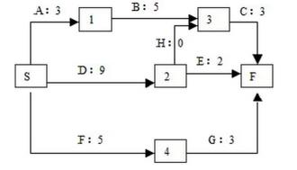

A.进度网络分析     B.确定依赖关系    C.进度压缩    D.资源平衡

#### 【试题 60】---2016 下真题 42

60、在项目进度管理中，对项目进度压缩是一种常用的方法，其中将正常情况下按照顺序进行的 活动或阶段改为至少是部分并行开展的技术称为（）。

A.赶工    B.快速跟进   C.资源优化    D.提前量和滞后量

#### 【试题 61】---2016 下真题 43

61、进行活动历时压缩时， 项目经理可以对关键路径上的活动增加资源， 这时必须进一步考虑（）。 A.其他活动均延迟                       B.是否出现新的关键路径

C.分配给关键路径上其他任务的资源       D.进度计划中历时最长的任务

#### 【试题 62】---2017 上真题 42

62、通过增加资源来压缩进度工期的技术称为（）。

A.快速跟进    B.持续时间缓冲    C.赶工    D.提前量管理

#### 【试题 63】---2017 上真题 45

63、下面的箭线图中（活动的时间单位： 周），活动 G 最多可以推延（）周而不会影响项目的完工 日期。

A.1      B.2        C.3        D.4

#### 【试题 64】---2017 下真题 46

64、（）不是规划项目进度管理的输入。

A.项目范围说明书    B.WBS 和 WBS 字典    C.活动清单    D.项目章程

#### 【试题 65】---2017 下真题 47

65、下图中（单位： 天）关于活动 H 和活动 I 之间的关系描述正确的是（）。

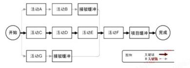
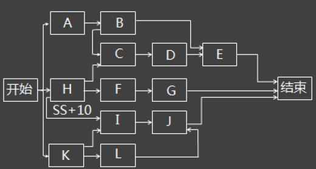

A.活动 H 开始时，开始活动 I

B.活动 H 完成 10 天后，开始活动 I

C.活动 H 结束时， 开始活动 I

D.活动 H 开始 10 天后，开始活动 I

#### 【试题 66】---2017 下真题 48

66、项目经理小李在制定进度计划时采用下图所示的工具，该工具是（）。

A.关键链法    B.关键路径法    C.进度网络分析    D.建模技术

#### 【试题 67】---2017 下真题 49

67、在制定进度计划时，可以采用多种工具与技术， 如关键路径法、资源平衡技术、资源平滑技 术等，在以下叙述中，不正确的是（）。

A.项目的关键路径可能有一条或多条

B.随着项目的开展， 关键路径法可能也随着不断变化

C.资源平衡技术往往会导致关键路径延长

D.资源平滑技术往往会改变项目关键路径，导致项目进度延迟

#### 【试题 68】---2018 上真题 46

68、（）属于规划项目进程过程的输出。

A.项目管理计划    B.项目章程    C.事业环境因素    D.控制临界值

#### 【试题 69】---2018 上真题 47

69、某项目的双代号网络图如下所示， 该项目的工期为（）。

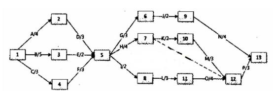

A.17        B.18        C.19        D.20

#### 【试题 70】---2018 上真题 48

70、关于制定进度计划的工具和技术的描述，不正确的是：（）。

A.总浮动的时间等于本活动的最迟完成时间减去本活动的最早完成时间

B. 自由浮动时间等于紧后活动的最早开始时间的最小值减去本活动的最早完成时间 C.资源平滑技术通过缩短项目的关键路径来缩短完工时间

D.关键路径上活动的总浮动时间与自由浮动时间都为

#### 【试题 71】---2018 上真题 49

71、（）属于控制进度的工作内容。

A.确定完成项目工作所需花费的时间量

B.确定完成项目工作所需的资源

C.确定工作之间的逻辑关系

D.确定是否对工作进度偏差采取纠正措施

#### 【试题 72】---2018 下真题 46

72、规划项目进度管理是为实施项目进度管理制定政策、程序。并形成文档化的项目进度管理计 划的过程，（）不属于规划项目进度管理的输入。

A.项目章程   B.范围基准    C.里程碑清单    D.组织文化

#### 【试题 73、】---2018 下真题 47

73、下图某工程单代号网络图中，活动 B 的总浮动时间为（）天。

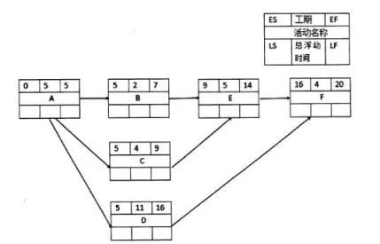

A.1    B.2    C.3   D.4

#### 【试题 74】---2018 下真题 48

74、某工程由 8 个活动组成,其各活动情况如下表所示,该工程关键路径为()

| 活动 | 紧前活动 | 所需天数 | 活动 | 紧前活动 | 所需天数 |
|---|---|---|---|---|---|
| A | - | 3 | F | C | 6 |
| B | A | 2 | G | E | 2 |
| C | B | 5 | H | FG | 5 |
| D | B | 7 | I | HD | 2 |
| E | C | 4 |  |  |  |

A.ABCEGI    B.ABCFHI    C.ABDHI    D.ABDI

#### 【试题 75】---2018 下真题 49

75、关于项目控制进度过程,不正确的是：（）。

A.有效项目进度控制的关键是严格按照制定的项目进度计划执行,避免项目偏离计划

B.当项目的实际进度滞后于进度计划时,可以通过赶工,投入更多的资源或增加工作时间来缩 短工期

C.项目控制进度的工具与技术有关键路径法、趋势分法等

D.项目控制进度旨在发现计划偏离并及时采纠正措施,以降低风险

#### 【试题 76】---2019 上真题 48

76、前导图法可以描述四种关键活动类型的依赖关系，对于接班同事 A 到岗， 交班同事 B 才可以 下班的交接班过程， 可以用（）描述。

A.S-F        B.F-F        C.S-S        D.F-S

#### 【试题 77】---2019 上真题 48

77、下图为某规划的进度网络图（单位:周），在实际实施过程中活动 B-E 比计划延迟了 2 周，活 动 J-K 比计划提前了 3 周，则该关键路径是（），总工期是（）。

47）A.A-D-G-I-J-K       B.A-B-F-K        C.A-B-E-H-K        D.A-D-F-K

48）A.15        B.14        C.13        D.12

#### 【试题 78】---2019 上真题 48

78、某大型项目原计划于 6 个月后交付目前由于设备故障、人员流失和客户审缓慢导致项目实际 进展比计划延迟了 1 个月作为项目经理首先应该做的是（）。

A.对关键路径活动进行分析，评估是否可以进行赶工

B.重新设立进度基线并对新的进度基线进行评审

C.记录进展缓慢的相关问题， 并报告管理层

D.与客户沟通项目延期的可能性

#### 【试题 79】---2019 下真题 43

79、关于项目进度管理计划的描述，正确的是（）。

A.项目进度管理计划一旦确定， 不能被修改

B.在制定项目进度管理计划时，应该考虑项目章程

C.项目进度管理计划一定要形成正式的文件

D.项目进度管理计划是详细的， 不能是高度概括的

#### 【试题 80】---2019 下真题 44

80、关于箭线图的描述不正确的是（）。

A.流入同一节点的活动均有共同的紧前活动

B.任两项活动的紧前事件和紧后事件代号至少有一个不同

C.每一个活动和每一个事件都必须有唯一代号

D.虚活动不消耗时间， 也不消耗资源，主要用于表达活动之间的关系

#### 【试题 81】---2019 下真题 45

81、某项目的网络图如下，活动 D 是自由浮动时间为（）天。

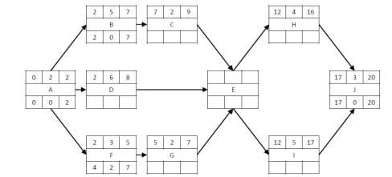

A.0        B.1        C.2      D.3

#### 【试题 82】---2019 下真题 46

82、（）不是常用的缩短项目工期的方法。

A.使用高素质的资源或使用经验丰富的人员

B.改进方法和技术， 提高工作效率

C.采用资源平滑技术，使项目资源需求不超过预定的资源限制

D.采用快速跟进技术， 将顺序进行的活动改为部分并行

六、项目成本管理

#### 【试题 1】---2009 上真题 36

1、如果项目受资源限制， 往往需要项目经理进行资源平衡。但当（1）时，不宜进行资源平衡。

（1）A.项目在时间上有一定的灵活性          B.项目团队成员一专多能

C.项目在成本上有一定的灵活性          D.项目团队处理应急风险

#### 【试题 2】---2009 上真题 51

2、在项目实施中间的某次周例会上， 项目经理小王用下表向大家通报了目前的进度。根据这个表 格，目前项目的进度（2）。

| 活  动 | 计划值 | 完成百分比 | 实际成本 |
|---|---|---|---|
| 基础设计 | 20000 元 | 90% | 10000 元 |
| 详细设计 | 50 000 元 | 90% | 60000 元 |
| 测试 | 30 000 元 | 100% | 40 000 元 |

（2）A.提前于计划 7%                                B.落后于计划 18%

C.落后于计划 7%                               D.落后于计划 7 .5%

#### 【试题 3】---2009 下真题 44

3、某项目经理正在负责某政府的一个大项目，采用自下而上的估算方法进行成本估算，一般而言， 项目经理首先应该（3）。

（3）A.确定一种计算机化的工具， 帮助其实现这个过程

B.利用以前的项目成本估算来帮助其实现

C.识别并估算每一个工作包或细节最详细的活动成本

D.向这个方向的专家咨询， 并将他们的建议作为估算基础

#### 【试题 4】 ---2009 下真题 45

4、企业的保安费用对于项目而言属于--（4） 。

（4）A.可变成本    B.固定成本    C.间接成本    D.直接成本

#### 【试题 5】---2009 下真题 46

5、在某项目进行的第三个月， 累计计划费用是 25 万元人民币，而实际支出为 28 万元，以下关于 这个项目进展的叙述，正确的是（5）。

（5）A.提供的信息不全， 无法评估    B.由于成本超支，项目面临困难

C.项目将在原预算内完成        D.项目计划提前

#### 【试题 6】---2010 上真题 44

6 、 某企业今年用于信息系统安全工程师的培训费用为 5  万元，其中有 8000  元计入 A  项目成 本，该成本属于 A  项目的（6）。

（6）A.可变成本           B.沉没成本      C.实际成本（AC）     D.间接成本

#### 【试题 7】---2010 上真题 45

7、项目进行到某阶段时，项目经理进行了绩效分析，计算出 CPI  值为 0 .91。这表示（7）。 （7）A.项目的每 91  元人民币投资中可创造相当于 100  元的价值

B.当项目完成时将会花费投资额的 91%

C.项目仅进展到计划进度的 91%

D.项目的每 100  元人民币投资中只创造相当于 91  元的价值

#### 【试题 8】---2010 上真题 46

8、下图是一项布线工程计划和实际完成的示意图，2009  年 3  月 23   日的 PV、EV、AC  分别是（8）。

（8）A.PV=4000  元、 EV=2000  元、 AC=3800  元

B.PV=4000  元、 EV=3800  元、 AC=2000  元

C.PV=3800  元、 EV=4000  元、 AC=2000  元

D.PV=3800  元、 EV=3800  元、 AC=2000  元

#### 【试题 9】 ---2010 下真题 39

9、甲公司生产急需 5000 个零件， 承包给乙工厂进行加工， 每个零件的加工费预算为 20  元，计划 2  周（每周工作 5  天）完成。甲公司负责人在开工后第 9 天早上到乙工厂检查进度，发现已完成 加工 3600  个零件， 支付款项 81000  元。经计算，（9）。

（9）A.该项目的费用偏差为-18000 元    B.该项目的进度偏差为-18000  元

C.该项目的 CPI  为 0.80                       D.该项目的 SPI  为 0.90

#### 【试题 10】---2010 下真题 44

10、（10）不是系统集成项目的直接成本。

（10）A.进口设备报关费     B.第三方测试费用  C.差旅费  D.员工福利

#### 【试题 11】---2010 下真题 45

11、项目经理创建了某软件开发项目的 WBS 工作包，其中一个工作包举例如下： 130（注： 工作 包编号，下同）需求阶段；131  需求调研； 132  需求分析； 133   需求定义。通过成本估算，131  预 计花费 3  万元； 132  预计花费 2 万元； 133  预计花费 2 .5  万元。根据各工作包的成本估算，采 用（11）方法， 能最终形成整个项目的预算。

（11）A.资金限制平衡      B.准备金分析   C.成本参数估算      D.成本汇总

#### 【试题 12】---2010 下真题 46

12、根据以下布线计划及完成进度表， 在 2010 年 6  月 2   日完工后对工程进度和费用进行预测，

按此进度， 完成尚需估算（ETC）为（12）。

|  | 计划开始 时间 | 计划结束 时间 | 计划费用 | 实际开始 时间 | 实际结束 时间 | 实际完成 费用 |
|---|---|---|---|---|---|---|
| 1  号区域 | 2010 年 6  月 1   日 | 2010 年 6  月 1  日 | 10000  元 | 2010 年 6 月 1   日 | 2010 年 6 月 2   日 | 18000  元 |
| 2  号区域 | 2010 年 6  月 2   日 | 2010 年 6  月 2   日 | 10000  元 |  |  |  |
| 3  号区域 | 2010 年 6  月 3   日 | 2010 年 6  月 3   日 | 10000  元 |  |  |  |

（12）A.18000  元      B.36000 元        C.20000 元        D.54000 元

#### 【试题 13】---2011 上真题 33

13、项目经理王某对其负责的系统集成项目进行了成本估算和进度安排，根据团队成员的情况分 配了任务，并制定出计划执行预算成本的基准。由于公司高层领导非常重视该项目，特地调配了 几名更有经验（薪水更高）的技术骨干参与项目，这种变化对项目绩效造成的最可能影响是（13）。

（13）A.正的成本偏差 CV  ，正的进度偏差 SV    B.负的成本偏差 CV  ，正的进度偏差 SV C.正的成本偏差 CV  ，负的进度偏差 SV    D.负的成本偏差 CV  ，负的进度偏差 SV

#### 【试题 14】---2011 上真题 42

14 某公司按照项目核算成本， 在针对某化工厂信息化咨询项目中，需进行 10 天的驻场研究，产 生成本如下：①公司管理费用的项目分摊成本； ②咨询顾问每人每天出差补贴 500 元，入工资结 算；③顾问如需进入生产车间，每人额外增加健康补助 100 元/天。按照成本类型分类，上述三类

成本应分别列入（14）。 （14）A.①间接成本  	B.①间接成本  		C.①直接成本  D.①直接成本

②间接成本

②直接成本

②直接成本

②间接成本

③可变成本

③可变成本

③固定成本

③固定成本

#### 【试题 15】---2011 上真题 43

15、挣值管理是一种综合了范围、时间、成本绩效测量的方法，通过与计划完成的工作量、实际 挣得的收益、实际的成本进行比较，可以确定成本进度是否按计划执行。下图中标号所标示的区 间依次应填写（15）。

（15）A.①进度落后 ②成本差 CV  ③进度差 SV

B.①成本差 CV  ②进度差 SV    ③进度落后时间

C.①进度差 SV  ②成本差 CV    ③进度落后时间

D.①进度落后  ②进度差 SV  ③成本差 CV

#### 【试题 16】---2011 上真题 44

16、某信息化施工项目一共要进行 30 天， 预算总成本 60 万元，其中 5 万元为管理成本， 40 万元 为物料使用费，其余为人工成本。按照管理计划，每 5 天进行一次挣值分析以评价项目绩效。在 第 5 天绩效评价时计算得到 CPI（绩效评价指数）为 0 .95，则说明在前 5 天的施工中， 实际成本 ①预算成本；如果要使下一次绩效评价时 CPI 为 1，且人工、物料使用成本不能改变，以免影响 施工质量，则在这两次绩效评价间，每天平均可花费的管理成本为②元。上述①和②依次序应该 填写（16）（假设所有成本按照天数平均分配， 工程进度不存在延时或提前情况）。

（16）A.①低于 ②614 元         B.①高于      ②614 元

#### 【试题 17】---2011 上真题 51

| 姓名 | 技能 |  |  |  |  |
|---|---|---|---|---|---|
| 张三风 | 管理，系统分析 | Y37 .50/h |  |  |  |
| 李立华 | 系统分析 | Y37 .50/h | 100 | 100 | 3850 |
| 王锋 | 硬件设计 |  | 50 | 0 | 1600 |
| 刘丽芳 |  |  | 80 | 0 | 2400 |
| …… | …… |  |  |  |  |

#### 【试题 19】---2011 下真题 45

19、以下各项中，不能作为项目成本预算工具或技术的是（19）。

（19）A.参数估算       B.资金限制平衡      C.挣值分析       D.准备金分析

#### 【试题 20】---2011 下真题 46

20、某信息系统集成项目采用挣值分析技术进行成本控制，假设当前状态数据如下表所示，则该 项目的 CPI、EAC.当前项目的状态分别是（20）。

| 工作 参数 | 预算 | 完成百分比 |  |
|---|---|---|---|
| 活动 1 | 800 | 100% | 700 |
| 活动 2 | 10000 | 90% | 10000 |
| 活动 3 | 20000 | 60% | 16000 |

（20）A.0.82 ,37676 元,进度滞后且成本超支

B.0.8 ,12500 元,进度提前且成本超支

C.1.25 ,12500 元,进度滞后且成本低于预算

D.1.25 ,12500 元,进度提前且成本低于预算

#### 【试题 21】---2012 上真题 34

21、单位在项目执行过程中,由于质量管理方面的问题造成了局部范围的返工,单位变失去了承 建另外一个项目的机会,这属于 21  。

（21）A.质量成本    B.机会成本    C.时间成本     D.无形成本

#### 【试题 22】---2012 上真题 44

22、企业为某客户实施电子商务平台建设项目,需要采购 5  台交付给客户使用服务器,这部分成 本属于该项目的（22）。

（22）A.直接成本  B.间接成本  C.固定成本 D.机会成本

#### 【试题 23】---2012 上真题 45

23、某项目经理已经完成了 WBS 和每个工作包的成本估算。要根据这些数据编制项目成本估算, 该项目经理要（23）。

（23）A.使用 WBS 的最高层次进行类比估算    B.计算工作包和风险储备估算的总和

C.把工作包估算累计成为项目估算总和   D.获得专家对项目成本总计晌意见

#### 【试题 24】---2012 上真题 46

24、某 ERP 软件开发项目共有 12 个模块,项目经理对较件进行了成本预算,预算每个模块的开 发成本为 5 万元,按照项目管理计划,每月开发一个模块,12 个月完成开发工作。在项目进行到 第 3 个月底的时候,项目经理对照计划,发现刚完成了 2 个模块的开发工作,经统计,实际花费 的成本为 15 万元。若按照目前的绩效情况,到所有模块开发完成时预计托费的总成本为（24）。

（24）A.90 万    B.  75 万    C.  70 万    D.  66,7 .万

#### 【试题 25】---2012 下真题 44

25、（25）技术是确定为了完成项目工作所需的资源和技能水平的最佳方法。

（25）A. 预测     B. 挣值      C. 专家判断    D. 帕累托图

#### 【试题 26】---2012 下真题 45

26、每次项目投标,都需要向招标方交纳一定比例的押金,由此产生的费用属于（26）。

（26）A. 固定成本    B. 直接成本    C. 机会成本     D. 间接成本

#### 【试题 27】---2012 下真题 46

27、项目预算中包含应急储备的目的是（27）。

（27）A. 降低范围变更的概率       B. 杜绝范围变更

C. 降低成本超支的概率       D. 杜绝成本超支

#### 【试题 28】---2012 下真题 47

28、某软件公司项目的利润分析如下表所示。设贴现率为 10%，则第二年结束时的利润总额净现 值为 （28） 元。

| 利润分析 | 第零年 | 第一年 | 第二年 | 第三年 |
|---|---|---|---|---|
| 利 润 值 |  | 110 000 | 121 000 | 123 000 |

（28）A.1 00000       B.200000            C.220000                    D.210000

#### 【试题 29】---2012 下真题 56

29、夏工是一个负责大型信息项目造价工程师。为准备预算，基于类似项目创建了一个模板。可 以用于 5~20 层建筑物成本预算。它把成本分解成每平方米墙壁、地板、窗户，类似工程的成本， 这属于（29） 。

（29）A.似量化与类比的估算     B.参数模型估算

C. 自上往下的估算        D.类比估算

#### 【试题 30】---2012 下真题 57

30、如果挣值 EV  是 300  万元， 实际成本 AC  是 350  万元， 计划值 PV  是 375  万元。进度执 行 指数显示（30）。

（30）A.仅以原始计划速率的 86%进行项目   B.正在以原始计划速率的 93%进行项目

C.正在以原始计划速率的 107%进行项目 D.仅以原始计划速率的 80%进行项目

#### 【试题 31】---2012 下真题 66

31、在各种绩效报告工具或技巧中，通过（31）方法可综合范围、成本（或资源）和进度信息作 为关键因素。

（31）A.绩效评审     B.趋势分析    C.偏差分析    D.挣值分析

#### 【试题 32】---2013 上真题 34

32、单位在项目执行过程中，由于质量管理方面的问题造成了局部范围的返工，单位变失去了承 建另外一个项目的机会，这属于  32  。

（32）A.质量成本    B.机会成本    C.时间成本     D.无形成本

#### 【试题 33】---2013 上真题 35

33 、33  求第 1  年的利润净现值？假设贴现率是 10%

| 年份 |  |  |  |  |
|---|---|---|---|---|
| 利润 |  | 11000 | 12100 | 14500 |

（33）A.1000            B.10000          C.11000          D.12100

#### 【试题 34】---2013 上真题 38

34、自下而上估算方法是指估算单个工作包或细节详细活动的成本，然后简写详细的成本汇总到 更高层级估算的方法，下面关于该方法的描述中  34    是错误的。

（34）A.其精确性取决于估算对象的规模和复杂程度

B.便于报告和跟踪

C.适于对项目情况了解较少时采用

D.该估算方法的准确性通常高于其他估算方法

#### 【试题 35】---2013 上真题 39

35、在某一时刻，项目 CPI 为 1.05，这表示   35 。

（35）A.项目 100 元的成本创造了 105 元的价值

B.项目 100 元的成本创造了 100 元的价值

C.项目进度提前了 5%

D.项目进落后了 5%

#### 【试题 36】---2013 下真题 45

36、在项目的各种成本中，税金、额外福利属于（36）。

（36）A.可变成本    B.固定成本    C.直接成本    D.间接成本

#### 【试题 37】---2013 下真题 46

37、某信息化建设项目的状态数据为：实际成本（AC）=44150 元，计划值（PV）= 40800，挣值 （EV）=36610 元，则成本执行（绩效）指数是（37）。

（37）A.-7540       B.-4190         C.0.83            D.0.90

#### 【试题 38】---2014 上真题 38

38、某项目经理绘制的 WBS 局部图如下图所示,B.C 工作包的负责人对人日数进行了估算，依据 他们的估算结果，项目经理得出了分项工程 A 的人日数结果，他采用的是（38）方法.

| A |
|---|

（38）A.类比估算  B. 自上而下估算  C. 自下而上估算  D.多方案分析估算

#### 【试题 39】---2014 上真题 44

39 、WBS 工作包中一般不包括的成本是（39）

（39）A.管理成本  B.设备采购成本  C.项目人员成本   D .直接成本

#### 【试题 40】---2014 上真题 45

40、在完成项目估算后，要制定项目的成本预算，其基本流程是：①将项目总成本分推到各个工 作包：②（40）；③确定各项成本再分配的时间：④确定项目成本预算计划。

（40）A.将工作包成本再分解到相关活动上   B.进行准备金分析并分解到相关活动上

C.进行挣值分析和绩效预估           D.提出項目资金需求

#### 【试题 41】---2014 上真题 46

41、某项目计划安排为： 2014 年 4 月 30  日完成 1000 万元的投资任务。在当期进行项目绩效时评 估结果为： 完成计划投资额的 90%，而 CPI 为 50%，这时的项目实际花费为（41）万元。

（41）A.450     B.900        C.1800       D.2000

#### 【试题 41】---2014 下真题 44

41、企业管理费属于信息工程项目投资的（41）。

（41）A.工程前期费   B.直接费用   C. 间接费用    D.措施费

#### 【试题 42】---2014 下真题 45

42、项目的成本估算要经过识别并分析成本的构成科目、估算每一科目的成本大小、分析成本估 算结果三个步骤。在第一个步骤中无法形成的是（42）。

（42）A.低成本的替代方案   B.会计科目表   C.项目资源矩阵  D.项目资源数据表

#### 【试题 43】---2014 下真题 46

43、在进行成本估算时，将工作的计划数量与单位数量的历史成本相乘得到估算成本的方法称为 （43）。

（43）A.自下而上估算法   B.类比估算法   C.参数估算法   D.质量成本估算法

#### 【试题 44】---2014 下真题 47

44、项目成本控制是指（）。

（44）A.对成本费用的趋势及可能达到的水平所作的分析和推断

B.预先规定计划期内项目施工的耗费和成本要达到的水平

C.确定各个成本项目内比预计要达到的降低额和降低率

D.在项目施工过程中，对形成成本的要素进行监督、调节和控制

#### 【试题 45】---2014 下真题 48~49

45、某项目计划成本为 400 万元， 计划工期为 4 年， 项目进行到两年时， 监理发现预算成本为 200   万元， 实际成本为 100 万元， 挣值为 50 万元，则项目成本偏差为（1）万元，项目进度偏差为（2） 万元。

#### 【试题 46】---2014 下真题 68

46、在项目实施期间的某次周例会上，项目经理向大家通报了项目目前的进度。根据以下表格， 目前的进度（）。

| 活动 | 计划值（元） | 完成百分比 | 实际成本（元） |
|---|---|---|---|
| 基础设计 | 20000 | 90% | 10000 |
| 详细设计 | 50000 | 90% | 60000 |
| 测试 | 30000 | 100% | 40000 |

（46）A.提前计划 7%      B.落后计划 15%    C.落后计划 7%      D.提前计划 15%

#### 【试题 47】---2015 上真题 44

47、成本基准是对项目进行成本管控的重要措施，成本基准是指按时间分段的项目（）。

A.成本估算   B.成本预算    C.实际成本      D.隐形成本

#### 【试题 48】---2015 上真题 45

48、某项目成本明细如下：设备费 1.5 万元，差旅费 0.5 万元，设备租赁费 0.8 万元，管理分摊费 用 0.3 万元。下列说法中，（） 是不正确的。

A.设备费 1.5 万元属于直接成本         B.差旅费 0.5 万元属于直接成本

C.设备租赁费 0.8 万元属于间接成本     D.管理分摊费用 0.3 万元属于间接成本

#### 【试题 49】---2015 上真题 46

### 49、项目经理在制定项目成本预算时采取以下步骤：

①估算项目的总成本；②将项目的总成本分解到 WBS 工作包； ③将各个工作包成本再分解到相关 活动；④公司对预算草案进行审批围绕该步骤， 下列说法中，（） 是正确的

A.项目经理不应该将各个工作包成本再分解到相关活动

B.项目经理采用至上而下分解成本的方法是不对的，应该直接对工作包进行估算 C.该流程中缺乏成本预算支出的时间计划

D.预算由项目经理批准即可，不必公司批准

#### 【试题 50】---2015 上真题 47

50、某土方工程总挖方量为 4000 立方米。预算单价为 45 元/立方米。计划用 10 天完成， 每天 400 立方米。开工后第 7 天早晨刚上班时业主项目管理人员前去测量，取得了两个数据；已完成挖方 2000 立方米，支付给承包单位的工程进度款累计已支付 120000 元，那么此时项目 CPI 和 SPI 分别 为（）。

A.CPI=0.75；SP1=0.75      B.CPI=0.83；SPI=0.83

C.CPI=0.75；SPI=0.83      D.CPI=0.83；SPI=0.75

#### 【试题 51】---2015 上真题 60

51、某项目的绩效报告给出了该项目的 PV、EV、AC.CV 、SV、CPI 、SPI，据此可判断出该项目的（）。 A.成本偏差、进度偏差              B.成本绩效指数、质量绩效指数

C.进度绩效指数、质量绩效指数      D.质量偏差、进度偏差

#### 【试题 52】---2015 下真题 44

52、某公司有一个项目，发生的财包括：

1.  项目团队人员工作 50 万元

2.  项目团队差旅费 10 万元

3.  项目税金 10 万元

4.  项目分摊公司保卫费 5 万元

5.  项目物料及设备使用费 20 万元

其中直接成本包括( )

（52）A.12345         B.123         C.1235         D.1324

#### 【试题 53】---2015 下真题 45

53、项目经理正在估算某个 ERP 项目的成本， 此时尚未掌握项目的全部细节， 项目经理此时可用 ( )来估算成本

（53）A.类比估算法  B. 自上而下估算法  C.蒙特卡洛分析  D.参数模型

#### 【试题 54】---2015 下真题 46

54、（ ）不是成本估算的方法

（54）A.估算法  B.确定资源费率  C.工料清单法  D.挣值分析法

#### 【试题 55】---2015 下真题 47

55、某项目经理 2015 年 6 月 1 日为止的成本执行（绩效） 数据为：PV（计划 值）=20000 元， EV （挣值） =21000 元。 AC（实际成本） =22000 元。则 SV（进度偏差）是（ ）元

（55）A.1000         B.-1000           C.2000           D.-2000

#### 【试题 56】---2015 下真题 48

56、如果项目实施进度比计划提前 20%，实际成本只用了预算成本的 60%，首先应该( )

（56）A.重新修订季度计划    B.给项目团队加薪， 开表彰大会

C.重新进行行成本核算  D.找出最初计划产生差别的原因

#### 【试题 57】---2015 下真题 57

57、在估算项目中软件开发的工作量时，项目经理按照自己的经验，利用了以下公式：活动历时 （软件开发）=5X19XP （P 为开发人员的经验系数，19 位开发人员的平均工作时间）。该项目经 理采用的估算方法是（ ）。

（57）A.参数估算  B.类比估算  C.三点估算法  D.专家判断

#### 【试题 58】---2016 上真题 44

58、小张在得到项目的成本估算后，开始制定项目的成本预算。他首先应该做的事情是（58）。 A.确定项目成本预算计划

B.识别并分析成本的构成科目

C.确定各项成本预算指出的时间计划及项目成本预算计划

D.将项目总成本分配到项目工作分解结构的各个工作包

#### 【试题 59】---2016 上真题 45

59、以下关于项目成本预算的工具与技术的叙述中， 不正确的是（59）。

A.管理储备金包含在项目预算范围内，是项目成本基准的一部分

B.参数估算技术是运用数学模型根据项目特性预测项目成本

C.资金限制平衡需要对工作安排进行调整

D.工作包的成本估算汇总到 WBS 中的更高一级，最终形成项目预算

#### 【试题 60】---2016 上真题 46

60、项目成本控制是指（60）。

A.对成本费用的趋势及可能达到的水平所作的分析和推断

B.预先规定计划期内项目施工的耗费和成本要达到的水平

C.确定各个成本项与计划值相比的差额和变化率

D.在项目施工过程中，对形成成本的要素进行监督、调节和控制

#### 【试题 61】---2016 上真题 57

61、某项目当前的 PV=150 、AC=120 、EV=140，则项目的绩效情况是（61）。

A.进度超前，成本节约     B.进度滞后，成本超支

C.进度超前， 成本超支     D.进度滞后，成本节约

#### 【试题 62】---2016 下真题 44

62、在北方的冬季， 一般企业都会给员工发放采暖费。对于项目管理来说，企业支付的这部分成 本属于（）。

A.固定成本    B.隐形成本   C.间接成本    D.沉没成本

#### 【试题 63】---2016 下真题 45

63、某个项目的预算是 3000 万元，工期为 5 个月。现在过去了 3 个月，实际成本是 1800 万元，项目 进度和绩效都符合计划、而且这种情况也会持续下去。则再过 3 个月， 项目的 EV 是（）万元。

A.1800       B.2400       C.1200         D.3000

#### 【试题 64】---2016 下真题 46

64、挣值管理是项目监控的重要手段， EAC=AC+BAC-EV 公式所计算的是项目的（）。 A.完工尚需估算    B.进度绩效指数    C.完工估算     D.完工偏差

#### 【试题 65】---2017 上真题 48

65、在管理项目及投资决策过程中,需要考虑很多成本因差, 比如人员的工资、项目过程中需要的物 料、设备等,但是在投资决策的时候我们不需要考虑（），还应尽量排除它的干扰。

A.机会成本    B.沉没成本    C.可变成本    D. 间接成本

#### 【试题 66】---2017 上真题 49

66、进行项目估算时,需要根据项目的特点等因素,决定采用何种估算方法。（）方法的准确性会受 到所采用估算模型的成熟度和基础数据可靠性的影响。

A.专家判断    B.类比估算    C.参数估算    D. 自下而上估算

#### 【试题 67】---2017 下真题 50

67、不随生产量、工作量或时间的变化而变化的非重复成本属于（）。

A. 固定成本    B.直接成本    C.间接成本   D.沉没成本

#### 【试题 68】---2017 下真题 51

68、在进行项目成本估算时， 可以使用多种技术和工具， 其中，（） 相对于其他估算技术来说， 成 本较低，耗时较少， 但准确性也较低。

A.专家判断    B.类比估算    C.参数估算    D.三点估算

#### 【试题 69】---2017 下真题 52

69、下表给出某信息化建设项目到 2017 年 9 月 1 日为止的成本执行（绩效）数据，基于该数据， 项目经理对完工估算（EAC）进行预测，假设当前的成本偏差被看作是可代表未来偏差的典型偏 差时， EAC 应为（） 元。

A.45000.00        B.50000.00        C.53200.00        D.62500.00

#### 【试题 70】---2018 上真题 50

70、成本分类是指根据成本核算和成本管理的不同要求，将成本分成不同的类别。其中，项 目团对差旅费、工资属于（）。

A.直接成本    B.沉没成本    C. 固定成本    D.机会成本

#### 【试题 71】---2018 上真题 51

71 、A 公司的某项目即特开始，项目经理估计该项目需 12 人天完成，如果出现问题耽搁则 20 人天完成，最快 10 人天完成。根据项目成本估计中的三点结算法。该项目预计花费() 人天。

A.14        B.13        C.12        D.11

#### 【试题 72】---2018 上真题 52

72、某信息化项目到 2017 年 12 月 31  日的成本执行（精效） 数据如下表。根据表不正确的是（）。

| 活动编码 | 活动 | PV/元 | AC/元 | EV/元 |
|---|---|---|---|---|
| 1 | 召开项目会议 | 2000 | 2000 | 2000 |
| 2 | 制定项目计划 | 900 | 1000 | 900 |
| 3 | 客户需求分析 | 5000 | 5500 | 5000 |
| 4 | 系统总体设计 | 10500 | 11500 | 7350 |
| 5 | 系统编码 | 20500 | 22500 | 19000 |
| 6 | 界面设计 | 5200 | 5250 | 4160 |
| 合计 |  | 44100 | 47750 | 38410 |
| 项目总预算（BAC）： 167500 | 项目总预算（BAC）： 167500 | 项目总预算（BAC）： 167500 | 项目总预算（BAC）： 167500 | 项目总预算（BAC）： 167500 |

A.非典型偏差时，完工估算（EAC）为 176840 元

B.该项目成本偏差为-9340 元

C.该项目进度绩效指数为 0.80

D.此项目目前成本超支，进度落后

#### 【试题 73】---2018 下真题 50

73、投资者赵某可以选择股票和储蓄存款两种投资方式。他于 2017 年 1 月 1 日用 2 万元购进某股 票，一年后亏损了 500 元，如果当时他选择储蓄存款，一年后将有 360 元的收益。由此可知，赵某投 资股票的机会成本为（）元

A.500    B.360    C.860    D.140

#### 【试题 74】---2018 下真题 51

74、关于项目成本估算所采用的技术和工具，不正确的是:（）。

A.成本估算需要采用定量方法，与估算人员的技术和管理经验无关

B.三点估算法涉及到最可能成本、最乐观成本和最悲观成本

C.类比估算相对于其他估算技术，具有成本低、耗时少、准确率低的特点

D.在估算活动成本时，可能会受到质量成本因素的影响

#### 【试题 75】---2018 下真题 52

75、某工程项目，完工预算为 2000 万元。到目前为止，由于某些特殊原因，实际支出 800 万元，成本 绩致指数为 0.8,假设后续不再发生成本偏差，则完工预算（EAC）为（）万元。

A.2500    B.2160    C.2000    D.2800

#### 【试题 76】---2019 上真题 50

76、关于成本类型的描述，不正确的是（）。

A.项目团队差旅费、工资、税金、物料及设备使用费为直接成本

B.随着生产量、工作量或时间而变的成本称为变动成本

C.利用一定时间或资源生产-种商品时， 便失去了使用这些资源生产其它最佳替代品的机会， 称为机会成本

D.沉没成本是一种历史成本，对现有决策而言是不可控成本

#### 【试题 77】---2019 上真题 51

77、某公司组织专家对项目成本进行评估， 得到如下结论:最可能成本为 10 万元， 最乐观成本为 8 万元最悲观成本 12 万元。采用“三点估算法"该项目成本为（）。

A.9        B.10        C.11        D.12

#### 【试题 78】---2019 上真题 52

78、关于进度偏差、成本偏差的描述， 不正确的是（）。

A.项目延期完工时，进度偏差和成本偏差均为 0

B.成本偏差和进度偏差均为负值说明项目成本超支进度落后

C. 当进度偏差大于 0 时说明进度超前

D. 当成本偏差大于 0 时说明成本节省

#### 【试题 79】---2019 下真题 47

79、关于成本的描述，正确的是（）。

A.在投资决策时应避免受到沉没成本的干扰

B.项目团队差旅费、工资、物料费属于间接成本

C.管理储备是用于应对已识别风险

D.管理储备是包含在成本基准内的一部分预算

#### 【试题 80】---2019 下真题 48

80、关于成本估算的描述，不正确的是（）。

A.成本估算时应考虑管理成本、房屋租金、保险等非直接成本

B.在项目生命周期内，项目估算的准确性随看项目的进展而降低

C.项目团队成员学习过程所引起的成本应该被纳入项目成本中

D.应急储备和管理储备应被计入项目成本中

#### 【试题 81】---2019 下真题 49

81 、关于成本估算相关技术的描述，正确的是（）。

C.类比估算法通常成本较高、耗时较多

#### 【试题 82】---2019 下真题 50

| 活动编号 | 活动 | 预计完成百分 比% | 实际完成百分 比% | 计划值 Pv（元） | 实际成本 AC（元） |
|---|---|---|---|---|---|
| 1 | A | 100 | 100 | 2000.00 | 2000.00 |
| 2 | B | 100 | 100 | 1600.00 | 1800.00 |
| 3 | C | 100 | 100 | 2500.00 | 2800.00 |
| 4 | D | 100 | 80 | 1500.00 | 1600.00 |
| 5 | E | 100 | 75 | 2000.00 | 2800.00 |
| 6 | F | 100 | 60 | 2500.00 | 2200.00 |
| 合计 | 合计 | 合计 | 合计 | 12100.00 | 12200.00 |
| 项目总预算（BAC）：50000.00 | 项目总预算（BAC）：50000.00 | 项目总预算（BAC）：50000.00 | 项目总预算（BAC）：50000.00 | 项目总预算（BAC）：50000.00 | 项目总预算（BAC）：50000.00 |
| 报告日期： 2019 年 8 月 1  日 | 报告日期： 2019 年 8 月 1  日 | 报告日期： 2019 年 8 月 1  日 | 报告日期： 2019 年 8 月 1  日 | 报告日期： 2019 年 8 月 1  日 | 报告日期： 2019 年 8 月 1  日 |

A.59238        B.51900        C.50100        D.48100

七、项目质量管理

#### 【试题 1】---2009 下真题 67

1、为保证项目的质量，要对项目进行质量管理，项目质量管理过程的第一步是（1）。

（1）A.制定项目质量计划      B.确立质量标准体系

C.对项目实施质量监控    D.将实际与标准对照

#### 【试题 2】---2009 下真题 68

2、在制定项目质量计划时对实现既定目标的过程加以全面分析， 估计到各种可能出现的障碍及结 果，设想并制定相应的应变措施和应变计划，保持计划的灵活性。这种方法属于（2）  。

（2）A.流程图法    B.实验设计法   C.质量功能展开    D.过程决策程序图法

#### 【试题 3】---2009 下真题 69

3、质量管理六西格玛标准的优越之处不包括（3） 。

（3）A.从结果中检验控制质量    B.减少了检控质量的步骤

C.培养了员工的质量意识    D.减少了由于质量问题带来的返工成本

#### 【试题 4】 ---2009 下真题 70

4、在项目质量监控过程中，在完成每个模块编码工作之后就要做的必要测试，称为（4）。

（4）A.单元测试    B.综合测试    C.集成测试    D.系统测试

#### 【试题 5】---2010 上真题 67

5、质量管理人员在安排时间进度时，为了能够从全局出发、抓住关键路径、统筹安排、集中力量， 从而达到按时或提前完成计划的目标， 可以使用（5）。

（5）A.活动网络图      B.因果图      C.优先矩阵图      D.检查表

#### 【试题 6】---2010 上真题 68

6、排列图（帕累托图）可以用来进行质量控制是因为（6）。

（6）A.它按缺陷的数量多少画出一条曲线， 反映了缺陷的变化趋势

B.它将缺陷数量从大到小进行了排列，使人们关注数量最多的缺陷

C.它将引起缺陷的原因从大到小排列，项目团队应关注造成最多缺陷的原因

D.它反映了按时间顺序抽取的样本的数值点，能够清晰地看出过程实现的状态

#### 【试题 7】---2010 上真题 69

7 、 CMMI  所追求的过程改进目标不包括（7）。

（7）A.保证产品或服务质量            B.项目时间控制

C.所有过程都必须文档化          D.项目成本最低

#### 【试题 8】---2010 上真题 70

8、项目经理在进行项目质量规划时应设计出符合项目要求的质量管理流程和标准， 由此而产生的 质量成本属于（8）。

（8）A. 纠错成本        B. 预防成本    C. 评估成本        D. 缺陷成本

#### 【试题 9】 ---2010 下真题 67

9、甲公司承担的某系统开发项目， 在进入开发阶段后， 出现了一系列质量问题。为此， 项目经理 召集项目团队，列出问题，并分析问题产生的原因。结果发现，绝大多数的问题都是由几个原因 造成的，项目组有针对性地采取了一些措施。这种方法属于（9）法。

（9）A.因果图       B.控制图      C.排列图      D.矩阵图

#### 【试题 10】---2010 下真题 68

10、在质量管理中可使用下列各图作为管理工具，这 4  种图按顺序号从小到大依次是（10）。

（10）A.相互关系图、控制图、流程图、排列图

B.网络活动图、因果图、流程图、直方图

C.网络活动图、因果图、过程决策程序图、直方图

D.相互关系图、控制图、过程决策程序图、排列图

#### 【试题 11】---2010 下真题 69

11、甲公司最近中标某市应急指挥系统建设，为保证项目质量，项目经理在明确系统功能和性能 的过程中，以本省应急指挥系统为标杆，定期将该项目的功能和性能与之比较。这种方法属于（11）。 （11）A.实验设计法   B.相互关系图法   C.优先矩阵图法   D.基准比较法

#### 【试题 12】---2010 下真题 70

12、关于项目质量审计的叙述中，（12）是不正确的。

（12）A.质量审计是对其他质量管理活动的结构化和独立的评审方法

B.质量审计可以内部完成，也可以委托第三方完成

C.质量审计应该是预先计划的， 不应该是随机的

D.质量审计用于判断项目活动是否遵从于项目定义的过程

#### 【试题 13】---2011 上真题 63

13、某项目经理在制定项目质量计划时，从客户对项目交付物的质量要求出发，先识别客户在功 能方面的要求，然后把功能要求与产品的特性对应起来，形成功能要求与产品特性的关系矩阵， 进而确定产品的技术参数。他采用的方法是（13）。

（13）A.质量成本分析  B.效益/成本分析   C.质量功能展开  D.过程决策程序图法

#### 【试题 14】---2011 上真题 64

14、（14）不是进行项目质量保证采用的方法和技术。

（14）A.制定质量保证规划   B.质量活动分解  C.建立质量保证体系 D.统计抽样

#### 【试题 15】---2011 上真题 65

15、某公司对本单位负责的信息系统集成项目实施失败原因进行分析后， 发现约 80%的原因都是 用户需求不明确、授权不清晰、以及采用了不适宜的技术，而其他十几种原因造成的失败较少。 根据这些分析结果， 该公司所采用项目质量控制的方法是（15）。

（15）A.散点图法   B.直方图法        C.帕累托法        D.控制图法

#### 【试题 16】---2011 上真题 66

16 下图所表示的质量控制工具为（16）。

（16）A.散点图法    B.因果图     C.帕累托图        D.控制图

#### 【试题 17】---2011 下真题 67

17、在进行项目质量控制时， 统计方法强调一切用数据说话，而（17）则主要用事实说话， 靠“灵 感”发现新思想、解决新问题。

（17）A.帕累托图       B.树状图      C.相互关系图      D.亲和图

#### 【试题 18】---2011 下真题 68

18、某项目质量管理员希望采用一些有助于分析问题发生原因的工具，来帮助项目组对各出现的 质量问题进行预测并制订应对措施，以下工具中，能够满足其需要的是（18）。

（18）A.控制图     B.流程图      C.树状图      D.活动网络图

#### 【试题 19】---2011 下真题 69

19、在项目管理中经常需要在成本与进度之间做出权衡，尽管聘用高级程序员的花费要比初级程 序员高得多，却可以获得更高的生产效率。如果项目经理在编制项目质量计划时，希望确定聘用 高级程序员和初级程序员的最佳人数比例，同时还要明确质量标准以及达到标准的最佳方法，最 适合采用的方法是（19）。

（19）A.基准比较       B.效益/成本分析        C.实验设计    D.质量成本分析

#### 【试题 20】---2011 下真题 70

20、某系统集成公司制订了一系列完备的质量管理制度，其中一项是要求每个项目在各个阶段的 最后都必须进行质量审计。这种审计活动是（20）过程的一部分工作。

（20）A.质量保证       B.质量改进        C.质量控制        D.质量计划

#### 【试题 21】---2012 上真题 67

21 、一个项目经理和他的团队正在使用鱼骨图（Ishikawa  图）讨论所发现的一个重大质量问题的 原因，这属于质量管理中的（21）.

（21）A.质量计划编制   B. 质量工具  C.质量保证  D.质量控制

#### 【试题 22】---2012 上真题 68

22、控制图中的控制上限和控制下限标明（22）。

（22）A.客户将要接受的界限          B.可能出现的过程的偏差范围

C.可以接受的过程的偏差范围    D.判断项目成败的统计控制点

#### 【试题 23】---2012 下真题 69

23、（23）不是质量控制的方法、技术和工具。

（23）A.趋势图    B.检查表   C.控制图   D.制定参数基准表

#### 【试题 24】---2012 下真题 70

24、质量保证部门最近对某项目进行了质量审计，给出了一些建议和规定， 一项建议看来关键应 该采纳执行。因为它将影响到这个项目是成功地交给客户。如果建议不被执行，产品就不能满足 需要。该项目的项目经理下一步应该（24）  。

（24）A.开一个项目团队会议，以确定谁对这个问题负责

B.重新分配任务并且发现这个错误负有责任队员

C.立即进行产品的返工

D.发布一项变更申请以采取必要的纠正措施

#### 【试题 25】---2013 上真题 66

25、应用 paretol 图可以（25）。

（25）A.将精力集中到最关键的因素上     B.量化风险

C.帮助预测未来的问题             D.改进风险管理

#### 【试题 26】---2013 上真题 67

26 、（26）一般不是用于质量控制的方法和技术。

（26）A.趋势分析    B.检验    C.控制图   D.制定参数基准

#### 【试题 27】---2013 下真题 38

27、质量保证是项目管理中非常重要的活动，质量保证除了为项目提供支持外还为（27）创造了 条件。

（27）A.产品改进    B.过程改进   C.质量控制  D.成本控制

#### 【试题 28】---2013 下真题 43

28、在某操作系统中,47%的错误时由该系统 4%的程序模块产生的,该现象（28）特征。

（28）A.蒙特卡洛    B.大数定律    C.帕累托定律    D.PDP

#### 【试题 29】---2013 下真题 67

29、某公司的质量目标是每千行代码缺陷数不大于 2.5 个,项目组为确保,并能对软件开发项目组 5 个代码编写人员各自的质量进行趋势分析,适合质量工具是（29）。

（29）A.散点图     B.矩阵图     C.控制图      D.亲和图

#### 【试题 30】---2014 上真题 57

30、质量管理体系文件包括质量手册、程序文件和（30）

（30）A.质量计划   B.质量目标   C.质量方针   D.质量记录

#### 【试题 31】---2014 下真题 66

31、六西格玛管理方法的核心是将所有的工作作为一种流程,采取量化的方法分析流程中影响质 量的因素,找出最关键的因素加以改进从而提高客户满意度。具体的改进流程为（31）。

（31）A.①确定②测量③分析④改进⑤控制    B.①测量②分析③确定④改进⑤控制

C.①测量②分析③改进④确定⑤控制    D.①控制②测量③分析④改进⑤确定

#### 【试题 32】---2014 下真题 67

32、在制定项目质量计划中,（32）运用统计方法帮助项目确定影响特定变量的因素,经常用于项 目产品的分析。

（32）A.基准比较  B.质量成本分析  C.流程图  D.实验设计

#### 【试题 33】---2015 上真题 66

33、为了识别项目中使用的无效和低效政策、过程和程序,可以采用（） 方法。

A.检查   B.质量审计   C.标杆对照      D.过程分析

#### 【试题 34】---2015 上真题 67~68

34、项目的质量保证不包括（1）,采用的方法和技术不包括（2）。

（1）A.产品的质量保证    B.系统的质量保证       C.人员的质量保证

（2）A.确定质量目标      B.确定保证范围的等级   C.质量检验

D.服务的质量保证  D.制定质量保证规划

#### 【试题 35】---2015 上真题 69

35、为了实现项目质量控制,经常用到各种图形工具,下面是（）。

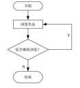

A. 因果图   B.流程图   C.直方图      D.控制图

#### 【试题 36】---2015 上真题 70

36、项目具体结果包括项目的最终产品或服务，也包括项目过程的结果。项目过程结果的质量需 要由（）进行控制。

A.质量控制职能部门    B.质检员    C.项目经理       D.项目管理组织的成员

#### 【试题 37】---2015 下真题 66~67

37、在信息项目建设开发中，（1）不能用来描述项目的进度安排，（2）可动态地反应项目的建设 情况

（1）A.甘特图  B.PERT 图    C.PERT/CPM 图    D.鱼骨图

（2）A.甘特图  B.PERT 图    C.PERT/CPM 图    D.鱼骨图

#### 【试题 38】---2015 下真题 68

### 38、项目质量保证活动的参与者应为( )

（38）A.项目经理                       B.负责执行项目的管理层

C.负责项目执行的一线工作人员     D.全体工作人员

#### 【试题 39】---2016 上真题 66

39、以下关于质量管理的叙述中，不正确的是：（66）。

A.产品等级高就是质量好

B.质量管理注重预防胜于检查

C.质量方针由最高管理者批准并发布

D.质量目标是落实质量方针的具体要求，从属于质量方针

#### 【试题 40】---2016 上真题 67

40、在制定项目质量计划过程中，可以采用（67）方法以识别哪些因素会对特定变量产生影响。 A.散点图   B.检查表   C.质量功能展开    D.实验设计

#### 【试题 41】---2016 上真题 68~69

41、在质量控制过程中，经常会使用一些工具和方法。（68）是一种基于 80/20 原理， 用于找出影 响项目产品或服务质量的主要因素的方法。（69）不属于质量控制活动。

（68）A.流程图     B.帕累托图   C.控制图                 D.鱼骨图

（69）A.产品测试   B.抽样       C.对不合格进行原因分析   D.过程分析

#### 【试题 42】---2016 下真题 47

42、规划质量管理的过程中可以用到多种工具和技术。（） 是一种统计方法，用来识别哪些因素会 对正在生成的产品或正在开发的流程的特定变量产生影响。

A.成本效益分析法   B.质量成本法    C.标杆对照    D.实验设计

#### 【试题 43】---2016 下真题 48

43、以下关于质量审计的叙述中，不正确的是（）。

A.质量审计是对具体质量管理活动的结构性评审

B.质量审计可以是事先安排，也可以随机进行

C.质量审计只能由外部审计师进行

D.质量审计可检查已批准的变更请求的实施情况

#### 【试题 44】---2016 下真题 49

44、在质量管理电中，可以使用（）判断一个过程是否处于控制状态还是处于失控状态。 A.散点图    B.运行图    C.控制图   D.因果图

#### 【试题 45】---2016 下真题 50

45、某项目组的测试团队对项目的功能及性能进行全面测试，来保证项目的可交付成果及工作满 足主要干系人的既定需求。项目组所采用的质量管理方式是（）。

A.规划质量   B.质量控制   C.实施质量保证    D.质量改进

#### 【试题 46】---2017 上真题 50

46、在质量管理中,（）可以识别造成大多数问题的少数重要原因。

A.直方图    B.控制图    C.核查表    D.帕累托图

#### 【试题 47】---2017 上真题 51

47、下图是（）。

A.亲和图    B.过程决策程序图    C.矩阵图    D.优先矩阵图

#### 【试题 48】---2017 下真题 63

48、质量管理发展过程中，从（）开始，质量管理从“对已完成产品的事后检验”提前到“对产 品生产过程中的全过程监控”。

A.手工艺人时代    B.质量检验阶段    C.统计质量控制阶段    D.全面质量管理阶段

#### 【试题 49】---2017 下真题 64

49、（）属于质量管理中规划质量过程的工具和技术。

A.成本效益分析法    B.质量审计    C.控制图    D.甘特图

#### 【试题 50】---2017 下真题 65

50、在进度管理中常用的活动网络图，如计划评审技术（PERT），关键路径法等，也可以应用于 质量管理的（）过程中。

A.规划质量管理    B.实施质量保证    C.质量控制    D.质量改进

#### 【试题 51】---2018 上真题 63

51、“某型号手机，主打商务智能， 无线充电、价格低廉， 像素高续航强”。（）属于对质量的描述。 A.商务智能    B.无线充电    C.价格低廉    D.像素高续航强

#### 【试题 52】---2018 上真题 64

52、生产过程中，需要通过统计返工和废品的比率来进行质量管理，这种方法在质量管理中属于 ()。

A.质量成本法    B.标杆对照    C.实验设计    D.抽样统计

#### 【试题 53】---2018 上真题 65

53、某项目的质量管理人员在统计产品缺陷时，绘制了如下统计图，并将结果反绩至项目经理， 但是由于工期紧张， 下列选项中()缺陷可以暂时搁置。

A.起皱     B.缺边     C.划伤     D.磕碰

#### 【试题 54】---2018 下真题 63

54、质量管理的阶段，大致经历了手工艺人时代、质量检验阶段、统计质量控制阶段和（） 四个阶 段。

A.零缺陷质量管理    B.全面质量管理    C.过程质量管理    D.精益质量管理

#### 【试题 55】---2018 下真题 64

55、针对规划质量管理的工具和技术，不正确的是:()

A.成本效益法通过比较可能的成本和预期的收益来提高质量

B.预防成本是质量成本，内部失败成本不是质量成本

C.统计抽样的频率和规模应在规划质量管理过程中确定

D.实验设计是规划质量管理过程中使用的一种统计方法

#### 【试题 56】---2018 下真题 65

56、（）属于规划质量管理的输出。

A.项目管理计划    B.需求文件    C.风险登记册    D.质量核对单

#### 【试题 57】---2019 上真题 63

57、质量管理通过质量体系中的质量规划、质量保证、质量控制和（）的实现。 A.质量分析    B.质量改进    C.质量检验    D.质量度量

#### 【试题 58】---2019 上真题 64

58、质量管理工具或技术中，（）用图形方式显示变更的推力和阻力。

A.头脑风暴    B.实验设计    C.力场分析    D.名义小组技术

#### 【试题 59】---2019 上真题 65

59、关于质量管理七种工具的描述.不正确的是（）。

A.帕累托图用于识別造成大多数问题的少数重要原因

B.控制图展示了项目进展信息用于判断某一过程是否失控

C.直方图用于指述集中趋势分散程度和统计分布，反映了时间对分化的影响 D.过程决策程序图用于理解一个目标与达成此目标的步骤之间的关系

#### 【试题 60】---2019 下真题 62

60、（）将质量控制扩展到产品生命周期全过程。

A.检验技术    B.统计质量控制    C.抽验检验方法    D.全面质量管理

#### 【试题 61】---2019 下真题 63

61、某电池生产厂商为了保证产品的质量，在每一块电池出厂前做破坏性测试所产生的成本属于 ()。

A.项目开发成本，不属于质量成本

B.质量成本中的非一致性成本

C.质量成本中的评价成本

D.质量生产中的内部失败成本

#### 【试题 62】---2019 下真题 64

62、某制造商面临大量产品退货，产品经理怀疑是采购和货物分类流程存在问题，此时应该采用 ()进行分析。

A.流程图    B.质量控制图    C.直方图    D.鱼骨图

八、项目人力资源管理

#### 【试题 1】---2009 上真题 33

1、（1）不是组建项目团队的工具和技术。

（1）A.事先分派   B.资源日历    C.采购    D.虚拟团队

#### 【试题 2】---2009 上真题 34

2、团队建设一般要经历几个阶段，这几个阶段的大致顺序是（2）。

（2）A.震荡期、形成期、正规期、表现期     B.形成期、震荡期、表现期、正规期

C.表现期、震荡期、形成期、正规期     D.形成期、震荡期、正规期、表现期

#### 【试题 3】---2009 上真题 46

3、在当今高科技环境下， 为了成功激励一个 IT 项目团队，（3）可以被项目经理用来激励项目团 队保持气氛活跃、高效率的士气。

（3）A.期望理论和 X 理论                     B.Y 理论和马斯洛理论

C.Y 理论、期望理论和赫滋伯格的卫生理论   D.赫滋伯格的卫生理论和期望理论

#### 【试题 4】 ---2009 下真题 39

4、项目人力资源计划编制完成以后，不能得到的是（4）。

（4）A.角色和职责的分配    B.项目的组织结构图

C.人员配置管理计划    D.项目团队成员的人际关系

#### 【试题 5】---2009 下真题 40

5、公司要求项目团队中的成员能够清晰地看到与自己相关的所有活动以及和某个活动相关的所有 成员。项目经理在编制该项目人力资源计划时应该选用的组织结构图类型是（5）。

（5）A.层次结构图    B.矩阵图    C.树形图 D.文本格式描述

#### 【试题 6】---2009 下真题 41

6、一些公司为了满是公司员工社会交往的需要会经常组织一些聚会和社会活动， 还为没有住房的 员工提供住处。这种激励员工的理论属于（6）。

（6）A.赫淡伯格的双因素理论    B.马斯洛需要层次理论

C.期望理论               D.X 理论和 Y 理论

#### 【试题 7】---2010 上真题 47

7、在项目人力资源计划编制中，一般会涉及到组织结构图和职位描述。其中，根据组织现有的部 门、单位或团队进行分解，把工作包和项目的活动列在负责的部门下面的图采用的是（7）。

（7）A.工作分解结构（WBS）     B.组织分解结构（OBS）

C.资源分解结构（RBS）      D.责任分配矩阵（RAM）

#### 【试题 8】---2010 上真题 48

8、在组建项目团队时，人力资源要满足项目要求。以下说法，（8）是不妥当的。

（8）A.对关键岗位要有技能标准， 人员达标后方可聘用

B.与技能标准有差距的员工进行培训，合格后可聘用

C.只要项目经理对团队成员认可就可以

D.在组建团队时要考虑能力、经验、兴趣、成本等人员因素

#### 【试题 9】 ---2010 上真题 49

9、项目经理管理项目团队有时需要解决冲突，（9）属于解决冲突的范畴。

（9）A.强制、妥协、撤退               B.强制、求同存异、观察

C.妥协、求同存异、增加权威       D.妥协、撤退、预防

#### 【试题 10】---2011 上真题 45

10、下列工具或方法均可用来描述项目组织，以下说法中，不正确的是（10）。

（10）A.组织分解结构（OBS）与工作分解结构（WBS）形式上相似，是根据项目的交付物进 行分解，把项目的活动和工作包列在负责的部门下面

B.资源分解结构（RBS）用于分解项目中各类型的资源，除了包含人力资源之外还可以包 括各种资源类型，例如材料和设备

C.工作分解结构（WBS）可以用来确定项目的范围，也可以同来描述不同层次的职责

D.团队成员职责需要详细描述时，可以采用文档文字形式，详细提供职责、权力、能力和 资格等信息

#### 【试题 11】---2011 上真题 46

11、在进行项目团队的激励时， 一般不会采用的方法是（11）。

（11）A.马斯洛的需要层次理论       B.赫滋伯格的双因素理论

C.人际网络管理               D.期望理论

#### 【试题 12】---2011 上真题 47

12、下列关于冲突及其解决方式的描述中，不正确的是（12）。

（12）A.冲突是自然的团队问题， 不是某人的个人问题

B.冲突的产生原因有项目的高压环境、责任划分不清楚、存在多个上级或者新科技的使用 等

C.冲突的解决方法有合作、强制、妥协等，但不能将冲突搁置起来，从中撤退 D.冲突应早被发现，利用私下但直接的、合作的方式来处理冲突

#### 【试题 13】---2011 下真题 47

13、在制定人力资源计划时， 不适合采用的工具或技术是（13）。

（13）A.人际交往      B.组织理论   C.组织结构图与职位描述   D.专家判断

#### 【试题 14】---2011 下真题 48

14、项目团队建设活动的首要目的是提高团队绩效， 而很多活动所产生的附属效应也能够提高团 队绩效。以下活动中，（14）就代表了这种情况。

（14）A.建立一套以团队为基础的奖励与表彰系统

B.让非管理层的团队成员参与到项目计划制订过程中

C.确定团队绩效的目标，并审查达到这些目标的最佳方法

D.为所有团队成员安排一间大办公室进行集中工作

#### 【试题 15】---2011 下真题 49

15、某项目小组的两位技术骨干分别提出了一套技术解决方案并因此发生激烈争论。项目经理决 定召开团队会议，让两人进行公开讨论，直到最终选择出一套最佳方案。该项目经理所采用的冲 突管理方法是（15）。

（15）A.解决问题       B.撤退       C.妥协     D.合作

#### 【试题 16】---2012 上真题 47

16、人员配备管理计划描述何时以及怎样满足人力资源需求。关于人员既备管理计划的叙述中， （16）是正确的。

（16）A.制定人员配备管理计划可采用工作分解结构、组织分解结构和资源分解结构等描述工具

B.项目人力资源计划可以是正式或非正式的，，但人员配备管理管理计划是不能省略的正式 计划

C.人员配备管理计划通过通常制定人员需求和人力资源时间安排，不涉及人员培训和奖惩 措施

D.项目人力资源计划是项目人员配备管理计划的一个分计划

#### 【试题 17】---2012 上真题 48

17、项目团队建设对项目的成功至关重要，在项目经理的下述做法中，有可能不利于团队建设的 是（17）。

（17）A.鼓励团队成员间的沟通   B.奖励加班的成员

C.尽早建立团队基本规则   D.尽早发现冲突， 利用私下、直接但合法的方式处理

#### 【试题 18】---2012 上真题 49

18、关于项目管理环境中的冲突管理的叙述中，（18）是正确的。

（18）A.通过建立团队基本规则及实施可行的项目管理经验， 冲突是可以避免的 B.解决冲突最理想方法是求同存异

C.冲突管理的最终目的是消除意见分歧

D.不管冲突对项目的影响是正面的还是负面的，项目经理都有责任处理它

#### 【试题 19】---2012 下真题 58

19、一个新测试中心将在两年内建成。项目发起人和项目经理已经确定并且高层次估算已经开始。 预计该项目可以在预算内按进度计划完成。唯一的难点是获得完成工作所需的具有正确专门核算 的人力资源。在这种情况下， 项目经理应花更多时间建立（19）。

（19）A.风险分析    B.责任分配矩阵  C.责任图    D.受资源限制的进度计划

#### 【试题 20】---2012 下真题 60

20 、一家公司为了满足员工社会交往的需要会经常组织一些聚会和社会活动，还为没有住房的员 工提供抵押贷款，这些激励员工的理论基础是（20）。

（20）A.期望理论             B. X  理论和 Y  理论

C.赫淡伯格的双因素理论  D.马斯洛需要层次理论

#### 【试题 21】---2013 上真题 48

21、一个新测试中心将在两年内建成。项目发起人和项目经理已经确定并且高层次估算已经开始。 预计该项目可以在预算内按进度计划完成。唯一的难点是获得完成工作所需的具有正确专门技能 的人力资源。在这种情况下， 项目经理应建立（21）。

（21）A.风险分析    B.责任分配矩阵    C.责任图     D.受资源限制的进度计划

#### 【试题 22】---2013 上真题 49

22、某公司刚刚宣布下个月将要裁员，并且极可能包括张工项目团队里的一些成员。团队成员议 论纷纷， 已无心正常工作。张工告诉团队：“让我们冷静下来， 回到工作上去，也许我们下个月的 绩效可以保住我们的工作”。此时，张工采取的冲突解决技术是 22  。

（22）A.  妥协      B.强制     C.安抚        D.撤退

#### 【试题 23】---2013 上真题 56

23 、一个公司的新员工被分配到一个正处在计划编制阶段的项目中工作，她必须决定是否接受分 配到这个项目或者要求被分配到另一个不同的项目。但是项目经理没有上班并且也联系不上。项 目团队成员可以查看（23）以帮助她确认分配的工作。

（23）A.活动定义      B.项目计划     C.工作说明      D.责任分配矩阵

#### 【试题 24】---2013 下真题 47

24、很多因素会影响员工对工作的的满意，但即使这些因素很好的被提供了，也不能增加员工对 工作的满意感，这种激励理论是（24）

（24）A.马斯洛的需求层次理论        B.赫淡伯格的双因素理论

C.维克多.弟洛姆的期望理论     D.道格拉斯.麦格雷戈的 X-Y 理论

#### 【试题 25】---2013 下真题 48

25、责任分配矩阵式一种常用的描述项目角色和职责的方式，关于责任分配的说法错误的是（25）。 （25）A.在反映团队成员个人与其承担的工作时， 责任分别配矩阵不够直观

B.责任分配矩阵可以分成多个层级

C.高层级的责任分配矩阵可以界定团队中的哪个小组负责工作分解中的哪一部分工作 D.底层级的责任分配矩阵用来在小组内为具体活动分配角色、职责层次

#### 【试题 26】---2013 下真题 49

26 、一个优秀项目团队的形成，一般需要经历 5 个阶段，按次序分别是（26）。

（26）A.形成  震荡  规范   发挥  结束     B.形成  发挥  震荡  规范    结束

C.形成  震荡  发挥  规范  结束      D.形成  规范  震荡  发挥    结束

#### 【试题 27】---2013 下真题 50

27、在冲突管理中，经常要集合多方观点和意见，得出一个多数人接受和承诺的解决方案。这种 冲突管理的方法被称为（27）.

（27）A.合作      B.强制     C.妥协    D.回避

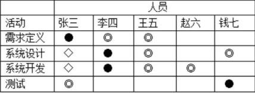

#### 【试题 28】---2014 上真题 47

28、为了满足员工的归属感需要，某公司经常为新员工组织一些聚会或者社会活动，按照马斯洛 的需要层次理论，这属于满足员工的（27）的需要。

（28）A.安全   B.社会交往   C. 自尊   D.自我实现

#### 【试题 29】---2014 上真题 48

29、项目经理在项目管理时使用了下图，该图是（29）

（29）A.责任分配矩阵   B.沟通计划表  C.列表式   D.组织结构分解图

#### 【试题 30】---2014 上真题 49

30、由于在执行任务时，遇到了超出想象的困难，项目团队成员之间开始争执互相指责，并开始 怀疑项目经理的能力。按照项目团队建设的阶段来划分，该阶段属于（30）

（30）A.形成阶段   B.震荡阶段   C.规范阶段    D.发挥阶段

#### 【试题 31】---2014 下真题 50

31、进行团队建设时可以采取的方式有（31）。

（31）A.培训、拓展训练， 认可和奖励        B.冲突管理、观察和对话、绩效评估

C.冲突管理、观察帮对话、认可和奖励  D.谈判、采购、虚拟团队

#### 【试题 32】---2015 上真题 48

32 、一个五人组成的项目团队已经进入到了项目团队的正规期，但是由于项目任务比较紧张。又 增添了两名新成员进入团队， 则此时项目团队处于（）。

A.震荡期    B.形成期     C.变现期     D.正规期

#### 【试题 33】---2015 上真题 49

33、（）不属于编制人力资源计划的工具与技术。

A.OBS        B.RAM        C.RBS            D.SWOT

#### 【试题 34】---2015 上真题 50

34、在管理项目团队时，项目经理可以运用（） 等方法来解决冲突。

A.求同存异、观察、强制         B.求同存异、妥协、增加权威

C.强制、问题解决、撤退         D.强制、妥协、预防

#### 【试题 35】---2015 下真题 49

35、塔库曼的团队建设理论认为，项目团队建设的生命周期中不包括（ ）阶段。

（35）A.形成（forming） B.磨合（running） C.震荡（storming） D.规范（norming）

#### 【试题 36】---2015 下真题 50

### 36、项目团队建设的内容一般不包括( )

（36）A.培训  B.认可和奖励  C.职责分配  D. 同地办公

#### 【试题 37】---2015 下真题 51

### 37、项目人力资源管理计划一般不包括( )

（37）A.项目中的角色和职责  B.绩效报告 C.项目组织结构图  D.人员配备管理计划

#### 【试题 38】---2015 下真题 29

38、信息系统集成项目的技术性很强，是智力密集， 劳动密集型项目，必须在人才激励和团队管 理的问题上给与足够的重视。（ ）不是造成信息系统项目必须注重团队管理的主要原因

（38）A.项目成员的机构对系统集成项目的质量有重要的影响

B.信息系统集成项目通常包括软硬件集成

C.项目成员的责任心和稳定性对系统集成项目是否成功有决定性的影响。 D. 团队成员专业分工合理

#### 【试题 39】---2016 上真题 49

39、虽然项目具有独特性，但考虑到当前进行的项目和去年已完工的一个项目类似，为了加快人 力资源计划的编制，项目经理小王采用了这个类似项目的任务或职责定义、汇报关系、组织架构 图和职位描述。小王在人力资源计划的编制过程中采用了（39）方法。

A.组织结构图和职位描述       B.人力资源模板

C.非正式的人际网络           D .活动资源估算

#### 【试题 40】---2016 上真题 50

40 、一个为期 2 年的项目已经实施了 1 年，在项目期间不同的项目成员进进出出， 团队成员已经 发生了较大的变化，而相应的团队职责分工也已经与原计划有了很多出入。最近团队成员在为一 个工作包由谁来负责产生了分歧，项目经理查看了项目计划，他发现很多工作包都没有规定负责 人，或者是原定的负责人已经发生了变更。针对这种情况，项目经理应该首先（40）以加强对项 目的管控。

A.为该工作包指定负责人     B.重新制定责任分配矩阵

C.重新分解项目工作包      D.重新制定人力资源计划

#### 【试题 41】---2016 上真题 51

41、对团队成员的激励永远是困扰项目经理的一个问题，对于高创新要求的项目团队来说，利用 （41）方法相对会更加有效。

A.赋予更大的责任和权力      B.大幅增加薪酬

C.给予必要的关心和照顾      D.给予更高的社会地位

#### 【试题 42】---2016 下真题 51

42、可采用多种形式描述项目的角色和职责。下图所示的描述角色和职责的方法是（）。

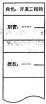

A.层次结构图   B.RAM 图   C.文本格式    D.RACI 图

#### 【试题 43】---2016 下真题 52

43、描述项目团队成员在项目中何时，以何种方式，以及在项目中工作持续时日等相关信息的是（）。 A.项目组织结构  B.角色职责分配    C.活动资源需求 D.人员配备管理计划

#### 【试题 44】---2016 下真题 53

44、项目团队形成要经历 5 个阶段，其中经过一段时间的磨合， 团队成员之间已经相互熟悉和了 解，团队矛盾已经基本解决的阶段是（）。

A.形成阶段    B.发挥阶段    C.震荡阶段     D.规范阶段

#### 【试题 45】---2016 下真题 54

45、成功的冲突管理可以大大地提高团队生产力并促进积极的工作关系。以下关于冲突的叙述中， 不正确的是（）。

A.一般来说， 冲突是一个团队问题，而不是某人的个人间题

B.冲突的解决应聚焦问题

C.冲突的解决应聚焦在过去，分析冲突造成的原因

D.冲突是自然的， 而且要找出一个解决办法

#### 【试题 46】---2017 上真题 52

46、当需要确保每一个工作包只有一个明确的责任人,而且每一个项目团队成员都非常清楚自己的 角色和职责时,应采用的工具和技术是（）。

A.组织结构图和职位描述    B.人际交往    C.组织理论    D.专家判断

#### 【试题 47】---2017 上真题 53

47、在实施某项目时, 由于地域限制,必须建立一个虚拟团队,此时制定（） 就显得更加重要。 A.一个可行的沟通计划    B.一个可行的风险计划

C.一个可行的采购计划    D.一个可行的质量计划

#### 【试题 48】---2017 下真题 53

48、以下关于编制人力资源计划的工具和技术的叙述中，不正确的是（）。

A.可使用多种形式描述项目的角色和职责

B.每个工作包可分配多人负责，做好工作备份

C.职责分配矩阵是反映团队成员与其承担工作之间联系的最直观的方法

D.描述职责时，需要让每一位项目成员都非常清楚自己的角色和职责

#### 【试题 49】---2017 下真题 54

49、可以通过多种方法实现对项目团队的管理，随着远程通讯方式的快速发展，虚拟团队成为了 项目管理的方式。作为项目经理，想要管理好虚拟团队，采用（）方法更合适。

A. 问题清单    B.冲突管理    C.风险管理    D.观察和交流

#### 【试题 50】---2018 上真题 53

50、在编制项目管理计划过程中，项目管理的其他分领域计划也在同步编制。作为项目经理， 编制项目人力资源管理计划过程，需要与编制（）的过程紧密关联。

A.沟通计划    B.质量计划    C.风险计划    D.采购计划

#### 【试题 51】---2018 上真题 54

51、项目经理常用领导力、影响力和有效决策等人际关系技能来管理团队，根据项目管理的 领导与管理理论，如果针对新员工，采用（）领导方式更有效。

A. 民主型    B.部分授权    C.放任型    D.指导型

#### 【试题 52】---2018 下真题 53

52、层次结构图用于描述项目的组织结构，常用的层次结构图不包含（53）

（53）A.工作分解结构    B.组织分解结构    C.资源分解结构    D.过程分解结构

#### 【试题 53】---2018 下真题 54

53、关于项目团队管理，不正确的是:（54）.

（54）A.项目团队管理用于跟踪个人和团队的绩效，解决问题和协调变更

B.项目成员的工作风格差异是冲突的来源之一

C.在一个项目团队环境下，项目经理不应公开处理冲突

D.合作、强制、妥协、求同存异等是解决冲突的方法

#### 【试题 54】---2019 上真题 53

54、关于责任分配矩阵（RAM）的描述， 不正确的是（）。

A.大型项目中，RAM 可分为多个层

B.针对具体的一项活动可分配多个成员每个成员承担不同职责

C.RAM 中用不同的字母表示不同的职责

D.RAM 中每项活动中可以有一个以上成员对任务负责

#### 【试题 55】---2019 上真题 54

55、（）属于人力资源管理中的 Y 理论。

A.一般人天性好逸恶劳，只要有可能就会逃避工作

B.在适当的条件下， 人们愿意主动承担责任

C.人缺乏进取心逃避职责，甘愿听从指挥安于现状，没有创新性

D.人生来就以自我为中心，漠视组织的要求

#### 【试题 56】---2019 下真题 51

56、（）反映了团队成员个人与其承担的工作之间的联系。

A.层次结构图    B.工作分解结构    C.矩阵图    D.文本格式

#### 【试题 57】---2019 下真题 52

57、关于虚拟团队的描述，不正确的是（）。

A.现代通信技术，如 Email、微信等，有助于虚拟团队的沟通和管理

B.虚拟团队有助于将行动不便，在家办公或有特殊技能的人纳入团队

C.与实体团队相比， 虚拟团队成员之间更容易分享知识和经验

D.与实体团队相比，在虚拟团队中制定可行的沟通计划更加重要

#### 【试题 58】---2019 下真题 53

58、（）指的是集合多方的观点和意见， 得出一个多数人接受和承诺的冲突解决的方案。 A.合作    B.强制    C.妥协    D. 问题解决

九、项目沟通管理和干系人管理

#### 【试题 1】---2009 上真题 32

1、项目绩效评审的主要目标是（1）。

（1）A.根据项目的基准计划来决定完成该项目需要多少资源

B.根据过去的绩效调整进度和成本基准

C.得到客户对项目绩效认同

D.决定项目是否应该进入下一个阶段

#### 【试题 2】---2009 上真题 48

2、项目绩效审计不包括（2）。

（2）A.决算审计     B.经济审计    C.效率审计     D.效果审计

#### 【试题 3】---2010 上真题 57

3、某公司正在计划实施一项用于公司内部的办公自动化系统项目， 由于该系统的实施涉及到公司 很多内部人员，因此项目经理打算制定一个项目沟通管理计划， 他应采取的第一个工作步骤是（3）。

（3）A.设计一份日程表， 标记进行每种沟通的时间 B.分析所有项目干系人的信息需求 C.构建一个文档库并保存所有的项目文件     D.描述准备发布的信息

#### 【试题 4】 ---2010 上真题 58

4、召开会议就某一事项进行讨论是有效的项目沟通方法之一，确保会议成功的措施包括提前确定 会议目的、按时开始会议等，（4）不是确保会议成功的措施。

（4）A.项目经理在会议召开前一天，将会议议程通过电子邮件发给参会人员

B.在技术方案的评审会议中， 某专家发言时间超时严重， 会议主持人对会议进程进行控制

C.某系统验收会上， 为了避免专家组意见太发散， 项目经理要求会议主持人给出结论性意 见

D.项目经理指定文档管理员负责会议记录

#### 【试题 5】---2010 上真题 59

5、某项目组的小组长王某和程序员李某在讨论确定一个功能模块的技术解决方案时发生激烈争 执，此时作为项目经理应该首先采用（5）的方法来解决这一冲突。

（5）A.请两人先冷静下来，淡化争议，然后在讨论问题时求同存异

B.帮助两人分析对错， 然后解决问题

C.要求李某服从小组长王某的意见

D.请两人把当前问题搁置起来，避免争吵

#### 【试题 6】---2010 下真题 57

6、小张最近被任命为公司某信息系统开发项目的项目经理， 正着手制定沟通管理计划， 下列选项 中（6）属于小张应该采取的主要活动。

①找到业主，了解业主的沟通需求      ②明确文档的结构

③确定项目范围                      ④明确发送信息的格式

（6）A.①②③④         B.①②④         C.①③④         D.②③④

#### 【试题 7】---2012 上真题 57

7、在项目沟通管理过程中存在若干影响因素， 其中潜在的技术影响因素包括（7）。 ①对信息需求的迫切性         ②资金是否到位

③预期的项目人员配备         ④项目环境     ⑤项目时间的长短

（7）A.①③④⑤      B.①②③④        C.①②④⑤       D.②③④⑤

#### 【试题 8】---2010 下真题 59

8、某公司正在编制项目干系人沟通的计划，以下选项中（8）属于干系人沟通计划的内容。 ①干系人需要哪些信息   ②各类项目文件的访问路径

③各类项目文件的内容   ④各类项目文件的接受格式   ⑤各类文件的访问权限

（8）A.①②③④⑤       B.①②③④        C.①②④⑤       D.②③④⑤

#### 【试题 9】 ---2012 上真题 57

9、（9）是制订项目沟通管理计划的输入。

（9）A.沟通技术   B.项目可行性分析      C.成本控制 D.项目范围说明书

#### 【试题 10】---2012 上真题 58

10、状态会议的目的是（10）。

（10）A.交换项目信息      B.让团队成员汇报正在执行的工作

C.签发工作授权      D.确认团队提交的成本的准确性

#### 【试题 11】---2012 上真题 59

11、某项目的现状是： 已经被按照沟通计划发布了项目信息； 一些项目可交付物成果发生了变更； 这些变更是按照变更控制计划做出的； 一位干系人在得知以前曾经公布过的项目可交付物成果变 更时， 感觉十分惊讶；其余干系人都收到了变更通知的消息。针对这种情况， 项目经理应该（11）。 （11）A.告知干系人信息公布的日期

B.审核沟通计划，确定为什么干系人不理解自己的职责

C.对沟通计划进行审核，如需要，对沟通计划进行修改

D.在下次项目工作会议上说明该问题，以便其他干系人不会遗忘公布的变更信息

#### 【试题 12】---2013 上真题 44

12、在沟通管理中， 沟通方式的选择是一项重要的工作。  12   不是书面沟通的特点。

（12）A.  沟通速度快    B.歧义性少    C. 内容清晰      D.信息充分

#### 【试题 13】---2013 上真题 53

13、项目沟通管理涉及到项目管理的诸多内容。 一般而言，（13）不属于项目沟通管理计划的主要

内容。

（13）A.项目干系人沟通需求      B.传递信息的技术和方法

C.项目会议频率            D.通用词语表

#### 【试题 14】---2013 上真题 57

14、项目经理编制了一份项目沟通计划。其主要内容包括项目干系人要求、发布信息的描述、传 达信息所需的技术方法和沟通频次。这份计划中还欠缺的最主要内容是（14）。

（14）A.信息接收的个人和组织   B.沟通计划检查要求   C.沟通备忘录  D.干系人分析

#### 【试题 15】---2013 上真题 58

15、沟通是项目管理和团队建设中的重要环节。下面关于沟通的说法中。（15）是正确的。 （15）A.正式沟通优于非正式沟通。项目经理不应鼓励团队成员的非正式沟通和交流。

B.水平沟通优于垂直沟通。项目经理不应鼓励团队成员的垂直沟通。

C.集中办公和会议有利于提高沟通效率。是团队建设的有效手段。

D.沟通的及时性是沟通的第一目标。项目的所有问题需第一时间与干系人沟通。

#### 【试题 16】---2013 下真题 58

16、在信息分发过程中，如果为了使沟通更加清晰、减少二义性，并且可以留备忘录，那么应该 采取的沟通方式是（16）。

（16）A.书面沟通      B.电话录音      C.垂直沟通    D.水平沟通

#### 【试题 17】---2013 下真题 59

17、绩效报告是指搜集所有基准数据并向项目干系人提供项目绩效信息，为了绩效报告，首先要 收集材料， 这些材料不包括（17）。

（17）A.被评价项目资料的清单   B.项目绩效预测   C.调查问卷     D.征询函

#### 【试题 18】---2014 上真题 50

18、在项目实施过程中，（18）容易增加冲突发生的概率.

（18）A.保证资源的供给           B.项目组织结构由矩阵结构改为项目型结构

C.项目实施中引入新技术     D.明确责任

#### 【试题 19】---2014 上真题 58

19、在项目管理中， 讲行信息分发时，（19）的特点是：复杂程度高，往往不受当事人的控制。 （19）A.正式沟通   B.非正式沟通  C.垂直沟通   D.水平沟通

#### 【试题 20】---2014 下真题 58

20、项目沟通管理计划的主要内容中不包括（20）。

（20）A.信息的传递方式           B.项目问题的解决

C.更新沟通管理计划的方法   D.项目干系人沟通要求

#### 【试题 21】---2014 下真题 59

21、项目经理小张想要与客户就合同变更事宜进行沟通，他应该采取（21）沟通方式比较合适。 （21）A.口头、非正式   B.书面、非正式   C. 口头、正式   D.书面、正式

#### 【试题 22】---2014 下真题 60

22、对项目干系人管理的主要目标是（22）。

（22）A.调查项目干系人的需求和期望，以了解项目干系人的目标、目的和沟通层次 B.充分理解项目干系人的需求以便充分与干系人合作，以达到项目的目标

C.使用沟通管理计划中为每个项目干系人确定的沟通方式讨论、解决问题

D.促进干系人对项目的理解与支持， 使干系人了解项目的进展和有可能带来的影响

#### 【试题 23】---2015 上真题 58

23、项目绩效报告就是要搜集项目（） 并向项目干系人提供绩效信息。

A.干系人偏好    B.资源使用情况    C. 团队绩效      D.所有基准数据

#### 【试题 24】---2015 上真题 59

24、某项目经理在与项目干系人的沟通过程中运用了多种沟通方法。有项目日志、项目例会、甲 方代表参与的项目会议等，但仍有些关键问题未能与客户达成一致。根据沟通原则，可建议承建 单位采用（）方法。

A.给用户发送绩效报告    B.双方高层沟通   C.提交仲裁    D.请用户参加娱乐活动

#### 【试题 25】---2015 下真题 58

25、关于项目沟通管理计划编制的叙述，不正确的是( )

（25）A.沟通管理计划编制是确定干系人的信息与沟通需求的过程

B.沟通管理计划应描述信息收集和文件归档的结构

C.沟通管理计划中应明确发送信息和重要信息的格式

D.编制沟通计划的最后一步是项目干系人分析

#### 【试题 26】---2015 下真题 59

26、关于项目沟通方式的叙述，不正确的是( )

（26）A.沟通方式的选择与沟通渠道有关，与沟通技术无关

B.常用的沟通方式有书面沟通，口头沟通

C. 口头的沟通方式比较为人性化， 容易使沟通双方充分了解

D.必要时要用正式会议的形式进行沟通

#### 【试题 27】---2015 下真题 60

27、根据项目干系人权利/利益的分类，针对项目有重大影响，同时项目执行对其有明显利益关系 的干系人应采用（ ）的管理策略。

（27）A.监督  B.随时告知  C.令其满意 D.重点管理

#### 【试题 28】---2016 上真题 58

28、沟通管理计划的编制是确定（28）的过程，即明确谁需要何种信息，何时需要以及如何向他 们传递。

A.干系人信息与沟通需求           B.沟通方式与信息发布

C.干系人提供的绩效信息           D.干系人管理与经验教训总结

#### 【试题 29】---2016 上真题 59

29、项目经理 80%甚至更多的时间都用于进行项目沟通工作。在项目的沟通管理计划中可以不包 括（29）。

A.传达信息所需的技术或方法  B.沟通频率

C.干系人登记册             D.对要发布信息的描述

#### 【试题 30】---2016 上真题 60

30、为使项目团队提高项目管理效率， 项目经理张工非常注重在项目进行过程中召开经验总结会， 对经验教训进行汇编、格式化以及正式归档等相关工作。这种经验总结会应由（30）参加。

A.项目负责人和项目主要技术人员     B.公司质量经理和项目主要负责人

C.公司内部和外部的主要项目干系人   D.项目甲方业务代表和公司质量经理

#### 【试题 31】---2016 下真题 55

31 、管理项目干系人参与过程的主要作用是（）。

A.限制干系人参与项目          B.鼓励干系人参与项目

C.提升干系人对项目的支持     D.与干系人进行沟通

#### 【试题 32】---2017 上真题 54

32、在沟通过程中, 当发送方自认为已经掌握了足够的信息,有了自己的想法且不需要进一步听取多 方意见时,一般会选择（）进行沟通。

A.征询方式    B.参与讨论方式    C.推销方式    D.叙述方式

#### 【试题 33】---2017 上真题 55

33、权力/利益方格根据干系人权力的大小, 以及利益大小（或项目关注度）对干系人进行分类,是干 系人分析的方法之一。对于那些对项目有很高的权力同时又非常关注项目结果的干系人，项目经 理应采取的干系人管理策略是（）。

A.令其满意    B.重点管理    C.随时告知    D.监督

#### 【试题 34】---2017 上真题 56

34、某项目经理在编制干系人管理计划,绘制的如下表格是（）。

A.干系人职责分配矩阵干   B.干系人优先矩阵干

C.干系人参与评估矩阵     D.干系人亲和图

#### 【试题 35】---2017 下真题 55

35、以下（）不是控制沟通的技术和方法。

A.业务数据分析    B.项目例会   C.信息管理系统    D.专家判断

#### 【试题 36】---2017 下真题 56

36、在进行项目干系人分析时， 经常用到权力/利益分析法， 对待属于第 A 区域的项目干系人，应 采取的策略是（）。

A.随时告知    B.令其满意    C.花较少的精力    D.争取支持

#### 【试题 37】---2018 上真题 55

37、沟通过程管理的最终目标是（）。

A.严格执行沟通计划        B.保障干系人之间有效沟通

C.与干系人建立沟通机制    D.正确传递项目信息

#### 【试题 38】---2018 上真题 56

38、关于干系人管理的描述。不正确的是:（）。
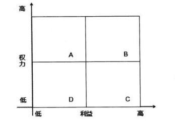

A.干系人分析在项目立项时进行，以便尽早了解干系人对项目的影响

B.识别干系人的方法包含组织相关会议、专家判断、干系人分析等

C.干系人分析是系统地收集干系人各种定性和定量信息的一种方法

D.典型的项目干系人包含客户、用户、高层领导、项目团队和社会成员等

#### 【试题 39】---2018 下真题 55

39、关于管理沟通的工具，不正确的是:()

A.沟通模型的各要素会影响沟通的效率和效果

B.管理沟通过程中要确保已创建并发布的信息能够被接受和理解

C.项目经理在项目进行中，应定期或不定期进行绩效评估

D.为了方便快捷地进行沟通，项目进行过程中需选择固定的沟通渠道

#### 【试题 40】---2018 下真题 56

40、下图干系人权力和利益的描述，不正确的是（）。

A.项目经理的主管领导就是 A 区的干系人，要“令其满意 ”

B.项目客户是 B 区的干系人，要“重点管理、及时报告 ”

C.对于 C 区的干系人，要“随时告知”

D.对于 D 区干系人，花费最少的精力监督即可

#### 【试题 41】---2019 上真题 55

41、项目团队中原来有 5 名成员，后来又有 4 人加入项目.与之前相比项目成员之间沟通渠道增加 ()条。

A.26        B.10        C.20        D.36

#### 【试题 42】---2019 上真题 56

42、识别项目干系人的活动按时间先后排序正确的是（）。

①对干系人分类②识别干系人及其信息

③制定干系人管理计划④评估关键干系人的诉求和影响力

A.④③②①    B.②④①⑧    C.①②③④    D.②①④③

#### 【试题 43】---2019 下真题 54

43、关于沟通表达方式的描述，不正确的是（）。

A.文字沟通的优点是读者可以根据自己的速度进行调整

B.文字沟通的缺点是无法控制何时， 以及是否被阅读

C.语言沟通的优点是节省时间，因为语言速度高于阅读速度

D.语言沟通的缺点是达不到文字资料的精确性和准确性

#### 【试题 44】---2019 下真题 55

44、对项目干系人进行分类时，常用的分类方法不包括（）。

A.权利/利益方格    B.权利影响方格    C.影响/作用方格    D.影响/意愿方格

十、项目合同管理

#### 【试题 1】---2009 上真题 38

1、合同法律关系是指由合同法律规范调整的在民事流转过程中形成的（1）。 （1）A.买卖关系 B.监督关系   C.权利义务关系   D.管控关系

#### 【试题 2】---2009 上真题 39

2、（2）属于要约。

（2）A.商场的有奖销售活动   B.商业广告    C.寄送的价目表     D.招标公告

#### 【试题 3】---2009 上真题 40

3、（3）属于《合同法》规定的合同内容。

（3）A.风险责任的承担    B.争议解决方法      C.验收标准     D.测试流程

#### 【试题 4】 ---2009 上真题 41

4、《合同法》规定，价款或酬金约定不明的，按（4）的市场价格履行。

（4）A.订立合同时订立地            B.履行合同时订立地

C.订立合同时履行地            D.履行合同时履行地

#### 【试题 5】---2009 下真题 50

5、合同一旦签署了就具有法律约束力， 除非（5）  。

（5）A.一方不愿意履行义务    B.损害社会公共利益

C.一方宣布合同无效      D.一方由于某种原因破产

#### 【试题 6】---2009 下真题 51

6、项目合同管理不包括（6）。

（6）A.合同签订    B.合同履行    C.合同纠纷仲裁    D.合同档案管理

#### 【试题 7】---2009 下真题 52

7、合同的内容就是当事人订立合同时的各项合同条款，下列不属于项目合同主要内容的是（7）。

（7）A.项目费用及支付方式    B.项目干系人管理

C.违约责任             D.当事人各自权力、义务

#### 【试题 8】---2009 下真题 53

8、承建单位有时为了获得项目可能将信息系统的作用过分夸大， 使得建设单位对信息系统的预期 过高。除此之外，建设单位对信息系统的期望可能会随着自己对系统的熟悉而提高。为避免此类 情况的发生，在合同中清晰地规定（8）对双方都是有益的。

（8）A.保密约定 B.售后服务    C.验收标准    D.验收时间

#### 【试题 9】 ---2009 下真题 54

9、为出售公司软件产品， 张工为公司草拟了一份合同， 其中写明“软件交付以后， 买方应尽快安 排付款”。经理看完后让张工重新修改， 原因是（9）  。

（9）A.没有使用国家或行业标准的合同形式    B.用语含混不清，容易引起歧义

C.名词术语使用错误                    D.措辞不够书面化

#### 【试题 10】---2009 下真题 55

10、下列关于索赔的描述中， 错误的是（10）。

（10）A.索赔必须以合同为依据

B.索赔的性质属于经济惩罚行为

C.项目发生索赔事件后，合同双方可以通过协商方式解决

D.合同索赔是规范合同行为的一种约束力和保障措施

#### 【试题 11】---2010 上真题 53

11、系统集成商与建设方在一个 ERP  项目的谈判过程中， 建设方提出如下要求： 系统初验时间为 2010  年 6  月底（付款 50%）；正式验收时间为 2010  年 10  月底（累计付款 80%）；系统运行服 务期限为一年（可能累计付款 100%）；并希望长期提供应用软件技术支持。系统集成商在起草项 目建设合同时，合同期限设定到（11）为妥。

（11）A.2010  年 10  月底    B.2011  年 6  月底  C.2011  年 10  月底   D.长期

#### 【试题 12】---2010 上真题 54

12、某软件开发项目合同规定，需求分析要经过客户确认后方可进行软件设计。但建设单位以客  户代表出国、其他人员不知情为由拒绝签字，造成进度延期。软件开发单位进行索赔一般按（12） 顺序较妥当。

①由该项目的监理方进行调解 ②由经济合同仲裁委员会仲裁 ③由有关政府主管机构仲裁

（12）A.①②③   B.①③②   C.③①②    D.②①③

#### 【试题 13】---2010 上真题 55

13、按照索赔程序，索赔方要在索赔通知书发出后（13）内，向监理方提出延长工期和（或）补 偿经济损失的索赔报告及有关资料。

（13）A.2  周    B.28  天    C.30  天    D.3  周

#### 【试题 14】---2010 上真题 56

14、某项工程需在室外进行线缆铺设，但由于连续大雨造成承建方一直无法施工，开工日期比计 划晚了 2  周（合同约定持续 1  周以内的天气异常不属于反常天气），给承建方造成一定的经济损 失。承建方若寻求补偿，应当（14）。

（14）A.要求延长工期补偿               B.要求费用补偿

C.要求延长工期补偿、费用补偿     D. 自己克服

#### 【试题 15】---2010 下真题 50

15、某机构将一大型信息系统集成项目分成 3  个包进行招标， 共有 3  家承包商中标， 发包人与承 包商应签署（15）。

（15）A.技术转让合同   B.单项项目承包合同   C.分包合同      D.总承包合同

#### 【试题 16】---2010 下真题 51

16、根据合同法规定，（16）不属于违约责任的承担方式。

（16）A.继续履行   B.采取补救措施  C.支付约定违约金或定金  D.终止合同

#### 【试题 17】---2010 下真题 52

17、小张草拟了一份信息系统定制开发合同，其中写明“合同签订后建设单位应在 7 个工作日内 向承建单位支付 60%合同款；系统上线并运行稳定后，建设单位应在 7  个工作日内向承建单位支 付 30%合同款”。上述条款中存在的主要问题为（17）。

（17）A.格式不符合行业标准的要求      B.措辞不够书面化

C.条款描述不清晰、不准确        D.名词术语不规范

#### 【试题 18】---2010 下真题 53

18、为保证合同订立的合法性，关于合同签订， 以下说法不正确的是（18）。

（18）A.  订立合同的当事人双方，应当具有相应的民事权利能力和民事行为能力

B.  为保障双方利益， 应在合同正文部分或附件中清晰规定质量验收标准， 并可在合同签署 生效后协议补充

C.  对于项目完成后发生技术性问题的处理与维护， 如果合同中没有相关条款， 默认维护期 限为一年

D.  合同价款或者报酬等内容，在合同签署生效后， 还可以进行协议补充

#### 【试题 19】---2010 下真题 54

19、下述关于项目合同索赔处理的叙述中，不正确的是（19）。

（19）A.按业务性质分类， 索赔可分为工程索赔和商务索赔

B.项目实施中的会议纪要和来往文件等不能作为索赔依据

C.建设单位向承建单位要求的赔偿称为反索赔

D.项目发生索赔事件后一般先由监理工程师调解

#### 【试题 20】---2010 下真题 55

20、某信息系统集成项目实施期间’因建设单位指定的系统部署地点所处的大楼进行线路改造’ 导致项目停工一个月’由于建设单位未提前通知承建单位’导致双方在项目启动阶段协商通过的  项目计划无法如期履行。根据我国有关规定’承建单位（20）。

（20）A.可申请延长工期补偿’也可申请费用补偿

B.可申请延长工期补偿’不可申请费用补偿

C.可申请费用补偿’不可申请延长工期补偿

D.无法取得补偿

#### 【试题 21】---2010 下真题 56

21、某机构信息系统集成项目进行到项目中期’建设单位单方面终止合作’承建单位于 2010  年 7 月 1  日发出索赔通知书’承建单位最迟应在（21）之前向监理方提出延长工期和（或）补偿经济 损失的索赔报告及有关资料。

（21）A.2010  年 7 月 31   日         B.2010  年 8  月 1   日

C.2010  年 7 月 29   日        D.2010  年 7  月 16  日

#### 【试题 22】---2011 上真题 48

22、某项目在招标时被分成 5 个标段’分别发包给不同的承包人。承包人中标后与招标人签订的 是（22）。

（22）A.单项项目承包合同   B.分包合同   C.单价合同     D.总承包合同

#### 【试题 23】---2011 上真题 49

23、甲公司在进行采购时选定了乙公司的产品’但在签订采购合同时没有对采购内容的交付时间 进行约定’则以下说法错误的是（23）。

（23）A.可以通过协议或交易习惯确定交付时间

B.不能通过协议或交易习惯确定的’则采购合同无效

C.乙公司可以随时履行交付义务

D.甲公司可以随时要求乙公司履行交付义务

#### 【试题 24】---2011 上真题 50

24、某项目甲乙双方签订了建设合同’其中对工程款支付及知识产权的描述分别是“…… 甲方在 系统安装完毕’经试运行及初验合格后’收到乙方材料 XX 日内’支付第二笔款 XXXX 元。乙方 提供的材料包括： ①商业发票； ②…… ”’从上述描述可看出’支付第二笔款还必须附加的材料是 （24）。

（24）A.第三方测试报告   B.初验报告  C.专家评审报告 D.监理工作总结报告

#### 【试题 25】---2011 下真题 53

25、以下关于项目合同签订的描述中’正确的是（25）。

（25）A.只有具有相应民事权利能力的自然人、法人或其他组织才可订立合同

B.如果合同中对技术支持服务期限未作出任何规定’则认为企业所有的维护要求都要另行付费

C.对于当事人在订立合同中熟悉的商业秘密’一旦合同成立’在执行合同过程中造成泄密’ 必须承担经济损害赔偿

D.为了避免合同纠纷’当事人必须将签订的合同进行公证’使之获得法律强制执行效力

#### 【试题 26】---2011 下真题 63

26、M 公司委托 T 公司开发一套新的管理信息系统， T 公司未能按合同规定的日期交付最终产品， 给 M 公司照成巨大的运营损失，因此 M 公司向 T 公司提出索赔，其中不包括（26）。

（26）A.清算赔偿金     B.间接损失赔偿金  C.补偿性赔偿金   D.惩罚性赔偿金

#### 【试题 27】---2012 上真题 50

27、某电信企业要建设一个 CRM 系统（包括呼叫中心和客服中心），系统集成一级资质企业甲和 系统集成二级资质企业乙参与该系统建设。关于合同的签订，下面说法中，（27）是正确的。

（27）A.如电信企业和乙签订 CRM 建设总包台同， 则乙和甲就呼叫中心的建设只能签订分包公司

B.如电信企业和乙签订客服中心建设总包台同，则电信企业和甲就 CRM  的建设只能签定 总价合同

C.如电信企业和乙签订客服中心建设单项承包合同，则电信企业和甲就 CRM  的建设只能 签定单项承包合同

D.如电信企业和甲签订 CRM 建设总价合同， 则甲和乙就呼叫中心帕建设只能签订单价合同

#### 【试题 28】---2012 上真题 51

28、建设方和承建方甲就某信息系统建设项目进行了多次合同谈判均未达成一致，未能签定系统 建设合同，但在谈判期间建设方获悉了甲的行业关键技术指标。之后建设方与另一承建方乙经过 合同谈判后就系统建设签定了合同，同时将甲的关键技术指标透露给乙，导致甲蒙受损失。下列 说法中，（28）是正确的。

（28）A.建设方对甲蒙受的损失应承担赔偿责任

B.建设方和甲未签定合同，对甲蒙受的损失不应承担赔偿责任

C.乙和甲未签定合同， 对甲蒙受的损失不应承担赔偿责任

D.甲的损失是由于其自身保密工作未做好， 其损失应全部由其自身承担

#### 【试题 29】---2012 上真题 52

29、某系统集成商 M 公司于甲方签订了一份电子商务平台建设项目， 合同中规定， 如果系统交付 后存在质量问题， 系统集成商 M 应提供免费的及时维护服务， M 公司按合同要求交付了系统， 双 方签订了验收报告。在此后的一年内， M 公司及时响应了甲方的维护要求，一年之后， M 公司向 甲方提出此后的技术服务应该为有偿服务，甲方认为合同中提到的免费服务并无具体期限， M  公 司的收费要求是不合理的。下列说法中（29）是最恰当的。

（29）A.因为合同中规定的免费服务并无具体期限，因此 M 公司要求收费不合理

B.应对甲方的服务要求进行分类，如是处理质量问题，则 M 公司应无限期免费服务 C.M 公司已经提供了一年的免费服务，此后要求对服务收费是合理的

D.合同内容不明确，可根据有关信息化工程建设的法律、法规处理

#### 【试题 30】---2012 上真题 53

30、某办公大楼的开发商将办公楼的智能楼宇系统承包给 H 公司， 双方签订了合同， 开发商海聘 请了监理方对此项目进行监理。期间， 消防子系统验收延误，开发商认为是 H 公司的责任，向监 理方提出索赔要求。关于索赔流程，下列说法中，（30）是正确的。

（30）A.开发商应在验收延误事件发生后 20 天内提出索赔意向通知

B.监理方收到索赔通知后，应在 28 天内帮助开发商编制出索赔报告

C.监理方应在索赔报告中充分论证该事件的确为开发商带来了损失， 并提出具体的赔偿方案 D.如果 H 公司不同意监理方作出的索赔决定，可提请仲裁或法律诉讼

#### 【试题 31】---2012 下真题 53

31、合同管理是项目管理中一个重要的组成部分、其中合同（31）管理是合同管理的基础。

（31）A.索赔     B.履行    C.档案    D.变更

#### 【试题 32】---2012 下真题 63

32、某小型系统集成项目，甲乙双方只订立了口头合同。工程完工后，因甲方拖欠乙方工程款项 发生风险， 应当认定该合同  （32） 。

（32）A.未成立    B.补签后成立   C.成立     D.备案登记后成立

#### 【试题 33】---2012 下真题 64

33、甲乙双方订立合同，规定甲应予 2007 年 8 月 1  日交货，乙应予同年 8 月 7  日付款，7 月底， 甲发现乙财产状况恶化，已没有支付货款的能力，并有确切证据，甲提出终止合同，但乙未允。 基于上述情况，甲于 8 月 1  日未按约定交货，依照合同法的原则。下列关于甲行为的论述中，正 确的是（33）。

（33）A.甲必须按合同约定交货， 但可以要求乙提供相应的担保

B.甲有权不按合同约定交货，除非乙提供了相应的担保

C.甲必须按合同约定交货，但可以仅先交付部分货物

D.甲应按合同约定交货，如乙不支付货款可追究其违约责任

#### 【试题 34】---2013 上真题 43

34.索赔是合同管理中经常会碰到的问题，以下关于索赔管理的描述中，  34   是正确的。 （34）A.  一方或双方存在违约行为和事实是合同索赔的前提

B.凡是遇到客观原因造成的损失， 承包商都可以申请费用补偿

C.索赔是对对方违约行为的一种惩罚

D.承建方应该将索赔通知书直接递交建设方， 监理方不参与索赔管理

#### 【试题 35】---2013 上真题 50

35.某项目在启动阶段难以确定所需要的人员和资源， 需要在实施过程中动态增加较多人员、专家 和外部资源。在为该项目制订采购计划时需要确定采购合同类型，最适合该项目的合同类型是 35  。

（35）A.  时间和材料合同     B.成本加固定酬金合同 C.成本补偿合同        D. 固定总价合同

#### 【试题 36】---2013 上真题 52

36.甲公司与乙公司订立了一份总货款额为 20 万元的设备供货合同。合同约定的违约金为货款总额 总值的 10%。同时，甲公司向乙公司给付定金 5000 元。后乙公司违约， 给甲公司造成损失 2 万元。 乙公司依法向甲公司支付违约金（36）万元。

（36）A.2              B.2.5              C.4              D.1.5

#### 【试题 37】---2013 下真题 51

37、系统集成合同管理是管理建设方与承建方的关系，保证承建方的实际工作合同要求的过程。 其内容不包括（37）。

（37）A.合同签订管理     B.合同履行管理   C.合同变更管理  D.合同违法管理

#### 【试题 38】---2013 下真题 52

38、按照我国建设部、财政部下达的通用条款， 下列关于索赔的说法错误的是（38）。

（38）A.索赔必须以合同为依据       B.索赔必须注意资料的积累

C.索赔是一种惩罚行为        D.索赔处理要及时、合理

#### 【试题 39】---2014 上真题 51

39、按照付款方式的不同，工程合同分（51）。

①总价合同②单价合同③分包合同④成本加酬金合同

（39）A.1234          B.123       C.124                   D.134

#### 【试题 40】---2014 上真题 52

40、在信息系统建设中，建设方与承建方的合同可用于()

①作为监理工作的基本依据②规定总监工程师的职责③确定項目的工期④规定双方的经济关系⑤ 规定扣除招标公司费用的比例

（40）A.123         B.134            C.2345             D.12345

#### 【试题 41】---2014 上真题 53

41、在合同谈判前，要制定切合实际的谈判目标，要抓住实质问题， 要营造一个平等协商的氛围。 这些工作在合同管理中属于（41）管理

（41）A.合同签订  B.合同履行   C.合同变更   D.合同档案

42、以下关于合同变更的叙述中，（42）是不正确的。

（42）A.合同变更一般处理程序如下：变更的提出、变更请求的审查、变更的批准、变更的实施 B.变更申请可以以口头形式提出， 变更评估必须采取书面方式

C.对于任何变更的评估都应该有变更影响分析

D.合同变更的处理由合同变更控制系统来完成

#### 【试题 43】---2014 下真题 52

43、如果承建单位项目经理由于工作失误导致采购的设备不能按期到货， 施工合同没有按期完成， 则建设单位可以要求（43）承担责任。

（43）A.承建单位   B.监理单位   C.设备供应商  D.项目经理

#### 【试题 44】---2015 上真题 51~52

44、工程建设合同纠纷的仲裁由（1）的仲裁委员会仲裁， 仲裁委员会作出裁决以后， 当事人应当 履行。当一方当事人不履行仲裁裁决时。另一方当事人可以依照民事诉讼法的有关规定向（2）申

请执行。

（1）A.工程所在地

（2）A.当地人民政府

B.建设单位所在地 B.人民法院

C.承建单位所在地

C.仲裁委员会

D.合同双方选定

D.调节委员会

#### 【试题 45】---2015 上真题 53

45、签订信息系统工程项目合同时有需要注意事项。下列选项中（）在合同签订时不要考虑。 A. 当事人的法律资格   B.验收标准   C.项目管理计划    D.技术支持服务

#### 【试题 46】---2015 上真题 54

46 、一个具有五个分包商的项目，分包商递交了变更请求，希望扩大其工作范围，根据对此请求 的评审，决定对合同进行修订，该活动属于（）。

A.管理采购    B.实施采购    C.形成合同     D.解决争议

#### 【试题 47】---2015 下真题 52

47、小张模拟了一份信息系统定制开发合同， 其中“,合同签订后建设单位应在 74 个工作日内向承 建单位支付 60%合同款： 系统上线并运行稳定后，建设单位应在 7 个工作日内向承建方单位支付 30%合同款.”。上诉条款中存在的主要问题为( )

（47）A.格式不符合行业标准的要求    B.措辞不够书面化

C.条款描述不清晰，不准确      D.名词术语不规范

#### 【试题 48】---2015 下真题 53

### 48、开发合同中索赔的性质属于( )

（48）A.经济补偿 B.经济惩罚  C.经济制裁   D.经济补偿和经济制裁

#### 【试题 49】---2015 下真题 54

49、索赔是合同管理的重要环节， 甲单位在进行某一工程项目时，于 2015 年 3 月 1  日发生了一项 索赔的事项，则需在（ ）提出索赔意向通知。

（49）A.2015 年 3 月 29  日前向建设方项目经理  B.2015 年 3 月 31  日前向监理工程师

C.2015 年 3 月 29 日前向监理工程师      D.2015 年 3 月 31  日前向建设方项目经理

#### 【试题 50】---2015 下真题 61

50、项目采购计划的编制需要有适宜的方法，以规避项目风险，实现项目本目标，（ ）不属于项 目采购计划编制采用的技术

（50）A.专家判断 B.合同类型  C. 自制/采购分析  D.工作说明书

#### 【试题 51】---2015 下真题 62

51、对于工作模式或产品界定不甚明确的外包项目， 承建方一般愿意采用的合同形式是( ) （51）A.固定总价合同  B.成本补偿合同  C.工时和材料合同  D.采购单

#### 【试题 52】---2016 上真题 52

52、项目合同评审是项目管理中一项重要工作， 其中不包括（52）。

A.确认合同的需求        B.进行初步的项目任务分解

C.对合同条款进行分析     D.对自身的资源和能力进行确认

#### 【试题 53】---2016 上真题 53

53、合同内容是当事人订立合同时的各项合同条款。合同的主要内容包括（53）。

①当事人各自的权利、义务②项目费用及工程款的支付方式③项目变更约定④违约责任⑤保密约定 A.①②④    B.①②③④⑤   C.①②③⑤    D.②③④

#### 【试题 54】---2016 上真题 54

54、加强合同管理对于提高合同执行水平、减少合同纠纷、进而加强和改善建设单位和承建单位 的经营管理、提高经济效益， 都具有十分重要的意义。该过程主要包括（54）内容。

A.合同签订管理、合同履行管理、合同变更管理以及合同档案管理

B.合同签订管理、合同索赔管理、合同变更管理以及合同绩效管理

C.合同谈判管理、合同履行管理、合同纠纷管理以及合同档案管理

D.合同谈判管理、合同风险管理、合同变更管理以及合同档案管理

#### 【试题 55】---2016 上真题 61

55、某承建单位准备把机房项目中的消防系统工程分包出去，并准备了详细的设计图纸和各项说

明。该项目工程包括：火灾自动报警、广播、火灾早期报警灭火等。为使总体成本可控， 该分包合同宜采用（55）方式。

A.单价合同   B.成本加酬金合同   C.总价合同   D.委托合同

#### 【试题 56】---2016 下真题 56

56、以下关于合同管理的叙述中，不正确的是（）。

A.合同管理主要包括合同签订管理、合同履行管理、合同变更管理和合同档案管理

B.有多重因素会导致合同变更， 例如范围变更、成本变更、质量要求的变更甚至人员变更都 可能引起合同的变更甚至重新签订

C.“ 公平合理”是合同变更的处理原则之一

D.合同一般要求采用计算机打印文本，手写的旁注和修改等同样具有法律效力

#### 【试题 57】---2016 下真题 57

57、根据合同违约管理的有关规定，以下叙述中，不正确的是（）。

A.承建单位有质量问题的，监理单位可要求承建单位无偿返工整改，由此造成逾期交工的， 承建单位应赔偿预期违约金

B.承建单位出现严重违约， 监理单位应该采取善后措施， 不能终止合同

C.因不可抗力导致项目费用增加和延期，由建设单位和承建单位协商解决

D.在不可抗力事件结束后的约定时间内， 承建单位应向监理单位通报受害情况以及预计清理 和修复费用

#### 【试题 58】---2016 下真题 58

58、合同索赔是合同管理的一项重要内容。合同索赔流程的正确步骤是（）。

①发出索赔通知书②监理工程师答复③提交索赔材料

④索赔认可⑤提交索赔报告

A.①②⑧⑤④  B.②①③⑤④   C.①③②④⑤  D.③②①④⑤

#### 【试题 59】---2017 上真题 57

59、以下关于不同项目合同类型的叙述中,不正确的是:（）。
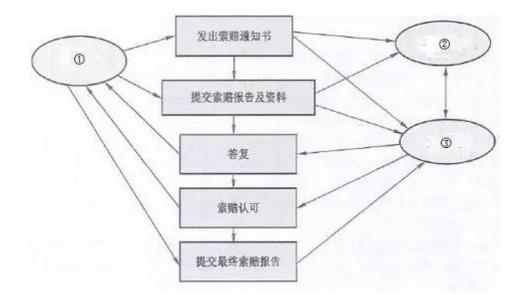

A.成本补偿合同也称成本加酬金合同,承包人无成本风险

B.总价合同又称固定价格合同,适用于工期短、风险大的项目

C.工时和材料合同又称单价合同,是综合了固定价格合同和成本补偿合同两者优点的一种合同类型 D. 固定单价合同中合同单价一次性明确, 固定不变, 即不再因为环境的变化和工程量的增减而变化

#### 【试题 60】---2017 上真题 61

60、某项目因甲方不能提供实施环境，严重影响了项目进度， 为此项目组按下列流程提出了索赔。 图中各方指的是（）。

A.①招标单位②承建单位③建设单位    B.①政府部门②建设单位③承建单位

C.①建设单位②承建单位③监理单位     D.①承建单位②建设单位③监理单位

#### 【试题 61】---2017 下真题 57

61、某系统集成商中标一个县政府办公系统的开发项目，该项目在招标时已经明确确定该项目的 经费不超过 150 万元，此项目适合签订（）。

A.工料合同    B.成本补偿合同    C.分包合同    D.总价合同

#### 【试题 62】---2017 下真题 58

62、某系统集成商中标一个县政府办公系统的开发项目，在合同执行过程中，县政府提出在办公 系统中增加人员考勤管理的模块，由于范围发生变化，合同管理人员需要协调并重新签订合同， 该合同的管理内容属于（）。

A.合同签订管理    B.合同履行管理    C.合同变更管理    D.合同档案管理

#### 【试题 63】---2018 上真题 57

63、（）类合同的适用范围比较宽， 风险可以得到合理的分摊， 但在履行中需要注意双方对实际工 作量的确认。

A.总价    B.成本补偿    C.工料    D.分包

#### 【试题 64】---2018 上真题 58

64、合同变更处理的首要原则是（）。

A.公平合理    B.经济利益优先    C.安全环保    D. 甲方优先

#### 【试题 65】---2018 下真题 57

65、关于项目合同的分类，正确的是:()

A.信息系统工程项目合同通常按照信息系统范围和项目总价划分

B.需要立即开展工作的项目不适宜采用成本补偿合同

C.工程量大、工期较长、技术复杂的项目宜采用总价合同

D.工料合同兼有成本补偿合同和总价合同的特点，适用范围较宽

#### 【试题 66】---2018 下真题 58

66、合同变更的处理由（）来完成

A.配置管理系统    B.变更控制系统    C.发布管理系统    D.知识管理系统

#### 【试题 67】---2019 上真题 57

67、（）的项目不适合使用总价合同。

A.工程量不大且能精确计算    B.技术不复杂    C.项目内容未确定    D.风险较小

#### 【试题 68】---2019 上真题 58

### 68、合同变更一般包括以下活动:

①变更实施②变更请求审查③变更批准④变更提出

上述活动正确的排列顺序是()

A.①②③④    B.④②③①    C.④①③②    D.④③①②

#### 【试题 69】---2019 下真题 56

69、成本补偿合同不适用于（）的项目。

A.需立即开展工作

B.对项目内容和技术经济未确定

C.风险大

D.工程量不大、且能精准计算工期、工期较短。

#### 【试题 70】---2019 下真题 57

70、关于合同变更的描述，不正确的是（）。

A.对于任何变更的评估都应该有变更影响分析

B.合同变更时应首先确定合同变更价款，然后确定合同变更量清单

C.合同中已有适用于项目变更的价格，按合同己有的价格变更合同条款 D.合同变更申请、变更评估和变更执行等必须以书面形式呈现

十一、项目采购管理

#### 【试题 1】---2009 上真题 57

1、（1）活动应在编制采购计划过程中进行。

（1）A.自制或外购决策     B.回答卖方的问题    C.制订合同    D.制订 RFP 文件

#### 【试题 2】---2009 上真题 58

2、采购审计的主要目的是（2）。

（2）A.确认合同项下收取的成本有效、正确      B.简要地审核项目

C.确定可供其他采购任务借鉴的成功之处    D.确认基本竣工

#### 【试题 3】---2009 下真题 34

3、某单位要对一个网络集成项目进行招标， 由于现场答辩环节没有一个定量的标准，相关负责人 在制定该项评分细则时规定本项满分为 10 介， 但是评委的打分不得低于 5 分。这一规定反映了制 定招标评分标准时（3）。

（3）A.以客观事实为依据       B.得分应能明显分出高低

C.严格控制自由裁量权     D.评分标准应便于评审

#### 【试题 4】 ---2009 下真题 61

4、在采购中，潜在卖方的报价建议书是根据买方的（4）制定的。

（4）A.采购文件 B.评估标准    C.工作说明书    D.招标通知

#### 【试题 5】---2009 下真题 62

5、在对某项目采购供应商的评价中， 评价项有技术能力、管理水平、企业资质等，假定满分为 10 分，技术能力权重为 20% ，3 个评定人的技术能力打分分别为 7 分， 8 分， 9 分，那么该供应商的 “技术能力,,的单项综合分为（5）。

（5）A.24        B.8        C.4 .8        D.1 .6

#### 【试题 6】---2010 上真题 51

6、小王为本公司草拟了一份计算机设备采购合同， 其中写到“乙方需按通常的行业标准提供技术 支持服务”。经理审阅后要求小王修改， 原因是（6）。

（6）A.文字表达不通顺                   B.格式不符合国家或行业标准的要求

C.对合同标的的描述不够清晰、准确    D.术语使用不当

#### 【试题 7】---2010 上真题 60

7、以下关于采购工作说明书的叙述中，（7）是错误的。

（7）A.采购说明书与项目范围基准没有关系

B.采购工作说明书与项目的工作说明书不同

C.应在编制采购计划的过程中编写采购工作说明书

D.采购工作说明书定义了与项目合同相关的范围

#### 【试题 8】---2010 上真题 63

8、某项采购已经到了合同收尾阶段，为了总结这次采购过程中的经验教训，以供公司内的其他项 目参考借鉴，公司应组织（8）。

（8）A.业绩报告         B.采购评估      C.项目审查   D.采购审计

#### 【试题 9】 ---2010 下真题 60

9、某项目建设方没有聘请监理，承建方项目组在编制采购计划时可包括的内容有（9）。 ①第三方系统测试服务；     ②设备租赁；    ③建设方按照进度计划提供的货物； ④外部聘请的项目培训；

（9）A.①②③       B.②③④      C.①③④      D.①②④

#### 【试题 10】---2010 下真题 61

10、编制采购计划时，项目经理把一份“计算机的配置清单及相关的交付时间要求”提交给采购 部。关于该文件与工作说明书的关系， 以下表述（10）是正确的。

（10）A.虽然能满足采购需求，但它是物品清单不是工作说明书

B.该清单不能作为工作说明书， 不能满足采购验收需要

C.与工作说明书主要内容相符

D.工作说明书由于很专业应由供应商编制

#### 【试题 11】---2011 上真题 58

11、某企业在项目实施过程中，为降低项目成本、更好的满足客户需求，按照以下流程对项目所 需的部分产品进行了采购：

① 记录项目对于产品、服务或成果的需求，并且寻找潜在的供应商；

② 从供应商处获取相关信息、报价和建议书；

③ 审核所有建议书， 在供应商中进行选择，并与选中者谈判签订最终合同；

④ 管理合同以及买卖双方的关系，并管理与合同相关的变更。

该企业的采购流程缺少了（11）环节。

（11）A.编制采购计划    B.编制询价计划   C.询价、招投标   D .合同管理和收尾

#### 【试题 12】---2011 下真题 60

12、某公司承担了一项系统集成项目，正在开发项目适用的软件系统，但是需要从其他公司购买 一些硬件设备。该公司的转包合同负责人应当首先准备一份（12）。

（12）A.项目章程      B.项目范围说明书     C.工作说明书     D.外包合同

#### 【试题 13】---2011 下真题 61

13、投标人会议是在（13）过程中采用的一种方法。

（13）A.开标       B.询价        C.评标           D.投标

#### 【试题 14】---2012 上真题 60

14、某项目经理要求采购管理员从外面供货商那里采购硬件设备时，需要准备一个（14）以描述 采购设备的相关质量技术指标、验收标准和付款方式与期待等内容。

（14）A.工作说明书    B. 合同范围说明       C. 项目章程       D.合同

#### 【试题 15】---2012 上真题 61

15、在采购管理中， 编制询价计划需要用到（15）。

（15）A.标准表格    B.评估标准    C.采购管理计划  D.采购文件

#### 【试题 16】---2012 下真题 59

16、某系统集成一级企业年项目合同额近 3 亿元。采购部门   从交换机商家定购事务的大量的采 购任务，下面的采购措施中， 不可能的是（16）  。

（16）A.为防止采购人员可能出现经济问题，所有产品都按照统一规则、统一方法进行采购

B.按照重量粒度将产品分为 A 级、B 级、C 级， 分别制定采购规则，A 类产品要通过招标， C 类产品可简化采购手续

C.无论采购产品还是服务，都要建立对供应商的评价制度

D.建立和维护合格供应商名录来缩小采购选择的范围

#### 【试题 17】---2012 下真题 62

17、某项目采购人员接到一个紧急采购任务后启动了询价流程。关于询价，下面说法不正确的是 （17） 。

（17）A.询价就是询问卖方的产品价格

B.询价主要是以卖方处获取如何满足项目需要的答复

C.询价过程是确定合格供应商名单

D.询价过程中却使卖方参与了大部分工作， 买方也无需为其直接支付费用

#### 【试题 18】---2012 下真题 67

18、某公司现有的职员能轻易满足某新项目的一部分要求，但是这个项目的其他方面对该公司 来 说是新的。项目经理经过调研了解到一些供应商专业生产这类产品，可能能满足项目很多 或全部 需要。项目经理在准备项目计划和决定怎样招聘最佳人选及处理所需要的资源时，首 先应该（18 （18）A.进行自制/外购分析

B.进行市场调查

C.通过邀请提交建议书（RFP）向供应商征求方案来决定是否将项目外包出去

D.评审公司采购部门提供的合格的卖方名单， 并向选定的卖方发邀请提交建议书

#### 【试题 19】---2013 上真题 51

19、某公司现有的职员能轻易满足某新项目的一部分要求，但是这个项目的其他方面对该公司 来  说是新的。项目经理经过调研了解到一些供应商专业生产这类产品，可能能满足项目很多 或全部  需要。项目经理在准备项目计划和决定怎样招聘最佳人选及处理所需要的资源时，首 先应该（19。）

（19）A.进行自制/外购分析

B.进行市场调查

C.通过邀请提交建议书（RFP）向供应商征求方案来决定是否将项目外包出去

D.评审公司采购部门提供的合格的卖方名单， 并向选定的卖方发邀请提交建议书

#### 【试题 20】---2013 上真题 59

20、用来征求潜在供应商建议的文件一般称为（20）。

（20）A.RFI        B.IFB      C.RFQ              D.RFP

#### 【试题 21】---2013 上真题 60

21、技术部给采购部提供了一份采购产品的技术标准和要求，这份文件可被称做（21）。

（21）A.项目建议书    B.工作说明书    C.工作包    D.项目范围说明书

#### 【试题 22】---2013 上真题 61

22、在项目采购中经常使用询价过程， 询价过程的输出不包括 22  。

（22）A.合格卖方清单    B.采购工作说明书    C.采购建议书     D.采购管理计划

#### 【试题 23】---2013 下真题 23

23、编制询价计划的过程是为下一步招标所需要的文件做准备，并确定“选择”所需要的评定标 准。（23）不属于编制询价计划过程的输出。

（23）A.采购建议书   B.采购文档   C.评估标准    D.更新的工作说明书

#### 【试题 24】---2013 下真题 30

24、某信息系统集成项目经理需要为项目采购硬件设备，那么项目经理需要在（24）中对该采购 物品进行描述。

（24）A.建议邀请书     B.合同     C.合同范围说明书     D.项目工作说明书

#### 【试题 25】---2013 下真题 53

25、编制询价计划的过程是为下一步招标所需要的文件做准备，并确定“选择供方”所需要的评 定标准，（25）不属于编制询价计划过程的输出

（25）A.采购建议书 B.采购文档 C.评估标准 D.更新的工作说明书

#### 【试题 26】---2014 下真题 61

26、某系统集成项目的项目经理需采购第三方软件插件，在编制询价计划时，由于待采购软件插 件比较专业，为了更加明确采购需求， 该项目经理需要使用的文件为（）。

（26）A.供应商意见书  B.方案邀请书  C.投标邀请书   D.报价邀请书

#### 【试题 27】---2014 下真题 62

27、某项目经理在执行项目时，在详细了解了项目所需要采购的产品和服务后，制订了包含如下 所示的采购说明书模板让采购人员填写。该工作说明书中缺少了（）。

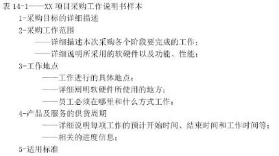

（27）A.拟采购产品和服务的规格说明  B.验收标准  C.质量要求  D.工作方式

#### 【试题 28】---2015 上真题 61

28、采购是项目管理工作的重要组成部分。以下关于采购的叙述中，（）是不正确的。

A.采购管理计划是评估卖方的衡量指标    B.采购工作说明书不是来自于项目范围基准

C.采购工作说明书描述采购产品的细节    D.采购管理计划确定采用的合同类型

#### 【试题 29】---2015 上真题 62

29、采购文件可用于识别干系人过程， 因为这些文件（）。

A.是事业环境因素，并且是过程的输入 B.是组织过程资产，并且是过程的输入

C.将关键干系人标注为合同中的当事方 D.作为设立干系人优先级并将干系人分类的一种方式

#### 【试题 30】---2015 下真题 61

30、项目采购计划的编制需要有适宜的方法，以规避项目风险，实现项目本目标，（ ）不属于项 目采购计划编制采用的技术

（30）A.专家判断 B.合同类型  C. 自制/采购分析  D.工作说明书

#### 【试题 31】---2016 上真题 62

31、以下关于工作说明书 SOW 的叙述中，不正确的是（31）。

A.SOW 包括的主要内容有前言、服务范围、方法、假设条件、变更管理等 B.采购过程中，不能修改 SOW

C.对内部项目而言， SOW 有时可称为任务书

D.SOW 与范围说明书不同， SOW 是对项目所要提供的产品、成本或服务的描述

#### 【试题 32】---2016 下真题 59

32、实施采购过程中往往需要综合采用多种方法， 来保证采购能够顺利进行。（）不属于实施采购 过程中需要用到的方法和技术。

A.投标入会议   B.“ 自制/外购”分析   C.独立估算     D.采购谈判

#### 【试题 33】---2016 下真题 60

33、采购过程需要进行控制，以发现采购计划与实施采购过程中的偏差。以下关于采购控制的叙 述中，不正确的是（）。

A.控制采购过程是买方需要做的，卖方不需要控制采购

B.控制采购是管理采购关系、监督合同执行情况，并根据需要实施变更和采取纠正措施的过程

C.控制采购过程中可通过绩效评估， 预测卖方未来项目执行能力

D.控制采购中需要进行财务管理工作

#### 【试题 34】---2017 上真题 58

34、小王作为某项目的项目经理,决定采用投标人会议的方式选择卖方。以下做法中,正确的是：（）。 A. 限制参会者提问的次数，防止少数人问太多的问题

B. 防止参会者试下提问

C.小王不需要参加投标人会议,只需采购管理员参加即可

D.设法获得每个参会者的机密信息

#### 【试题 35】---2017 上真题 59

35、合同变更控制系统用来规范合同变更，保证买卖双方在合同变更过程中达成一致,其内容不包 括（）。

A.变更跟踪系统    B.变更书面记录    C.变更争议解决程序    D.合同审计程序

#### 【试题 36】---2017 下真题 59

36、对于提供长期（一般为 3 年）涉外人力资源外包服务的软件企业，面对国际金融汇率波动较 大和区域人力资源成本攀升速度较快的情况，应与客户签订（） 类合同。

A. 固定总价合同    B.成本补偿合同    C.工时合同    D.总价加经济价格调整合同

#### 【试题 37】---2017 下真题 60

37、以下关于说明书（SOW）的叙述中，不正确的是（）。

A.SOW 的内容主要包括服务范围、方法、假定、工作量、变更管理等

B. 内部的 SOW 有时可称为任务书

C.SOW 的变更应由项目变更控制过程进行管理

D.SOW 通过明确项目应该完成的工作来确定项目范围

#### 【试题 38】---2018 上真题 59

38、采购人员按照（）的安排实施采购活动。

A.采购工作说明书    B.需求文档    C.活动资源需求    D.采购计划

#### 【试题 39】---2018 上真题 60

39、关于控制采购的描述，不正确的是:（）。

A.控制采购是管理采购关系、监督合同执行情况， 并依据需要实施变更和采取纠正措施的过程 B.采购是买方行为， 卖方不需要控制采购过程

C.控制采购过程中， 还需要财务管理工作

D.控制采购可以保证采购产品质量的控制

#### 【试题 40】---2018 下真题 59

40、项目经理赵某负责公司的大数据分析平台项目，搭建该平台需要大规模的计算能力。经过市场 调研，国内 A 公司可提供大规模计算服务。赵某在编制项目的采购计划时，正确的做法是:  ()

A.直接把 A 公司的大规模计算服务列入采购计划

B.将国际上最先进的高性能计算服务器列入采购计划

C.考虑项目管理计划、项目需求文档、活动成本估算等输入

D.以 A 公司的采购政策和工作程序作为采购指导

#### 【试题 41】---2018 下真题 60

### 41、控制采购的输入不包括()

A.合同管理计划    B.采购档案    C.合同    D.采购文件

#### 【试题 42】---2019 上真题 59

42、关于“自制/外购”分析的描述不正确的是（）。

A.有能力自行研制某种产品的情况下也有可能需要外部采购

B.决定外购后，需要进一步分析是购买还是租借

C.总价合同对进行“自制/外购”分析过程没有影响

D.任何预算限制都有可能影响“自制/外购”分析

#### 【试题 43】---2019 上真题 60

43、（）不属于控制采购过程的工具与技术。

A.工作绩效信息    B.合同变更控制系统    C.采购绩效审计    D.检查与审计

#### 【试题 44】---2019 下真题 58

44、“自制/外购”分析过程中，（）时，项目不应从外部进行采购。

A. 自制成本高于外购

B.与其他项目有资源冲突

C.项目需要保密

D.技术人员能力不足

#### 【试题 45】---2019 下真题 59

45、关于采购谈判的描述，不正确的是（）。

A.采购谈判过程中以买卖双方签署文件为结束标志

B.项目经理应是合同的主谈人

C.项目团队可以列席谈判

D.合同文本的最终版本应反映所达成的协议

十二、项目信息（文档）和配置管理

#### 【试题 1】---2009 上真题 45

1、进行配置管理的第一步是（1）。

（1）A.制定识别配置项的准则        B.建立并维护配置管理的组织方针

C.制定配置项管理表           D.建立 CCB

#### 【试题 2】---2009 上真题 47

2、（2）不是创建基线或发行基线的主要步骤。

（2）A.获得 CCB 的授权   B.确定基线配置项 C.形成文件    D.建立配置管理系统

#### 【试题 3】---2010 上真题 64

3、以下关于文档管理的描述中，（3）是正确的。

（3）A.程序源代码清单不属于文档

B.文档按项目周期角度可以分为开发文档和管理文档两大类

C.文档按重要性和质量要求可以分为正式文档和非正式文档

D.《软件文档管理指南》明确了软件项目文档的具体分类

#### 【试题 4】 ---2010 上真题 65

4 、 配置识别是软件项目管理中的一项重要工作，它的工作内容不包括（4）。

（4）A.确定需要纳入配置管理的配置项      B.确定配置项的获取时间和所有者

C.为识别的配置项分配唯一的标识      D.对识别的配置项进行审计

#### 【试题 5】---2010 上真题 66

5、某开发项目配置管理计划中定义了三条基线， 分别是需求基线、设计基线和产品基线，（5）应 该是需求基线、设计基线和产品基线均包含的内容。

（5）A.需求规格说明书   B.详细设计说明书   C.用户手册   D.概要设计说明书

#### 【试题 6】---2011 上真题 60

6、在管理信息系统的开发过程中用到很多图表，对这些图表进行有规则的编号， 可以方便图表的 查找。根据生命周期的 5 个阶段，可以给出下图所示的分类编号规则，其中第 3、4 位应该表示（6）。

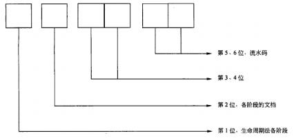

（6）A.文档页数        B.文档编号    C.文档内容    D.文档目录

#### 【试题 7】---2011 上真题 61

7、件开发项目中的很多过程产出物都属于配置项， 一般意义上来讲， 以下可以不作为配置项的是 （7）。

（7）A.项目计划书      B.需求文档        C.程序代码        D.会议记录

#### 【试题 8】---2011 上真题 62

8、某系统集成企业为做好项目配置管理，对配置库中的操作权限进行了以下定义：

| 权限 | 内容 |
|---|---|
| Read | 可以读取文件内容 ，但不能对文件进行变更 |
| Check | 可使用[checkin]等命令，对文件内容进行变更 |
| Add | 可使用[文件的追加]、 [文件的重命名]、[删除]等命令 |
| Destroy | 有权进行文件的不可逆毁坏 、清除、rollback 等命令 |

同时， 对项目相关人员在该产品库中的操作权限进行了如下分配， 其中J表示该人员具有相 应权限，x表示该人员没有相应权限

| Release（产品库） | Release（产品库） | Release（产品库） | Release（产品库） | Release（产品库） | Release（产品库） |
|---|---|---|---|---|---|
| 人员权限 | 项目经理 | 项目成员 | QA | 测试人员 | 配置管理员 |
| Read | + | + | + | + | + |
| Check | ① | ② | ③ | ④ | ⑤ |
| Add | 根 | 根 | 根 | 根 | + |
| Destroy | 根 | 根 | 根 | 根 | + |

其中J表示该人员具有相应权限，x表示该人员没有相应权限，则产品库权限分配表中用①②③ ④⑤标出的位置，应填写的内容为（8）。

（8）A.①J；②x；③x；④J； ⑤J    B.①x；②x； ③x；④x；⑤J

C.①J；②J；③J； ④x；⑤J     D.①x；②J；③x；④x； ⑤J

#### 【试题 9】 ---2011 下真题 65

9、以下关于配置项的描述中， 不正确的是（9）。

（9）A.使用配置管理工具后，所有配置项要以一定的目录结构保存在配置库中 B.所有配置项的操作权限应该由项目经理严格统一管理

C.所有配置项都必须按照相关规定进行统一编号

D.基线配置项要向软件开发人员开放读取的权限

#### 【试题 10】---2011 下真题 66

10、配置项的版本号规则与配置项的状态相关， 以下叙述中正确的是（10）。

（10）A.处于“正式”状态的配置项版本号格式为 X.Y，当配置项升级幅度较大时， 可以将变动 部分制作为配置项的附件，附件版本依次为 1.0，1.1，

B.处于“修改”状态的配置项版本号格式为 X.YZ，其中 X 保持不变， YZ 在 01~99 之间递增

C.处于“草稿”状态的配置项版本号格式为 0.YZ，随着草稿的修改， YZ 取值逐步递增， 而 YZ 的初值和幅值由用户自行把握

D.处于“草稿”状态的配置项版本号格式为 X.YZ，当配置项通过评审， 状态第一次成为 “正式”时，版本号直接设置为 1.0

#### 【试题 11】---2012 上真题 64

11、信息系统文档的管理主要体现在文档书写规范、图表编号规则、文档目录编写标准和（11） 等几个方面。

（11）A.文档管理方法   B.文档管理制度  C.建立文档规范  D.文档使用权限控制重

#### 【试题 12】---2012 上真题 65

12、下面任务中，（12）不是在配置管理过程中执行的内容。

（12）A.确认一个条目或一个系统的功能和物理特征

B.针对特证控制变更

C.对项目范围进行审核以检验当前的项目是否与预定的要求相符

D.允许对变更自动承认

#### 【试题 13】---2012 上真题 66

13、如果一个配置项的版本号为 1 .1，那么这个配置项处于（13）状态。

（13）A.草稿  B. 正式   C.修改 D. 完成

#### 【试题 14】---2013 上真题 27

14、配置管理作为项目综合变理管理的重要支持，为项目综合变理管理提供了标准化的，有效率 的变理管理平台，配置管理系统在项目变更中的作用不包括  14  。

（14）A.建立一种前后一致的变理管理方法    B.定义变理控制委员会的角色和责任

C.提供改进项目的机会               D.提供了统一的变理发布方发

#### 【试题 15】---2013 上真题 62

15、配置识别是配置管理的一个要素，包括选择一个系统的配置项和在技术文档中配置项目的功 能和物理特性， （15）是配置管理员的关键职责。

（15）A.识别软件开发中产生的所有工作结果

B.给每个产品及其组件和相关的文档分配标识

C.定议每个配置项目的重要特征以及识别其所有者

D.修改基线

#### 【试题 16】---2013 上真题 63

16、从软件开发生命周期的角度划分， 可将项目文档分为开发文档、产品文档和（16）。

（16）A.记录文档    B.测试文档    C.维护文档   D.管理文档

#### 【试题 17】---2013 上真题 64

17、软件开发项目中选用了配置管理工具对文档进行管理，下面关于配置权限符合配置管理要求 的是（17）。

（17）A.测试报告向项目经理开放读取权限     B.源代码向质保人员开放读写权限

C.需求说明书向测试人员工放读写权限   D.所有配置权限都由项目经理严格管理

#### 【试题 18】---2013 上真题 65

18、配置项的版本控制作用于多个配置管理活动之中，如创建配置项，配置项的变更和配置项的 评审等。下面关于配置项的版本控制的描述中，（18）是正确的。

（18）A.在项目开发过程中，绝大部分的配置项目都要经过多次的修改才能最终确定下来 B.对配置项的修改不一定产生新版本

C.版本控制的目的是按照一的规则有选择地保存配置项的必要的版本

D. 由于我们保证新版本一定比旧版本好，所以可以抛弃旧版本

#### 【试题 19】---2013 下真题 64

19、（19）不属于配置是别的内容。

（19）A.给每个产品和它的组件及相关的文档分配唯一的标识

B.  定义每个配置项的重要特征以及识别其所有者

C.  维护文档和组件的修订与产品版本之间的关系

D.  确定配置库程序的标志和管理机制

#### 【试题 20】---2013 下真题 65

20、以下关于版本控制的说法中，（20）是错误的。

（20）A.  版本管理主要控制配置项的创建过程

B.  软件开发过程中，绝大多数配置项都要经过多次修改才能最终确定下来 C.  对配置项的任何修改都将产生新的版本

D.  版本控制的目的是避免版本丢失或混饶等现象

#### 【试题 21】---2014 上真题 55

21、软件配置管理（SCM）是一组用于在软件（21）管理变化的活动。

（21）A.交付使用后   B.开发过程中   C.整个生命周期内   D.测试过程中

#### 【试题 22】---2014 上真题 56

22、（22）可作为软件生存期中各开发阶段的一个质量检查点。

（22）A.配置项   B.程序  C.基线   D.过程

#### 【试题 23】---2014 上真题 65

23、某软件开发项目中将《详细设计说明书》作为配置项，项目的开发人员正在编写一份《详细 设计说明书》的版本号为 V0.1，此后他对这份文件进行了修改并保存，版本号应升级为（23）

（23）A.V0.2            B.V0.5       C.V1.0                  D.V1.1

#### 【试题 24】---2014 下真题 64

24、建立配置管理方案首先要组建配置管理方案构造小组， 该小组包括四类成员，其中设计人员、 编码人员、测试人员均属于（24）。

（24）A.小组负责人   B.技术支持专家  C.配置管理技术专家  D.配置管理系统用户代表

#### 【试题 25】---2014 下真题 65

25、某软件集成公司承接了一个软件开发项目，需求分析师张工在公司刚完成的类似项目的需求 规格说明书 V3.0 版本上， 增加了新项目的需求， 拟准备和用户开会讨论确认， 此时需求规格说明

书的版本是（25）。

（25）A.V0.1      B.V3.1      C.V1.0      D.V3.01

#### 【试题 26】---2014 下真题 70

26、在进行项目文档及配置管理时，引入“基线”这一概念的目的是（26）。

（26）A.保证成果的完整与正确   B.合理分配权限

C.保证成果相互依赖性     D.合理控制变更

#### 【试题 27】---2015 上真题 64

27、配置识别是配置管理的一项活动，包括选择一个系统的配置项和在技术文档中记录配置项的 功能和物理特性。其功能不包括（）。

A.识别需受控的软件配置项                 B.建立和控制基线

C.识别组件、数据及产品获取点和准则       D.识别源程序

#### 【试题 28】---2015 上真题 65

28、配置项的状态可分为“草稿”、“正式”和“修改”三种。以下关于三种状态变化的叙述中() 是正确的。

A. “草稿”经过修改未通过评审时， 状态为“修改 ”

B. “草稿”经过修改未通过评审时，状态仍为“草稿”

C. “草稿”经过修改通过评审时， 状态为“修改 ”

D. “正式”的配置项发生变更，状态变为“草稿 ”

#### 【试题 29】---2015 下真题 63

29、关于软件配置管理中的“基线“这一概念的理解，不正确的是( )

（29）A.软件开发中的所有配置项不一定都要建立基线

B.对基线配置项设置操作权限的基本原则： 向软件开发人员开发读取的权限 C.基线中的配置项将不能再被更改

D.建立和控制基线是配置识别所包含的内容之一

#### 【试题 30】---2015 下真题 64

30、对于软件开发项目来说，基线是软件生存期各个开发阶段的工作成果，测试阶段的基线( ) （30）A.可提交软件  B.被测试的程序  C.提交报告  D.测试报告

#### 【试题 31】---2015 下真题 65

31、如果一个配置项的版本号为 1.1，那么这个配置处于（ ）状态。

（31）A.草稿  B.正式发布  C.修改  D.完成

#### 【试题 32】---2016 上真题 63

32、《计算机软件产品开发文件编制指南》明确了软件文档分为（32）三种类型。

A.需求文档、设计文档、总结文档           B.开发文档、实施文档，验收文档

C.需求说明书、详细设计说明书、操作手册   D.开发文档、产品文档、管理文档

#### 【试题 33】---2016 上真题 64

33、以下关于基线和配置项的叙述中， 不正确的是（33）。

A.所有配置项的操作权限应由变更管理委员会严格管理

B.基线配置项向软件开发人员开放读取的权限

C.非基线配置项可能包含项目的各类计划和报告等

D.每个配置项的基线都要纳入配置控制，对这些基线的更新只能采用正式的变更管理过程

#### 【试题 34】---2016 上真题 65

34、配置项的状态可分为“草稿”、“正式”和“修改”三种。以下关于配置项状态的叙述中， 不正确的是：（34）。

A.配置项处于“草稿”状态时，版本号格式为 0.YZ

B.配置项第一次成为“正式”文件时，版本号为 1.0

C.配置项处于“修改”状态时， 版本号应改回 0.YZ

D.对于配置项的任何版本都应该保存，不能抛弃旧版本

#### 【试题 35】---2016 下真题 61

35、软件文档分为（）三类。

A.需求分析文档、设计文档、编码文档

B.开发文档、实施文档、维护文档

C.项目文档、产品文档、培训文档

D.开发文档、产品，文档、管理文档

#### 【试题 36】---2016 下真题 62

36、配置项的状态可分为草稿、（）、修改三种， 下图体现了配置项的状态变化。

A.发布    B.正式   C.基线    D.基准

#### 【试题 37】---2016 下真题 63

37、配置控制与变更包含着几个重要的任务，变更申请、变更评估、通报评估结果、变更实施、 变更验证与确认、变更发布等。其中变更实施的主要负责人一般是（）。

A.CCB       B.项目经理   C.配置管理员     D.QA

#### 【试题 38】---2016 下真题 66

38、在以下基于配置库的变更控制的图示中，①应为（）。

A.读写   B.删除   C.变更    D.复制

#### 【试题 39】---2017 上真题 60

39、编写配置管理计划、识别配置项的工作是（）的职责。

A.配置管理员    B.项目经理    C.项目配置管理委员会    D.产品经理

#### 【试题 40】---2017 上真题 62-63

40、配置库可用来存放配置项并记录与配置项相关的所有信息，是配置管理的有力工具。根据配 置库的划分，在信息系统开发的某个阶段工作结束时形成的基线应存入（）；开发的信息系统产品 完成系统测试之后等待交付用户时应存入（）。

（62）A.开发库    B.受控库    C.产品库    D.动态库

（63）A.开发库    B.受控库    C.产品库    D.基线库

#### 【试题 40】---2017 下真题 61

41、项目验收时发现项目经理签字确认的《需求规格说明书》纸质文档内容与配置服务器上的产 品库同一文档内容不一致，最有可能是在（）的执行上出现了问题。

A.文档管理规范   B.文档目录编写标准    C.文档书写规范    D. 图表编号规则

#### 【试题 42】---2017 下真题 62

42、某软件开发项目的《概要设计说明书》版本号为 V2.13，该配置项的状态是（）。 A.首次发布    B.正在修改    C.正式发布  D.草稿

#### 【试题 43】---2018 上真题 61

43、在开发人员编写程序时， 程序的开始要用统一的格式，包含程序名称、程序功能、调用 和被调用的程序、程序设计人等信息， 体现了信息系统文档管理的（）。

A.文档书写规范    B. 图表编写规则    C.文档目录编写标准    D.文档管理制度

#### 【试题 44】---2018 上真题 62

44、配置库的建库模式有多种，在产品继承性较强， 工具比较统一，采用并行开发的组织， 一般会按（）建立配置库。

A.开发任务    B.客户群    C.配置项类型    D.时间

#### 【试题 45】---2018 下真题 61

### 45、质量保证计划属于软件文档中的()

A.开发文档   B.产品文档    C.管理文档    D.说明文档

#### 【试题 46】---2018 下真题 62

46、关于配置库的描述，不正确的是:()

A.开发库用于保存开发人员当前正在开发的配置项

B.受控库包含当前的基线及对基线的变更

C.产品库包含已发布使用的各种基线

D.开发库是开发人员的个人工作区，由配置管理员控制

#### 【试题 47】---2018 下真题 14

47、关于配置管理，不正确的是:()

A.配置管理计划制定时需了解组织结构环境和组织单元之间的联系

B.配置标识包含识别配置项，并为其建立基线等内容

C.配置状态报告应着重反映当前基线配置项的状态

D.功能配置审计是审计配置项的完整性，验证所交付的配置项是否存在

#### 【试题 48】---2019 上真题 61

48、在审查项目需求规格说明书时，发现该文档图编号混乱，建立（）解决上述问题。

①文档管理制度②文档书写规范③图表标号规则④文档加密

A.①②④    B.②③④    C.④②③    D.①③④

#### 【试题 49】---2019 上真题 62

49、研发人员应将正在研发调试的模块、文档和数据元素存入（）。

A.开发库    B.产品库    C.受控库    D.基线库

#### 【试题 50】---2019 下真题 60

50、关于配置管理的描述，不正确的是（）。

A.所有配置项的操作权限，应由配置管理员严格管理

B.配置项的状态分为“草稿”和，“正式”两种

C.配置基线由一组配置项组成，这些配置项构成一个相对稳定的逻辑实体 D.配置库可分为开发库、受控库、产品库三种类型

#### 【试题 51】---2019 下真题 61

51、（）不属于发布管理与交付活动的工作内容。

A.检入    B.复制    C.存储    D.打包

十三、项目变更管理

#### 【试题 1】---2009 下真题 63

1 、变更常常是项目干系人由于项目环境或者是其他各种原因要求对项目的范围基准等进行修改。 如某项目由于行业标准变化导致变更， 这属于（1）。

（1）A.项目实施组织本身发生变化   B.客户对项目、项目产品或服务的要求发生变化

C.项目外部环境发生变化       D.项目范围的计划编制不周密详细

#### 【试题 2】---2009 下真题 64

2、整体变更控制过程实际上是对（2）的变更进行标识、文档化、批准或拒绝，并控制的过程。

（2）A.详细的 WBS 计划    B.项目基准    C.项目预算    D.明确的项目组织结构

#### 【试题 3】---2009 下真题 65

3、项目变更贯穿于整个项目过程的始终，项目经理应让项目干系人（特别是业主）认识到--（3） 。

（3）A.在项目策划阶段， 变更成本较高         B.在项目执行阶段， 变更成本较低

C.在项目编码开始前， 变更成本较低       D.在项目策划阶段，变更成本较低

#### 【试题 4】 ---2009 下真题 66

4、项目规模小并且与其他项目的关联度小时，变更的提出与处理过程可在操作上力求简便和高效。 关于小项目变更，不正确的说法是（4）。

（4）A.对变更产生的因素施加影响以防止不必要的变更并减少无谓的评估

B.应明确变更的组织与分工合作

C.变更流程也要规范化

D.对变更的申请和确认，既可以是书面的也可以是口头的，以简化程序

#### 【试题 5】---2010 下真题 64

5、甲公司承担了某市政府门户网站建设项目，与该市信息中心签订了合同。在设计页面的过程中， 经过多轮讨论和修改，页面在两周前终于得到了信息中心的认可，项目进入开发实施阶段。然而， 信息中心本周提出，分管市领导看到页面设计后不是很满意，要求重新设计页面。但是，如果重 新设计页面，可能会影响项目工期，无法保证网站按时上线。在这种情况下，项目经理最恰当的 做法是（5）。

（5）A.坚持原设计方案， 因为原页面已得到客户认可

B.让设计师加班加点， 抓紧时间修改页面

C.向领导争取网站延期上线，重新设计页面

D.评估潜在的工期风险，再决定采取何种应对措施

#### 【试题 6】---2010 下真题 65

6、某公司最近承接了一个大型信息系统项目，项目整体压力较大，对这个项目中的变更，可以使 用（6）等方式提高效率。

①分优先级处理  ②规范处理  ③整批处理  ④分批处理

（6）A.①②③    B.①②④  C.②③④  D.①③④

#### 【试题 7】---2010 下真题 66

7、合同变更控制系统规定合同修改的过程，包括（7）。

①文书工作     ②跟踪系统     ③争议解决程序     ④合同索赔处理

（7）A.①②③    B.②③④  C.①②④      D.①③④

#### 【试题 8】---2011 下真题 40

8、某信息系统集成项目经理王某收到客户的最新变更要求， 他带领其团队成员经过认真分析， 发 现这次变更将导致项目范围增加近 70%，初步估计成本将增加 5 倍。王某必须要在已被批准的项 目计划中改变原定的开始和结束日期， 那么他的第一步工作应该是（8）。

（8）A.修改合同                   B.增加人员和资源

C.重新制订基准计划            D.采用一个新的目标进度计划

#### 【试题 9】 ---2011 下真题 43

9、某项目小组在定义项目的工作构成时设计一份材料清单来代替工作分解结构 WBS，客户在对 材料清单进行评审时发现其中缺少一项会导致范围变更的需求， 后来这一变更需求被补充了进去。 造成这一次单位变更的主要原因是（9）。

（9）A.设计人员提出了新手段        B.客户对项目要求发生变化

C.项目外部环境发生变化        D.定义项目范围过程中发生的错误和遗漏

#### 【试题 10】---2012 上真题 69

10、在变更管理中，“变更初审”的目的是（10）。

（10）A.确保评估所需信息准备的必要性

B.在干系人间就提出供评估的变更信息达成共识

C.以项目基准为评估依据

D.对变更实施进行监控

#### 【试题 11】---2012 上真题 70

11、进度变更的控制活动包括：（ 11  ）。

（11）A.判断项目进度的当前状态，对造成进度变更的因素施加影响， 查明进度是否已经改变， 在实际变更出现时对其进行调整

B.判断项目进度的当前状态，对造成成本变更的因素施加影响，查明进度是否已经改变， 在实际变更出现时对其进行管理

C.判断项目进度的当前状态，对造成进度变更的因素施加影响，查明进度是否已经改变， 在实际变更出现时对其进行管理

D.判断项目进度的当前状态，对造成进度变更的因素施加影响，查明进度改变的原因，在 实际变更出现时对其进行调整

#### 【试题 12】---2012 下真题 50

12、某软件开发项目进度紧迫,在设计方案还没完成前,项目经理改变计划,停止设计工作, 要

求项目组成员立即转入代码编写。关于项目经理的行为,下面说法正确的是（12） （12）A.项目经理的行为不妥,等 CCB  批准后方可改变计划

B.项目经理有权改变流程,不需审批

C.这种行为属于赶工,项目经理可直接安排实施

D.这种行为属于快速跟进,项目经理有权决定

#### 【试题 13】---2012 下真题 51

13 、 一 家大型信息技术质询公 司的 一 名项目 经理在某软件整合项目进度计 划制订 负责该项目。客户的项目管理层向项目经理提出：市场竞争压力要求项目比计划期提前一个月完 工,他们已经对项目期限进行了审核,认为无法对期限进行缩减,他们同时告诉项目经理如果每 项任务的历时可以削减 10%,这个提前完工的目标就可以实现。在这种情况下,项目经理能够采 取的最合适的措施是（13）。

（13）A.启动变更控制程序,说明项目进度计划需要变更,并审核涉及的风险 B.与团队开会,审核每项任务如何削减 10%,以便满足目标

C.并行进行更多的关键路径任务

D.与管理层一起审核最初的项目计划并讨论压缩进度可以采取的范围变更

#### 【试题 14】---2013 上真题 37

14、某企业的管理系统已进入试运行阶段,公司领导在试用该系统时认为他使用的出差报销表格 的栏目设置不合理,便电话要求负责系统建设的项目经理修改,根据变理管理的要求,项目经理 正确的做法是 14 。

（14）A.告诉公司领导,项目试运行结束后再统一修改

B.让开发人员修,再通知公司领导确认

C.将公司领导的要求记录下来,确认变理内容后提出正式的变理申请

D.亲自督促对该表格的修改,完成后亲自确认并向公司领导汇报。

#### 【试题 15】---2013 上真题 69

15、以下关于项目变更控制委员会的描述中（15）是正确的。

（15）A. CCB 是作业机构

B.CCB 的工作是通过评审手段来决定项目是否能变更,并提出变更方案

C.CCB 是决策机构,又是作业机构

D.CCB 是决策机构

#### 【试题 16】---2013 上真题 70

16、变更管理的工作程序包括：接受变更申请、对变更的初审、（16）、CCB 决定是否批准、发出 变更通知并开始实施、变更实施监控、变更效果评估。

（16）A.变更实施      B.变更方案论证

C.组建 CCB.          D.判断发生变更的项目是辣己纳入正常轨道

#### 【试题 17】---2013 下真题 29

17、某项目经理在项目执行过程中得知公司新的规章将导致该项目绩效的测试发生变化，为了保 证该变更纳入到项目计划之中，项目经理应当（17）。

（17）A.要求召开变更控制委员会议

B.变更工作分解结构、进度计划，以在项目管理计划中反映新的要求

C.准备变更申请

D.反对公司新计划

#### 【试题 18】---2013 下真题 60

18、在进行项目整体变更控制过程中， 首先要受理变更申请，接下来（18）。

（18）A.接受或拒绝变更                     B.执行变更

C.进行变更结果追踪与审核             D .进行变更的整体影响分析

#### 【试题 19】---2013 下真题 66

19、以下有关变更控制方面的描述中，（17）是正确的。

（19）A.任何变更都要得到三方（建设单位、监理单位和承建单位）的，严禁擅自变更 B.承建单位或建设单位是变更的申请者， 监理方不能提出变更申请

C.承建单位提出变更申请， 一般应首先递交业主初审，同意后再确定变更方法 D.建设单位不能提出变更申请

#### 【试题 20】---2013 下真题 67

20、以下关于需求变更策略的叙述中，（20）是错误的。

（20）A.所有需求变更必须遵循变更控制过程

B.对于未获得核准的变更，不应该做变更实现工作

C.完成了对某个需求的变更之后，就可以删除或者修改变更请求的原文档 D.每一个需求变更必须能追溯到一个经核准的变更请求

#### 【试题 21】---2013 下真题 68

21、以下关于变更控制委员会 CCB 的描述中，（21）是正确的。

（21）A.CCB 是作业机构            B.CCB 在审批变更时要提出变更

C.CCB 项目经理不能进入     D.CCB 的权利包含对储备资源的

#### 【试题 22】---2013 下真题 69

22、以下关于变更的流程和规则的做法中，（22）是错误的。

（22）A.以口头方式提出某项变更，在评估前针对该变更提交了书面报告

B.项目组成员变更以邮件发出， 在评审前填写了变更申请

C.为了规范， 监理不对变更进行分级，所有变更流程都不能简化

D.按照影响范围、紧急程度把变更分为 3 个优先级别

#### 【试题 23】---2014 上真题 36

23、在项目变更时， 如果有人要求项目进度提前，那么根据变更控制流程，首先应该（23）。

（23）A.提交书面的进度变更申请单     B.变更的影响分析

C.对该变更接受或拒绝          D.执行变更

#### 【试题 24】---2014 上真题 37

24、整体变更控制过程基于项目的执行情况对项目的过程进行控制。以下关于整体变更控制的描 述，（24）是不恰当的。

（24）A.每一个变更都需要跟踪和确认        B.设置多个变更控制委员会

C.变更过程需要维持所有基线的完整    D.整体变更控制在不同层次上实施

#### 【试题 25】---2014 上真题 64

25、项目发生变更在所难免， 但项目经理应让项目干系人（特别是业主） 认识到（25）

（25）A.在项目策划阶段， 变更成本较高           B.在项目策划阶段， 变更成本较低

C.在项目策划阶段，变更带来的附加值较低   D.在项目执行阶段，变更成本较低

#### 【试题 26】---2014 上真题 67

26、对变更效果的评估是变更管理中非常重要的一环。（26）不属于变更效果评估的内容。

（26）A.项目基准是评估依据             B.是否达到了变更提出时的要求

C.在干系人间就变更达成共识       D.评估变更的效率和效果

#### 【试题 27】---2014 上真题 69

27、依据项目变更管理流程， 项目中的正式变更手续应该由（27）来进行审批。

（27）A.项目经理              B.公司高层领导

C.变更控制委员会         D.公司高层领导与客户方高层领导共同

#### 【试题 28】---2014 上真题 70

28、某项目的项目经理在进行项目范围变更时,在对项目的技术和管理文件做了必要的修改后，他 下一步应该（28）。

（28）A.及时通知项目干系人      B.修改公司的知识管理系统

C.获取客户的正式认可      D.获得政府认可

#### 【试题 29】---2014 下真题 43

29、系统集成公司 A 为保险公司 B 开发非核心业务系统， 项目开发过程中客户常常提出一些新的 要求，如界面上的按钮位置、业务流程上的更改。以下项目经理的做法中，（29）是正确的。

（29）A.对于要求更改操作界面的颜色、按钮位置这样小的变更要求，开发人员可以请示项目经 理后直接更改，不用保存变更记录

B.对于修改业务流程这样的要求， 项目经理可以单独批准

C.项目经理应考虑客户需求方面的变更对进度、成本等方面是否有较大的影响， 如果有较大 影响并决定变更，需要修订相应的项目管理计划及其子计划

D.项目经理应尽量找到有说服力的理由来劝说客户不要进行变更

#### 【试题 30】---2015 下真题 43

30、小张是软件研发和项目经理，负责的某项目已进入实验阶段，此时用户提出要增加一项新的 功能，小张应该( )

（30）A.拒绝该变更        B.通过变更控制流程进行处理

C.立即实现该变更    D.要求客户应先去与公司领导协商

#### 【试题 31】---2015 下真题 43

31、（ ）不属于变更控制过程所包含的变更管理活动

（31）A.识别可能发生的变更      B.维持所有基线的完整性

C.完成防灾演习等特定工作  D.系统升级

#### 【试题 32】---2016 上真题 37~38

32、项目变更是项目管理中的一项重要工作，项目变更控制委员会是（37），其参与变更管理时，

一般不进行（38）工作。

（37）A.执行机构 （38）A.变更执行

B.固定机构

B.变更结果确认

C.决策机构

C.变更计划确认

D.管理机构

D .变更方案选择

#### 【试题 33】---2016 上真题 39

33、变更管理有两个重要的用途， 一是（39）；二是变更度量分析，帮助组织提升自身的项目管理能力。

（1）A.分析变更的原因， 并管理这些原因    B.规避风险， 确保项目顺利

C.限制变更， 维持项目的计划          D.控制变更，保证项目可控

#### 【试题 34】---2016 上真题 47

34、某信息系统集成公司为客户公司开发非核心业务系统，项目开发过程中客户常常提出一些新 的要求， 如界面上的按钮位置、业务流程上的更改等。针对此状况， 项目经理的正确做法是（34）。

A.对于要求更改操作界面的颜色、按钮位置这样小的变更要求，开发人员可以请示项目经理 后直接更改，不用保存变更记录

B.对于修改业务流程这样的要求，项目经理可以单独批准

C.应考虑客户需求方面的变更对进度、成本等方面是否有较大的影响， 如果有较大影响并决 定变更，需要修订相应的项目管理计划及其子计划

D.应尽量找到有说服力的理由来劝说客户不要进行变更

#### 【试题 35】---2017 上真题 44

35、下图是变更控制管理流程图,该流程图缺少（）。

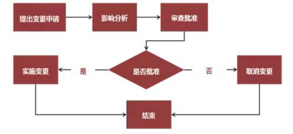

A.评估影响记录    B.配置审计    C.变更定义    D.记录变更实施情况

#### 【试题 36】---2017 上真题 41

36、在项目变更管理中，变更影响分析一般由（）负责。

A.变更申请提出者    B.变更管理员    C.变更控制委员会    D.项目经理

#### 【试题 37】---2017 上真题 59

37、合同变更控制系统用来规范合同变更，保证买卖双方在合同变更过程中达成一致,其内容不包 括（）。

A.变更跟踪系统    B.变更书面记录    C.变更争议解决程序    D.合同审计程序

十四、信息安全管理

#### 【试题 1】---2009 下真题 25

1、应用数据完整性机制可以防止（1） 。

（1）A.假冒源地址或用户地址的欺骗攻击    B.抵赖做过信息的递交行为

C.数据中途被攻击者窃听获取          D.数据在途中被攻击者篡改或破坏

#### 【试题 2】---2009 下真题 26

2、应用系统运行中涉及的安全和保密层次包括 4 层，这 4 个层次按粒度从粗到细的排列顺序是一 （2）。

（2）A.数据域安全、功能性安全、资源访问安全、系统级安全

B.数据域安全、资源访问安全、功能性安全、系统级安全

C.系统级安全、资源访问安全、功能性安全、数据域安全

D.系统级安全、动能性安全、资源访问安全、数据域安全

#### 【试题 3】---2009 下真题 27

3、为了确保系统运行的安全， 针对用户管理， 下列做法不妥当的是（3）  。

（3）A.建立用户身份识别与验证机制，防止非法用户进入应用系统

B.用户权限的分配应遵循“最小特权”原则

C.用户密码应严格保密，并定时更新

D.为了防止重要密码丢失， 把密码记录在纸质介质上

#### 【试题 4】 ---2010 上真题 24

4 、 某机房部署了多级 UPS  和线路稳压器， 这是出于机房供电的（4）需要。

（4）A.分开供电和稳压供电     B.稳压供电和电源保护

C.紧急供电和稳压供电     D.不间断供电和安全供电

#### 【试题 5】---2010 上真题 25

5、以下关于计算机机房与设施安全管理的要求，（5）是不正确的。

（5）A.计算机系统的设备和部件应有明显的标记， 并应便于去除或重新标记 B.机房中应定期使用静电消除剂，以减少静电的产生

C.进入机房的工作人员，应更换不易产生静电的服装

D.禁止携带个人计算机等电子设备进入机房

#### 【试题 6】---2010 上真题 26

6、某企业应用系统为保证运行安全， 只允许操作人员在规定的工作时间段内登录该系统进行业务 操作，这种安全策略属于（6）层次。

（6）A.数据域安全        B.功能性安全  C.资源访问安全       D .系统级安全

#### 【试题 7】---2010 上真题 27

7、基于用户名和口令的用户入网访问控制可分为（7）三个步骤。

（7）A.用户名的识别与验证、用户口令的识别与验证、用户账号的默认限制检查

B.用户名的识别与验证、用户口令的识别与验证、用户权限的识别与控制

C.用户身份识别与验证、用户口令的识别与验证、用户权限的识别与控制

D.用户账号的默认限制检查、用户口令的识别与验证、用户权限的识别与控制

#### 【试题 8】---2010 下真题 32

8、关于计算机机房安全保护方案的设计，以下说法错误的是（8）。

（8）A.  某机房在设计供电系统时将计算机供电系统与机房照明设备供电系统分开

B.某机房通过各种手段保障计算机系统的供电，使得该机房的设备长期处于 7*24  小时连 续运转状态

C.  某公司在设计计算机机房防盗系统时，在机房布置了封闭装置，当潜入者触动装置时， 机房可以从内部自动封闭，使盗贼无法逃脱

D.  某机房采用焊接的方式设置安全防护地和屏蔽地

#### 【试题 9】---2010 下真题 33

9、应用系统运行中涉及的安全和保密层次包括系统级安全、资源访问安全、功能性安全和数据域 安全。以下关于这四个层次安全的，错误的是（9）。

（9）A.按粒度从粗到细排序为系统级安全、资源访问安全、功能性安全、数据域安全

B.系统级安全是应用系统的第一道防线

C.所有的应用系统都会涉及资源访问安全问题

D.数据域安全可以细分为记录级数据域安全和字段级数据域安全

#### 【试题 10】---2010 下真题 34

10、某公司接到通知，上级领导要在下午对该公司机房进行安全检查，为此公司做了如下安排：

①了解检查组人员数量及姓名，为其准备访客证件

②安排专人陪同检查人员对机房安全进行检查

③为了体现检查的公正，下午为领导安排了一个小时的自由查看时间

④根据检查要求，在机房内临时设置一处吸烟区，明确规定检查期间机房内其他区域严禁烟 火

上述安排符合《GB/T 20269-2006  信息安全技术信息系统安全管理要求》的做法是（10）。

（10）A.③④      B.②③       C.①②       D.②④

#### 【试题 11】---2011 上真题 25

11、信息安全的级别划分有不同的维度， 以下级别划分正确的是（11）。

（11）A.系统运行安全和保密有 5 个层次， 包括设备级安全、系统级安全、资源访问安全、功能 性安全和数据安全

B.机房分为 4 个级别： A 级、 B 级、 C 级、 D 级

C.根据系统处理数据划分系统保密等级为绝密、机密和秘密

D.根据系统处理数据的重要性，系统可靠性分 A 级和 B 级

#### 【试题 12】---2011 上真题 26

12、系统运行安全的关键是管理，下列关于日常安全管理的做法，不正确的是（12）。 （12）A.系统开发人员和系统操作人员应职责分离

B.信息化部门领导安全管理组织，一年进行一次安全检查

C.用户权限设定应遵循“最小特权”原则

D.在数据转储、维护时要有专职安全人员进行监督

#### 【试题 13】---2011 上真题 27

13、在某次针对数据库的信息安全风险评估中，发现其中对财务核心数据的逻辑访问密码长期不 变。基于以上现象， 下列说法正确的是（13）。

（13）A.该数据不会对计算机构成威胁，因此没有脆弱性

B.密码和授权长期不变是安全漏洞，属于该数据的脆弱性

C.密码和授权长期不变是安全漏洞，属于对该数据的威胁

D.风险评估针对设施和软件，不针对数据

#### 【试题 14】---2011 下真题 24

14、完整性是信息系统未经授权不能进行改变的特性，它要求保持信息的原样。下列方法中， 不 能用来保证应用系统完整性的措施是（14）。

（14）A.安全协议     B.纠错编码    C.数字签名    D.信息加密

#### 【试题 15】---2011 下真题 25

15、在信息系统安全技术体系中，环境安全主要指中心机房的安全保护。以下不属于该体系环境 安全内容的是（15）。

（15）A.设备防盗器    B.接地和防雷击    C.机房控制    D.防电磁泄漏

#### 【试题 16】---2011 下真题 26

16、物理安全是整个信息系统安全的前提，以下安全防护措施中不属于物理安全范畴的是（16）。 （16）A.安装烟感、温感报警系统，禁止工作人员在主机房内吸烟或者使用火源

B.要求工作人员在主机房内工作时必须穿着防静电工装和防静电鞋， 并定期喷涂防静电剂

C.为工作人员建立生物特征信息库， 并在主机房入口安装指纹识别系统， 禁止未经授权人 员进入主机房

D.对因被解雇、退休、辞职活其他原因离开信息系统岗位的人员， 收回所有相关证件、 徽章、密匙和访问控制标记等

#### 【试题 17】---2011 下真题 27

17、以下各项措施中，不能够有效防止计算机设备发生电磁泄漏的是（17）。

（17）A.配备电磁干扰设备，且在被保护的计算机设备工作时不能关机

B.设置电磁屏蔽室，将需要重点保护的计算机设备进行隔离

C.禁止在屏蔽墙上打钉钻孔，除非连接的是带金属加强芯的光缆

D.信号传输线、公共地线以及电源线上加装滤波器

#### 【试题 18】---2012 上真题 26

18、系统运行安全和保护的层次按照粒度从粗到细排序为（18） 。

（18）A.系统级安全,资源访问安全,数据域安全,功栽性安全

B.系统级安全,资源访问安全,功能性安全,数据域安全

C.资源访问安全,系统级安全,数据域安全,功能性安全

D.资源访问安全,系统级安全,功能性安全,数据域安全

#### 【试题 19】---2012 上真题 27

19、以下不属于主动式攻击策略的是（19）。

（19）A.中断    B.篡改    C.伪造    D.窃听

#### 【试题 20】---2012 下真题 25

20、在信息系统安全管理中,业务流控制,路由选择控制和审计跟踪等技术主要用于提高信息系 统的（20）。

（20）A.保密性        B.可用性         C.完整性       D.不可抵赖性

#### 【试题 21】---2012 下真题 26

21、根据《信息安全技术信息系统安全通用性技术要求 GB/T 27201-2006》,信息系统安全的技术 体系包括（21）。

（21）A.物理安全、运行安全、数据安全     B.物理安全、网络安全、运行安全

C.人类安全、资源安全、过程安全     D.方法安全、过程安全、工具安全

#### 【试题 22】---2012 下真题 29

22、按照系统安全等级中的可靠性等级由高到低分别为（22）。

（22）A.绝密、机密、秘密       B.军用、商用、民用

C.A 级、 B 级、 C 级        D.使用级、修改级、控制级

#### 【试题 23】---2013 上真题 20

23、应用系统运行的安全管理中心,数据域安全是其中非常重要的内容数据域安全包括   23  。

（23）A.行级数据域安全,字段级数据域安全    B.系统性数据域安全,功能性数据域安全

C.数据资源安全,应用性数据安全       D.组织级数据域安全,访问性数据域安全

#### 【试题 24】---2013 下真题 24

24、某公司系统安全管理员在建公司的“安全管理体系”时,根据 GB/T20269-2006《信息安全技  术  信息系统安全管理要求》, 对当前公司的安全风险进行了分析和评估,他分析了常见病毒对  计算机系统、 数据文件等的破坏程度及感染特点,制定了相应的防病毒措施。 这一做法符合（24） 的要求。

（24）A.  资产识别和评估              B.  威胁识别和分析

C.  脆弱性识别和分析            D.  等保识别和分析

#### 【试题 25】---2013 下真题 25

25、信息安全策略应该全面地保护信息系统整体的安全，网络安全体系设计是逻辑设计工作的重 要内容之一，可从物理线路安全、网络安全、系统安全、应用方面来进行安全体系的设计与规则。 其中，数据库的容灾属于（25）的内容。

（25）A.物理线路安全与网络安全           B.网络安全与系统安全

C.物理线路安全与系统安全           D .系统安全与应用安全

#### 【试题 26】---2013 下真题 26

26、以下不属于物理访问控制要点的是（26）。

（26）A.硬件设施在合理范围内是否能防止强制入侵

B.计算机设备的钥匙是否具有良好的控制

C.计算机设备电源供应是否能适当控制在合理的规格范围内

D.计算机设备在搬动时是否需要设备授权通行的证明

#### 【试题 27】---2013 下真题 27

27 、MD5 常用于数据（27）保护。

（27）A.校验     B.完整    C.机密     D.可靠

#### 【试题 28】---2014 上真题 26

28、在设计计算机机房时，（） 做法是不恰当的。

（28）A.机房设置在 20 层大楼的 18 层，该楼层人员流动最少

B.机房设置在大楼偏角上，远离停车场及运输通道等公共区域

C.考察机房所在附近区域，避开油库和其它易燃物

D.为机房设置较完备的中央空调系统，保证机房各区域温度变化满足计算机系统要求

#### 【试题 29】---2014 上真题 27

29、具有保密资质的公司中一名涉密的负责信息系统安全的安全管理员提出了离职申请，公司采 取的以下安全控制措施中，（29）可能存在安全隐患.

（29）A.立即终止其对安全系统的所有访问权限

B.收回所有相关的证件、徽章、密钥、访问控制标志、提供的专用设备等 C.离职员工办理完人事交接，继续工作一个月后离岗

D.和离职人员签订调离后的保密要求及协议

#### 【试题 30】---2014 上真题 30

30、依据 GB/T20271-2006《信息系统安全技术信息系统通用安全技术要求》中的规定，（30）不 属于信息系统安全技术体系包含的内容。

（30）A.物理安全   B.运行安全   C.人员安全   D.数据安全

#### 【试题 31】---2015 上真题 23

31、不同安全等级的安全管理机构应该建立自己的信息系统安全组织机构管理体系。在该体系中， 最低级别的安全管理要求是（）。

A.建立信息安全保密管理部门   B.成立安全领导小组

C.建立安全职务部门           D.配备安全管理人员

#### 【试题 32】---2015 上真题 24

32、信息安全的级别划分为不同的维度，在下列划分中，正确的是（）。

A.系统运行安全和保密有 5 个层次，包括设备级安全、系统级安全、资源访问安全、功能性 安全和数据安全

B.机房分为 4 个级别： A 级、 B 级、 C 级、 D 级

C.根据系统处理数据的重要性，系统可靠性分 A 级和 B 级

D.根据系统处理数据划分系统保密等级为绝密、机密和秘密

#### 【试题 33】---2015 上真题 25

33、下列属于对称密切加密算法的是（）。

A.RSA 加密体制    B.DES 加密体制     C.BCC 加密体制     D.ELGamal 加密体制

#### 【试题 34】---2015 上真题 26

34、针对应用程序或工具在使用过程中可能出现计算、传输数据的泄露和失窃，通过其他安全工 具或策略来消除隐患属于安全保护措施中的（）。

A.应用安全    B.物理安全    C.介质安全     D.数据安全

#### 【试题 35】---2015 下真题 22

35、某公司财务管理数据只能提供给授权用户， 通过采取安全管理措施确保不能被未授权的个人、 实体或过程利用或知悉，以确保数据的（ ）;

（35）A.保密性   B.完整性   C.可用性  D.稳定性

#### 【试题 36】---2015 下真题 23

36、访问控制是信息安全管理的重要内容之一，以下关于访问控制规则的叙述中，（） 是不正确的 （36）A.应确保授权用户对信息系统的正常访问

B. 防止对操作系统的未授权访问

C. 防止对外部网络未经授权进行访问，对内部网络的访问则没有限制

D.访问对应用系统中的信息未经授权进行访问

#### 【试题 37】---2015 下真题 24

37、依据（2007）43 号《信息安全等级保护管理办法》，我国对信息系统的安全保护等级分为() 级

（37）A.三    B.五    C. 四       D.二

#### 【试题 38】---2015 下真题 25

38、为了保护计算机机房及其设备的安全，（ ）做法是不合适的。

（25）A.机房地板的阻止应控制在不易产生静电的范围

B.机房隔壁为卫生间或水房，一旦发生火灾便于取水灭火

C.机房的供电系统应将计算机系统供电与其他供电分开

D.机房设备应具有明显的且无法去除的标记， 以防更换和便于追查

#### 【试题 39】---2015 下真题 26

39、为保障数据的存储和运输安全，防止信息泄露， 需要对一些数据进行加密。由于对称密码算 法（ ），所以特别适合对大量的数据进行加密。

（39）A.比非对称密码算法更安全    B. 比非对称密码算法密钥更长

C. 比非对称密码算法效率更高  D.还能同时用于身份认证

#### 【试题 40】---2016 上真题 24

40、计算机网络安全是指利用管理和技术措施， 保证在一个网络环境里， 信息的（40）受到保护。 A.完整性、可靠性及可用性     B.机密性、完整性及可用性

C.可用性、完整性及兼容性     D.可用性、完整性及冗余性

#### 【试题 40】---2016 上真题 25

41、系统运行的安全检查是安全管理中的一项重要工作，旨在预防事故、发现隐患、指导整改。 在进行系统运行安全检查时， 不恰当的做法是（41）。

A.定期对系统进行恶意代码检查， 包括病毒、木马、隐蔽通道等

B.检查应用系统的配置是否合理和适当

C.检查应用系统的用户权限分配是否遵循易用性原则

D.检查应用系统的可用性， 包括系统的中断时间、正常服务时间、恢复时间等

#### 【试题 42】---2017 上真题 13

42、根据《关于信息安全等级保护工作的实施意见》 ,如信息系统受到破坏后,会对社会秩序和公共 利益造成较大损害,或者对国家安全造成损害,该信息系统应实施（）的信息安全保护。

A.第一级    B.第二级    C.第三级    D.第四级

#### 【试题 43】---2017 上真题 68

43、数字签名技术属于信息系统安全管理中保证信息（）的技术。

A.保密性    B.可用性    C.完整性    D.可靠性

#### 【试题 44】---2017 下真题 22

44、《中华人民共和国网络安全法》与 2017 年 6 月 1  日起开始施行，（）负责统筹协调网络安全工 作和相关监督管理工作。

A. 国务院电信主管部门   B.工业和信息化部主管部门    C.公安部门    D. 国家网信部门

#### 【试题 45】---2017 下真题 69

45、应用系统运行中涉及的安全和保密层次包括系统级安全、资源访问安全、功能性安全和数据 域安全。针对应用系统安全管理，首先要考虑（）。

A.系统级安全    B.资源访问安全    C.功能性安全    D.数据域安全

#### 【试题 46】---2018 上真题 21

46、只有得到允许的人才能修改数据，并且能够判别出数据是否已被篡改，这体现了信息安全的 ()。

A.机密性    B.可用性    C.完整性    D.可控性

#### 【试题 47】---2018 上真题 69

47、关于信息系统岗位人员的安全管理的描述， 不正确的是（）。

A.对安全管理员、系统管理员、重要业务操作人员等关键岗位进行统一管理

B.紧急情况下，关键岗位人员可独自处理重要事务或操作

C.人员离岗后，应立即中止其所有访问权限

D.业务开发人员和系统维护人员不能兼任安全管理员

#### 【试题 48】---2018 上真题 70

48、应用系统运行中涉及的安全和保密层次包括系统级安全、资源访问安全、数据域安全等。 以下描述不正确的是（）。

A.按粒度从大到小排序为系统级安全、资源访问安全、数据域安全

B.系统级安全是应用系统的第一道防线

C.功能性安全会对程序流程产生影响

D.数据域安全可以细分为文行级数据域安全和字段级数据域安全

#### 【试题 49】---2018 下真题 69

49、在信息系统安全技术体系中，安全审计属于()

A.物理安全   B.网络安全    C.数据安全    D.运行安全

#### 【试题 50】---2018 下真题 70

. 根据《信息安全等级保护管理办法》规定，信息系统受到破坏后，会对社会秩序和公共利益造成 严重损害，或者对国家安全造成损害，则该信息系统的安全保护等级为（50）

A.一级    B.二级    C.三级   D.四级

#### 【试题 51】---2019 上真题 69

51、应用系统运行中涉及的安全和保密层次包括系统级安全、资源访问安全、功能性安全和数据 域安全，其中粒度最小的层次是（）。

A.系统级安全    B.资源访问安全    C.功能性安全    D.数据域安全

#### 【试题 52】---2019 上真题 70

52、关于信息系统岗位人员安全管理的描述，不正确的是（）。

A.业务应用操作人员不能由系统管理员

B.业务开发人员不能兼任系统管理员

C.系统管理员可以兼任数据库管理员

D.关键问题人员处理重要事务或操作时，应保持二人同时在场

#### 【试题 53】---2019 下真题 68

53、（）技术不能保障应用系统的完整性。

A.奇偶校验法    B.数字签名    C.物理加密    D.密码校验

#### 【试题 54】---2019 下真题 69

54、关于信息系统岗位人员管理的要求，不正确的是（）。

A.安全管理员和系统管理员不能由一人兼任

B.业务开发人员不能兼任安全管理员、系统管理员

C.系统管理员、数据库管理员、网络管理员不能相互兼任岗位或工作

D.关键岗位在处理重要事物或操作时，应保证二人同时在场

十五、项目风险管理

#### 【试题 1】---2009 上真题 25

1、德尔菲法区别于其他专家预测法的明显特点是（1）。

（1）A.引入了权重参数              B.多次有控制的反绩

C.专家之间互相取长补短        D.至少经过 4 轮预测

#### 【试题 2】---2009 上真题 35

2、既可能带来机会、获得利益， 又隐含威胁、造成损失的风险，称为（2）。

（2） A.可预测风险   B.人为风险   C.投机风险     D.可管理风险

#### 【试题 3】---2009 上真题 37

3、定性风险分析工具和技术不包括（3）。

（3）A.概率及影响矩阵    B.建模技术  C.风险紧急度评估   D.风险数据质量评估

#### 【试题 4】 ---2009 上真题 43

4、在项目管理的下列四类风险类型中，对用户来说如果没有管理好，（4）将会造成最长久的影响。

（4）A.范围风险      B.进度计划风险     C.费用风险      D.质量风险

#### 【试题 5】---2009 下真题 47

5、德尔菲技术作为风险识别的一种方法，主要用途是（5）  。

（5）A.为决策者提供图表式的决策选择次序

B.确定具体偏差出现的概率

C.有助于将决策者对风险的态度考虑进去

D.减少分析过程中的偏见， 防止任何人对事件结果施加不正确的影响

#### 【试题 6】---2009 下真题 48

6、（6）指通过考虑风险发生的概率及风险发生后对项目目标及其他因素的影响， 对已识别风险的 优先缀进行评估。

（6）A.风险管理    B.定性风险分析    C.风险控制    D.风险应对计划编制

#### 【试题 7】---2009 下真题 49

7、风险定量分析是在不确定情况下进行决策的一种量化方法， 该过程经常采用的技术有（7）。

（7）A.蒙特卡罗分析法    B.SWOT 分析法   C.检查表分析法    D.预测技术

#### 【试题 8】---2010 下真题 47

8、在信息系统试运行阶段， 系统失效将对业务造成影响。针对该风险， 如果采取“接受”的方式 进行应对， 应该（8）。

（8）A.签订一份保险合同，减轻中断带来的损失

B.找出造成系统中断的各种因素，利用帕累托分析减轻和消除主要因素 C.设置冗余系统

D.建立相应的应急储备

#### 【试题 9】---2010 下真题 48

9、围绕三点估算技术在风险评估中的应用，以下论述（9）是正确的。

（9）A.三点估算用于活动历时估算，不能用于风险评估

B.三点估算用于活动历时估算， 不好判定能否用于风险评估

C.三点估算能评估时间与概率的关系，可以用于风险评估，不能用于活动历时估算 D.三点估算能评估时间与概率的关系，可以用于风险评估，属于定量分析

#### 【试题 10】---2010 下真题 49

10、下图是某项目成本风险的蒙特卡罗分析图。以下说法中不正确的是（10）。

（10）A.蒙特卡罗分析法也叫随机模拟法

B.该图用于风险分析时，可以支持定量分析

C.根据该图， 41  万元完成的概率是 12%，如果要达到 75%的概率， 需要增加 5 .57  万元 作为应急储备

D.该图显示，用 45 万元的成本也可能完成计划

#### 【试题 11】---2011 上真题 11

11、软件开发项目规模度量 （sizemeasurement） 是估算软件项目工作量、编制成本预算、策划 合理项目进度的基础。在下列方法中，（11） 可用于软件的规模估算，帮助软件开发团队把握开 发时间、费用分布等。

（11）A.德尔菲法       B. V 模型方法        C.原型法       D.用例设计

#### 【试题 12】---2011 上真题 67

12、有关风险识别， 以下说法不正确的是（12）。

（12）A.项目组全体成员参与风险识别

B.识别范围覆盖了项目的整个生命周期

C.风险管理计划是风险识别的输出

D.识别过程中综合运用了多种风险识别的技术和工具

#### 【试题 13】---2011 上真题 68

13、某系统集成企业为做好项目风险管理，给风险定义了 3 个参数：

1、风险严重性：指风险对项目造成的危害程度；

2、风险可能性：指风险发生的几率；

| 参数名 | 等级 | 值 | 描述 |
|---|---|---|---|
| 风险严重性 | 很高 | 5 | 进度延误大于 30%，或者工作量偏差大于 30% |
| 风险严重性 | 比较高 | 4 | 进度延误 20~30%，或者工作量偏差大于 20~ 30% |
| 风险严重性 | 严重 | 3 | 进度延误大于 20%，或者工作量偏差大于 30%。 |
| 风险严重性 | 一般 | 2 | 进度延误大于 10%，或者工作量偏差大于 20%。 |
| 风险严重性 | 轻微 | 1 | 进度延误低于 5%，或者工作量偏差低于 10%。 |

风险可能性等级：

| 参数名 | 等级 | 值 | 描述 |
|---|---|---|---|
| 风险可能性 | 很高 | 5 | 风险发生的几率为 0.8 ~ 1.0（不包括 1.0） |
| 风险可能性 | 比较高 | 4 | 风险发生的几率为 0.6 ~ 0.8（不包括 0.8） |
| 风险可能性 | 高 | 3 | 风险发生的几率为 0.4 ~ 0.6（不包括 0.6） |
| 风险可能性 | 中 | 2 | 风险发生的几率为 0.2 ~ 0.4（不包括 0.4） |
| 风险可能性 | 低 | 1 | 风险发生的几率为 0 ~ 0.2（不包括 0 和 0.2） |

假定该企业将风险系数大于等于 15 的情况定义为红灯状态， 需要优先处理，则下列（13）的情况 属于红灯状态。

（13）A.进度延误 15%，工作量偏差 15%，发生几率为 0 .5

B.进度延误 15%，工作量偏差 35%，发生几率为 0 .2

C.进度延误 25%，工作量偏差 15%，发生几率为 0 .6

D.进度延误 15%，工作量偏差 25%，发生几率为 0 .4

#### 【试题 14】---2011 上真题 69

14、风险紧迫性评估多用于（14）中。

（14）A.风险识别    B.定性风险分析  C.定量风险分析   D.风险应对

#### 【试题 15】---2011 上真题 70

15、决策树分析是风险分析过程中的一项常用技术。某企业在项目风险分析过程中，采用了决策 树分析方法，并计算出了 EMV（期望货币值）。以下说法中，正确的是（15）。

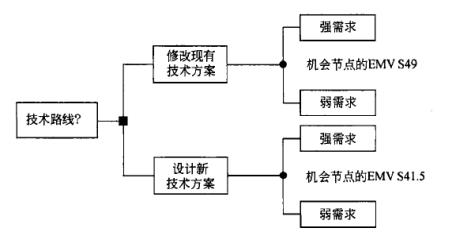

（15）A.以上进行的是定量风险分析，根据分析结果应选择升级当前系统

B.以上进行的是定量风险分析， 根据分析结果应选择全新开发

C.以上进行的是定性风险分析， 根据分析结果应选择升级当前系统

D.以上进行的是定性风险分析，根据分析结果应选择全新开发

#### 【试题 16】---2011 下真题 57

16、德尔菲技术是一种非常有用的风险识别方法，其主要优势在于（16）。

（16）A.可以明确表示出特定变量出现的概率

B.能够为决策者提供一系列图表式的决策选择

C.可以过滤分析过程中的偏见， 防止任何个人结果施加不当的过大影响 D.有助于综合考虑决策者对风险的态度

#### 【试题 17】---2011 下真题 58

17、以下关于定性风险分析的描述中， 不正确的是（17）。

（17）A.定性风险分析需要考虑风险发生的概率及其后果的影响性

B.实施定性风险分析的方法中包括 SWOT 分析法

C.通常情况下技术含量越高的项目，其风险程度也越高

D.定性风险分析的工作成果之一是按优先级形成风险总排队

#### 【试题 18】---2011 下真题 59

18、以下各项中，不属于定量风险分析工作成果的是（18）

（18）A.需优先应对的风险原因     B.项目的概率分析

C.经过量化的风险优先清单   D.实现成本和时间目标的概率

#### 【试题 19】---2012 上真题 54

19、某集成企业在进行风险定性分析时，考虑了风险的几种因素：①威胁，指风险对项目造成的 危害程度；②机会，指对项目带来的收益程度；③紧迫性，对风险退待处置的程度；④风险发生

的概率。关于该公司的定性风险分析， 下列说法中，（19）是不正确的。

（19）A.①X③X④的值越大，则表明风险高，应考虑优先处理

B.②X③X④的值越大，则表明机会大， 应考虑优先处理

C.①X②X④的值越大，则表明风险高、机会大， 应考虑优先处理   。

D.②X④的值越大，则表明机会大，应考虑优先处理

#### 【试题 20】---2012 上真题 55

20、关于项目的风险管理，下列说法中，（20）是不正确的。

（20）A.风险管理包括风险识别、定性分析、定量分析、风险应对、风险监控等过程 B.定性风险分析后，可制定和采取风险应对措施

C.制定了风险应对措施后，可重新进行定量风险分析，以确定风险降低的程度 D.风险管理的最终目标是消除风险

#### 【试题 21】---2012 上真题 56

21、在一个信息系统集成项目中，对项目涉及的客户端、服务器、网络和运行环境等进行集成时， 不确定会遇到什么问题，这对项目来说是一个风险， 因此项目经理计划找一个以前有相关技术经 验的专家来处理这个风险。该应对措施属于（21）

（21）A.风险接受    B.风险转移  C.风险规避 D.风险减轻

#### 【试题 22】---2012 下真题 54

22、根据风险的概率，及其风险发生的影响量对风险进行优先级排列的风险管理步骤是（22）。

（22）A.制订风险管理机制    B.风险识别

C.实施定性风险分析    D.定量风险分析

#### 【试题 23】---2012 下真题 55

23、风险识别的方式从专家争执中收集意见并综合， 从而对将来的可能风险做出预测的风险识别 工具是（23） 。

（23）A.风险分解结构    B.头脑风暴    C.错误方法    D.德尔菲法

#### 【试题 24】---2013 上真题 45

24、风险管理是项目管理中的重要内容，其中风险概率分析是指 24 。

（24）A.  分析风险对项目的潜在影响      B.调查每项具体风险发生的可能性

C.分析风险的可能消极影响         D.分析风险的可能积极影响

#### 【试题 25】---2013 上真题 46

25、建立一个概率模型或者随机过程，使它的参数等于问题的解，然后通过对模型或过程的观察 计算所求参数的统计特征，最后给出所求问题的近似值，解的精度可以用估计值的标准差表示。

这种技术称为  25   方法。

（25）A.  期望货币分析    B.决策树分析    C.蒙特卡洛分析     D.优先顺序图

#### 【试题 26】---2013 上真题 47

26、风险转移是设法将风险的后果连同应对的责任转移到他方的风险应对措施,   26   不属于风 险转移的措施。

（26）A.  履约保证书    B.购买保险    C.第三方担保     D.改变工艺流程

#### 【试题 27】---2013 上真题 54

27、在项目执行阶段,一名团队成员识别了一项新风险,此时,应该（27）。

（27）A.将之涵盖在风险触发因素中     B.对假设条件进行测试

C.将之加入风险管理计划内       D.对风险进行定性分析

#### 【试题 28】---2013 下真题 54

28、以下关于定性风险的说法中,错去的是（28）

（28）A.风险概率分析指调查每项具体风险的发生的可能性

B.风险影响评估旨在分析风险对项目目标的潜在影响

C.风险影响评估值包括消极影响或威胁,不包括积极影响或机会

D.可以让专家通过召开会议或进行访谈的方式对风险进行评估

#### 【试题 29】---2013 下真题 57

29、在风险监控中,如果出现了风险登记单未预期的风险或“观察清单”未创造风险,应该（29）。

（29）A.进行额外的风险应对规划       B.进行风险审计

C.进行变差和趋势分析           D.召开状态审查会

#### 【试题 30】---2014 上真题 54

30、在进行风险评估时,如果发现风险概率和影响很低,可（）。

（30）A.将该风险作为待观察项目列入清单中,供将来进一步监测

B.对该风险进行等级排序

C.着手消除该风除

D.不做任何措施

#### 【试题 31】---2014 下真题 53

31、由于员工对一些新技术的使用缺乏经验,而导致项目偏离轨迹,那么项目发起人可以通过（31） 来减少这一风险。

（31）A.启动风险应急计划

B.从应急储备中拨出一部分资金,雇佣外部的顾问,为项目成员使用新技术提供培训和咨询 C.对项目利害关系者的承受水平进行修订,以适应这一突发状况

D.对这一问题进行记录、界定,并与相关人员进行必要的沟通

#### 【试题 32】---2014 下真题 54

32、某公司经过 SWOT（Strength 优势、 Weakness 劣势、 Opportunity 机会、 Threat 威胁） 分析后 形成的表格如下，依据其中⑤号区域的内容而制定的战略而属于（32）。

|  | （3）优势： 列出自身优势 | （4）劣势： 列出具体弱点 |
|---|---|---|
| （1）机会： 列出现有机会 | （5） | （6） |
| （2）挑战：列出面临的威胁 | （7） | （8） |

（32）A.抓住机遇、发挥优势的战略    B.利用机会、克服弱点的战略

C.利用优势、减少威胁的战略    D.弥补缺点：规避威胁的战略

#### 【试题 33】---2014 下真题 55

33、识别风险就是确定风险的来源、确定风险产生的条件和描述风险特征等方面工作的总称。（33） 是指造成损失的直接或外在的原因，是损失的媒介物。

（33）A.风险事件  B.风险事故   C.风险因素   D.风险危害

#### 【试题 34】---2014 下真题 56

34、软件风险是指在软件开发过程中面临的一些不确定性和可能造成的损失。软件风险大致可以 分为三类： 项目风险、技术风险和商业风险。下列叙述中，（34）属于商业风险。

（34）A.软件的开发时间可能会超出预期时间

B.采用的开发技术过于先进，技术本身尚不稳定

C.软件开发过程中需求一直未能稳定下来

D.软件开发过程没有得到预算或人员上的保证

#### 【试题 35】---2014 下真题 57

35、在应对风险的基本措施中，（35）属于消极风险应对策略。

（35）A.改变项目计划，以排除风险或条件，或者保护项目目标，使其不受影响，或对受到威胁 的一些目标放松要求

B.为项目分配更多的有能力的资源，以便缩短完成时间或实现超过最初预期的高质量 C.将风险的责任分配给最能为项目的利益获取机会的第三方

D.通过提高风险的概率或其积极影响，识别并最大程度发挥这些风险的驱动因素，致力于改 变机会的“大小 ”

#### 【试题 36】---2015 上真题 55

36、以下关于风险概率与影响评估的叙述中，（）是不正确的。

A.风险概率与影响评估是定量风险分析的一种方法。

B.风险概率分析指调查每项具体风险发生的可能性。

C.风险影响评估指在分析风险对项目目标的潜在影响，包括消极影响或威胁、积极影响或机会。

D.可采用会议或访谈等方式对风险进行评估， 组织的历史数据或经验不足时， 需要专家做出判断。

#### 【试题 37】---2015 上真题 56

37、项目范围基准应用于识别风险过程，其（）。

A.识别了所有必需完成的工作，因此包括了项目的所有风险    B.识别了项目假设

C.有助于把项目中所有必需完成的工作组织起来。             D.包括以往项目的风险信息

#### 【试题 38】---2015 上真题 57

38、因时间紧、任务急，经过评估，某智能监控软件涉及的图像传输速度与精度指标难以满足客 户需求，故项目团队欲将该软件开发分包给技术实力很强的企业完成。这种风险应对措施被称为 风险（）。

A.接受    B.规避    C.减轻      D.转移

#### 【试题 39】---2015 上真题 63

39、某工厂生产雷达， 成品无效的历史数据是 4%。在工厂测试每个雷达的成本为 10000 元；工厂 测试后重新组装每个测试合格雷达的成本是 2000 元；工厂测试后修理并重新组装每个不合格雷达 的成本是 23000 元。而修理安装每个现场的不合格雷达的成本是 350000 元。利用决策树分析。若 决定对 500 个雷达进行 100%测试， 预期支出需要（）万元。

A.550        B.596        C.642            D.700

#### 【试题 40】---2015 下真题 68

40、（ ）不属于定量风险分析的技术方法

（40）A.决策树分析   B.概率和影响矩阵       C.计划评审技术  D.蒙特卡洛分析

#### 【试题 41】---2016 上真题 48

41、某公司正在准备竞标一系统集成项目，为了估算项目的收益，技术总监带领风险管理团队，  对项目可选的两种集成实施方案进行了决策树分析，分析图如下所示。以下说法中，正确的是（41）。

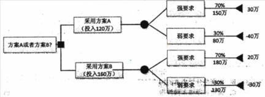

A.以上进行韵是风险定性分析，根据分析， 该公司应采用方案 B

B.以上进行的是风险定量分析， 根据分析，该公司应采用方案 B

C.以上进行的是风险定性分析， 根据分析，该公司应采用方案 A

D.以上进行的是风险定量分析，根据分析， 该公司应采用方案 A

#### 【试题 42】---2016 下真题 64

42、公司任命小李作为项目 A 的项目经理。由于小李不能计划所有不测事件，他设立了一个应急 储备，包括处理已知或未知风险的时间、资金或资源。这属于（）。

A.风险回避， 用应急储备避免风险的发生

B.风险接受，用应急储备接受风险的发生

C.风险转移，因为应急储备使项目成本提高

D.不当风险规划， 因为应识别并虑及所有风险

#### 【试题 43】---2016 下真题 65

43、规划风险应对是针对项目目标， 制订提高机会、降低威胁的方案和措施的过程。（） 不是规划 风险应对的工具与技术。

A.应急应对策略 B.概率和影响矩阵  C.专家判断 D.消极风险或威胁的应对策略

#### 【试题 44】---2016 下真题 67

44、控制风险是在整个项目中实施风险应对计划、跟踪已识别的风险、监督残余风险、识别新风 险，以及评估风险过程有效性的过程。（）不属于控制风险时使用的工具与技术。

A.偏差和趋势分析    B.SWOT 分析    C.技术绩效测量   D.风险审计

#### 【试题 45】---2017 上真题 65

45、项目面临的各种风险中,（）对客户的影响最为深远。

A.范围风险    B.进度风险    C.成本风险    D.质量风险

#### 【试题 46】---2017 上真题 66

46、风险预测从两个方面来评估风险, 即（）和风险发生可能带来的后果。

A.风险原因分析    B.风险发生的时间    C.风险应对措施    D.风险发生的可能性

#### 【试题 47】---2017 上真题 67

47、某项目承包者预计该项目有 0.5 的概率获利 200000 美元,0.3 的概率亏损 50000 美元,还有 0.2 的概率维持平衡.该项目的期望货币价值为（）美元。

A.200000        B.85000        C.50000        D.180000

#### 【试题 48】---2017 下真题 66

48、识别风险过程的主要输出就是风险登记册，风险登记册始于识别风险过程，在项目实施过程 中供其他风险管理过程和项目管理过程使用， 风险登记册中的（） 内容是识别风险过程中产生的。

A.风险紧迫性或风险分类    B. 已识别的风险清单

C.商定的应队策略          D.风险责任人及其职责

#### 【试题 49】---2017 下真题 67

49、项目经理张工在项目风险管理过程中，使用如下公式进行风险评估：

风险值=风险发生的概率*风险发生后的后果

该项目分析管理处于（）阶段。

A.识别风险    B.实施定性风险分析    C.实施定量风险分析    D.规划风险应对

#### 【试题 50】---2017 下真题 68

50、风险相关的项目文件随着定量风险分析产生的信息而更新，（） 不是在定量风险分析过程中产 生的。

A.风险评级和分值    B.量化风险优先级清单

C.项目的概率分析    D.实现成本和时间目标的概率

#### 【试题 51】---2018 上真题 31

51、人们对风险事件都有一定的承受能力，当（）时，人们愿意承担的风险越大。

A.项目活动投入的越多

B.项目的收益越大

C.个人、组织拥有的资源越少

D.组织中高级别管理人员相对较少

#### 【试题 52】---2018 上真题 66

### 52、风险识别的输出是()

A.风险因素     B. 已识别风险清单     C.风险概率     D.风险损失

#### 【试题 53】---2018 上真题 67

53、在进行项目风险定性分析时，可能会涉及到()

A.建立概率及影响矩阵     B.决策树分析     C.敏感性分析     D.建模和模拟

#### 【试题 54】---2018 上真题 68

54、（） 是检查并记录风险应对措施在处理已识别风险及其根源方面的有效性， 以及风险管理过程 的有效性。

A.风险再评估     B.技术绩效测量     C.偏差和趋势分析     D.风险审计

#### 【试题 55】---2018 下真题 66

55、（）不是风险识别的原则。

A.由粗及细,由细及粗    B.先怀疑,后排除   C.对客户保密    D.排除与确认并重

#### 【试题 56】---2018 下真题 67

56、（56）属于定量风险分析的工具和技术。

A.概率和影响矩阵     B.风险数据质量评估    C.风险概率和影响评估    D.敏感性分析

#### 【试题 57】---2018 下真题 68

57、有关控制风险的描述,不正确的是:（）。

A.控制风险时,需要参考已经发生的成本

B.风险分类是控制风险过程所采用的工具和技术

C.可使用挣值分析法对项目总体绩效进行监控

D.控制风险过程中需要更新风险登记册

#### 【试题 58】---2019 上真题 66

58、（）不属于项目风险的特性。

A.可变性    B.必然性    C.相对性    D.不确定性

#### 【试题 59】---2019 上真题 67

59、（）从项目的优势、劣势、机会和威胁角度对项目风险进行分析与管理。

A.头脑风暴法    B.假设分析    C.影响图    D.SWOT 分析

#### 【试题 60】---2019 上真题 68

60、风险应对策略中，（ ）可用于应对积极风险。

A.规避    B.转移    C.减轻    D.分享

#### 【试题 61】---2019 下真题 65

61 、关于风险识别的描述，不正确的是（）。

A.风险识别的原则包括:先怀疑，后排除

B.识别风险活动仅在项目启动时进行

C.风险识别技术包括文档审查，假设分析与 SWOT 分析

D.风险登记册包括己识别清单和潜在应对措施清单

#### 【试题 62】---2019 下真题 66

62、（）不属于风险定性分析的输出。

A.风险评级和分值    B.实现项目目标的概率    C.风险紧迫性    D.风险分类

#### 【试题 63】---2019 下真题 67

63、某项目发生一个已知风险，尽管团队之前针对该风险做过减轻措施，但是并不成功，接下项 目经理应该通过（） 控制该风险。

A.重新进行风险识别

B.使用管理储备

C.更新风险管理计划

D.评估应急储备，并更新风险登记册

十六、项目收尾管理

#### 【试题 1】---2009 上真题 48

1、项目绩效审计不包括（1）。

（1）A.决算审计     B.经济审计    C.效率审计     D.效果审计

#### 【试题 2】---2009 上真题 49

2、在项目结束阶段， 大量的行政管理问题必须得到解决。 一个重要问题是评估项目有效性。完成 这项评估的方法之一是（2）。

（2）A.制作绩效报告   B.进行考察   C.举行绩效评估会议    D.进行采购审计

#### 【试题 3】---2012 下真题 48

3、项目收尾包括（3）。

（3）A.产品收尾和管理收尾         B.管理收尾和合同收尾

C.项目总结和项目审计        D.产品收尾和合同收尾

#### 【试题 4】---2012 下真题 49

4、承建方项目进度或监理方提交收尾或审核收尾的项目管理计划。其中必须要包括（4）。

5、项目收尾过程是结束项目某一阶段中的所有活动，正式收尾该项目阶段的过程。（5）不属于管 理收尾。

（5）A.确认项目或者执行阶段已满足所有赞助者、客户，以及其他项目干系人需求

B.确认已满足项目阶段或者整个项目的完成标准， 或者确认项目阶段或者整个项目的退出

标准

C.当需要时，把项目产品或者服务转移到下一个阶段， 或者移交到生产或运作 D.更新反映最终结果的合同记录并把将来会用到的信息存档

#### 【试题 6】---2014 上真题 60

6、系统终验是系统投入正式运行前的重要工作,系统验收工作通常是在建设方主管部门的主持下， 按照既定程序来进行，下列系统终验的做法中，（6）是错误的

（6）A.承建方应该首先提出工程终验的申请和终验方案

B.监理方应该协助建设方审查承建方提出的终验申请，如果符合条件则开始准备系统终验； 否则，向承建方提出系统整改意见

C.监理方应协助建设方成立验收委员会，该委员会包括建设方、承建方和专家组成。

D.验收测试小组可以是专业的第三方的测试机构或者是承建方聘请的专家测试小组或者三 方共同成立的测试小组。

#### 【试题 7】---2014 下真题 37

7、项目收尾是项目管理中非常重要的一个环节，其中一般不包括（7）。

（7）A.项目评估审计   B. 团队成员转移   C.项目总结    D.项目验收

#### 【试题 8】---2015 上真题 36

8、项目收尾主要包括项目验收、项目总结和项目评估审计。其中项目评估中无需评估的内容是（）。 A.盈利要求     B.客户满意度要求    C.后续项目指标要求    D.系统是否实现既定要求

#### 【试题 9】---2015 上真题 37

9、项目团队人员转移首先应满足的条件是（）。

A.项目人力资源管理计划中所描述的人员转移条件已触发

B.项目团队成员所承担的任务已完成，提交了经过确认的可交付物并已完成工作交接 C.项目经理与项目团队成员确认该成员的工作衔接已经告一段落或者已经完成

D.项目经理签发项目团队成员转移确认文件

#### 【试题 10】---2017 上真题 39

10、（）不属于项目验收的内容。

A.验收测试            B.系统维护工作    C.项目终验      D.系统试运行

#### 【试题 11】---2017 上真题 40

11、信息系统集成项目完成验收后要进行一个综合性的项目后评估,评估的内容一般包括（）。

A.系统目标评价、系统质量评价、系统技术评价、系统可持续性评价

B.系统社会效益评价、系统过程评价、系统技术评价、系统可用性评

C.系统目标评价、系统过程评价、系统效益评价、系统可持续性评价

D.系统责任评价、系统环境影响评价、系统效益评价、系统可持续性评价

十七、知识产权管理

#### 【试题 1】---2010 下真题 14

1、关于知识产权，以下说法不正确的是（1）。

（1）A.知识产权具有一定的有效期限，超过法定期限后，就成为社会共同财富 B.著作权、专利权、商标权皆属于知识产权范畴

C.知识产权具有跨地域性， 一旦在某国取得产权承认和保护， 那么在域外将具有同等效力 D.发明、文学和艺术作品等智力创造，都可被认为是知识产权

#### 【试题 2】---2011 下真题 15

2、依照《中华人民共和国合同法》，委托开发完成的发明创造，除当事人另有约定的以外，申请 专利的权利属于（2）。

（2）A.研究开发人员        B.委托人  C.开发人与委托人共有   D.国家所有

#### 【试题 3】---2013 上真题 68

3.公民为完成法人或者其它组织工作任务所创作的作品是职务作品，对于主要是利用法人或者其它 组织的物质技术条件创作，并由法人或者其它组织承担责任的工程设计图、产品设计图、地图， 计算机软件等职务作品，其（3）。

（3）A.作者享有著作权                   B.作者享有署名权

C.法人或者其他组织享有著作权      D.法人或者其它组织享有署名权

#### 【试题 4】---2013 下真题 62

4、（4）不需要登记或标注版权标记就应得到保护。

（4）A.专利权     B.商标权      C.著作权      D.房产权

#### 【试题 5】---2014 上真题 65

5、以下各项中，（5）不属于知识产权。

（5）A.著作权   B.专利权   C.隐私权    D.商标权

#### 【试题 6】---2014 下真题 69

6、李某购买了一张有注册商标的应用软件光盘，则李某享有（6）。

（6）A.注册商标专用权   B.该光盘的所有权  C.该软件的著作权  D.该软件的复制权

#### 【试题 7】---2015 下真题 70

7、关于知识产权的理解，不正确的是( )

（7）A.知识产权的客体不是有形物， 而 S 是知识，信息等抽象物

B.知识产权具有地域性，即在本国获得承认和保护的知识产权不具有域外效力 C.对于专利权的或外效力， 可以依赖国际公约或者双边协定取得

D.知识产权具有一定的有效期限，无法永远程序

#### 【试题 8】---2016 上真题 70

8、知识产权作为法律所确认的知识产品所有人依法享有的民事权利，其管理的要项中不包括（8）。 A.权利客体是一种无形财产   B.权利具有地域性

C.权利具有优先性           D .权利具有时间性

#### 【试题 9】---2017 上真题 69

9、（）不属于知识产权的基本特征。

A.时间性    B.地域性    C.专有性    D.实用性

#### 【试题 10】---2019 下真题 70

10、关于标准分级与类型的描述，不正确的是（）。

A.GB/T 指推荐性国家标准

B.强制性标准的形式包含全文强制和条文强制

C. 国家标准一般有效期为 3 年

D. 国家标准的制定过程包括立项、起草、征求意见、审查、批准等阶段

## 第七章、考试中涉及的法律法规

### 1、中华人民共和国招标投标法

#### 【试题 1】---高级 2005 上真题 50

1、在招标过程中，下列中的（1）应在开标之前完成。

A.确认投标人资格  B.制定评标原则      C.答标    D.发放中标通知书

#### 【试题 2】---高级 2005 下真题 50

2、下列关于投标的叙述中，不正确的是（2）。

A.两个以上法人可以组成一个联合体，以一个投标人的身份共同投标

B.在招标文件要求提交投标文件的截止时间后送达的投标文件，招标人应当拒收 C.招标人不得相互串通投标报价

D.竞标时，投标人可以自行决定报价，报价数额不受限制

#### 【试题 3】---高级 2006 下真题 50

3、公开招标是指（3）。

A.招标人以投标邀请书的方式邀请特定的法人或者其他组织投标

B.发布招标广告吸引或者直接邀请众多投标人参加投标并按照规定程序从中选择中标人的行 为

C.招标人以招标公告的方式邀请不特定的法人或者其他组织投标

D.有限招标

#### 【试题 4】 ---高级 2006 下真题 51

4、根据有关法律，招标人与中标人应当自中标通知发出之日（4）天内，按招标文件和中标人的 投标文件订立书面合同。

A.15             B.20             C.30          D.45

#### 【试题 5】---高级 2007 下真题 33

5、按照《中华人民共和国招标投标法》的规定，下列说法中正确的是（5）。

A.投标人在向招标方递交投标文件后，就无权对投标文件进行补充、修改或者撤回了

B.两个以上法人或者其他组织可以组成一个联合体，以一个投标人的身份共同投标。由同一 专业的单位组成的联合体，按照资质等级较高的单位确定资质等级

C.中标通知书发出后， 中标人放弃中标项目的，不用承担法律责任

D.中标人按照合同约定或者经招标人同意，可以将中标项目的部分非主体、非关键性工作分 包给他人完成

#### 【试题 6】---高级 2007 下真题 34

6、按照《中华人民共和国招标投标法》的规定，下列说法中错误的是（6）。

A.招标人根据招标项目的具体情况，可以组织潜在投标人踏勘项目现场

B.招标人不得向他人透露已获取招标文件的潜在投标人的名称、数量以及可能影响公平竞争 的有关招标投标的其他情况。招标人设有标底的，标底必须在招标文件中载明

C.投标人应当按照招标文件的要求编制投标文件。投标文件应当对招标文件提出的实质性要 求和条件做出响应

D.招标人应当确定投标人编制投标文件所需要的合理时间； 但是，依法必须进行招标的项目， 自招标文件开始发出之日起至投标人提交投标文件截止之日止， 最短不得少于二十日

#### 【试题 7】---高级 2009 上真题 8

7、两个以上法人或者其他组织组成联合体投标时， 若招标文件对投标人资格条件有规定的，则联 合体（7）。

（7）A.各方的加总条件应符合规定的资格条件

B.有一方应具备规定的相应资格条件即可

C.各方均应具备规定的资格条件

D.主要一方应具备相应的资格条件

#### 【试题 8】---高级 2009 上真题 9

8、在我国境内进行的工程建设项目，可以不进行招标的环节是（8）。

（8）A.监理 B.可研 C.勘察设计 D.施工

#### 【试题 9】 ---高级 2009 下真题 29

9、在投标文件的报价单中，如果出现总价金额和分项单价与工程量乘积之和的金额不一致时，应 当（9）

（9）A.以总价金额为准， 由评标委员会直接修正即可

B.以总价金额为准，由评标委员会修正后请该标书的投标授权人予以签字确认 C.以分项单价与工程量乘积之和为准，由评标委员会直接修正即可.

D.以分项单价与工程量乘积之和为准， 由评标委员会修正后请该标书的投标授权人予以签 字确认

#### 【试题 10】---高级 2009 下真题 30

10、下列描述中（10）不是《中华人民共和国招投标法》的正确内容。

（10）A.招标人采用公开招标方式的，应当发布招标公告。

B.招标人采用邀请招标方式的， 应当向三个以上具备承担招标项目的能力、资信良好的特 定的法人或者其他组织发出投标邀请书。

C.投标人报价不受限制

D.中标人不得向他人转让中标项目，也不得将中标项目肢解后分别同他人转让。

#### 【试题 11】---高级 2010 上真题 29

11 、X 公司中标某大型银行综合业务系统，并将电信代管托收系统分包给了 G 公司。依据相关法 律法规，针对该项目，以下关于责任归属的叙述中，（11）是正确的。

A.X 公司是责任者， G 公词对分包部分承担连带责任

B.X 公司是责任者， 与 G 公司无关

C.G 公司对分包部分承担责任，与 X 公司无关

D.G 公司对分包部分承担责任， X 公司对分包部分承担连带责任

#### 【试题 12】---高级 2010 上真题 43

12、某省级政府对一个信息系统集成项目进行招标， 2010 年 3 月 1 日发招标文件， 定于 2010 年 3 月 20 日 9 点开标。在招投标过程中，（12）是恰当的。

A.3 月 10 日对招标文件内容做出了修改， 3 月 20  日 9 点开标

B.3 月 20 日 9 点因一家供应商未能到场， 在征得其他投标人同意后， 开标时间延后半个小 时

C.3 月 25  日发布中标通知书.4 月 15  日与中标单位签订合同

D.评标时考虑到支持地方企业发展， 对省内企业要求系统集成二级资质，对省外企业要求 系统集成一级资质

#### 【试题 13】---高级 2010 下真题 43

13、以下关于招投标的叙述， 不正确的是（13）。

A.采购单位可直接从已有的供应商管理库中抽取若干供应商作为竞标者

B.采购文件是竞标方准备

C.采用加权系统对供方进行定性分析，可减少招投标活动中人为偏见带来的影响 D.对于关键性采购物，可采用多渠道采购以规避风险

#### 【试题 14】---高级 2011 上真题 28

14、下列做法符合《招投标法》相关规定的是（14）。

A.某项目的招标文件中详细介绍了招标人的名称和地址、招标项目的性质、数量、实施地 点和时间、评标委员会组成名单以及获取招标文件的办法等事项

B.投标监督员有权对标书的密封情况进行检查， 投标人之间也可以相互检查标书的密封情 况

C.某项目在截止时间前仅收到了两份投标文件， 招标人直至收到第三份投标文件后才宣布 开标

D.某企业在中标之后，将主体工程分为三个部分， 并将其中两个部分分别承包给其他单位

#### 【试题 15】---高级 2011 上真题 43

### 15、某招标公司在为委托方的项目进行公开招标的过程如下：

①3 月 15 日在互联网上公开了招标事项，写明投标的截止日期是 4 月 1 日上午 9 时整 ②从本地公证处请了 2 名工作人员对招标过程进行公证

③邀请相关行业的专家和委托方代表各 5 人成立评审委员会

④唱标结束后，请所有投标人离场，待评审委员会得出结论后再通知相关人员

⑤确定中标单位后， 立即向所有参加投标的企业退还投标保证金

上述过程中不正确的包括（15）。

A.①③⑤B.①②③C.①②④D.②③⑤

#### 【试题 16】---高级 2011 上真题 44

16、某企业在招标时，首先通过某种资格审查选择部分供应商，并以邮件问询的方式确定它们是 否有兴趣参与竞标，然后将采购文件包发给所有有兴趣的供应商，并对供应商反绩的投标文件进 行评估，最终将中标消息通知给中标的供应商。以下关于本次招标过程的判断，正确的是（16）。

A.项目招标之前该企业不应当事先进行资格筛选

B.意见征询不应通过邮件的方式进行

C.中标结果不应仅凭评估分数确定

D.在选定供应商后，招标结果不应只反绩给中标供应商

#### 【试题 17】---高级 2011 下真题 64

17、下列叙述中，不符合《中华人民共和国招投标法》的是（17）。

A.招标人采用公开招标发方式的，应该发布招标公告

B.招标人采用邀请招标方式的， 应当向三个以上具备承担招标项目的能力、资信良好的特定 的法人或者其他组织发出投标邀请书

C.中标人不得向他人转让中标项目， 也不得将中标项目肢解后分别向他人转让 D.投标人报价不受限制

#### 【试题 18】---高级 2011 下真题 65

18、评标委员会中， 技术、经济等方面的专家不得少于成员总数的（18）。

A.2/3B.1/2C.1/3D.2/5

#### 【试题 19】---高级 2012 上真题 29

19、公开招标在开标时，应当由（19）。

A.招标监督机构主持， 邀请所有投标人参加B.招标监督机构主持，投标人自愿参加 C .招标人主持， 邀请所有投标人参加D.招标人主持，投标人自愿参加

#### 【试题 20】---高级 2012 下真题 43

20、以下关于招投标的说法， 错误的是   （20）--

A.招标人设有标底的，标底必须保密

B.依法必须进行招标的项目，自招标文件开始发出之日起至投标人提交投标文件截止之日止， 最短不得少于二十日

C.国家重点项目和省、自治区、直辖市人民政府确定的地方重点项目不适宜公开招投标的, 经相关部门批准,可以不进行招标

D.招标人具有编制招标文件和组织评标能力的,可以自行办理招标事宜

#### 【试题 21】---高级 2012 下真题 44

21、依照招投标法,项目公开招标的资格预审阶段,在“ 资格预审须知”文件中可以（21）。 A.要求投标人必须组成联合体投标B.要出严格的专业资质等级

C.要求必须使用某种品牌的网络布线材料D.对本行业外的投标人提出特别要求

#### 【试题 22】---高级 2013 上真题 38

22、某公司采用邀请招标的方式选择承建单位,实施过程中发生了如下事件：

①该公司向 3 家单位发出招标邀请函,其中包括该公司的股东公司

②该公司 8 月 1  日发出邀请函,要求对方在 8 月 16 日提交投标书

③该公司外聘了 1 名法律专家,连同公司 CIO、总经理和党委书记组建了评标委员会 ④该公司的招标书中公开了项目标底

根据上述情况,下面说法中,正确的是（22）。

（22）A.该公司的股东公司参加投标不符合招投标法规

B.该公司拟订的投标截止日期符合招投标法规

C.评标委员会的组成不符合招投标法规

D.招标书中不准公开项目标底

#### 【试题 23】---高级 2013 上真题 39

23、标前会议也称为投标预备会,是招标人按投标须知规定的时间和地点召开的会议。以下关于 标前会议有关文档的说法中,错误的是（23）。

（23）A.会议纪要应以书面形式发给获得投标文件的投标人

B.会议纪要和答复函件形成招标文件的补充文件

C.补充文件与招标文件具有同等法律效力

D.会议纪要必须要说明相关问题的来源

#### 【试题 24】---高级 2013 下真题 28

24、根据中华人民共和国招标投标法（24）是不恰当的

（24）A.机标人少于三个的,招标人应当重新招标

B.当依法必须进行招标的项目的所有投标被否决时,招标人需重新招标

C.招标代理机构违反规定,向 A  投票机构泄露应当保密的与招标有关的情况的资料、结 果为 B 反对票机构中标,中标无效

D.投标人相互串通反反投标或者与招标人串通投标的,投标人以向招标人或者评标委员会 成员行贿的手段谋广播操中标的,中标无效

#### 【试题 25】---高级 2013 下真题 31

25、按照招投标法律和法规的规定，开标后允许（25）

（25）A.投标人更改投标书的内容和报价

B.投标人再增加优惠条件

C.投标人对投标书中的错误以澄清

D.招标人更改招标文件中说明的评标、定标办法

#### 【试题 26】---高级 2013 下真题 42

26、某公司在制定招标评分标准时，下列做法较合适的是（26）

（26）A.对业绩评定的标准是：好，不好

B.服务评定标准是：根据其通过 ISO20000 谁情况酌情打分

C.价格分采用优先计算

D.按照 ISO9000 认证情况，将质量标准分为 7 个档次

#### 【试题 27】---高级 2013 下真题 43

27、当出现招标文件中的某项规定与招标人对投标人质疑问题的书面解答不一致时，应以()

（27）A.招标文件中的规定              B.现场时招标单位的口头解释

C.招标单位在会议上的口头解答     D.对招标人质疑的书面解答问题

#### 【试题 28】---高级 2014 上真题 41

28、某政府公开招标项目，在编制了招标文件并发布了招标公告后，招标人应随即（28）

A.组织专家对招标文件进行评审 B.出售招标文件，对潜在招标人资格预审 C.接受参与投标人的投标书 D.由评标委员会对投标文件进行预审

#### 【试题 29】---高级 2014 下真题 39

29、政府采购项目的招标过程应按照以下（29）的程序开展。

①项目技术可行性分析

②采购人编制采购计划，报上级单位审批，并确定招标方式

③采购人或其委托的招标代理机构编制招标文件，发出招标公告

④出售招标文件并对潜在投标人进行预审

⑤项目论证，编写投标文件

⑥接受投标人的标书

⑦制定评标的评审标准

⑧开标及评标，依据评标原则确定中标人

⑨发送中标通知书， 签订合同

（29）A、①②③④⑤⑥⑦⑧⑨   B、②④⑤⑥⑦⑧⑨

C、⑦②③④⑤⑥⑧       D、⑦②③④⑥⑧⑨

#### 【试题 30】---高级 2014 下真题 40

30、招标确定招标人后，实施合同内注明的合同价款应为（30）。

（30）A.评标委员会算出的评标价     B.招标人编制的预算价

C. 中标人的投标价             D.所有投标人的价格平均值

#### 【试题 31】---中级 2009 上真题 67

31、依据《中华人民共和国招标投标法》，公开招标是指招标人以招标公告的方式邀请（31）投标。

（31）A.特定的法人或者其他组织       B.不特定的法人或者其他组织

C.通过竞争性谈判的法人或者其他组织 D.单一来源的法人或者其他组织

#### 【试题 32】---中级 2009 下真题 33

32、以下关于投标文件送达的叙述，（32）是错误的。

（32）A.投标人必须按照招标文件规定的地点、在规定的时间内送达投标文件

B.投递投标书的方式最好是直接送达或委托代理人送达， 以便获得招标机构已收到投标书 的回执

C.如果以邮寄方式送达的，投标人应保证投标文件能够在截止日期之前投递即可 D.招标人收到标书以后应当签收， 在开标前不得开启

#### 【试题 33】---中级 2010 上真题 52

33、组织项目招标要按照《中华人民共和国招标投标法》进行。以下叙述中，（33）是不正确的。 （33）A.公开招标和邀请招标都是常用的招标方式

B.公开招标是指招标人以招标公告方式邀请一定范围的法人或者其他组织投标 C.邀请招标是指招标人以投标邀请书的方式邀请特定的法人或者其他组织投标 D.招标人是依照本法规定提出招标项目、进行招标的法人或者其他组织

#### 【试题 34】---中级 2010 上真题 61

34、某项目建设内容包括机房的升级改造、应用系统的开发以及系统的集成等。招标人于 2010 年 3 月 25 日在某国家级报刊上发布了招标公告，并规定 4 月 20 日上午 9 时为投标截止时间和开标时 间。系统集成单位 A 、B 、C 购买了招标文件。在 4 月 10 日，招标人发现已发售的招标文件中某 技术指标存在问题， 需要进行澄清，于是在 4 月 12  日以书面形式通知 A 、B 、C 三家单位。根据 《中华人民共和国招标投标法》，投标文件截止日期和开标日期应该不早于（34）。

（34）A.5 月 5 日 B.4 月 22  日 C.4 月 25  日 D.4 月 27  日

#### 【试题 35】---中级 2010 上真题 62

35、在评标过程中，（35）是不符合招标投标法要求的。

（35）A.评标委员会委员由 5 人组成，其中招标人代表 2 人， 经济、技术专家 3 人

B.评标委员会认为 A 投标单位的投标文件中针对某项技术的阐述不够清晰，要求 A 单位 予以澄清

C.某单位的投标文件中某分项工程的报价存在个别漏项， 评标委员会认为个别漏项属于细 微偏差，投标标书有效

D.某单位虽然按招标文件要求编制了投标文件，但是个别页面没有编制页码，评标委员会 认为投标标书有效。

#### 【试题 36】---中级 2010 下真题 16

36、某省政府采用公开招标方式采购信息系统项目及服务，招标文件要求投标企业必须具备系统 集成二级及其以上资质，提交证书复印件并加盖公章。开标当天共有 5 家企业在截止时间之前投

递了标书。根据《中华人民共和国政府采购法》，如发生以下（36）情况， 本次招标将作废标处理。 （36）A.有 3 家企业具备系统集成一级资质，有 2 家企业具备系统集成三级资质

B.有 3 家企业具备系统集成二级资质， 有 2 家企业具备系统集成三级资质

C.5 家企业都具有系统集成二级资质， 其中有 2 家企业的系统集成二级资质证书有效期满 未延续换证

D.有 3 家企业具备系统集成三级资质，有 2 家企业具备系统集成二级资质

#### 【试题 37】---中级 2010 下真题 63

37、某企业 ERP 项目拟采用公开招标方式选择系统集成商， 2010 年 6 月 9  日上午 9 时，企业向通 过资格预审的甲、乙、丙、丁、成五家企业发出了投标邀请书， 规定投标截止时间为 2010 年 7 月 19  日下午 5  时。甲、乙、丙、成四家企业在截止时间之前提交投标文件，但丁企业于 2010 年 7 月 20 日上午 9 时才送达投标文件。

在评标过程中，专家组确认：甲企业投标文件有项目经理签字并加盖公章，但无法定代表人 签字；乙企业投标报价中的大写金额与小写金额不一致；丙企业投标报价低于标底和其他四家较 多。以下论述不正确的是（37）。

（37）A.丁企业投标文件逾期，应不予接受

B.甲企业无法定代表人签字，做废标处理

C.丙企业报价不合理， 做废标处理

D.此次公开招标依然符合投标人不少于三个的要求

#### 【试题 38】---中级 2011 上真题 14

38、根据《中华人民共和国招投标法》，以下做法正确的是（38）。

A.某项目于 2 月 1 日公开发布招标文件，标明截止时间为 2011 年 2 月 14 日 9 时整 B.开标应当在招标文件确定的提交投标文件截止时间的同一时间公开进行

C.某项目的所有投标都不符合招标文件要求， 评标委员会在与招标方商量后， 确定其中最接 近投标文件要求的一家公司中标

D.联合投标的几家企业中只需一家达到招标文件要求的资质即可

#### 【试题 39】---中级 2011 上真题 15

39、某市政府采购办公用计算机及配套软件时进行了公开招标， 以下做法正确的是（39）。 A.在招标文件中明确指出投标企业不应有外资背景

B.该项目招标结束后， 招标单位向中标人发出中标通知书， 但对所有未中标的投标人只通知 了中标结果

C.某项目在招标时仅有一家企业投标，于是该企业顺利中标

D.某项目的评标委员会由一名经济专家、 一名技术专家和一名招标单位负责人组成

#### 【试题 40】---中级 2011 上真题 59

40、某大型系统集成项目进行公开招标，要求投标人具有计算机系统集成二级资质，甲、乙两家 企业为提高竞争力、增加投标成功的可能性，组成联合体以一个投标人的身份共同投标，如出现 以下（40）情况，甲、乙两家企业组成的联合体将无法满足该项目的招标要求。

A.甲、乙两家企业共同按照招标文件的要求编制投标文件， 对招标文件提出的实质性要求和 条件作出了响应

B.甲企业具有计算机系统集成二级资质， 乙企业具有计算机系统集成三级资质

C.甲、乙两家企业签订了共同投标协议， 并将该协议连同投标文件一并提交招标人 D.甲、乙两家企业经过协商，对招标项目提出了略低于市场价格的报价

#### 【试题 41】---中级 2011 下真题 34

41、根据《中华人民共和国招投标法》，以下叙述中，不正确的是（41）。

A.两个以上法人或组织组成联合体共同投标时， 联合体各方均应当具备承担招标项目的相应 能力

B.联合体中标的， 联合体各方应当共同与招标人签订合同， 就中标项目向招标人承担连带责 任

C.联合体各方应当签订共同招标协议，并将共同投标协议连同投标文件一并提交给投标人 D.有同一专业的单位组成的联合体，按照其中资质等级最高的单位确定资质等级

#### 【试题 42】---中级 2011 下真题 62

42、某公司甲计划建立一套 ERP 系统， 在一家监理单位协助下开始招标工作。在以下招标过程中， 不符合《招标投标法》有关规定的是（42）。

A.甲公司在编制了招标文件以后， 于 3 月 4  日发出招标公告， 规定投标截止时间为 3 月 25 日 17 时

B.甲公司在收到五家公司的投标书后， 开始制订相应的评标标准， 并且邀请了 5 位行业专家 和 2 名公司领导组成 7 人评标委员会

C.在评标会议上， 评标委员会认为 T 公司的投标书虽然满足投标文件中规定的各项要求，但 报价低于成本价，因此选择了投标书同样满足要求而报价次低的 S 公司作为中标单位

D.在 4 月 1  日发布中标公告后， S 公司希望修改合同中的付款方式，双方经过多次协商后， 于 4 月 28 日正式签订了 ERP 项目合同

#### 【试题 43】---中级 2012 上真题 15

43、根据《中华人民共和国招标投标法》第四十八条对中标人的权利和义务的规定，（43）是不正 确的。

（43）A、中标人不得向他人转让中标项目， 也不得将中标项目肢解后分别向他人转让

B、中标人按照合同约定或者经招标人同意，可以将中标项目的部分非主体、非关键性工作 分包给他人完成

C、接受分包的人可以再次分包

D、中标人应当就分包项目向招标人负责，接受分包的人就分包项目承担连带责任

#### 【试题 44】---中级 2012 下真题 68

44、下列说法不正确的是（44）。

A.招标投标法规定招标方式分为公开招标和邀请招标两类

B.只有不属于法规规定必须招标的项目才可以采用直接委托方式

C.建设行政主管部门派人参加开标、评标，定标的活动，监督招标按法定程序选择中标人； 所派人员可作为评标委员会的成员，但不得以任何形式影响或干涉招标人依法选择中标人的活动

D.比较而言公开招标的评标工作量较大，所需招标时间长，费用高

#### 【试题 45】---中级 2013 下真题 16

45、乙公司参加一个网络项目的投标，为增加中标的可能性，乙公司决定将招标文档中的一些次 要项目（约占总金额的 3%）作为可选项目， 没有计算到投标总价中，而是另作一张可选价格表， 由招标方选择是否需要。评标时，评委未计算可选价格部分，这样乙公司因报价低而中标。洽谈 合同时，甲方提出乙方所说的可选项是必须的，在招标文件中已明确说明，要求乙方免费完成， 乙方以投标文件中有说明为由不同意免费。该项目最可能的结果是（45）。

（45）A.甲方追加经费                          B.重新招标

C.甲方不追加经费，相应部分取消            D.重新确定中标方

#### 【试题 46】---中级 2013 下真题 17

46、根据《中华人民共和国招标投标法》，以下有关招标文件的说法中，（46）是错误的 （46）A.针对邀请招标，招标人应当根据潜在投标人的情况和特点编制招标文件

B.国家对招标项目的技术、标准有规定的， 招标人应当按照其规定在招标文件中提出相应 要

C.招标文件应当包括招标项目的技术要求、对投标人资格审查的标准、投标报价要求和评 标标准等所有实质性要求和条件以及拟签订的合同主要条款。

D.招标项目需要划分标段、确定工期的，招标人应当合理划分标段、确定日期， 并在招标 文件中载明

#### 【试题 47】---中级 2014 上真题 16

47、根据《中华人民共和国招标投标法》，招标的方式可分为（47）

A.公开招标和代理招标 B.邀请招标和自行招标

C.公开招标和邀请招标 D.公开招标和自行招标

#### 【试题 48】---中级 2014 上真题 62

48、根据《中华人民共和国招投标法》中关于招投标程序的规定，（48）是错误的。

A.招标人如采用公开招标方式的，应当公开发布招标公告； 依法必须进行招标的项目的招标 公告，应当通过国家指定的报刊、信息网络或者其他媒介发

B.招标人根据招标项目的具体情况， 可以组织潜在投标人踏勘项目现场

C.投标人应当在招标文件要求提交投标文件的截止时间前将投标文件送达投标地点。招标人 收到投标文件后，应当签收， 并当面开启进行初审。

D.评标由招标人依法组建的评标委员会负责，中标结果确定后， 评标委员会成员的名单可以 在中标公告中公布

#### 【试题 49】---中级 2014 下真题 16

49、依据《中华人民共和国招投标法》，（49）必须进行招标。

（49）A.政府部门为大型项目选择可行性研究服务提供方

B.政府部门为涉及抢险救灾项目选择承建方

C.为国际组织援助的项目选择承建方

D.为私有企业投资的信息管理系统选择承建方

#### 【试题 50】---中级 2014 下真题 32

50、某招标文件包括：招标项目的技术要求、投标人员资格审查标准、投标报价要求、评标 标准。该招标文件还缺少（50）。

（50）A.评标组构成          B.拟签订合同的主要条款

C.特定的生产供应者    D.是否要求投标人组成联合体共同投标

#### 【试题 51】---中级 2014 下真题 33

51、以下关于评标过程和方法的叙述中，（51）是不正确的。

（51）A.在评标时，当出现最低评标价远远高于标底或缺乏竞争性等情况时，应废除全部投标

B.在评标时， 先进行初步评标， 只有在初评中确定为基本合格的投标， 才有资格进入详细评

定和比较阶段

C.评标工作结束后，评标委员会要编写评标报告， 上报采购主管部门

D.如果在投标前没有进行资格预审， 在评标后则需要对最低评标价的投标商进行资格后审。 如果审定结果认为他有资格、有能力承担合同任务， 则应把合同授与他

#### 【试题 52】---高级 2015 上真题 16

52、（）属于评标依据。

A.招标文件    B.企业法人营业执照复印件   C.公司业绩     D.施工组织设计

#### 【试题 53】---中级 2015 下真题 34

53、某招标文件要求投标方应具有计算机信息集成系统集成资质和 ISO 9000 质量认证证书， 投标 人在投标文件中提供了母公司的计算机信息系统资质和 ISO 9000 质量认证证书， 则该投标人提供 的投标文件( )

（53）A.符合招标要求  B.不符合招标要求  C.基本符合招标要求  D.完招标要求

#### 【试题 54】---高级 2015 下真题 45

54、根据《中华人民共和国招标法》，以下做法中，（ ）是正确的。

A.某项目于 4 月 7 日公开发布招标文件，表明截止时间为 2015 年 4 月 14  日 13 时 B.开标应当在招标文件确定的提交投标文件截止时间的同一时间公开进行

C.某次招标活动中的所有投标文件都与招标文件要求存在一定的差异，评标委员会可以确 定其中最接近投标文件要求的公司中标

D.联合投标的几家企业中只需一家达到招标文件要求的资质即可

#### 【试题 55】---中级 2016 上真题 34

55、公司的小张正在准备一份关于甲项目的标书。标书中一般不包括（55）。

A.投标书、投标报价一览表、分项一览表

B.公司的营业执照副本复印件加盖公章及其他相关证件

C.公司相关的技术资料

D.甲项目需求合理性分析

#### 【试题 56】---高级 2016 上真题 30

56、根据《中华人民共和国招标投标法》的规定，以下叙述中， 不正确的是：()

（56）A.国务院发展计划部门确定的国家重点项目和省、自治区、直辖市人民政府确定的地方重 点项目不适宜公开招标的，经国务院发展计划部门或者省、自治区、直辖市人民政府批准，可以 进行邀请招标

B.招标人有权自行选择招标代理机构， 委托其办理招标事宜。任何单位和个人不得以任何 方式为招标人指定招标理机构

C.招标项目按照国家有关规定需要履行项目审批手续的， 可在招标前审批， 也可招标后履 行审批手续

D.招标人需要在招标文件中如实载明招标项目有相应资金或者资金来源已经落实

#### 【试题 57】---高级 2016 下真题 30

57、依据《中华人民共和国招标投标法》，以下叙述中，不正确的是（57）。

（57）A.招标人具有编制招标文件和组织评标能力的，可以自行办理招标事宜 B.招标人不可以自行选择招标代理机构

C.依法必须进行招标的项目，招标入自行办理招标事宜的，应当向有关行政监督部门备案 D.招标代理机构与行政机关和其他国家机关不得存在隶属关系或者其他利益关系

#### 【试题 58】---高级 2016 下真题 39

58、投标文件中存在对招标文件响应的非实质性的微小偏差，则该投标文件应（58）。

（58）A.不予淘汰，但需订立合同前予以澄清   B.不予淘汰，但需在评标结束前予以澄清 C.不予淘汰，允许投标人重新投         D.予以淘汰

#### 【试题 59】---高级 2016 下真题 40

59、在评标过程中，发现有一投标单位提交了两份不同的投标文件，而且招标文件中也未要求提 交备选投标，则应（59）。

（59）A.否决其投标                B. 以最低报价投标文件为准

C. 以最高得分投标文件为准    D.征求投标方的建议君决定

#### 【试题 60】---中级 2016 下真题 34

60、以下关于开标与评标的叙述中，不正确的是（60）。

A.评标委员会的数量为单数， 其中技术、经济等方面专家人数不得少于成员总数的 1/2

B.招标人自收到评标报告之日起 3 日内公示中标候选人， 公示期不得少于 3 日 C.依法必须进行招标的项目，招标人应当确定排名第一的中标候选人为中标人 D.评标报告应当由评标委员会全体成员签字

#### 【试题 61】---中级 2017 上真题 35

61、某系统集成商准备去投标一个政府网站开发项目，该系统集成商在项目招投标阶段的工作依 次是（）。

①组建评标小组②编制投标文件中③参写开标过程④研读招标公告⑤提交投标文件 A.①②③④⑤    B.⑤②④③    C.④②⑤③    D.①④⑤②③

#### 【试题 62】---中级 2017 上真题 70

62、通过招标过程确定中标人后,实施合同内的合同价款应为（）。

A.招标预算价          B. 中标者的投标价

C.所有投标价的均价    D.评标委员会综合各方面因素后给出的建议价

#### 【试题 63】---高级 2017 下真题 29

63、根据《中华人民共和国招标投标法》，招标人和中标人应当自中标通知书发出之日起（） 日内， 按照招标文件和中标人的投标文件订立书面合同。

A.30    B.20    C.15    D.10

#### 【试题 64】---高级 2018 上真题 29

64、关于招投标的描述，不正确的是：（）。

A.招标人采用邀请招标方式的，应当向三个以上具备承担项目的能力、资信良好的特定法人 或者其他组织发出投标邀请书

B.招标人对已发出的招标文件进行必要的澄请或者修改的，应当在招标文件要求提交报标文 件截止时间至少十五日前，以书面形式通知所有招标文件收受人

C.投标人在招标文件要求提交投标文件的截止时间前，可以补充、修改或者撤回已提交的投 标文件，并书面通知招标人

D.依法必须进行招标的项目，其评标委员会由招标人的代表和有关技术、经济等方面的专家 组成，成员人数为五人以上单数，其中技术、经济等方面的专家不得少于成员总数的一半

#### 【试题 65】--中级 2018 上真题 34

65、在（） 时。可以不进行招标。

A.需要采用不可替代的专利或者专有技术

B.项目全部或部分使用国有投资或国家融资

C.采购大型关系公共安全的基础设施

D.使用国际组织或外国政府贷款、援助资金

#### 【试题 66】--中级 2018 上真题 35

66、关于项目招投标的说法， 不正确的是（）。

A. 中标人确定后，招标人应当视情况向中标人发出中标通知书，将中标结果通知所有未中标 的投标人

B.依法必须进行招标的项目。招标人应当自收到评标报告之日起 3 日内公示中标候选人

C.招标人在招标文件中要求投标人提交投标保证金的，投标保证金有效期应当与投标有效期 一致

D.投标人少于 3 个的， 不得开标；招标人应当重新招标

#### 【试题 67】--高级 2019 上真题 29

67、进行招标的项目，自招标文件开始发出之日起至投标人提交投标文件止，最短不得少于() 天。

A.20        B.30        C.15        D.60

### 2、中华人民共和国招投标法实施条例

#### 【试题 1】---2012 下真题 61

1、某政府部门要进行采购招标，其招标的部分流程如下：

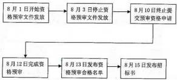

关于上述招标流程， 下面说法正确的是（1）。

（1）A.4 日内完成资格预审文件发放符合招投标相关法规

B.停止发放资格预审文件到终止提交预审资格申请的时间间隔符合招投标相关法规 C.发布资格预审合格名单和发布招标书时间间隔不符合招投标相关法规

D.招标书应在 8 月 3 日前发售

#### 【试题 2】---2013 上真题 16

2  在某单位招标过程中发生了如下事件，根据中华人民共和国招投标法及其实施条例，当出现 2 之一时，评标委员会应当否决其投标。

1.投标文件未经投标单位盖章和单位负责人签字

2.同一投标人提交两个以上不同的投标文件，但招标文件未要求提交备选投标

3.投标报价高于招标文件设定的最高投标价

4.投标书中包括投标联合体共同签发的报价折扣声明

A.12        B.124      C.134        D.123

#### 【试题 3】---高级 2016 上真题 29

3、根据《中华人民共和国招标投标法》及《中华人民共和国招标投标法实施条例》，国有资金占 控股或者主导地位的依法必须进行招标的项目， 当（）时，可以不进行招标。

（3）A.项目涉及企业信息安全及保密

B.需要采用不可替代的专利或者专有技术

C.招标代理依法能够自行建设、生产或者提供

D.为了便于管理， 必须向原分包商采购工程、货物或者服务

#### 【试题 4】 ---中级 2018 下真题 35

4、关于项目招投标的描述，不正确的是:（4）。

（4）A.招标人采用公开招标，应当发布招标公告

B.两个或两个以上法人或者其他组织可以组成一个联合体共同投标

C.招标人在招标文件中要求投标人提交投标保证金的，投标保证金有期应长于投标效期 D.评标委员会名单在中标结果确定前需保密

#### 【试题 5】---中级 2019 下真题 24

5、根据 2019 年修订的《中华人民共和国招投标法实施条例》招标文件要求中标人要提交履约保 证金的，属约保证金不得超过中标合同金额的（）。

A.2%        B.5%        C.10%        D.15%

### 3、中华人民共和国政府采购法

#### 【试题 1】---高级 2007 下真题 28

1、下列有关《中华人民共和国政府采购法》的陈述中，错误的是（1）。

A.任何单位和个人不得采用任何方式， 阻挠和限制供应商自由进入本地区和本行业的政府采购市场

B.政府采购应当采购本国货物、工程和服务。需要采购的货物、工程或者服务在中国境内无 法获取或者无法以合理的商业条件获取的则除外

C.政府采购应当采购本国货物、工程和服务。为在中国境外使用而进行采购的则除外

D.政府采购实行集中采购和分散采购相结合。其中集中采购由国务院统一确定并公布；分散 采购由各省级人民政府公布的采购目录确定并公布

#### 【试题 2】---高级 2007 下真题 29

2、依据中华人民共和国政府采购法中有关供应商参加政府采购活动应当具备的条件， 下列陈述中 错误的是（2）。

A.供应商参加政府采购活动应当具有独立承担民事责任的能力

B.采购人可以要求参加政府采购的供应商提供有关资质证明文件和业绩情况，对有资质的供 应商免于资格审查

C.供应商参加政府采购活动应当具有良好的商业信誉和健全的财务会计制度

D.供应商参加政府采购活动应当具有依法缴纳税收和社会保障资金的良好记录， 并且参加政 府采购活动前三年内，在经营活动中没有重大违法记录

#### 【试题 3】---高级 2007 下真题 30

3、下列有关中华人民共和国政府采购法的陈述中， 错误的是（3）。

A.政府采购可以采用公开招标方式

B.政府采购可以采用邀请招标方式

C.政府采购可以采用竞争性谈判方式

D.公开招标应作为政府采购的主要采购方式，政府采购不可从单一来源采购

#### 【试题 4】 ---高级 2007 下真题 31

4、依据中华人民共和国政府采购法，在招标采购中，关于应予废标的规定，（4）是不成立的。 A.符合专业条件的供应商或者对招标文件作实质响应的供应商不足三家的应予废标

B.出现影响采购公正的违法、违规行为的应予废标

C.投标人的报价均超过了采购预算，采购人不能支付的应予废标

D.废标后，采购人将废标理由仅通知该投标人

#### 【试题 5】---高级 2008 上真题 26

5、（5）与《中华人民共和国政府采购法》的有关内容一致。

A.政府采购是指各级国家机关、事业单位和团体组织， 使用贷款、财政性资金或自筹资金采 购依法制定的集中采购目录以内的或者采购限额标准以上的货物、工程和服务的行为

B.货物是指各种形态和种类的物品， 包括原材料、燃料、设备、产品等。工程是指建设工程， 包括建筑物和构筑物的新建、改建、扩建、装修、拆除、修鳍等

C.在技术咨询合同、技术服务合同履行过程中， 受托人利用委托人提供的技术资料和工作条 件完成的新的技术成果，属于受托人。委托人利用受托人的工作成果完成的新的技术成果，属于 委托人。当事人另有约定的， 按照其约定

D.中标人按照合同约定或者经招标人同意，可以将中标项目的部分非主体、非关键性工作分 包给他人完成

#### 【试题 6】---高级 2008 上真题 27

6、根据《中华人民共和国政府采购法》的规定，当（6）时不采用竞争性谈判方式采购。 A.技术复杂或性质特殊，不能确定详细规格或具体要求

B.采用招标所需时间不能满足用户紧急需要

C.发生了不可预见的紧急情况不能从其他供应商处采购

D.不能事先计算出价格总额

#### 【试题 7】---高级 2008 下真题 29

7、按照《中华人民共和国政府采购法》的规定，供应商可以在知道或者应知其权益受到损害之日 起 7 个工作日内，以书面形式向采购人提出质疑。（7）不属于质疑的范围。

A.采购过程  B.采购文件  C.合同效力  D.中标、成交结果

#### 【试题 8】---高级 2009 下真题 6

8、关于政府采购法的描述，正确的是（8）。

（6）A.各级人民政府财政部门是负责政府采购监督管理的部门，依法履行对政府采购活动的监 督管理职责

B.集中采购机构是非营利事业法人， 也可以是营利性事业法人， 根据采购人的委托办理采购事宜

C.自然人、法人或者其他组织不能组成一个联合体以一个供应商的身份共同参加政府采购 D.竞争性谈判应作为政府采购的主要采购方式

#### 【试题 9】 ---高级 2010 上真题 28

9、某市政府采购采用公开招标。招标文件要求投标企业必须通过 IS09001 认证并提交 IS09001 证 书。在评标过程中， 评标专家发现有多家企业的投标文件没有按标书要求提供 IS09001  证书。依 据相关法律法规，以下处理方式中，（9）是正确的。

A.因不能保证采购质量，招标无效，重新组织招标

B.若满足招标文件要求的企业达到三家， 招标有效

C.放弃对 IS09001 证书的要求， 招标有效

D.若满足招标文件要求的企业不足三家，则转入竞争性谈判

#### 【试题 10】---高级 2010 下真题 29

10、根据《中华人民共和国政府采购法》，针对（10）情况，不能使用单一来源方式采购。 A.只有唯一的供应商可满足采购需求

B.招标后没有供应商投标

C.发生了不可预见的紧急情况不能从其他供应商处采购

D.必须保证原有采购项目一致性或者服务配套的要求， 需要继续从原供应商处添购，且添购 资金总额不超过原合同采购金额百分之十

#### 【试题 11】---高级 2010 下真题 30

11、某地政府采取询价方式采购网络设备，（11）是符合招投标法要求的。

A.询价小组由采购人的代表和有关专家共 8 人组成

B.被询价的 A 供应商提供第一次报价后，发现报价有误，调整后提交了二次报价

C.询价小组根据采购需求， 从符合资格条件的供应商名单中确定三家供应商， 并向其发出询 价通知书让其报价

D.采购人根据符合采购需求、质量和服务相等且报价最低的原则确定成交供应商，最后将结 果通知成交供应商

#### 【试题 12】---高级 2010 下真题 58

12、某集成企业把部分集成项目分包出去， 准备采用竞争性谈判方式。以下叙述不正确的是（12）。

A.竞争性谈判的结果主要依据供应商的综合实力确定

B.应先确立一个标准， 然后按照标准进行竞争性谈判

C.可先从合格供应商数据库中筛选供应商，再进行竞争性谈判

D.进行竞争性谈判时，选择供应商的基本原则是一致的

#### 【试题 13】---高级 2011 下真题 30

13、某采购人在履行采购金额为 1000 万元的政府采购合同中， 需要追加与该合同标的相同的货物。 根据相关法律，在不改变合同其他条款的前提下，下列说法中正确的是（13）。

A.可以与供应商协商签订补充合同，但补充合同的采购金额不得超过 100 万元 B.可以与供应商签订补充合同， 但须得到省级以上政府授权的机构批准

C.采购商不能与供应商签订单一来源的采购合同

D.可以与供应商签订补充合同，但补充合同的采购金额不得超过 1000  万元， 如超过 1000 万元则须得到省级以上授权的机构批准

#### 【试题 14】---高级 2013 上真题 25

14、供应商甲在参与某政府机构办公设备采购的活动中，发现参加竞标的供应商乙的负责人与该 政府机构领导有亲属关系。甲向该政府机构提出书面质疑，该政府机构随后大幅。甲对答复结构 不满意，拟向当地采购监督管理部门提出投诉。根据政府采购法，甲应在答复期满（14）个工作 日内提出投诉。

（14）A.十五  B.二十   C.二十八    D.三十

#### 【试题 15】---高级 2014 下真题 28

15、依据《中华人民共和国政府采购法》，在招标采购中，（15）做法不符合关于废标的规定。

（15）A.出现影响采购公正的违法、违规行为的应予废标

B.符合专业条件的供应商或者对招标文作出实质响应的供应商不足三家的应予废标 C.投标人的报价均超过了采购预算，采购人不能支付的应予废标

D.某投标人被废标后，采购人将废标理由仅通知该投标人

#### 【试题 16】---高级 2015 下真题 29

16、根据政府采购法的规定， 以下叙述中，（ 16）是不正确的

（16）A.某省政府采购中心将项目采购的招标中委托给招标公司完成

B.政府采购项目完成后，采购方请国家认可的质量检测机构参与项目验收 C.政府采购项目验收合格后，采购方将招标文件进行了销毁

D.招标采购过程中， 由于符合条件的供货商不满三家，重新组织了招标

#### 【试题 17】---中级 2010 上真题 16

17、以下采用单一来源采购方式的活动，（17）是不恰当的。

（17）A.某政府部门为建立内部办公系统， 已从一个供应商采购了 120 万元的网络设备， 由于办 公地点扩大，打算继续从原供应商采购 15 万元的设备

B.某地区发生自然灾害，当地民政部门需要紧急采购一批救灾物资

C.某地方主管部门需要采购一种市政设施，目前此种设施国内仅有一家厂商生产 D.某政府机关为升级其内部办公系统，与原承建商签订了系统维护合同

#### 【试题 18】---中级 2010 下真题 15

18、关于竞争性谈判，以下说法不恰当的是（18）。

（18）A.竞争性谈判公告须在财政部门指定的政府采购信息发布媒体上发布，公告发布日至谈判 文件递交截止日期的时间不得少于 20 个自然日

B.某地方政府采用公开招标采购视频点播系统，招标公告发布后仅 2 家供应商在指定日期 前购买标书，经采购、财政部门认可， 可改为竞争性谈判

C.某机关办公大楼为配合线路改造， 需在两周内紧急采购一批 UPS 设备， 因此可采用竞争 性谈判的采购方式

D.须有 3 家以上具有资格的供应商参加谈判

#### 【试题 19】---中级 2010 下真题 16

19、某省政府采用公开招标方式采购信息系统项目及服务，招标文件要求投标企业必须具备系统 集成二级及其以上资质，提交证书复印件并加盖公章。开标当天共有 5 家企业在截止时间之前投 递了标书。根据《中华人民共和国政府采购法》，如发生以下（19）情况， 本次招标将作废标处理。

（19）A.有 3 家企业具备系统集成一级资质，有 2 家企业具备系统集成三级资质 B.有 3 家企业具备系统集成二级资质， 有 2 家企业具备系统集成三级资质

C.5 家企业都具有系统集成二级资质， 其中有 2 家企业的系统集成二级资质证书有效期满 未延续换证

D.有 3 家企业具备系统集成三级资质，有 2 家企业具备系统集成二级资质

#### 【试题 20】---中级 2010 下真题 62

20、某市经济管理部门规划经济监测信息系统，由于该领域的专业性和复杂性，拟采取竞争性谈 判的方式进行招标。该部门自行编制谈判文件并在该市政府采购信息网发布采购信息，谈判文件 要求自谈判文件发出 12 天内提交投标文档、第 15 天进行竞争性谈判。谈判小组由建设方代表 1 人、监察部门 1 人、技术专家 5 人共同组成， 并邀请 3 家有行业经验的 IT 厂商参与谈判。在此次 竞争性谈判中存在的问题是（20）。

（20）A.该部门不应自行编制谈判文件，应委托中介机构编制

B.谈判文件发布后 12  日提交投标文件违反了“招投标类采购自招标文件发出之日起至投 标人提交投标文件截止之日止，不得少于 20 天”的要求。

C.应邀请 3 家以上（不含 3 家） IT 厂商参与谈判

D.谈判小组人员组成不合理

#### 【试题 21】---中级 2011 上真题 16

21、根据《中华人民共和国政府采购法》，以下做法正确的是（21）。

①某市民政局在进行政府采购的重新招标时，由于仅有两家企业的标的合格，于是报请本地采购 监督管理部门批准将招标形式转为竞争性谈判

②某市民政局在进行政府采购的公开招标时，由于没有企业投标，于是报请本地采购监督管理部 门批准将招标形式转为竞争性谈判

③某市民政局在进行政府采购的公开招标时，由于仅有一家企业的标的合格，于是报请本地采购 监督管理部门批准将招标形式转为单一来源采购

④某县民政局在进行公开招标时连续两次出现流标， 于是报请本地采购监督管理部门批准将招标 形式转为竞争性谈判

A.①②B.①③C.②③D.②④

#### 【试题 22】---中级 2011 下真题 16

22、拟采购货物的规格、标准统一，现货货源充足且价格变化幅度小的政府采购项目， 可依照《中 华人民共和国政府采购法》采用（22）方式进行采购。

A.竞争性谈判采购 B.邀请招标 C.单一来源采购 D.询价

#### 【试题 23】---中级 2012 上真题 16

23、《中华人民共和国政府采购法》第二十四条规定， 两个以上的自然人、法人或者其他组织可以 组成一个联合体，以一个供应商的身份共同参加政府采购。以下关于联合体供应商的叙述，（23） 是不正确的。

（23）A.参加联合体的供应商均应具备相关的条件

B.参加联合体的供应商应当向采购人提交联合协议，载明联合体各方承担的工作和义务 C.参加联合体的供应商各方应当共同与采购人签订采购合同

D.参加联合体的次要供应商不需要就采购合同约定的事项对采购承担连带责任

#### 【试题 24】---中级 2012 下真题 17

24、根据《中华人民共和国政府采购法》。关于询价采购的程序，下面说法不正确的是（24）。

A.询价小组应由采购人的代表和有关专家共五人以上的单数组成。其中专家的人数不得少于

成员总数的三分之二

B.询价小组按照采购需求,从符合相应资格条件的供应的商名单中确定不少于三家的供应商, 并向其发出询价通知书让其报价

C.询价小组应要求被询价的供应商一次报出不得更改的价格

D.采购人员根据符合采购需求、质量和服务同等且报价最低的原则确定成交供应商,并将结 果通知所有被询价的未成交的供应商

#### 【试题 25】---中级 2013 上真题 17

25、根据中华人民共和国政府采购法,下面关于采购方式的说法中 25 是不正确的。

A.采用公开招标方式的招标费用占政府采购项目总价值的比例过大的,可依照政府采购法单 一来源方式采购

B.招标后没有供应商投标或者没有合格标的或者重新招标未能成立的,可依照政府采购法采用 竞争性谈判方式采购

C.采购的货物或服务具有特殊性,只能从有限范围的供应商处采购的,可依照政府采购法采用 邀请招标方式采购

D.采购的货物规格,标准统一,现货货源充足且价格变化幅度小的政府采购项目,可依照政 府采购法采用询价方式采购

#### 【试题 26】---中级 2014 下真题 17

26、政府采购的主要采购方式是（）。

（26）A.公开招标    B.邀请招标   C.询价   D.竞争性谈判

#### 【试题 27】---高级 2016 上真题 28

27、根据《中华人民共和国政府采购法》,在以下与政府采购相关的行为或做法中,不正确的是（）。 （27）A.采购人员陈某与供应商丙是亲戚,故供应商乙申请陈某回避

B.采购人的上级单位为其指定采购代理机构

C.供应商甲与供应商丁组成了一个联合体,以一个供应商的身份共同参加政府采购 D.采购人要求参加政府采购的各供应商提供有关资质证明文件和业绩情况

#### 【试题 28】---中级 2016 下真题 68

28、依据《中华人民共和国政府采购法（2014 年修订）》,采用竞争性谈判方式采购的,应当依次 遵循下列程序（）。

①成立谈判小组  ②谈判   ③确定成交供应商

④确定邀请参加谈判的供应商名单   ⑤制订谈判文件

A.①②⑨④⑤    B.①⑤②④③    C.①⑤④②③  D.①④⑤②⑨

#### 【试题 29】---中级 2017 上真题 28

29、根据《中华人民共和国政府采购法》,（）应作为政府采购的主要方式。

A.公开招标    B.邀请招标    C.竞争性谈判   D.询价

#### 【试题 30】---中级 2017 上真题 29

30、根据《中华人民共和国政府采购法》,以下叙述中,不正确的是：（）。

A.集中采购机构是非营利性事业法人，根据采购人的委托办理采购事宜

B.集中采购机构进行政府采购活动，应当符合采购价格低于市场价格、采购效率更高、采购 质量优良和服务良好的要求

C.采购纳入集中采购目录的政府采购项目，必须委托集中采购机构代理采购

D.采购末纳入集中采购目录的政府采购项目， 只能自行采购，不能委托集中采购机构采购

#### 【试题 31】---中级 2017 下真题 70

31 、以下关于政府采购的说法，不正确的是（）。

A.为在中国境外使用而进行采购的，可以不采购本国货物、工程和服务

B.两个以上的自然人、法人或者其他组织可以组成一个联合体，以一个供应商的身份共同参 与政府采购

C.招标后没有供应商投标或者没有合格标的或者重新招标未能成立的，可以采用单一来源采 购方式采购

D.公开招标应作为政府采购的主要采购方式

#### 【试题 32】---高级 2018 下真题 15

### 32、政府采购的主要方式是()

A.公开招标    B.邀请招标    C.竞争性谈判    D.单一来源采购

#### 【答案】A

#### 【解析】P842 此题考察的是政府采购的形式，必须掌握，高频考点

公开招标应作为政府采购的主要采购方式

#### 【江山老师点评】多次考了，太简单了，送分题

### 4、中华人民共和国政府采购法实施条例

### 5、中华人民共和国合同法

#### 【试题 1】---高级 2008 上真题 25

1、合同生效后， 当事人就质量、价款或者报酬、履行地点等内容没有约定或者约定不明确的，可 以以协议补充;不能达成补充协议的，按照（1）或者交易习惯确定。

A.公平原则   B.项目变更流程   C.第三方调解的结果   D.合同有关条款

#### 【试题 2】---高级 2008 下真题 26

2、合同可以变更，但是当事人对合同变更的内容约定不明确的，推定为（2）。 A.变更为可撤销  B.部分变更  C.已经变更  D.未变更

#### 【试题 3】---高级 2008 下真题 27

3、根据《中华人民共和国合同法》，隐蔽工程在隐蔽以前， 承包人应当通知（3）来检查。若其没 有及时来检查，承包人可以顺延工程日期，并有权要求赔偿停工等造成的损失。

A.承建人 B.发包人  C.分包人  D.设计方

#### 【试题 4】 ---高级 2008 下真题 28

4、在建设工程合同的订立过程中’投标人根据招标内容在约定期限内向招标人提交的投标文件’ 此为（4）。

A.要约邀请  B.要约  C.承诺 D.承诺生效

#### 【试题 5】---高级 2009 上真题 7

5、合同可以变更’但是当事人对合同变更的内容约定不明确的’推定为（5）。

（5）A.未变更   B.部分变更   C.已经变更    D.变更为可撤销

#### 【试题 6】---高级 2011 下真题 29

。、根据《合同法》的有关规定’下列（6）一项描述不符合合同的法律性质。

A.合同是一种民事法律行为

B.合同是解决两方或多方当事人分歧的民事法律行为

C.合同是以设立、变更、终止民事权利义务关系为目的的民事法律行为

D.合同是两方或多方当事人意思表示的结果

#### 【试题 7】---高级 2012 上真题 27

7、根据合同法的相关条款’下叙述’（7）是错误的。

A.合同解除后’已经履行的’根据履行情况和合同性质’当事人可以要求恢复原状’采取其 他补救措施’并有权要求赔偿损失

B .当事人互负到期债务’该债务的标的物种类.品质相同的’一般情况下任何一方可以将自 己的债务与对方的债务抵销

c .当事人互负债务’标的物种类.品质不相同的’拘不可以抵销

D.当事人采用信件.数据电文等形式订立全同的’可以在合同成立之前要求签订确认书

#### 【试题 8】---高级 2013 下真题 29

8、中华人民共和国合同法规定当事人订立合同’有书面形式、口头形式和其它形式。以电子邮件 的形式订立合同属于（8）

（8）A.其它形式   B 书面形式、  C.口头形式   D .无效合同

#### 【试题 9】 ---高级 2013 下真题 30

9、根据中华人民共和国合同法’以下说法中’不正确的是（9）

（9）A.价款或者报酬不明确的’按照订立合同时履行地的市场价格履行；依法应当执行政府定 价或者政府指导价的’按照规定履行

B.履行地点不明确的’给付货币的’在交付货币乙方所在地履行； 将会不动产的’在不动 产所在地履行；其它标的’在履行义务怕在地履行

C.履行期限不明确的’债务人可以随时履行’债权人也可以随时要求履行’但应当给对方 必要的准备时间

D.履行方式不明确的’按照有利于实现合同目的的方式履行

#### 【试题 10】---高级 2014 上真题 28

10、某承诺文件超过要约规定时间到达要约人。依据邮寄文件收函邮局戳记标明的时间，受要约 人是在要求的时间内投邮，由于邮局错递而错过了规定时间。对此情况， 该承诺文件（10）

A.因迟到而自然无效

B.必须经要约人发出接受通知后才有效

C.必须经要约人发出拒绝通知后才无效

D.因非受要约人的原因迟到，要约人必须接受该承诺

#### 【试题 11】---高级 2014 上真题 29

11、某软件开发企业，在平面媒体上刊登了其开发的财务软件销售商业广告，概要介绍了产品的 功能。按照合同法规定，该商业广告属于（11）

A.要约   B.承诺    C.要约邀请    D.承诺邀请

#### 【试题 12】---高级 2014 上真题 34

12、某网络系统安装实施合同约定的开工日为 2 月 1  日。由于机房承包人延误竣工，导致网络系 统安装承包人实际于 2 月 10 日开工。网络系统安装承包人在 5 月 1 日安装完毕并向监理工程师提 交了竣工验收报告， 5 月 10  日开始进行 5 天启动连续试运行，结果表明安装实施有缺陷。网络系 统安装承包人按照监理工程师的要求进行了调试工作，并于 5 月 25  日再次提交请求验收申请。 5 月 26 日再次试运行后表明安装工作满足合同规定的要求， 参与试运行有关各方于 6 月 1 日签署了 同意移交工程的文件。为判定承包人是提前竣工还是延误竣工，应以（12）作为网络系统安装实 施的实际工期并与合同工期比较

A.2 月 1 日至 5 月 10 日      B.2 月 1  日至 5 月 25  日

C.2 月 10 日至 5 月 26 日     D.2 月 10  日至 6 月 1  日

#### 【试题 13】---高级 2014 下真题 29

13、信息系统设备供应在与业主单位签订采购合同前，因工期要求，已提前将所采购设备交付给 业主单位， 并通过验收。不签订合同时，合同的生效日期应当为（13）。

（13）A.交付日期   B.委托采购日期   C.验收日期    D.合同实际签订日期

#### 【试题 14】---高级 2014 下真题 30

14、依据《合同法》第九十二条，合同的权利义务终止后，当事人根据交易习惯履行保密义务， 该义务的依据是（14）。

（14）A.诚实信用原则  B.协商原则  C.资源原则   D.第三方协助原则

#### 【试题 15】---高级 2014 下真题 52

15、某通信设备采购项目，签订合同后进入了合同履行阶段，以下（15）做法是不合理的。

（15）A.合同履行过程中发现处于支付的通信设备的质量及验收要求约定不明确，双方进行商议 后以补充协议进行了规定

B.由于采购方不具备接收通信设备的条件， 要求供货方延迟货物的交付， 到了实际交付时， 由于该通信设备的价格涨价， 供货方要求变更合同价格

C.通信设备在运输至采购方的过程中， 遇到了连续的暴雨天气无法按时交付， 采购方认为合 同中没有对应的免责条款，对供货方进行经济索赔

D.合同双方在履行过程中产生了纠纷， 双方无法协调一致，因此向仲裁机构提出了仲裁申请。

#### 【试题 16】---中级 2009 上真题 39

16、（16）属于要约。

（16）A.商场的有奖销售活动   B.商业广告   C.寄送的价目表   D .招标公告

#### 【试题 17】---中级 2009 上真题 40

17、（17）属于《合同法》规定的合同内容。

（17）A.风险责任的承担  B.争议解决方法  C  .验收标准   D.测试流程

#### 【试题 15】---中级 2009 上真题 41

18、《合同法》规定，价款或酬金约定不明的， 按（18）的市场价格履行。

（18）A.订立合同时订立地    B.履行合同时订立地

C.订立合同时履行地    D.履行合同时履行地

#### 【试题 19】---中级 2010 上真题 53

19、系统集成商与建设方在一个 ERP 项目的谈判过程中， 建设方提出如下要求： 系统初验时间为 2010 年 6 月底（付款 50%）；正式验收时间为 2010 年 10 月底（累计付款 80%）；系统运行服务期 限为一年（可能累计付款 100%）；并希望长期提供应用软件技术支持。系统集成商在起草项目建 设合同时， 合同期限设定到（19）为妥。

（19）A.2010 年 10 月底  B.2011 年 6 月底   C.2011 年 10 月底   D.长期

#### 【试题 20】---中级 2010 下真题 50

20、某机构将一大型信息系统集成项目分成 3 个包进行招标，共有 3 家承包商中标， 发包人与承 包商应签署（20）。

（20）A.技术转让合同  B.单项项目承包合同  C.分包合同   D.总承包合同

#### 【试题 21】---中级 2010 下真题 52

21、小张草拟了一份信息系统定制开发合同，其中写明“合同签订后建设单位应在 7 个工作日内 向承建单位支付 60%合同款；系统上线并运行稳定后，建设单位应在 7 个工作日内向承建单位支 付 30%合同款”。上述条款中存在的主要问题为（21）。

（21）A.格式不符合行业标准的要求     B.措辞不够书面化

C.条款描述不清晰、不准确       D.名词术语不规范

#### 【试题 22】---中级 2010 下真题 53

22、为保证合同订立的合法性，关于合同签订， 以下说法不正确的是（22）。

（22）A.订立合同的当事人双方，应当具有相应的民事权利能力和民事行为能力

B.为保障双方利益，应在合同正文部分或附件中清晰规定质量验收标准， 并可在合同签署 生效后协议补充

C.对于项目完成后发生技术性问题的处理与维护，如果合同中没有相关条款，默认维护期 限为一年

D.合同价款或者报酬等内容，在合同签署生效后，还可以进行协议补充

#### 【试题 23】---中级 2011 上真题 49

23、甲公司在进行采购时选定了乙公司的产品，但在签订采购合同时没有对采购内容的交付时间 进行约定， 则以下说法错误的是（23）。

A.可以通过协议或交易习惯确定交付时间

B.不能通过协议或交易习惯确定的，则采购合同无效

C.乙公司可以随时履行交付义务

D.甲公司可以随时要求乙公司履行交付义务

#### 【试题 24】---中级 2011 下真题 15

24、依照《中华人民共和国合同法》，委托开发完成的发明创造， 除当事人另有约定的以外， 申请 专利的权利属于（24）。

A.研究开发人员   B.委托人   C.开发人与委托人共有    D.国家所有

#### 【试题 25】---中级 2012 上真题 52

25、某系统集成商 M 公司于甲方签订了一份电子商务平台建设项目， 合同中规定， 如果系统交付 后存在质量问题， 系统集成商 M 应提供免费的及时维护服务， M 公司按合同要求交付了系统， 双 方签订了验收报告。在此后的一年内， M 公司及时响应了甲方的维护要求，一年之后， M 公司向 甲方提出此后的技术服务应该为有偿服务，甲方认为合同中提到的免费服务并无具体期限， M  公 司的收费要求是不合理的。下列说法中（25）是最恰当的。

（25）A.因为合同中规定的免费服务并无具体期限，因此 M 公司要求收费不合理

B.应对甲方的服务要求进行分类，如是处理质量问题，则 M 公司应无限期免费服务 C.M 公司已经提供了一年的免费服务，此后要求对服务收费是合理的

D.合同内容不明确，可根据有关信息化工程建设的法律、法规处理

#### 【试题 26】---中级 2012 下真题 14

26、《中国人民共和国合同法》规定当事人订立合同， 有书面形式， 口头形式和其他形式， 以电子 邮件的形式订立的合同属于（26）。

A.其他形式   B.书面形式   C.口头形式    D.无效合同

#### 【试题 27】---中级 2012 下真题 63

27、某小型系统集成项目，甲乙双方只订立了口头合同。工程完工后，因甲方拖欠乙方工程款项 发生风险， 应当认定该合同（27）。

A.未成立   B.补签后成立   C.成立   D.备案登记后成立

#### 【试题 28】---中级 2012 下真题 64

28、甲乙双方订立合同，规定甲应予 2007 年 8 月 1  日交货，乙应予同年 8 月 7  日付款，7 月底， 甲发现乙财产状况恶化，已没有支付货款的能力，并有确切证据，甲提出终止合同，但乙未允。 基于上述情况，甲于 8 月 1  日未按约定交货，依照合同法的原则。下列关于甲行为的论述中，正 确的是（28）。

A.甲必须按合同约定交货， 但可以要求乙提供相应的担保

B.甲有权不按合同约定交货，除非乙提供了相应的担保

C.甲必须按合同约定交货，但可以仅先交付部分货物

D.甲应按合同约定交货，如乙不支付货款可追究其违约责任

#### 【试题 29】---中级 2013 上真题 52

29、甲公司与乙公司订立了一份总货款额为 20 万元的设备供货合同。合同约定的违约金为货款总 额总值的 10%。同时，甲公司向乙公司给付定金 5000 元。后乙公司违约， 给甲公司造成损失 2 万 元。乙公司依法向甲公司支付违约金（29）万元。

A.2      B.2.5      C.4        D.1.5

#### 【试题 30】---中级 2014 上真题 17

30、根据《中华人民共和国合同法》，（）不属于合同的权利义务终止的条件。

A.债务已经按照约定履行   B.合同终止

C.债务相互抵销           D.债权债务同归于一人，且涉及第三人利益

#### 【试题 31】---高级 2016 下真题 28

31、根据《中华人民共和国合同法》，以下叙述中， 正确的是（31）。

（31）A.当事人采用合同书形式订立合同的， 自合同付款时间起合同生效

B.只有书面形式的合同才受法律的保护

C. 当事人采用信件或者数据电文等形式订立合同的， 可以在合同成立之前要求签订确认书， 签订确认书时合同成立

D. 当事人采用合同书形式订立合同的，甲方的主营业地为合同成立的地点

#### 【试题 32】---高级 2016 下真题 29

32、格式条款是当事人为了重复使用而预先拟定，并在订立合同时未与对方协商的条款。对于格 式条款，不正确的是（32）。

（32）A.提供格式条款一方免除其责任、加重对方责任、排除对方主要权利的，该条款无效 B.格式条款和非格式条款不一致的，应当采用格式条款

C.对格式条款有两种以上解释的， 应当作出不利于提供格式条款一方的解释

D.采用格式条款订立合同的，提供格式条款的一方应当遵循公平原则确定当事人之间的权 利和义务

#### 【试题 33】---高级 2017 下真题 28

33、甲公司因业务开展需要，拟购买 10 部手机，便向乙公司发出传真， 要求以 2000 元/台的价格 购买 10 部手机， 并要求乙公司在一周内送货上门。根据《中华人民共和国合同法》为甲公司向乙 公司发出传真的行为属于（33）。

A.邀请    B.要约    C.承诺    D.要约邀请

#### 【试题 34】---高级 2018 上真题 28

34、在合同履行过程中，当事人就有关合同内容约定不明确时， 不正确的是：() A.价款或者报酬不明确的，接照订立合同时履行地的市扬价格履行

B.履行地点不明确， 给付货币的，在支付货币一方所在地履行

C.履行方式不明确的，按照有利于实现合同目的的方式履行

D.履行费用的负担不明确的，由履行义一方负担

### 6、中华人民共和国著作权法

#### 【试题 1】---高级 2012 上真题 28

1、以下对著作仅的表述，（1）是错误的。

（1）A.中国公民、法人或者其他组织的作品，不论是否发表， 享有著作权

B .对作品、作品的片段或者不构成作品的数据或者其他材料选择、编排体现独创性的新生 作品，称为汇编作品，其著作权由汇编人享有

c .公民为完成法人或者其他组织工作任务所创作的作品是职务作品， 其一般职务作品的著 作权由作者享有

D.职务作品完成两年内，作者在任何情况下均不可以许可第三人以与单位使用的相同方式 使用该作品

#### 【试题 2】---高级 2013 上真题 27

2、根据我国著作权法，作者的署名权、修改权、保护作品完整权是著作权的一部分，他们的保护 期限为（2）。

（2）A.50 年 B.20 年 C.15 年 D.不受限制

#### 【试题 3】---高级 2014 上真题 30

3、某集成企业的软件著作权登记发表日期为 2013 年 9 月 30  日，按照著作权法规定， 其权利保护 期到（3）

A.2063 年 12 月 31  日 B.2063 年 9 月 29  日

C.2033 年 12 月 31  日 D.2033 年 9 月 29  日

#### 【试题 4】 ---中级 2010 下真题 14

4、关于知识产权，以下说法不正确的是（4）。

（4）A.知识产权具有一定的有效期限，超过法定期限后，就成为社会共同财富 B.著作权、专利权、商标权皆属于知识产权范畴

C.知识产权具有跨地域性， 一旦在某国取得产权承认和保护， 那么在域外将具有同等效力 D.发明、文学和艺术作品等智力创造，都可被认为是知识产权

#### 【试题 5】---中级 2011 下真题 15

5、依照《中华人民共和国合同法》，委托开发完成的发明创造，除当事人另有约定的以外，申请 专利的权利属于（5）。

A.研究开发人员 B.委托人 C.开发人与委托人共有 D.国家所有

#### 【试题 6】---中级 2013 上真题 68

6、公民为完成法人或者其它组织工作任务所创作的作品是职务作品， 对于主要是利用法人或者其 它组织的物质技术条件创作，并由法人或者其它组织承担责任的工程设计图、产品设计图、地图， 计算机软件等职务作品，其（6）。

A.作者享有著作权                     B.作者享有署名权

C.法人或者其他组织享有著作权        D.法人或者其它组织享有署名权

#### 【试题 7】---中级 2013 下真题 62

7、（7）不需要登记或标注版权标记就应得到保护。

（7）A.专利权 B.商标权 C.著作权 D.房产权

#### 【试题 8】---中级 2014 上真题 68

8、以下各项中，（8）不属于知识产权。

A.著作权 B.专利权 C.隐私权 D.商标权

#### 【试题 9】 ---高级 2015 下真题 30

9、（ ）不受《著作权法》保护。

①文字作品 ②口述作品 ③音乐、戏剧、曲艺 ④摄影作品 ⑤计算机软件 ⑥时事新闻 ⑦通用表格 和公式

（9）A.②⑥⑦  B.②⑤⑥  C.⑥⑦  D.③⑤

#### 【试题 10】---高级 2017 上真题 30

10、甲乙两人分别独立开发出相同主题的阀门， 但甲完成在先， 乙完成在后。依据专利法规定，（）。 A. 甲享有专利申请权， 乙不享有

B. 甲不享有专利申请权，乙享有

C. 甲、乙都享有专利申请权

D. 甲、乙都不享有专利申请权

#### 【试题 11】---高级 2018 下真题 14

11 、根据著作权法规定， 当著作权属于公民时，著作权人署名权的保护期为（）。 A.永久    B.100 年    C.50 年    D.20 年

## 第八章、考试中涉及的常用技术标准规范

二、常用的软件工程相关技术标准

1、软件工程术语 GB/T11457—1995

#### 【试题 1】---高级 2011 上真题 12

1、根据《软件工程术语 GB/T11457-2006》，基线是业已经过正式审核与同意， 可用作下一步开发 的基础，并且只有通过正式的修改管理步骤方能加以修改的规格说明或产品。对于配置管理，有 以下三种基线：功能基线、（1）和产品基线。

A.编码基线  B.测试基准  C.里程碑    D.分配基线

#### 【试题 2】---高级 2011 上真题 17

2、根据《软件工程术语 GB/T11457-2006》，验证过程试图确保活动的输出产品已经被正确制造， 而确认过程则试图确保建造了正确的产品。因此，项目组为保证系统的设计满足需求规格说明书 要求而实施的过程称为（）。

A.架构验证  B.需求确认  C.架构确认   D.需求验证

#### 【试题 3】---中级 2012 下真题 10

3、根据《软件工程术语GB/T11457-2006》，（8）是一个正式的过程，通过这个过程决定产品是 否符合它的规格说明，是否可在目标环境中使用。

A.走查  B.审计  C.认证   D.鉴定

#### 【试题 4】 ---高级 2015 上真题 13

4、配置管理是软件生命周期中的重要控制过程，在软件开发过程中扮演着重要的角色， 根据 GB/T11457-2006《软件工程术语》的描述，以下关于配置管理基线的叙述中，（）是不正确的。

A.配置管理基线包括功能基线，即最初通过的功能的配置

B.配置管理基线包括分配基线，即最初通过的分配的配置

C.配置管理基线包括产品基线，即最初通过的或有条件通过的产品的配置

D.配置管理基线包括时间基线，即最初通过的时间安排

#### 【试题 5】---高级 2016 下真题 12

5 、GB/T11457-2006《信息技术软件工程术语》规定了配置管理的三种基线，它们是（）。

A.功能基线、测试基线和原始基线     B.功能基线、分配基线和产品基线

C.产品基线、分配基线和测试基线    D.产品基线、原始基线和测试基线

#### 【试题 6】---高级 2017 上真题 12

6、依据 GB/T11457-2006《信息技术软件工程术语》，（）是一种静态分析技术或评审过程，在此 过程中， 设计者或程序员引导开发组的成员通读已书写的设计或者代码， 其他成员负责提出问题， 并对有关技术风格、风格、可能的错误、是否违背开发标准等方面进行评论。

A.走查    B.审计    C.认证    D.鉴定

#### 【试题 7】---高级 2017 下真题 12

7、依据标准 GB/T  11457--2006《信息技术软件工程术语》（）是忽略系统或部件的内部机制只集 中于响应所选择的输入和执行条件产生的输出的一种测试，是有助于评价系统或部件与规定的功 能需求遵循性的测试。

A.结构测试    B.白盒测试    C.功能测试    D.性能测试

#### 【试题 8】---高级 2018 上真题 12

8、根据 GB/T11457-2006《软件工程术语》由某人、某小组或借助某种工具对源代码进行的独立 的审查，以验证其是否符合软件设计文件和程序设计标准，称为()

A.桌面捡查    B.代码评审    C.代码走查    D.代码审计

#### 【试题 9】 ---高级 2018 下真题 12

9、《信息技术软件工程术语》（GB/T11457-2006）规定了软件工程领域的术语。其中（）指的是为

评估是否符合软件需求、规格说明、基线、祈准、过程、指令、代码以及合同和特殊要求而进行 的一种独立的检查。

A.验收测试    B.审计    C.鉴定    D.走查

#### 【试题 10】---2019 上真题 12

10、（）验证一个配置项的实际工作性能是否符合他的需求规格说明。

A.功能配置审计    B.物理配置审计    C.设计评审    D.代码审计

2、软件文档管理指南 GB/T16680—1996

#### 【试题 1】---高级 2010 上真题 12

1、根据《软件文档管理指南》（GB/T16680-1996），下列关于文档质量的描述中，（1）是不正确的。 A.1 级文档适合开发工作量低于一个人月的开发者自用程序

B.2 级文档色括程序清单内足够的注释以帮助用户安装和使用程序

C.3 级文档适合于由不在一个单位内的若干人联合开发的程序

D.4 级文档适合那些要正式发行供普遍使用的软件产品关键性程序

#### 【试题 2】---高级 2010 下真题 12

2、根据《软件文档管理指南 GB/T16680-1996》的要求，有关正式组织需求文档的评审，不正确 的是（2）。

A.无论项目大小或项目管理的正规化程度， 需求评审是必不可少的

B.可采用评宙会的方式进行评审

C.评审小组由软件开发单位负责人、开发小组成员、科技管理人员和标准化人员组成， 必要时 还可邀请外单位专家参加

D.需求文档可能需要多次评审

#### 【试题 3】---高级 2011 上真题 14

3、某单位计划开发信息系统来实现其全员工资计算的自动化，根据《软件文档管理指南 GB/T16680-1996》，该信息系统项目中的文档质量等级最低应达到（3）。

A.4 级  B.3 级  C.2 级   D.1 级

#### 【试题 4】 ---高级 2014 下真题 13

4、（）不属于 GB/T16680-1996《软件文档管理指南》中规定的管理文档

A.开发过程的每个阶段的进度记录   B.软件集成和测试记录

C.软件变更情况记录              D.职责定义

#### 【试题 5】---中级 2009 上真题 68

5、根据《软件文档管理指南 GB/T16680-1996》，（11）不属于基本的产品文档。

A.参考手册和用户指南    B.支持手册   C.需求规格说明          D.产品手册

#### 【试题 6】---中级 2010 上真题 13

6、根据《软件文档管理指南》（GB/T16680-1996）’以下关于软件文档归类的叙述’（）是不正确的。 A.开发文档描述开发过程本身         B.产品文档描述开发过程的产物

C.管理文档记录项目管理的信息      D.过程文档描述项目实施的信息

#### 【试题 7】---中级 2010 上真题 64

7、以下关于文档管理的描述中’（）是正确的。

A.程序源代码清单不属于文档

B.文档按项目周期角度可以分为开发文档和管理文档两大类

C.文档按重要性和质量要求可以分为正式文档和非正式文档

D. 《软件文档管理指南》明确了软件项目文档的具体分类

#### 【试题 8】---中级 2011 下真题 12

8、根据《软件文档管理指南 GB/T16680-1996》’记录开发过程每个阶段的进度和进度变更的文档 属于（）。

A.开发文档   B.产品文档   C.管理文档    D.质量文档

#### 【试题 9】 ---中级 2012 上真题 12

9、在《软件文档管理指南 GB/T16680-1996》中’对确定文档的质量等级作了规定’软件文档的 质量可以按照文档的形式和列出的要求划分为四个等级。对于由同一单位内若干人联合开发的程 序’或要交由其它单位使用的程序’应该达到（）级的要求。

A.一   B.二    C.三     D. 四

#### 【试题 10】---中级 2012 下真题 9

10、根据GB/T16680 -1996的相关规定’《用户手册》或《用户指南》属于（10）。 A.产品文档  B.开发文档  C.管理文档   D.需求文档

#### 【试题 11】---中级 2013 上真题 15

11、软件文档管理指南 GB/T16680--1996 将文档的质量按文档的形式和列出要求划分为四级’分 别是最底限度文档、内部文档、   和正式文档

A.外部文档    B.管理文档    C.工作文档     D.临时文档

#### 【试题 12】---中级 2013 下真题 63

12、根据《计算机软件文档编制规范 GB/T8567-2006》’文档在形成后都要实行质量控制’主要活 动包括（12）。

①评审②可行性测试③走查④审查

（12）A.①②③④   B.①②  C.①③④    D.②③④

#### 【试题 13】---中级 2014 下真题 15

13、根据 GB/T16680-1996《软件文档管理指南》的规定’文档也是要分质量等级的’适合于同一 单位内若干人联合开发的程序’或可被其他单位使用的程序的文档被称为（13）。

（13）A.最低限度文档    B. 内部文档     C.工作文档     D.正式文档

#### 【试题 14】---中级 2016 上真题 63

14、《计算机软件产品开发文件编制指南》明确了软件文档分为（14）三种类型。

A.需求文档、设计文档、总结文档           B.开发文档、实施文档，验收文档 C.需求说明书、详细设计说明书、操作手册   D.开发文档、产品文档、管理文档

#### 【试题 15】---中级 2016 下真题 61

15、软件文档分为（15）三类。

A.需求分析文档、设计文档、编码文档

B.开发文档、实施文档、维护文档

C.项目文档、产品文档、培训文档

D.开发文档、产品，文档、管理文档

#### 【试题 16】---高级 2016 下真题 13

B.详细设计评审需要评审程序单元测试计划

3、信息技术软件生存周期过程 GB/T8566—2001

⑦实现、验证和发布已修改的软件项

（1）A.②③⑤⑦   B.①③⑤⑥   C.①③⑤⑦   D.②④⑥⑦

#### 【试题 2】---高级 2017 下真题 14

2、 GB/T8556-2007《信息技术软件生存周期过程》标准为软件生存周期过程建立了一个公共库框 架，其中定义了三类过程，（14）不属于 GB/T8566-2007 定义的过程类别。

A.主要过程    B.支持过程    C.组织过程    D.工程过程

#### 【试题 3】---高级 2019 下真题 20

3、根据软件生存周期标准，验证确认过程属于（） 过程。

A.主要过程    B.支持过程    C.组织过程    D.改进过程

4、信息技术软件产品评价质量特性及其使用指南 GB/T16260-2006

#### 【试题 1】---高级 2009 下真题 13

1、《GB/T16260-1996 信息技术软件产品评价质量特性及其使用指南》中对软件的质量特性做出了 描述，以下描述错误的是（1）。

（1）A.可靠性是指与在规定的时间和条件下， 软件维持其性能水平的能力有关的一组属性

B. 易用性是指与一组规定或潜在的用户为使用软件所需作的努力和对这样的使用所作的评 价有关的一组属性

C.可移植性是指与进行指定的修改所需作的努力有关的一组属性

D.效率是指与在规定的条件下，软件的性能水平与所使用资源量之间关系有关的一组属性

#### 【试题 2】---高级 2010 上真题 14

2、根据《软件工程产品质量》（GB/T16260.1-2006）定义的质量模型，（2）不属于易用性的质量特性。 A. 易分析性 B.易理解性 C.易学性 D.易操作性

#### 【试题 3】---高级 2010 下真题 13

。、软件的质量需求是软件需求的一部分，根据《软件工程产品质量第 I  部分： 质量模型 GB/T16260.1-2006》，软件产品质量需求的完整描述要包括（3）， 以满足开发者、维护者、需方以 及最终用户的需要。

①内部质量的评估准则②外部质量的评估准则③使用质量的评估准则④过程质量的评估准则 A.①②   B.③  C.①②③   D.①②③④

#### 【试题 4】 ---高级 2011 上真题 14

4、根据《软件工程产品质量第 1 部分：质量模型 GB/T16260.1-2006》，在指定条件下使用时，软 件产品被理解、学习、使用和吸引用户的能力被称为软件产品的（4）。

A. 易用性（usability）   B.有效性（availability）

C.适合性（suitability）  D.功能性（functionality）

#### 【试题 5】---高级 2011 下真题 11

5、国家标准 GB/T16260《软件产品评价——质量特性及其使用指南》规定了软件产品的 6 个质量 特征，他们是（5）。

A.功能性、可靠行、易用性、效率、可维护性、可移植性

B.功能性、寿命、可信性、安全、可维护性、可移植性

C.功能性、无形性、经济性、效率、可维护性、可移植性

D.功能性、同步性、可信性、安全、可维护性、可移植性

#### 【试题 6】---高级 2011 下真题 13

6、根据《软件工程产品质量第 1 部分， 质量模型 GB/T162601 -2006》，在规定条件下， 相对于所 用资源的数量，软件产品可提供适当性能的能力成为软件产品的（6）。

A. 易用性   B.稳定性   C.可靠性     D.效率

#### 【试题 7】---高级 2013 上真题 8

7、根据《GB/T16260.1-2006 软件工程产品质量》中用于测量用户在特定环境中能达到其目标的程 度的度量指标为（7）。

（7）A.使用质量  B.过程质量  C. 内部质量   D.外部质量

#### 【试题 8】---高级 2013 上真题 62

8、根据《软件工程产品质量 GB/T16260-2600》，软件的内部和外部质量属性划分为六个特性， 分 别是功能性、可靠性、易用性、效率、（8）和可移植性。

（8）A.安全性   B.稳定性   C.适应性    D.可维护性

#### 【试题 9】 ---高级 2013 下真题 11~12

9、在 GB/T16260-2006 中，提出了质量途径的概念，一般来说， 质量途径的唾弃是（12）产品质 量分为内部质量、外部质量和使用质量，通过通过以下（13）方法来评价和度量这三类型质量

（1）过程质量属于测量（2）使用质量属于测量（3）内部质量属于测量（4）外部质量属于测量

（12）A.（1）（2）（3）（4）   B.（1）（3）（4）（2）

C.（1）（3）（2）（4）   D.（1）（4）（2）（3）

（13）A.确认-验证-使用和反绩   B.验证-确认-使用和反绩

C.使用和反绩-验证-确认   D.使用和反绩-确认-验证

#### 【试题 10】---中级 2010 上真题 14

10、根据《软件工程—产品质量》（GB/T16260.1-2006）定义的质量模型， 不属于功能性的质量特 性是（10）。

A.适应性   B.适合性   C.安全保密性   D.互操作性

#### 【试题 11】---中级 2010 下真题 12

11、根据《软件工程—产品质量第 1 部分： 质量模型 GB/T16260.1-2006》，软件产品的使用质量是 基于用户观点的软件产品用于指定的环境和使用周境（contextsofuse）时的质量，其中（11）不是 软件产品使用质量的质量属性。

A.有效性   B.可信性   C.安全性    D.生产率

#### 【试题 12】---中级 2012 上真题 11

12、根据 GB/T16260.1 中对对软件产品质量模型的描述，软件产品的使用质量不包括（12）。 A.有效性 B.生产率 C.满意度 D.易用性

#### 【试题 13】---中级 2012 上真题 13

13 、GB/T16260-1996 给出的质量特性中，不包括（13）。

A.功能性   B.效率   C.软件环境   D.可移植性

#### 【试题 14】---中级 2012 下真题 10

14、GB/T16260-2006对软件质量度量做了详细的规定，其中（14）可用于开发阶段的非执行软件

产品,如标书、需求定义、设计规格说明等。

A.外部度量   B.管理度量  C.使用质量的度量   D. 内部度量

#### 【试题 15】---中级 2012 下真题 11

15、关于软件用户质量要求,以下说法正确的是（15）。

A.用户质量要求可通过内部质量的度量、外部度量。有时是功能度量来确定为质量要求

B.用户质量要求可通过用户需求质量的度量、内部度量。有时是外部度量确定为质量要求 C.用户质量要求可通过使用质量的度量、外部度量,有时是内部度量来确定为质量要求

D.用户质量要求可通过使用质量的外部度量、内部度量。有时是需求度量来确定为质量要求

#### 【试题 16】---中级 2013 上真题 14

16、根据软件工程产品质量 GB/T16260-2006 在下列信息系统的设计方案中,主要用于提高系统 可靠性的方案是  16。

A.将简单的文本界面升级为图形交互界面,增加语音,视频等交互方式

B.添加备用模块,当主模块出现错误时用备用模块来顶替它

C.采用原型化开发方法,同时将核心系统用原型系统代替

D.精简系统架构,合并有关模块,减少系统的总模块数

#### 【试题 17】---中级 2013 下真题 55

17、软件产品的质量测量是软件开发和交付过程中的重要环节,通过测量代码执行时的行为来判 断软件质量属于软件测度的（55）,而对中间产品的静态测度属于软件测度的（56）。

（55）A.内部属性测量 B.外部属性测量 C.使用属性测量 D.过程属性测量

（56）A.内部属性测量 B.外部属性测量 C.使用属性测量 D.过程属性测量

#### 【试题 18】---高级 2015 上真题 8

18、在软件系统的生命周期中,软件度量包括 3 个维度,即项目度量、产品度量和（）。 A.用户度量    B.过程度量    C.应用度量     D.绩效度量

#### 【试题 19】---高级 2015 下真题 14

19、软件可靠性是指在指定条件下使用时,软件产品维持规定的性能级别的能力,其子特性（19） 是指在软件发生故障或者违反指定接口的情况下,软件产品维持规定的性能级别的能力 ；

（19）A.成熟性  B. 易恢复性   C.容错性   D.依从性

#### 【试题 20】---高级 2016 上真题 13

20、依据 GB/T16260.2-2006《软件工程产品质量第 2 部分外部质量的度量》,评估软件的帮助系统 和文档的有效性是对软件进行()

（20）A.易理解性度量  B. 易操作性度量  C.吸引性度量   D.易学性度量

#### 【试题 21】---高级 2016 下真题 10

21 根据 GB/T-17544,软件包质量要求包括三部分,即产品描述要求、（）、程序和数据要求。 （21）A.用户文档要求   B.系统功能要求   C.设计要求说明   D.软件配置要求

#### 【试题 22】---高级 2017 上真题 13-14

22、过程质量是指过程满足明确和隐含需要的能力的特性之综合。根据 GB/T16250-2006 中的观点， 在软件工程项目中，评估和改进一个过程是提高（1）的一种手段，并据此称为提高（2）的一种 方法。

（1）A.产品质量    B.使用质量    C. 内部质量    D.外部质量

（2）A.产品质量    B.使用质量    C. 内部质量    D.外部质量

#### 【试题 23】---高级 2017 下真题 13

23、依据标准 GB/T16260.1—2006《软件工程产品质量第 1 部分质量模型》定义的外部和内部质量 的质量模型，可将软件质量属性划分为（23）个特性

A.三    B.四    C.五    D.六

#### 【试题 24】---高级 2018 上真题 23

24、根据 GB/T16260.1-2006《软件工程产品质量》，软件产品使用质量特性中的可靠性，是指与软件在 规定的一段时间内和规定的条件下维持其性能水平的一组软件属性，（）不属于可靠性质量特性。

A.安全性    B.成熟性    C.容错性    D.可恢复性

#### 【试题 25】---高级 2018 下真题 13

25、软件质量模型描述了软件产品的质量特性和指量子特性。其中（）包括适宜性、准确性、互 用性、依从性和安全性等子特性。

A.功能性    B.可靠性    C.可用性    D.可维护性

#### 【试题 26】---高级 2019 上真题 13

26、GB/T16260.1 是产品质量系列标准中的基础标准，他描述了软件工程领域产品质量的（）   A.

使用质量    B.外部度量    C. 内部度量    D.质量模型

5、计算机软件可靠性和可维护性管理 GB/T14394—1993

#### 【试题 1】---高级 2010 上真题 14

1、根据《GB/T14394-2008 计算机软件可靠性和可维护性管理》，有关下列术语与定义描述中，（1） 是错误的。

A.软件可维护性， 是指与进行规定的修改难易程度有关的一组属性

B.软件生存周期，是指软件产品从形成概念开始，经过开发、使用和维护，直到最后不再使 用的过程

C.软件可靠性， 是指在规定环境下、规定时间内软件不引起系统失效的概率

D.软件可靠性和可维护性大纲，是指为保证软件满足规定的可靠性和可维护性要求而记录的历史档案

#### 【试题 2】---高级 2010 下真题 14

z、根据《计算机软件可靠性和可维护性管理 GB/T14394-2008》，在软件生存周期的可行性研究和 计划阶段， 为强调软件可靠性和可维护性要求， 需要完成的活动是（2）。

A.编制软件可靠性和可维护性大纲   B.提出软件可靠性和可维护性目标

C.可靠性和可维护性概要设计      D.可靠性和可维护性目标分配

#### 【试题 3】---高级 2012 下真题 12

3、根据《软件可靠性和可维护性管理GB/T14394-2008》,在软件开发各阶段都要求进行评审，其 中与软件可靠性和可维护性有关的具体评审除包括需求评审和设计评审外，还包括（3）。

A.系统架构评审、测试评审、安装和验收评审、用户满意度评审

B.概念评审、测试评审、安装和验收评审、软件用户手册评审

C.配置项评审、测试评审、安装和验收评审、软件用户手册评审

D.代码走查、测试评审、安装和验收评审、用户满意度评审

#### 【试题 4】 ---高级 2012 下真题 13

4、GB/T14394-2008，对软件的可靠性和可维护性管理做出了详细的规定， 其中进行软件可行性分 析制定初步软件开发计划， 提出软件可靠性和可维护性分解目标，要求及经费的是（4）活动中的 可靠性和可维护性要求。

A.概念   B.需求   C.设计    D.实现

#### 【试题 5】---高级 2014 下真题 14

5、根据 GB/T14394-2008《计算机软件可靠性和可维护性管理》，在软件生命周期的测试阶 段，为强调软件可靠性和可维护性要求，需要完成的活动是()

（5）A.建立适合的软件可靠性测试环境

B.分析和确定可靠性和可维护性的具体设计目标

C.编写测试阶段的说明书，明确测试阶段的具体要求

D.提出软件可靠性和可维护性分解目标、要求及经费

#### 【试题 6】---高级 2014 下真题 15

### 6、可靠性和可维护性设计方案的评审属于()

（6）A.概念评审   B.需求评审   C.设计评审    D.测试评审

#### 【试题 7】---高级 2015 上真题 14

7、软件可靠性和可维护性测试评审时， 不用考虑的是（）。

A.针对可靠性和可维护性的测试目标     B.测试方法及测试用例

C.测试工具、通过标准                 D.功能测试报告

#### 【试题 8】---高级 2016 上真题 14

8、依据 GB/T14394-2008《计算机软件可靠性和可维护性管理》，以下关于在软件生存周期 各个过程中对可靠性和可维护性管理要求的叙述中， 不正确的是（）。

（8）A.在概念活动中提出软件可靠性和可维护性分解目标、要求和经费

B.在需求活动中制定各实施阶段的基本准则，确定各实施阶段的验证方法

C.在设计话动中明确对编码、测试阶段的具体要求， 评价或审查代码以验证相应要求的实现

D.在测试活动中建立适当的软件可靠性测试环境，组织分析测试和测量的数据，进行风险分析

#### 【试题 9】 ---高级 2016 下真题 14

9、GB/T14394-2008《计算机软件可靠性与可维护性管理》提出了软件生存周期各个阶段进行软件 可靠性和可维护性管理的要求。“测量可靠性， 分析现场可靠性是否达到要求”是（） 的可靠性和 可维护性管理要求。

（9）A.获取过程    B.供应过程   C.开发过程   D.运作过程和维护过程

#### 【试题 10】---中级 2009 上真题 9

10、在 GB/T14393 计算机软件可靠性和可维护性管理标准中，（9）不是详细设计评审的内容。 A.各单元可靠性和可维护性目标   B.可靠性和可维护性设计

C.测试文件、软件开发工具       D.测试原理、要求、文件和工具

#### 【试题 11】---中级 2012 上真题 14

11、软件可靠性和可维护性是软件的一项重要特性， 根据 GB/T14394-2008 中对其的描述，在软件 运作和维护过程中，（10）不属于分析和提高软件可靠性的措施。

A.实施 FRACAS                    B.跟踪用户功能要求

C.跟踪用户满意程度       D.测量可靠性，并分析现场可靠性是否达到要求

#### 【试题 12】---中级 2012 下真题 15

12、甲软件系统每年因故障中断 10 次，每次恢复平均要 20 分钟， 乙软件系统每年因故障中断 2 次， 每次恢复平均要 5 个小时， 根据《软件工程产品质量 GB/T16260-2006》中可靠性和有有效性 （或可用性）的定义，下面说法正确的是（11）。

A. 甲系统的可靠性比乙系统高，可用性比乙系统差

B. 甲系统的可用性比乙系统高，可靠性比乙系统差

C. 甲系统的可靠性比乙系统高，可用性比乙系统高

D. 甲系统的可用性比乙系统差，可容性比乙系统差

#### 【试题 13】---中级 2014 上真题 15

13 、GB/T14394-93《计算机软件可靠性和可维护性管理》标准提出了软件生存周期各阶段的可靠 性和可维护性要求。其中“分析和确定软件可靠性和可维护性目标”是（）的要求。

A.需求分析阶段   B.概要设计  C.详细设计阶段   D.实现阶段

#### 【试题 14】---高级 2018 上真题 24

14、根据 GB/T14394-2008《计算机软件可靠性和可维护性管理》，软件开发各阶段都要进行评审， 与软件可靠性和可维护性有关的评审要求中，（）不属于需求评审的内容.

A.测试用例    B.可靠性和可维护性目标    C.实施计划    D.验证方法

#### 【试题 15】---高级 2019 上真题 14

15 、GB/T14394-2008 用于指导软件产品生存周期内可靠性和（ ）大纲的指定和实施。 A.可用性    B.可维护性    C.可访问性    D.可移植性

## 第九章、考试涉及的计算题

### 1、关键路径问题的考题

#### 【试题 1】---高级 2005 上真题 8

1、以下工程进度网络图中，若结点 0 和 6 分别表示起点和终点，则关键路径为（1）

A.0一1一3一6        B.0一1一4一6        C.0一1一2一4一6        D.0一2一5一6

#### 【试题 2】---高级 2005 下真题 24~25

2、在下面的活动图中，从 A 到 J 的关键路径是（24），I 和 J 之间的活动开始的最早时间是（2）。

（24）A.ABEGJ

（25）A.13

B.ADFHJ

B.23

C.ACFGJ

C.29

D.ADFIJ

D.40

#### 【试题 3】---高级 2005 下真题 32

3、在下面的项目活动网络图中，关键路径的时长为 （3） 周。

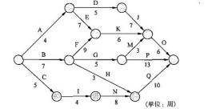

A.27                 B.28                 C.29                   D.30

#### 【试题 4】---高级 2006 下真题 36（经典例题，必须会）

4、某项目最初的网络图如下， 为了压缩进度， 项目经理根据实际情况使用了快速跟进的方法：在 任务 A  已经开始一天后开始实施任务 C，从而使任务 C  与任务 A  并行 3  天。这种做法将使项 目（4）。
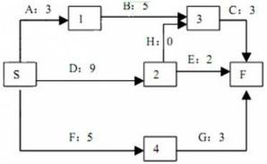

A.完工日期不变  B.提前 4  天完成  C.提前 3  天完成  D.提前 2  天完成

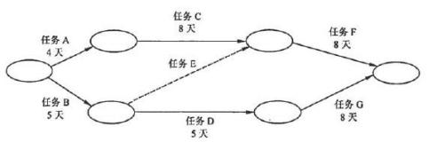

#### 【试题 5】---高级 2008 上真题 36（经典例题，必须会）

5、下图中活动"G"可以拖延（5）周而不会延长项目的最终结束日期。

（图中时间单位为周）

A.0          B.1          C.3            D.4

#### 【试题 6】---高级 2008 上真题 40（经典例题，必须会）

6 、一项任务的最早开始时间是第 3 天， 最晚开始时间是第 13 天，最早完成时间是第 9 天， 最晚 完成时间是第 19 天。该任务（6）。

A.在关键路径上    B.有滞后    C.进展情况良好      D.不在关键路径上

#### 【试题 7】---高级 2009 上真题 40

7、某项目的时标网络图如下（时间单位：周），在项目实施过程中，因负责实施的工程师误操作 发生了质量事故，需整顿返工，造成工作 4-6 拖后 3 周，受此影响，工程的总工期会拖延（14）

周。

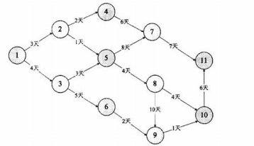

（7）A. 0            B. 1            C. 2            D. 3

#### 【试题 8】---高级 2009 下真题 37~38（经典例题，必须会）

### 8、下图为某工程进度网络图’

结点 1 为起点’结点 11 为终点’那么关键路径为（37）’此工程最快（38）天完成。

（37）A.1-3-5-8-9-10-11                B.1-2-4-7-11

C.1-3-5-7-11                        D.1-2-5-8-10-11

（38）A.18          B.28            C.22          D.20

#### 【试题 9】---高级 2010 上真题 66~67

9、在软件开发项目中’关键路径是项目事件网络中（66）’组成关键路径的活动称为关键活动。 下图中的关键路径历时（67）个时间单位。

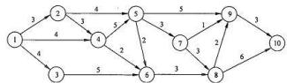

（66）A.最长的回路                 B.最短的回路

C.源点和汇点间的最长路径     D.源点和汇点间的最短路径

（67）A.14        B.18            C.23            D.25

#### 【试题 10】---高级 2010 下真题 37（经典例题， 必须会）

10、以下是某工程进度网络图，如果因为天气原因， 活动③一⑦的工期延后 2  天，那么总工期将

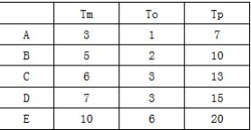

延后  （10）  天。

——           ——

A.0          B. 1        C.2            D.3

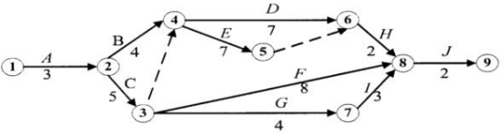

#### 【试题 11】---高级 2011 上真题 37（经典例题，必须会）

,,、依据下面的项目活动网络图中， 该项目历时为——（11）天。

A.10    B.11    C.13    D.14

#### 【试题 12】---高级 2015 上真题 35

12、某项目由 ABCDE 五个活动构成，完成各活动工作所需要的最可能时间（Tm）、最乐观时间（To）、 最悲观时间（TP）见下表：

各活动之间的依赖关系如下：

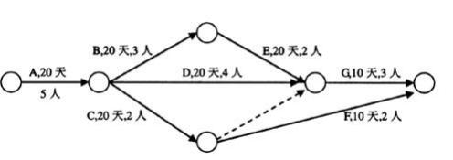
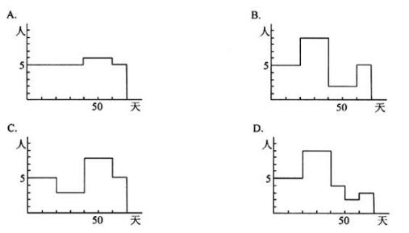

则该项目工期的估算结果约为（）天。

A.22        B.23          C.24          D.25

#### 【试题 13】---高级 2015 上真题 66

13、某信息系统集成项目包括 7 个作业（A-G），各作业所需的时间、人数以及各作业之间的衔接 关系如图所示（其中虚线表示不消耗资源的虚作业）

如果各作业都按最早时间开始，那么正确描述该工程每一天所需人数的图为()

#### 【试题 14】---高级 2015 上真题 68

14、某工程的进度计划网络图如下，其中包含了①~⑩10  个结点，节点之间的剪线表示作业及其 进度方向， 剪线旁标注了作业所需的时间（单位：周）。设起始结点①的时间为 0，则结点⑤的最 早时间和最迟时间分别为（） 周。

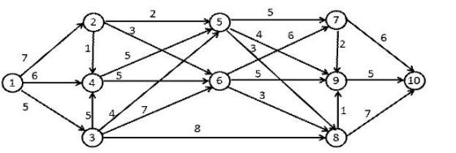

A.9,19        B.9,18        C.15,17              D.15,16

#### 【试题 15】---高级 2015 下真题 35

15、已知某系统由 ABCDEF 六个活动构成， 项目实习人员根据活动逻辑关系及历时等信息绘制了 该系统的网络图， 并给出了该系统的工期为 9 周，项目组其他成员纷纷提出意见， 以下意见中，( ) 是正确的。

| 工作名称 | A | B | C | D | E | F |
|---|---|---|---|---|---|---|
| 紧前关系 | -- | -- | A | A | AB | AB |
| 历时 | 2 周 | 3 周 | 4 周 | 6 周 | 5 周 | 1 周 |

（15）A.逻辑关系错误，项目工期应为 7 周       B.有循环问路，项目工期是正确的

C.节点序号编排不对，项目工期是正确的   D.项目工期为 8 周

#### 【试题 16】---高级 2016 下真题 35~36

16、某项目由并行的 3 个模块 A\B 和 C 组成， 其中活动 A 需要 3 人 5 天时间完成， 活动 B 需要 6 人 7 天时间完成，活动 C 需要 4 人 2 天时间完成。为了保证项目在最低时间内完成，则最少应该 为项目组配置（35）人。假设活动 A.B 和 C 按时完成的概率分别多 80% 、70%和 100%，则该项 目按时完成的概率为（36）。

（35）A.6            B.9            C.10          D.13

（36）A.50%      B.56%        C.64%        D.90%.

#### 【试题 17】---高级 2016 下真题 37

### 17、某项目包括的活动情况如下表所示：

| 活动 | 持续时间 | 活动 | 持续时间 | 活动 | 持续时间 |
|---|---|---|---|---|---|
| A | 4 | B | 3 | C | 4 |
| D | 2 | E | 3 | F | 4 |

活动 D 和活动 F 只能在活动 C 结束后开始。活动 A 和活动 B 可以在活动 C 开始后的任何时 间内开始， 但是必须在项目结束前完成。活动 E 只能在活动 D 完成后开始。活动 B 是在活动 C 开 始 1 天后才开始的。在活动 B 的过程中， 发生了一件意外事件， 导致活动 B 延期 2 天。为了确保 项目按时完成，（）。

（17）A.应为活动 B 添加更多资源              B.可不需要采取任何措施

C.需为关键路径上的任务重新分配资源    D.应为活动 D 添加更多的资源

#### 【试题 18】---高级 2017 上真题 36-37

18、下图是某项目的箭线图（时间单位：周），其关键路径是（），工期是（）周。

A.1-4-6-8-10-11        B.1-3-9-11        C.1-4-9-11        D.1-2-5-7-11

A.14        B.12        C.11                      D.13

#### 【试题 19】---中级 2017 上真题 45

19、下面的箭线图中（活动的时间单位： 周），活动 G 最多可以推延（）周而不会影响项目的完工 日期。

A.1      B.2        C.3        D.4

#### 【试题 20】---高级 2017 下真题 37-38

20、下图中（单位： 周）显示的项目历时总时长是（37）周。在项目实施过程中， 活动 D-I 比计 划延期了 2 周， 活动 a-c 实际工期是 6 周，活动 f-h 比计划提前了 1 周，此时该项目的历时总时 长为（38）周。

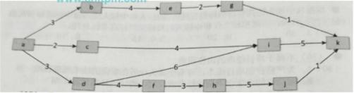

（37）A.14   B.18   C.16   D.13

（38）A.14   B.18    C.16   D.17

#### 【试题 21】---高级 2018 上真题 37-38

21、某项目包含 ABCDEFG 七个活动， 各活动的历时估算和活动间的逻辑关系如下表所示,活动 C 的总浮动时间是（） 天，该项目工期是（）天。

| 活动名称 | 活动历时（天） | 紧前活动 |
|---|---|---|
| A | 2 | - |
| B | 4 | A |
| C | 5 | A |
| D | 6 | A |
| E | 4 | B |
| F | 4 | C 、D |
| G | 3 | E 、F |

（37）A.0

（38）A.13

B.1

B.14

C.2

C.15

D.3

D.16

#### 【试题 22】---高级 2018 上真题 66-67

22、某项工程的活动明细如下表（时间：周：费用： 万元）

| 活动 | 紧前 | 正常进度 | 正常进度 | 赶工 | 赶工 |
|---|---|---|---|---|---|
| 活动 | 紧前 | 所需时间 | 直接费用 | 所需时间 | 直接费用 |
| A | -- | 3 | 10 | 2 | 15 |
| B | A | 8 | 15 | 6 | 17 |
| C | A | 4 | 12 | 3 | 13 |
| D | C | 5 | 8 | 3 | 11 |
| 项目间接费用每周需要 1 万元 | 项目间接费用每周需要 1 万元 | 项目间接费用每周需要 1 万元 | 项目间接费用每周需要 1 万元 | 项目间接费用每周需要 1 万元 | 项目间接费用每周需要 1 万元 |

项目总预算由原先的 60 万元增加到 63 万元，根据上表，在预算约束下该工程最快能完成时间为 （66）周， 所需项目总费用为（67）万元

（66）A.9          B.8        C.14        D.12

（67）A.60        B.64        C.56        D.45

#### 【试题 23】---中级 2018 上真题 47

23、某项目的双代号网络图如下所示， 该项目的工期为（）。
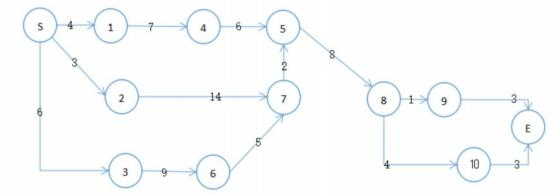

A.17        B.18      C.19        D.20

#### 【试题 24】---高级 2018 下真题 38-39

24、项目经理为某政府网站改造项目制作了如下双代号网络图（单位：天），该项目的总工期为() 天。在项目实施的过程中，活动 2-7 比计划提前了 2 天， 8-10 活动的实际工期是 3 天， 活动 6-7 的工期增加了 3 天， 判断对项目总工期的影响:  ()

（38）A.40        B.37        C.34        D.32

（39）A.没有影响    B.增加了 2 天    C.增加了 3 天    D.增加了 4 天

#### 【试题 25】---中级 2018 下真题 47

25、下图某工程单代号网络图中，活动 B 的总浮动时间为（）天。

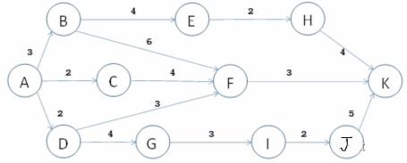

A.1    B.2    C.3    D.4

#### 【试题 26】---中级 2018 下真题 48

26、某工程由 8 个活动组成，其各活动情况如下表所示，该工程关键路径为()

| 活动 | 紧前活动 | 所需天数 | 活动 | 紧前活动 | 所需天数 |
|---|---|---|---|---|---|
| A |  | 3 | F | C | 6 |
| B | A | 2 | G | E | 2 |
| C | B | 5 | H | FG | 5 |
| D | B | 7 | I | HD | 2 |
| E | C | 4 |  |  |  |

A.ABCEGI    B.ABCFHI    C.ABDHI    D.ABDI

#### 【试题 27】---中级 2019 上真题 47-48

27、下图为某规划的进度网络图（单位:周），在实际实施过程中活动 B-E 比计划延迟了 2 周，活 动 J-K 比计划提前了 3 周，则该关键路径是（），总工期是（）。

47）A.A-D-G-I-J-K       B.A-B-F-K        C.A-B-E-H-K        D.A-D-F-K

48）A.15        B.14        C.13        D.12

#### 【试题 28】---高级 2019 下真题 33-34

28、某项目包含 A 、B 、C 、D 、E 、F、G 七个活动。各活动的历时估算和活动间的逻辑关系如下 表所示：

| 活动名称 | 活动历时（天） | 紧前活动 |
|---|---|---|
| A | 2 | - |
| B | 4 | A |
| C | 5 | A |
| D | 3 | A |
| E | 3 | B |
| F | 4 | B 、C 、D |
| G | 3 | E 、F |

依据上表内容，活动 D 的总浮动时间是（33）天，该项目工期为（34）天

（33）A.0          B.1          C.2          D.3

（34）A.12        B.13        C.14        D.15

#### 【试题 29】---中级 2019 下真题 45

29、某项目的网络图如下，活动 D 是自由浮动时间为（）天

A.0        B.1        C.2        D.3

### 2、 PERT、完工概率的考题

| 历年中高级真题汇总：（命题几率大，1 分） |
|---|

#### 【试题 1】---高级 2007 下真题 37（经典例题，必须会）

1、完成活动 A 所需的时间， 悲观（P）的估计需 36 天， 最可能（ML）的估计需 21 天，乐观（O） 的估计需 6 天。活动 A 在 16 天至 26 天内完成的概率是（1）。

A.55.70%          B.68.26%            C.95.43%        D.99.73%

#### 【试题 2】---高级 2010 上真题 37~38

2、完成某信息系统集成项目中的一个最基本的工作单元 A 所需的时间，乐观的估计需 8 天，悲观

的估计需 38 天，最可能的估计需 20 天，按照 PERT 方法进行估算，项目的

工期应该为（37），在 26 天以后完成的概率大致为（38）。

（37）A.20                B.21                C.22                    D.23

（38）A.8.9%        B.15.9%        C.22.2%          D.28.6%

#### 【试题 3】---高级 2011 上真题 36

3、某项任务由子任务I（计划编制和批准） 和子任务Ⅱ（计划实施） 组成。项目经理认为子任务 I的乐观历时为 3 天， 最可能为 4 天，悲观历时为 8 天；子任务Ⅱ的乐观历时为 5 天， 最可能 6 为天，悲观历时为 10 天。根据估算，该任务估算历时为（36）天。

A.10                  B.11                         C.12                      D.13

#### 【试题 4】---高级 2012 下真题 37（经典例题，必须会）

4、某项目预计最快12天完成， 最慢36天完成， 21天完成的可能性最大。公司下达的计划是18天完 成，要使计划完成的概率达到50%，在计划中需要增加（37）天应急时间。

A.4            B.6            C.8              D.22

#### 【试题 5】---中级 2009 上真题 27

。、某项目完成估计需要 12 个月。在进一步分析后认为最少将花 8 个月，最糟糕的情况下将花 28 个月。那么，这个估计的 PERT 值是（5）个月。

A.9          B.11          C.13            D.14

#### 【试题 6】---中级 2009 下真题 37~38

6 、A 公司的某项目即将开始，项目经理估计该项目 10 天即可完成， 如果出现问题耽搁了也不会 超过 20 天完成，最快 6 天即可完成。根据项目历时估计中的 3 点估算法，你认为该项目的历时为 （37），该项目历时的估算方差为 （38） 。

（37） A.10 天      B.11 天      C.12 天       D.13 天

（38） A.2.1 天    B.2.2 天    C.2.3 天     D.2.4 天

#### 【试题 7】---中级 2010 下真题 38

7、某项目经理在对项目历时进行估算时，认为正常情况下完成项目需要 42  天，同时也分析了影 响项目工期的因素， 认为最快可以在 35  天内完成工作， 而在最不利的条件下则需要 55  天完成任 务。采用三点估算得到的工期是（7）天。

A.42                       B.43                    C.44                    D.55

#### 【试题 8】---中级 2012 上真题 36（经典例题，必须会）

8、过去几年小李完成了大量网卡驱动模块的开发，最快 6 天完成， 最慢 36 天完成， 平均 21 天完 成。如今小李开发一个新网卡驱动模块，在 21 天到 26 天内完成的概率是（8）。

A.68.3%        B.34.1%        C.58.2%      D.28.1%

#### 【试题 9】 ---高级 2014 上真题 36

9、项目经理小李对一个小项目的工期进行估算时， 发现开发人员的熟练程度对工期有较大的影响， 如果都是经验丰富的开发人员，预计 20 天可以完成；如果都是新手，预计需要 38  天；按照公司 的平均开发速度， 一般 26  天可以完成。该项目的工期可以估算为（52）天

（9）A.26                            B.27                        C.28                        D.29

#### 【试题 10】---高级 2017 上真题 58

10、项目经理向往在做软件项目成本估算时，先考虑了最不利的情况，估算出项目成本为 120 人 日，又考虑了最有利的情况下项目成本为 60 人日，最后考虑一般情况下的项目成本可能为 75 人 日，该项目最终的成本预算应为（）人日。

A.100        B.90        C.80        D.75

#### 【试题 11】---中级 2018 上真题 51

11 、A 公司的某项目即特开始， 项目经理估计该项目需 12 人天完成，如果出现问题耽搁则 20 人天完成，最快 10 人天完成。根据项目成本估计中的三点结算法。该项目预计花费() 人天。

A.14        B.13        C.12        D.11

#### 【试题 12】---中级 2019 上真题 51

12、某公司组织专家对项目成本进行评估， 得到如下结论:最可能成本为 10 万元， 最乐观成本为 8 万元最悲观成本 12 万元。采用“三点估算法"该项目成本为（）。

A.9        B.10        C.11        D.12

### 3、网络图的考题

#### 【试题 1】---高级 2009 上真题 57~58

1、某工程包括 A 、B、C 、D、E、F、G、H 八个作业，各个作业的紧前作业、所需时间和所需人 数如下表所示（假设每个人均能承担各个作业）  ：

| 作业 | A | B | C | D | E | F | G | H |
|---|---|---|---|---|---|---|---|---|
| 紧前作业 |  |  | A | B | C | C | D,E | G |
| 所需时间（周） | 2 | 1 | 1 | 1 | 2 | 1 | 2 | 1 |
| 所需人数 | 8 | 4 | 5 | 4 | 4 | 3 | 7 | 8 |

该工程的工期应为（57）周。按此工期，整个工程至少需要（58）人。

#### 【试题 2】---高级 2010 上真题 35~36

2、某工程包括 A 、B 、C 、D、E 、F、G 七项工作， 各工作的紧前工作、所需时所需人数如下表所 示（假设每个人均能承担各项工作）。

| 工作 | A | B | C | D | E | F | G |
|---|---|---|---|---|---|---|---|
| 紧前工作 | -- | A | A | B | C 、D | -- | E 、F |
| 所需时间（天） | 5 | 4 | 5 | 3 | 2 | 5 | 1 |
| 所需人数 | 7 | 4 | 3 | 2 | 1 | 2 | 4 |

该工程的工期应为（35）天。按此工期，整个工程最少需要（36）人。

（35）A.13        B.14          C.15          D.16

（36）A.7          B.8            C.9            D.10

#### 【试题 3】---高级 2010 上真题 54

3、某市数字城市项目主要包括 A 、B 、C 、D 、E 等五项任务，且五项任务可同时开展。 各项任务的预计建设时间以及人力投入如下表所示。

| 任务 | 预计建设时间 | 预计投入时间 |
|---|---|---|
| A | 51 人 | 25 人 |
| B | 120 人 | 56 人 |
| C | 69 人 | 25 人 |
| D | 47 人 | 31 人 |
| E | 73 人 | 31 人 |

以下安排中，（3）能较好地实现资源平衡， 确保资源的有效利用。

（3）A.五项任务同时开工

B.待 B 任务完工后，再依次开展 A、C 、D 、E 四项任务

C. 同时开展 A、B 、D 三项任务， 待 A 任务完工后开展 C 任务、 D 任务完工后开展 E 任务 D. 同时开展 A 、B 、D 三项任务，待 A 任务完工后开展 E 任务、 D 任务完工后开展 C 任务

#### 【试题 4】---高级 2010 下真题 35

### 4、某项工程由下列活动组成：

（4）  是该工程的关键路径。

——         ——

A .ABEHJ          B .ACDHJ          C .ACGIJ          D.ACFJ

#### 【试题 5】---高级 2010 下真题 36（经典例题，必须会）

5、下表给出了项目中各活动的乐观估计时间、最可能估计时间和悲观估计时间， 则项目的期望完 工总时间是——（5）——天。

A .36              B.38          C.40                    D.42

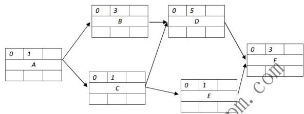

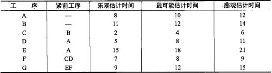

#### 【试题 6】---高级 2012 上真题 33（经典例题，必须会）

6、图1  中，工作E  总时差是（6）

（6）A.1        B.2          C.3        D.4

#### 【试题 7】---高级 2012 上真题 37（经典例题，必须会）

7 、一个活动有 4  道工序， 一个工作只能负责 1  道工序。每名工人工作完成各工序所需小时数如 表 1  所示， 工序间的依赖关系如表 2  所示。完成该活动最少需要（37）

表一：

| 工人小时数工序 | 一 | 二 | 三 | 四 |
|---|---|---|---|---|
| 甲 | 4 | 6 | 5 | 8 |
| 乙 | 6 | 10 | 7 | 8 |
| 丙 | 7 | 8 | 11 | 9 |
| 丁 | 9 | 3 | 8 | 4 |

表二：

| 工序 | 紧前工序 | 紧后工序 |
|---|---|---|
| 一 |  | 二、三 |
| 二 | 一 | 四 |
| 三 | 一 | 四 |
| 四 | 二、三 |  |

A.10          B.14            C.16            D.18

#### 【试题 8】---中级 2009 上真题 24

8、在项目某阶段的实施过程中,A 活动需要 2 天 2 人完成,B 活动需要 2 天 2 人完成,C 活动需 要 5 天 4 人完成,D 活动需要 3 天 2 人完成,E 活动需要 1 天 1 人完成,该阶段的时标网络图如 下。该项目组共有 8 人,且负责 A、E 活动的人因另有安排,无法帮助其他人完成相应工作,且 项目整个工期刻不容缓。以下（24）安排是恰当的,能够使实施任务顺利完成。

A.B 活动提前两天开始          B.B 活动推迟两天开始

C.D 活动提前两天开始          D.D 活动推迟两天开始

#### 【试题 9】---中级 2010 上真题 37

9、在工程网络计划中,工作 M  的最早开始时间为第 16  天,其持续时间为 5  天。该工作有三 项紧后工作,他们的最早开始时间分别为第 25  天、第 27  天和第 30  天,最迟开始时间分别为

第 28  天、第 29  天和第 30  天。则工作 M   的总时差为（37）天。

A.5         B.6         C.7            D.9

#### 【试题 10】---中级 200 下真题 35~36（经典例题，必须会）

10、某工程建设项目中各工序历时如下表所示,则本项目最快完成时间为（35）周。同时,通过 （10）可以缩短项目工期。

| 工序名称 | 紧前工序 | 持续时间（周） |
|---|---|---|
| A | — | 1 |
| B | A | 2 |
| C | A | 3 |
| D | B | 2 |
| E | B | 2 |
| F | C 、D | 4 |
| G | E | 4 |
| H | B | 5 |
| I | G、H | 4 |
| J | F | 3 |

（35）A.7                 B.9                     C.12                    D.13

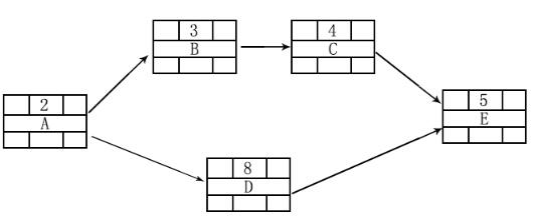
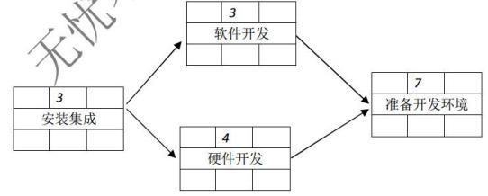

①压缩 B 工序时间 ④压缩 F 工序时间

②压缩 H 工序时间

⑤压缩 G 工序时间

③同时开展 H  工序与 A 工序

A.①⑤      B.①③        C.②⑤        D.③④

#### 【试题 11】---中级 2012 上真题 37（经典例题，必须会）

11、图 2 右侧是单代号网络图（单位为工作日），左侧是图列。在确保安装集成活动尽早开始的前 提下，软件开发活动可以推迟（11）个工作日。

| 最早开始时间 | 持续时间 | 最早完成时间 |
|---|---|---|
| 活动名称 | 活动名称 | 活动名称 |
| 最迟开始时间 |  | 最迟完成时间 |

（11）A.0        B.1          C.2          D.4

#### 【试题 12】---中级 2013 上真题 32（经典例题，必须会）

12、在下面的项目网络图中（时间单位为天），活动 B 的自由时差和总时差分别为（32），如果活 动 A 的实际开始时间是 5 月 1 日早 8 时， 在不延误项目工期的情况下， 活动 B 最晚应在（33）前 结束。

（32）A. 0 ，0B. 0 ，1C. 1，0D. 1 ，1

（33）A. 5 月 5  日早 8 时     B. 5 月 6  日早 8 时

C. 5 月 7 日早 8 时     D. 5 月 8 日早 8 时

#### 【试题 13】---中级 2014 上真题 41

13、已知网络计划中工作 M 有两项紧后工作，这两项紧后工作的最早开始时间分别为第 12 天和 第 15 天，工作 M 的最早开始时间和最迟开始时间分别为第 6 天和第 8 天，如果工作 M 的持续时 间为 4 天， 则工作 M 总时差为（）天

（50）A.1      B.2      C.3          D.4

#### 【试题 14】---高级 2014 上真题 35

14、某项目各项工作的先后顺序及工作时间如下表所示，该项目的总工期为（51）天。

| 序号 | 活动名称 | 紧前活动 | 活动持续时间（天） |
|---|---|---|---|
| 1 | A | -- | 5 |
| 2 | B | A | 7 |
| 3 | C | A | 5 |
| 4 | D | A | 6 |
| 5 | E | B | 9 |
| 6 | F | C 、D | 13 |
| 7 | G | E 、F | 6 |
| 8 | H | F | 5 |
| 9 | I | G、H | 2 |

（14）A.31

B.32

C.33

D.34

#### 【试题 15】---高级 2019 上真题 37-38

15、某项目包含 A 、B 、C 、D 、E 、F、G 七个活动，各活动的历时估算和逻辑关系如下表所示， 则活动 C 的总浮动时间是（）天，项目工期是（） 天。

| 活动名称 | 紧前活动 | 活动历时（天） |
|---|---|---|
| A | - | 2 |
| B | A | 4 |
| C | A | 5 |
| D | A | 6 |
| E | B 、C | 4 |
| F | D | 6 |
| G | E 、F | 3 |

（37）A.0

（38）A.14

B.1

B.15

C.2

C.16

D.3

D.17

### 4、成本管理中挣值分析、预测技术

#### 【试题 1】---高级 2005 上真题 36

1、如果在挣值分析中，出现成本偏差 CV<0 的情况，说法正确的是（1）

A.项目成本超支  B.不会出现计算结果  C.项目成本节约   D.成本与预算一致

#### 【试题 2】---高级 2005 下真题 36~37（经典例题，必须会）

2、项目经理小张对自己正在做的一个项目进行成本挣值分析后，画出了如下所示的一

张图，当前时间为图中的检查日期。根据该图小张分析:该项目进度（36），成本（37）。

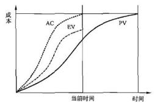

（36）A.正常    B.落后    C.超前    D.无法判断

（37）A.正常    B.超支    C.节约    D.无法判断

#### 【试题 3】---高级 2006 下真题 37

3、项目经理小张对自己正在做的一个项目进行挣值分析后，发现 CPI>1，则可以判断该项目（3）。 A.进度超前      B.进度落后      C.成本超支      D.成本节约

#### 【试题 4】---高级 2006 下真题 39

4 、 根据下表提供的数据，（4）最有可能在时间和成本的约束内完成。

| 项目 | PV | EV | AC |
|---|---|---|---|
| 甲 | 1200 | 900 | 700 |
| 乙 | 1200 | 700 | 900 |
| 丙 | 1200 | 900 | 1000 |

A.项目甲      B.项目乙      C.项目丙      D.项目甲和项目乙。

#### 【试题 5】---高级 2007 下真题 40

5、项目经理认为到目前为止的费用在某种程度上是项目将发生的剩余工作所需成本的指示器， 则 EAC 的公式为（5）。

A.EAC=AC+（BAC-EV）/CPI              B.EAC=AC+ETC

C.EAC=AC+BAC—EV                         D.EAC=AC+EV

#### 【试题 6】---高级 2008 上真题 57

6、下表为同时开展的 4  个项目在某个时刻的计划值 PV、实际成本 AV  和挣值 EV，该时刻成 本超出最多的项目和进度最为落后的项目分别是（57） 。

| 项目 |  |  |  |  |  |
|---|---|---|---|---|---|
| 1 | 10000 | 11000 | 10000 |  |  |
| 2 | 9000 | 7200 | 6000 |  |  |
| 3 | 8000 | 8000 | 8000 |  |  |
| 4 | 10000 | 7000 | 5000 |  |  |

#### 【试题 7】---高级 2008 下真题 45~46（经典例题，必须会）

7、某正在进行中的项目，当前的 PV=2200 元、 EV=2000 元、 AC=2500 元，当前项目的 SV 和项 目状态是（45），该项目的 CPI 和成本绩效是（46）。

（45）A.-300 元;项目提前完成          B.+200 元;  项目提前完成

C.+8000 元;  项目按时完成        D.-200 元;  项目比原计划滞后

（46）A.0.20;  实际成本与计划的一致     B.0.80;  实际成本比计划成本要低

C.0.80;  实际成本超出了计划成本   D.1.25;  实际成本超出了计划成本

#### 【试题 8】---高级 2009 下真题 58

8、项目甲、乙、丙、丁的工期都是三年， 在第二年末其挣值分析数据如下表所示， 按照趋势最早 完工的应是一（8）。

（8）A.甲     B. 乙     C.丙      D.丁

#### 【试题 9】---高级 2009 下真题 59

C.成本超支、进度超前      D.成本超支、进度落后

完工的应是项目（10）。

| 项目 | 预算总成本 |  |  |  |
|---|---|---|---|---|
| I | 1500 | 1000 | 1200 | 900 |
| II | 1500 | 1300 | 1200 | 1300 |
| III | 1500 | 1250 | 1200 | 1300 |
| IV | 1500 | 1100 | 1200 | 1200 |

（10）A. I            B.II              C.III              D.Ⅳ

#### 【试题 11】---高级 2010 上真题 58（经典例题，必须会）

11、已知某综合布线工程的挣值曲线如下图所示： 总预算为 1230 万元， 到目前为止己支出 900 万 元，实际完成了总工作量的 60%，该阶段的预算费用是 850 万元。按目前的状况继续发展，要完 成剩余的工作还需要（11）万元。

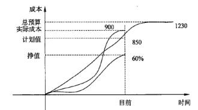

A. 330    B.492    C.600   D. 738

#### 【试题 12】---高级 2011 上真题 61 （经典例题，必须会）

12、项目计划工期为 4 年，预算总成本为 800 万元。在项目的实施过程中，通过对成本的核算和 有关成本与进度的记录得知， 开工后第 2 年末实际成本发生额为 200 万元， 所完成工作的计划预 算成本额为 100 万元。与项目预算成本比较可知： 当工期过半时，项目的计划成本发生额应该为 400 万元。此时如果不采取任何纠正措施， 照此速度发展下去， 那么到开工后第 4 年末项目会出现

（12）  万元的成本超支。

一一      一一

A.50         B.100         C.200          D.400

#### 【试题 13】---高级 2011 下真题 38~39（经典例题，必须会）

13、某大型项目进行到两年时，使用挣值法所需要的三个中间变量的数值分别是： 计划值 PV 为 400 万元， 实际成本 AC 为 200 万元， 挣值 EV 为 100 万元。基于该项目的成本偏差，下列描述正 确的是（38），基于该项目的成本绩效指数，下列描述中正确的是（39）。

（38）A.项目成本偏差为负且项目处于超支状态

B.项目成本偏差为正且项目处于超支状态

C.项目成本偏差为负且项目处于成本节约状态

D.项目成本偏差为正且项目处于成本节约状态

（39）A.成本绩效指数小于 1 且实际发生的成本是预算成本的 2 倍

B.成本绩效指数大于 1 且实际发生的成本是预算成本的一半

C.成本绩效指数小于 1 且实际发生的成本是预算成本的一半

D.成本绩效指数大于 1 且实际发生的成本是预算成本的 2 倍

#### 【试题 14】---高级 2011 下真题 57

14、 某项目的工期为 40 周，每周可以使用 12 个工时。若用于完成该项目所有活动的资源只有 192 个工时，则此时项目资源使用率为（57）。

A.0.2             B.0.4       C.0.8             D.1

#### 【试题 15】---高级 2012 上真题 39（经典例题，必须会）

15、根据下图，表示竣工费用超支情况的是（15） 。

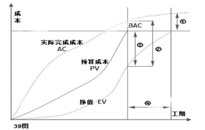

A.①      B.②     C.③      D.④

#### 【试题 16】---高级 2012 上真题 61

16、某信息系统集成项目的预算为5050000  元，工期6  周。某时间点，该项目花了1550000  元完 成了预计要花1690000  元的工作，而计划成本是2110000  元。则该项目的实际成（16）

A.低于预算   B.超出预算  C.符合预算   D.提供的信息不足， 无法判断

#### 【试题 17】---高级 2013 下真题 57

17、某软件开发项目， 预算为 40 万无， 计划在 40 个工作日内完成， 当项目进行到第 10 个工作日 时， 项目经进对项目进行了绩效评估， 结果是： 项目完成当期计划进度的 70%，花费 23 万，按此

绩效还需投入（17）万才能完成项目

（17）A.10    B.12    C.19    D.21

#### 【试题 18】---高级 2013 下真题 58

18、某项目计划工期为 4 年，投资总成本为 800 万，在项目实施过程中， 通过对成本的核算和有 关成本与进度的记录通知，开工后两年末实际成本发生额为 200 万，所完成工作的计划预算成本 额为 100 万，与项目预算成本比较可知， 当工期过半时， 项目的计划成本发生预算应该为 400 万， 该项目成本绩效指数 CPI 为百分之()

（18）A.50    B.25      C.12.5      D.10

#### 【试题 19】---中级 2009 上真题 51 （经典例题， 必须会）

19、在项目实施中间的某次周例会上，项目经理小王用下表向大家通报了目前的进度。根据这个 表格，目前项目的进度（19）。

| 活  动 | 计划值 | 完成百分比 | 实际成本 |
|---|---|---|---|
| 基础设计 | 20000 元 | 90% | 10000 元 |
| 详细设计 | 50 000 元 | 90% | 60000 元 |
| 测试 | 30 000 元 | 100% | 40 000 元 |

A.提前于计划 7%                                  B.落后于计划 18%

C.落后于计划 7%                                  D.落后于计划 7.5%

#### 【试题 20】---中级 2009 下真题 46

20、在某项目进行的第三个月，累计计划费用是 25 万元人民币，而实际支出为 28 万元，以下关 于这个项目进展的叙述，正确的是（20）。

A.提供的信息不全，无法评估    B. 由于成本超支，项目面临困难

C.项目将在原预算内完成       D.项目计划提前

#### 【试题 21】---中级 2010 上真题 45（经典例题，必须会）

21、项目进行到某阶段时，项目经理进行了绩效分析，计算出 CPI  值为 0.91。这表示（45）。 A.项目的每 91  元人民币投资中可创造相当于 100  元的价值

B. 当项目完成时将会花费投资额的 91%

C.项目仅进展到计划进度的 91%

D.项目的每 100  元人民币投资中只创造相当于 91  元的价值

#### 【试题 22】---中级 2010 上真题 46（经典例题， 必须会）

22、下图是一项布线工程计划和实际完成的示意图， 2009  年 3  月 23   日的 PV 、EV 、AC  分别 是（22）。

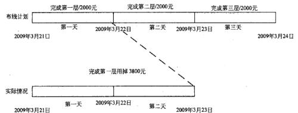

A.PV=4000  元、 EV=2000  元、 AC=3800  元

B.PV=4000  元、 EV=3800  元、 AC=2000  元

C.PV=3800  元、 EV=4000  元、 AC=2000  元

D.PV=3800  元、 EV=3800  元、 AC=2000  元

#### 【试题 23】---中级 2010 下真题 39

23、甲公司生产急需 5000 个零件，承包给乙工厂进行加工，每个零件的加工费预算为 20  元，计 划 2  周（每周工作 5  天）完成。甲公司负责人在开工后第 9 天早上到乙工厂检查进度， 发现已完 成加工 3600  个零件，支付款项 81000  元。经计算，（23）。

A.该项目的费用偏差为-18000 元    B.该项目的进度偏差为-18000  元

C.该项目的 CPI  为 0.80                        D.该项目的 SPI  为 0.90

#### 【试题 24】---中级 2010 下真题 46（经典例题，必须会）

24、根据以下布线计划及完成进度表， 在 2010 年 6  月 2   日完工后对工程进度和费用进行预测， 按此进度， 完成尚需估算（ETC）为（24）。

|  | 计划开始 时间 | 计划结束 时间 | 计划费用 | 实际开始 时间 | 实际结束 时间 | 实际完成 费用 |
|---|---|---|---|---|---|---|
| 1  号区域 | 2010 年 6  月 1   日 | 2010 年 6  月 1   日 | 10000  元 | 2010 年 6 月 1   日 | 2010 年 6 月 2   日 | 18000  元 |
| 2  号区域 | 2010 年 6  月 2   日 | 2010 年 6  月 2   日 | 10000  元 |  |  |  |
| 3  号区域 | 2010 年 6  月 3   日 | 2010 年 6  月 3   日 | 10000  元 |  |  |  |

A.18000  元      B.36000 元        C.20000 元        D.54000 元

#### 【试题 25】---中级 2011 上真题 33

25、项目经理王某对其负责的系统集成项目进行了成本估算和进度安排，根据团队成员的情况分 配了任务，并制定出计划执行预算成本的基准。由于公司高层领导非常重视该项目，特地调配了 几名更有经验（薪水更高）的技术骨干参与项目，这种变化对项目绩效造成的最可能影响是（25）。

A.正的成本偏差 CV  ，正的进度偏差 SV    B.负的成本偏差 CV  ，正的进度偏差 SV C.正的成本偏差 CV  ，负的进度偏差 SV    D.负的成本偏差 CV  ，负的进度偏差 SV

#### 【试题 26】---中级 2011 上真题 43（经典例题， 必须会）

26、挣值管理是一种综合了范围、时间、成本绩效测量的方法，通过与计划完成的工作量、实际 挣得的收益、实际的成本进行比较，可以确定成本进度是否按计划执行。下图中标号所标示的区 间依次应填写（26）。

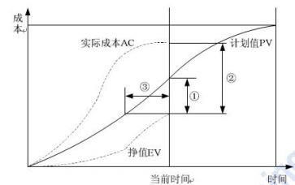

A.①进度落后②成本差 CV  ③进度差 SV

B.①成本差 CV  ②进度差 SV    ③进度落后时间

C.①进度差 SV  ②成本差 CV    ③进度落后时间

D.①进度落后  ②进度差 SV  ③成本差 CV

#### 【试题 27】---中级 2011 上真题 44

27、某信息化施工项目一共要进行 30 天， 预算总成本 60 万元，其中 5 万元为管理成本， 40 万元 为物料使用费，其余为人工成本。按照管理计划，每 5 天进行一次挣值分析以评价项目绩效。在 第 5 天绩效评价时计算得到 CPI（绩效评价指数）为 0.95，则说明在前 5 天的施工中，实际成本 ①预算成本；如果要使下一次绩效评价时 CPI 为 1，且人工、物料使用成本不能改变，以免影响 施工质量，则在这两次绩效评价间，每天平均可花费的管理成本为②元。上述①和②依次序应该 填写（27）（假设所有成本按照天数平均分配， 工程进度不存在延时或提前情况）。

A.①低于②614 元

C.①低于②1052 元

B.①高于

D.①高于

②614 元

②1052 元

#### 【试题 28】---中级 2011 下真题 46

28、某信息系统集成项目采用挣值分析技术进行成本控制，假设当前状态数据如下表所示，则该 项目的 CPI、EAC、当前项目的状态分别是（46）。

| 工作 参数 | 预算 | 完成百分比 |  |
|---|---|---|---|
| 活动 1 | 800 | 100% | 700 |
| 活动 2 | 10000 | 90% | 10000 |
| 活动 3 | 20000 | 60% | 16000 |

A.0.82 ，37676 元， 进度滞后且成本超支

B.0.8 ，12500 元，进度提前且成本超支

C.1.25 ，12500 元，进度滞后且成本低于预算

D.1.25 ，12500 元， 进度提前且成本低于预算

#### 【试题 29】---中级 2012 上真题 46（经典例题，必须会）

29、某 ERP 软件开发项目共有 12 个模块，项目经理对较件进行了成本预算，预算每个模块的开 发成本为 5 万元，按照项目管理计划， 每月开发一个模块， 12 个月完成开发工作。在项目进行到 第 3 个月底的时候，项目经理对照计划， 发现刚完成了 2 个模块的开发工作，经统计，实际花费 的成本为 15 万元。若按照目前的绩效情况，到所有模块开发完成时预计托费的总成本为（29）。

A.90 万    B.    75 万    C.    70 万    D.    66,7.万

#### 【试题 30】---中级 2012 下真题 57（经典例题， 必须会）

30、如果挣值 EV  是 300  万元， 实际成本 AC  是 350  万元， 计划值 PV  是 375  万元。进度执 行 指数显示（30）。

（30）A.仅以原始计划速率的 86%进行项目 B.正在以原始计划速率的 93%进行项目

C.正在以原始计划速率的 107%进行项目  D.仅以原始计划速率的 80%进行项目

#### 【试题 31】---中级 2013 上真题 39（经典例题，必须会）

31、在某一时刻，项目 CPI 为 1.05，这表示   31  。

A.项目 100 元的成本创造了 105 元的价值

B.项目 100 元的成本创造了 100 元的价值

C.项目进度提前了 5%

D.项目进落后了 5%

#### 【试题 32】---中级 2014 上真题 46

32、某项目计划安排为： 2014 年 4 月 30  日完成 1000 万元的投资任务。在当期进行项目绩效时评 估结果为： 完成计划投资额的 90%，而 CPI 为 50%，这时的项目实际花费为（）万元。

（32）A.450      B.900        C.1800        D.2000

#### 【试题 33】---高级 2014 上真题 50

33、项目I、Ⅱ、Ⅲ、 Ⅳ的工期都是三， 在第二年末其挣值分析数据如下表所示。按此趋势，

项目（33）应最早完工。

| 项目 | 项目总成本 |  |  |  |
|---|---|---|---|---|
| I | 1500 | 1000 | 1200 | 900 |
| II | 1500 | 1300 | 1200 | 1300 |
| III | 1500 | 1250 | 1200 | 1300 |
| IV | 1500 | 1100 | 1200 | 1200 |

（33）A. I        B. Ⅱ       C.Ⅲ          D.Ⅳ

#### 【试题 34】---2014 下真题 48~49

34、某项目计划成本为 400 万元， 计划工期为 4 年， 项目进行到两年时， 监理发现预算成本为 200   万元， 实际成本为 100 万元， 挣值为 50 万元，则项目成本偏差为（1）万元，项目进度偏差为（2） 万元。

#### 【试题 35】---2014 下真题 68

35、在项目实施期间的某次周例会上，项目经理向大家通报了项目目前的进度。根据以下表格， 目前的进度（）。

| 活动 | 计划值（元） | 完成百分比 | 实际成本（元） |
|---|---|---|---|
| 基础设计 | 20000 | 90% | 10000 |
| 详细设计 | 50000 | 90% | 60000 |
| 测试 | 30000 | 100% | 40000 |

（46）A.提前计划 7%      B.落后计划 15%    C.落后计划 7%      D.提前计划 15%

#### 【试题 36】---2015 上真题 47

36、某土方工程总挖方量为 4000 立方米。预算单价为 45 元/立方米。计划用 10 天完成， 每天 400 立方米。开工后第 7 天早晨刚上班时业主项目管理人员前去测量，取得了两个数据；已完成挖方 2000 立方米，支付给承包单位的工程进度款累计已支付 120000 元，那么此时项目 CPI 和 SPI 分别 为（）。

A.CPI=0.75；SP1=0.75          B.CPI=0.83；SPI=0.83

C.CPI=0.75；SPI=0.83        D.CPI=0.83；SPI=0.75

#### 【试题 37】---2015 上真题 57

37、假设某项目任务已进行了充分细化分解，任务安排及完成情况如下图，已获价值适用 50/50 规则（活动开始执行即获得一半价值），则下图中项目监控点的 PV、EV、BAC 分别为（）。

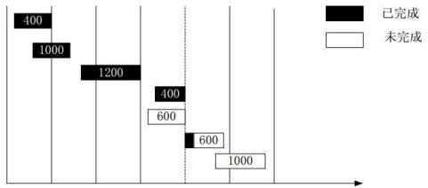

A.PV=4200 、EV=3000、BAC=5200        B.PV=4200 、EV=3300 、BAC=4600

C.PV=3600 、EV=3300、BAC=5200        D.PV=3600 、EV=3600、BAC=4600

#### 【试题 38】---高级 2015 下真题 57~58

38、某项目包含 A.B.C 三项主要活动，项目经理在成本估算时采用自下而上的估算方法，分别估 算出三项活动的成本分别为 13 万元，23 万元和 8 万元，同时为了应对未来可能遇到的不确定因素， 预留了 10 万元的管理储备，同时为每个活动预留了 2 万元的准备金，该项目的总预算为（1）万 元。项目进行到第二个月时，实际花费为 20 万元，完成总工作量的 30%。如果项目按照当前的绩 效继续进行下去，预测项目的完工尚需成本 ETC 约为（2）万元

（1）A.44       B.54       C.60     D.50

（2）A.46.7     B.40.7     C.45     D.46

#### 【试题 39】---高级 2016 下真题 56

39、项目经理负责对项目进行成本估算。下述表格是依据某项目分解的成本估算表，该项目总成 本估算是（）万元。

表 1：研发阶段成本估算表

| 研发 阶段 | 需求 调研 | 需求 分析 | 项目 策划 | 概要 设计 | 详细 设计 | 编码 | 系统 测试 | 其他 | 合计 |
|---|---|---|---|---|---|---|---|---|---|
| 占研发比例 | 3% | 4% | 5% | 5% | 10% | 15% | 13% | 9% | 100% |
| 阶段工作量（万元） | 7 | 9 | 11 | 11 | 22 | 112 | 28 | 20 | 220 |

表 2：项目成本估算表

| 项目 | 研发阶段 | 项目管理 | 质量保证 | 配置管理 | 其他 | 合计 |
|---|---|---|---|---|---|---|
| 占项目比例 | 84% | 7% | 4% | 3% | 2% | 100% |
| 工作量（万元） | 220 |  |  |  |  |  |

（39）A.184      B.219      C.262        D.297

#### 【试题 40】---高级 2016 下真题 58

40、项目经理小李对自己的项目采用挣值法进行分析后，发现 SPI>1 、CPI<I，则该项目（）。

（40）A.进度超前，成本节约      B.进度超前， 成本超支

C.进度延后，成本节约      D.进度延后，成本超支

#### 【试题 41】---中级 2016 下真题 45

41、某个项目的预算是 3000 万元，工期为 5 个月。现在过去了 3 个月，实际成本是 1800 万元，项目 进度和绩效都符合计划、而且这种情况也会持续下去。则再过 3 个月， 项目的 EV 是（）万元。

A.1800        B.2400        C.1200          D.3000

#### 【试题 42】---中级 2017 下真题 52

42、下表给出某信息化建设项目到 2017 年 9 月 1 日为止的成本执行（绩效）数据，基于该数据， 项目经理对完工估算（EAC）进行预测，假设当前的成本偏差被看作是可代表未来偏差的典型偏 差时， EAC 应为（） 元。

A.45000.00        B.50000.00        C.53200.00        D.62500.00

#### 【试题 43】---高级 2017 下真题 58-60

43、某系统集成项目包含了三个软件模块，现在估算项目成本时，项目经理考虑到其中的模块 A 技术成熟， 已在以前类似项目中多次使用并成功交付，所以项目经理忽略了 A 的开发成本， 只给 A 预留了 5 万元， 以防意外发生。然后估算了 B 的成本为 50 万元，C 的成本为 30 万元， 应急储备为 10 万元， 三者集成成本为 5 万元， 并预留了项目的 10 万元管理储备。如果你是项目组成成员， 该 项目的成本基准是（58）万元，项目预算是（59）万元，项目开始执行后，当项目的进度绩效指 数 SPI 为 0.6 时，项目实际花费 70 万元，超出预算 10 万元，如果不加以纠偏，请根据当前项目 进展，估算该通目的完工估算值（EAC）为（60）万元

（58）A.90    B.95     C.100      D.110

（59）A.30    B.95     C.100      D.110

（60）A.64    B.134    C.194.4    D.124.4

#### 【试题 44】---高级 2018 上真题 59

44、某信息系统集成项目计划 6 周完成， 项目经理就前 4 周的项目进展情况进行分析情况如下， 项目的成本执行指数 CPI 为（）。

| 周 | 计划投入成本值（元） | 实际投入成本值（元） | 完成百分比 |
|---|---|---|---|
| 1 | 1000 | 1000 | 100% |
| 2 | 3000 | 2500 | 100% |
| 3 | 8000 | 10000 | 100% |
| 4 | 13000 | 15000 | 90% |
| 5 | 17000 |  |  |
| 6 | 19000 |  |  |

A.0.83        B.0.87        C.0.88        D.0.95

#### 【试题 45】--中级 2018 上真题 52

45、某信息化项目到 2017 年 12 月 31  日的成本执行（精效） 数据如下表。根据表不正确的是（）。

| 活动编码 | 活动 | PV/元 | AC/元 | EV/元 |
|---|---|---|---|---|
| 1 | 召开项目会议 | 2000 | 2000 | 2000 |
| 2 | 制定项目计划 | 900 | 1000 | 900 |
| 3 | 客户需求分析 | 5000 | 5500 | 5000 |
| 4 | 系统总体设计 | 10500 | 11500 | 7350 |
| 5 | 系统编码 | 20500 | 22500 | 19000 |
| 6 | 界面设计 | 5200 | 5250 | 4160 |
| 合计 |  | 44100 | 47750 | 38410 |
| 项目总预算（BAC）： 167500 | 项目总预算（BAC）： 167500 | 项目总预算（BAC）： 167500 | 项目总预算（BAC）： 167500 | 项目总预算（BAC）： 167500 |

A.非典型偏差时，完工估算（EAC）为 176840 元

B.该项目成本偏差为-9340 元

C.该项目进度绩效指数为 0.80

D.此项目目前成本超支，进度落后

#### 【试题 46】--中级 2018 下真题 45

46、某工程项目，完工预算为 2000 万元。到目前为止，由于某些特殊原因，实际支出 800 万元，成本 绩致指数为 0.8,假设后续不再发生成本偏差，则完工预算（EAC）为（46）万元。

A.2500    B.2160    C.2000    D.2800

#### 【试题 47】--中级 2019 上真题 59

47、下表给出了某项目到 2018 年 12 月 30  日为止的部分成本执行（绩效） 数据。如果当前的成本 偏差是非典型的，则完工估算（EAC）为（ ）元。

| 活动编号 | 活动 | 完成百分比（%） | 计划值（PV）/元 | 实际成本（AC）/元 |
|---|---|---|---|---|
| 1 | A | 100 | 1000 | 1000 |
| 2 | B | 100 | 800 | 1000 |
| 3 | C | 100 | 2000 | 2200 |
| 4 | D | 100 | 5000 | 5100 |
| 5 | E | 80 | 3200 | 3000 |
| 6 | F | 60 | 4000 | 3800 |
| 合计 | 合计 | 合计 | 16000 | 16100 |
| 项目总预算（BAC）：40000.00 | 项目总预算（BAC）：40000.00 | 项目总预算（BAC）：40000.00 | 项目总预算（BAC）：40000.00 | 项目总预算（BAC）：40000.00 |
| 报告日期： 2018 年 12 月 30  日 | 报告日期： 2018 年 12 月 30  日 | 报告日期： 2018 年 12 月 30  日 | 报告日期： 2018 年 12 月 30  日 | 报告日期： 2018 年 12 月 30  日 |

A.45000        B.40100        C.42340        D.47059

#### 【试题 48】--高级 2019 下真题 37

48、下表拾出了某项目到 2019 年 6 月 30 日为止的庙本次行（绩效）数据，如果当前的成本偏差 是典型的， 则完工估算（EAC）为（） 元

| 活动 | 完成百分比% | 计划值（PV）/元 | 实际成本（AC）/元 |
|---|---|---|---|
| A | 100 | 2200.00 | 2500.00 |
| B | 100 | 2500.00 | 2900.00 |
| C | 100 | 2500.00 | 2800.00 |
| D | 80 | 1500.00 | 1500.00 |
| E | 70 | 3000.00 | 2500.00 |
| F | 60 | 2500.00 | 2200.00 |
| 合计 | 合计 | 14200.00 | 14400.00 |
| 项目总预算（BAC）：40000.00 | 项目总预算（BAC）：40000.00 | 项目总预算（BAC）：40000.00 | 项目总预算（BAC）：40000.00 |
| 报告日期： 2019 年 6 月 30  日 | 报告日期： 2019 年 6 月 30  日 | 报告日期： 2019 年 6 月 30  日 | 报告日期： 2019 年 6 月 30  日 |

A.48000        B.44000        C.42400        D.41200

#### 【试题 49】--中级 2019 下真题 50

| 活动编号 | 活动 | 预计完成百分 比% | 实际完成百分 比% | 计划值 Pv（元） | 实际成本 AC（元） |
|---|---|---|---|---|---|
| 1 | A | 100 | 100 | 2000.00 | 2000.00 |
| 2 | B | 100 | 100 | 1600.00 | 1800.00 |
| 3 | C | 100 | 100 | 2500.00 | 2800.00 |
| 4 | D | 100 | 80 | 1500.00 | 1600.00 |
| 5 | E | 100 | 75 | 2000.00 | 2800.00 |
| 6 | F | 100 | 60 | 2500.00 | 2200.00 |
| 合计 | 合计 | 合计 | 合计 | 12100.00 | 12200.00 |
| 项目总预算（BAC）：50000.00 | 项目总预算（BAC）：50000.00 | 项目总预算（BAC）：50000.00 | 项目总预算（BAC）：50000.00 | 项目总预算（BAC）：50000.00 | 项目总预算（BAC）：50000.00 |
| 报告日期： 2019 年 8 月 1  日 | 报告日期： 2019 年 8 月 1  日 | 报告日期： 2019 年 8 月 1  日 | 报告日期： 2019 年 8 月 1  日 | 报告日期： 2019 年 8 月 1  日 | 报告日期： 2019 年 8 月 1  日 |

A.59238        B.51900        C.50100        D.48100

## 第十章、考试涉及到的英文题

#### 【试题 1】---2009 上真题 71

1、Which ofthe following statement related to PMO is not correct?（1）

A.The specific form,filnction,and structure of a PMO are dependent upon the needs ofthe organization that it supports.

B.One'of the key features of a PMO is managing shared resources across all projeas administered by the PMO.

C.The PMO focuses on the specified project objectives,

D.The PMO opthruzes the use of shared organizational resources across all projects.

#### 【试题 2】---2009 上真题 72

2、The inputs ofdeveloping project management plan do not include  （2）  .

A, project charter              B.stakeholder management strategy

C.project scope statement    D.outputs fi'om planning processes

#### 【试题 3】---2009 上真题 73~74

3、A project life cycle is a collection of generally sequential project（3）   whose name and

number are determined by the control needs of the organization or organizations involved in the project. The life cycle provides the basic一  （74） 一for managing the project,regardless of the

specific work involved.

（73） A. phases    B. processes    C.segrnents    D. pieces

（74） A. plan    .    B.fraction    C.main    D. framework

#### 【试题 4】 ---2009 上真题 75

4、 （4） is one ofthe quality planning outputso

A.scopebaseline     B.Cost of quality    C.Productspecification  D.Qualitychecklist

]【试题 5】---2009 下真题 71

5、Risk management allows the project manager and the project team not to一（5）.

eliminate most risks during the planning phase ofthe project

identify project risks

identify impacts ofvarious risks

plan suitable responses

#### 【试题 6】---2009 下真题 72

6、The project life-cycle can be described as一（ 6）.

A.project concept,project planning,project execution,and project close-out

B.projectplanning,work authorization,and project reporting

C.project planning, project control, project definition, WBs development, and project termination D.project concept,project execution,and project reporting

#### 【试题 7】---2009 下真题 73

7、（7）  is a method used in Critical path Methodology for constructing a project schedule network diagram that uses boxes or rectangles,referred to as nodes,to represent activities and connects them with arrows that show the logical relationships that exist between them .

A.pERT        B.AOA       C.WBs        D.pDM

#### 【试题 8】---2009 下真题 74

8 、 schedule  development  can  require  the  review  and  revision  of  duration  estimates  and  resource estimates to create an approved    （8） that can serve as a baseline to track progress.

A.scope statement       B.Activitylist        C.projectcharter       D.projectschedule

#### 【试题 9】 ---2009 下真题 75

9 、The Development of project Management plan process includes the actions necessary to define,prepare,integrate,and coordinate all constituent plans into a      （9）

A.project scope statement         B.project Management plan

C.Forecasts                                      D.projectCharter

#### 【试题 10】---2010 上真题 71

10、project（10）is an uncertain event or condition that, if it occurs, has a positive or a negative effect on at least one project objective, such as time, cost, scope, or quality.

A.risk           B.problem     C.result       D.data

#### 【试题 11】---2010 上真题 72

11 、Categories of risk response are  （11）.

A.Identification, quantification, response development, and response control. B.Marketing, technical, financial, and human

C.Avoidance, retention, control, and deflection

D.Avoidance, mitigation, acceptance, and Transferring

#### 【试题 12】---2010 上真题 73

12、（12）is the application of planned, systematic quality activities to ensure that the project will employ all processes needed to meet requirements .

A.Quality assurance  （QA）     B.Quality planning

C.Quality control  （QC）        D.Quality costs

#### 【试题 13】---2010 上真题 74

13、（13） is primarily concerned with defining and controlling what is and is not included in the project. A.project Time Management                   B.project Cost Management

C.project scope management                   D .project Communications Management

#### 【试题 14】---2010 上真题 75

14 、 A project manager believes that modifying the scope of the project may provide added value service for the customer . The project manager should（14）.

A.assign change tasks to project members

B.call a meeting of the configuration control board

C.change the scope baseline

D.postpone the modification until a separate enhancement project is funded after this project is completed according to the original baseline

#### 【试题 15】---2010 下真题 71

15 、OSI is a theoretical model that shows how any two different systems can communicate with each other.Router, as a networking device, operate at the  （15） layer of   the OSI model.

A.transport               B.application             C.network          D.physical

#### 【试题 16】---2010 下真题 72

16 、Most of the host operating system provides a way for a system administrator to manually configure the IP information needed by a host.Automated configuration methods, such as （16） , are required to solve the problem .

A.IPsec          B.DHCP            C.PPTP             D.SOAP

#### 【试题 17】---2010 下真题 73

17、Business intelligence （BI） is the integrated application of data warehouse, data mining and （17）. A.OLAP            B.OLTP             C.MRPII              D.CMS.

#### 【试题 18】---2010 下真题 74

18 、Perform Quality Control is the process of monitoring and recording results of executing the Quality Plan activities to assess performance and recommend necessary changes.（18） are the techniques and tools in performing quality control.

①Statistical sampling              ②Run chart      ③Control charts           ④Critical Path Method

⑤Pareto chart                      ⑥Cause and effect diagrams

A.①②③④     B.②③④⑤    C.①②③⑤⑥    D.①③④⑤⑥

#### 【试题 19】---2010 下真题 75

19 、Plan Quality is the process of identifying quality requirements and standards for the project and product, and documenting how the project will demonstrate compliance .（19） is a method that analyze all the  costs  incurred  over  the  life  of the  product  by  investment  in  preventing  nonconformance  to requirements, appraising the product or service for conformance to requirement, and failing to meet requirements .

A.Cost-Benefit analysis                       B.Control charts

C.Quality function deployment          D .Cost of quality analysis

#### 【试题 20】---2011 上真题 71

20、TCP/IP communication protocol contains four layers .From bottom to top, the four layers are（20）. A.network interface layer, internet layer, transport layer and application layer

B.internet layer, network interface layer, transport layer and application layer

C.network interface layer, transport layer, network interface layer and application layer D.application layer, transport layer, internet layer and network interface layer

#### 【试题 21】---2011 上真题 71

21 、Ethernet is the  commonly used  local  area  network  communication protocol. The  standard  of Ethernet is  （21）.

A.IEEE 802 .1        B.IEEE 802 .2     C.IEEE 802 .3            D.IEEE 802 .11

#### 【试题 22】---2011 上真题 72

22、（22） are the four major activities of software configuration management .

① configuration identification  ② statement report  ③ change control

④ preparation of requirement document  ⑤ configuration auditing

A.①②③④         B.①②④⑤    C.①②③⑤    D.②③④⑤

#### 【试题 23】---2011 上真题 73

23、The earned value technique is a commonly used method of performance measurement . It integrates project  scope,  cost,  and  schedule  measures  to  help  the  project  management  team  assess  project performance . If a project , s Schedule Performance Index（SPI=EV/PV） value less than 1 .0, it means that  （23）.

A.the project is ahead of its planned schedule

B.less work was completed than was planned

C.the cost overrun for work completed

D.the cost under-run of performance to date

#### 【试题 24】---2011 上真题 74

24 、SWoT analysis is a kind of risk identification method. If the project team chose the So strategy, they should  （24）.

A.make full use of the advantage and catch the opportunity

B.overcome the weakness and catch the opportunity

C.make full use of the advantage and reduce the threat

D.overcome the weakness and reduce the threat

#### 【试题 25】---2011 下真题 71

25、The project manager must maintainan effective communication link with the customer ,s satisfaction with the progress of the project. The project manager maintains this link through（25）.

A.Periodic project reports, periodic visits to the customer, and telephonic exchanges B.Subordinates, project team members, and the project sponsor

C.one-time reports, weekly reports, and monthly reports

D.The telephone, facsimile, and data transmission

#### 【试题 26】---2011 下真题 72

26 、A project manager is called to an informal meeting with the customer and a problem is raised. This problem has major implications for the project manager,s company, but the customer wants to pursue a solution at the meeting, The project manager should（26）.

A.Tell the customer that he will not address any problems

B.Tell the customer that the problem is not sufficiently defined to company to a solution

C.Collect as much information on the problem without committing his company to a solution D.Give the customer a range of solutions that might be acceptable to his company

#### 【试题 27】---2011 下真题 73

27 、The project schedule is more than a document that lays out the activities over time to represent the time dimension of the project, it is a management tool to be used for decision making. As such , the schedule is used by the project management team to（27）.

A.Measure, delay, record, distribute, analyze, and direct

B.plan, schedule, monitor, control, report, and forecast

C.promote, highlight, monitor, control, forecast ,and report

D.Emphasize, visualize, analyze, conceptualize, report and record

#### 【试题 28】---2011 下真题 74

28、which of the following project scope Management processes involves subdividing the major project

deliverables into smaller, more manageable components（28）.

A.scope planing                                    B.scope verification

C.scope Change Control                       D .scope Definition

#### 【试题 29】---2011 下真题 75

29 、The work breakdown structure comprises several levels of decomposition of the total project. The lowest level of definition is always the（29）.

A.planning element      B.work package          C.subtask     D.working ineterface

#### 【试题 30】---2012 上真题 71

30、A（30）is a dedicated storage network that provides access to consolidated,block level storage.It is primarily used to mark storage devices accessible toservers so that the devices appear as locally

attached to the operating system .

A.network-attached storage           B .storge area network

C .direct attached storage               D .computer cluster

#### 【试题 31】---2012 上真题 72

31、Information is no good to you if you can't （31） it.The location dimension of information means having access to access to information no where you are .

A. access          B . make         C . learn           D. bring

#### 【试题 32】---2012 上真题 73

32、project manager believes that modifying the project scop may provide added valuefor the customer .The project manager should（32）.

A.change the scope baseline

B .contact the customer to determine if the change adds value

C .call a meeting of the change control board

D.change the project's objectives

#### 【试题 33】---2012 上真题 74

33、（33）describees,indetail,the project's deliverables and the work required to create those deliverables.

A.product scope description               B.project objectives

C.produce specification                     D.The project scope statement

#### 【试题 34】---2012 上真题 75

34、To ensure the project team provide the functionlity the customer expects in a new prece of software, the project manager ask the customer for sing-off on the design crieria .There documents are（34）.

A.technical speifications                 B.performance specifications

C.product descriptions                     D.quality assurance

#### 【试题 35】---2012 下真题 71

35 、A  test  case  normally  consists  of  a  unique   identifier,  requirement  references  from  a   design specification, events,      a series of steps to follow, input, output, actual      result, and（35）。

A.bug      B.expected result         C.test report        D .traceability matrix

#### 【试题 36】---2012 下真题 72

36 、The systems Development Life Cycle  （sDLC） is a process of creating or altering information

systems, and the models and methodologies that people use to develop these systems. sequential

sDLC models, such as    （36）, focus on complete and correct planning to guide large projects and risks to successful   and  predictable results.

A.waterfall       B.Extreme programming     C.spiral       D .Rapid Frototyping

#### 【试题 37】---2012 下真题 73

37 、Managing risk and documenting them is very important in project planning process. You  are  in  the

process of defining key risks, including constraints and assumptions, and planned responses and contingencies. These details will be included in the  （37） .

A.project management plan        B.project baseline

C.risk response plan                   D.risk baseline

#### 【试题 38】---2012 下真题 74

38 、The    project    budget     has    been     finalized.Additional    work    has     been    discovered     that was    not planned for in the budget or project scope.  （38） could provide the fund to cover the newly discovered work item.

A.Contingency reserve    B.project profit    C.Management reserve   D .special fund

#### 【试题 39】---2012 下真题 75

39 、several    risk   response    strategies    are    available.  （39） the   risk   simply   gives       another

party      responsibility for      its management,it does not eliminate risk.

A.Avoiding       B.Mitigating        C.Accepting            D.Transferring

#### 【试题 40】---2013 上真题 71

40 、Modern computers based on    （40） are millions to billions of times more capable than the early computers, which occupy a fraction of the space. simple computers are small enough to fit into mobile devices, and mobile computers can be powered by small batteries. personal computers in their various forms are icons of the Information    Age and are what most people think of are “computers” .

A.Central processing unit  B.integrated circuits   C.Hard disk    D.software integration

#### 【试题 41】---2013 上真题 72

41 、41 is the use of computing delivered as a service over a network（typically the Internet）o

A. virtualization            B. Internet of things      C. Cloud computer        D. Cloud computing

#### 【试题 42】---2013 上真题 73

42 、The work that needs to be accomplished to deliver a product, service, or result with the specified features and functions is called42  o

A. scope      B. Integrated management      C. sOw         D. pMO

#### 【试题 43】---2013 上真题 74

43 、All of followings should be done by the project manager during project control except 43 o A. Determine the a change has occurred

B. Ensure that a change is agreed

C. Make sure all changes are approved by management

D. Manage changes as they occur

#### 【试题 44】---2013 上真题 75

44 、which of following is an important input to scope verification? 44

A. work results                     B. Historical information

C. Formal acceptance            D. Change request

#### 【试题 45】---2013 下真题 71

45、A（ 45）is a software that provides a method of communication between two electronic devices over the world wide web.

A. router             B. cober          C. J2EE                    D. web service

#### 【试题 46】---2013 下真题 72

46 、The length of the IPv6 address is  （46   ）.

A. 64 bytes         B. 128 bytes           C. 64 bits                 D. 128 bits

#### 【试题 47】---2013 下真题 73

47、（47  ）is not the advantage of GERT（Graphical evaluation and review techniques）as compared with PERT （project evaluation and review techniques）.

A. Allowing looping                             B. Allowing for dummy tasks

C. Allowing branching                         D. Allowing multiple project end results

#### 【试题 48】---2013 下真题 74

48、（48  ）can be considered as part of risk mitigation.

A. Risk identification                                B. Purchasing insurance

C. Assessment of outcomes                    D. Assessment of  probabilities

#### 【试题 49】---2013 下真题 75

49、In project management, a（49  ）is a list of a project ,s milestones, activities, and deliverables, usually with intended start and finish date. Those items are often estimated in terms of resource allocation, budget and duration, linked by dependencies and scheduled events.

A. schedule                   B. WBS                           C. SoW                  D. charter

#### 【试题 50】---2014 上真题 71

50 、Information theory    is related to the quantification    of information. This was developed by Claude E. Shannon to who found fundamental limits on （50  ） operations such as compressing data and on reliably storing andcommunicating data.

（50）A.    signal                  B.    data              C.    information             D.    signal    processing

#### 【试题 51】---2014 上真题 72

51、Circuit-switching    technology    is    used     in    Publish    Switched     Telephone    Network（PSTN）, Global  System    for  Mobile     Communications（GSM） and     code    Division     Multiple    Access  （CMDA）. It isa  （51） information transfermode.

（51）A. connection oriented                  B. connectionless

C. high bandwidth utilization          D.poor real-time

#### 【试题 52】---2014 上真题 73~74

52、In project management , a （1）is a listing of a project ,s milestones, activities,     and    deliverables, usually    with intended    start    and    finish    dates. Those items are often estimated in terms of resource （2） ,budget and duration, linked by dependencies and scheduledevents.

（1）A. schedule        B. activity                C.plan            D. contractor

（2）A. finding          B. balance                  C.allocation      D. distribution

#### 【试题 53】---2014 上真题 75

53 、A milestone isa significant  （53）in a project.

（53）A. activity                B.event                  C.phase                D.process

#### 【试题 54】---2014 下真题 71

54 、software engineering is the study and application of engineering to the  （54）, development and

maintenance of software.

（54）A.research      B.management      C.assembly      D.design

#### 【试题 55】---2014 下真题 72

55 、ATM (Asynchronous Transfer Mode) technology combines connection oriented mechanism and （55） mechanism.

（55）A.circuitswitching      B.packetswitching      C.messageswitching      D.voiceswitching

#### 【试题 56】---2014 下真题 73

56 、A schedule is commonly used in project planning and project portfolio management. （56） on a schedule may be closely related to the work breakdown structure (WBS)terminal elements, the statement of work, or a contract data requirements list.

（56）A.Essences        B.Elements      C.purposes      D.Issues

#### 【试题 57】---2014 下真题 74

57 、（57） management includes negotiating the terms and conditions in contracts and ensuring compliance with. the terms and conditions, as well as documenting and agreeing on any changes or amendments that may arise during its implementation or execution.

（57）A.Contract      B.Document        C.Communication        D.Risk

#### 【试题 58】---2014 下真题 75

58 、The perform Integrated change control process is conducted from project inception through completion and is the ultimate responsibility of the （58）

（58）A.Changcontrolboard        B.projectmanagementoffice

C.projectmanager               D.Configurationmanagementofficer

#### 【试题 59】---2015 上真题 71

59 、The  （ ） refers to the integration of complex physical machinery with networked  sensors and software.  It  draws  together  fields  such  as  machine  learning,  big  data,  the  Internet  of  things  and machine-to-machine communication to ingest data form machines, analyze it  （often in real-time）, and use it to adjust operations.

A.Industrialinternet          B.factoryinternet        C.Industrialweb              D.businessinternet

#### 【试题 60】---2015 上真题 72

60 、software  engineers  apply  the  principles  of  software  engineering  to  the  design,  development, 	( ) ,testing, and evaluation of the software and systems that make computers or anything containing software work.

A.Requirement          B.construction      C.service          D.maintenance

#### 【试题 61】---2015 上真题 73

61 、The  work  breakdown  structure  （WBs） has  been  widely  used  in  management  for  software development project,  （ ） is generally NOT validated through the WBs.

A.scheduleandcost                  B.Organizationstructuring

C.Managementcoordination          D.Qualityofwork

#### 【试题 62】---2015 上真题 74

62、（ ）is the output of the quality planning.

A.scopebaseline       B.Costofquality           C.scopechecklist           D.Qualitychecklist

#### 【试题 63】---2015 上真题 75

63 、The features and functions that characterize a product, service, or esult in a project are called  （ ）. A.statementofwork         B.productscope          C.productquality          D.projectscope

#### 【试题 64】---2015 下真题 71

64 、software engineering is the study and an application of engineering to the design, development ,and ( ) of software

（64）A. maintenance     B. service       C. Running       D. deployment

#### 【试题 65】---2015 下真题 72

65 、Cloud computing is a style of computing in which dynamically scalabled often  （ ）resources are

provided as a service over the internet

（65）A. real     B. rixed     C. actual       D. virtualized

#### 【试题 66】---2015 下真题 73

66 、The project Management Triangle is a model of the constraints of project management. These constraints have been listed scope  （or quality）,  （ ）, and cost

（66）A. resource     B. time     C. plan     D. tool

#### 【试题 67】---2015 下真题 74

67、Establishing a project （ ）involves listen milestones, activities, and deliverables withintended start and finish dates, of which the scheduling of employees may be an element

（67）A. cost management plan         B. risk management plan

C. soope management plan       D. management schedule

#### 【试题 68】---2015 下真题 75

68 、Risk management ,s （ ）is to assure uncertainty does not deflect the endeavor from the business goals

（68）A. trend     B. detail     C. objective     D. rule

#### 【试题 69】---2016 上真题 71

69、WLAN is increasingly popular because it enables cost-effective （） among people and applications that were not possible in the past.

A.line     B.circuit      C.connection       D.Interface

#### 【试题 70】---2016 上真题 72

70、（70）is not included in the main contents of the operation and maintenance of the   information system.

A.Daily    operation    and    maintenance           B.system change

C.security   management                          D.Business    change

#### 【试题 71】---2016 上真题 73

71 、In project time management, activity definition is the process of identifying and documenting the specific  action  to be  performed  to  produce  the  project  deliverables.  （）are  not  output  of activity definition.

A.Activity    list             B.Work    Breakdown    structures

C.Activity   Attributes    D .Milestone    Lists

#### 【试题 72】---2016 上真题 74

72、The customer asks your project to be completed 6 months earlier than planned.You think this target can be reached by-overlapping project activities. This approach is known as  （）.

A.balance    engjneering       B.fast-tracking      C.leveling       D .crashing

#### 【试题 73】---2016 上真题 75

73 、The auditing function that provides feedback about the quality of output is referred to as  （）.  A.qualitycontrol       B.qualityplanning    C.qualityassurance       D.qualityimprovement

#### 【试题 74】---2016 下真题 71

74、（） is a paradigm for enabling network access to a scalable and elastic pool of shareable physical or virtual resources with self-service provisioning and administration on-demand.

A.VPN     B.Big data      C.Cloud computing     D.Cyber-physical system

#### 【试题 75】---2016 下真题 72

75 、unlike more traditional embedded systems, a full-fledged CPs is typically designed as a  （）of

interacting elements with physical input and output instead of as standalone devices.

A.system     B.mechanism      C.net       D.network

#### 【试题 76】---2016 下真题 73

76、The（） plan is aiming to integrate the Internet with traditional industries, and fuel economic growth. A.Internet plus action     B.Internet action    C.web plus action    D.Net plus action

#### 【试题 77】---2016 下真题 74

77 、In order facilitate configuration and change management, manual or automated tools may be used. Tools selection should be based on the needs of the  （）.

A.project manage                  B.CCB members

C.project stakeholders         D .project Management Office（pMO）

#### 【试题 78】---2016 下真题 75

78 、Human resource management is the management of human resources. It is function in organization designed to maximize employee  （） in service of an employer ’s strategic objectives.

A.work     B.job        C.scope       D.performance

#### 【试题 79】---2017 上真题 71

79 、（ ）The capability provided to the consumer is to use the provide's applications running on a c1oud infrastructure.The applications are accessible from various client devices through either a thin client interface, such as a web browser  （e.g.,web-based E-mai1）,or a program interface.

A.Iaas        B.paas        C.saas         D.Daas

#### 【试题 80】---2017 上真题 72

80  、（ ） refers to the application of the Internet and other information techno1ogy in conventiona1 industries. It is an incomplete equation where various Internets  （mobi1e Internet ， cloud computing ， big data  or Internet  of Things）can be  added to  otherfields ，fostering new  industries  and business development.

A.Internet plus        B.Industry 4.0        C.Big data        D.Cloud computing

#### 【试题 81】---2017 上真题 73

81 、For anyinformation system to serve its purpose ，the ihformation must be（ ）when it  兰s needed. A:integral        B.available        C.irreplaceable        D.confidential

#### 【试题 82】---2017 上真题 74

82、（ ）is a project management technique for measuring projectperformance progress.It has the ability to combine measurements of the project management triangle: scope,time and costs.

A.Critica1 path method（CpM）         B.Earned value management（CEV）

C.Net present value method（NpVM）    D.Expert judgment method（EJM）

#### 【试题 83】---2017 上真题 75

83 、Human resource management is the management of human resources. It is function in organization

designed to maximize employee  （） in service of an employer,s strategic objectives.

A 、work      B、job      C、scope        D 、performance

#### 【试题 84】---2017 下真题 71

84 、Retail firms analyze consumer sales trends  and user preference through internet user  data,This belongs to  （）application area.

A.big data        B.cloud computing          C.internet of things          D.artificial intelligence

#### 【试题 85】---2017 下真题 72

85 、 In the following cloud computing technology architecture,（） represented by number 3

A.paas        B.saas        C.Iaas        D.cloud platform interface

#### 【试题 86】---2017 下真题 73

86 、 The  seven  basic  quality  tools  are  used  within  in  the  context  of  the  pDCA  Cycle  to  solve quality-related problems.These tools are used in（） in the following processes.

A.plan quality management        B.perform quality assurance

C.perform quality control            D.perform quality improvement

#### 【试题 87】---2017 下真题 74

87 、（）is the process of implementing risk response plans ,tracking identified risks ,monitoring residual risk ,identifying new risk,and evaluating risk process effectiveness throughout the project.

A.Identity risks       B.Control risks         C.plan risk responses        D.plan risk management

#### 【试题 88】---2017 下真题 75

88、（ ）is the approved version of the time-phased project budget ,excluding any management reserves , which  can  only  be  changed  through  formal  change  control  precedures  and  is  used  as  a  basis  for

comparison to actual results.

A.The control accounts        B.Funding requirement

C.The cost estimates            D.The cost baseline

#### 【试题 89】---2018 上真题 71

89、（） is a programming model and an associated implementation for processing and generating big data sets with a parallel, distributed algorithm on a cluster. The model is a specialization of

the split-apply-combine strategy for data analysis.

A. HDFs          B. Chukwa          C. MapReduce          D. HBase

#### 【试题 90】---2018 上真题 72

90 、The IoT architecture can be divided into three layers.  （） is the key layer to realize the foundational capabilities which support the electronic devices interact with physical worl

A. Sensing layer          B. Network layer          C. Application layer          D. operation layer

#### 【试题 91】---2018 上真题 73

91 、project Integration Management includes the processes and activities to identify, define,    combine, unify, and coordinate the various processes and project management activities within the project Management process Groups.（） process does not belong to project Integration   Management.

A. Developing project charter          B. Developing project management plan

C. Analyzing project risks                  D. Monitoring and controlling project

#### 【试题 92】---2018 上真题 74

92 、In project management and systems engineering,（） is a deliverable-oriented breakdown of a project into smaller components. It is a key project deliverable that organizes the team's work

into manageable sections.

A. RBS          B. pBS          C. GBS          D. WBS

#### 【试题 93】---2018 上真题 75

93、（） is the sum of all budgets established for the work to be performe

A. CpI          B. BAC          C. SpI          D. EAC

#### 【试题 94】---2018 下真题 71

94、Cloud storage is a model of computer of computer data storage in which the digital data is stored in logical pools. The physical storage spans multiple servers （sometimes in multiple locations）, and the physical environment is typically owned and managed by a hosting company. As for the cloud concept, the cloud storage service is one kind of 	() .

A. Iaas    B. paas    C. saas    D. Daas

#### 【试题 95】---2018 下真题 72

95、（） is a subset of artificial intelligence in the field of computer science that often uses statistical techniques give computers the ability to ”learn ”（ i.e., progressively improve performance on a specific task ） with data. without being explicitly programme    D.

A.Machine learning            B. program language learning

C. Natural language learning    D. statistical learning

#### 【试题 96】---2018 下真题 73

96、Configuration management is focus on the specification of both the deliverables and

the processes；while （ ） is focused on identifying, documenting, and approving or rejecting changes to the project documents, deliverables, or baselines.

A. cost management         B. change management

C. configuration management    D. capacity management

#### 【试题 97】---2018 下真题 74

97、Quality management ensures that an organization product or service is consistent. It has four main components: quality planning, quality assurance （74） and quality improvement.

A.quality objective    B. quality policy

C. quality control      D. quality system

#### 【试题 98】---2018 下真题 75

98、In a project plan, when the project manager schedules activities, he （or she） often uses （） method, precedence relationships between activities are represented by circles connected by one or more arrows. The length of the arrow represents the duration of the relevant activity.

A.causality diagram    B.Gantt chart    C.histogram    D.arrow diagram

#### 【试题 99】---2019 上真题 71

99 、Big  data  can  be  described  by  fourcharaeteristics:  volume ， vrietylocity  and  veracity.     (  )

( ) referstothe quantity of generated and stored dateo

A.volume          B.variety           c.velocity         D.veracity

#### 【试题 100】---2019 上真题 72

100 、（ ）is  the  extension  of  internetconnectivity   into  physical  devices  and  everyday  objects. Embeddedwithelectronics ， internet connectivity ， and other forms of hardware  （ such as sensors）， thesedevices  can   communicate   and   interact   with   others   over   the   Internet ，  andthey   can   be remotelymonitored and controlledo

A.cloud computing         B.Internet of Things        c. Block chain       D. Artificial   Intelligence

#### 【试题 101】---2019 上真题 73

101、（ ）is a process of developing adocument that formally  authorizes the  existence  of a project

andprovides theproject manager with the authority to apply organizational resources toprojectactivitieso A.Develop project charter                             B.Manageproject knowledge

c. Monitor and control project work            D.close project

#### 【试题 102】---2019 上真题 74

102、（ ） is a process of developing adetailed description of the project and producto

A.collect requirements          B.Definition scope        c.validate scope        D.control range

#### 【试题 103】---2019 上真题 75

103、（ ）is a process of  monitoring the status of the project to update the project costs and managechanges to the costbaseline。

A.plan CostManagement           B.Estimate Costs        C.DetermineBudget     D.Control Costs

#### 【试题 104】---2019 下真题 71

104、（） contributes to monitoring and data collection by defining security monitoring and data collection requirements。

A.information continuity managemenT

B.information catalogue management

C.information security managemenT

D.information distribution management

#### 【试题 105】---2019 下真题 72

105、（ ）seek to perform rooTcause investigation as to whaTis leading identified trends。 A.incidenTmanagement         B.problem management

C.change management           D.knowledge management

#### 【试题 106】---2019 下真题 73

106 、the（ ）isAgraph thaTshows the relationship between two variables。

A.stograms          B.flowcharts          C.matrix diagrams          D.scatter diagrams

#### 【试题 107】---2019 下真题 74

107、（） is the process of identifying individual projecTrisks as well as source of overall projecTrisk， and documenting their characteristics。

A.identify risks    B.monitor risks      C.implemenTrisks responses      D.plan risk management

#### 【试题 108】---2019 下真题 75

108 、work performance information is circulated through（ ）processes。

A.planning          B.change          C.improvemenT        D.communication

## 第十一章、各章真题参考答案

| 第 1 章、信息化基础知识 | 第 1 章、信息化基础知识 | 第 1 章、信息化基础知识 | 第 1 章、信息化基础知识 | 第 1 章、信息化基础知识 | 第 1 章、信息化基础知识 | 第 1 章、信息化基础知识 | 第 1 章、信息化基础知识 | 第 1 章、信息化基础知识 | 第 1 章、信息化基础知识 |
|---|---|---|---|---|---|---|---|---|---|
| 中级知识点 1、信息化六要素 | 中级知识点 1、信息化六要素 | 中级知识点 1、信息化六要素 | 中级知识点 1、信息化六要素 | 中级知识点 1、信息化六要素 | 中级知识点 1、信息化六要素 | 中级知识点 1、信息化六要素 | 中级知识点 1、信息化六要素 | 中级知识点 1、信息化六要素 | 中级知识点 1、信息化六要素 |
| 1 | 2 | 3 | 4 | 5 | 6 | 7 | 8 | 9 | 10 |
| B | B | D | C | A | A | A |  |  |  |
| 中级知识点 2、电子政务 | 中级知识点 2、电子政务 | 中级知识点 2、电子政务 | 中级知识点 2、电子政务 | 中级知识点 2、电子政务 | 中级知识点 2、电子政务 | 中级知识点 2、电子政务 | 中级知识点 2、电子政务 | 中级知识点 2、电子政务 | 中级知识点 2、电子政务 |
| 1 | 2 | 3 | 4 | 5 | 6 | 7 | 8 | 9 | 10 |
| C | B | C | B | A | B | A | C | B | D |
| 11 | 12 |  |  |  |  |  |  |  |  |
| B | D |  |  |  |  |  |  |  |  |
| 中级知识点 3、ERP | 中级知识点 3、ERP | 中级知识点 3、ERP | 中级知识点 3、ERP | 中级知识点 3、ERP | 中级知识点 3、ERP | 中级知识点 3、ERP | 中级知识点 3、ERP | 中级知识点 3、ERP | 中级知识点 3、ERP |
| 1 | 2 | 3 | 4 | 5 | 6 | 7 | 8 | 9 | 10 |
| C | B | C | B | D | B |  |  |  |  |
| 中级知识点 4、CRM | 中级知识点 4、CRM | 中级知识点 4、CRM | 中级知识点 4、CRM | 中级知识点 4、CRM | 中级知识点 4、CRM | 中级知识点 4、CRM | 中级知识点 4、CRM | 中级知识点 4、CRM | 中级知识点 4、CRM |
| 1 | 2 | 3 | 4 | 5 | 6 | 7 | 8 | 9 | 10 |
| A | A | C | D | C | B | A | B |  |  |
| 中级知识点 5、电子商务 | 中级知识点 5、电子商务 | 中级知识点 5、电子商务 | 中级知识点 5、电子商务 | 中级知识点 5、电子商务 | 中级知识点 5、电子商务 | 中级知识点 5、电子商务 | 中级知识点 5、电子商务 | 中级知识点 5、电子商务 | 中级知识点 5、电子商务 |
| 1 | 2 | 3 | 4 | 5 | 6 | 7 | 8 | 9 | 10 |
| B | C | C | B | B | C | A | C | D | A |
| 11 | 12 | 13 | 14 | 15 | 16 | 17 | 18 | 19 | 20 |
| C | C | A | D | A | C | B | B | B | C |
| 21 | 22 | 23 | 24 | 25 | 26 | 27 |  |  |  |
| A | C | B | D | C | A | A |  |  |  |
| 中级知识点 6、商业智能 BI | 中级知识点 6、商业智能 BI | 中级知识点 6、商业智能 BI | 中级知识点 6、商业智能 BI | 中级知识点 6、商业智能 BI | 中级知识点 6、商业智能 BI | 中级知识点 6、商业智能 BI | 中级知识点 6、商业智能 BI | 中级知识点 6、商业智能 BI | 中级知识点 6、商业智能 BI |
| 1 | 2 | 3 | 4 | 5 | 6 | 7 | 8 | 9 | 10 |
| D | B | A | C | A | D | D | C | D | A |
| 中级知识点 7、信息化知识 | 中级知识点 7、信息化知识 | 中级知识点 7、信息化知识 | 中级知识点 7、信息化知识 | 中级知识点 7、信息化知识 | 中级知识点 7、信息化知识 | 中级知识点 7、信息化知识 | 中级知识点 7、信息化知识 | 中级知识点 7、信息化知识 | 中级知识点 7、信息化知识 |
| 1 | 2 | 3 | 4 | 5 | 6 | 7 | 8 | 9 | 10 |
| B | D | D | D | D | C | B | C | A | A |
| 11 | 12 | 13 | 14 | 15 | 16 | 17 | 18 | 19 | 20 |
| D | B | D | C | C | B | D | D | B | C |
| 21 | 22 | 23 | 24 | 25 | 26 | 27 |  |  |  |
| C | D | A | C | D | A | B |  |  |  |

| 【中级】第二章、服务管理 | 【中级】第二章、服务管理 | 【中级】第二章、服务管理 | 【中级】第二章、服务管理 | 【中级】第二章、服务管理 | 【中级】第二章、服务管理 | 【中级】第二章、服务管理 | 【中级】第二章、服务管理 | 【中级】第二章、服务管理 | 【中级】第二章、服务管理 |
|---|---|---|---|---|---|---|---|---|---|
| 【中级】监理知识 | 【中级】监理知识 | 【中级】监理知识 | 【中级】监理知识 | 【中级】监理知识 | 【中级】监理知识 | 【中级】监理知识 | 【中级】监理知识 | 【中级】监理知识 | 【中级】监理知识 |
| 1 | 2 | 3 | 4 | 5 | 6 | 7 | 8 | 9 | 10 |
| D | D | C | C | C | A | A | D | D | C |

| 11 | 12 | 13 | 14 | 15 | 16 | 17 | 18 | 19 | 20 |
|---|---|---|---|---|---|---|---|---|---|
| AC | D |  |  |  |  |  |  |  |  |
| 【中级】服务管理知识 | 【中级】服务管理知识 | 【中级】服务管理知识 | 【中级】服务管理知识 | 【中级】服务管理知识 | 【中级】服务管理知识 | 【中级】服务管理知识 | 【中级】服务管理知识 | 【中级】服务管理知识 | 【中级】服务管理知识 |
| 1 | 2 | 3 | 4 | 5 | 6 | 7 | 8 | 9 | 10 |
| B | C | A | B | D | D | C | C | D | A |
| 11 | 12 | 13 | 14 | 15 | 16 | 17 | 18 | 19 |  |
| D | A | B | D | A | C | B | D | B |  |

| 【高级】第三章、信息系统集成专业技术知识 | 【高级】第三章、信息系统集成专业技术知识 | 【高级】第三章、信息系统集成专业技术知识 | 【高级】第三章、信息系统集成专业技术知识 | 【高级】第三章、信息系统集成专业技术知识 | 【高级】第三章、信息系统集成专业技术知识 | 【高级】第三章、信息系统集成专业技术知识 | 【高级】第三章、信息系统集成专业技术知识 | 【高级】第三章、信息系统集成专业技术知识 | 【高级】第三章、信息系统集成专业技术知识 | 【高级】第三章、信息系统集成专业技术知识 |
|---|---|---|---|---|---|---|---|---|---|---|
| 中级知识点 1、系统集成的定义 | 中级知识点 1、系统集成的定义 | 中级知识点 1、系统集成的定义 | 中级知识点 1、系统集成的定义 | 中级知识点 1、系统集成的定义 | 中级知识点 1、系统集成的定义 | 中级知识点 1、系统集成的定义 | 中级知识点 1、系统集成的定义 | 中级知识点 1、系统集成的定义 | 中级知识点 1、系统集成的定义 | 中级知识点 1、系统集成的定义 |
| 1 | 2 | 3 | 4 | 5 | 6 | 6 | 7 | 8 | 9 | 10 |
| D | B | C | C | D | B | B | A | A | C | A |
| 11 | 12 | 13 | 14 | 15 | 16 | 17 | 17 | 18 | 19 | 20 |
| A | A |  |  |  |  |  |  |  |  |  |
| 中级知识点 2、信息系统生命周期 | 中级知识点 2、信息系统生命周期 | 中级知识点 2、信息系统生命周期 | 中级知识点 2、信息系统生命周期 | 中级知识点 2、信息系统生命周期 | 中级知识点 2、信息系统生命周期 | 中级知识点 2、信息系统生命周期 | 中级知识点 2、信息系统生命周期 | 中级知识点 2、信息系统生命周期 | 中级知识点 2、信息系统生命周期 | 中级知识点 2、信息系统生命周期 |
| 1 | 2 | 3 | 4 | 5 | 6 | 6 | 7 | 8 | 9 | 10 |
| B | C | A | A | A | A | A | C | C | A | C |
| 中级知识点 3、信息系统开发方法 | 中级知识点 3、信息系统开发方法 | 中级知识点 3、信息系统开发方法 | 中级知识点 3、信息系统开发方法 | 中级知识点 3、信息系统开发方法 | 中级知识点 3、信息系统开发方法 | 中级知识点 3、信息系统开发方法 | 中级知识点 3、信息系统开发方法 | 中级知识点 3、信息系统开发方法 | 中级知识点 3、信息系统开发方法 | 中级知识点 3、信息系统开发方法 |
| 1 | 2 | 3 | 4 | 5 | 6 | 6 | 7 | 8 | 9 | 10 |
| B | A | B | A | D | A | A | C | D | D | B |
| 中级知识点 4、软件需求 | 中级知识点 4、软件需求 | 中级知识点 4、软件需求 | 中级知识点 4、软件需求 | 中级知识点 4、软件需求 | 中级知识点 4、软件需求 | 中级知识点 4、软件需求 | 中级知识点 4、软件需求 | 中级知识点 4、软件需求 | 中级知识点 4、软件需求 | 中级知识点 4、软件需求 |
| 1 | 2 | 3 | 4 | 5 | 6 | 6 | 7 | 8 | 9 | 10 |
| D | A | D | A | C | B | B | D | B | A | B |
| 11 | 12 | 13 |  |  |  |  |  |  |  |  |
| A | B |  |  |  |  |  |  |  |  |  |
| 中级知识点 5、软件设计 | 中级知识点 5、软件设计 | 中级知识点 5、软件设计 | 中级知识点 5、软件设计 | 中级知识点 5、软件设计 | 中级知识点 5、软件设计 | 中级知识点 5、软件设计 | 中级知识点 5、软件设计 | 中级知识点 5、软件设计 | 中级知识点 5、软件设计 | 中级知识点 5、软件设计 |
| 1 | 2 | 3 | 4 | 5 | 6 | 6 | 7 | 8 | 9 | 10 |
| A | D | D | C | A | C | C | C |  |  |  |
| 中级知识点 6、软件测试 | 中级知识点 6、软件测试 | 中级知识点 6、软件测试 | 中级知识点 6、软件测试 | 中级知识点 6、软件测试 | 中级知识点 6、软件测试 | 中级知识点 6、软件测试 | 中级知识点 6、软件测试 | 中级知识点 6、软件测试 | 中级知识点 6、软件测试 | 中级知识点 6、软件测试 |
| 1 | 2 | 3 | 4 | 5 | 6 | 6 | 7 | 8 | 9 | 10 |
| A | D | D | B | D | B | B | D | B | B | B |
| 11 | 12 | 13 |  |  |  |  |  |  |  |  |
| C | C | A |  |  |  |  |  |  |  |  |
| 中级知识点 7、软件维护 | 中级知识点 7、软件维护 | 中级知识点 7、软件维护 | 中级知识点 7、软件维护 | 中级知识点 7、软件维护 | 中级知识点 7、软件维护 | 中级知识点 7、软件维护 | 中级知识点 7、软件维护 | 中级知识点 7、软件维护 | 中级知识点 7、软件维护 | 中级知识点 7、软件维护 |
| 1 | 2 | 3 | 4 | 5 | 6 | 6 | 7 | 8 | 9 | 10 |
| C | D | A | A | B | A | A |  |  |  |  |
| 中级知识点 8、软件复用 | 中级知识点 8、软件复用 | 中级知识点 8、软件复用 | 中级知识点 8、软件复用 | 中级知识点 8、软件复用 | 中级知识点 8、软件复用 | 中级知识点 8、软件复用 | 中级知识点 8、软件复用 | 中级知识点 8、软件复用 | 中级知识点 8、软件复用 | 中级知识点 8、软件复用 |
| 1 | 2 | 3 | 4 | 5 | 6 | 6 | 7 | 8 | 9 | 10 |
| C |  |  |  |  |  |  |  |  |  |  |

| 中级知识点 9、软件质量保证和质量评价 | 中级知识点 9、软件质量保证和质量评价 | 中级知识点 9、软件质量保证和质量评价 | 中级知识点 9、软件质量保证和质量评价 | 中级知识点 9、软件质量保证和质量评价 | 中级知识点 9、软件质量保证和质量评价 | 中级知识点 9、软件质量保证和质量评价 | 中级知识点 9、软件质量保证和质量评价 | 中级知识点 9、软件质量保证和质量评价 | 中级知识点 9、软件质量保证和质量评价 |
|---|---|---|---|---|---|---|---|---|---|
| 1 | 2 | 3 | 4 | 5 | 6 | 7 | 8 | 9 | 10 |
| B | D | C | B |  |  |  |  |  |  |
| 中级知识点 10、面向对象 | 中级知识点 10、面向对象 | 中级知识点 10、面向对象 | 中级知识点 10、面向对象 | 中级知识点 10、面向对象 | 中级知识点 10、面向对象 | 中级知识点 10、面向对象 | 中级知识点 10、面向对象 | 中级知识点 10、面向对象 | 中级知识点 10、面向对象 |
| 1 | 2 | 3 | 4 | 5 | 6 | 7 | 8 | 9 | 10 |
| CB | D | A | B | A | C | D | A |  |  |
| 11 | 12 | 13 |  |  |  |  |  |  |  |
| B | D | A |  |  |  |  |  |  |  |
| 中级知识点 11、UML | 中级知识点 11、UML | 中级知识点 11、UML | 中级知识点 11、UML | 中级知识点 11、UML | 中级知识点 11、UML | 中级知识点 11、UML | 中级知识点 11、UML | 中级知识点 11、UML | 中级知识点 11、UML |
| 1 | 2 | 3 | 4 | 5 | 6 | 7 | 8 | 9 | 10 |
| A | A | B | A | A | B | D | B | C |  |
| 中级知识点 12、软件架构 | 中级知识点 12、软件架构 | 中级知识点 12、软件架构 | 中级知识点 12、软件架构 | 中级知识点 12、软件架构 | 中级知识点 12、软件架构 | 中级知识点 12、软件架构 | 中级知识点 12、软件架构 | 中级知识点 12、软件架构 | 中级知识点 12、软件架构 |
| 1 | 2 | 3 | 4 | 5 | 6 | 7 | 8 | 9 | 10 |
| B | C | C | B | B | B | D | C |  |  |
| 中级知识点 13、软件中间件 | 中级知识点 13、软件中间件 | 中级知识点 13、软件中间件 | 中级知识点 13、软件中间件 | 中级知识点 13、软件中间件 | 中级知识点 13、软件中间件 | 中级知识点 13、软件中间件 | 中级知识点 13、软件中间件 | 中级知识点 13、软件中间件 | 中级知识点 13、软件中间件 |
| 1 | 2 | 3 | 4 | 5 | 6 | 7 | 8 | 9 | 10 |
| D | A | C | A | B | A | D |  |  |  |
| 中级知识点 14、数据库和数据仓库 | 中级知识点 14、数据库和数据仓库 | 中级知识点 14、数据库和数据仓库 | 中级知识点 14、数据库和数据仓库 | 中级知识点 14、数据库和数据仓库 | 中级知识点 14、数据库和数据仓库 | 中级知识点 14、数据库和数据仓库 | 中级知识点 14、数据库和数据仓库 | 中级知识点 14、数据库和数据仓库 | 中级知识点 14、数据库和数据仓库 |
| 1 | 2 | 3 | 4 | 5 | 6 | 7 | 8 | 9 | 10 |
| D | B | B | D | C | B | A | B | B | C |
| 11 | 12 | 13 | 14 | 15 | 16 | 17 | 18 | 19 |  |
| C | B | D | A | A | B | A | B | D |  |
| 中级知识点 15、web service 技术 | 中级知识点 15、web service 技术 | 中级知识点 15、web service 技术 | 中级知识点 15、web service 技术 | 中级知识点 15、web service 技术 | 中级知识点 15、web service 技术 | 中级知识点 15、web service 技术 | 中级知识点 15、web service 技术 | 中级知识点 15、web service 技术 | 中级知识点 15、web service 技术 |
| 1 | 2 | 3 | 4 | 5 | 6 | 7 | 8 | 9 | 10 |
| B | C | D | C | D | B | A | A |  |  |
| 中级知识点 16、J2EE 与.NET | 中级知识点 16、J2EE 与.NET | 中级知识点 16、J2EE 与.NET | 中级知识点 16、J2EE 与.NET | 中级知识点 16、J2EE 与.NET | 中级知识点 16、J2EE 与.NET | 中级知识点 16、J2EE 与.NET | 中级知识点 16、J2EE 与.NET | 中级知识点 16、J2EE 与.NET | 中级知识点 16、J2EE 与.NET |
| 1 | 2 | 3 | 4 | 5 | 6 | 7 | 8 | 9 | 10 |
| B | A | C | B | D | A |  |  |  |  |
| 中级知识点 17、工作流技术 | 中级知识点 17、工作流技术 | 中级知识点 17、工作流技术 | 中级知识点 17、工作流技术 | 中级知识点 17、工作流技术 | 中级知识点 17、工作流技术 | 中级知识点 17、工作流技术 | 中级知识点 17、工作流技术 | 中级知识点 17、工作流技术 | 中级知识点 17、工作流技术 |
| 1 | 2 | 3 | 4 | 5 | 6 | 7 | 8 | 9 | 10 |
| B | A |  |  |  |  |  |  |  |  |
| 中级知识点 18、构件 | 中级知识点 18、构件 | 中级知识点 18、构件 | 中级知识点 18、构件 | 中级知识点 18、构件 | 中级知识点 18、构件 | 中级知识点 18、构件 | 中级知识点 18、构件 | 中级知识点 18、构件 | 中级知识点 18、构件 |
| 1 | 2 | 3 | 4 | 5 | 6 | 7 | 8 | 9 | 10 |
| A | A | D | B |  |  |  |  |  |  |
|  |  |  |  |  |  |  |  |  |  |
| 中级知识点 19、计算机网络 | 中级知识点 19、计算机网络 | 中级知识点 19、计算机网络 | 中级知识点 19、计算机网络 | 中级知识点 19、计算机网络 | 中级知识点 19、计算机网络 | 中级知识点 19、计算机网络 | 中级知识点 19、计算机网络 | 中级知识点 19、计算机网络 | 中级知识点 19、计算机网络 |
| 1 | 2 | 3 | 4 | 5 | 6 | 7 | 8 | 9 | 10 |
| C | B | CDB | B | B | B | A | C | A | A |

| 11 | 12 | 13 | 14 | 15 | 16 | 16 | 17 | 18 | 19 | 20 |
|---|---|---|---|---|---|---|---|---|---|---|
| B | A | D | D | A | D | D | D | A | C | A |
| 21 | 22 | 23 | 24 | 25 | 26 | 26 | 27 | 28 | 29 | 30 |
| B | A | B | B | B | D | D | A | C | B | B |
| 31 | 32 | 33 | 34 | 35 | 36 | 36 | 37 | 38 | 39 | 40 |
| C | C | C | B | D | C | C | A | B | A | D |
| 41 | 42 | 43 | 44 | 45 | 46 | 46 | 47 | 48 | 49 | 50 |
| C | CD | A | B | A | B | B | C | A | B | B |
| 51 | 52 | 53 | 54 | 55 | 56 | 56 | 57 | 58 | 59 | 60 |
| C | D | C | BB | D | C | C | A | B | C | C |
| 61 | 62 | 63 | 64 | 65 | 66 | 66 | 67 | 68 | 69 | 70 |
| A | D | D | D | C | B | B | B | B | A | DA |
| 71 | 72 | 73 | 74 | 75 | 76 | 76 | 77 | 78 | 79 | 80 |
| D | B | C | B | C | C | C | D | C | B | A |
| 81 | 82 | 83 | 84 | 85 | 86 | 87 | 87 | 88 | 89 | 90 |
| B | B | C | D | A | C | C | C | B | B | C |
| 91 | 92 | 93 | 94 | 95 | 96 | 97 | 97 | 98 | 99 | 100 |
| C | A | C | D | D | B | A | A | C | C | C |
| 101 | 102 | 103 | 104 | 105 | 106 | 107 | 107 | 108 | 109 | 110 |
| A | B | B | C | C | B | C | C | A | C | B |
| 111 |  |  |  |  |  |  |  |  |  |  |
| B |  |  |  |  |  |  |  |  |  |  |

|  |  |  |  |  |  |  |  |  |  |
|---|---|---|---|---|---|---|---|---|---|
| 1 | 2 | 3 |  | 5 | 6 | 7 | 8 | 9 | 10 |
| D | D | B |  | B | C | A | C | C | B |
| 11 | 12 |  |  | 15 | 16 | 17 | 18 | 19 | 20 |
| B | C |  | D | B | D | C | C | A | C |
| 21 | 22 |  | 24 | 25 | 26 | 27 | 28 | 29 | 30 |
| A | B | B | C | A | D | D | A | AD | A |
| 31 | 32 | 33 | 34 | 35 | 36 | 37 | 38 | 39 | 40 |
| AA | C | C | A | C | A | B | D | C | B |
| 41 | 42 | 43 | 44 | 45 | 46 | 47 | 48 | 49 | 50 |
| C | B | C | B | B | C | C | D | C | B |
| 51 | 52 | 53 | 54 | 55 | 56 | 57 | 58 | 59 | 60 |
| C | B | B | D | A | C | A | B | A | D |
| 61 | 62 | 63 | 64 | 65 | 66 | 67 | 68 | 69 | 70 |
| C | B | D | A | A | B | C | C | C | A |
| 71 | 72 | 73 | 74 | 75 | 76 | 77 | 78 | 79 | 80 |
| B | D | D | B | D | C | A | B | A | A |

| 81 | 82 | 83 | 84 | 85 | 86 | 87 | 88 | 89 | 90 |
|---|---|---|---|---|---|---|---|---|---|
| B | C | D | A | C | D | D | B | A | D |
| 91 | 92 | 93 | 94 | 95 | 96 | 97 |  |  |  |
| B | B | B | D | C | A | A |  |  |  |

| 【中级】一、项目管理一般知识 | 【中级】一、项目管理一般知识 | 【中级】一、项目管理一般知识 | 【中级】一、项目管理一般知识 | 【中级】一、项目管理一般知识 | 【中级】一、项目管理一般知识 | 【中级】一、项目管理一般知识 | 【中级】一、项目管理一般知识 | 【中级】一、项目管理一般知识 | 【中级】一、项目管理一般知识 |
|---|---|---|---|---|---|---|---|---|---|
| 1 | 2 | 3 | 4 | 5 | 6 | 7 | 8 | 9 | 10 |
| C | B | D | B | C | B | D | C | B | B |
| 11 | 12 | 13 | 14 | 15 | 16 | 17 | 18 | 19 | 20 |
| A | D | A | D | D | D | AD | B | A | B |
| 21 | 22 | 23 | 24 | 25 | 26 | 27 | 28 | 29 | 30 |
| A | B | D | B | C | AC | C | A | D | D |
| 31 | 32 | 33 | 34 | 35 | 36 | 37 | 38 | 39 | 40 |
| C | A | A | D | A | C | A | A | B | D |
| 41 | 42 | 43 | 44 | 45 | 46 |  |  |  |  |
| D | C | C | B | C | D |  |  |  |  |

|  |  |  |  |  |  |  |  |  |  |
|---|---|---|---|---|---|---|---|---|---|
| 1 | 2 | 3 | 4 | 5 |  |  |  | 9 | 10 |
| C | D | D | A | A | C | D | D | A | B |
| 11 | 12 | 13 | 14 |  | 16 | 17 | 18 | 19 | 20 |
| CA | D | D | DB |  | BA | A | A | D | A |
| 21 | 22 | 23 |  |  | 26 | 27 | 28 | 29 | 30 |
| B | D | A |  | B | B | C | D | C | C |
| 31 | 32 | 33 |  | 35 | 36 | 37 | 38 | 39 | 40 |
| DC | A |  |  | C | A | C | B | C | D |
| 41 | 42 |  | 44 | 45 | 46 | 47 | 48 | 49 | 50 |
| B | A |  | A | C | D | B | C | C | D |
| 51 | 52 | 53 | 54 | 55 | 56 | 57 | 58 | 59 | 60 |
| D | C | D | C | C | D | D | B | C | A |

| 【中级】三、整体管理 | 【中级】三、整体管理 | 【中级】三、整体管理 | 【中级】三、整体管理 | 【中级】三、整体管理 | 【中级】三、整体管理 | 【中级】三、整体管理 | 【中级】三、整体管理 | 【中级】三、整体管理 | 【中级】三、整体管理 |
|---|---|---|---|---|---|---|---|---|---|
| 1 | 2 | 3 | 4 | 5 | 6 | 7 | 8 | 9 | 10 |
| A | B | A | B | D | A | C | D | A | C |
| 11 | 12 | 13 | 14 | 15 | 16 | 17 | 18 | 19 | 20 |
| B | C | B | C | C | D | A | C | C | C |
| 21 | 22 | 23 | 24 | 25 | 26 | 27 | 28 | 29 | 30 |
| C | C | A | C | A | C | D | D | AC | D |

| 31 | 32 | 33 | 34 | 35 | 36 | 37 | 38 | 39 | 40 |
|---|---|---|---|---|---|---|---|---|---|
| A | B | A | C | A | D | A | A | A | D |
| 41 | 42 | 43 | 44 | 45 | 46 | 47 | 48 | 49 | 50 |
| B | A | B | C | C | B | C | D | C | D |
| 51 | 52 | 53 | 54 | 55 | 56 | 57 | 58 | 59 | 60 |
| B | D | A | B | C | A | D | A | B | D |
| 61 | 62 | 63 | 64 | 65 | 66 | 67 | 68 | 69 |  |
| B | A | B | C | D | A | A | D | C |  |

| 【中级】四、范围管理 | 【中级】四、范围管理 | 【中级】四、范围管理 | 【中级】四、范围管理 | 【中级】四、范围管理 | 【中级】四、范围管理 | 【中级】四、范围管理 | 【中级】四、范围管理 | 【中级】四、范围管理 | 【中级】四、范围管理 |
|---|---|---|---|---|---|---|---|---|---|
| 1 | 2 | 3 | 4 | 5 | 6 | 7 | 8 | 9 | 10 |
| C | A | A | C | C | B | A | C | C | B |
| 11 | 12 | 13 | 14 | 15 | 16 | 17 | 18 | 19 | 20 |
| A | AD | A | C | B | D | D | B | B | D |
| 21 | 22 | 23 | 24 | 25 | 26 | 27 | 28 | 29 | 30 |
| C | C | B | C | B | A | A | B | B | A |
| 31 | 32 | 33 | 34 | 35 | 36 | 37 | 38 | 39 | 40 |
| D | A | B | D | D | C | D | D | C | A |
| 41 | 42 | 43 | 44 | 45 | 46 | 47 | 48 | 49 | 50 |
| C | C | C | C | AC | C | A | A | D | B |
| 51 | 52 | 53 | 54 | 55 | 56 | 57 | 58 | 59 | 60 |
| D | D | C | C | B | B | D | C | A | D |
| 61 | 62 | 63 | 64 |  |  |  |  |  |  |
| D | A | B | A |  |  |  |  |  |  |

|  |  |  |  |  |  |  |  |  |  |
|---|---|---|---|---|---|---|---|---|---|
| 1 | 2 |  |  | 5 | 6 | 7 | 8 | 9 | 10 |
| D | B |  | A | C | C | D | C | BC | A |
| 11 | 12 |  | 14 | 15 | 16 | 17 | 18 | 19 | 20 |
| D | C | B | B | A | C | DA | A | B | B |
| 21 | 22 | 23 | 24 | 25 | 26 | 27 | 28 | 29 | 30 |
| D | D | D | B | D | D | C | D | C | B |
| 31 | 32 | 33 | 34 | 35 | 36 | 37 | 38 | 39 | 40 |
| D | D | B | B | A | A | C | C | B | C |
| 41 | 42 | 43 | 44 | 45 | 46 | 47 | 48 | 49 | 50 |
| C | AB | D | A | B | B | A | B | B | B |
| 51 | 52 | 53 | 54 | 55 | 56 | 57 | 58 | 59 | 60 |
| A | D | B | C | A | C | B | C | B | B |
| 61 | 62 | 63 | 64 | 65 | 66 | 67 | 68 | 69 | 70 |
| B | C | D | C | D | A | D | D | C | C |

| 71 | 72 | 73 | 74 | 75 | 76 | 77 | 78 | 79 | 80 |
|---|---|---|---|---|---|---|---|---|---|
| D | C | D | B | C | A | CA | A | B | A |
| 81 | 82 |  |  |  |  |  |  |  |  |
| B | C |  |  |  |  |  |  |  |  |

| 【中级】六、成本管理 | 【中级】六、成本管理 | 【中级】六、成本管理 | 【中级】六、成本管理 | 【中级】六、成本管理 | 【中级】六、成本管理 | 【中级】六、成本管理 | 【中级】六、成本管理 | 【中级】六、成本管理 | 【中级】六、成本管理 |
|---|---|---|---|---|---|---|---|---|---|
| 1 | 2 | 3 | 4 | 5 | 6 | 7 | 8 | 9 | 10 |
| D | C | C | C | A | D | D | A | D | D |
| 11 | 12 | 13 | 14 | 15 | 16 | 17 | 18 | 19 | 20 |
| D | B | B | B | C | B | C | B | C | A |
| 21 | 22 | 23 | 24 | 25 | 26 | 27 | 28 | 29 | 30 |
| A | A | B | A | C | D | C | B | B | D |
| 31 | 32 | 33 | 34 | 35 | 36 | 37 | 38 | 39 | 40 |
| D | A | B | C | A | C | C | C | A | A |
| 41 | 42 | 43 | 44 | 45 | 46 | 47 | 48 | 49 | 50 |
| C | A | C | D | BC | C | B | C | C | C |
| 51 | 52 | 53 | 54 | 55 | 56 | 57 | 58 | 59 | 60 |
| A | C | A | D | A | D | A | D | A | D |
| 61 | 62 | 63 | 64 | 65 | 66 | 67 | 68 | 69 | 70 |
| D | A | D | C | B | C | A | B | D | A |
| 71 | 72 | 73 | 74 | 75 | 76 | 77 | 78 | 79 | 80 |
| B | C | B | A | B | A | B | A | A | B |
| 81 | 82 |  |  |  |  |  |  |  |  |
| D | B |  |  |  |  |  |  |  |  |

| 【中级】七、质量管理 | 【中级】七、质量管理 | 【中级】七、质量管理 | 【中级】七、质量管理 | 【中级】七、质量管理 | 【中级】七、质量管理 | 【中级】七、质量管理 | 【中级】七、质量管理 | 【中级】七、质量管理 | 【中级】七、质量管理 |
|---|---|---|---|---|---|---|---|---|---|
| 1 | 2 | 3 | 4 | 5 | 6 | 7 | 8 | 9 | 10 |
| B | D | A | A | A | C | C | B | C | B |
| 11 | 12 | 13 | 14 | 15 | 16 | 17 | 18 | 19 | 20 |
| D | C | C | C | C | D | D | B | C | A |
| 21 | 22 | 23 | 24 | 25 | 26 | 27 | 28 | 29 | 30 |
| D | C | D | D | A | D | C | C | C | D |
| 31 | 32 | 33 | 34 | 35 | 36 | 37 | 38 | 39 | 40 |
| A | D | B | CA | B | D | DA | D | A | D |
| 41 | 42 | 43 | 44 | 45 | 46 | 47 | 48 | 49 | 50 |
| BD | D | C | C | B | D | D | D | A | C |
| 51 | 52 | 53 | 54 | 55 | 56 | 57 | 58 | 59 | 60 |
| D | C | C | B | B | D | B | C | C | D |
| 61 | 62 |  |  |  |  |  |  |  |  |
| C | D |  |  |  |  |  |  |  |  |

| 【中级】九、沟通管理 | 【中级】九、沟通管理 | 【中级】九、沟通管理 | 【中级】九、沟通管理 | 【中级】九、沟通管理 | 【中级】九、沟通管理 | 【中级】九、沟通管理 | 【中级】九、沟通管理 | 【中级】九、沟通管理 | 【中级】九、沟通管理 |
|---|---|---|---|---|---|---|---|---|---|
| 1 | 2 | 3 | 4 | 5 | 6 | 7 | 8 | 9 | 10 |
| D | A | B | C | A | B | A | A | A/D | A |
| 11 | 12 | 13 | 14 | 15 | 16 | 17 | 18 | 19 | 20 |
| C | A | C | A | C | A | B | C | D | B |
| 21 | 22 | 23 | 24 | 25 | 26 | 27 | 28 | 29 | 30 |
| D | D | D | B | D | A | D | A | C | C |
| 31 | 32 | 33 | 34 | 35 | 36 | 37 | 38 | 39 | 40 |
| C | D | B | C | A | B | B | A | D | A |
| 41 | 42 | 43 | 44 |  |  |  |  |  |  |
| A | B | C | D |  |  |  |  |  |  |

| 【中级】十、合同管理 | 【中级】十、合同管理 | 【中级】十、合同管理 | 【中级】十、合同管理 | 【中级】十、合同管理 | 【中级】十、合同管理 | 【中级】十、合同管理 | 【中级】十、合同管理 | 【中级】十、合同管理 | 【中级】十、合同管理 |
|---|---|---|---|---|---|---|---|---|---|
| 1 | 2 |  | 4 | 5 | 6 | 7 | 8 | 9 | 10 |
| C | A | B | C | B | C | B | C | B | B |
| 11 | 12 | 13 | 14 | 15 | 16 | 17 | 18 | 19 | 20 |
| C | B | B | A | B | D | C | C | B | A |
| 21 | 22 | 23 | 24 | 25 | 26 | 27 | 28 | 29 | 30 |
| C | A | B | B | B | D | A | A | D | D |
| 31 | 32 | 33 | 34 | 35 | 36 | 37 | 38 | 39 | 40 |
| C | C | B | A | A | A | D | C | C | B |
| 41 | 42 | 43 | 44 | 45 | 46 | 47 | 48 | 49 | 50 |
| A | B | A | DB | C | A | C | A | C | D |
| 51 | 52 | 53 | 54 | 55 | 56 | 57 | 58 | 59 | 60 |
| C | B | B | A | C | D | B | C | B | D |

| 61 | 62 | 63 | 64 | 65 | 66 | 67 | 68 | 69 | 70 |
|---|---|---|---|---|---|---|---|---|---|
| D | C | C | A | D | B | C | B | D | B |

| 【中级】十二、文档和配置管理 | 【中级】十二、文档和配置管理 | 【中级】十二、文档和配置管理 | 【中级】十二、文档和配置管理 | 【中级】十二、文档和配置管理 | 【中级】十二、文档和配置管理 | 【中级】十二、文档和配置管理 | 【中级】十二、文档和配置管理 | 【中级】十二、文档和配置管理 | 【中级】十二、文档和配置管理 |
|---|---|---|---|---|---|---|---|---|---|
| 1 | 2 | 3 | 4 | 5 | 6 | 7 | 8 | 9 | 10 |
| B | D | C | D | A | C | D | B | B | C |
| 11 | 12 | 13 | 14 | 15 | 16 | 17 | 18 | 19 | 20 |
| B | D | B | B | C | D | A | A | D | A |
| 21 | 22 | 23 | 24 | 25 | 26 | 27 | 28 | 29 | 30 |
| C | C | A | D | A | D | D | B | C | D |
| 31 | 32 | 33 | 34 | 35 | 36 | 37 | 38 | 39 | 40 |
| B | D | A | C | D | B | B | D | A | BC |
| 41 | 42 | 43 | 44 | 45 | 46 | 47 | 48 | 49 | 50 |
| A | B | A | C | A | D | D | C | A | B |
| 51 |  |  |  |  |  |  |  |  |  |
| A |  |  |  |  |  |  |  |  |  |

| 【中级】十三、变更管理 | 【中级】十三、变更管理 | 【中级】十三、变更管理 | 【中级】十三、变更管理 | 【中级】十三、变更管理 | 【中级】十三、变更管理 | 【中级】十三、变更管理 | 【中级】十三、变更管理 | 【中级】十三、变更管理 | 【中级】十三、变更管理 |
|---|---|---|---|---|---|---|---|---|---|
| 1 | 2 | 3 | 4 | 5 | 6 | 7 | 8 | 9 | 10 |
| C | B | D | D | D | B | A | D | D | B |
| 11 | 12 | 13 | 14 | 15 | 16 | 17 | 18 | 19 | 20 |
| C | A | C | C | D | B | C | D | A | C |
| 21 | 22 | 23 | 24 | 25 | 26 | 27 | 28 | 29 | 30 |
| D | C | A | B | B | D | C | C | C | B |
| 31 | 32 | 33 | 34 | 35 | 36 | 37 |  |  |  |
| C | CA | D | C | D | D | D |  |  |  |

| 【中级】十四、信息安全 | 【中级】十四、信息安全 | 【中级】十四、信息安全 | 【中级】十四、信息安全 | 【中级】十四、信息安全 | 【中级】十四、信息安全 | 【中级】十四、信息安全 | 【中级】十四、信息安全 | 【中级】十四、信息安全 | 【中级】十四、信息安全 |
|---|---|---|---|---|---|---|---|---|---|
| 1 | 2 | 3 | 4 | 5 | 6 | 7 | 8 | 9 | 10 |
| D | C | D | C | A | D | A | C | C | C |
| 11 | 12 | 13 | 14 | 15 | 16 | 17 | 18 | 19 | 20 |
| C | B | B | D | A | D | C | B | D | B |
| 21 | 22 | 23 | 24 | 25 | 26 | 27 | 28 | 29 | 30 |
| A | C | A | C | D | C | B | A | C | C |
| 31 | 32 | 33 | 34 | 35 | 36 | 37 | 38 | 39 | 40 |
| D | D | B | A | A | C | B | B | C | B |
| 41 | 42 | 43 | 44 | 45 | 46 | 47 | 48 | 49 | 50 |
| C | C | C | D | A | C | B | D | D | C |
| 51 | 52 | 53 | 54 |  |  |  |  |  |  |
| D | C | C | A |  |  |  |  |  |  |

| 【中级】十五、风险管理 | 【中级】十五、风险管理 | 【中级】十五、风险管理 | 【中级】十五、风险管理 | 【中级】十五、风险管理 | 【中级】十五、风险管理 | 【中级】十五、风险管理 | 【中级】十五、风险管理 | 【中级】十五、风险管理 | 【中级】十五、风险管理 |
|---|---|---|---|---|---|---|---|---|---|
| 1 | 2 | 3 | 4 | 5 | 6 | 7 | 8 | 9 | 10 |
| B | C | B | D | D | B | A | D | D | C |
| 11 | 12 | 13 | 14 | 15 | 16 | 17 | 18 | 19 | 20 |
| A | C | C | B | A | C | B | A | C | D |
| 21 | 22 | 23 | 24 | 25 | 26 | 27 | 28 | 29 | 30 |
| D | C | D | B | C | D | D | C | A | A |
| 31 | 32 | 33 | 34 | 35 | 36 | 37 | 38 | 39 | 40 |
| B | A | B | D | A | A | B | D | C | B |
| 41 | 42 | 43 | 44 | 45 | 46 | 47 | 48 | 49 | 50 |
| D | B | B | B | D | D | B | B | B | A |
| 51 | 52 | 53 | 54 | 55 | 56 | 57 | 58 | 59 | 60 |
| B | B | A | D | C | D | B | B | D | D |
| 61 | 62 | 63 |  |  |  |  |  |  |  |
| B | B | C |  |  |  |  |  |  |  |

| 【中级】十六、收尾管理 | 【中级】十六、收尾管理 | 【中级】十六、收尾管理 | 【中级】十六、收尾管理 | 【中级】十六、收尾管理 | 【中级】十六、收尾管理 | 【中级】十六、收尾管理 | 【中级】十六、收尾管理 | 【中级】十六、收尾管理 | 【中级】十六、收尾管理 |
|---|---|---|---|---|---|---|---|---|---|
| 1 | 2 | 3 | 4 | 5 | 6 | 7 | 8 | 9 | 10 |
| A | C | B | B | D | D | B | D | A | B |
| 11 |  |  |  |  |  |  |  |  |  |
| C |  |  |  |  |  |  |  |  |  |
| 【中级】十七、知识产权管理 | 【中级】十七、知识产权管理 | 【中级】十七、知识产权管理 | 【中级】十七、知识产权管理 | 【中级】十七、知识产权管理 | 【中级】十七、知识产权管理 | 【中级】十七、知识产权管理 | 【中级】十七、知识产权管理 | 【中级】十七、知识产权管理 | 【中级】十七、知识产权管理 |
| 1 | 2 | 3 | 4 | 5 | 6 | 7 | 8 | 9 | 10 |
| C | A | B | C | C | B | C | C | D | C |

| 【中高级】二十六、考试中涉及到的法律法规 | 【中高级】二十六、考试中涉及到的法律法规 | 【中高级】二十六、考试中涉及到的法律法规 | 【中高级】二十六、考试中涉及到的法律法规 | 【中高级】二十六、考试中涉及到的法律法规 | 【中高级】二十六、考试中涉及到的法律法规 | 【中高级】二十六、考试中涉及到的法律法规 | 【中高级】二十六、考试中涉及到的法律法规 | 【中高级】二十六、考试中涉及到的法律法规 | 【中高级】二十六、考试中涉及到的法律法规 |
|---|---|---|---|---|---|---|---|---|---|
| 一、招投标法 | 一、招投标法 | 一、招投标法 | 一、招投标法 | 一、招投标法 | 一、招投标法 | 一、招投标法 | 一、招投标法 | 一、招投标法 | 一、招投标法 |
| 1 | 2 | 3 | 4 | 5 | 6 | 7 | 8 | 9 | 10 |
| A | D | C | C | D | B | C | B | D | C |
| 11 | 12 | 13 | 14 | 15 | 16 | 17 | 18 | 19 | 20 |
| A | C | B | B | A | D | D | A | C | C |
| 21 | 22 | 23 | 24 | 25 | 26 | 27 | 28 | 29 | 30 |
| B | D | D | C | C | D | D | B | D | C |
| 31 | 32 | 33 | 34 | 35 | 36 | 37 | 38 | 39 | 40 |
| B | C | B | D | A | D | C | B | B | B |
| 41 | 42 | 43 | 44 | 45 | 46 | 47 | 48 | 49 | 50 |
| D | B | C | C | D | A | C | C | C | B |
| 51 | 52 | 53 | 54 | 55 | 56 | 57 | 58 | 59 | 60 |
| A | A | B | B | D | C | B | B | A | A |
| 61 | 62 | 63 | 64 | 65 | 66 | 67 |  |  |  |
| C | B | A | D | A | A | A |  |  |  |
| 二、招投标法实施条例 | 二、招投标法实施条例 | 二、招投标法实施条例 | 二、招投标法实施条例 | 二、招投标法实施条例 | 二、招投标法实施条例 | 二、招投标法实施条例 | 二、招投标法实施条例 | 二、招投标法实施条例 | 二、招投标法实施条例 |
| 1 | 2 | 3 | 4 | 5 | 6 | 7 | 8 | 9 | 10 |
| B | D | B | C | C |  |  |  |  |  |
| 三、政府采购法 | 三、政府采购法 | 三、政府采购法 | 三、政府采购法 | 三、政府采购法 | 三、政府采购法 | 三、政府采购法 | 三、政府采购法 | 三、政府采购法 | 三、政府采购法 |
| 1 | 2 | 3 | 4 | 5 | 6 | 7 | 8 | 9 | 10 |
| D | B | D | D | B | C | C | A | B | B |
| 11 | 12 | 13 | 14 | 15 | 16 | 17 | 18 | 19 | 20 |
| C | A | A | A | D | C | A | A | D | D |
| 21 | 22 | 23 | 24 | 25 | 26 | 27 | 28 | 29 | 30 |
| A | D | D | A | A | A | B | C | A | D |
| 31 | 32 |  |  |  |  |  |  |  |  |
| C | A |  |  |  |  |  |  |  |  |
| 四、合同法 | 四、合同法 | 四、合同法 | 四、合同法 | 四、合同法 | 四、合同法 | 四、合同法 | 四、合同法 | 四、合同法 | 四、合同法 |
| 1 | 2 | 3 | 4 | 5 | 6 | 7 | 8 | 9 | 10 |
| D | D | B | B | A | B | C | B | B | C |
| 11 | 12 | 13 | 14 | 15 | 16 | 17 | 18 | 19 | 20 |
| A | C | A | A | C | A | B | C | C | B |
| 21 | 22 | 23 | 24 | 25 | 26 | 27 | 28 | 29 | 30 |
| C | C | B | A | D | B | C | B | A | D |
| 31 | 32 | 33 | 34 |  |  |  |  |  |  |
| C | B | B | B |  |  |  |  |  |  |
| 五、著作权法 | 五、著作权法 | 五、著作权法 | 五、著作权法 | 五、著作权法 | 五、著作权法 | 五、著作权法 | 五、著作权法 | 五、著作权法 | 五、著作权法 |
| 1 | 2 | 3 | 4 | 5 | 6 | 7 | 8 | 9 | 10 |
| D | D | A | C | A | B | C | C | C | C |

| 11 | 12 |  |  |  |  |  |  |  |  |
|---|---|---|---|---|---|---|---|---|---|
| A | C |  |  |  |  |  |  |  |  |

| 【中高级】二十六、考试中涉及到的常用技术标准 | 【中高级】二十六、考试中涉及到的常用技术标准 | 【中高级】二十六、考试中涉及到的常用技术标准 | 【中高级】二十六、考试中涉及到的常用技术标准 | 【中高级】二十六、考试中涉及到的常用技术标准 | 【中高级】二十六、考试中涉及到的常用技术标准 | 【中高级】二十六、考试中涉及到的常用技术标准 | 【中高级】二十六、考试中涉及到的常用技术标准 | 【中高级】二十六、考试中涉及到的常用技术标准 | 【中高级】二十六、考试中涉及到的常用技术标准 |
|---|---|---|---|---|---|---|---|---|---|
| 1、软件工程术语 GB/T11457—1995 | 1、软件工程术语 GB/T11457—1995 | 1、软件工程术语 GB/T11457—1995 | 1、软件工程术语 GB/T11457—1995 | 1、软件工程术语 GB/T11457—1995 | 1、软件工程术语 GB/T11457—1995 | 1、软件工程术语 GB/T11457—1995 | 1、软件工程术语 GB/T11457—1995 | 1、软件工程术语 GB/T11457—1995 | 1、软件工程术语 GB/T11457—1995 |
| 1 | 2 | 3 | 4 | 5 | 6 | 7 | 8 | 9 | 10 |
| D | D | D | D | B | A | C | D | B | A |
| 2、软件文档管理指南 GB/T16680—1996 | 2、软件文档管理指南 GB/T16680—1996 | 2、软件文档管理指南 GB/T16680—1996 | 2、软件文档管理指南 GB/T16680—1996 | 2、软件文档管理指南 GB/T16680—1996 | 2、软件文档管理指南 GB/T16680—1996 | 2、软件文档管理指南 GB/T16680—1996 | 2、软件文档管理指南 GB/T16680—1996 | 2、软件文档管理指南 GB/T16680—1996 | 2、软件文档管理指南 GB/T16680—1996 |
| 1 | 2 | 3 | 4 | 5 | 6 | 7 | 8 | 9 | 10 |
| C | C | A | B | C | D | C | C | C | A |
| 11 | 12 | 13 | 14 | 15 | 16 | 17 | 18 | 19 | 20 |
| C | A | C | D | D | A |  |  |  |  |
| 3、信息技术软件生存周期过程 GB/T8566—2001 | 3、信息技术软件生存周期过程 GB/T8566—2001 | 3、信息技术软件生存周期过程 GB/T8566—2001 | 3、信息技术软件生存周期过程 GB/T8566—2001 | 3、信息技术软件生存周期过程 GB/T8566—2001 | 3、信息技术软件生存周期过程 GB/T8566—2001 | 3、信息技术软件生存周期过程 GB/T8566—2001 | 3、信息技术软件生存周期过程 GB/T8566—2001 | 3、信息技术软件生存周期过程 GB/T8566—2001 | 3、信息技术软件生存周期过程 GB/T8566—2001 |
| 1 | 2 | 3 | 4 | 5 | 6 | 7 | 8 | 9 | 10 |
| A | D | B |  |  |  |  |  |  |  |
| 4、信息技术软件产品评价质量特性及其使用指南 GB/T16260-2006 | 4、信息技术软件产品评价质量特性及其使用指南 GB/T16260-2006 | 4、信息技术软件产品评价质量特性及其使用指南 GB/T16260-2006 | 4、信息技术软件产品评价质量特性及其使用指南 GB/T16260-2006 | 4、信息技术软件产品评价质量特性及其使用指南 GB/T16260-2006 | 4、信息技术软件产品评价质量特性及其使用指南 GB/T16260-2006 | 4、信息技术软件产品评价质量特性及其使用指南 GB/T16260-2006 | 4、信息技术软件产品评价质量特性及其使用指南 GB/T16260-2006 | 4、信息技术软件产品评价质量特性及其使用指南 GB/T16260-2006 | 4、信息技术软件产品评价质量特性及其使用指南 GB/T16260-2006 |
| 1 | 2 | 3 | 4 | 5 | 6 | 7 | 8 | 9 | 10 |
| C | A | C | A | A | D | C | D | BB | A |
| 11 | 12 | 13 | 14 | 15 | 16 | 17 | 18 | 19 | 20 |
| B | D | C | D | C | B | BA | B | C | D |
| 21 | 22 | 23 | 24 | 25 | 26 |  |  |  |  |
| A | AB | D | A | A | D |  |  |  |  |
| 5、计算机软件可靠性和可维护性管理 GB/T14394—1993 | 5、计算机软件可靠性和可维护性管理 GB/T14394—1993 | 5、计算机软件可靠性和可维护性管理 GB/T14394—1993 | 5、计算机软件可靠性和可维护性管理 GB/T14394—1993 | 5、计算机软件可靠性和可维护性管理 GB/T14394—1993 | 5、计算机软件可靠性和可维护性管理 GB/T14394—1993 | 5、计算机软件可靠性和可维护性管理 GB/T14394—1993 | 5、计算机软件可靠性和可维护性管理 GB/T14394—1993 | 5、计算机软件可靠性和可维护性管理 GB/T14394—1993 | 5、计算机软件可靠性和可维护性管理 GB/T14394—1993 |
| 1 | 2 | 3 | 4 | 5 | 6 | 7 | 8 | 9 | 10 |
| D | B | B | A | A | C | D | C | D | D |
| 11 | 12 | 13 | 14 | 15 |  |  |  |  |  |
| B | B | A | A | B |  |  |  |  |  |

| 【中高级】二十八、计算题 | 【中高级】二十八、计算题 | 【中高级】二十八、计算题 | 【中高级】二十八、计算题 | 【中高级】二十八、计算题 | 【中高级】二十八、计算题 | 【中高级】二十八、计算题 | 【中高级】二十八、计算题 | 【中高级】二十八、计算题 | 【中高级】二十八、计算题 |
|---|---|---|---|---|---|---|---|---|---|
| 1、关键路径问题 | 1、关键路径问题 | 1、关键路径问题 | 1、关键路径问题 | 1、关键路径问题 | 1、关键路径问题 | 1、关键路径问题 | 1、关键路径问题 | 1、关键路径问题 | 1、关键路径问题 |
| 1 | 2 | 3 | 4 | 5 | 6 | 7 | 8 | 9 | 10 |
| C | BD | B | D | D | D | B | AB | CC | A |
| 11 | 12 | 13 | 14 | 15 | 16 | 17 | 18 | 19 | 20 |
| D | C | D | D | D | CB | B | CA | D | CC |
| 21 | 22 | 23 | 24 | 25 | 26 | 27 | 28 | 29 |  |
| BC | AA | C | BB | D | B | CA | CC | B |  |
| 2 、PERT、完工概率 | 2 、PERT、完工概率 | 2 、PERT、完工概率 | 2 、PERT、完工概率 | 2 、PERT、完工概率 | 2 、PERT、完工概率 | 2 、PERT、完工概率 | 2 、PERT、完工概率 | 2 、PERT、完工概率 | 2 、PERT、完工概率 |
| 1 | 2 | 3 | 4 | 5 | 6 | 7 | 8 | 9 | 10 |
| B | BB | B | A | D | BC | B | B | B | C |
| 11 | 12 |  |  |  |  |  |  |  |  |

| B | B | B |  |  |  |  |  |  |  |  |  |  |  |  |  |
|---|---|---|---|---|---|---|---|---|---|---|---|---|---|---|---|
| 3、网络图 | 3、网络图 | 3、网络图 | 3、网络图 | 3、网络图 | 3、网络图 | 3、网络图 | 3、网络图 | 3、网络图 | 3、网络图 | 3、网络图 | 3、网络图 | 3、网络图 | 3、网络图 | 3、网络图 | 3、网络图 |
| 1 | 2 | 2 | 3 | 3 | 4 | 4 | 5 | 5 | 6 | 7 | 7 | 8 | 9 | 9 | 10 |
| AB | CA | CA | C | C | B | B | C | C | D | C | C | D | C | C | DA |
| 11 | 12 | 12 | 13 | 13 | 14 | 14 | 15 | 15 | 16 | 17 | 17 | 18 | 19 | 19 | 20 |
| B | BC | BC | B | B | B | B | DD | DD |  |  |  |  |  |  |  |
| 4、成本管理中挣值分析、预测技术 | 4、成本管理中挣值分析、预测技术 | 4、成本管理中挣值分析、预测技术 | 4、成本管理中挣值分析、预测技术 | 4、成本管理中挣值分析、预测技术 | 4、成本管理中挣值分析、预测技术 | 4、成本管理中挣值分析、预测技术 | 4、成本管理中挣值分析、预测技术 | 4、成本管理中挣值分析、预测技术 | 4、成本管理中挣值分析、预测技术 | 4、成本管理中挣值分析、预测技术 | 4、成本管理中挣值分析、预测技术 | 4、成本管理中挣值分析、预测技术 | 4、成本管理中挣值分析、预测技术 | 4、成本管理中挣值分析、预测技术 | 4、成本管理中挣值分析、预测技术 |
| 1 | 2 | 2 | 3 | 3 | 4 | 4 | 5 | 5 | 6 | 7 | 7 | 8 | 9 | 9 | 10 |
| A | CB | CB | D | D | A | A | A | A | C | DC | DC | D | B | B | B |
| 11 | 12 | 12 | 13 | 13 | 14 | 14 | 15 | 15 | 16 | 17 | 17 | 18 | 19 | 19 | 20 |
| C | C | C | AA | AA | B | B | A | A | A | D | D | A | C | C | A |
| 21 | 22 | 22 | 23 | 23 | 24 | 24 | 25 | 25 | 26 | 27 | 27 | 28 | 29 | 29 | 30 |
| D | A | A | D | D | B | B | B | B | C | B | B | A | A | A | D |
| 31 | 32 | 32 | 33 | 33 | 34 | 34 | 35 | 35 | 36 | 37 | 37 | 38 | 39 | 39 | 40 |
| A | C | C | B | B | BC | BC | C | C | C | C | C | CA | C | C | B |
| 41 | 42 | 42 | 43 | 43 | 44 | 44 | 45 | 45 | 46 | 47 | 47 | 48 | 49 | 49 |  |
| D | D | D | CDC | CDC | A | A | C | C | B | C | C | A | B | B |  |
| 【中级】英文题 | 【中级】英文题 | 【中级】英文题 | 【中级】英文题 | 【中级】英文题 | 【中级】英文题 | 【中级】英文题 | 【中级】英文题 | 【中级】英文题 | 【中级】英文题 | 【中级】英文题 | 【中级】英文题 | 【中级】英文题 | 【中级】英文题 | 【中级】英文题 | 【中级】英文题 |
| 1 | 1 | 2 | 2 | 3 | 3 | 4 | 4 | 5 | 6 | 6 | 7 | 8 | 8 | 9 | 10 |
| C | C | B | B | AD | AD | D | D | A | A | A | D | D | D | B | A |
| 11 | 11 | 12 | 12 | 13 | 13 | 14 | 14 | 15 | 16 | 16 | 17 | 18 | 18 | 19 | 20 |
| D | D | A | A | C | C | B | B | C | B | B | A | C | C | D | A |
| 21 | 21 | 22 | 22 | 23 | 23 | 24 | 24 | 25 | 26 | 26 | 27 | 28 | 28 | 29 | 30 |
| C | C | C | C | B | B | A | A | A | C | C | B | D | D | B | B |
| 31 | 31 | 32 | 32 | 33 | 33 | 34 | 34 | 35 | 36 | 36 | 37 | 38 | 38 | 39 | 40 |
| A | A | C | C | D | D | A | A | B | A | A | A | C | C | C | B |
| 41 | 41 | 42 | 42 | 43 | 43 | 44 | 44 | 45 | 46 | 46 | 47 | 48 | 48 | 49 | 50 |
| D | D | A | A | C | C | A | A | D | B | B | A | B | B | A | D |
| 51 | 51 | 52 | 52 | 53 | 53 | 54 | 54 | 55 | 56 | 56 | 57 | 58 | 58 | 59 | 60 |
| D | D | AC | AC | B | B | D | D | B | B | B | A | C | C | A | D |
| 61 | 61 | 62 | 62 | 63 | 63 | 64 | 64 | 65 | 66 | 66 | 67 | 68 | 68 | 69 | 70 |
| D | D | D | D | A | A | A | A | D | B | B | D | C | C | C | D |
| 71 | 71 | 72 | 73 | 73 | 73 | 74 | 75 | 75 | 76 | 76 | 77 | 78 | 78 | 79 | 80 |
| B | B | B | C | C | C | C | D | D | A | A | C | D | D | C | A |
| 81 | 81 | 82 | 83 | 83 | 83 | 84 | 85 | 85 | 86 | 86 | 87 | 88 | 88 | 89 | 90 |
| B | B | B | D | D | D | A | B | B | C | C | B | D | D | A | A |
| 91 | 91 | 92 | 93 | 93 | 93 | 94 | 95 | 95 | 96 | 96 | 97 | 98 | 98 | 99 | 100 |
| C | C | D | B | B | B | A | A | A | B | B | C | D | D | A | B |
| 101 | 101 | 102 | 103 | 103 | 103 | 104 | 105 | 105 | 106 | 106 | 107 | 108 | 108 |  |  |
| A | A | B | D | D | D | C | B | B | D | D | A | D | D |  |  |
